# After Seconds (애프터 세컨즈) — 메인 기획서 V0.07

> 모든 행동이 3초 늦게 세상에 닿는 실험체가 되어, 총에 맞힌 것과 3초 뒤 자리를 바꾸며 시설을 탈출하는 1인칭 퍼즐 액션 게임.

| 항목 | 내용 |
| --- | --- |
| 가제 | After Seconds (애프터 세컨즈) |
| 장르 | 1인칭 지연 퍼즐 액션 · 탈출 |
| 형태 | 개인 프로젝트 |
| 엔진 | 💡 Unity / URP, C# |
| 플랫폼 | 💡 PC Windows |
| 문서 버전 | V0.07 (2026-10-26). 고칠 때마다 0.01씩 올리고, 완성되면 1.0. 버전별 내용은 맨 아래 「변경 기록」 |
| 작성자 | 송예찬 |
| 프로토타입 | 웹 3D 탈출 방 (claude.ai 아티팩트, 비공개) — 12장 참고 |

### 표시 규칙

- 🔴 **작성 필요**: 아직 비어 있음
- 🟡 **보완 필요**: 있지만 모호하거나, 플레이 테스트로 확인해야 함
- 💡 **제안**: 초안 값. 테스트 후 확정 (확정되면 표시를 지움)

수치는 모두 웹 프로토타입에서 쓴 값이며, 플레이 테스트 전이므로 💡 가안입니다.

---

## 목차

1. 게임 개요
2. 플레이어 규칙
3. 핵심 루프
4. 시스템 규칙
5. 대상과 적
6. 데이터
7. UI · 피드백
8. 조작
9. 방 구성
10. 개발 계획
11. 위험과 확인할 것
12. 참고 자료
13. 결정 필요 목록

---

## 1. 게임 개요

### 1.1 기획 의도

출발점은 2026-10-22 노션 인사이트 메모 **"총을 쏘면 3초 뒤에 나가는 게임?"** 입니다. 여기서 총을 떼어 내고 질문을 넓혔습니다.

> **3초 뒤에 일어나는 상호작용으로 어떻게 재미를 만들 수 있을까?**

- 그냥 늦게 일어나기만 하면 답답할 뿐입니다. 쏘고 3초를 기다리는 건 벌이지 재미가 아닙니다.
- 그래서 지연을 불편이 아니라 **무기**로 바꾸는 방법을 찾았습니다. 그 답이 **"맞힌 것과 3초 뒤 자리가 바뀐다"** 였습니다.
- 자리가 바뀌는 순간이 3초 뒤로 밀리자, 3초는 기다리는 시간이 아니라 **3초 뒤의 내가 어디 설지 설계하는 시간**이 됐습니다. 그 사이에 경비는 달려오고, 상자는 날아가고, 나는 움직입니다.
- 이 "3초 뒤의 나를 설계하는 재미"를 중심에 두고, 지하 연구 시설에 갇힌 피험체가 위로 올라가며 빠져나가는 이야기(1.4)를 입혔습니다. 그것이 After Seconds입니다.

### 1.2 핵심 재미

| 재미 | 설명 |
| --- | --- |
| 3초 뒤의 나를 설계한다 | 맞힌 순간 교환이 예약되고, 3초 뒤 내가 설 자리가 정해집니다. 그 3초 동안 무엇을 할지가 플레이입니다. |
| 시간마다 다른 곳에 있어야 한다 | 쏘는 순간엔 가림벽 너머에, 교환되는 순간엔 발판 위에 있어야 하는 식으로(5번 방), 한 몸으로 여러 시각을 맞춥니다. |
| 지연이 무기가 된다 | 던진 물체는 3초 멈춰 있다 날아가므로 경비는 그 공중 지점을 범인 자리로 압니다. 제압한 경비는 3초 동안 아무것도 모른 채 걷다 쓰러집니다. |

### 1.3 비슷한 게임과 차이

| 게임 | 공통점 | 차이 |
| --- | --- | --- |
| Unreal Tournament 트랜스로케이터, Dota 2 Nether Swap, Warframe 로키 | 쏘거나 던져서 위치 이동·교환 | 모두 즉시 일어남 |
| Bullet Swap · Switcheroo 류 인디 게임 | 총알 명중 시 위치 교환 | 즉시 교환, 예약·연쇄 없음 |
| The Swapper | 교환으로 푸는 퍼즐 | 복제체와의 교환, 지연 없음 |
| Coyote Time Lord 등 | 행동이 늦게 반영됨 | 위치 교환 없음 |

**After Seconds의 조합:** 지연된 교환 + 지연된 힘 + 시간순으로 처리되는 예약 큐입니다. 조합으로서는 새롭지만, 마케팅에서 "최초"라고 주장하지는 않습니다.

### 1.4 세계관 💡

- 지하 연구 시설에 갇힌 피험체. 실험의 결과로 **3초**라는 시간이 이 사람에게 붙었다(무엇이 3초인지는 2.1의 두 안에 따라 다름).
- 피험체는 이 3초를 이용해 경비의 총을 빼앗고, 맞힌 것과 자리를 바꾸며 **지하 5층에서 지상까지** 올라가 빠져나간다.

아래는 전부 💡 초안입니다. 퍼즐 규칙에는 영향을 주지 않습니다.

| 항목 | 초안 |
| --- | --- |
| 시설 | 「제7 반응연구소」. 지상은 물류 창고로 위장하고, 연구 시설은 지하 5층부터 지하 1층까지 있다. 위험한 것일수록 아래층에 둔다. 피험체는 맨 아래 B5 격리층에 있다. 층 배치는 9장. |
| 피험체 | 피험체 **S-03**. 같은 실험의 세 번째 피험체이고, 앞의 두 명(S-01, S-02)은 기록만 남아 있다. 연구원들은 "삼번"이라고 부른다. 이름은 끝까지 나오지 않는다. |
| 실험의 정체 | 🟡 2.1의 두 안에 따라 다름. **B안:** 시설의 목표는 "3초 앞을 보는 사람"이었다. S-03은 3초 뒤를 보고, 맞힌 것의 3초 뒤로 건너간다. 화면의 미리보기와 시야 창은 S-03이 실제로 보는 것이다. **A안:** 예지는 없다. S-03의 행동이 3초 늦게 세상에 닿고, 미리보기는 "이미 한 일이 어떻게 닿을지 아는 감각"이다. (예지와 지연을 섞으면 "미래를 보는데 왜 주먹이 늦나"라는 모순이 생겨 둘을 나눔) |
| 왜 경비가 허술한가 | 공식 기록상 S-03은 **실패작**이다. A안이면 "행동이 3초씩 늦는 피험체는 아무것도 못 한다", B안이면 "3초 앞을 본다는 측정이 재현되지 않았다"는 판정이다. 위험 등급이 내려가 **폐기 대기**로 분류됐고, 격리층 경비는 최소 인원에 그나마 졸고 있다. 자리 교환은 어떤 공식 기록에도 없다. |
| 숨은 진실 | 연구 책임자는 교환 능력을 알고 있었다. 실험실 안에서는 재현되지 않자, 일부러 등급을 낮추고 경비를 줄여 **탈출하는 S-03을 관찰하는 현장 실험**을 열었다. 허술한 경비 자체가 실험 조건이다. 층을 올라갈수록 이 사실이 조금씩 드러난다. |
| 층 사이 연출 | 층을 오르는 계단·엘리베이터 통로(4.6)에서 시설 방송과 기록 단말이 기록을 하나씩 보여 준다. B5 격리 규정 → B4 관찰 일지(S-03의 설명되지 않는 움직임) → B3 시료 목록(S-01, S-02) → B2 장비 로그(같은 시각 두 곳에 찍힌 위치 신호) → B1 책임자 메모(등급 하향과 경비 감축 지시). 주인공은 말하지 않는다. |
| 결말 | 지상 1층 출입 검문소. 책임자는 마지막 관찰을 하려고 출구 너머에서 기다리고 있다. 마지막 한 발(또는 던진 것)이 책임자에게 맞고, 3초 뒤 S-03은 지상 출구에, 책임자는 시설 안에 선다. 관찰하던 사람이 관찰당하던 자리로 들어간다. 1번 방에서 경비가 격리 칸에 남았던 장면과 짝을 이룬다. |
| 엔딩 연출 | 지하 내내 인공조명만 보다가, 마지막 교환으로 처음 바깥 빛을 본다. 화면이 하얗게 넘어가고 정확히 3초 뒤에 크레딧이 시작된다. |

### 1.5 설계 원칙

- **규칙은 단순하게, 데이터는 복잡하게.** 플레이어는 2장의 규칙만 알면 되고, 경비 반응·무게·문 같은 복잡함은 데이터와 연출이 맡습니다. 새 요소를 넣어도 플레이어 규칙은 늘리지 않습니다.
- **계산은 전부 미리 보여 주고, 확정한 뒤에는 보여 준 그대로 일어난다.** 미래의 나, 쏘면 미리보기, 던지기 명중 예측이 이 원칙의 구현입니다(7장).
- **예외는 아무 일도 일어나지 않는 쪽으로.** 대상이 사라졌거나 손에 들려 있으면 교환은 조용히 취소됩니다.
- **경비 행동에 무작위를 넣지 않는다.** 미리보기가 가능하려면 같은 상황에서 항상 같은 결과가 나와야 합니다.
- **지연은 불편이 아니라 선택지.** 총은 빠르지만 위치가 들키고, 던지기는 느리지만 위치를 숨겨 줍니다.

---

## 2. 플레이어 규칙

플레이어에게 보여 주는 규칙은 아래 두 줄이 전부입니다. 화면 상단에 항상 표시합니다.

> 1. **맞은 것은 3초 뒤 나와 자리가 바뀐다.**
> 2. **내 손이 준 힘(던지기·제압)은 3초 뒤에 나간다.**
>
> (보조) 총알은 내 손이 아니라서 바로 날아간다.

- "맞은 것"은 총알에 맞은 것, 그리고 내가 던진 물체에 맞은 것입니다.
- 손으로 직접 만지는 것(빼앗기·줍기·제압)은 교환을 일으키지 않습니다.
- 교환되는 쪽은 언제나 **나**입니다. 물체끼리 바뀌는 일은 없습니다.

### 2.1 검토 중인 두 모델 🟡

위 규칙은 A안 기준입니다. **손의 힘이 언제 닿는지**를 두고 두 안을 함께 들고 가며, 두 안 모두 프로토타입으로 실험한 뒤 정합니다(10장 1단계). 총은 두 안에서 같습니다: 총알은 바로 맞고 경비도 바로 반응하며(쏜 곳으로 달려감), 교환만 3초 뒤입니다.

| | A안 지연형 | B안 예지형 |
| --- | --- | --- |
| 한 줄 | 내 행동이 3초 늦게 세상에 닿는다 | 나는 3초 뒤를 본다. 맞힌 것의 3초 뒤로 건너간다 |
| 플레이어 규칙 | 2줄 (교환 3초 뒤 · 손의 힘 3초 뒤) | 1줄 (손을 떠난 것에 맞은 것과 3초 뒤 자리가 바뀐다) |
| 주먹·칼·제압 | 힘이 3초 뒤 닿음. 경비는 그동안 모름 | 즉시. 경비도 즉시 반응 |
| 던지기 | 놓은 자리에 3초 멈췄다 날아감 | 바로 날아감 |
| 손에 든 것으로 닿음 | 교환 없음 | 교환 없음 (대상과 떨어지지 않아 건너갈 자리가 없음) |
| 3초 동안 할 일 | 다음 예약, 이동, 깔아 둔 힘 맞추기 | 맞힌 대상의 시야 창 보기(7.2), 이동, 다음 예약 |
| 세계관 | 예지 없음. 행동이 늦게 닿는 실험체 | "3초 앞을 보는 사람" 실험(1.4) |
| 약점 | 경비와 마주쳤을 때 즉시 쓸 수단이 없음 | 3·7·8번 방 재설계, 던지기와 총의 차이를 다른 데이터(소리 등)로 만들어야 함 |

**A안의 약점 보충 💡**

1. **공간에 남는 주먹:** 손의 힘은 닿은 대상이 있으면 그 대상을 따라가고(뒤에서 제압), 없으면 휘두른 자리에 3초 남았다가 터집니다. 달려오는 경비가 3초 뒤 지나갈 자리에 미리 깔아 두는 방어가 됩니다.
2. **도망이 정식 대응:** 내 이동 속도(4.6m/s)가 경비 달리기(3.0m/s)보다 빠른 것을 의도로 둡니다. 들키면 3초를 버티며 도망치거나, 총을 쏴 3초 뒤 교환으로 빠집니다. 방 설계 규칙: 도망칠 공간이 없는 막다른 곳에서 경비와 마주치게 만들지 않습니다. 🟡 반대로 3번 방(9.4)은 출구 앞 경비 F 옆을 뛰어 지나가는 길이 막혀야 풀이가 성립합니다. 도망이 이런 방을 건너뛰게 하지 않는지 플레이 테스트로 확인합니다(13장).
3. **붙잡힘 유예:** 붙잡혀도 💡 1초 동안 끌려가다 실패합니다. 그 사이 미리 예약한 교환이나 깔아 둔 힘이 터지면 빠져나옵니다.
4. **발견 여유:** 시야에 들어와도 💡 0.5초 동안 「!」를 띄운 뒤 쫓아옵니다.

**B안에서 바뀌는 방 💡:** 3번(제압이 즉시라 "모른 채 걷다 쓰러짐"이 사라짐), 7번(던진 상자의 3초 정지가 사라짐), 8번(경비가 "멈춰 있던 곳"으로 가는 규칙이 사라짐). 1·2·4·5·6·9·10번은 총 위주라 거의 그대로입니다.

---

## 3. 핵심 루프

### 3.1 행동 루프 (몇 초 단위)


- 예약은 여러 개 쌓을 수 있습니다. 첫 교환을 기다리는 동안 두 번째를 예약해 "3초 뒤 A로, 6초 뒤 B로" 이어 갈 수 있습니다.
- 대비 시간에 하는 일이 없으면 3초는 지루한 대기가 됩니다. 방 설계는 **대비 시간에 할 일**을 반드시 만듭니다. 🟡 플레이 테스트로 확인

### 3.2 방 루프 (몇 분 단위)

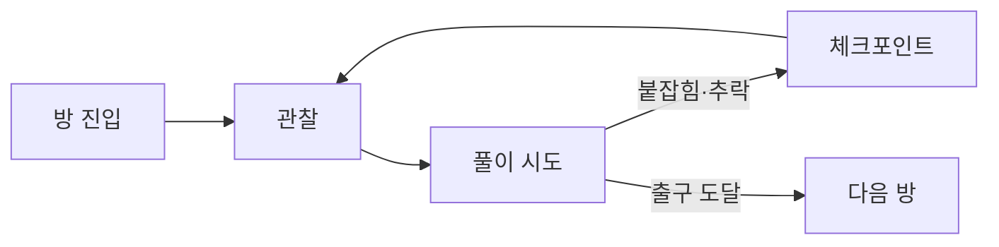

---

## 4. 시스템 규칙

### 4.1 예약 큐

지연된 모든 결과는 **예약(이벤트)** 으로 만들어져 하나의 큐에 들어가고, 시간순으로 처리됩니다.

| 예약 종류 | 언제 생기나 | 처리될 때 |
| --- | --- | --- |
| 교환 | 총알 명중, 던진 물체 명중 | 그 시각 나와 대상의 발 위치를 바꿈 |
| 출발 | 물체를 던짐 | 공중에 멈춰 있던 물체가 저장된 속도로 날아감 |
| 기절 | 뒤에서 제압 | 경비가 그 자리에서 쓰러짐 |

**처리 규칙**

1. 시각이 빠른 것부터 처리합니다. 같은 시각이면 먼저 예약한 것부터 처리합니다.
2. 교환은 예약한 순간이 아니라 **처리하는 순간의 위치**로 바꿉니다. 대상이 움직였으면 움직인 자리로 갑니다.
3. 연쇄 교환은 앞 교환으로 옮겨 간 자리를 기준으로 일어납니다.
4. **예외는 아무 일도 일어나지 않는 쪽으로 정합니다.** 대상이 사라졌거나(구덩이에 떨어짐) 내 손에 들려 있으면 그 교환은 조용히 취소됩니다.
5. 내가 붙잡히면 남은 교환 예약은 모두 취소됩니다. 이미 준 힘(출발·기절)은 취소되지 않습니다.

### 4.2 교환

- **교환을 일으키는 것:** 총알 명중(즉시 판정), 던진 물체가 날아가는 동안의 첫 충돌. 한 번 날아가는 동안 같은 대상은 한 번만 맞습니다.
- **교환 후 속도:** 💡 0으로 초기화. 실험 설정에서 "속도 유지"를 켜면 떨어지던 속도 그대로 옮겨 갑니다.
- **끼임 처리:** 교환 후 벽이나 철창에 겹치면 먼저 옆으로 밀어 내고, 그래도 겹치면 위로 올립니다. (경비가 나보다 몸이 넓기 때문)
- **경비와 교환하면:** 경비는 💡 1.2초 동안 멍해져서, 그동안 보지도 잡지도 못합니다.
- **공중에 멈춘 물체와 교환하면:** 나는 그 공중 자리로 가고, 물체는 내 자리로 와서 남은 대기 시간이 끝나면 그 자리에서 출발합니다. (힘은 물체를 따라감)

### 4.3 손의 힘

| 행동 | 규칙 | 지연 동안 |
| --- | --- | --- |
| 던지기 | 놓는 순간 그 자리에 3초 멈췄다가, 던진 속도로 날아감 | 공중에 떠 있고, 날아갈 궤적이 보임 |
| 뒤에서 제압 | 경비가 나를 보지 못할 때, 💡 1.8m 안에서 E. 3초 뒤 기절 | 경비는 아무것도 모른 채 하던 일을 계속함 |
| 정면 주먹 💡 | 경비가 나를 보고 있어도 💡 1.8m 안에서 E. 3초 뒤 경비가 내가 바라본 방향으로 💡 3m 밀려남. 쓰러지지 않고 멍함 | 경비는 이미 나를 보고 있으므로 그대로 붙잡으러 옴. 철창 너머처럼 손만 지나가는 곳에서만 안전 |

- 정면 주먹은 규칙 2(손의 힘은 3초 뒤)에 그대로 들어가므로 플레이어 규칙이 늘지 않습니다. 💡 본편 10개 방에는 넣지 않고 확장 요소로 둡니다. 예: 철창 너머 경비를 구덩이로 밀어 넣는 퍼즐.
- 제압한 경비가 다른 경비의 시야 안에서 쓰러지면, 본 경비가 그 자리로 달려옵니다.
- 쓰러진 경비는 움직이지 않는 대상이 됩니다. 쏘면 정확히 그 자리로 가는 **고정 발판**이 되고, 압력판 위라면 계속 누르는 무게가 됩니다.

### 4.4 총

- 처음에는 총이 없습니다. 철창 너머 잠든 경비에게서 **빼앗습니다.**
- 쏘면 바로 날아갑니다. 탄약은 💡 3발이며, 탄약이 곧 한 방에서 예약할 수 있는 횟수입니다.
- 💡 **탄약 보충:** 방 사이 통로(4.6)를 지날 때마다 3발로 채웁니다. 방마다 같은 조건에서 시작하므로 방을 따로 설계할 수 있고, 한 번 빗나가도 그 방 안에서 다시 쏠 수 있습니다.
- 탄약이 없으면 **총을 던질 수 있습니다**(Q). 던진 총도 손의 힘이므로 3초 멈췄다 날아가고, 맞은 것과 교환됩니다. 총은 대상 근처에 떨어지므로 교환 후 다시 줍습니다.
- 총이 구덩이에 떨어지면 다시 손에 돌아옵니다. (진행 불가 방지)
- 💡 총이 **손이 닿지 않는 곳**(높은 선반 위, 우리 안 등)에 멈춰도 구덩이와 똑같이 손에 돌아옵니다. 손이 닿지 않는 바닥은 레벨 데이터에 표시해 둡니다(`unreachable`).

### 4.5 경비

**상태**

| 상태 | 하는 일 | 보는가 | 잡는가 |
| --- | --- | --- | --- |
| 잠듦 | 그 자리에 있음 | ✕ | ✕ |
| 순찰 | 두 지점 사이를 왕복 | ○ | ○ |
| 경계 | 💡 0.35초 뒤, 범인 자리로 달려감 | ○ | ○ |
| 수색 | 💡 2.5초 동안 두리번거림 | ○ | ○ |
| 복귀 | 순찰 지점으로 걸어서 돌아감 | ○ | ○ |
| 추격 | 나를 향해 달려감. 💡 2초 놓치면 수색 | ○ | ○ |
| 멍함 | 교환 직후 💡 1.2초 | ✕ | ✕ |
| 기절 | 쓰러져 있음 | ✕ | ✕ |

**반응 규칙**

| 일어난 일 | 경비가 가는 곳 | 의미 |
| --- | --- | --- |
| 총에 맞음 | 쏜 곳 | 빠르지만 내 위치가 들킴 |
| 던진 것에 맞음 | 그 물체가 멈춰 있던 공중 지점 아래 | 느리지만 지연이 내 위치를 숨겨 줌 |
| 동료가 쓰러지는 걸 봄 | 쓰러진 자리 | 제압 위치를 골라야 함 |

**공통 규칙**

- 경비는 **스스로 낭떠러지에서 떨어지지 않습니다.** 땅이 없거나 높이 차가 큰 곳 앞에서 멈춥니다. 교환으로 허공에 놓였을 때만 떨어집니다.
- 붙잡기는 💡 0.9m 안에서, **손이 지나갈 틈**이 있을 때만 됩니다. 철창 너머로는 잡지 못합니다.
- 시야는 💡 5m · 좌우 40°이며, 벽과 단상에 가려지면 보지 못합니다.
- **경비 행동에는 무작위가 없습니다.** 같은 상황이면 항상 같은 곳으로 갑니다. 이것이 7장의 미리보기가 가능한 조건입니다.

### 4.6 발판과 문

웹 프로토타입(코덱스 버전)의 압력판·셔터·감금 구역 아이디어를 하나의 규칙으로 정리합니다.

> **발판은 무게가 올라가 있는 동안 켜진다.** 켜진 발판은 연결된 문(셔터)을 연다.

| 올라간 것 | 무게 | 비고 |
| --- | --- | --- |
| 나 | ○ | |
| 무거운 궤짝 | ○ | 들 수 없음. 교환으로만 옮길 수 있음 |
| 쓰러진 경비 | ○ | 계속 누름 |
| 서 있는 경비 | ○ | 멍함이 끝나면 걸어 나가므로 잠깐만 누름 |
| 상자 | ✕ | 가벼움. 들어서 옮길 수 있으므로 무게로 치지 않음 |

- 핵심 활용: **궤짝을 맞히고, 교환되는 순간 판 위에 서 있는다 → 궤짝은 판 위로, 나는 궤짝 자리로.** 교환의 반대쪽(상대를 어디로 보내나)이 목표가 됩니다.
- 💡 **우리:** 바닥이 💡 1.2m 낮은 좁은 칸입니다. 감금 구역을 따로 만들지 않고 기존 규칙으로 표현합니다.
  - 경비는 낭떠러지에서 스스로 내려가지 않고, 올라오지도 못합니다. 나도 기어오르기(1.1m)로는 못 나옵니다. **우리에서 나오는 길은 교환뿐**입니다.
  - 교환으로 경비를 우리에 넣으면 그 경비는 계속 거기 있습니다.
  - 우리 바닥 전체가 발판이면, 갇힌 경비가 계속 누르는 무게가 됩니다(6·10번 방). 우리가 발판보다 넓으면 경비가 걸어서 발판을 벗어나므로, 우리 바닥은 통째로 발판으로 만듭니다.
- 💡 발판 종류: 유지형(밟는 동안), 고정형(한 번 밟으면 계속), 시한형(밟고 N초 동안). 본편은 유지형만.
- 💡 **문이 닫힐 때 그 자리에 있던 것은 밀어 냅니다.** 몸의 중심이 있는 쪽으로 밀고, 정확히 가운데면 들어온 쪽으로 밉니다. "닫히지 않음"으로 하면 상자를 문 밑에 끼워 발판 없이 문을 열어 두는 지름길이 생기기 때문입니다.
- 💡 **방 사이 통로:** 방과 방은 짧은 통로로 잇고, 통로 양 끝에 문을 둡니다. 뒤 문이 닫힌 뒤에 앞 문이 열리므로 한 방에서 다음 방을 쏠 수 없습니다. 통로에서 탄약을 채우고(4.4) 체크포인트를 저장하며, 방송 연출(1.4)을 합니다. 방 출구는 발판으로 여는 문이 아니면 다가가면 열립니다. 층을 오르는 통로는 계단·엘리베이터·사다리입니다(9장 층 배치).

### 4.7 실패와 체크포인트

- **실패:** 경비에게 붙잡힘, 구덩이로 추락.
- **처리:** 마지막 체크포인트로 돌아갑니다. 총은 다시 손에 돌아오고, 탄약은 체크포인트 때 이상으로 맞춥니다. 추격·경계 중이던 경비는 복귀 상태로 돌아갑니다.
- **체크포인트:** 방 사이 통로, 그리고 방의 주요 목표를 달성한 순간(감방 탈출, 구덩이 건넘 등).

---

## 5. 대상과 적

### 5.1 대상 종류

| 대상 | 들기 | 교환 | 무게 | 쓰임 |
| --- | --- | --- | --- | --- |
| 상자 | ○ | ○ | ✕ | 던지기 탄, 공중 발판 (던져서 띄우고 쏘기) |
| 무거운 궤짝 | ✕ | ○ | ○ | 압력판 누르기 |
| 총 | ○ | ○ | ✕ | 탄약이 없을 때 던지는 탄 |
| 경비(깨어 있음) | ✕ | ○ | ○ | 이동 수단, 함정에 빠뜨리기 |
| 경비(쓰러짐) | ✕ | ○ | ○ | 고정 발판, 압력판 누르기 |
| 감시 카메라 💡 | ✕ | ○ | ✕ | 벽 높은 곳으로 가는 고정 발판. 나를 보면 경비를 부름. 💡 본편에는 넣지 않고 확장 요소로 둠 |
| 연구 책임자 💡 | ✕ | ○ | ○ | 10번 방 출구 너머. 움직이지 않고 반응하지 않음. 결말용 |

### 5.2 경비 종류

| 종류 | 처음 상태 | 특징 | 처음 나오는 방 |
| --- | --- | --- | --- |
| 잠든 경비 | 잠듦 | 총을 차고 있음. 튜토리얼 전용 | 1 |
| 순찰 경비 | 순찰 | 기본형 | 2 |
| 단상 경비 | 순찰 | 높은 곳에 있어 아래에서는 서로 보이지 않음 | 4 |
| 방탄 경비 💡 | 순찰 | 총알로는 교환 안 됨. 맞으면 쏜 곳으로 달려오는 반응은 그대로. 던진 것만 통함 | 💡 10 |

- 방탄 경비는 새 규칙이 아니라 경비 데이터 하나(`bulletproof`)입니다. 8번 방에서 배운 던지기를 10번 방에서 강제로 쓰게 합니다.

---

## 6. 데이터

형식: `기획 명칭 | 변수명 | 타입 | 초기값 | 비고`. 모든 초기값은 💡 가안입니다.

### 6.1 지연

| 기획 명칭 | 변수명 | 타입 | 초기값 | 비고 |
| --- | --- | --- | --- | --- |
| 교환 지연 | swapDelay | float | 3 | 초. 맞은 순간부터 |
| 손 힘 지연 | forceDelay | float | 3 | 초. 던지기 출발·제압 기절까지 |

### 6.2 플레이어

| 기획 명칭 | 변수명 | 타입 | 초기값 | 비고 |
| --- | --- | --- | --- | --- |
| 이동 속도 | moveSpeed | float | 4.6 | m/s. 던지기 충전 중 60% |
| 점프 속도 | jumpSpeed | float | 6.6 | m/s |
| 손 닿는 거리 | reach | float | 2.6 | m. 줍기·빼앗기 |
| 제압 거리 | takedownRange | float | 1.8 | m. 수평 거리 |
| 기어오르기 높이 | mantleHeight | float | 1.1 | m. 물체 위로 |
| 정면 주먹 거리 | punchRange | float | 1.8 | m. 확장 요소 |
| 정면 주먹 밀기 | punchPush | float | 3 | m. 3초 뒤 경비가 밀려나는 거리 |

### 6.3 총 · 던지기

| 기획 명칭 | 변수명 | 타입 | 초기값 | 비고 |
| --- | --- | --- | --- | --- |
| 탄약 | ammo | int | 3 | 빼앗을 때 받는 수 |
| 탄약 보충 | ammoRefill | int | 3 | 방 사이 통로에서 채우는 값 |
| 조준 보정 반경 | aimAssist | float | 0.2 | m. 교환할 수 있는 대상의 판정을 이만큼 넓힘 |
| 사거리 | gunRange | float | 30 | m. 즉시 판정 |
| 최소 던지기 속도 | throwMin | float | 4 | m/s |
| 최대 던지기 속도 | throwMax | float | 12 | m/s |
| 최대 충전 시간 | chargeTime | float | 0.9 | 초 |
| 던지기 보정 각 | throwLift | float | 10 | 도. 조준보다 위로 |
| 중력 | gravity | float | 20 | m/s² |

### 6.4 경비

| 기획 명칭 | 변수명 | 타입 | 초기값 | 비고 |
| --- | --- | --- | --- | --- |
| 걷는 속도 | walkSpeed | float | 1.0~1.5 | m/s. 경비마다 |
| 달리는 속도 | runSpeed | float | 3.0 | m/s. 경계·추격 |
| 반응 시간 | reactTime | float | 0.35 | 초. 맞고 달려가기까지 |
| 수색 시간 | searchTime | float | 2.5 | 초 |
| 멍함 시간 | confusedTime | float | 1.2 | 초. 교환 직후 |
| 시야 거리 | visionRange | float | 5 | m |
| 시야 각 | visionAngle | float | 40 | 도. 좌우 각각 |
| 놓침 시간 | loseTime | float | 2 | 초 |
| 붙잡기 거리 | catchRange | float | 0.9 | m |
| 방탄 | bulletproof | bool | false | 방탄 경비만 true. 총알에 맞아도 교환 없이 반응만 |

### 6.5 발판 · 문

프로토타입에 없던 값입니다. 5·6번 방(9.6·9.7)을 설계하며 정한 초안입니다.

| 기획 명칭 | 변수명 | 타입 | 초기값 | 비고 |
| --- | --- | --- | --- | --- |
| 발판 크기 | plateSize | float | 1.5 | m. 정사각형 |
| 문 열리는 시간 | doorOpenTime | float | 0.3 | 초 |
| 문 닫히는 시간 | doorCloseTime | float | 0.3 | 초. 무게가 빠진 뒤 다 닫히기까지 |
| 궤짝 크기 | crateSize | float | 1.0 | m. 정육면체 |
| 우리 깊이 | penDepth | float | 1.2 | m. 기어오르기 높이(1.1)보다 커야 함 |
| 우리 크기 | penSize | float | 2.4 | m. 정사각형. 바닥 전체가 발판. 가장자리에 멈춘 경비와 반대쪽 벽 사이가 붙잡기 거리(0.9)보다 멀어야 함 |

- **방 설계 규칙:** 발판에서 문까지 걷는 거리는 `moveSpeed × doorCloseTime`(4.6 × 0.3 ≈ 1.4m)보다 충분히 길어야 합니다. 이보다 가까우면 발판을 밟고 뛰어서 문을 지나가는 지름길이 생깁니다.

---

## 7. UI · 피드백

### 7.1 원칙

> **계산은 전부 미리 보여 주고, 확정한 뒤에는 보여 준 그대로 일어난다.**

공식은 숨기고 결과를 보여 줍니다. 플레이어는 "왜"를 몰라도 "무엇이 언제 일어날지"는 알 수 있어야 합니다.

### 7.2 요소

| 요소 | 보여 주는 것 | 언제 |
| --- | --- | --- |
| 예약 타임라인 | 앞으로 7초 안의 교환·출발·기절을 시간순으로 | 항상 (화면 아래) |
| 미래의 나 | 예약된 교환마다 그 시각 내가 설 자리. 발밑이 비면 빨간색 | 예약이 있을 때 |
| 쏘면 미리보기 | 지금 쏘면 3초 뒤 내가 설 자리 (경비가 달려오는 반응 포함) | 총으로 대상을 겨눌 때 |
| 던지기 명중 예측 | 3초 대기 + 비행 뒤 경비가 있을 자리. 맞으면 궤적이 보라색, 빗나가면 경비의 그때 위치 | 던지기 충전 중 |
| 공중 대기 표시 | 회전하는 링, 남은 초, 바닥까지 지지선, 날아갈 궤적 | 물체가 멈춰 있을 때 |
| 경비 상태 | Zz(잠듦) · !(경계) · !! 추격 · ?(수색) · ?!(멍함) · 기절 남은 초 | 항상 |
| 경비 시야·동선 | 바닥의 빨간 부채꼴, 순찰 경로 점선 | 깨어 있을 때 |
| 교환 예약 표시 | 대상 머리 위 보라색 링 | 예약이 있을 때 |
| 탄약 | 화면 오른쪽 위 ●●○ | 총을 가졌을 때 |
| 발판·문 연결 💡 | 발판에서 문까지 바닥에 이어진 선(꺼짐 회색 · 켜짐 노란색), 문 위 램프 | 항상 |
| 시야 창 💡 | 맞힌 대상의 시야를 화면 오른쪽 아래 작은 창으로. 다른 경비가 오는지 보며 다음 행동을 짬 | 맞힌 순간부터 교환까지 3초. B안 중심, A안에서도 실험 |

- 🟡 시야 창에서 정할 것: 예약이 여러 개일 때 어느 창을 보여 줄지(먼저 처리될 것 / 전환), 눈이 없는 물체(상자)는 무엇을 보여 줄지.

- 🟡 **미리보기를 어디까지 보여 줄지**가 핵심 밸런스입니다. 너무 친절하면 퍼즐이 "표시 맞추기"가 되고, 없으면 너무 어렵습니다.
- 💡 **초안:** 기본은 모든 방에서 전부 보여 줍니다(7.1 원칙). 설정에 「미리보기 줄이기」를 두어 쏘면 미리보기·던지기 명중 예측을 끌 수 있게 합니다. 미래의 나와 예약 타임라인은 이미 확정된 결과라 끄지 않습니다. 후반 방에서 자동으로 줄일지는 플레이 테스트(11장 3번)에서 켬/끔을 비교한 뒤 정합니다.

---

## 8. 조작

| 입력 | 동작 |
| --- | --- |
| 마우스 | 둘러보기 |
| W A S D · Space | 이동 · 점프 |
| 왼쪽 클릭 / F | 총 쏘기(즉시). 상자를 들고 있으면 누르고 있다 떼서 던지기 |
| E | 총 빼앗기 · 줍기 · 들키지 않은 경비 뒤에서 제압 · (💡 확장) 보고 있는 경비에게 정면 주먹 |
| Q | 누르고 있다 떼면 총 던지기 |
| R | 방 처음부터 |

- 🟡 1인칭 조준이 퍼즐을 방해하는지 테스트 후, 조준 보정 여부를 정합니다.
- 💡 **초안:** 교환할 수 있는 대상은 판정을 0.2m 넓힙니다(6.3 `aimAssist`). 조준점을 끌어당기는 보정은 하지 않습니다. 쏘면 미리보기가 떠 있으면 반드시 맞습니다(보이는 판정과 실제 판정이 같음). 효과는 플레이 테스트(11장 2번)에서 확인합니다.

---

## 9. 방 구성 💡

새 요소는 한 방에 하나씩 엽니다. 앞 방에서 배운 것을 다음 방에서 섞습니다.

| # | 방 | 시설 공간 💡 | 새로 배우는 것 | 풀이 핵심 |
| --- | --- | --- | --- | --- |
| 1 | 감방 | 피험체 격리실 | 총 빼앗기, 쏘기 → 3초 뒤 교환 | 쏜 경비가 철창으로 달려오고, 교환되면 경비가 감방 안에 갇힘 |
| 2 | 구덩이 | 냉각조 연결 통로 | 경비는 낭떠러지 앞에서 멈춤 | 건너편 경비를 쏴서 건넘. 보너스: 교환 직전 구덩이로 뛰어들면 경비가 대신 떨어짐 |
| 3 | 순찰 복도 | 관찰 복도 | 시야, 뒤에서 제압 | 시야 밖으로 다가가 제압. 3초 뒤 어디서 쓰러질지 계산 |
| 4 | 단상 | 관제 데크 | 높이와 시야 가림 | 단상 바로 밑에서는 서로 안 보임. 조금 물러나야 쏠 수 있음 |
| 5 | 압력판 | 시료 저장고 | 무거운 궤짝, 무게 | 궤짝을 쏘고 3초 안에 판 위에 서면 궤짝이 판 위로 |
| 6 | 셔터 | 오염 제거 에어록 | 우리, 서 있는 경비도 무게 | 우리 안 발판에 서야 셔터 너머가 보임. 쏘고 기다리면 경비는 우리로, 나는 밖으로 |
| 7 | 던진 상자 | 원심분리기 홀 | 교환은 처리하는 순간의 위치로 | 상자를 구덩이 너머로 던짐. 아직 떠 있을 때 쏴도 3초 뒤엔 건너편 착지점으로 |
| 8 | 소리 없는 손 | 중앙 관제실 | 던지기로 위치 숨기기 | 단상 뒤에서 던져 맞히면 경비는 뒤쪽 가장자리로 오고 나는 출구 옆에 내림. 앞에서 쏘면 다른 경비 시야에 내림 |
| 9 | 연쇄 | 피험 챔버 | 예약 2개 이상, 순서 | 상자 → 경비 순서로 미리 예약해야 경비가 발판 부스에 갇힘 |
| 10 | 탈출 | 출입 검문소 | 종합 (+ 방탄 경비) | 제압으로 다가가 우리에 뛰어들고, 방탄 경비를 던져 맞혀 가둠. 마지막 한 발로 연구 책임자와 바뀜 |

- 1, 2, 4번은 웹 프로토타입에서 이미 동작을 확인했습니다. 3번 제압도 스크립트로 확인했습니다.
- 5, 6번은 코덱스 프로토타입의 01·03 실험에서 출발해 무게·우리 규칙으로 다시 정리한 것입니다.
- 💡 6·7·8번의 처음 안을 바꿨습니다. 6번 "던진 것이 지나갈 땐 판 위에"는 총으로 쏘면 판 위에서 바로 풀려서, 7번 "상자를 높이 던져 두고 쏘기"는 공중에서 바뀌면 떨어지기만 해서, 8번 "탄약 0"은 총을 빼앗는 예외 규칙이 따로 필요해서입니다. 바꾼 이유는 각 방 점검표에 있습니다.
- 💡 시설 공간: 퍼즐 장치를 연구 시설 안에 있을 법한 공간으로 다시 해석한 이름입니다. 배치·수치는 바꾸지 않았습니다(구덩이 → 냉각조·수직갱·기계실, 단상 → 관측 데크·관제 데스크, 우리 → 세척·검색 피트 등).
- 평면도: `Docs/도면/`의 SVG(건축 평면도 양식). `make_plans.py`로 배치 표에서 다시 그립니다.
- 모든 방에 도면 초안이 있습니다(9.2~9.11). 3번과 6~10번은 새 설계라 전부 💡이고, 프로토타입으로 확인하지 않았습니다.

**층 배치 💡**

지하에서 지상으로 올라가며 탈출합니다. 떨어지는 것(구덩이)이 실패라서 "위로 = 목표, 아래로 = 위험"이 직관적으로 맞고, 위험한 피험체를 가장 깊은 곳에 격리한다는 시설 논리(1.4)와도 맞습니다.

| 층 | 이름 | 방 | 위층으로 가는 길 |
| --- | --- | --- | --- |
| B5 | 격리층 | 1 피험체 격리실 · 2 냉각조 연결 통로 | 2번 방 북쪽 계단 |
| B4 | 관찰층 | 3 관찰 복도 · 4 관제 데크 | 4번 방 관측 데크의 출구가 곧 위층 계단 |
| B3 | 시료층 | 5 시료 저장고 · 6 오염 제거 에어록 | 6번 방 북쪽 화물 엘리베이터 |
| B2 | 기계층 | 7 원심분리기 홀 · 8 중앙 관제실 | 8번 방 관제 데스크 섬의 천장 사다리 |
| B1 | 실험층 | 9 피험 챔버 | 9번 방 출구 문 너머 비상계단 |
| 1F | 지상 | 10 출입 검문소 | 외부 출구 |

- 층을 오르는 계단·엘리베이터·사다리도 방 사이 통로(4.6)와 같은 규칙입니다. 탄약을 채우고 체크포인트를 저장하며, 층 사이 연출(1.4)을 합니다.
- 같은 층의 두 방은 짧은 복도 통로로 잇습니다.

### 9.1 도면 양식

- 위에서 내려다본 평면도입니다. **위쪽이 출구 방향**입니다.
- 가로 한 칸은 0.5m입니다. 세로는 줄마다 왼쪽에 z값을 적습니다(간격이 고르지 않음). 도면은 개략이고, **정확한 값은 배치 표**가 기준입니다.
- 좌표: x는 오른쪽이 +, z는 **출구 쪽이 −** 입니다(웹 프로토타입 좌표 그대로). 높이 y는 바닥이 0이고 단위는 m입니다. Unity로 옮길 때 축 방향을 맞춥니다.
- 1·2번은 프로토타입 좌표, 3번부터는 방마다 가운데를 (0, 0)으로 둔 방 안 좌표입니다.
- 방마다 같은 순서로 적습니다: 목표 → 도면 → 배치 → 풀이 → 대비 시간에 할 일 → 다른 풀이·지름길 점검.

| 기호 | 뜻 |
| --- | --- |
| `+` `-` 세로 막대 | 벽 (높이 4m) |
| `:` | 철창. 틈으로 쏘거나 E로 손을 뻗을 수 있지만, 사람과 경비의 손은 못 지나감 |
| `~` | 구덩이 |
| `#` | 가림벽 (천장까지) |
| `%` | 높은 선반 (올라갈 수 없음) |
| `=` | 셔터 문 |
| `o` | 발판 |
| `^` | 단상 (높이 2.5m, 올라갈 수 없음) |
| `v` | 우리 (바닥이 1.2m 낮은 칸, 바닥 전체가 발판) |
| `*` | 출구 지점 |
| `.` | 순찰 경로 (세로) |
| `P` | 시작 위치 |
| `S` | 체크포인트 |
| 그 밖의 대문자 (`A` `B` `D` …) | 경비·인물. 화살표는 처음 순찰 방향 |
| `b` | 상자 |
| `X` | 무거운 궤짝 |
| `@` | 쏘는·던지는 자리 (예시) |

### 9.2 1번 감방

**목표:** 총을 빼앗고, 경비와 자리를 바꿔 감방을 나간다.
**배우는 것:** 빼앗기(E), 쏘기, 3초 뒤 교환, 총에 맞은 경비는 쏜 곳으로 달려온다.

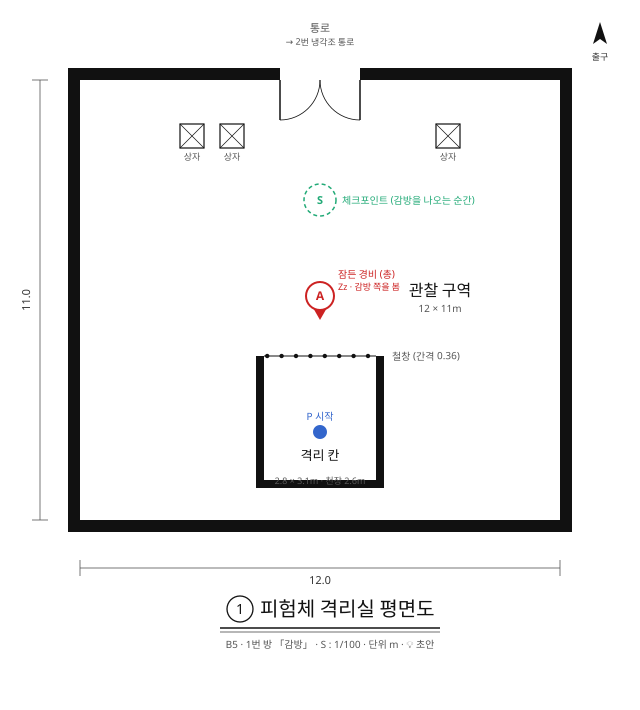

```
x:    -6            0          +6
z= 2   +------------------------+   북쪽: 구덩이 (2번 방)
z= 3.4 |     b b          b     |
       |                        |
z= 5   |            S           |
       |                        |
z= 7.4 |            A           |
z= 8.9 |         |:::::|        |
z=10.8 |         |  P  |        |
z=12   |         +-----+        |
z=13   +------------------------+
```

| 대상 | 위치 (x, z) | 메모 |
| --- | --- | --- |
| 방 | x −6~6, z 2~13 | 12 × 11m. 북쪽 끝이 구덩이 |
| 감방 | x −1.4~1.4, z 8.9~12 | 안쪽 2.8 × 3.1m, 천장 2.6m. 앞면만 철창 |
| 철창 | z 8.9 | 막대 간격 0.36m |
| 시작 위치 P | (0, 10.8) | |
| 잠든 경비 A | (0, 7.4) | 철창에서 1.5m. 총을 차고 있고, 감방 쪽을 봄 |
| 상자 b × 3 | (−3.2, 3.4) · (−2.2, 3.4) · (3.2, 3.4) | 다음 방에서 던질 것 |
| 체크포인트 S | (0, 5) | 감방을 나오는 순간 |

**풀이**

1. 철창 앞에서 A에게 E → 총을 얻습니다(탄약 💡 3발). 손 닿는 거리(2.6m)가 철창 너머 A까지 닿습니다.
2. A를 쏩니다. A는 깨어나 0.35초 뒤 쏜 곳(감방 안)으로 달려오다 철창에 막힙니다.
3. 3초 뒤 교환. 나는 A가 있던 철창 앞으로, A는 감방 안으로 갑니다. A는 철창 너머로 나를 붙잡지 못합니다.

**대비 시간에 할 일:** 🟡 거의 없습니다. A가 철창으로 달려오는 걸 보는 시간입니다. 첫 방이라 규칙을 보여 주는 시간으로 두고, 지루한지는 플레이 테스트(11장 1번)에서 봅니다.

**다른 풀이·지름길 점검**

| 경우 | 결과 | 판단 |
| --- | --- | --- |
| 총을 빼앗기 전 | 철창·벽·천장(2.6m) 때문에 나갈 길이 없음 | 의도대로 |
| 감방 안에서 상자를 쏨 | 상자와 바뀌어 나감. A는 계속 잠듦 | 💡 허용(다른 풀이). 다만 "경비는 쏜 곳으로 달려온다"를 못 배우므로, 상자를 감방에서 안 보이는 곳으로 옮길지 테스트 뒤 결정 |
| 감방 안에서 구덩이 건너편 경비 B를 쏨 | 프로토타입은 1·2·4번 방이 한 공간이라 B까지 약 15m로 사거리(30m) 안. 한 발로 1·2번 방을 건너뛸 수 있어 보임 | 💡 막음. 1번 방 북쪽 끝(z 2)에 벽과 방 사이 통로(4.6)를 둬서 감방에서 구덩이 쪽이 보이지 않게 함. 2번 방 남쪽 바닥은 통로 너머로 옮김 |

### 9.3 2번 구덩이

**목표:** 건너편 경비와 바꿔 구덩이를 건넌다.
**배우는 것:** 경비는 낭떠러지 앞에서 멈춘다. 쏘는 자리가 곧 내가 도착할 자리를 정한다.

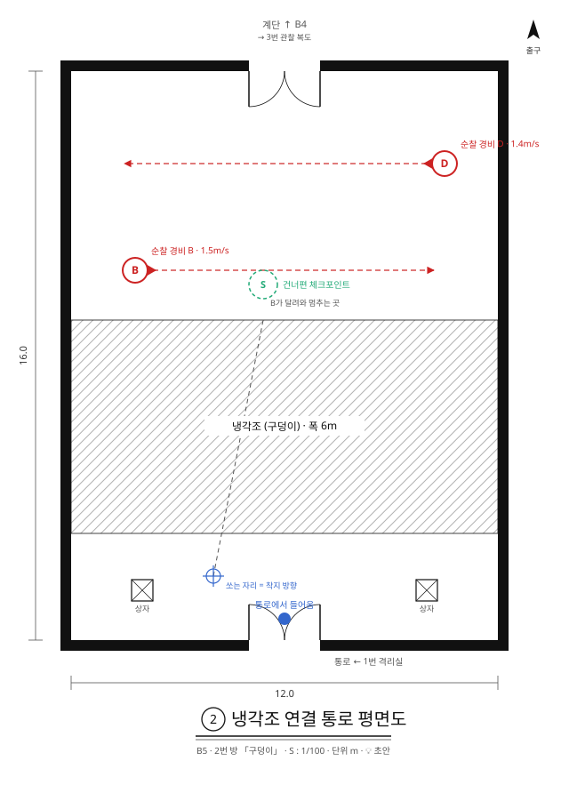

```
x:    -6            0          +6
z=-11  +----------    ----------+   북쪽: 통로 → 3번 순찰 복도
z=-8.4 |   <-----------------D  |
z=-5.4 |   B---------------->   |
z=-4   |~~~~~~~~~~~~~~~~~~~~~~~~|
       |~~~~~~~~~~~~~~~~~~~~~~~~|
z= 2   |~~~~~~~~~~~~~~~~~~~~~~~~|
z= 3.4 |     b b          b     |
z= 5   |            S           |   남쪽: 1번 방
```

| 대상 | 위치 (x, z) | 메모 |
| --- | --- | --- |
| 구덩이 | z −4~2, 방 너비 전체 | 폭 6m. 점프로는 약 3m밖에 못 감 |
| 순찰 경비 B | (−4.2, −5.4) ↔ (4.2, −5.4) | 걷는 속도 1.5m/s. 처음엔 오른쪽으로 감 |
| 순찰 경비 D | (4.5, −8.4) ↔ (−4.5, −8.4) | 1.4m/s. 건넌 뒤의 위험 |
| 상자 (건너편) | 💡 없음 | 프로토타입에는 (−4.6, −6.3) · (4.6, −6.3) · (−4.6, −10.2)에 3개 있었음. 조용히 건너는 풀이를 막으려고 치우고, 4번 방으로 옮김 |
| 체크포인트 | 건너편에 처음 선 자리 | |

- 💡 슬라이스에서는 1번 방과 사이에 통로를 두므로(9.2 점검표), 남쪽 바닥(z 2~5)은 통로 출구 앞 공간이 됩니다. 위 좌표는 프로토타입 기준입니다.

**풀이**

1. 남쪽에서 B를 쏩니다(약 7~10m). B는 쏜 곳을 향해 똑바로 달려오다 구덩이 앞에서 멈춥니다.
2. 3초 뒤 교환. 나는 B가 멈춘 북쪽 가장자리로, B는 내 자리(남쪽)로 갑니다. B는 다시 건너오지 못합니다.
3. 건너편에 서면 체크포인트. D의 시야(5m · 좌우 40°)를 피해 단상 쪽으로 갑니다.

**대비 시간에 할 일**

- **쏘는 자리를 고르는 것이 곧 착지할 자리를 고르는 것입니다.** B는 쏜 곳을 향해 똑바로 달려오므로, B의 위치와 쏜 자리를 잇는 선이 구덩이 가장자리와 만나는 곳에 내가 내립니다. D가 어느 쪽을 보고 있는지 보고 시야 밖에 내리도록 쏘는 자리를 고릅니다.
- 보너스: 교환 직전에 구덩이로 뛰어들면 B가 내 자리(구덩이 속)로 와서 떨어집니다. 뛰어든 뒤 실패 판정까지 💡 약 0.6~1초 안에 교환이 일어나야 합니다(중력 20 기준 계산).

**다른 풀이·지름길 점검**

| 경우 | 결과 | 판단 |
| --- | --- | --- |
| D를 쏨 | D도 구덩이 앞에서 멈춤. 같은 풀이 | 허용 |
| 건너편 상자를 쏨 | 💡 건너편 상자를 치워서 불가 | 막힘. 남겨 두면 이 방이 가르치는 "경비는 낭떠러지 앞에서 멈춘다"를 건너뛰게 됨 |
| 상자를 던져 B를 맞힘 | B는 상자가 멈춰 있던 곳 아래로 달려가다 구덩이 앞에서 멈춤 | 허용. 탄약이 없을 때의 풀이 |

### 9.4 3번 순찰 복도 💡

**목표:** 출구 앞을 지키는 경비를 자리에서 떼어 내고 지나간다.
**배우는 것:** 경비의 시야(5m · 좌우 40°, 벽에 가려짐). 뒤에서 제압하면 3초 동안 모른 채 걷다 쓰러진다. **동료가 쓰러지는 걸 본 경비는 그 자리로 간다** — 쓰러질 자리를 고르면 경비를 부를 자리를 고르는 것이다.

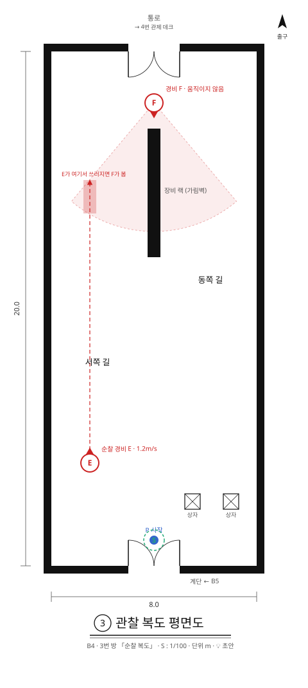

```
x:    -4       0       +4
z=-10  +------    ------+   북쪽: 통로 → 4번 단상
z=-8   |       F        |   F: 남쪽을 보고 서 있음
z=-7   |       #        |
z=-5   |   .   #        |   E 순찰 북쪽 끝
z=-2   |   .   #        |   가림벽 남쪽 끝
z= 0   |   .            |
z= 6   |   E            |   E 순찰 남쪽 끝. 처음엔 북쪽으로
z= 7.5 |          b  b  |
z= 9   |       S P      |
z=10   +------    ------+   남쪽: 통로 ← 2번 구덩이
```

| 대상 | 위치 (x, z) | 메모 |
| --- | --- | --- |
| 방 | x −4~4, z −10~10 | 8 × 20m 복도 |
| 입구 · 시작 P | 남쪽 벽 x −1~1 · (0, 9) | 체크포인트 S도 입구 |
| 출구 | 북쪽 벽 x −1~1 | 통로로 이어짐. 다가가면 열림 |
| 가림벽 # | x −0.25~0.25, z −7~−2, 천장까지 | 복도 북쪽 절반을 서쪽 길·동쪽 길로 나눔 |
| 순찰 경비 E | (−2.5, 6) ↔ (−2.5, −5) | 1.2m/s. 서쪽 길을 오감 |
| 경비 F | (0, −8) | 움직이지 않음. 남쪽을 봄. 등 뒤는 출구 벽이라 돌아 들어갈 수 없음 |
| 상자 b × 2 | (1.5, 7.5) · (3, 7.5) | 다른 풀이용 |
| 체크포인트 | 입구, 출구 | |

**계산**

- F의 시야로 서쪽 길(x −2.5)을 보면, 보이는 구간은 **z −5.0~−3.7** 입니다(5m 안이면서 40° 안).
- E는 1.2m/s로 걸으므로 3초면 3.6m를 갑니다. E가 북쪽으로 걸으며 **z 0~−1.4** 에 있을 때 제압하면 그 구간에서 쓰러집니다.
- F는 E가 쓰러진 자리까지 4.3m를 달려가(약 1.8초) 2.5초 수색하고, 걸어서 돌아옵니다(약 4.3초). **약 8.6초 동안 출구 앞이 빕니다.**
- F가 수색하는 자리에서 출구까지 5.8m라 시야 밖이고, 가림벽이 동쪽 길을 가립니다.

**풀이**

1. F가 출구 바로 앞에서 남쪽을 보고 있어 그대로는 지나갈 수 없습니다.
2. E가 북쪽으로 걸어갈 때(나에게 등을 보일 때) 서쪽 길로 따라붙어 뒤에서 제압합니다. 이때 나는 F에게서 8m 넘게 떨어져 있어 보이지 않습니다.
3. E는 3초 동안 계속 북쪽으로 걷다가 F의 시야 안에서 쓰러집니다.
4. F가 E에게 달려가면, 동쪽 길로 출구까지 갑니다.

**대비 시간에 할 일:** 제압한 뒤 3초 동안 E 머리 위 기절 남은 초를 보며 동쪽 길로 옮겨 가, F가 떠나기를 기다립니다. **제압하는 시점이 곧 F를 어디로 부를지 고르는 것**이라, 3초를 기다리는 게 아니라 계산하는 시간이 됩니다.

**다른 풀이·지름길 점검**

| 경우 | 결과 | 판단 |
| --- | --- | --- |
| E를 너무 일찍 제압 (z −3.7보다 남쪽에서 쓰러짐) | F가 못 봄. F는 자리를 지킴 | 실패 아님. 아래 총·상자 풀이로 넘어감 |
| F를 쏨 | F가 쏜 곳으로 달려오고, 3초 뒤 나는 달려오던 F 자리로, F는 내 자리로 감. 출구가 가까워짐 | 💡 허용(탄약 1발). 다만 F가 수색하는 동안 5m 안에 있으면 들킴 |
| F에게 상자를 던짐 | F는 상자가 멈춰 있던 곳으로 달려감 | 허용 |
| F 옆을 뛰어 지나감 | F는 출구에서 2m. 보는 순간 추격, 붙잡기 0.9m | 🟡 막힐 것으로 보지만, 내 속도(4.6m/s)가 경비 달리기(3.0m/s)보다 빨라 직접 확인 필요 |
| E가 남쪽으로 돌아올 때 정면에서 다가감 | E에게 보임 → 추격 | 막힘 (시야를 배우는 장면) |

### 9.5 4번 단상 💡

**목표:** 단상 위 경비와 바꿔 단상 위 출구에 선다.
**배우는 것:** 단상 바로 밑에서는 서로 안 보인다. 조금 물러나야 쏠 수 있다. 경비는 단상 가장자리에서도 멈춘다(2번 방 낭떠러지와 같은 규칙).

프로토타입 배치를 옮겼습니다. 프로토타입에서는 2번 방 건너편 북쪽 끝이고, 여기서는 방 안 좌표(프로토타입 z + 9)로 적습니다.

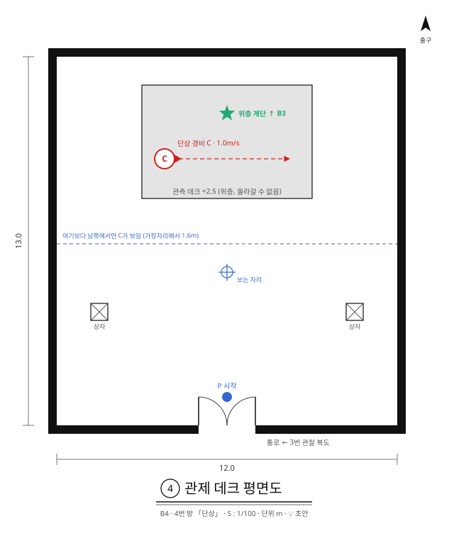

```
x:    -6            0          +6
z=-7   +------------------------+   북쪽 벽
z=-6   |      ^^^^^^^^^^^^      |   단상 북쪽 끝 (높이 2.5m)
z=-5   |      ^^^^^^*^^^^^      |   * 출구 (단상 위)
z=-3.4 |      ^C-------->^      |   C 순찰 (단상 위)
z=-2   |      ^^^^^^^^^^^^      |   단상 남쪽 가장자리
z=-0.4 |            @           |   여기보다 남쪽이어야 C가 보임
z= 2   |   b                 b  |
z= 5   |            P           |
z= 6   +----------    ----------+   남쪽: 통로 ← 3번 복도
```

| 대상 | 위치 (x, z) | 메모 |
| --- | --- | --- |
| 방 | x −6~6, z −7~6 | 12 × 13m |
| 단상 ^ | x −3~3, z −6~−2, 높이 2.5m | 올라갈 수 없음 (기어오르기 1.1m) |
| 단상 경비 C | (−2.2, −3.4) ↔ (2.2, −3.4), 단상 위 | 1.0m/s |
| 출구 * | (0, −5), 단상 위 | 프로토타입의 초록 원판 |
| 입구 · 시작 P | 남쪽 벽 x −1~1 · (0, 5) | |
| 상자 b × 2 | (−4.5, 2) · (4.5, 2) | 2번 방 건너편에서 옮겨 온 상자 |
| 쏘는 자리 @ | 예: (0, −0.4)보다 남쪽 | |
| 체크포인트 | 출구 * | |

**계산:** 눈높이 1.5m에서 C의 가슴(단상 2.5m + 0.9m = 3.4m)을 보려면, C가 가장자리에서 1.4m 안쪽에 있으므로 **가장자리에서 1.6m 이상** 물러나야 시선이 단상 모서리 위로 지나갑니다.

**풀이**

1. 단상 밑으로 바로 가면 C가 안 보여 쏠 수 없습니다. C도 나를 못 봅니다.
2. 1.6m 이상 물러나 C를 쏩니다. C는 쏜 곳으로 달려오다 단상 남쪽 가장자리에서 멈춥니다.
3. 3초 뒤 교환. 나는 단상 가장자리로, C는 내 자리(바닥)로 갑니다. C는 단상에 올라오지 못합니다.
4. 출구까지 약 3m 걸어갑니다.

**대비 시간에 할 일:** 🟡 적습니다. C가 달려와 가장자리에서 멈추는 걸 보며 "낭떠러지 규칙이 단상에도 통한다"를 확인하는 시간입니다. 쏜 자리에 그대로 있어도 C는 바닥에서 단상으로 못 올라오므로 위험은 없습니다.

**다른 풀이·지름길 점검**

| 경우 | 결과 | 판단 |
| --- | --- | --- |
| 단상 밑에서 C를 쏨 | 단상 모서리에 가려 안 보임 | 막힘 (의도한 학습) |
| 상자를 단상 위로 던지고 쏨 | 상자가 단상 위에 떨어진 뒤, 물러나서 보이면 쏠 수 있음. C를 깨우지 않고 올라감 | 💡 허용. 7번 방(던진 상자)의 예고 |
| C에게 상자를 던짐 | C는 상자가 멈춰 있던 곳 아래로 가다 가장자리에서 멈춤. 결과는 총과 같음 | 허용 |
| 상자를 딛고 기어오름 | 0.6 + 1.1 = 1.7m < 2.5m | 막힘 |
| 상자 두 개를 쌓고 오름 | 1.2 + 1.1 = 2.3m < 2.5m | 막힘 (쌓기가 되는지와 상관없이) |

### 9.6 5번 압력판 💡

**목표:** 무거운 궤짝을 발판 위로 보내 문을 연다.
**배우는 것:** 발판은 무게가 올라가 있는 동안 켜진다. 상자는 무게가 아니다. **교환의 반대쪽(상대를 어디로 보내나)이 목표**가 된다.

프로토타입이 없는 새 설계입니다. 아래는 전부 💡 초안이고, 좌표는 이 방 가운데를 (0, 0)으로 둡니다.

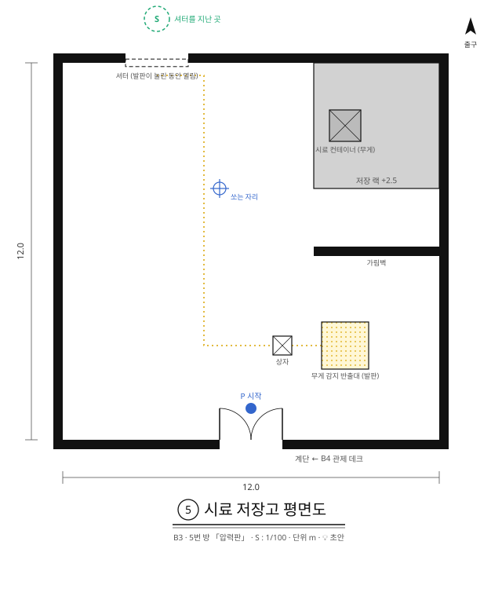

```
x:    -6            0          +6
z=-6   +----====----------------+   북쪽: 셔터 문 → 다음 방
z=-5   |                %%%%%%%%|
z=-4   |                %%X%%%%%|
z=-3   |                %%%%%%%%|
z=-2   |          @             |
z= 0   |                ########|
z= 3   |              b oooo    |
z= 5   |            P           |
z= 6   +----------    ----------+   남쪽: 입구
```

| 대상 | 위치 (x, z) | 메모 |
| --- | --- | --- |
| 방 | x −6~6, z −6~6 | 12 × 12m |
| 입구 · 시작 P | 남쪽 벽 x −1~1 · (0, 5) | |
| 셔터 문 | 북쪽 벽 x −4~−2 | 발판이 켜져 있는 동안 열림 |
| 발판 | (3, 3) | 유지형, 크기는 6.5 참고 |
| 상자 b | (1, 3) | 가벼움. 발판에 올려도 안 켜짐 |
| 가림벽 # | x 2~6, z 0, 천장까지 | 발판에서 궤짝이 안 보이게 가림 |
| 선반 % | x 2~6, z −6~−2, 높이 2.5m | 올라갈 수 없음 (기어오르기 1.1m) |
| 궤짝 X | (3, −4), 선반 위 | 들 수 없음. 교환으로만 옮김 |
| 쏘는 자리 @ | 예: (−1, −2) | 가림벽 북쪽이면 어디든. 선반에서 멀수록 궤짝이 잘 보임 |
| 체크포인트 | 문을 지난 곳 | |

**풀이**

1. (학습) 발판에 올라서면 북서쪽 문이 열리고, 내려오면 닫힙니다. 문까지 약 11m라 밟고 뛰어도 못 들어갑니다.
2. (학습) 상자를 발판에 올려도 켜지지 않습니다.
3. 가림벽 북쪽으로 가면 선반 위 궤짝이 보입니다. 발판에서는 가림벽 때문에 궤짝을 쏠 수 없습니다.
4. 궤짝을 쏘고, 3초 안에 가림벽을 돌아 발판 위에 섭니다(약 7m, 달려서 약 1.5초).
5. 교환: 궤짝은 발판 위로, 나는 선반 위로 갑니다. 이제 문은 계속 열려 있습니다.
6. 선반에서 뛰어내려 문으로 나갑니다.

**대비 시간에 할 일:** 쏜 뒤 발판까지 달려가는 것 자체입니다. 3초 기다림을 "3초 뒤에 어디 서 있을지"로 바꾸는 방이고, 6번 셔터 방("시간마다 다른 곳에 있기")의 예고입니다.

**다른 풀이·지름길 점검**

| 경우 | 결과 | 판단 |
| --- | --- | --- |
| 발판을 밟고 문까지 달림 | 문 닫히는 시간(💡 0.3초) 동안 1.4m밖에 못 감. 문까지 약 11m | 막힘 |
| 상자를 발판에 올림 | 무게가 아님 | 막힘 (의도한 학습) |
| 상자를 딛고 선반에 오름 | 상자 0.6m + 기어오르기 1.1m = 1.7m로 2.5m에 못 미침 | 막힘. 올라가도 궤짝은 못 듦 |
| 발판 위에서 궤짝을 바로 쏨 | 가림벽에 가려 안 보임 | 막힘 |
| 쏘고 그 자리에 가만히 있음 | 궤짝이 쏜 자리 바닥으로 오고, 나는 선반 위로 감 | 실패 아님. 내려와서 발판 위에서 바닥의 궤짝을 다시 쏘면 됨(가림벽 서쪽이라 보임). 탄약 1발을 더 씀 |
| 상자를 던져 궤짝을 맞힘 | 총과 같은 결과 | 허용 |

**이 방을 만들기 전에 정할 것 → 💡 초안**

- 발판·문 연결 표시: 바닥에 발판에서 문까지 이어진 선, 문 위 램프(7.2).
- 탄약 보충: 방 사이 통로에서 3발로 채움(4.4). 이 방에서 한 번 빗나가도 2발이 남습니다.
- 선반 위에 떨어진 총: 손이 닿지 않는 곳이라 손에 돌아옴(4.4).
- 문이 닫힐 때 끼인 것: 밀어 냄(4.6). 이 방에서는 궤짝이 올라간 뒤로 문이 닫히지 않아 생기지 않습니다.

### 9.7 6번 셔터 💡

**목표:** 셔터 너머 경비를 우리에 가둬 셔터를 계속 열어 둔다.
**배우는 것:** 우리(4.6). 우리에서 나오는 길은 교환뿐이다. 서 있는 경비도 무게라서, 우리에 가두면 계속 누른다. 셔터는 시선과 총알을 막는다.

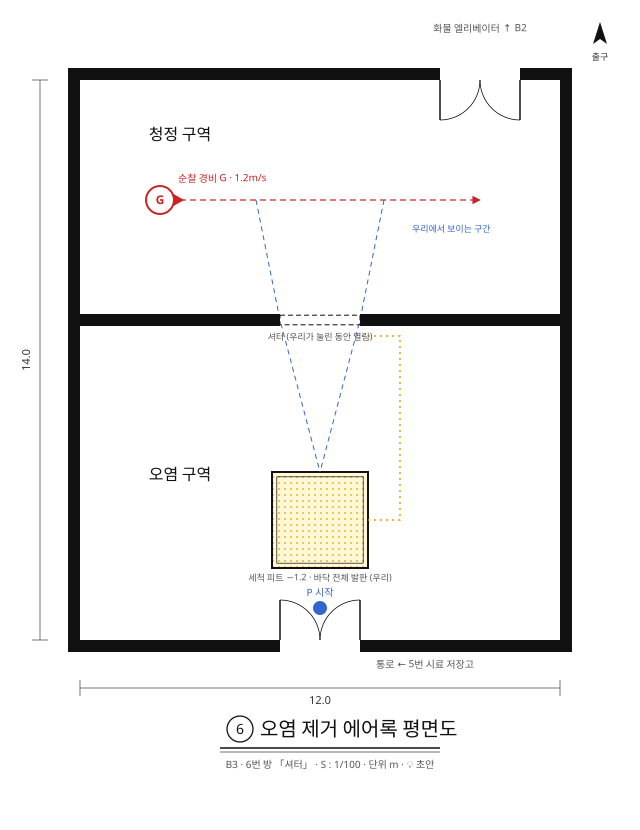

```
x:    -6            0          +6
z=-8   +------------------    --+   북쪽: 출구 (x 3~5) → 통로
z=-5   |    G-------------->    |   G 순찰
z=-2   +----------====----------+   셔터 (우리가 눌린 동안 열림)
z= 3   |          vvvv          |   우리 (가운데 (0, 3))
z= 5   |            P           |
z= 6   +----------    ----------+   남쪽: 통로 ← 5번 압력판
```

| 대상 | 위치 (x, z) | 메모 |
| --- | --- | --- |
| 방 | x −6~6, z −8~6 | 12 × 14m. z −2의 벽이 남쪽(입구 쪽)과 북쪽(출구 쪽)을 나눔 |
| 셔터 = | 가운데 벽 x −1~1 | 우리 바닥(발판)이 눌린 동안 열림. 닫혀 있으면 시선도 총알도 못 지나감 |
| 우리 v | 가운데 (0, 3), 2.4 × 2.4m, 깊이 1.2m | 바닥 전체가 발판. 들어가면 혼자 못 나옴 |
| 순찰 경비 G | (−4, −5) ↔ (4, −5) | 1.2m/s. 처음엔 동쪽으로. 동서로 걸으므로 남쪽(셔터)을 보지 않음 |
| 입구 · 시작 P | 남쪽 벽 x −1~1 · (0, 5) | |
| 출구 | 북쪽 벽 x 3~5 | 다가가면 열림 |
| 체크포인트 | 입구, 그리고 G가 우리에 갇힌 순간 | |

**풀이**

1. 우리에 뛰어듭니다. 발판이 눌려 셔터가 열리고, 셔터 너머 G가 보입니다. 이제 혼자서는 우리를 못 나옵니다.
2. G가 셔터 틈으로 보이는 구간(x 약 −1.6~1.6)을 지날 때 쏩니다.
3. G는 쏜 곳(우리)으로 곧장 달려오고, 셔터를 지나 우리 북쪽 가장자리에서 멈춥니다(낭떠러지 규칙). 약 6.8m, 2.6초.
4. 3초 뒤 교환. 나는 우리 밖 가장자리로, G는 우리 안으로 갑니다. G는 나오지 못하고, 서 있는 경비는 무게이므로 셔터가 계속 열려 있습니다.
5. G가 멍한 1.2초 안에 우리 가장자리에서 떨어진 뒤, 셔터를 지나 출구로 갑니다.

**보이면 달려올 수 있다:** G가 보였다는 건 G와 나를 잇는 직선이 셔터 틈을 지난다는 뜻입니다. G는 쏜 곳을 향해 똑바로 달려오므로 항상 셔터를 지나옵니다. 따로 경로를 계산하지 않아도 됩니다.

**대비 시간에 할 일:** G가 멈출 북쪽 가장자리에서 먼 **우리 남쪽 벽에 붙어 섭니다.** 가장자리에 멈춘 G와 붙잡기 거리(0.9m) 넘게 떨어져야 합니다. 우리 크기(2.4m)는 이 거리를 기준으로 정했습니다(6.5).

**다른 풀이·지름길 점검**

| 경우 | 결과 | 판단 |
| --- | --- | --- |
| 우리 밖에서 셔터 너머를 쏨 | 셔터가 닫혀 있어 안 보임 | 막힘 |
| 우리에 상자를 던져 넣음 | 상자는 무게가 아님 | 막힘 |
| 우리 안에서 기다리기만 함 | 아무 일도 없음 | R(방 처음부터) 또는 체크포인트. 💡 우리 벽에 "R: 다시 하기" 안내 |
| 탄약 없이 우리에 들어감 | 총을 던지면(Q) G는 총이 멈춰 있던 곳(우리)으로 와서 같은 결과 | 허용 |
| 우리 북쪽 가장자리에 그대로 서 있음 | 멈춘 G의 붙잡기 거리 안 | 붙잡힘 (대비 시간에 피해야 할 것) |

- 처음 안("던진 것이 지나갈 땐 판 위에, 교환될 땐 우리 안에")은 판 위에서 총으로 쏘면 바로 풀려서 바꿨습니다. 지금 안은 우리 안에서만 셔터 너머가 보이므로 총으로도 같은 순서를 밟아야 합니다.

### 9.8 7번 던진 상자 💡

**목표:** 교환할 대상이 없는 건너편으로, 상자를 던져 보내고 그 상자와 바꿔 건넌다.
**배우는 것:** 교환은 맞힌 순간이 아니라 **처리하는 순간의 위치**로 일어난다(4.1 처리 규칙 2).

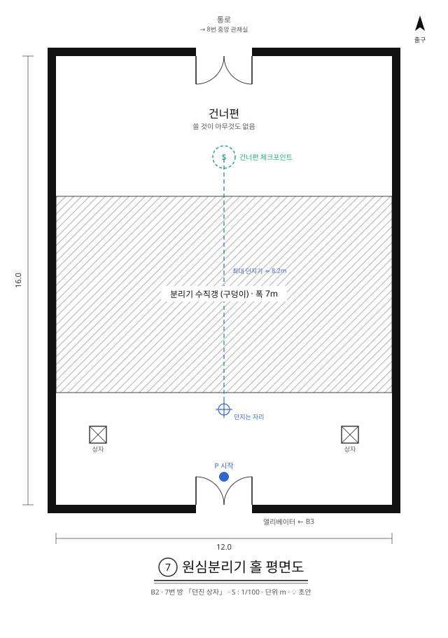

```
x:    -6            0          +6
z=-10  +----------    ----------+   북쪽: 출구 → 통로
z=-7   |                        |   건너편: 쏠 것이 아무것도 없음
z=-5   |~~~~~~~~~~~~~~~~~~~~~~~~|
z=-1.5 |~~~~~~~~~~~~~~~~~~~~~~~~|   구덩이 폭 7m
z= 2   |~~~~~~~~~~~~~~~~~~~~~~~~|
z= 3.5 |   b        @        b  |
z= 5   |            P           |
z= 6   +----------    ----------+   남쪽: 통로 ← 6번 셔터
```

| 대상 | 위치 (x, z) | 메모 |
| --- | --- | --- |
| 방 | x −6~6, z −10~6 | 12 × 16m |
| 구덩이 | z −5~2, 방 너비 전체 | 폭 7m. 점프로는 약 3m |
| 상자 b × 2 | (−4.5, 3.5) · (4.5, 3.5) | 하나를 빠뜨려도 하나 남게 |
| 건너편 | z −10~−5 | 경비·상자 없음 |
| 던지는 자리 @ | 구덩이 가장자리 근처, 예: (0, 2.5) | |
| 체크포인트 | 건너편에 처음 선 자리 | |

**계산:** 최대 던지기(12m/s, 보정 포함 약 45°)는 놓는 높이 1.3m 기준 약 8.2m를 갑니다(중력 20). 가장자리에서 던지면 건너편 가장자리를 1~2m 넘겨 떨어집니다. 상자는 손앞에 3초 떠 있다가 약 1.3초 날아갑니다.

**풀이**

1. 건너편에는 쏠 것이 없습니다. 상자를 들고 구덩이 가장자리로 갑니다.
2. 거의 끝까지 충전해 건너편으로 던집니다. 명중 예측 궤적이 건너편 바닥에 닿는지 확인합니다.
3. 상자를 쏩니다. **아직 눈앞에 떠 있는 상자를 쏴도 됩니다.**
4. 3초 뒤 나는 그때 상자가 있는 자리(건너편 바닥)로, 상자는 내 자리로 갑니다.

**언제 쏘나:** 교환 지연과 손 힘 지연이 같은 3초라서 생기는 규칙입니다.

- 던지고 **s초 뒤에 쏘면**, 교환 때 상자는 **날아간 지 s초 된 자리**에 있습니다.
- s가 비행 시간(약 1.3초)보다 크면 상자는 이미 건너편에 내려앉아 있습니다.
- s가 그보다 작으면 나는 구덩이 위 공중으로 가서 떨어집니다. 미래의 나가 빨간색(발밑이 빔)으로 미리 알려 줍니다.

**대비 시간에 할 일:** 🟡 적습니다. 미래의 나가 건너편에 서 있는지 확인하는 시간입니다. 방을 작게 만들어 시도 사이 시간을 줄입니다.

**다른 풀이·지름길 점검**

| 경우 | 결과 | 판단 |
| --- | --- | --- |
| 상자를 약하게 던져 구덩이에 빠뜨림 | 교환 예약이 있었다면 조용히 취소 | 실패 아님. 두 번째 상자로 다시 |
| 상자 두 개를 모두 빠뜨림 | 건널 방법 없음 | 💡 구덩이에 빠진 상자는 처음 자리에 다시 나타남(총과 같은 진행 불가 방지) |
| 너무 일찍 쏨 | 공중에서 바뀌어 추락 | 체크포인트. 미래의 나가 빨간색으로 경고함 |

- 처음 안("상자를 높이 던져 두고 쏘면 그 공중으로")은 공중에서 바뀌면 떨어지기만 하고 오를 곳이 없어서 바꿨습니다. "공중에서 바뀐다"는 이 방에서 실패 쪽으로 배우고, 9번 방에서 다시 씁니다.

### 9.9 8번 소리 없는 손 💡

**목표:** 단상 위 출구를 지키는 경비를, 다른 경비에게 들키지 않는 쪽 가장자리로 불러 바꾼다.
**배우는 것:** 던진 것에 맞은 경비는 **나에게가 아니라 물체가 멈춰 있던 곳으로** 간다. 그래서 내가 내릴 자리를 고를 수 있다. 총은 빠르지만 내 쪽으로 부른다.

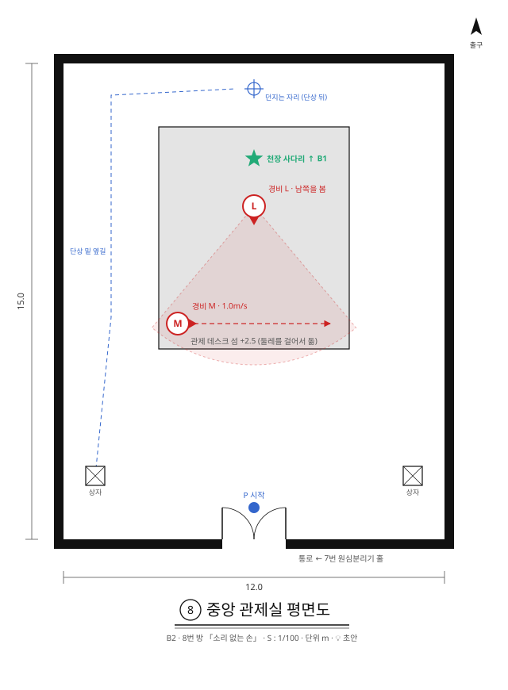

```
x:    -6            0          +6
z=-9   +------------------------+
z=-8   |            @           |   단상 뒤 틈 (폭 2m). 던지는 자리
z=-7   |      ^^^^^^^^^^^^      |
z=-6   |      ^^^^^^*^^^^^      |   * 출구 (단상 위, 천장 사다리)
z=-4.5 |      ^^^^^^L^^^^^      |   L: 남쪽을 보고 서 있음
z=-0.8 |      ^M-------->^      |   M 순찰 (단상 위)
z= 0   |      ^^^^^^^^^^^^      |   단상 남쪽 가장자리
z= 4   |  b                  b  |
z= 5   |            P           |
z= 6   +----------    ----------+   남쪽: 통로 ← 7번 던진 상자
```

| 대상 | 위치 (x, z) | 메모 |
| --- | --- | --- |
| 방 | x −6~6, z −9~6 | 12 × 15m |
| 단상 ^ | x −3~3, z −7~0, 높이 2.5m | 방 가운데 섬. 둘레를 걸어서 돌 수 있음 |
| 출구 * | (0, −6), 단상 위 | |
| 경비 L | (0, −4.5), 단상 위 | 움직이지 않음. 남쪽을 봄 |
| 경비 M | (−2.4, −0.8) ↔ (2.4, −0.8), 단상 위 | 1.0m/s. 단상 남쪽 가장자리를 순찰 |
| 상자 b × 2 | (−5, 4) · (5, 4) | |
| 입구 · 시작 P | 남쪽 벽 x −1~1 · (0, 5) | |
| 던지는 자리 @ | 단상 뒤 틈 (0, −8) | L도 M도 안 보이는 곳 |
| 체크포인트 | 출구 * | |

**풀이**

1. 상자를 들고 단상 옆길로 단상 뒤 틈까지 갑니다. 단상 위 경비는 단상 바로 밑을 보지 못합니다(4번 방).
2. 단상 뒤에서는 L이 보이지 않지만, **명중 예측 궤적이 보라색이면 맞습니다.** 단상 너머로 높이 던져 L의 등을 맞힙니다.
3. 상자는 손앞에 3초 떠 있다가 날아갑니다. 맞은 L은 상자가 멈춰 있던 곳(단상 뒤 틈)으로 달려가다 단상 북쪽 가장자리에서 멈춥니다.
4. 맞고 3초 뒤 교환. 나는 단상 북쪽 가장자리(출구에서 1m)로, L은 내 자리(단상 밑)로 갑니다. M은 6m 떨어져 있어 보지 못합니다.
5. 출구로.

**대비 시간에 할 일:** 상자가 떠 있는 3초와 날아가는 동안 단상 바로 밑으로 붙어 섭니다. L이 북쪽 가장자리에 와서 내려다봐도 단상 바로 밑은 보이지 않습니다. 들켜도 L은 내려오지 못합니다.

**다른 풀이·지름길 점검**

| 경우 | 결과 | 판단 |
| --- | --- | --- |
| 앞(남쪽)에서 L을 쏨 | L의 몸이 보이려면 단상에서 5m 넘게 물러나야 함. L은 남쪽 가장자리로 와서 멈추고, 교환되면 나는 M의 순찰로 바로 앞(0.8m)에 내림 | 대부분 붙잡힘. M이 등을 보인 순간을 맞추면 가능 → 💡 허용(어려운 풀이). "총은 빠르지만 위치가 들킨다" |
| M을 쏘거나 맞힘 | 나는 단상 남쪽에 내림. 남쪽을 보는 L의 시야(3.7m) 안 | 막힘 |
| 상자를 단상 위로 던지고 쏨 | 상자가 떨어진 자리로 감. 그 자리가 L·M 시야 밖이면 됨 | 💡 허용. 떨어진 자리에 따라 다름 |
| 단상 뒤에서 L에게 총을 던짐(Q) | 상자와 같은 결과 | 허용 (탄약 0일 때) |

- 처음 안의 "탄약 0"은 빼앗는 예외 규칙이 따로 필요해서 뺐습니다. 대신 총으로 풀면 M에게 들키도록 배치해, 탄약이 있어도 던지기를 고르게 합니다.

### 9.10 9번 연쇄 💡

**목표:** 구덩이 한가운데 발판 부스에 경비를 가둬 출구 문을 연다.
**배우는 것:** 예약을 두 개 이상 쌓는다. 두 번째 교환은 **첫 교환으로 옮겨 간 자리**를 기준으로 일어난다(4.1 처리 규칙 3). 순서가 결과를 바꾼다.

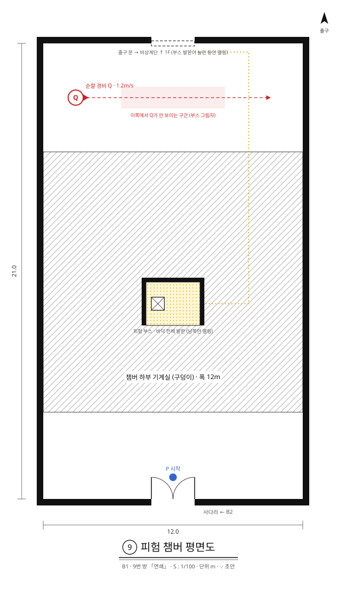

```
x:    -6            0          +6
z=-13  +----------====----------+   북쪽: 출구 문 (부스 발판이 눌린 동안 열림)
z=-10.5|   Q---------------->   |   Q 순찰
z=-8   |~~~~~~~~~~~~~~~~~~~~~~~~|
z=-5   |~~~~~~~~~~~~~~~~~~~~~~~~|
z=-2   |~~~~~~~~~+----+~~~~~~~~~|   부스 북·동·서 벽 (천장까지)
z=-1   |~~~~~~~~~|b o |~~~~~~~~~|   발판 부스. 남쪽만 열림
z= 0   |~~~~~~~~~      ~~~~~~~~~|
z= 2   |~~~~~~~~~~~~~~~~~~~~~~~~|
z= 4   |~~~~~~~~~~~~~~~~~~~~~~~~|
z= 7   |            P           |
z= 8   +----------    ----------+   남쪽: 통로 ← 8번 소리 없는 손
```

| 대상 | 위치 (x, z) | 메모 |
| --- | --- | --- |
| 방 | x −6~6, z −13~8 | 12 × 21m |
| 구덩이 | z −8~4, 방 너비 전체 (부스 자리 빼고) | |
| 발판 부스 | x −1.25~1.25, z −2~0 | 구덩이 한가운데 섬. 이쪽에서 4m, 건너편까지 6m(점프 불가). 북·동·서 벽은 천장까지, 남쪽만 열림. 바닥 전체가 발판 |
| 상자 b | 부스 안 (−0.8, −1) | 가벼움. 발판을 못 누름 |
| 출구 문 = | 북쪽 벽 x −1~1 | 부스 발판이 눌린 동안 열림 |
| 순찰 경비 Q | (−4.5, −10.5) ↔ (4.5, −10.5) | 1.2m/s. 처음엔 동쪽으로 |
| 입구 · 시작 P | 남쪽 벽 x −1~1 · (0, 7) | |
| 체크포인트 | 입구, 출구 | |

**보이는 것**

- 이쪽(z 4~8)에서는 부스 안 상자가 보입니다(남쪽이 열려 있음). Q는 부스 그림자 밖(|x| > 약 2.4)에 있을 때만 보입니다.
- 부스 안에서는 북·동·서 벽 때문에 Q가 보이지 않습니다. **부스에 들어간 뒤에는 Q를 쏠 수 없습니다.**

**풀이**

1. 상자를 쏩니다(0초). 3초 뒤 나는 부스 안으로 갑니다.
2. 3초가 지나기 전에, Q가 부스 그림자 밖에 있을 때 Q를 쏩니다(예: 1.5초). Q는 쏜 곳으로 달려오다 건너편 가장자리(z −8)에서 멈춥니다.
3. 3초: 첫 교환. 나는 부스 안 발판 위로, 상자는 이쪽으로. 내가 무게라 출구 문이 열립니다.
4. 4.5초: 두 번째 교환. 처리하는 순간의 내 자리(부스) 기준이므로, 나는 건너편 가장자리로, Q는 부스 안으로 갑니다. Q는 부스를 나오지 못하고, 서 있는 경비는 무게라 문이 계속 열려 있습니다.
5. 출구로.

**대비 시간에 할 일:** 이 방의 3초는 **두 번째 예약을 넣을 수 있는 시간**입니다. Q는 부스 그림자 안을 약 4초 동안 지나가므로, Q가 곧 그림자 밖으로 나올 때를 보고 상자를 쏘는 시점부터 고릅니다. 예약 타임라인에 두 교환이 순서대로 뜨고, 미래의 나가 둘 다 보입니다.

**다른 풀이·지름길 점검**

| 경우 | 결과 | 판단 |
| --- | --- | --- |
| 상자만 쏘고 부스에서 기다림 | Q가 안 보임. 내 무게로 문은 열리지만 못 건넘 | 막힘. 체크포인트 |
| Q만 쏨 | 나는 건너편, Q는 이쪽. 문은 닫혀 있음. 건너편에서 부스 안 상자는 북쪽 벽에 가려 안 보임 | 막힘. 이쪽의 Q를 다시 쏘면 되돌아올 뿐 |
| Q를 먼저, 상자를 나중에 예약 | 건너편으로 갔다가 다시 부스로 끌려와 갇힘 | 막힘. 탄약 3발로는 되돌릴 수 없어 체크포인트. 미래의 나 순서로 미리 보임 |
| 부스로 점프 | 4m. 점프는 약 3m | 막힘 |
| 상자를 건너편으로 던짐 | 이쪽 가장자리에서 건너편까지 약 12m, 던지기 최대 약 8.2m | 막힘 |
| 상자를 부스 안으로 던져 넣고 쏨 | 부스 안 상자와 같은 역할 | 허용 |

### 9.11 10번 탈출 💡

**목표:** 방탄 경비를 우리에 가둬 출구 셔터를 열고, 마지막 한 발로 시설을 나간다.
**배우는 것:** 새 규칙 없음. 방탄 경비(5.2)는 데이터 하나로, 8번 방의 던지기를 강제로 쓰게 합니다.
**쓰는 것:** 3번 제압 · 6번 우리 · 8번 던지기 · 2번 구덩이.

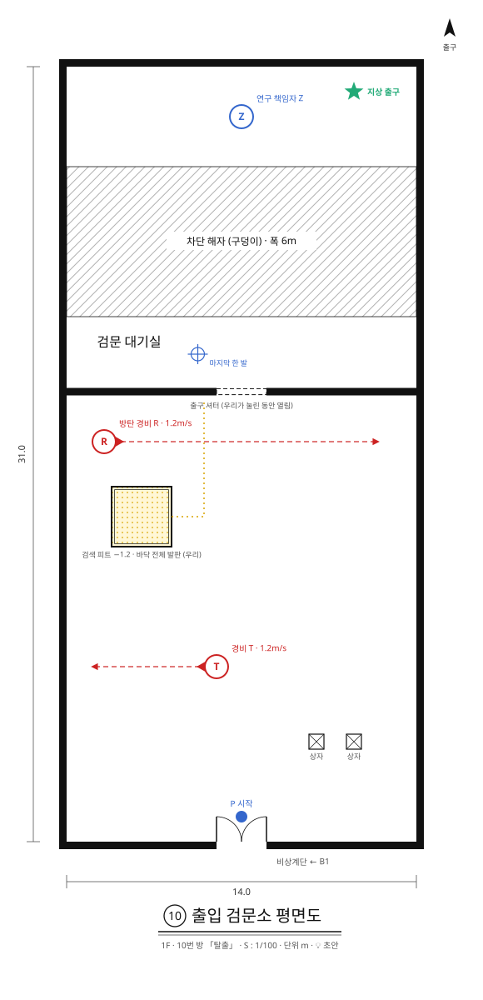

```
x:    -7              0              +7
z=-22  +----------------------------+
z=-20  |             Z              |   출구 플랫폼. 연구 책임자 Z
z=-18  |~~~~~~~~~~~~~~~~~~~~~~~~~~~~|
z=-15  |~~~~~~~~~~~~~~~~~~~~~~~~~~~~|   구덩이 6m
z=-12  |~~~~~~~~~~~~~~~~~~~~~~~~~~~~|
z=-10.5|          @                 |   착지대 (셔터 너머). 마지막 한 발
z=-9   +------------====------------+   출구 셔터 (우리가 눌린 동안 열림)
z=-7   |   R------------------->    |   방탄 경비 R
z=-4   |   vvvvv                    |   우리 (가운데 (−4, −4))
z= 2   | <---------T                |   경비 T 순찰
z= 5   |                   b  b     |
z= 8   |             P              |
z= 9   +------------    ------------+   남쪽: 통로 ← 9번 연쇄
```

| 대상 | 위치 (x, z) | 메모 |
| --- | --- | --- |
| 방 | x −7~7, z −22~9 | 셔터 남쪽(z −9~9)이 본 방, 북쪽이 착지대·구덩이·출구 플랫폼 |
| 출구 셔터 = | z −9 벽, x −1~1 | 우리 바닥(발판)이 눌린 동안 열림 |
| 우리 v | (−4, −4), 2.4 × 2.4m, 깊이 1.2m | 6번 방과 같은 규격 |
| 방탄 경비 R | (−5.5, −7) ↔ (5.5, −7) | 1.2m/s. 총알로는 교환 안 됨 |
| 경비 T | (−1, 2) ↔ (−6, 2) | 1.2m/s. 처음엔 서쪽으로. 우리로 가는 길을 지킴 |
| 상자 b × 2 | (3, 5) · (4.5, 5) | |
| 착지대 | z −12~−9 | 셔터 너머 |
| 구덩이 | z −18~−12 | 폭 6m |
| 연구 책임자 Z | (0, −20), 출구 플랫폼 | 움직이지 않음(5.1) |
| 입구 · 시작 P | 남쪽 벽 x −1~1 · (0, 8) | |
| 체크포인트 | 입구, R이 우리에 갇힌 순간 | |

**풀이**

1. T가 서쪽으로 걸어갈 때 뒤에서 제압합니다(3번 방). T가 쓰러지는 자리는 R에게서 9m 떨어져 있어 아무도 오지 않습니다.
2. 동쪽에서 상자를 들고 우리로 가 뛰어듭니다. 우리 바닥이 눌려 셔터가 열립니다. (E는 손이 비어야 하므로 제압이 먼저입니다.)
3. R에게 총을 쏘면 튕겨 나가고 교환되지 않습니다. R이 가까이 올 때 상자를 던져 맞힙니다(8번 방).
4. R은 상자가 멈춰 있던 곳(우리)으로 달려와 우리 가장자리에서 멈춥니다. 그동안 우리 반대쪽 벽에 붙어 섭니다(6번 방).
5. 교환. 나는 우리 밖, R은 우리 안으로. 셔터가 계속 열립니다. 체크포인트.
6. 셔터를 지나 착지대에 서면, 구덩이 건너 연구 책임자 Z가 보입니다. Z를 쏩니다.
7. 3초 뒤 나는 출구 플랫폼에, Z는 착지대에. 결말(1.4).

- 우리에서는 셔터 틈으로 Z가 보이지 않습니다(각도). R을 가두기 전에는 Z를 쏠 수 없습니다.

**대비 시간에 할 일:** 4번은 R이 달려오는 동안 자리 잡기. 7번 마지막 3초는 연출입니다. 💡 교환 전까지 화면이 천천히 어두워지고, Z가 나를 알아봅니다.

**다른 풀이·지름길 점검**

| 경우 | 결과 | 판단 |
| --- | --- | --- |
| 우리에서 R을 총으로 쏨 | 방탄. 교환 없이 R이 우리 가장자리로 달려옴 | 막힘. 탄약 1발 낭비. 상자로 다시 |
| 상자 없이 우리에 들어감 | 총알은 R에게 안 통함 | 탄약을 다 쓰고 총을 던지면(Q) 풀림. 총은 R 근처에 떨어지므로 교환 뒤 주워서 Z에게 다시 던짐 |
| T를 제압하지 않고 지나감 | T가 동서로 걸으므로 등을 보일 때 지나갈 수 있음 | 허용. 다만 상자를 든 채로는 제압을 못 하므로 순서에 주의 |
| R을 우리 밖에서 맞힘 | R이 내 쪽으로 옴. 우리에 아무도 없음 | 막힘. 다시 |
| 착지대에서 Z 대신 아무것도 안 쏨 | 구덩이 6m, 건널 길 없음 | 막힘 (결말은 Z와 바뀌는 것) |

---

## 10. 개발 계획

| 단계 | 내용 | 끝나는 기준 |
| --- | --- | --- |
| 0. 프로토타입 | 웹 3D 탈출 방 (감방·구덩이·제압·단상) | ✅ 완료 |
| 1. 플레이 테스트 | 직접 + 2~3명에게 설명 없이. 💡 프로토타입에 A안·B안 전환을 넣어 같은 방을 두 안으로 플레이 | 11장 질문 1~3, 6에 답이 나옴 |
| 2. 기획서 개정 | 테스트 결과 반영, 방 도면 | 13장의 🟡 항목이 플레이 테스트 결과로 정해짐 |
| 3. 버티컬 슬라이스 | Unity로 방 3개 (감방·구덩이·압력판) | 방 하나 만드는 데 드는 시간을 잼 |
| 4. 본 개발 | 나머지 방, 연출, 사운드 | 💡 처음 해 보는 사람 3명이 설명 없이 1~10번 방을 끝까지 깸 |

### 10.1 Unity 구조 💡

프로토타입에서 얻은 가장 중요한 기술 결정입니다.

- **예약 큐는 순수 C# 클래스**로 만듭니다. MonoBehaviour가 아니라서 시간을 직접 넣어 테스트할 수 있습니다.
- **경비 상태는 순수 데이터 + 한 걸음 함수**로 만듭니다. 실제 게임과 모든 미리보기(미래의 나, 명중 예측)가 **같은 함수**를 돌립니다. 그래서 "보여 준 대로 일어난다"가 코드로 보장됩니다.
- 6장의 수치는 ScriptableObject로 둡니다. 코드에 숫자를 쓰지 않습니다.
- 교환 판정, 무게, 문은 Unity 물리와 별개로 규칙 코드에서 판정합니다. 물리 엔진의 미세한 차이가 미리보기와 결과를 어긋나게 하지 않도록 합니다. 🟡 캐릭터 이동까지 직접 구현할지는 슬라이스에서 결정. 💡 초안: 미리보기는 경비만 계산하고 플레이어 이동은 계산하지 않으므로, 이동은 Unity CharacterController로 시작하고 교환·끼임 처리만 규칙 코드로 합니다.

---

## 11. 위험과 확인할 것

| # | 위험 | 확인 방법 |
| --- | --- | --- |
| 1 | 3초 기다림이 지루한가 | 대비 시간에 플레이어가 무엇을 하는지 관찰 |
| 2 | 1인칭 조준이 퍼즐을 방해하는가 | 풀이를 알고도 조준 때문에 실패하는 횟수 |
| 3 | 미리보기가 너무 친절한가, 부족한가 | 미리보기 켬/끔으로 같은 방을 풀게 함 |
| 4 | 방 하나 만드는 비용이 큰가 | 버티컬 슬라이스에서 방 1개 제작 시간 측정 |
| 5 | 경비·시야·발판이 얽혀 의도하지 않은 지름길이 생기는가 | 방마다 풀이 경로 목록을 만들고 테스트 |
| 6 | A안(손의 힘 3초 뒤)과 B안(손의 힘 즉시) 중 어느 쪽이 더 납득되고 재미있는가 | 1·3·8번 방을 두 안으로 플레이. 경비와 마주쳤을 때 억울함을 느끼는지, 3초 동안 무엇을 하는지 관찰 |

---

## 12. 참고 자료

| 자료 | 위치 | 비고 |
| --- | --- | --- |
| 출발 인사이트 | 노션 인사이트 2026-10-22 "총을쏘면 3초뒤에 나가는 게임?" | |
| 탈출 프로토타입 (총·경비·제압·명중 예측) | https://claude.ai/artifact/9yk2t6TGWsFJLXtRt3HRCR | 비공개. 공유하려면 페이지의 공유 메뉴에서 열어야 함 |
| 던지기 샌드박스 (1인칭, 3초 멈춤) | https://claude.ai/artifact/Y82bcBZsSGuMfKCMD6QeQv | 비공개 |
| 도화선 퍼즐 2D / 3D | https://claude.ai/artifact/99dz98oTHXcNfSBLWiyVN8 · https://claude.ai/artifact/MTY2KaR4rwdjd1f31fdmLc | 초기 컨셉 실험, 비공개 |
| 코덱스 프로토타입 (압력판·셔터·감금) | `Desktop/MCP_Test/after-seconds-web` | 아이디어만 가져옴. 코드는 레벨별 하드코딩이라 재사용하지 않음 |
| Swap Lab | https://after-seconds-swap-lab.peppy-fawn-2065.chatgpt.site/ | 손댄 대상과 3초 뒤 교환 실험 |

---

## 13. 결정 필요 목록

2026-10-25에 빈칸을 모두 💡 초안으로 채웠습니다. 검토 후 확정하면 표시를 지웁니다.

| 항목 | 초안 | 상태 |
| --- | --- | --- |
| 엔진·플랫폼 확정 (Unity / PC) | Unity / PC | 💡 |
| 교환 지연·손 힘 지연을 같은 3초로 둘지 | 같은 3초. 7번 방 "s초 뒤에 쏘면 날아간 지 s초 된 자리"가 이 조건에서 나옴 | 💡 |
| 탄약 수 | 3발 | 💡 |
| 미리보기 수준 (후반 방에서 줄일지) | 기본 전부 표시 + 설정에서 「미리보기 줄이기」(7.2). 자동으로 줄일지는 테스트 후 | 💡 🟡 |
| 1인칭 조준 보정 | 교환 대상 판정 0.2m 확대, 끌어당기기 없음(8장) | 💡 🟡 |
| 정면 주먹 (반격·넉백) | 3초 뒤 3m 밀기, 그동안 붙잡힐 수 있음. 본편 제외, 확장 요소(4.3) | 💡 |
| 발판 종류 (유지형 외) | 본편은 유지형만 | 💡 |
| 문이 닫힐 때 끼인 것 처리 | 밀어 냄(4.6) | 💡 |
| 방탄 경비·감시 카메라 | 방탄 경비는 10번 방에 데이터로. 감시 카메라는 확장 | 💡 |
| 세계관·결말 | 제7 반응연구소, 피험체 S-03, 지하 B5에서 지상 1F로 올라가는 탈출, 책임자의 현장 관찰 실험과 책임자와 바뀌는 결말(1.4, 9장 층 배치) | 💡 |
| 방별 도면 | 1~10번 모두 초안(9.2~9.11) | 💡 |
| 탄약 보충 (방마다 채울지) | 방 사이 통로에서 3발로 채움(4.4) | 💡 |
| 손이 닿지 않는 곳에 떨어진 총 처리 | 구덩이처럼 손에 돌아옴(4.4) | 💡 |
| 방을 건너뛰는 사격 (방 사이를 문으로 나눌지) | 방 사이 통로 + 양쪽 문(4.6) | 💡 |
| 2번 방 건너편 상자 (조용히 건너는 풀이를 허용할지) | 치움. 4번 방으로 옮김 | 💡 |
| 경비 옆을 뛰어 지나가기 (내가 경비보다 빠름) | A안에서 도망은 들킨 뒤 빠져나가는 정식 대응(2.1 보충책 2). 다만 3번 방처럼 경비 옆을 지나가는 길이 막혀야 하는 방에서 지름길이 되지 않는지 3번 방에서 직접 확인 | 🟡 |
| 손의 힘 타이밍 (A안 지연형 / B안 예지형) | 두 안 모두 프로토타입으로 실험 후 결정(2.1, 11장 6번) | 🟡 |
| 시야 창 (맞힌 대상의 시야를 3초 동안) | 7.2에 초안. 여러 예약·물체일 때 규칙 미정 | 🟡 |

---

## 변경 기록

| 버전 | 날짜 | 작성자 | 변경 내용 |
| --- | --- | --- | --- |
| V0.01 | 2026-10-23 | 송예찬 | 초안 작성. 웹 프로토타입(탈출 방)과 코덱스 프로토타입(발판)의 규칙을 정리 |
| V0.02 | 2026-10-23 | 송예찬 | 9장에 방 도면 추가: 1 감방·2 구덩이는 프로토타입 배치를 옮김, 5 압력판은 새로 설계(💡). 5번 방 풀이 핵심을 "궤짝을 쏘고 3초 안에 판 위에 서기"로 수정. 6.5 발판·문 데이터 추가. 13장에 탄약 보충·손 닿지 않는 총·방 건너뛰기·2번 방 상자 추가 |
| V0.03 | 2026-10-25 | 송예찬 | 🔴·🟡 빈칸을 모두 💡 초안으로 채움(검토 전). 9장에 3·4·6~10번 방 도면 추가(9.4~9.11, 5번은 9.6으로 옮김). 6·7·8번 방의 풀이 핵심을 바꿈(6 셔터: 우리에 경비 가두기, 7 던진 상자: 처리 순간의 위치, 8: 탄약 0 대신 단상 뒤에서 던지기). 4.6에 우리·문 끼임(밀어 냄)·방 사이 통로 추가. 4.4 탄약 보충(통로에서 3발)·손 닿지 않는 총. 4.3 정면 주먹 초안(확장). 1.4 세계관·결말 초안. 5장 연구 책임자·방탄 경비(10번 방). 6장 데이터 추가(ammoRefill, aimAssist, bulletproof, penDepth, penSize, punchRange, punchPush). 7.2 발판·문 연결 표시·미리보기 수준, 8장 조준 보정. 2번 방 건너편 상자 치움. 13장에 초안 칸 추가 |
| V0.04 | 2026-10-25 | 송예찬 | 2.1 추가: 손의 힘 타이밍을 A안(지연형)·B안(예지형) 두 안으로 들고 가고 프로토타입으로 비교해 결정. A안 약점 보충책(공간에 남는 주먹·도망·붙잡힘 유예·발견 여유) 기록. 1.4 실험의 정체를 두 안으로 나눔. 7.2 시야 창 추가. 10장 1단계·11장 6번·13장에 반영 |
| V0.05 | 2026-10-25 | 송예찬 | 구글 문서 검토 댓글 반영. 1.1 기획 의도를 "3초 뒤 상호작용을 재미로 만드는 과정"으로 다시 씀, 설계 원칙은 1.5로 분리. 1.4 세계관 보강(제7 반응연구소, 피험체 S-03, 실패작 판정과 폐기 대기, 책임자의 현장 관찰 실험, 층 사이 연출, 지상 출구 결말). 9장에 층 배치(B5 → 1F, 지하에서 올라가며 탈출)와 시설 공간 열 추가. 방 평면도 SVG(`Docs/도면/`)와 생성 스크립트 추가 |
| V0.06 | 2026-10-25 | 송예찬 | 버전 표기 도입: 제목 뒤에 V0.01부터 붙이고 고칠 때마다 0.01씩 올림, 완성되면 1.0. 지금까지의 변경 기록에 V0.01~V0.05를 소급해 붙임. 10장 2단계 이름을 「기획서 V0.2」에서 「기획서 개정」으로 바꿈 |
| V0.07 | 2026-10-26 | 송예찬 | 문서 안에서 서로 안 맞던 4곳 수정. 1.2 「시간마다 다른 곳에」 예시를 바뀌기 전 6번 방 안(공)에서 5번 방으로 바꿈. 4.6 핵심 활용을 9.6에 맞춰 "교환되는 순간 판 위에 서 있는다"로 바꿈. 10장 2단계 끝나는 기준을 "13장 🟡 항목이 플레이 테스트로 정해짐"으로 바꿈(빈칸은 V0.03에 이미 다 채워짐). 2.1 보충책 2(도망)가 3번 방 지름길이 될 수 있음을 적고 13장 해당 행을 맞춤. 구글 문서는 아직 V0.06 |
