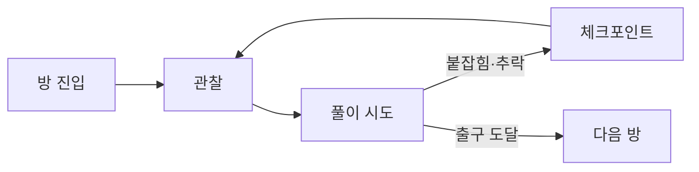

# After Seconds (애프터 세컨즈) — 메인 기획서

> 모든 행동이 3초 늦게 세상에 닿는 실험체가 되어, 총에 맞힌 것과 3초 뒤 자리를 바꾸며 시설을 탈출하는 1인칭 퍼즐 액션 게임.

| 항목 | 내용 |
| --- | --- |
| 가제 | After Seconds (애프터 세컨즈) |
| 장르 | 1인칭 지연 퍼즐 액션 · 탈출 |
| 형태 | 개인 프로젝트 |
| 엔진 | 💡 Unity / URP, C# |
| 플랫폼 | 💡 PC Windows |
| 문서 버전 | V0.1 초안 (2026-10-23) |
| 작성자 | 송예찬 |
| 프로토타입 | 웹 3D 탈출 방 (claude.ai 아티팩트, 비공개) — 12장 참고 |

### 표시 규칙

- 🔴 **작성 필요**: 아직 비어 있음
- 🟡 **보완 필요**: 있지만 모호하거나, 플레이 테스트로 확인해야 함
- 💡 **제안**: 초안 값. 테스트 후 확정 (확정되면 표시를 지움)

수치는 모두 웹 프로토타입에서 쓴 값이며, 플레이 테스트 전이므로 💡 가안입니다.

---

## 목차

1. 게임 개요
2. 플레이어 규칙
3. 핵심 루프
4. 시스템 규칙
5. 대상과 적
6. 데이터
7. UI · 피드백
8. 조작
9. 방 구성
10. 개발 계획
11. 위험과 확인할 것
12. 참고 자료
13. 결정 필요 목록

---

## 1. 게임 개요

### 1.1 기획 의도

출발점은 2026-10-22 노션 인사이트 메모 **"총을 쏘면 3초 뒤에 나가는 게임?"** 입니다. 여기서 총이라는 키워드를 떼어 내고 질문을 넓혔습니다.

> **모든 상호작용이 몇 초 뒤에 일어난다면, 그걸로 어떤 재미를 줄 수 있을까?**

- 지연 자체에는 세계관 속 이유가 필요 없습니다. 지연이 곧 게임의 기믹입니다.
- **플레이어가 느끼는 규칙은 단순하게, 우리가 만드는 데이터는 복잡하게.** 플레이어는 두 줄의 규칙만 알면 되고, 경비 반응·무게·문 같은 복잡함은 데이터와 연출이 맡습니다.

### 1.2 핵심 재미

| 재미 | 설명 |
| --- | --- |
| 3초 뒤의 나를 설계한다 | 맞힌 순간 교환이 예약되고, 3초 뒤 내가 설 자리가 정해집니다. 그 3초 동안 무엇을 할지가 플레이입니다. |
| 시간마다 다른 곳에 있어야 한다 | 공이 지나가는 순간엔 발판 위에, 교환되는 순간엔 감금실 안에 있어야 하는 식으로, 한 몸으로 여러 시각을 맞춥니다. |
| 지연이 무기가 된다 | 던진 물체는 3초 멈춰 있다 날아가므로 경비는 그 공중 지점을 범인 자리로 압니다. 제압한 경비는 3초 동안 아무것도 모른 채 걷다 쓰러집니다. |

### 1.3 비슷한 게임과 차이

| 게임 | 공통점 | 차이 |
| --- | --- | --- |
| Unreal Tournament 트랜스로케이터, Dota 2 Nether Swap, Warframe 로키 | 쏘거나 던져서 위치 이동·교환 | 모두 즉시 일어남 |
| Bullet Swap · Switcheroo 류 인디 게임 | 총알 명중 시 위치 교환 | 즉시 교환, 예약·연쇄 없음 |
| The Swapper | 교환으로 푸는 퍼즐 | 복제체와의 교환, 지연 없음 |
| Coyote Time Lord 등 | 행동이 늦게 반영됨 | 위치 교환 없음 |

**After Seconds의 조합:** 지연된 교환 + 지연된 힘 + 시간순으로 처리되는 예약 큐입니다. 조합으로서는 새롭지만, 마케팅에서 "최초"라고 주장하지는 않습니다.

### 1.4 세계관 💡

- 시설에 갇힌 실험체. 실험의 부작용으로 **이 사람의 행동은 3초 늦게 세상에 닿는다.**
- 실험체는 이 지연을 이용해 경비의 총을 빼앗고, 맞힌 것과 자리를 바꾸며 시설을 빠져나간다.
- 🔴 실험의 정체, 결말, 방 사이 연출은 아직 정하지 않음.

---

## 2. 플레이어 규칙

플레이어에게 보여 주는 규칙은 아래 두 줄이 전부입니다. 화면 상단에 항상 표시합니다.

> 1. **맞은 것은 3초 뒤 나와 자리가 바뀐다.**
> 2. **내 손이 준 힘(던지기·제압)은 3초 뒤에 나간다.**
>
> (보조) 총알은 내 손이 아니라서 바로 날아간다.

- "맞은 것"은 총알에 맞은 것, 그리고 내가 던진 물체에 맞은 것입니다.
- 손으로 직접 만지는 것(빼앗기·줍기·제압)은 교환을 일으키지 않습니다.
- 교환되는 쪽은 언제나 **나**입니다. 물체끼리 바뀌는 일은 없습니다.

---

## 3. 핵심 루프

### 3.1 행동 루프 (몇 초 단위)


- 예약은 여러 개 쌓을 수 있습니다. 첫 교환을 기다리는 동안 두 번째를 예약해 "3초 뒤 A로, 6초 뒤 B로" 이어 갈 수 있습니다.
- 대비 시간에 하는 일이 없으면 3초는 지루한 대기가 됩니다. 방 설계는 **대비 시간에 할 일**을 반드시 만듭니다. 🟡 플레이 테스트로 확인

### 3.2 방 루프 (몇 분 단위)



---

## 4. 시스템 규칙

### 4.1 예약 큐

지연된 모든 결과는 **예약(이벤트)** 으로 만들어져 하나의 큐에 들어가고, 시간순으로 처리됩니다.

| 예약 종류 | 언제 생기나 | 처리될 때 |
| --- | --- | --- |
| 교환 | 총알 명중, 던진 물체 명중 | 그 시각 나와 대상의 발 위치를 바꿈 |
| 출발 | 물체를 던짐 | 공중에 멈춰 있던 물체가 저장된 속도로 날아감 |
| 기절 | 뒤에서 제압 | 경비가 그 자리에서 쓰러짐 |

**처리 규칙**

1. 시각이 빠른 것부터 처리합니다. 같은 시각이면 먼저 예약한 것부터 처리합니다.
2. 교환은 예약한 순간이 아니라 **처리하는 순간의 위치**로 바꿉니다. 대상이 움직였으면 움직인 자리로 갑니다.
3. 연쇄 교환은 앞 교환으로 옮겨 간 자리를 기준으로 일어납니다.
4. **예외는 아무 일도 일어나지 않는 쪽으로 정합니다.** 대상이 사라졌거나(구덩이에 떨어짐) 내 손에 들려 있으면 그 교환은 조용히 취소됩니다.
5. 내가 붙잡히면 남은 교환 예약은 모두 취소됩니다. 이미 준 힘(출발·기절)은 취소되지 않습니다.

### 4.2 교환

- **교환을 일으키는 것:** 총알 명중(즉시 판정), 던진 물체가 날아가는 동안의 첫 충돌. 한 번 날아가는 동안 같은 대상은 한 번만 맞습니다.
- **교환 후 속도:** 💡 0으로 초기화. 실험 설정에서 "속도 유지"를 켜면 떨어지던 속도 그대로 옮겨 갑니다.
- **끼임 처리:** 교환 후 벽이나 철창에 겹치면 먼저 옆으로 밀어 내고, 그래도 겹치면 위로 올립니다. (경비가 나보다 몸이 넓기 때문)
- **경비와 교환하면:** 경비는 💡 1.2초 동안 멍해져서, 그동안 보지도 잡지도 못합니다.
- **공중에 멈춘 물체와 교환하면:** 나는 그 공중 자리로 가고, 물체는 내 자리로 와서 남은 대기 시간이 끝나면 그 자리에서 출발합니다. (힘은 물체를 따라감)

### 4.3 손의 힘

| 행동 | 규칙 | 지연 동안 |
| --- | --- | --- |
| 던지기 | 놓는 순간 그 자리에 3초 멈췄다가, 던진 속도로 날아감 | 공중에 떠 있고, 날아갈 궤적이 보임 |
| 뒤에서 제압 | 경비가 나를 보지 못할 때, 💡 1.8m 안에서 E. 3초 뒤 기절 | 경비는 아무것도 모른 채 하던 일을 계속함 |
| 정면 주먹 | 🔴 다음 단계. 3초 뒤 경비가 날아가지만, 그 사이 경비가 반격함 | — |

- 제압한 경비가 다른 경비의 시야 안에서 쓰러지면, 본 경비가 그 자리로 달려옵니다.
- 쓰러진 경비는 움직이지 않는 대상이 됩니다. 쏘면 정확히 그 자리로 가는 **고정 발판**이 되고, 압력판 위라면 계속 누르는 무게가 됩니다.

### 4.4 총

- 처음에는 총이 없습니다. 철창 너머 잠든 경비에게서 **빼앗습니다.**
- 쏘면 바로 날아갑니다. 탄약은 💡 3발이며, 탄약이 곧 예약할 수 있는 횟수입니다.
- 탄약이 없으면 **총을 던질 수 있습니다**(Q). 던진 총도 손의 힘이므로 3초 멈췄다 날아가고, 맞은 것과 교환됩니다. 총은 대상 근처에 떨어지므로 교환 후 다시 줍습니다.
- 총이 구덩이에 떨어지면 다시 손에 돌아옵니다. (진행 불가 방지)

### 4.5 경비

**상태**

| 상태 | 하는 일 | 보는가 | 잡는가 |
| --- | --- | --- | --- |
| 잠듦 | 그 자리에 있음 | ✕ | ✕ |
| 순찰 | 두 지점 사이를 왕복 | ○ | ○ |
| 경계 | 💡 0.35초 뒤, 범인 자리로 달려감 | ○ | ○ |
| 수색 | 💡 2.5초 동안 두리번거림 | ○ | ○ |
| 복귀 | 순찰 지점으로 걸어서 돌아감 | ○ | ○ |
| 추격 | 나를 향해 달려감. 💡 2초 놓치면 수색 | ○ | ○ |
| 멍함 | 교환 직후 💡 1.2초 | ✕ | ✕ |
| 기절 | 쓰러져 있음 | ✕ | ✕ |

**반응 규칙**

| 일어난 일 | 경비가 가는 곳 | 의미 |
| --- | --- | --- |
| 총에 맞음 | 쏜 곳 | 빠르지만 내 위치가 들킴 |
| 던진 것에 맞음 | 그 물체가 멈춰 있던 공중 지점 아래 | 느리지만 지연이 내 위치를 숨겨 줌 |
| 동료가 쓰러지는 걸 봄 | 쓰러진 자리 | 제압 위치를 골라야 함 |

**공통 규칙**

- 경비는 **스스로 낭떠러지에서 떨어지지 않습니다.** 땅이 없거나 높이 차가 큰 곳 앞에서 멈춥니다. 교환으로 허공에 놓였을 때만 떨어집니다.
- 붙잡기는 💡 0.9m 안에서, **손이 지나갈 틈**이 있을 때만 됩니다. 철창 너머로는 잡지 못합니다.
- 시야는 💡 5m · 좌우 40°이며, 벽과 단상에 가려지면 보지 못합니다.
- **경비 행동에는 무작위가 없습니다.** 같은 상황이면 항상 같은 곳으로 갑니다. 이것이 7장의 미리보기가 가능한 조건입니다.

### 4.6 발판과 문

웹 프로토타입(코덱스 버전)의 압력판·셔터·감금 구역 아이디어를 하나의 규칙으로 정리합니다.

> **발판은 무게가 올라가 있는 동안 켜진다.** 켜진 발판은 연결된 문(셔터)을 연다.

| 올라간 것 | 무게 | 비고 |
| --- | --- | --- |
| 나 | ○ | |
| 무거운 궤짝 | ○ | 들 수 없음. 교환으로만 옮길 수 있음 |
| 쓰러진 경비 | ○ | 계속 누름 |
| 서 있는 경비 | ○ | 멍함이 끝나면 걸어 나가므로 잠깐만 누름 |
| 상자 | ✕ | 가벼움. 들어서 옮길 수 있으므로 무게로 치지 않음 |

- 핵심 활용: **판 위에 서서 궤짝을 쏜다 → 3초 뒤 궤짝이 판 위에, 나는 궤짝 자리에.** 교환의 반대쪽(상대를 어디로 보내나)이 목표가 됩니다.
- 감금 구역은 따로 만들지 않고, 발판으로 닫히는 우리(문)로 표현합니다.
- 💡 발판 종류: 유지형(밟는 동안), 고정형(한 번 밟으면 계속), 시한형(밟고 N초 동안). 첫 버전은 유지형만.
- 🟡 문이 닫힐 때 그 자리에 있던 것의 처리 (밀어 냄 / 닫히지 않음).

### 4.7 실패와 체크포인트

- **실패:** 경비에게 붙잡힘, 구덩이로 추락.
- **처리:** 마지막 체크포인트로 돌아갑니다. 총은 다시 손에 돌아오고, 탄약은 체크포인트 때 이상으로 맞춥니다. 추격·경계 중이던 경비는 복귀 상태로 돌아갑니다.
- **체크포인트:** 방의 주요 목표를 달성한 순간(감방 탈출, 구덩이 건넘 등).

---

## 5. 대상과 적

### 5.1 대상 종류

| 대상 | 들기 | 교환 | 무게 | 쓰임 |
| --- | --- | --- | --- | --- |
| 상자 | ○ | ○ | ✕ | 던지기 탄, 공중 발판 (던져서 띄우고 쏘기) |
| 무거운 궤짝 | ✕ | ○ | ○ | 압력판 누르기 |
| 총 | ○ | ○ | ✕ | 탄약이 없을 때 던지는 탄 |
| 경비(깨어 있음) | ✕ | ○ | ○ | 이동 수단, 함정에 빠뜨리기 |
| 경비(쓰러짐) | ✕ | ○ | ○ | 고정 발판, 압력판 누르기 |
| 감시 카메라 💡 | ✕ | ○ | ✕ | 벽 높은 곳으로 가는 고정 발판. 나를 보면 경비를 부름 |

### 5.2 경비 종류

| 종류 | 처음 상태 | 특징 | 처음 나오는 방 |
| --- | --- | --- | --- |
| 잠든 경비 | 잠듦 | 총을 차고 있음. 튜토리얼 전용 | 1 |
| 순찰 경비 | 순찰 | 기본형 | 2 |
| 단상 경비 | 순찰 | 높은 곳에 있어 아래에서는 서로 보이지 않음 | 4 |
| 방탄 경비 💡 | 순찰 | 총알로는 교환 안 됨. 던진 것만 통함 | 🔴 |

---

## 6. 데이터

형식: `기획 명칭 | 변수명 | 타입 | 초기값 | 비고`. 모든 초기값은 💡 가안입니다.

### 6.1 지연

| 기획 명칭 | 변수명 | 타입 | 초기값 | 비고 |
| --- | --- | --- | --- | --- |
| 교환 지연 | swapDelay | float | 3 | 초. 맞은 순간부터 |
| 손 힘 지연 | forceDelay | float | 3 | 초. 던지기 출발·제압 기절까지 |

### 6.2 플레이어

| 기획 명칭 | 변수명 | 타입 | 초기값 | 비고 |
| --- | --- | --- | --- | --- |
| 이동 속도 | moveSpeed | float | 4.6 | m/s. 던지기 충전 중 60% |
| 점프 속도 | jumpSpeed | float | 6.6 | m/s |
| 손 닿는 거리 | reach | float | 2.6 | m. 줍기·빼앗기 |
| 제압 거리 | takedownRange | float | 1.8 | m. 수평 거리 |
| 기어오르기 높이 | mantleHeight | float | 1.1 | m. 물체 위로 |

### 6.3 총 · 던지기

| 기획 명칭 | 변수명 | 타입 | 초기값 | 비고 |
| --- | --- | --- | --- | --- |
| 탄약 | ammo | int | 3 | 빼앗을 때 받는 수 |
| 사거리 | gunRange | float | 30 | m. 즉시 판정 |
| 최소 던지기 속도 | throwMin | float | 4 | m/s |
| 최대 던지기 속도 | throwMax | float | 12 | m/s |
| 최대 충전 시간 | chargeTime | float | 0.9 | 초 |
| 던지기 보정 각 | throwLift | float | 10 | 도. 조준보다 위로 |
| 중력 | gravity | float | 20 | m/s² |

### 6.4 경비

| 기획 명칭 | 변수명 | 타입 | 초기값 | 비고 |
| --- | --- | --- | --- | --- |
| 걷는 속도 | walkSpeed | float | 1.0~1.5 | m/s. 경비마다 |
| 달리는 속도 | runSpeed | float | 3.0 | m/s. 경계·추격 |
| 반응 시간 | reactTime | float | 0.35 | 초. 맞고 달려가기까지 |
| 수색 시간 | searchTime | float | 2.5 | 초 |
| 멍함 시간 | confusedTime | float | 1.2 | 초. 교환 직후 |
| 시야 거리 | visionRange | float | 5 | m |
| 시야 각 | visionAngle | float | 40 | 도. 좌우 각각 |
| 놓침 시간 | loseTime | float | 2 | 초 |
| 붙잡기 거리 | catchRange | float | 0.9 | m |

### 6.5 발판 · 문

프로토타입에 없던 값입니다. 5번 방(9.4)을 설계하며 정한 초안입니다.

| 기획 명칭 | 변수명 | 타입 | 초기값 | 비고 |
| --- | --- | --- | --- | --- |
| 발판 크기 | plateSize | float | 1.5 | m. 정사각형 |
| 문 열리는 시간 | doorOpenTime | float | 0.3 | 초 |
| 문 닫히는 시간 | doorCloseTime | float | 0.3 | 초. 무게가 빠진 뒤 다 닫히기까지 |
| 궤짝 크기 | crateSize | float | 1.0 | m. 정육면체 |

- **방 설계 규칙:** 발판에서 문까지 걷는 거리는 `moveSpeed × doorCloseTime`(4.6 × 0.3 ≈ 1.4m)보다 충분히 길어야 합니다. 이보다 가까우면 발판을 밟고 뛰어서 문을 지나가는 지름길이 생깁니다.

---

## 7. UI · 피드백

### 7.1 원칙

> **계산은 전부 미리 보여 주고, 확정한 뒤에는 보여 준 그대로 일어난다.**

공식은 숨기고 결과를 보여 줍니다. 플레이어는 "왜"를 몰라도 "무엇이 언제 일어날지"는 알 수 있어야 합니다.

### 7.2 요소

| 요소 | 보여 주는 것 | 언제 |
| --- | --- | --- |
| 예약 타임라인 | 앞으로 7초 안의 교환·출발·기절을 시간순으로 | 항상 (화면 아래) |
| 미래의 나 | 예약된 교환마다 그 시각 내가 설 자리. 발밑이 비면 빨간색 | 예약이 있을 때 |
| 쏘면 미리보기 | 지금 쏘면 3초 뒤 내가 설 자리 (경비가 달려오는 반응 포함) | 총으로 대상을 겨눌 때 |
| 던지기 명중 예측 | 3초 대기 + 비행 뒤 경비가 있을 자리. 맞으면 궤적이 보라색, 빗나가면 경비의 그때 위치 | 던지기 충전 중 |
| 공중 대기 표시 | 회전하는 링, 남은 초, 바닥까지 지지선, 날아갈 궤적 | 물체가 멈춰 있을 때 |
| 경비 상태 | Zz(잠듦) · !(경계) · !! 추격 · ?(수색) · ?!(멍함) · 기절 남은 초 | 항상 |
| 경비 시야·동선 | 바닥의 빨간 부채꼴, 순찰 경로 점선 | 깨어 있을 때 |
| 교환 예약 표시 | 대상 머리 위 보라색 링 | 예약이 있을 때 |
| 탄약 | 화면 오른쪽 위 ●●○ | 총을 가졌을 때 |
| 발판·문 연결 🔴 | 발판과 문을 잇는 바닥 선, 켜짐 상태 | 🔴 |

- 🟡 **미리보기를 어디까지 보여 줄지**가 핵심 밸런스입니다. 너무 친절하면 퍼즐이 "표시 맞추기"가 되고, 없으면 너무 어렵습니다. 방 후반부에서 미리보기를 줄이는 안 💡 을 테스트합니다.

---

## 8. 조작

| 입력 | 동작 |
| --- | --- |
| 마우스 | 둘러보기 |
| W A S D · Space | 이동 · 점프 |
| 왼쪽 클릭 / F | 총 쏘기(즉시). 상자를 들고 있으면 누르고 있다 떼서 던지기 |
| E | 총 빼앗기 · 줍기 · 들키지 않은 경비 뒤에서 제압 |
| Q | 누르고 있다 떼면 총 던지기 |
| R | 방 처음부터 |

- 🟡 1인칭 조준이 퍼즐을 방해하는지 테스트 후, 조준 보정 여부를 정합니다.

---

## 9. 방 구성 💡

새 요소는 한 방에 하나씩 엽니다. 앞 방에서 배운 것을 다음 방에서 섞습니다.

| # | 방 | 새로 배우는 것 | 풀이 핵심 |
| --- | --- | --- | --- |
| 1 | 감방 | 총 빼앗기, 쏘기 → 3초 뒤 교환 | 쏜 경비가 철창으로 달려오고, 교환되면 경비가 감방 안에 갇힘 |
| 2 | 구덩이 | 경비는 낭떠러지 앞에서 멈춤 | 건너편 경비를 쏴서 건넘. 보너스: 교환 직전 구덩이로 뛰어들면 경비가 대신 떨어짐 |
| 3 | 순찰 복도 | 시야, 뒤에서 제압 | 시야 밖으로 다가가 제압. 3초 뒤 어디서 쓰러질지 계산 |
| 4 | 단상 | 높이와 시야 가림 | 단상 바로 밑에서는 서로 안 보임. 조금 물러나야 쏠 수 있음 |
| 5 | 압력판 | 무거운 궤짝, 무게 | 궤짝을 쏘고 3초 안에 판 위에 서면 궤짝이 판 위로 |
| 6 | 셔터 | 시간마다 다른 곳에 있기 | 던진 것이 지나갈 땐 판 위에, 교환될 땐 우리 안에 |
| 7 | 공중 발판 | 던져서 띄운 상자와 교환 | 상자를 높이 던져 두고 쏘면 그 공중으로 |
| 8 | 소리 없는 손 | 던지기로 위치 숨기기 | 탄약 0. 던진 것에 맞은 경비는 엉뚱한 곳으로 감 |
| 9 | 연쇄 | 예약 2개 이상 | 3초 뒤 A, 6초 뒤 B로 이어지는 경로 |
| 10 | 탈출 | 종합 | 🔴 |

- 1, 2, 4번은 웹 프로토타입에서 이미 동작을 확인했습니다. 3번 제압도 스크립트로 확인했습니다.
- 5, 6번은 코덱스 프로토타입의 01·03 실험을 무게 규칙으로 다시 정리한 것입니다.
- 🔴 나머지 방(3·4·6~10) 도면. 1·2·5번은 9.2~9.4에 있습니다.

### 9.1 도면 양식

- 위에서 내려다본 평면도입니다. **위쪽이 출구 방향**입니다.
- 가로 한 칸은 0.5m입니다. 세로는 줄마다 왼쪽에 z값을 적습니다(간격이 고르지 않음). 도면은 개략이고, **정확한 값은 배치 표**가 기준입니다.
- 좌표: x는 오른쪽이 +, z는 **출구 쪽이 −** 입니다(웹 프로토타입 좌표 그대로). 높이 y는 바닥이 0이고 단위는 m입니다. Unity로 옮길 때 축 방향을 맞춥니다.
- 방마다 같은 순서로 적습니다: 목표 → 도면 → 배치 → 풀이 → 대비 시간에 할 일 → 다른 풀이·지름길 점검.

| 기호 | 뜻 |
| --- | --- |
| `+` `-` 세로 막대 | 벽 (높이 4m) |
| `:` | 철창. 틈으로 쏘거나 E로 손을 뻗을 수 있지만, 사람과 경비의 손은 못 지나감 |
| `~` | 구덩이 |
| `#` | 가림벽 (천장까지) |
| `%` | 높은 선반 (올라갈 수 없음) |
| `=` | 셔터 문 |
| `o` | 발판 |
| `P` | 시작 위치 |
| `S` | 체크포인트 |
| `A` `B` `D` | 경비. 화살표는 처음 순찰 방향 |
| `b` | 상자 |
| `X` | 무거운 궤짝 |
| `@` | 쏘는 자리 (예시) |

### 9.2 1번 감방

**목표:** 총을 빼앗고, 경비와 자리를 바꿔 감방을 나간다.
**배우는 것:** 빼앗기(E), 쏘기, 3초 뒤 교환, 총에 맞은 경비는 쏜 곳으로 달려온다.

```
x:    -6            0          +6
z= 2   +------------------------+   북쪽: 구덩이 (2번 방)
z= 3.4 |     b b          b     |
       |                        |
z= 5   |            S           |
       |                        |
z= 7.4 |            A           |
z= 8.9 |         |:::::|        |
z=10.8 |         |  P  |        |
z=12   |         +-----+        |
z=13   +------------------------+
```

| 대상 | 위치 (x, z) | 메모 |
| --- | --- | --- |
| 방 | x −6~6, z 2~13 | 12 × 11m. 북쪽 끝이 구덩이 |
| 감방 | x −1.4~1.4, z 8.9~12 | 안쪽 2.8 × 3.1m, 천장 2.6m. 앞면만 철창 |
| 철창 | z 8.9 | 막대 간격 0.36m |
| 시작 위치 P | (0, 10.8) | |
| 잠든 경비 A | (0, 7.4) | 철창에서 1.5m. 총을 차고 있고, 감방 쪽을 봄 |
| 상자 b × 3 | (−3.2, 3.4) · (−2.2, 3.4) · (3.2, 3.4) | 다음 방에서 던질 것 |
| 체크포인트 S | (0, 5) | 감방을 나오는 순간 |

**풀이**

1. 철창 앞에서 A에게 E → 총을 얻습니다(탄약 💡 3발). 손 닿는 거리(2.6m)가 철창 너머 A까지 닿습니다.
2. A를 쏩니다. A는 깨어나 0.35초 뒤 쏜 곳(감방 안)으로 달려오다 철창에 막힙니다.
3. 3초 뒤 교환. 나는 A가 있던 철창 앞으로, A는 감방 안으로 갑니다. A는 철창 너머로 나를 붙잡지 못합니다.

**대비 시간에 할 일:** 🟡 거의 없습니다. A가 철창으로 달려오는 걸 보는 시간입니다. 첫 방이라 규칙을 보여 주는 시간으로 두고, 지루한지는 플레이 테스트(11장 1번)에서 봅니다.

**다른 풀이·지름길 점검**

| 경우 | 결과 | 판단 |
| --- | --- | --- |
| 총을 빼앗기 전 | 철창·벽·천장(2.6m) 때문에 나갈 길이 없음 | 의도대로 |
| 감방 안에서 상자를 쏨 | 상자와 바뀌어 나감. A는 계속 잠듦 | 💡 허용(다른 풀이). 다만 "경비는 쏜 곳으로 달려온다"를 못 배우므로, 상자를 감방에서 안 보이는 곳으로 옮길지 테스트 뒤 결정 |
| 감방 안에서 구덩이 건너편 경비 B를 쏨 | 프로토타입은 1·2·4번 방이 한 공간이라 B까지 약 15m로 사거리(30m) 안. 한 발로 1·2번 방을 건너뛸 수 있어 보임 | 🟡 직접 확인 전. 슬라이스에서는 방 사이를 문으로 나눠 막는 안 💡 |

### 9.3 2번 구덩이

**목표:** 건너편 경비와 바꿔 구덩이를 건넌다.
**배우는 것:** 경비는 낭떠러지 앞에서 멈춘다. 쏘는 자리가 곧 내가 도착할 자리를 정한다.

```
x:    -6            0          +6
z=-11  +------------------------+   북쪽: 단상 (4번 방)
z=-10.2|  b                     |
z=-8.4 |   <-----------------D  |
z=-6.3 |  b                  b  |
z=-5.4 |   B---------------->   |
z=-4   |~~~~~~~~~~~~~~~~~~~~~~~~|
       |~~~~~~~~~~~~~~~~~~~~~~~~|
z= 2   |~~~~~~~~~~~~~~~~~~~~~~~~|
z= 3.4 |     b b          b     |
z= 5   |            S           |   남쪽: 1번 방
```

| 대상 | 위치 (x, z) | 메모 |
| --- | --- | --- |
| 구덩이 | z −4~2, 방 너비 전체 | 폭 6m. 점프로는 약 3m밖에 못 감 |
| 순찰 경비 B | (−4.2, −5.4) ↔ (4.2, −5.4) | 걷는 속도 1.5m/s. 처음엔 오른쪽으로 감 |
| 순찰 경비 D | (4.5, −8.4) ↔ (−4.5, −8.4) | 1.4m/s. 건넌 뒤의 위험 |
| 상자 b × 3 (건너편) | (−4.6, −6.3) · (4.6, −6.3) · (−4.6, −10.2) | 4번 방에서 던질 것 |
| 체크포인트 | 건너편에 처음 선 자리 | |

**풀이**

1. 남쪽에서 B를 쏩니다(약 7~10m). B는 쏜 곳을 향해 똑바로 달려오다 구덩이 앞에서 멈춥니다.
2. 3초 뒤 교환. 나는 B가 멈춘 북쪽 가장자리로, B는 내 자리(남쪽)로 갑니다. B는 다시 건너오지 못합니다.
3. 건너편에 서면 체크포인트. D의 시야(5m · 좌우 40°)를 피해 단상 쪽으로 갑니다.

**대비 시간에 할 일**

- **쏘는 자리를 고르는 것이 곧 착지할 자리를 고르는 것입니다.** B는 쏜 곳을 향해 똑바로 달려오므로, B의 위치와 쏜 자리를 잇는 선이 구덩이 가장자리와 만나는 곳에 내가 내립니다. D가 어느 쪽을 보고 있는지 보고 시야 밖에 내리도록 쏘는 자리를 고릅니다.
- 보너스: 교환 직전에 구덩이로 뛰어들면 B가 내 자리(구덩이 속)로 와서 떨어집니다. 뛰어든 뒤 실패 판정까지 💡 약 0.6~1초 안에 교환이 일어나야 합니다(중력 20 기준 계산).

**다른 풀이·지름길 점검**

| 경우 | 결과 | 판단 |
| --- | --- | --- |
| D를 쏨 | D도 구덩이 앞에서 멈춤. 같은 풀이 | 허용 |
| 건너편 상자를 쏨 | 경비를 깨우지 않고 조용히 건넘 | 🟡 이 방이 가르치는 "경비는 낭떠러지 앞에서 멈춘다"를 건너뜀. 슬라이스에서는 건너편 상자를 치우거나 4번 방으로 옮길지 결정 |
| 상자를 던져 B를 맞힘 | B는 상자가 멈춰 있던 곳 아래로 달려가다 구덩이 앞에서 멈춤 | 허용. 탄약이 없을 때의 풀이 |

### 9.4 5번 압력판 💡

**목표:** 무거운 궤짝을 발판 위로 보내 문을 연다.
**배우는 것:** 발판은 무게가 올라가 있는 동안 켜진다. 상자는 무게가 아니다. **교환의 반대쪽(상대를 어디로 보내나)이 목표**가 된다.

프로토타입이 없는 새 설계입니다. 아래는 전부 💡 초안이고, 좌표는 이 방 가운데를 (0, 0)으로 둡니다.

```
x:    -6            0          +6
z=-6   +----====----------------+   북쪽: 셔터 문 → 다음 방
z=-5   |                %%%%%%%%|
z=-4   |                %%X%%%%%|
z=-3   |                %%%%%%%%|
z=-2   |          @             |
z= 0   |                ########|
z= 3   |              b oooo    |
z= 5   |            P           |
z= 6   +----------    ----------+   남쪽: 입구
```

| 대상 | 위치 (x, z) | 메모 |
| --- | --- | --- |
| 방 | x −6~6, z −6~6 | 12 × 12m |
| 입구 · 시작 P | 남쪽 벽 x −1~1 · (0, 5) | |
| 셔터 문 | 북쪽 벽 x −4~−2 | 발판이 켜져 있는 동안 열림 |
| 발판 | (3, 3) | 유지형, 크기는 6.5 참고 |
| 상자 b | (1, 3) | 가벼움. 발판에 올려도 안 켜짐 |
| 가림벽 # | x 2~6, z 0, 천장까지 | 발판에서 궤짝이 안 보이게 가림 |
| 선반 % | x 2~6, z −6~−2, 높이 2.5m | 올라갈 수 없음 (기어오르기 1.1m) |
| 궤짝 X | (3, −4), 선반 위 | 들 수 없음. 교환으로만 옮김 |
| 쏘는 자리 @ | 예: (−1, −2) | 가림벽 북쪽이면 어디든. 선반에서 멀수록 궤짝이 잘 보임 |
| 체크포인트 | 문을 지난 곳 | |

**풀이**

1. (학습) 발판에 올라서면 북서쪽 문이 열리고, 내려오면 닫힙니다. 문까지 약 11m라 밟고 뛰어도 못 들어갑니다.
2. (학습) 상자를 발판에 올려도 켜지지 않습니다.
3. 가림벽 북쪽으로 가면 선반 위 궤짝이 보입니다. 발판에서는 가림벽 때문에 궤짝을 쏠 수 없습니다.
4. 궤짝을 쏘고, 3초 안에 가림벽을 돌아 발판 위에 섭니다(약 7m, 달려서 약 1.5초).
5. 교환: 궤짝은 발판 위로, 나는 선반 위로 갑니다. 이제 문은 계속 열려 있습니다.
6. 선반에서 뛰어내려 문으로 나갑니다.

**대비 시간에 할 일:** 쏜 뒤 발판까지 달려가는 것 자체입니다. 3초 기다림을 "3초 뒤에 어디 서 있을지"로 바꾸는 방이고, 6번 셔터 방("시간마다 다른 곳에 있기")의 예고입니다.

**다른 풀이·지름길 점검**

| 경우 | 결과 | 판단 |
| --- | --- | --- |
| 발판을 밟고 문까지 달림 | 문 닫히는 시간(💡 0.3초) 동안 1.4m밖에 못 감. 문까지 약 11m | 막힘 |
| 상자를 발판에 올림 | 무게가 아님 | 막힘 (의도한 학습) |
| 상자를 딛고 선반에 오름 | 상자 0.6m + 기어오르기 1.1m = 1.7m로 2.5m에 못 미침 | 막힘. 올라가도 궤짝은 못 듦 |
| 발판 위에서 궤짝을 바로 쏨 | 가림벽에 가려 안 보임 | 막힘 |
| 쏘고 그 자리에 가만히 있음 | 궤짝이 쏜 자리 바닥으로 오고, 나는 선반 위로 감 | 실패 아님. 내려와서 발판 위에서 바닥의 궤짝을 다시 쏘면 됨(가림벽 서쪽이라 보임). 탄약 1발을 더 씀 |
| 상자를 던져 궤짝을 맞힘 | 총과 같은 결과 | 허용 |

**이 방을 만들기 전에 정할 것**

- 🔴 발판·문 연결 표시(7.2). 발판과 문이 멀리 떨어져 있어, 어느 문이 열리는지 보여 줘야 합니다.
- 🟡 탄약 보충. 1·2·5번 방을 이어서 하면 방마다 1발씩, 3발을 남김없이 씁니다. 한 번 빗나가면 총 던지기(Q)로만 풀 수 있습니다. 방마다 채울지 정해야 합니다.
- 🟡 총을 던졌다가 선반 위에 떨어지면 손이 닿지 않습니다. 구덩이처럼 손에 돌려줄지 정해야 합니다.
- 문이 닫힐 때 끼인 것 처리(4.6 🟡)는 이 방에서는 생기지 않습니다. 궤짝이 올라간 뒤로는 문이 닫히지 않기 때문입니다. 6번 셔터 방 전에 정합니다.

---

## 10. 개발 계획

| 단계 | 내용 | 끝나는 기준 |
| --- | --- | --- |
| 0. 프로토타입 | 웹 3D 탈출 방 (감방·구덩이·제압·단상) | ✅ 완료 |
| 1. 플레이 테스트 | 직접 + 2~3명에게 설명 없이 | 11장 질문 1~3에 답이 나옴 |
| 2. 기획서 V0.2 | 테스트 결과 반영, 방 도면 | 🔴 작성 필요 칸이 없음 |
| 3. 버티컬 슬라이스 | Unity로 방 3개 (감방·구덩이·압력판) | 방 하나 만드는 데 드는 시간을 잼 |
| 4. 본 개발 | 나머지 방, 연출, 사운드 | 🔴 |

### 10.1 Unity 구조 💡

프로토타입에서 얻은 가장 중요한 기술 결정입니다.

- **예약 큐는 순수 C# 클래스**로 만듭니다. MonoBehaviour가 아니라서 시간을 직접 넣어 테스트할 수 있습니다.
- **경비 상태는 순수 데이터 + 한 걸음 함수**로 만듭니다. 실제 게임과 모든 미리보기(미래의 나, 명중 예측)가 **같은 함수**를 돌립니다. 그래서 "보여 준 대로 일어난다"가 코드로 보장됩니다.
- 6장의 수치는 ScriptableObject로 둡니다. 코드에 숫자를 쓰지 않습니다.
- 교환 판정, 무게, 문은 Unity 물리와 별개로 규칙 코드에서 판정합니다. 물리 엔진의 미세한 차이가 미리보기와 결과를 어긋나게 하지 않도록 합니다. 🟡 캐릭터 이동까지 직접 구현할지는 슬라이스에서 결정.

---

## 11. 위험과 확인할 것

| # | 위험 | 확인 방법 |
| --- | --- | --- |
| 1 | 3초 기다림이 지루한가 | 대비 시간에 플레이어가 무엇을 하는지 관찰 |
| 2 | 1인칭 조준이 퍼즐을 방해하는가 | 풀이를 알고도 조준 때문에 실패하는 횟수 |
| 3 | 미리보기가 너무 친절한가, 부족한가 | 미리보기 켬/끔으로 같은 방을 풀게 함 |
| 4 | 방 하나 만드는 비용이 큰가 | 버티컬 슬라이스에서 방 1개 제작 시간 측정 |
| 5 | 경비·시야·발판이 얽혀 의도하지 않은 지름길이 생기는가 | 방마다 풀이 경로 목록을 만들고 테스트 |

---

## 12. 참고 자료

| 자료 | 위치 | 비고 |
| --- | --- | --- |
| 출발 인사이트 | 노션 인사이트 2026-10-22 "총을쏘면 3초뒤에 나가는 게임?" | |
| 탈출 프로토타입 (총·경비·제압·명중 예측) | https://claude.ai/artifact/9yk2t6TGWsFJLXtRt3HRCR | 비공개. 공유하려면 페이지의 공유 메뉴에서 열어야 함 |
| 던지기 샌드박스 (1인칭, 3초 멈춤) | https://claude.ai/artifact/Y82bcBZsSGuMfKCMD6QeQv | 비공개 |
| 도화선 퍼즐 2D / 3D | https://claude.ai/artifact/99dz98oTHXcNfSBLWiyVN8 · https://claude.ai/artifact/MTY2KaR4rwdjd1f31fdmLc | 초기 컨셉 실험, 비공개 |
| 코덱스 프로토타입 (압력판·셔터·감금) | `Desktop/MCP_Test/after-seconds-web` | 아이디어만 가져옴. 코드는 레벨별 하드코딩이라 재사용하지 않음 |
| Swap Lab | https://after-seconds-swap-lab.peppy-fawn-2065.chatgpt.site/ | 손댄 대상과 3초 뒤 교환 실험 |

---

## 13. 결정 필요 목록

| 항목 | 상태 |
| --- | --- |
| 엔진·플랫폼 확정 (Unity / PC) | 💡 |
| 교환 지연·손 힘 지연을 같은 3초로 둘지 | 💡 |
| 탄약 수 | 💡 |
| 미리보기 수준 (후반 방에서 줄일지) | 🟡 |
| 1인칭 조준 보정 | 🟡 |
| 정면 주먹 (반격·넉백) | 🔴 |
| 발판 종류 (유지형 외) | 💡 |
| 문이 닫힐 때 끼인 것 처리 | 🟡 |
| 방탄 경비·감시 카메라 | 💡 |
| 세계관·결말 | 🔴 |
| 방별 도면 (1·2·5번 초안 있음, 나머지) | 🔴 |
| 탄약 보충 (방마다 채울지) | 🟡 |
| 손이 닿지 않는 곳에 떨어진 총 처리 | 🟡 |
| 방을 건너뛰는 사격 (방 사이를 문으로 나눌지) | 🟡 |
| 2번 방 건너편 상자 (조용히 건너는 풀이를 허용할지) | 🟡 |

---

## 변경 기록

| 날짜 | 작성자 | 변경 내용 |
| --- | --- | --- |
| 2026-10-23 | 송예찬 | 초안 작성. 웹 프로토타입(탈출 방)과 코덱스 프로토타입(발판)의 규칙을 정리 |
| 2026-10-23 | 송예찬 | 9장에 방 도면 추가: 1 감방·2 구덩이는 프로토타입 배치를 옮김, 5 압력판은 새로 설계(💡). 5번 방 풀이 핵심을 "궤짝을 쏘고 3초 안에 판 위에 서기"로 수정. 6.5 발판·문 데이터 추가. 13장에 탄약 보충·손 닿지 않는 총·방 건너뛰기·2번 방 상자 추가 |
