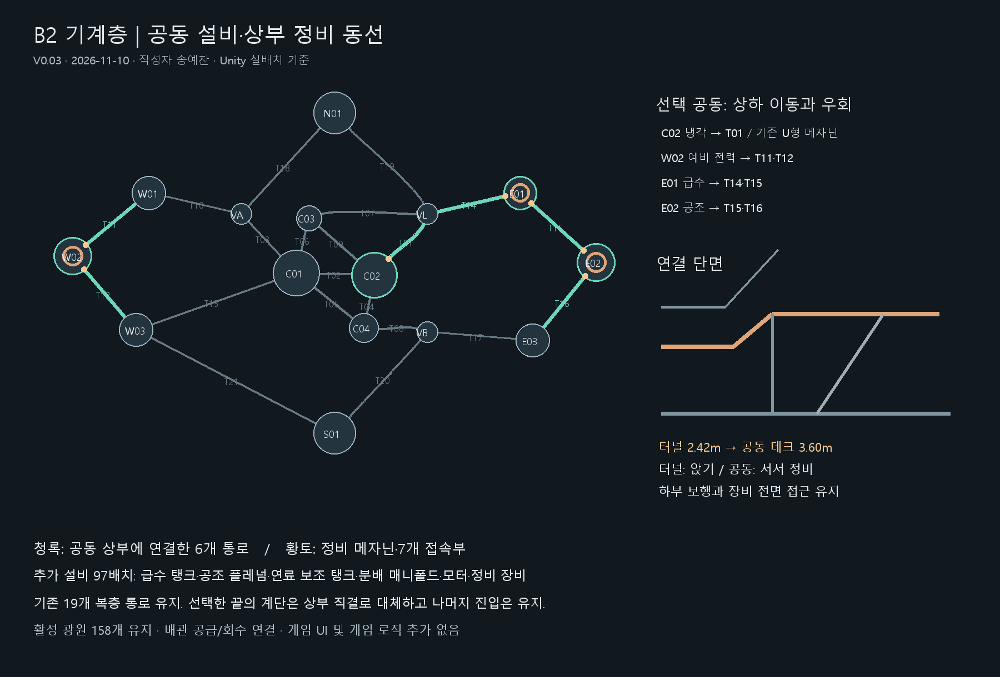

# After Seconds (애프터 세컨즈) — 메인 기획서 V0.83

**사용자 확정: 지상1층은 현재 가동/근무/출하에 사용하지 않는 위장용 폐공장이다.** 연구시설을 감추는 방치된 외관과 주변 부지를 표현한다. 켜진 작업등·정상 모니터·현재 직원 생활/운영 흔적을 배치하지 않는다. [최신 1F 검수](Review/2026-11-12_1F_Abandoned/Review.md) · [현재 모습](Review/2026-11-12_1F_Abandoned/review.html). 지하3도착점·7연결은 유지하며 실제 층 전환은 후속 기능이다.

이전 단계 기록:

**2026-11-12 지상1F 전체 제작.** 사용자가 마지막 지상층 제작을 요청해 폐공장4구역·3코어·OUT·7연결·85기물의 `Level_1F_Factory`를 저장했다. 통행84/84·실제Play8곳·Look·깊이 충돌 검수 완료. 기존 B1과 다른 층은 보존했다. [현재 검수](Review/2026-11-12_1F_FullFloor/Review.md) · [전체 화면](Review/2026-11-12_1F_FullFloor/review.html) · [실제 배치](도면/Decision/원형공동/1F_제작현황/README.md). 다음은 사용자 전체1F 공간·외형 검수다. 본편 층 전환·AI·보안문/승강기·결말은 후속 게임 구현이며, 과거 강제 교환 구덩이나 미확정 엔딩은 적용하지 않았다.

이전 단계 기록:

**2026-11-12 B1 기물 후속 보수.** 사용자 피드백에 따라 반복된 책상 상판과 낮은 입력 장치 디테일을 보수했다. 관련53배치 중51배치에 반영, 연구 데스크24개를12구성으로 나누고28업무석의 마우스를 작업자 오른쪽에 배치했다. 기존203주요 배치·실내 구조·업무/생활 용도는 유지한다. [최신 기물 검수](Review/2026-11-12_B1_DeskProps/Review.md)와 [전후 비교](Review/2026-11-12_B1_DeskProps/review.html)를 따른다. 다음은 사용자 전체 B1 외형 검수와 지정 범위 보수다. 게임 규칙·기능은 변경하지 않았다.

이전 단계 기록:

**2026-11-12 B1 전체 실내 구획 구현.** 연구 데이터와 직원 생활 용도를17체류 구획·103벽 구간·21부분 천장으로 나누고 기존 가구를 재배치했다. 13공동·3코어·22통로 유지,203주요 배치·통행297/297·체류 구획을 피한 공용 우회104/104·실제 Play13구역 검수. 회의석8개 화면 시야와 침실64개 시선 가림을 확인했다. [설계와 배치](B1_실내구획_재설계안.md) · [현재 검수](Review/2026-11-12_B1_Interior/Review.md) · [남은 할 일](B1_실내구획_재설계_할일.md). 다음은 사용자 전체 B1 외형·공간 검수 후 다음 층 진행 여부 결정이다. 게임 기능·AI·문/승강기·층 전환은 이번 구현에 포함하지 않았다. 아래11월11일 미착수 설명은 이전 상태다.

**2026-11-11 B1 전체 검토·다음 작업.** 용도 정정과8인 회의장·198배치·통행260/260은 정적 제작 결과이며 B1 디자인 완료가 아니다. 큰 돔 내부의 업무·회의·휴식·수면·위생·수납·통과 길을 칸막이·전실·부분 낮은 천장으로 먼저 구획하고 기존 가구를 재배치한다. 자료 인계→열람·대조→분석→회의·보고→보관의 업무 흐름과 생활 프라이버시를 구분한다. [B1 전체 실내 구획 재설계 할 일](B1_실내구획_재설계_할일.md)에 미완료 항목으로 기록했으며 이번 마감에서 새 구현을 시작하지 않았다. [최신 마감·검수 범위](WorkClose_2026-11-11.md)를 따른다.

**2026-11-11 사용자 정정.** 실험체의 정상 생활·시험 범위는 B5·B4이며, B4→B3 상행 경계부터 실험체 진입을 막는다. B3·B2·B1·1F는 실험체의 정상 활동 구역이 아니다. 플레이어가 상층으로 올라가는 것은 이 경계를 뚫는 탈출 상황이다. B1은 연구 데이터 업무·기록 보관과 직원 생활 공간이다. 여기서 통제는 실험체의 상층 진입을 막는 출입 보안을 뜻하며, 직원 통제나 B1 현장 능력 실험을 뜻하지 않는다. 세 코어의 자유 선택은 탈출 경로 선택 규칙이고 무조건 개방된 문이나 보안 부재를 뜻하지 않는다. 구체적인 보안문 작동·AI·층간 전환은 후속 구현이다.

작성자 송예찬 · 2026-11-12 · Unity 6000.4.0f1 · 1인칭 싱글 플레이 · 목표 플랫폼 Windows PC

**피험체 S-03은 지하 5층에서 깨어나 지상의 폐공장 출구까지 올라간다.** 복도 끝의 안내선은 계단이 어디 있는지 알려 준다. 그 앞을 지나는 경비를 피해 어느 길로 접근할지는 플레이어가 정한다. 대상을 맞히면 3초 뒤 서로의 위치가 바뀐다. 경비가 움직이는 동안 나도 움직일 수 있으므로, 물건을 던지거나 총을 쏴 교환을 예약하는 일은 내가 도착할 곳과 상대를 남겨 둘 곳을 함께 고르는 일이다.

**2026-11-10 사용자 확정.** 본편은 **B안(예지형)**으로 제작한다. 투척·직접 제압은 즉시 효력이 나고, 유효 대상 명중 후 위치 교환만 3초 뒤 실행한다. 이번 검토의 양쪽 도착 공간 검사, 피격 반응과 추적 기준, 그레이팅의 상하 감시 기준도 확정사항이다. 층별 코어 순서는 같은 날 사용자 결정으로 "세 코어 자유 선택"으로 바뀌었다(2장). 이후 플레이 검증은 이 규칙의 구현과 전달을 확인하는 과정이며 A/B안을 다시 선택하는 절차가 아니다. A안의 손 힘 3초 지연은 이전 실험 기록으로만 보관한다.

**현재 플레이할 수 있는 범위.** B5·B4·B3·B2·B1의 원형 공동 씬과 지상 폐공장 `Level_1F_Factory` 씬이 있으며, 기존 플레이어로 각 씬에서 걷고 달리고 앉아서 통과할 수 있다. 여섯 층의 개별 보행과 공간 검수 기록이 있다. 포드 탈출, 3초 교환, 감시와 추격, 층간 이동을 잇는 본편 플레이는 후속 구현 범위다. 1F는 최신 실제 배치와 검수 기록을 따른다. **기획 확정은 구현 완료를 뜻하지 않는다.** 아래에서 💡는 이번 확정 범위 밖의 제안, 🟡는 아직 남은 결정, 🔴는 상세 설계가 필요한 항목이다. [플레이어·층별 제작 현황](WorkClose_2026-11-09.md) · [B2 최신 검수](Review/2026-11-10_B2_DomeNetwork/Review.md)

## 1. 연구소를 빠져나가는 방식

제7 반응연구소에서는 지하로 갈수록 피험체의 일상이 직원의 생활권과 멀어진다. B5에서 보게 되는 것은 유리 너머의 관찰 장비와 격리 시설이다. B4에서는 피험체를 측정한 사람이 앉았던 자리와 그가 작성한 기록지를 가까이서 볼 수 있다. 지상에 이르면 방치된 하역 통로가 파손된 공장 외관과 잡초가 자란 부지로 이어진다. 층이 바뀔 때마다 시설이 S-03을 어떻게 다뤘는지 공간에서 한 가지씩 읽을 수 있게 한다.

한 구역의 플레이는 다음과 같이 이어진다.

1. **경로와 준비를 고른다.** 안내선·설비·기록에서 길을 읽고, 계단 A·계단 B·화물 승강기 중 어느 코어로 갈지 정한다. 최대 5개 안에서 무엇을 챙기고 무엇을 남길지 선택한다.
2. **감시와 대응을 고른다.** 문턱에서 시야와 순찰을 살핀다. 경비를 쓰러뜨려 총을 얻을지, 피하거나 숨어 지나갈지, 물건을 던져 교환할지 비교한다.
3. **3초와 지형을 쓴다.** 교환을 예약한 뒤 엄폐하거나 다음 출구로 움직여 양쪽 도착 자리를 고른다. 걸어서 우회하는 것도 유효한 해법이다. **우회가 열려 있는 개별 구간에서는 도구 없이 풀 수 있지만, 이것이 모든 층·모든 경보 상황에서 빈손 완주를 보장한다는 뜻은 아니다.**
4. **결과를 감수하고 올라간다.** 발견되면 문·코너·다른 높이의 통로로 도주하며 경로를 다시 고른다. 선택한 코어로 오를 때 소지품과 발각·경보 상태를 이어받고, 하행 불가와 준비 부족으로 이후 실패할 가능성을 감수한다.

💡 **이야기의 결말.** 공식 기록에는 S-03이 실패한 실험체로 남아 있다. 연구소장이 일부러 경계를 낮춰 탈출 자체를 관찰했다는 사실을 층별 기록으로 드러내는 안이 있다. 마지막에는 출구 밖의 소장과 교환해, 나를 관찰하던 사람이 시설 안에 서게 된다. 소장의 엔딩 역할은 정해져 있고, 기록의 배치와 마지막 장면의 진행은 연출 초안이다.

## 2. 여섯 층의 구조와 진행

VA는 계단 A, VB는 계단 B, VL은 화물 승강기다. 아래 연결은 최신 층간 설계다. Unity에서 현재 걸어 볼 수 있는 범위는 각 층 씬 안이다. [층별 공동·통로·수직 연결 원본](도면/Decision/원형공동/facility_layout.json)

| 층 | 장소와 플레이어가 읽을 단서 | 다음 목적지 | 제작 상태 |
| --- | --- | --- | --- |
| B5 격리층 | 실험동에서 시작해 보안관제동·냉각설비동·생활동의 관계를 배운다. 복도 바닥의 목적지 색과 방향이 첫 길잡이다. | 세 코어 중 선택 → B4 | 공동 12 · 코어 3 · 복도 19 |
| B4 능력 측정·발달·강화층 | 시험 구역과 관찰 데크가 마주 본다. 연구원이 어디에서 피험체를 관찰했는지 보면 자신이 노출될 자리도 가늠할 수 있다. | 세 코어 중 선택 → B3 | 공동 13 · 코어 3 · 복도 22 |
| B3 시료층 | 저온 보관 랙, 제염실, 시료 인계대가 동선을 나눈다. 소등된 보관부에서 출입등과 작업대 불빛으로 방향을 잡는다. | 세 코어 중 선택 → B2 | 공동 13 · 코어 3 · 복도 22 |
| B2 기계층 | 큰 펌프와 배전 설비를 기준점으로 삼는다. 통로 아래로 서서 갈지, 계단을 올라 배관 사이로 몸을 낮출지 고른다. | 세 코어 중 선택 → B1 | 공동 12 · 코어 3 · 통로 21 |
| B1 연구 데이터·직원 생활층 | 연구 자료 인계·열람·분석·보관과 사무·회의·숙소·식당·위생 공간이 이어진다. 실험체와 현장 능력 시험은 없다. | 세 코어 중 선택 → 1F | 원형 씬 제작 · 용도 정정 후 검수 |
| 1F 폐공장 위장층 | 방치된 폐하역장·생산동·폐경비실에서 외부로 이어진다. 현재 운영하지 않으며 파손 지붕의 외광, 잔해와 식생으로 위장 장소를 표현한다. | 공장 외부 | 위장 폐공장·Terrain 제작 및 표면 보수 · 사용자 검수 |

**세 코어는 모든 층에서 열려 있다 — 사용자 결정 (2026-11-10).** 계단 A·계단 B·화물 승강기는 여섯 층 모두 같은 평면 위치에 있다. A로 올라가면 위층의 A로, B로 올라가면 B로, 화물 승강기로 올라가면 화물 승강기로 나온다. 층마다 정해진 코어를 강제하지 않으며, 플레이어는 층마다 세 코어 중 어느 것이든 골라 올라갈 수 있다. V0.61의 "층마다 코어를 바꾸는 순서와 층 경계 출입 구획"은 이 결정으로 대체한다. 아래 층별 설명에 나오는 진입 코어와 목적지는 한 가지 예시 경로다.

| 코어 | 평면 위치 | 층마다 코어 앞에서 만나는 중심부 공동 |
| --- | --- | --- |
| 계단 A (VA) | 북서 | B5 보안관제 · B4 진단 · B3 저온 보관 · B2 원심분리 · B1 연구 기록 인계 · 1F 옛 사무동 |
| 계단 B (VB) | 남동 | B5 냉각설비 · B4 분석 · B3 제염 · B2 관제 · B1 직원 의무실 · 1F 폐하역장 |
| 화물 승강기 (VL) | 북동 | B5 유틸리티 · B4 기록 · B3 시료 준비 · B2 냉각·펌프 · B1 직원 회의 · 1F 폐하역장 |

💡 V0.61에 적었던 코어별 운영 설정(피험체 인계는 계단 A, 시료 인계는 계단 B, 물자와 정비는 화물 승강기)은 시설 배경과 기록 단서의 소재로 쓸 수 있다. 통행을 막는 근거로는 쓰지 않는다.

층 안의 일반 문마다 자동으로 잠그거나 플레이어 뒤의 우회로를 일괄 폐쇄하지 않는다. 공동 사이의 복수 경로·되돌아가기·추격 중 재합류를 유지한다. 같은 코어로 계속 올라가는 선택도 허용하며, 층을 가로지르거나 다른 코어를 쓰도록 강제하지 않는다. 🟡 각 층에 들를 이유와 코어 안의 감시는 상세 설계한다. 같은 코어로 계속 오르면 층별 기록을 하나도 읽지 않고 결말에 닿을 수 있으므로, 기록을 생략해도 알아야 할 핵심 서사와 선택 탐색으로 얻는 맥락을 나눠 설계한다. 기록 수집을 코어 개방 조건으로 강제하지 않는다. [이야기 전달 검토](잠입_상호작용_상세설계.md#6-기록을-읽지-않는-경로와-이야기)

**층 사이는 씬 전환으로 잇고 올라가기만 한다 — 사용자 확정.** 층마다 씬 하나를 쓰고, 선택한 코어의 전환 지점에서 위층 씬의 같은 코어·같은 자리·같은 방향으로 옮긴다. VA·VB·VL 각각 B5→B4→B3→B2→B1→1F로 이어져 인접 층 사이의 상행 연결은 총 15개다. 내려가는 연결은 제공하지 않는다. 계단은 현재 반복 평면을 바탕으로 도착 자리를 잡는다. 🔴 위층에서 올라온 자리를 읽을 수 있는 마감, B5와 나머지 층의 승강기 캐빈·문 방향 통일, 실제 도착 공간 검수가 필요하다.

**버리는 것은 지난 층의 현장 상태다.** 쓰러진 경비·바닥에 두고 온 물건 등 이전 층의 월드 상태는 돌아가지 않으므로 계속 보존할 필요가 없다. 플레이어의 소지품·진행 기록은 별도로 유지한다. 개별 객체 ID·종류·각 총의 남은 탄약·문서/USB/샤드 내용 ID·도구별 상태·현재 선택한 객체를 넘기며 복제하거나 초기화하지 않는다. 이미 읽거나 해제한 기록의 진행 상태도 유지한다. 실제 열람 화면과 저장 항목의 세부 구조는 상세 설계한다.

**전환 순간의 발각·경보 상태를 확인한다 — 사용자 확정.** 직접 목격된 상태인지, 시야가 끊겨 수색 중인지, 추격이 이어지는지와 현재 경보 단계·이미 전달된 신고 정보를 기록해 위층 경보 조정에 사용한다. 들키지 않고 올라온 경우와 목격·신고된 채 올라온 경우를 구별하며, 씬이 바뀌었다는 이유로 무조건 평상 상태로 초기화하지 않는다. 반대로 위층 경비에게 새 플레이어 좌표를 자동 공개하지도 않는다. 경비가 아는 위치는 직접 관측이나 전달된 유효 정보에 근거한다. 🟡 경보 단계별 수치·전파 범위·감쇠 시간, 추격 경비의 실제 층간 이동 여부는 후속 상세 설계다.

**준비와 실패도 플레이어의 선택이다 — 사용자 확정.** 무엇을 챙기고 올라갈지는 플레이어가 정한다. 빈손·탄약 0으로도 상행을 선택할 수 있고, 준비하지 않아 이후 상황을 해결하지 못하면 중간에 게임 오버를 겪을 수 있다. 모든 층에 빈손으로도 통과할 해법이나 자동 보충품을 보장하지 않는다. 실패 뒤 재도전하며 물건을 챙겨야 한다는 것을 배우는 방향이다. 소지품이 없다는 이유만으로 전환 즉시 게임 오버를 판정하는 규칙은 아니다. 🟡 준비를 다시 선택할 수 있는 재시작 범위와 진행 불가 판정 시점은 상세 설계한다. 재시작은 진행 중 아래층으로 되돌아가는 기능과 구분한다.

전환 완료 시 이전 씬 대상을 가리키는 교환 예약은 정리해야 한다. 💡 성공한 전환에서 예약을 취소하고, 로딩·도착 검증 실패 시에는 전환 전 상태를 보존하는 방식으로 설계한다. 💡 체크포인트는 정상 도착 확인 뒤 저장하되, 준비 실패가 같은 불가능한 상태의 자동 재시작만 반복하게 만들지 않도록 새 시도 경로를 함께 둔다. 정확한 저장 시점·재시작 UI는 미정이다. 전환 기능은 후속 구현한다. [코어별 위치·도착 지점과 상태 전달 명세](층간_코어_연결_대조.md)

### B5 · 포드 탈출과 자유로운 코어 선택

실험동(C01)은 기본 측정·관찰을 위한 공간이고, 장기 생활과 격리는 W01·W02가 맡는다. 아래는 계단 A를 고른 경우의 예시다. 계단 B·화물 승강기도 자유롭게 선택할 수 있다. C01에서 T01을 거쳐 보안관제동(C02)으로 간 뒤 계단으로 가는 짧은 길이 있다. 냉각설비동(C03)과 유틸리티동(C04)을 거쳐 C02로 들어가는 순환로도 있다. 갈림길에서 선택해도 결국 아는 장소로 돌아올 수 있어서, 한 번 익힌 층의 구조가 추격 때도 쓸모가 있다. B5 복도에는 목적지 색·방향·문자가 있고, 공동 안에서는 관제석·진료실·적재 선반 같은 설비가 위치를 기억하는 단서가 된다. [B5 전체 배치](검수/2026-11-06_B5_FullLayout/검수결과.md) · [시설별 용도](검수/2026-11-08_B5_SpatialRefinement/검수결과.md) · [복도 안내선](검수/2026-11-08_B5_CorridorOnlyGuidance/검수결과.md)

**첫 교환은 Cinemachine을 사용하는 컷씬이다 — 사용자 확정.** 플레이어가 직접 조작하는 투척 튜토리얼이 아니라 S-03의 능력을 보여 주는 도입 장면이다. S-03은 식판을 받는 척하다가 식판을 밀쳐 배식 경비에게 맞힌다. **손을 떠난 식판이 경비에게 실제로 명중한 순간부터 3초 뒤**, S-03과 경비의 위치가 교환되어 S-03은 포드 밖, 경비는 포드 안에 놓인다. 연출이 끝나면 플레이어에게 조작을 돌려준다. 컷씬의 카메라·인물·식판 동작을 맞추며, 직접 접촉이나 밀치는 손 자체가 교환을 예약하는 새 규칙은 만들지 않는다. 기존 B안의 명중·3초 지연·양쪽 공간 검사 원칙을 따른다.

**포드 유리는 총알과 투척물을 막고**, 통하는 곳은 배식구 개구부뿐이다. 식판이 개구부를 완전히 통과할 때까지 충돌 없는 통과 경로를 확보한다. 명중 후 배식구가 닫히거나 시야가 끊겨도 그것만으로 예약을 취소하지 않는다. 🔴 컷씬의 배식구 방향·카메라 시점·식판 궤적·양쪽 착지 공간·조작 복귀 시점을 설계한다. 스킵과 컷씬 후 경비의 경계·통보 처리는 🟡 상세 설계다. Cinemachine 컷씬과 본편 기능은 아직 구현하지 않았다.

**총과 소지품 수집은 플레이어의 선택이다.** 모든 경비는 총을 지니고 있으며 쓰러뜨리면 얻을 수 있다. 경비를 제압할지, 피하거나 숨어서 지나갈지, 총 대신 던질 물건을 챙길지는 자유다. 소지 한도는 개별 객체 5개이고 손에 든 물건을 포함한다. 소지 탄약의 총량은 들고 있는 각 총의 남은 탄약 합이며, 같은 용량 N발의 총만 5개 들면 최대 5N발이다. 🟡 남은 탄약 수치 결정은 한 자루당 탄약 수이며, 경비 사격 여부는 6장의 최우선 결정 항목이다. [B5 교환 구간 설계](B5_교환구간_설계.md)의 관제동·순찰 배치는 한 가지 시험 경로이며 수치는 제안이다. 첫 검증은 컷씬에서 능력의 인과관계가 보이고, 조작 복귀 뒤 스스로 도구와 코어를 선택할 수 있는지다.

### B4 · 측정받던 자리에서 관찰하는 자리로

B5가 상태를 파악하고 생활을 관리하는 층이라면, B4에서는 **같은 피험체를 여러 차례 시험해 능력의 변화와 강화 진행을 기록**한다. W01의 충격 표적, W02의 광학 게이트, E03의 전극 준비·회수대, C05의 기록 보관이 그 작업 순서를 드러낸다. 회차와 관찰 메모를 읽을 수 있는 기록지도 배치돼 있다. **계단 A로 들어온 경우의 예시로**, 진단 공동(C02)에 들어온 뒤 중앙 관찰 공동(C01)을 거쳐 분석 공동(C04)으로 가거나, 관찰 지원 공동(C03)을 거쳐 C04에 합류할 수 있다. 💡 두 경로에 감시를 붙일 때는 데크에서 보이는 측정 구역과 장비 뒤로 숨을 수 있는 지원 구역을 플레이어 눈높이에서 비교한다. [B4 층 배치](검수/2026-11-08_B4_FullFloor/검수결과.md) · [연구 장비와 기록지](Review/2026-11-09_B4_LabIdentity/Review.md)

### B3 · 어두운 보관 구역에서 길 기억하기

**계단 B로 들어온 경우의 예시로**, 제염 공동(C04)에 들어와 중앙 시료 공동(C01)이나 폐기·환복 공동(C03) 쪽을 고를 수 있다. C03과 C04를 잇는 T08은 실제로 굽은 통로다. 랙 사이에서 출구가 가려졌다가 다시 보이고, 저온 저장고의 냉동고와 운반 카트는 돌아오는 길의 기준점이 된다. E02에는 주 서버와 관측 데이터가 있다. 보관부 다섯 구역은 기본 소등 상태다. 🟡 구역 스위치를 작동시켰을 때 플레이어가 더 잘 보게 되는 범위와 감시자가 플레이어를 알아보는 조건은 실제 감지 기능과 함께 검증한다. [B3 전체 구역과 조명](Review/2026-11-09_B3_FullFloor/Review.md) · [T08과 보관 설비의 실제 배치](도면/Decision/원형공동/B3_구조보수/README.md)

### B2 · 같은 목적지까지 두 높이로 이동하기

**화물 승강기로 들어온 경우의 예시로**, 냉각·펌프 공동(C02)을 거쳐 원심분리 공동(C01)으로 갈 수 있고, 배전 공동(C03)을 경유하는 길도 있다. C02의 U자형 데크와 E01·E02·W02의 원형 정비 데크는 높이 3.6m다. **연결 통로**에는 높이 2.42m 그레이팅이 있으며, 21개 중 19개 통로에 상부 정비 경로가 있다. 짧은 T04와 T06은 단층이다. 상부 폭은 1.50m, 유효 높이는 약 1.30~1.43m로 공급·회수 배관과 밸브 사이를 앉아서 이동한다. 하부는 서서 통과한다.

C02–T01, W02–T11/T12, E01–T14/T15, E02–T15/T16의 **6개 통로·7개 끝**에서는 터널 상부와 공동 데크가 계단으로 직접 이어진다. 이 끝들의 기존 하부 진입 계단은 공동 연결로 대체했다. 다른 끝의 진입은 유지하며 공동 내부 계단으로 위·아랫길을 바꿀 수 있다. 상부 경로가 통로마다 반드시 아래로 내려와 끝나는 구조는 아니다. 공동 설비 97배치와 연속 배관을 추가한 최신 상태를 따른다. [B2 연결도와 단면](도면/Decision/원형공동/B2_배관통로/README.md)

**상하 감시 기준 — 확정.** 열린 그레이팅의 틈으로 위·아래를 볼 수 있다. 상부에 있거나 앉았다는 이유만으로 감지에서 제외하지 않는다. 실제로 시야를 가리는 굵은 배관·기계·불투명 구조물을 엄폐로 사용한다. 보행을 위해 그레이팅에 연속된 바닥 Collider를 쓰더라도 **그 Collider 전체를 불투명 시야 차단면으로 사용하지 않는다.** 감지 판정은 열린 격자와 실제 불투명 차폐를 구분한다. AI 연결 후 계단 입구와 위·아래 시점에서 이 원칙을 검증한다.

붉은 보호망등과 펜던트는 기계층의 평상시 조명이다. 활성 광원 158개, 흰 직접광 0개 상태에서 계단 첫 단·밸브·출구의 가독성을 사용자 외형 검수로 확인한다. [최신 공동 밀도·상부 연결 검수](Review/2026-11-10_B2_DomeNetwork/Review.md) · [이전 복층 통로 검수](Review/2026-11-10_B2_DetailMezzanine/Review.md)

### B1과 1F · 실험의 기록에서 지상 출구까지

**B1에서 계단 A로 들어와 계단 B로 나가는 경우의 예시다.** 계단 A에서 연구 기록 인계 공동으로 진입하고, 중앙 자료 열람·대조실이나 기록 보관실을 거쳐 직원 의무실에서 합류할 수 있다. 실제 진입·출발 코어는 VA·VB·VL 중 자유롭게 고른다. 직원 생활부의 따뜻한 회색·아이보리와 데이터 업무 구역의 작업광이 공간의 용도를 구분한다. 1F의 폐하역장 → 폐생산동 → 폐경비실 → 외부는 화물·하역 쪽으로 진입한 경로 예시다. 다른 코어로 진입하는 경로도 출구로 이어지게 설계한다. 지하에서 보던 정밀 설비와 지상 공장의 방치된 외관이 한 시설에 공존하는 이유를 마지막 구간에서 보여 준다. 🟡 두 층의 경비 배치와 결말의 정확한 착지 위치는 원형 씬 제작 후 검토한다. [여섯 층의 설계도](도면/Decision/원형공동/README.md) · [층별 조감도](도면/Decision/원형공동/층별조감도/README.md)

**2026-11-11 B1 현재 제작.** 연구 데이터·직원 생활 용도로198배치와 C05 8인 회의장을 완성했다. 전체260경로·변경4구역 실제 Play·최종 회의장 겹침 검수를 통과했다. [현재 화면/검수](Review/2026-11-11_B1_StaffData/review.html). 보안문·AI·층 전환은 후속이다.

**2026-11-11 B1 최초 제작 이력 — 이후 용도 정정으로 대체.** `Level_B1_Circular`에13공동·3코어·22통로와 주요 프랍174개를 제작했다. 공동/코어 좌표는 유지하고 T08은 접합 간섭을 피하는 북측 곡선으로 보수했다. 직원 숙소 이층침대8개·경비 숙소4개, 생활/연구 조명,18m 상행 계단·정적 승강기, R1 직원 안내선과 출입 표지를 반영했다. 통행250경로와 실제 Play8구간을 검증했다. 사용자 외형 검수 대기이며 AI·문/CCTV·승강기 이동·실제 층 전환·획득 기능은 미구현이다. [검수](Review/2026-11-11_B1_FullFloor/Review.md) · [현재 제작 배치](도면/Decision/원형공동/B1_제작현황/README.md)

## 3. 플레이어 조작과 상호작용

| 현재 조작 | 실제 동작 |
| --- | --- |
| WASD · 마우스 | 캐릭터 기준 이동과 1인칭 시점 회전 |
| 전진 중 Shift | 서거나 앉은 상태에서 전진·전방 대각선 달리기. 옆·뒤 입력만 있을 때는 해당 자세의 걷기 속도 유지 |
| C | 앉기·일어서기 전환. 위에 설 공간이 부족하면 앉은 높이를 유지하며 시점과 애니메이션도 그 자세를 따른다. |

플레이어 프리팹이 참조하는 이동 설정은 서서 걷기 **5m/s**, 달리기 **7.5m/s**, 앉아서 걷기 **2.5m/s**, 앉아서 달리기 **4m/s**다. 서 있는 캡슐은 1.8m, 앉은 높이는 1.2m다. 실제 이동은 CharacterController가 담당한다. Animator의 `Speed`는 대기·걷기·달리기를 섞는 값이다. 이동 속도를 바꿀 때는 설정 에셋과 발 미끄러짐을 함께 확인한다. [현재 이동 설정 에셋](../Unity/After_Seconds_Build_V0.01/Assets/Afrer_Seconds/06.Data/PlayerMotorSettings.asset) · [조작·애니메이션 연결 기록](WorkClose_2026-11-09.md)

### 소지품·상호작용 입력

이동·앉기는 위 표의 현재 동작이다. **휠 선택 방식은 사용자 확정이나 소지품 선택 기능은 후속 구현**이다. Input Actions에 `Attack=왼쪽 클릭`, `Interact=E`, `Previous/Next=휠` 바인딩은 있으나, 그것만으로 사격·획득 기능이 구현되거나 아래 기능 배분이 확정된 것은 아니다.

| 행동 | 입력 | 상태·문맥 |
| --- | --- | --- |
| 소지품 선택 | 마우스 휠 위·아래 | 사용자 확정. 우하단 UI, 객체별 선택 |
| 줍기·문/설비 상호작용 | 💡 E | 바라보는 유효 대상 하나에만 적용. 5개 소지 중에는 “공간이 없어”를 표시하고 새 획득 거절. 자동 교체 없음 |
| 선택한 물건 투척 | 💡 G | 총 자체도 포함. 사격과 분리해 실수로 총을 버리지 않게 함 |
| 총 사격 | 💡 왼쪽 클릭 | 총을 선택했고 탄약이 있을 때. 재장전·탄약 보충은 별도 기능으로 확정하지 않음 |
| 직접 제압 | 💡 Q | 사거리·후방 등 제압 조건 충족 때만. 줍기와 입력 충돌 방지 |
| 손에 든 문서 읽기 | 💡 왼쪽 클릭 | 선택한 객체가 문서일 때. 닫기는 💡 Esc |
| USB·샤드와 단말 | 💡 E | 호환되는 단말을 보고 해당 매체를 선택했을 때. 줍기보다 명확한 대상 안내 필요 |
| 기록 갤러리 열기 | 🟡 키·메뉴 위치 미정 | 이미 읽은 기록을 다시 열람. 열람 중 게임 시간 정지 |
| 손전등 켜기·끄기 | 💡 F | 선택한 손전등에 적용하는 안. 비선택 손전등 동작은 미정 |

💡 표의 키 배분은 검토안이며 입력 에셋·게임 코드에 적용하지 않았다. 읽기·단말·갤러리 열람 중 게임 시간 정지는 확정이다. 화면 닫기와 UI 입력 분리, 제압 실패 안내·키 재설정은 UI/UX에서 함께 검증한다.

**🟡 점프는 채택 여부를 논의 중이다.** 현재 B2의 두 높이는 걷기·계단·앉기로 왕복된다. 다음 보행 검수에서 점프하고 싶었던 위치와 이유를 기록한다. 작은 문턱에 발이 걸린 자리라면 충돌이나 단차를 살핀다. 반대로 눈앞의 낮은 설비를 넘어 시야에서 벗어나거나 새 경로에 합류하고 싶었던 자리라면, 그 한 곳에서 점프나 제한적 넘기를 비교할 수 있다. 도약 거리·입력 키·애니메이션 채택은 그 비교 뒤에 정한다.

## 4. 3초 교환, 도구와 감시

### B안의 행동 시점 — 확정

총은 발사 시 즉시 명중 판정을 한다. 던지기는 손을 놓는 즉시 물체가 출발하며, 비행 후 실제 명중 시점부터 교환 시간을 센다. 직접 제압은 성립한 순간 상대를 무력화한다. 투척·제압 자체에 별도의 3초 대기를 넣지 않는다. 집기·빼앗기·직접 제압은 교환을 예약하지 않는다.

총알이나 던진 물체가 유효 대상을 맞히면, **명중한 시각부터 3초 뒤** S-03과 대상이 **실행 순간의 발 위치**를 맞바꾼다. 물체는 바닥 접지 기준점을 쓴다. 둘 이상 예약하면 실행 시각순, 같은 시각에는 예약순으로 처리한다. 앞선 교환 후의 현재 위치로 다음 교환을 검사한다. 플레이어가 붙잡히거나 재시작하면 남은 예약을 취소한다. 하나의 예약이 대상·공간 문제로 취소돼도 다른 예약은 각 실행 시점에 독립적으로 판정한다.

B안의 설정은 S-03이 3초 뒤 교환을 내다보는 능력이다. 모든 적의 미래 행동을 화면에 전부 표시하는 것은 확정 범위에 포함하지 않는다. 교환을 예약한 뒤 3초 동안 어디로 움직일지 판단하는 경험에 초점을 둔다.

### 한 번의 투척에서 연속 명중 — 사용자 확정

한 번 던진 물건이 경비에게 맞은 뒤 계속 날아가 식판 등 다른 유효 대상에 맞으면, **각 명중마다 그 명중 시각 + 3초**에 실행할 교환을 따로 예약한다. 첫 명중에서 투척 물건을 자동 삭제하거나 한 번만 예약하도록 제한하지 않는다. 실제 비행·반사·충돌로 맞은 대상만 예약하며 대상을 자동으로 찾아가는 연출은 규칙에 포함하지 않는다.

첫 경비 명중을 게임 시간 0초로 잡은 예시다.

| 게임 시간 | 사건 | 예약·실행 |
| --- | --- | --- |
| 0.0초 | 볼펜이 경비 A에게 명중 | A 교환을 3.0초에 예약 |
| 0.5초 | 계속 날아간 볼펜이 식판 B에게 명중 | B 교환을 3.5초에 예약 |
| 3.0초 | 첫 예약 시각 도달 | 플레이어 ↔ A의 **현재 위치** 교환 |
| 3.5초 | 둘째 예약 시각 도달 | 플레이어 ↔ B의 **현재 위치** 교환 |

두 명중 사이가 0.5초이면 두 교환 사이도 0.5초다. 앞 교환이 끝난 뒤 다시 3초를 세거나, 다음 명중 때 앞 예약의 시간을 초기화하지 않는다. 매 교환의 한쪽은 플레이어이며 경비와 식판끼리 교환하지 않는다. 명중 지점을 저장해 순간이동시키지 않고 각 실행 시점의 위치·공간을 검사한다. 앞 예약이 취소돼도 뒤 예약은 원래 실행 시각에 독립적으로 검사한다. 같은 충돌을 여러 Collider 이벤트로 중복 예약하지 않아야 하며, 같은 대상에 떨어졌다 다시 맞는 재충돌의 구체 판정은 🟡 상세 설계다.

**교환 시 속도 유지 — 사용자 확정.** 각 대상은 교환 직전 자신의 이동·낙하 속도를 유지한다. 상대의 속도를 넘겨받거나 교환 자체가 속도를 0으로 초기화하지 않는다. 선속도 벡터를 보존하는 기준으로 구현을 대조하고, 도착 이후 벽 충돌·중력은 정상 적용한다. 현재 자세로 공간을 검사하는 기존 규칙도 유지한다. 🟡 시선/회전 방향과 물체의 각속도 처리는 이번 속도 결정과 구분해 상세 설계한다.

### 유효 대상의 범위

**유효 대상**은 명중한 물체 중 교환을 허용한 종류·상태에 해당하는 대상이다. 대상 종류의 허용과 명중 경로 검사, 실행 직전 양쪽 공간 검사는 별개다. 아래 미정 분류는 구현자가 임의로 전부 허용하지 않는다.

| 대상 | 현재 결정 | 상세 설계·제안 |
| --- | --- | --- |
| 서 있거나 이동하는 경비 | 교환 대상 확정 | 경계·추격 중에도 기존 명중/공간 검사 적용 |
| 쓰러진 경비 | 🟡 본편 허용 여부 미정 | 💡 허용하되 누운 몸 전체의 공간·지지 바닥 검사. 발판 무게라는 설정만으로 교환 허용을 확정하지 않음 |
| 집을 수 있는 물건 | 식판 같은 독립 물체와의 교환은 사용자 확정 | 볼펜→경비→식판의 연속 명중을 지원한다. 손에 들리지 않은 유효 대상으로 지정하고 공간·바닥을 검사한다. 전체 종류별 허용 목록은 🟡이며 고정 설비까지 자동 확장하지 않는다 |
| 손에 들린 물건 | 실행 불가 확정 | 예약 뒤 들리면 실행 직전 재검사에서 취소 |
| 벽·문·배관 등 고정 설비 | 🟡 본편 허용 범위 명시 필요 | 💡 교환 불가. 고정 구조물이 교환되어 시설이 붕괴하는 규칙은 도입하지 않는 안 |
| 연구원·CCTV | 🟡 교환·무력화 여부 미정 | 경보 역할과 교환 가능 여부를 각각 정함. 고정 CCTV를 이동시키는 효과도 검토 필요 |
| 연구소장 | 엔딩 역할 확정, 엔딩 교환은 연출 제안 | 일반 경비와 같은 자유 교환 대상으로 자동 등록하지 않음 |

명중 당시에는 허용 대상이어도 실행 전 소실·들림·공간 부족이 생기면 기존 취소 규칙을 따른다. 구체 분류를 승인하기 전까지 이 표의 💡를 확정 규칙으로 구현하지 않는다.

### 명중과 실행의 공간 검사 — 확정

| 검사 시점 | 판단 기준 | 실패 시 결과 |
| --- | --- | --- |
| 조준·명중 | 유효 대상인지, 사거리 안인지, 총알 또는 투척물의 경로가 벽·닫힌 문·차단 유리에 막히지 않는지 판단한다. 포드 유리는 총알과 투척물을 막고 배식구 개구부만 통과 경로가 된다. 투척물은 개구부를 완전히 벗어날 때까지 막히지 않아야 한다. | 유효 명중이 아니면 예약하지 않는다. 조준 표시로 현재 불가 사유를 구분한다. |
| 예약 후 3초 | 그동안 두 대상은 계속 이동할 수 있다. 명중 후 코너 뒤로 숨거나 문으로 시야를 끊어도 그것만으로 예약을 취소하지 않는다. | 명중 시점의 사선을 다시 요구하지 않는다. |
| 교환 실행 직전 | 두 대상이 존재하고 유효하며 손에 들려 있지 않은지 재검사한다. **양쪽 모두** 상대의 현재 발 위치에서 현재 자세·몸 크기로 들어갈 공간과 지지 바닥이 있어야 한다. 두 대상 자신이 비우는 몸체를 제외하고 벽·천장·문·주변 설비와의 겹침을 검사한다. | 한쪽이라도 들어가지 못하면 해당 교환 전체를 취소하고 이유를 표시한다. 한쪽만 옮기거나 자동으로 축소·강제 앉기·근처 밀어내기를 하지 않는다. |

따라서 낮은 B2 상부에서 앉은 플레이어가 서 있는 경비를 맞혔더라도, 3초 뒤 경비가 플레이어 자리의 천장에 걸리면 교환은 취소된다. 플레이어가 그 사이 양쪽 모두 설 수 있는 곳으로 옮겼다면 실행할 수 있다. 조준·예약 중의 도착 예측은 현재 조건에 따른 정보이며 실제 판정은 실행 직전 양쪽 공간으로 확정한다.

### 피격 반응과 경비가 아는 위치 — 확정

교환을 유발하는 총알·투척물 명중은 **즉시 사망·기절시키지 않는다.** 경비는 피격을 인지하고 경계·추격을 계속할 수 있다. 피격 표현이 3초 동안 경비를 제자리에 묶는 수단이 되지 않게 한다. 직접 제압은 이 명중 반응과 구분하며 B안에 따라 즉시 무력화한다. 피해량이나 경직 시간 같은 별도 수치는 이번에 추가하지 않는다.

경비가 플레이어를 직접 보고 있으면 **현재 보이는 위치**를 우선 추적한다. 시야가 끊기면 자신이 마지막으로 본 위치와 전달받은 관측·발사 위치 중 최신 유효 정보를 향해 이동해 수색한다. 발사 위치는 발사 당시의 정보이며 플레이어가 옮긴 뒤에도 현재 위치로 취급하지 않는다. 호출받은 경비도 전달받은 위치부터 확인한다. 교환이나 예약만으로 플레이어의 새로운 위치를 자동으로 알지는 못하며, 교환 뒤에도 실제 시야·새 보고로 다시 판단한다.

**피격·소음으로 얻는 위치 정보의 기준.** 발사 당시 위치와 현재 플레이어 위치를 구분한다. 총피격 경비에게 발사 원점 단서를 주는 기존 규칙을 명세하고, 투척의 추가 정보는 아래 제안으로 구분한다. 이 표를 AI 문서에서도 같은 기준으로 참조한다.

| 사건 | 얻는 위치와 시각 | 현재 플레이어 위치로 취급하는가? |
| --- | --- | --- |
| 경비가 총에 맞음 | **발사 당시 원점·발사 시각**을 피격 경비의 수색 근거로 제공. 직접 플레이어를 보면 그 관측이 우선. 피격 이벤트가 제공하는 단서이며 모든 경비에게 즉시 공유되지 않음 | 아니오. 피격 순간의 현재 좌표나 이후 이동을 알려 주지 않음 |
| 경비가 투척물에 맞음 | 💡 투척 시작을 목격했다면 그때의 위치·시각. 시작을 못 봤다면 마지막으로 관측한 비행 지점/방향과 충돌 지점·시각만 기록. 튕긴 물체로 최초 투척 원점을 자동 역산하지 않음 | 직접 플레이어를 확인한 경우에만 현재 관측. 발사 원점 자동 제공 규칙을 투척물까지 확대하지 않음 |
| 총성·탄착·충돌음만 감지 | 실제 감지한 사건 지점·시각을 의심 근거로 사용. 💡 소리만으로 얻는 원점 정밀도는 청각 상세안에서 시험 | 아니오. 소리 출처와 현재 플레이어를 동일시하지 않음 |
| 위치교환 실행 | 대상의 이동 사실과 새 위치에서의 실제 재감지 결과 | 교환 예약·실행만으로 상대의 현재 좌표를 인지하지 않음 |

💡 **B5 시험 배치 예시.** 관제동 입구에서 복도 안쪽 경비를 맞히고 냉각설비동 방향 모퉁이로 물러난다. 경비는 나를 보는 동안 현재 위치를 따라오고, 내가 시야에서 사라지면 마지막으로 확인한 위치를 향한다. 3초 뒤 양쪽 공간이 유효하면 나는 그때 경비가 선 자리에, 경비는 내가 물러난 모퉁이에 도착한다. 이 반응과 교환 규칙은 확정이다. 구체적인 경비 좌표·사선·엄폐 배치는 시험하며, 걸어서 우회할 이유도 남겨 둔다.

### 신고와 소음 — 사용자 결정

**연구원은 도망간 뒤 30초 후 전체 경보를 울린다.** 경보가 가리키는 위치는 공유된 유효 관측 중 플레이어가 가장 최근에 발견된 위치다. 예전 위치를 새 정보로 덮어쓰거나, 아무도 보지 못한 현재 플레이어 좌표를 읽어 오지 않는다. 경보의 전역 활성 상태와 수색할 위치·층 정보를 구분한다. 🟡 30초의 정확한 시작 사건(도주 시작/안전 지점 도착)은 확인 중이며, 신고 전 제압·여러 연구원·반복 신고 처리도 상세 설계한다. 30초는 게임 시간이며 기록 열람 중에는 멈춘다.

**경비는 플레이어를 추격하면서 무전으로 알린다.** 직접 관측한 위치·시각을 전달하고 시야를 잃으면 마지막 관측 정보임을 유지한다. 🟡 무전 지연·갱신 간격·전달 범위는 정하지 않았다. CCTV의 경비 호출 역할은 유지하며 감지 누적·전송 시점은 별도 상세 설계한다.

소음·어그로 관리에는 루시드 다이버에서 다룬 구조와 오브젝트 풀링을 참고한다. [원본 검토와 적용안](소음_어그로_루시드다이버_참조.md)을 따른다. 소음 위치 오브젝트의 재사용과 경비가 어느 정보를 우선할지는 구분하며, 기존의 직접 관측 우선 규칙을 유지한다. 발소리·물건 충돌·총성·빛 반응의 수치와 구체 감지 규칙은 아직 미정이다.

### 에너미 AI의 판단과 협력 — 상세 기획안

사용자 요청에 따라 [에너미 AI 기획과 로직](에너미_AI_기획과_로직.md)에 경비·연구원·CCTV·연구소장의 역할, 감지·기억·상태 전환, 무전·신고·구역 협력, 교환·시간 정지·층 전환과의 연결을 정리했다. 기존 확정 규칙을 기준으로 하며, 새 상태 구성·경보 단계·역할 배정·수치는 💡 제안이다. 붙잡기·사격·제압 조건, 경비 미래 위치 표시, 연구원 신고의 시작/중단 수단을 우선 결정한다. 문서의 상세안으로 자동 확정하지 않는다.

💡 개인 AI는 루시드 다이버의 감지·기억·FSM 분리를 발전시키고, 구역 단위로 조사 담당과 이동 경로 확인 역할을 배정한다. 소음은 발생 지점의 단서이며 현재 플레이어 위치를 보장하지 않는다. 전달된 정보는 원래 관측 시각·층·근거를 유지한다. 직접 보이는 플레이어가 일반 소음보다 우선하며, 위치교환 후에는 실제 감지 결과로 다시 판단한다. 협력·경보는 플레이어의 숨은 좌표를 읽지 않고, 소음 오브젝트 풀과 별개 데이터로 유지하는 안이다.

| 기획 항목 | 현재 방향과 남은 결정 |
| --- | --- |
| 손의 힘 · 확정 | B안 적용. 투척·직접 제압 즉시, 유효 명중 후 교환만 3초. A안 비교는 종료했다. |
| 총과 탄약 | 첫 교환은 컷씬에서 밀쳐 보낸 식판이 경비에게 명중해 일어난다. 총은 모든 경비가 지니고, 경비를 쓰러뜨리면 얻는다. 얻지 않고 던질 물건으로 대신해도 된다. 총은 한 개의 소지품이며 남은 탄약을 발사하거나 총 자체를 던질 수 있다. 총별 남은 탄약은 합치지 않는다. 별도 탄약 가방 없이 총량은 소지 중인 총들의 남은 탄약 합이다. 한 자루 용량 N발이면 총만 5개일 때 최대 5N발이며 다른 물건을 챙기면 줄어든다. 🟡 한 자루당 탄약 수를 정한다. 탄약 보충·재장전은 도입 여부를 정하지 않은 별도 기능이고, 도입한다면 이 한도와 다시 대조한다. |
| 경비 · CCTV · 연구원 · 소장 | 경비는 추격 중 무전하며, CCTV는 경비를 호출하고, 연구원은 도주 후 게임 시간 30초 뒤 전체 경보를 울린다. 소장은 엔딩에 등장한다. 직접 관측 우선·최신 유효 위치를 통한 수색은 확정이다. 연구원 30초 시작 사건, 경비 무전/CCTV 전송의 범위·지연 수치, 연구원·CCTV의 교환·무력화 대상 여부는 🟡. |
| 발견과 도주 | 직접 본 경비는 추격하고 시야를 놓치면 마지막 관측 지점을 수색한다. 호출받은 경비는 전달받은 위치로 향한다. 💡 앉은 자세가 발견까지 걸리는 시간에 미치는 영향은 실제 차폐와 함께 시험한다. 구역 조명의 효과와 발소리 감지는 미정이다. |
| 문·설비·압력판 | 복도를 되돌아가거나 다른 입구로 재합류할 수 있다. 명중의 경로 검사와 실행의 양쪽 공간 검사를 구분한다. 세 코어는 2장의 결정대로 모든 층에서 열려 있다. 압력판은 무게가 올라간 동안 연결 문이 열린다. 실제 배치 시설은 동선·설비 용도에 맞춰 상세 설계한다. |
| 실패와 재시작 | 발각은 도주의 시작이다. 붙잡힘·위험한 추락과 함께 준비 부족으로 이후 상황을 해결하지 못하는 실패도 허용한다. 💡 체크포인트 재시도에서는 저장 당시 소지품·탄약·경보·진행을 함께 복원하고, 실패한 시도의 교환 예약은 취소한다. 준비 선택을 바꿀 수 있는 새 시도를 제공하는 방향으로 검토한다. 체크포인트 위치·진행 불가 판정·새 시도 범위는 🟡. 아래층으로 내려가 물건을 회수하는 기능이나 자동 보충으로 대체하지 않는다. |

💡 **관제실과 층별 방문 이유.** CCTV의 확인 보고를 해당 층 관제 담당이 검토해 경비에게 보내는 안을 검토한다. 관제 담당을 유인해 자리를 비우면 CCTV의 신규 호출을 막을 수 있다. 이미 전달된 무전·현재 추격·연구원 30초 신고는 별도이며 취소되지 않는다. B5 C02(보안관제동. CCTV 감시 화면이 실제로 있는 곳이며 주 경로 위다), B4 N01, B2 C04, B1 E01을 도면상 후보로 사용한다. B5 N01 중앙관제동은 시설 상태 관제 후보로 구분한다. 정확한 관제권역·대체 인력·CCTV 전송/확인 지연은 [AI 상세안](에너미_AI_기획과_로직.md#83-cctv와-관제실의-호출-경로)에서 정한다. 선택 탐색의 보상이며 코어 이용의 강제 조건이 아니다.

### 소지품과 층별 오브젝트 — 사용자 확정

별도 인벤토리 창 없이 **화면 오른쪽 아래 소지품 인터페이스와 마우스 휠**로 손에 들 물건을 바꾼다. 최대 **개별 객체 5개**를 소지하며 선택해서 손에 든 물건도 포함한다. 각 객체는 항상 수량 1이고 같은 종류도 합쳐지지 않는다. 펜 두 개는 별개 선택 항목 두 개다. 총·손전등·서류·USB·데이터 샤드도 각각 한 개로 센다. 같은 종류를 추가로 얻어도 5개 제한을 우회하지 않는다. **이미 5개라면 “공간이 없어”를 표시하고 새 물건 획득을 막는다.** 기존 소지품을 자동으로 버리거나 교체하지 않으며 새 물건도 현장에 남는다. 화면에는 묶음 수량 대신 객체 이름과 구별 표식을 사용하며, 총은 해당 총의 남은 탄약을 표시한다.

획득 대상은 층별 업무에 맞춰 제작한다. B5는 식판·숟가락·컵과 관찰 기록, B4는 휴대 측정기·스톱워치·전극 케이스와 측정 자료, B3는 손전등·시료통·인계 자료, B2는 정비 공구·계측기·점검 자료, B1은 녹음기·연구 수첩·서류·데이터 매체, 1F의 무전기·안전모·운송 자료는 과거 후보이며, 현재 위장 폐공장에는 정상 운영 소품으로 배치하지 않는다. 추후 획득 대상으로 채택하려면 방치된 상태와 용도를 다시 결정한다. 총·서류·USB 등은 여러 층에서 등장할 수 있고 획득한 층 밖에서도 소지·사용·투척할 수 있다. 전체 종류·층별 조합·제작 후보는 [층별 획득 오브젝트 명세](층별_획득오브젝트_명세.md)를 따른다.

물건은 본래 용도와 투척 용도를 함께 갖는다. 문서는 직접 읽고, USB는 업무용 단말에서, 데이터 샤드는 호환되는 연구 단말에서 자료를 열람하는 대상으로 만든다. 손전등은 켜기·끄기를 갖는 도구로 계획한다. 기존 명중 후 3초 위치 교환 규칙은 그대로 적용하며 이번 분류로 다시 정의하지 않는다. 구체적인 단말 호환 범위·투척 수치·빛 감지·배터리·파손·일부 도구의 추가 기능은 상세 설계 항목이다. 현재는 획득·휠 UI·도구 사용·단말 열람·투척 기능의 제작 명세이며 런타임 구현은 후속이다.

### 기록 갤러리와 열람 시간 — 사용자 확정

읽은 문서·USB·데이터 샤드의 내용을 **기록 갤러리**에 등록해 다시 볼 수 있게 한다. 문서는 직접 열람하고 USB·샤드는 호환 단말에서 내용을 연 뒤 등록한다. 단순히 주웠다는 이유로 아직 열지 않은 자료를 자동 해독하지 않는다. 갤러리는 콘텐츠 ID로 관리하는 기록 열람 공간이며 물리 소지품 창이 아니다. 원본 물건을 버리거나 다음 층으로 넘어가도 등록된 자료를 다시 읽을 수 있다. 원본은 계속 개별 객체·최대 5개 규칙을 적용하고 갤러리 등록이 물건을 복제하거나 합치지 않는다. 🟡 분류·열기 키·새 회차와 체크포인트 재시작 때의 갤러리 해금 보존 범위는 UI/저장 상세 설계다.

**현장 기록·단말·기록 갤러리를 열람하는 동안 게임 시간은 흐르지 않는다.** 플레이어·적 이동, 물체 비행·물리, 교환 예약의 3초, 연구원 신고의 30초와 경보·소음 유효시간을 함께 멈춘다. 닫으면 남은 게임 시간에서 이어가며 열람한 실제 시간만큼 예약을 한꺼번에 실행하지 않는다. 기록의 화면 조작·스크롤·자료 재생은 가능하게 구분한다. 예를 들어 명중 후 1초에 갤러리를 열었다면 실제로 10초를 읽어도 교환까지 게임 시간 2초가 남는다.

## 5. 플레이어에게 보이는 정보

**길 찾기.** 복도에서는 색과 함께 방향·문자·식별 모양을 읽는다. 공동에 들어가면 관찰창, 작업대, 장비 배치와 출입구를 본다. 시설 기록은 어떤 물자와 사람이 어느 코어로 이동하는지 알려 주는 단서가 된다. B5의 목적지 안내는 19개 복도에 적용돼 있다. 다른 층에서는 보관 랙 끝의 출입등, 기계층의 계단·배관처럼 각 층의 용도에 맞는 단서를 살린다. [B5 길 찾기 제작 기준](도면/Decision/원형공동/B5_안내체계/README.md)

**교환 피드백의 필수 정보 — 확정.** 조준 시 유효 대상과 현재 명중 가능 여부, 명중 후 예약 대상·남은 시간·처리 순서를 구분한다. 플레이어와 상대 양쪽의 도착 공간·바닥 유무를 판단할 수 있고, 취소되면 대상 소실·들림·공간 부족 등의 이유를 알 수 있어야 한다. 현재는 가능해도 이동이나 문 변화로 실행 때 실패할 수 있다는 것을 예측 표시와 확정 예약 표시에서 구분한다. 🟡 아이콘·색·시야 창 등 표현 방식과 예지의 표시 범위는 UI/UX 단계에서 정한다. 모든 경비의 미래 동선을 상시 공개하지 않아도 위 필수 정보는 전달해야 한다. 미니맵·경보 HUD도 후속 설계 항목이다.

## 6. 다음 구현과 플레이 검증

### 먼저 결정할 항목

**플레이어 핵심 기능을 먼저 완성한다.** 아래 단계는 이후 에너미 AI에 착수했을 때의 내부 구현 순서이며, 플레이어에서 마련한 공통 게임 시계와 교환 시스템을 재사용한다. 에너미 AI의 첫 구현은 경비 1명의 순찰·직접 감지·추격·마지막 위치 수색이다. 위치·시각·종류로 된 관측과 고정 간격 판단부터 시작한다. 구역 협력·목표 예약·4단계 경보는 후속 단계다. [AI 구현 단계](에너미_AI_기획과_로직.md#16-사용자-주도-구현-순서)와 [잠입·상호작용 상세 설계](잠입_상호작용_상세설계.md)를 함께 따른다. **아래 추천안·시험 수치는 확정값이 아니다.**

| 우선 결정 | 정해야 할 내용 | 결정 전 제한 |
| --- | --- | --- |
| 1. 붙잡기와 실패 | **사용자 결정: 붙잡기 예고 동안에도 경비는 이동·회전을 계속해 플레이어를 따라붙는다.** 거리만으로 즉시 실패시키지 않고 예고 뒤 조건을 다시 검사한다. 🟡 거리 0.9m·예고 0.4초·회전 속도는 시험값이며, 높이·차폐·취소 조건과 교환 동시 처리는 남은 결정이다 | 앞을 막은 경비 옆을 달려 지나가는 경우와 달리기만으로 한 층을 통과하는 경우를 먼저 시험한다. 직선에서 뒤로 도주하는 것은 계속 허용. 멀리서 끌어당기기·숨은 가속으로 보완하지 않음 |
| 2. 경비 사격 | 생포 중심 / 제압탄 / 실탄, 경고·피격 효과·실패와 엄폐 | 총 소지만으로 사격·플레이어 피격 사망을 구현하지 않음 |
| 3. 직접 제압 | 방향·거리·차폐·높이, 회복·동료 발견 | '성립 즉시 무력화'는 효과 시점만 확정 |
| 4. 미리보기 범위 | 경비의 3초 뒤 위치를 보여 줄지, 조건부 경로까지인지, 교환 가능 공간·시간만 표시할지 | 미래 위치 표시를 전제한 월드 복제·미래 Raycast를 먼저 구현하지 않음. 감지·경로 질의 결과를 순수 판단에 전달하는 경계는 유지 |
| 5. 연구원 신고 대응 | 30초 시작 사건, 신고 전 제압 가능 여부와 취소 효과. 💡 도주 시작 기준·신고 전 유효 비살상 제압으로 취소하는 안 | 상행은 신고 취소가 아님. 관제실 무인화도 연구원 신고 취소로 확대하지 않음 |
| 6. 준비 부족 구간 | 어느 진행 상태에서 도구가 필요하고 빈손 대안이 남는지 | 정적 보행 구조를 준비 부족 실패 검증 완료로 보지 않음 |

경비 이동·감지 수치, CCTV 관제 경유, 층별 인원 범위와 관제실 방문 보상은 시험안이다. 유효 대상·입력·첫 수동 학습·기록 생략 경로도 함께 정한다. B5의 옛 달리기 3.0m/s·시야 5m를 기본값으로 복사하지 않는다.

| 장소 | 확인할 질문 | 결정에 쓰는 관찰 |
| --- | --- | --- |
| B2 C02·E01·E02·W02와 상부 연결 7곳 | 공동과 통로의 상부가 이어지는 것을 알 수 있는가? 어디에서 아래로 내려가거나 엄폐할 수 있는가? | 현재 씬의 붉은 조명·설비 밀도·계단·앉기 동선을 검수한다. 감지 연결 후에는 열린 격자 너머 상하 발견과 굵은 배관 뒤 차폐를 비교한다. 점프를 기대한 위치와 이유는 별도 기록한다. |
| B5 도입 컷씬 → 자유 조작 | 식판 밀침·실제 명중·3초 지연·교환의 인과관계가 보이는가? 조작 복귀 뒤 출구와 도구를 스스로 고르는가? | 입력 없이 장면이 진행되는지, 명중부터 3초인지, 배식구 통과와 양쪽 착지가 유효한지, 복귀 후 세 코어 선택이 열려 있는지 확인한다. |
| 연속 명중·열람 정지 | 한 투척의 경비→식판 명중이 각 명중 +3초에 실행되고, 열람 중 두 예약과 비행이 멈추는가? | 명중 간격 0.5초→교환 간격 0.5초, 첫 예약 취소 후 둘째 독립 실행, 교환 직후 자신의 이동·낙하 속도 보존을 검증한다. |
| 기록·소지 한도·신고 | 갤러리 재열람, 5개일 때 획득 거절, 도주 후 30초 경보와 무전 위치가 맞는가? | 원본을 버린 뒤/상행 뒤 등록 자료 열람, “공간이 없어” 표시와 현장 물건 보존, 최신 유효 관측 위치·층 정보와 열람 중 신고 타이머 정지를 검증한다. |
| 교환 실행 검사 | 낮은 천장·닫히는 문·바닥 소실·대상 소실·대상 들림에 양쪽 전체 취소가 작동하는가? | B2 앉은 플레이어와 서 있는 경비, 충분한 공간으로 이동한 경우, 연속 예약을 확인한다. 직접 제압은 즉시이고 예약이 없으며, 투척은 실제 명중부터 3초를 센다. |
| 피격 뒤 추격·시야 단절 | 경비가 피격 후에도 반응하며, 현재 시야와 오래된 발사 위치를 혼동하지 않는가? | 직접 관측 → 코너 뒤 마지막 관측 → 전달받은 위치 수색 → 교환 뒤 재관측을 확인한다. 시야 단절만으로 교환이 취소되지 않아야 한다. |
| B4 관찰 구역 · B3 보관 구역 | 플레이어 눈에 보이는 엄폐와 경비가 실제로 놓치는 지점이 맞는가? | 감지 기능을 연결한 뒤 같은 경로를 서서·앉아서 통과하고, 발견 위치와 시야가 끊긴 위치를 비교한다. |
| 계단과 화물 승강기 | 올라온 코어와 같은 코어로 위층에 나왔다는 것을 알 수 있는가? 세 코어 중 어디로 갈지 스스로 고르는가? | 코어별 도착 위치의 일치, 플레이어가 고른 코어의 순서, 한 코어로 연속해 올라간 비율, 체크포인트 복원을 확인한다. 층 안의 우회·재합류는 유지한다. |
| 층 전환 상태 전달 | 소지품·진행이 유지되고 발각·신고 여부에 따라 경보가 다르게 이어지는가? | 같은 종류 객체 2개·서로 다른 탄약의 총·선택 객체·기록 ID 보존, 미발각/수색/추격/신고 상태를 각각 검증한다. 위층이 새 좌표를 근거 없이 아는지도 확인한다. |
| B5 첫 수동 학습 | 컷씬을 본 뒤 실제 줍기·선택·투척·명중 후 3초를 안전하게 익힐 기회가 있는가? | C01 내부 감시 사각의 연습 구간을 제안한다. 실패 즉사와 연습 성공 강제를 피하고, 첫 위험 구간 전 능동 입력 기회를 제공한다. 대상·경계 분리는 상세 설계 확인 후 배치한다. |
| 준비 부족과 재도전 | 빈손 상행은 허용하고, 이후 실패에서 준비의 필요성을 배울 수 있는가? | 자동 보충·강제 수집 없이 실패를 허용한다. 같은 불가능한 체크포인트만 반복하지 않고 준비를 바꿔 재도전할 경로를 검증한다. 실제 하행은 불가다. |

당장의 레벨 검수는 지상1F의 폐공장 분위기·VA 벽 표면·주변 지형과 외부 진입로다. B2의 이전 제작과 냉각 펌프 보수는 보존했다. Player 조작감은 사용자가11월10일 확인했다. B1은 정적 레벨 제작/통행 검증 단계이며,1F 제작·층간 진행·포드 탈출·교환·적 AI는 각각 별도 작업이다. 위 표에서 후속 기능을 요구하는 항목은 해당 기능 연결 뒤 검증한다. 미정 규칙과 추천안을 이번 아트 제작으로 자동 확정하지 않는다. [B1 최신 검수](Review/2026-11-11_B1_FullFloor/Review.md)

## 참고 자료와 이전 기획

층 안의 좌표는 최신 Decision 도면을 따르고, B3·B2처럼 실제 제작 과정에서 통로가 꺾이거나 단면이 달라진 곳은 해당 층의 실측 배치와 검수 기록을 따른다. 초기 방 1~10의 단일 풀이, 점프 거리와 방별 수치는 능력 실험 당시의 조건으로 보관한다. 개별 기믹을 다시 검토할 때 당시 선택 이유와 전체 규칙을 찾을 수 있다. [현행 층별 설계](도면/Decision/원형공동/facility_layout.json) · [초기 방 도면](도면/Old/) · [웹 프로토타입](../Prototype/Web/README.md) · [개정 전 기획서 V0.58](https://github.com/SongYeChan1024/After_Seconds/blob/1dc89aa11914c73358c9ef43cfe65152783b027f/Docs/AfterSeconds_메인기획서.md)

## 변경 기록

| 버전 | 날짜 | 작성자 | 변경 내용 |
| --- | --- | --- | --- |
| V0.78 | 2026-11-11 | 송예찬 | 사용자 정정: 실험체는 B5/B4에 한정, B4→B3 상행 통제. B1은 연구 데이터·직원 생활층이며 현장 시험 장비 제거 방향 반영. |
| V0.77 | 2026-11-11 | 송예찬 | 사용자 요청으로 B1 전체 정적 외형13공동·3코어·22통로·174프랍 제작 및 통행/Play/접합 보수 검수 결과 반영. 사용자 외형 확인과 미구현 게임 기능 구분. |
| V0.76 | 2026-11-10 | 송예찬 | 작업 순서를 플레이어 우선으로 명시: 플레이어 핵심 기능을 먼저 완성하고, 에너미 AI는 그때 마련한 공통 게임 시계와 교환 시스템을 재사용한다. 판단 호출 시점·사건 시각 기준, 교환 성공 시 붙잡기 예고 처리 제안은 AI V0.05 참조. |
| V0.75 | 2026-11-10 | 송예찬 | 사용자 결정: 붙잡기 예고 동안에도 경비가 이동·회전을 계속해 따라붙는다. 거리·예고 시간·회전 속도는 시험값으로 유지. |
| V0.74 | 2026-11-10 | 송예찬 | B5 CCTV 수신 관제 후보를 실제 감시 화면이 있는 C02로 정정하고 N01은 시설 상태 관제 후보로 구분. 붙잡기 정면 통과 문제·판단 주기 정리·첫 구현 요약은 AI V0.03 참조. |
| V0.73 | 2026-11-10 | 송예찬 | AI 검토 반영: 총/투척 피격 정보 기준 통일, 첫 구현 축소, 붙잡기·미리보기·신고 대응을 우선 결정으로 올림. 관제실 경유 CCTV 호출·무인화 대응은 제안으로 추가. 실제 계층·도면 ID·고정 판단·경보 행동·병목·추가 검증은 AI V0.02 참조. |
| V0.72 | 2026-11-10 | 송예찬 | 에너미 AI 상세 기획 연결: 감지·정보 기억·FSM·구역 역할 배정·무전/신고·경보와 교환/시간 정지/층 전환 로직, 의사코드·검증 조건 정리. Cyberpunk 공식/커뮤니티 자료와 루시드 다이버를 구분해 참고. 새 상세안은 제안이며 기존 미정 결정·게임 구현 상태 유지. |
| V0.71 | 2026-11-10 | 송예찬 | 사용자 결정: 기록 갤러리·열람 중 게임 시간 정지, 한 투척의 연속 명중별 +3초 예약, 교환 시 자신의 속도 유지, 연구원 도주 후 30초 전체 경보·최신 관측 위치와 경비 추격 중 무전, 5개 소지 시 “공간이 없어” 획득 거절. 루시드 다이버 소음/풀링 검토 참조. |
| V0.70 | 2026-11-10 | 송예찬 | 검토 반영: 포드 유리·선택 코어 예시·국소 우회와 빈손 완주 구분, 도구 중심 도입·선택 흐름·총별 탄약 한도 정리. 사격/제압/준비 부족 구간 우선 과제와 유효 대상 표·입력 검토안·안전 학습·기록 생략 경로 추가. 미결정 규칙과 시험값은 제안으로 유지. |
| V0.69 | 2026-11-10 | 송예찬 | 사용자 확정: 세 코어 자유 상행, 개별 5개 소지품·진행과 발각/경보 정보 전달, Cinemachine 식판 밀침→명중 후 3초 교환 컷씬, 준비 부족에 따른 게임 오버와 재도전 학습. 지난 층 월드 상태와 지속 상태를 구분하고 저장·재시작 세부안은 별도 표시. |
| V0.68 | 2026-11-10 | 송예찬 | 사용자 결정: 층 이동은 올라가기만 한다. 지나온 층의 상태는 기억하지 않는다. |
| V0.67 | 2026-11-10 | 송예찬 | 사용자 승인한 B5~1F 층별 획득 오브젝트 구성과 본래 용도·투척 용도 반영. 별도 인벤토리 창 없이 우하단 휠 선택, 객체별 수량 1·비합산·최대 5개 소지, 총별 탄약과 총 자체 투척 명시. 층별 명세·제작 목록 연결. 기존 교환 규칙·코어 자유 선택과 씬 전환·모든 경비의 총 소지 유지. |
| V0.66 | 2026-11-10 | 송예찬 | 사용자 결정: 층 사이는 씬 전환으로 잇고 같은 코어·같은 자리·같은 방향으로 도착한다. 도착 지점 대조 결과와 전환 때 넘길 상태의 미정 항목을 표시. |
| V0.65 | 2026-11-10 | 송예찬 | 사용자 결정: 총은 모든 경비가 지니고 쓰러뜨리면 얻는다. 경비를 쓰러뜨릴지 피할지는 플레이어의 결정이다. 탄약 한도와 경비의 사격 여부는 미정. |
| V0.64 | 2026-11-10 | 송예찬 | 사용자 결정: 세 코어는 모든 층에서 열려 있고 같은 코어로 올라가면 위층의 같은 코어로 나온다. 코어 순서를 강제하지 않는다. V0.61의 코어 교대 순서와 층 경계 출입 구획을 대체. 씬 사이 도착 지점 불일치를 상세 설계 항목으로 표시. |
| V0.63 | 2026-11-10 | 송예찬 | 사용자 결정: 총 습득을 강제하지 않고, 던질 물건을 챙겨 교환에 쓸 수 있게 한다. 지닐 수 있는 수와 소품 범위는 미정. |
| V0.62 | 2026-11-10 | 송예찬 | 사용자 결정: 첫 교환은 배식을 받을 때, 받은 식판을 배식하는 경비에게 던져 일으킨다. 포드 유리는 던진 물체도 막는다. 총은 포드를 나온 뒤에 얻으며 얻는 자리는 제안 단계. |
| V0.61 | 2026-11-10 | 송예찬 | 사용자 판단으로 B안 확정. 투척·직접 제압 즉시 / 명중 후 교환 3초, 양쪽 현재 자세·공간·바닥 검사와 전체 취소, 피격 후 경계·추격과 관측 우선순위, 층별 코어 운영·출입 구획, 그레이팅 상하 감시 기준을 확정사항으로 반영. B2 4공동·7접속부 최신 연결과 검수 링크 갱신. 포드 유리 결정과 배식 장면 개정 맥락 보존. 미정 항목·기획 확정·구현 상태 구분. |
| V0.60 | 2026-11-10 | 송예찬 | 사용자 결정: 포드 유리는 총알을 막고 배식구 개구부만 사선으로 쓴다. 다른 유리의 판정은 미정. B5 교환 구간 설계 제안 문서 연결. |
| V0.59 | 2026-11-10 | 송예찬 | 본편을 여섯 층의 잠입·탐색과 3초 위치 교환 중심으로 전면 개정. B5~B2 현행 씬과 B1·1F 설계, 현재 이동값과 점프 논의, 층별 검증 과제를 반영. |

V0.58까지의 변경 기록

| 버전 | 날짜 | 작성자 | 변경 내용 |
| --- | --- | --- | --- |
| V0.47 | 2026-11-08 | 송예찬 | 이동 안내선을 복도에만 유지하고 돔/코어 내부 노선·목적지 문자·범례를 제거하도록 변경. |
| V0.46 | 2026-11-08 | 송예찬 | 사용자 위임에 따라 S01 계측시험·E03 제염 흐름·E02 직원식/피험체 물품 인계·E01 창고·VL 화물 설비의 목적과 상세 제작 기준을 구체화. |
| V0.45 | 2026-11-08 | 송예찬 | C01 보존, 나머지11돔·3코어 기능별 내부 구조/상세 프랍 재제작, 안내·통행·Play 재검수. |
| V0.44 | 2026-11-08 | 송예찬 | 남은10돔·2코어·17복도 제작,15목적지 안내 확장, 프리팹 좌표/통행/Play/가림 검수와 일괄 사용자 검수 순서 기록. |
| V0.43 | 2026-11-08 | 송예찬 | T02/VA 16m 계단 코어 제작, 목적지3색 확장, 통행/실제 Play 검수, B4 연결 미완료 범위 구분. |
| V0.42 | 2026-11-08 | 송예찬 | 각 돔의 도달 목적지별 안내 확정. 현재 C01/C02 두 선만 반영하고 다른 돔 안내는 해당 구역 제작 시 확장. |
| V0.41 | 2026-11-08 | 송예찬 | 네 목적지 색 안내선6경로·바닥 표기·정적 피드 갱신, 간격/통행 검수와 전체 확장 미완료 범위 기록. |
| V0.40 | 2026-11-08 | 송예찬 | C02 밀도·모니터 디테일·현재 구조 지도 보강과 통행/Play검수, 각 돔 안내체계 후속 의견. |
| V0.39 | 2026-11-08 | 송예찬 | T01 사용자 확인, C02 관제동 모델14종·문2세트·C04 안내선 연결 구현 및 통행/Play/기존 편집 보존 검증. |
| V0.38 | 2026-11-07 | 송예찬 | T01 복도 마감·C02 문 교체·목적지 바닥 표기4개·안내선 정렬 구현, 통행/Play/기존 자산 보존 검증 및 C02 후속 범위 기록. |
| V0.37 | 2026-11-07 | 송예찬 | 승인한 5섹터 구분 기반 15목적지·19복도 전체 배치안, 76개 바닥 글자 영역과 용도별 비중첩 노선 검증. 검토 도면·HTML·JSON/CSV 작성, 씬 읽기 전용 대조. |
| V0.36 | 2026-11-07 | 송예찬 | 구역명·목적지 선행 확정, 안내선에 구역명 표기, 돔 사이 선·글자 비중첩 기준 기록. 기존 공간 코드를 유지한 B5 5섹터 명칭 초안 제안. 전체 노선 설계 우선, 씬 미변경. |
| V0.35 | 2026-11-07 | 송예찬 | 실험동 확인 완료 및 B5 전체 제작 후 조명·색감 일괄 조정 결정. C01 업무 안내선과 소형 출입 표식 제작 범위·기존 Decision 코드 사용·국소 경로 제작 및 검수 완료 기록. 게임 규칙 유지. |
| V0.27 | 2026-11-06 | 송예찬 | 외부 설계 완성본 검수·수정과 원형 레벨 제작 재개. B5 청백색·B4 어두운 무채색·B2 철색/붉은 보조등·B3 저인원 보관부 소등 및 구역 점등의 사용자 수정안 반영. B1 유지. 런타임 코드는 사용자 직접 작성. |
| V0.26 | 2026-11-06 | 송예찬 | 층별 역할·구조·이동 경험으로 분위기와 색감을 구분하는 사용자 방향 반영.6층 재질·색·조명 가안, 공용 건축·안내선 의미의 일관성, 낮은 눈부심과 시야 가독성, 대표 구역 선행 검수 기준 정리. 외부 도면·Unity·게임 코드 미변경. |
| V0.25 | 2026-11-06 | 송예찬 | B2 냉각·펌프 공동의 스틸 그레이팅 메자닌과 상하 상호 관찰·잠입 방향 채택. 부분 데크·복수 계단 순환·차폐·지지 구조 외형과 검수 기준을 가안으로 정리. 앞선 관찰·업무·순환·생활 흔적 방향 반영. 외부 도면·Unity·게임 코드 미변경. |
| V0.24 | 2026-11-06 | 송예찬 | 직원용 바닥 안내선과 행정·감독·인수인계 기록을 통한 출구 방향 추론 채택. 감시 구간 우회·재합류와 표식 가독성 기준 정리. 색·코드·좌표는 미정이며 새 원형 공동 설계와 기존 Unity 제작 이력을 구분. 씬·게임 코드 변경 없음. |
| V0.23 | 2026-11-06 | 송예찬 | 큰 차폐벽12개 철거·벽면 설비 엄폐12개, 평면V0.04/터널·돔 단면 재작성, 돔10곳과 조명/충돌 정합, 현재 정적 공간 기준 예상 이동 재계산. 게임 코드 보존. |
| V0.22 | 2026-11-06 | 송예찬 | Reference_004 실내, 벽·상자 생활 흔적, B5/B4/B3 복도4.2m·북측4.8m 확장과 굵은 원호 아치·복도 조명 감축. 방·문 폭·계단 치수 보존, 도면/예상 동선 좌표 갱신. 게임 기능은 미구현 유지. |
| V0.01 | 2026-10-23 | 송예찬 | 초안 작성. 웹 프로토타입(탈출 방)과 코덱스 프로토타입(발판)의 규칙을 정리 |
| V0.02 | 2026-10-23 | 송예찬 | 9장에 방 도면 추가: 1 감방·2 구덩이는 프로토타입 배치를 옮김, 5 압력판은 새로 설계(💡). 5번 방 풀이 핵심을 "궤짝을 쏘고 3초 안에 판 위에 서기"로 수정. 6.5 발판·문 데이터 추가. 13장에 탄약 보충·손 닿지 않는 총·방 건너뛰기·2번 방 상자 추가 |
| V0.03 | 2026-10-25 | 송예찬 | 🔴·🟡 빈칸을 모두 💡 초안으로 채움(검토 전). 9장에 3·4·6~10번 방 도면 추가(9.4~9.11, 5번은 9.6으로 옮김). 6·7·8번 방의 풀이 핵심을 바꿈(6 셔터: 우리에 경비 가두기, 7 던진 상자: 처리 순간의 위치, 8: 탄약 0 대신 단상 뒤에서 던지기). 4.6에 우리·문 끼임(밀어 냄)·방 사이 통로 추가. 4.4 탄약 보충(통로에서 3발)·손 닿지 않는 총. 4.3 정면 주먹 초안(확장). 1.4 세계관·결말 초안. 5장 연구 책임자·방탄 경비(10번 방). 6장 데이터 추가(ammoRefill, aimAssist, bulletproof, penDepth, penSize, punchRange, punchPush). 7.2 발판·문 연결 표시·미리보기 수준, 8장 조준 보정. 2번 방 건너편 상자 치움. 13장에 초안 칸 추가 |
| V0.04 | 2026-10-25 | 송예찬 | 2.1 추가: 손의 힘 타이밍을 A안(지연형)·B안(예지형) 두 안으로 들고 가고 프로토타입으로 비교해 결정. A안 약점 보충책(공간에 남는 주먹·도망·붙잡힘 유예·발견 여유) 기록. 1.4 실험의 정체를 두 안으로 나눔. 7.2 시야 창 추가. 10장 1단계·11장 6번·13장에 반영 |
| V0.05 | 2026-10-25 | 송예찬 | 구글 문서 검토 댓글 반영. 1.1 기획 의도를 "3초 뒤 상호작용을 재미로 만드는 과정"으로 다시 씀, 설계 원칙은 1.5로 분리. 1.4 세계관 보강(제7 반응연구소, 피험체 S-03, 실패작 판정과 폐기 대기, 책임자의 현장 관찰 실험, 층 사이 연출, 지상 출구 결말). 9장에 층 배치(B5 → 1F, 지하에서 올라가며 탈출)와 시설 공간 열 추가. 방 평면도 SVG(`Docs/도면/`)와 생성 스크립트 추가 |
| V0.06 | 2026-10-25 | 송예찬 | 버전 표기 도입: 제목 뒤에 V0.01부터 붙이고 고칠 때마다 0.01씩 올림, 완성되면 1.0. 지금까지의 변경 기록에 V0.01~V0.05를 소급해 붙임. 10장 2단계 이름을 「기획서 V0.2」에서 「기획서 개정」으로 바꿈 |
| V0.07 | 2026-10-26 | 송예찬 | 문서 안에서 서로 안 맞던 4곳 수정. 1.2 「시간마다 다른 곳에」 예시를 바뀌기 전 6번 방 안(공)에서 5번 방으로 바꿈. 4.6 핵심 활용을 9.6에 맞춰 "교환되는 순간 판 위에 서 있는다"로 바꿈. 10장 2단계 끝나는 기준을 "13장 🟡 항목이 플레이 테스트로 정해짐"으로 바꿈(빈칸은 V0.03에 이미 다 채워짐). 2.1 보충책 2(도망)가 3번 방 지름길이 될 수 있음을 적고 13장 해당 행을 맞춤 |

| V0.08 | 2026-10-26 | 송예찬 | 연구소 전체 건물 시안 V0.01 반영. 9.0에 외관·층별 지원 공간·보안 및 직원 동선·층 연결 유지·치수 가안·검증 항목 추가. 외관·단면과 전체 층별 평면 이미지 수록. 기존 방별 좌표·SVG 보존 |

| V0.09 | 2026-10-26 | 송예찬 | 부위별 모듈 제작·공통 STYLE/OBJECT 템플릿·에셋 후보 AS01~06·회색 플레이어와 주황 경비 더미 추가. Unity 사용 및 사용자 주도 프로젝트 생성·의사코드 학습 진행 반영. 루시드 다이버 계층 분석을 바탕으로 순수 Simulation 분리와 단계별 구현 순서 제안 |

| V0.10 | 2026-10-30 | 송예찬 | 로컬 프로젝트를 Desktop/Projects 아래로 이동하고 Unity 상위 폴더 경로를 Unity로 갱신. 게임 규칙·수치 변경 없음. 구글 문서는 이번 로컬 경로 정리에서 수정하지 않음 |
| V0.11 | 2026-11-03 | 송예찬 | 시작 공간의 유리 관찰 포드 제작 상태와 기존 철창 프로토타입 원안을 구분. 배식구·사격·총 빼앗기 경로는 검토 중이며 핵심 규칙 유지 |
| V0.12 | 2026-11-03 | 송예찬 | 사용자 확대 포드(3,2,3)를 기준으로 생활·실험형 격리 공간, 높은 천장, 외부 경비, 안팎 동일한 양문 배식구와 전달함 구성. 가구·바닥 높이 정렬, 탈출 규칙은 검토 유지 |
| V0.13 | 2026-11-03 | 송예찬 | 가운데 등을 돔 안쪽 고정부·3지지선·하부 발광 링 조명으로 교체. 외부 천장 조명과 생활 배치 유지 |
| V0.14 | 2026-11-05 | 송예찬 | 사용자 결정: 큰 방 이름·번호 및 퍼즐 풀이 설명 표지를 제거하고 최소 시설 표식만 유지. 방 이름 UI는 보류하고 필요할 때만 안내하는 방향을 명시. 조작·게임 규칙·수치는 유지 |
| V0.15 | 2026-11-05 | 송예찬 | 사용자 결정: 방별 정형 퍼즐에서 연구소 잠입·탐색으로 중심 전환. 경비/CCTV/연구원/소장 역할 반영. 직원 통로 우회·복수 동선·도주 허용, 일반 문별 분리/자동 탄약 보충 기준 개정.6개 층별 SVG·PNG·좌표JSON과 평면 검사 V0.01 제작. 기존1~10번은 기믹 검증 원안으로 보존. A/B 손 힘 미확정·Unity 씬 미변경 |

| V0.16 | 2026-11-05 | 송예찬 | 예상 플레이어 경로18개를 도면 복사본에 표시. 원본 씬 보존·별도 B5 제작과 베벨/VARCO V03 반입, 실제 입력·경로·계단 보행 검증 범위 기록. NPC AI/교환/층간 전환 미구현, 냉각조 교환 방향과 층고 가안 명시 |

| V0.17 | 2026-11-05 | 송예찬 | B5 베벨 폭 유지 감면과 소품 LOD, 인물 메시/웨이트/검토 포즈 및 CCTV Enemy 아트 분류·Y/X 피벗 분리 반영. 게임 C#은 사용자가 질문하며 직접 작성, 현재 작업은 레벨·아트에 한정. 원본6씬 보존 |
| V0.18 | 2026-11-06 | 송예찬 | B5 현재 외형/정적 경로 재검수, 새 B4 잠입씬 제작 상태 반영. 관찰창4곳·2.5m 데크14단·계단B6.4m/36단 가안, A/B/C와 계단 왕복 및 실제 W 입력 검증. B5↔B4 단면 불일치와 층간 전환/AI 미구현 명시. 원본6씬·새 B5·게임 코드/설정 보존 |
| V0.19 | 2026-11-06 | 송예찬 | 사용자 이동 확인 뒤 B5·B4 문틀/슬라이딩문53세트·양면 키패드106개·프랍15개와 작업등5개 적용. 벽/배관 PBR·낮춘 조명·정적 반사 갱신. 캡슐1,725표본 막힘0, 열린 문49곳 통행 및 기존 잠금4곳 확인. 문/키패드 기능·게임 C#은 미구현, 원본6씬·게임 코드 보존. FPS 측정은 별도 |

| V0.20 | 2026-11-06 | 송예찬 | B5/B4 실제 플레이 성능 확인 후 계단A/B 상부참·도착문 정합 치수 채택, B4/B3 내려가는 계단과 별도 B3 잠입층17구역·문27세트·프랍18개 제작. 경로2,627표본·Controller19검사·실제 Play 성능 기록, 리프트 캐빈을 도면/예상 경로에 반영. 게임 기능은 사용자 직접 작성 범위 유지 |

| V0.21 | 2026-11-06 | 송예찬 | 제작된 B5/B4/B3 프랍 보강: VARCO V0.03 6종 생성·리메시 후 Blender 베벨/치수/LOD/PBR 정리, 추가101개와 B3 상자288개·6패턴 적용. 기존 랙 충돌·게임 규칙/코드 보존. |

- V0.28 (2026-11-06): 프랍·환경 제작 목록 V0.03, 환경32종과 바닥형 보급장2종 추가. B5 기준 구간42배치 및 구버전 씬 Old 정리. 송예찬.

- V0.29 (2026-11-06): 현재 B5 돔7개를 1~7섹터, 터널7개를 별도 복도 구역으로 구분. 실제 씬의7돔·7터널 대조, 번호 도면과 완료 기준·작업 순서 기록. Unity 씬과 기존 설계 좌표는 변경하지 않음. 송예찬.

- V0.30 (2026-11-06): 1섹터 내부 생활·외부 관찰/진료/보급 구획과 제작·검수 범위 명시. 성인 침상, 일체형 위생 유닛, 생체신호 기록기와 곡면 건축 마감. 송예찬.

- V0.31 (2026-11-06): Decision 조감도의 참고 범위와 C01 내부 생활 배치 유지 확인. 1섹터 레벨·아트 검수 완료, T01로 다음 단위 이동. 송예찬.

- V0.32 (2026-11-06): C01 실험용 격리·별도 생활 공동 역할 구분, 조감도 기준 섹터와 전체 돔11개 개편 논의. C01 완료 보고 철회 및 아트 재작업. 송예찬.

- V0.33 (2026-11-06): B5 조감도 전체 12공동·3이동 코어·19복도, 총34작업 단위로 확정. 11개 통합안 취소. C01 실험 / W01·W02 생활 역할 분리. 송예찬.

- V0.34 (2026-11-06): B5 전체12공동·3코어·19복도와 C01 실험 배치를 Unity에 반영. 통행·문·Play 검수, 외곽 세부 아트와 층간 구조의 미완료 범위를 구분. 송예찬.

- V0.48 (2026-11-08): 돔12곳 천장등80개·13복도98등 리브 사이 정렬·29등 외형 보강, 기하/보존/전후/Play 검수. 기존 작업등 설정과 복도 전용 안내선 유지. 송예찬.

- V0.49 (2026-11-08): B5 1차 확인 수용, B4 중앙 관찰동 대표 구역 제작과 확장 순서. 송예찬.

- V0.50 (2026-11-08): B4 C01/T02 대표 구역 구현과 검수 결과·후속 확장 순서. 송예찬.

- V0.51 (2026-11-08): 사용자 요청에 따른 B4 전체 일괄 제작 범위와 후속 일괄 검수. 송예찬.

- V0.52 (2026-11-08): B4 전체 첫 외형·배치·이동/Play 검수와 사용자 일괄 검수 단계. 송예찬.

- V0.53 (2026-11-08): B5 기본 측정·실험 관리와 B4 정밀 측정·발달·강화 진행 기록의 역할 구분 확정. 송예찬.

- V0.54 (2026-11-08): B5 생활 중심/B4 본격 실험의 역할 확정과 실험체·경비·연구원 관점의 설비 보강 착수. 송예찬.

- V0.55 (2026-11-08): B4 시험·보호 관측·준비/기록·회복 설비 보강과 접근/Play 검수. 송예찬.

- V0.56 (2026-11-08): 프로젝트 내부 이름의 간결한 영어 표기 규칙과 기존 이름 마이그레이션. 송예찬.

- V0.57 (2026-11-08): 제작 커밋·push와 블로그 배포·공개 페이지 확인. 송예찬.

- V0.58 (2026-11-09): 달리기(Shift)·앉기(C 토글) 조작과 앉은 높이·앉아서 이동/달리기 속도 가안, 앉기의 경비 발견 지연 방향 추가. 송예찬.

- V0.78 (2026-11-11): 실험체 B5/B4 활동 경계와 B1 연구 데이터·직원 생활 용도 정정. 송예찬.

- V0.79 (2026-11-11): B1 전체 공간 완성도 검토와 실내 구획·업무/생활 동선 재설계를 다음 할 일로 기록. 정적 제작·통행 검수와 디자인 완료를 구분. 송예찬.

- V0.80 (2026-11-12): B1 전체 실내 구획 재설계·203배치와 통행/시야/Play 검수 반영. 사용자 전체 외형 검수 및 다음 층 결정 단계로 갱신. 송예찬.

- V0.81 (2026-11-12): B1 데스크 반복·키보드/마우스·상판 기물51배치 보수 기록. 게임 규칙 변경 없음. 송예찬.

- V0.83 (2026-11-12): 지상1F 위장 폐공장·지형 재작업과 반복 무늬 보수/검수 기록. 송예찬.
