# After Seconds (애프터 세컨즈) — 메인 기획서 V0.58

2026-11-08 저녁 커밋·push 확인: 사용자 승인에 따라 After Seconds 제작 커밋 `c47aade`와 블로그 `272b353`를 각각 원격 `main`에 반영했다. 블로그 Build and Deploy 실행42490413170 성공, 공개 글2편과 이미지5장 HTTP200 확인. 다음 회사 작업은 `git pull --ff-only` 후 B4 사용자 전체 검수 → 지적 설비/배치 보수 → 전체 조명·성능 마감이다. 현재 Unity 저장된 B4 편집 모드와 영어 이름 기준을 유지한다. 아래의 로컬 저장·미게시 문구는 각 단계 당시 기록이다. 작성자 송예찬. [원격·게시 결과](WorkClose_2026-11-08_Evening.md).

이전 단계 기록:
최신 마감: [2026-11-08 저녁 작업·블로그 원고](WorkClose_2026-11-08_Evening.md). 이번 저녁 작업은 로컬 저장 상태이며 커밋·push·게시 미실시다. 아래의 이전 단계 이름보다 최신 영문 이름을 우선한다.

2026-11-08 이름 규칙 변경: 사용자 요청에 따라 Unity 오브젝트·에셋·폴더 이름은 간결한 영어(ASCII)로 통일한다. 구역 코드는 유지하고 `B4_W01_ObservationBooth_01`, `C01_CeilingLight_01`처럼 용도와 번호를 붙인다. 한글 이름1,778개와 특수기호가 있던 복도 이름21개를 네이티브 편집으로 변경 완료했다. 전체13씬 이름은 ASCII이며 위치·재질·충돌·직렬화 참조가 보존됐다. 이후 새 제작에도 영어 이름을 적용한다. 문서 본문과 사용자 대화는 한국어다. 작성자 송예찬.

이전 단계 기록:
2026-11-08 B4 실험 운용 설비 보강: **B5 생활·격리/기본 관리, B4 본격적인 정밀 측정·발달·강화 연구**라는 결정에 따라13돔·3코어에 새 전용 설비210배치와 의자27개를 추가했다. 모델35종 제작/34종 사용, 정적 화면18장·밀착 라벨2장, 실제 등기구에 맞춘 작업 광원44개. 실험체 인계/대기·센서 준비·시험·회복, 경비 통제, 연구원 교정·보호 관측·판독/기록·회수로 용도를 구분했다. 투척/궤적/반응/차폐·부하 시험은 전용 장비와 화면으로 구별한다. 기존1,317 Transform과22복도 구조 보존, Controller320/320·실제 키보드 Play16구역 새 게임 경고/오류0. 기존6,389파일 중 B4 씬만 변경하고6,388파일 동일. 현재 씬 루트는 B4_능력측정발달강화층_V0.03, 새 하위 그룹은 B4_실험운용설비. **다음은 사용자 전체 검수 → 지적 설비/배치 보수 → 전체 조명·성능 마감**. 화면/설비는 정적이며 구체적인 강화 방식·약물/수치·게임 동작은 확정하지 않았다. 안내선은 복도 전용, B5↔B4↔B3 실제 연결과 문/승강기·실험·AI 기능은 별도다. 로컬 저장, 이번 변경 커밋·push 미실시. 작성자 송예찬. [검수 화면](검수/2026-11-08_B4_ExperimentOperations/review.html) · [검수 결과](검수/2026-11-08_B4_ExperimentOperations/검수결과.md).

이전 단계 기록:
2026-11-08 B4 실험 운용 설비 제작 시작: 사용자는 B5를 생활·격리 중심, B4를 본격적인 실험 공간으로 확정하고 각 돔의 역할을 구분해 프랍·설비를 채우도록 요청했다. 실험체의 이송/접수·대기·준비·시험·회복, 경비의 인계·감시·통제, 연구원의 교정·조작·분석·기록·장비 회수 동선을 고려한다. 기존13돔·3코어·22복도의 연결을 유지하며 시험 구획/관측 구획, 전용 계측/반복 훈련 장비, 수납·교정·회수·응급·보안 지원을 보강한다. 설비 위치·치수·세부 운용은 제작 가안이며 충돌·통행·시야로 검수한다. 구체적인 능력 강화 수단·약물·게임 수치는 확정하지 않고, 현재는 정적 아트로 제작한다. 안내선은 복도 전용이다. 작성자 송예찬.

이전 단계 기록:
2026-11-08 B5/B4 역할 확정: B5는 기본적인 측정·실험으로 실험체를 관리하는 격리층, B4는 각 실험체의 능력을 정밀 측정하고 발달·강화 진행도와 연구 자료를 축적하는 **능력 측정·발달·강화층**으로 구분한다. 기본 관리와 심화 연구가 이어지는 관계다. 기존 B4 전체 첫 외형을 바탕으로 장비·측정 화면·기록 표현을 이 목적에 맞춰 후속 검수한다. 이번 변경은 용도와 설계 기준의 문서 반영이며 Unity 씬·장비 동작은 변경하지 않았다. B2는 배관·펌프·탱크와 정비 메자닌이 중심인 기계층이다. 작성자 송예찬.

이전 단계 기록:
2026-11-08 B4 전체 일괄 제작: 사용자 요청에 따라 남은12돔·3코어·21복도를 제작해 **B4 전체13돔·3코어·22복도의 첫 외형을 완료**했다. C01/T02 기존 구조·93 Transform 보존, 임시 폐쇄4곳과 이전 안내2개만 비활성화했다. 신규 모델117종·구역 장비107+화물1배치, 정적 화면16장, 목적지별 안내는 복도에만 배치했다. 관제/판독석·연구 작업열·분석 작업섬과17m 계단 상부 문 앞 연결부까지 보수했다. Controller104/104, 실제 키보드 Play12구역 새 게임 경고/오류0, B4 전용 가림 베이크 완료. 기존5,900파일 중 B4 씬만 변경, 나머지5,899파일 동일. **다음은 B4 사용자 전체 외형/밀도/밝기 검수 → 지적 사항 보수 → 전체 조명·성능 마감**. B5↔B4↔B3 실제 연결과 문/승강기·실험·AI 게임 기능은 별도다. 전체 아트 최종 판정 전이며 로컬 저장, 커밋·push 미실시. 작성자 송예찬. [검수 화면](검수/2026-11-08_B4_FullFloor/review.html) · [검수 결과](검수/2026-11-08_B4_FullFloor/검수결과.md).

이전 단계 기록:
2026-11-08 B4 전체 일괄 제작 결정: 사용자가 대표 구역 검수에서 멈추지 말고 전체를 먼저 만들도록 요청했다. C01/T02 기존 외형을 보존하면서 남은12돔·3코어·21복도를 일괄 제작하고, 이후 사용자 전체 검수를 받는다. 각 방의 측정/진단/관찰지원/분석/기록/판독/연구/회복 용도를 구조와 대표 장비로 구분한다. VA/VB는 B4→B3 높이17m의 정적 계단과 상부 연결 준비, VL은 화물 승강기 외형을 구성한다. 복도 전용 목적지 안내와 리브 사이 등기구, 각 돔 작업 조명을 유지한다. B5/B3 실제 씬 전환·문/승강기·실험·AI 게임 기능은 별도다. 작성자 송예찬.

이전 단계 기록:
2026-11-08 B4 대표 구역 반영: C01 중앙 관찰동과 T02 접근 복도를 새 Level_B4_Circular 씬에 저장했다. C01 반지름12m/바닥-66m, 북측2.5m 관찰 데크와 양쪽15단 계단, 광학 측정/준비/제어/기록 설비를 구현했다. 관측석은 시험 바닥 방향으로 배치하고 뒤쪽 통행을 확보했다. 중성 작업광18개, 이동7/7와 실제 키보드 Play3구역 새 경고/오류0. 기존5,788파일/B5/게임 코드/Animator 보존. 아직 C01 대표 구역 사용자 확인 단계이며 남은12돔·3코어·21복도와 층간 연결은 후속이다. 다음 C02 진단동→T01/VA 순으로 확장한다. B5 1차 수용을 전체 최종 아트 확정으로 간주하지 않는다. 작성자 송예찬. [검수 화면](검수/2026-11-08_B4_Observation/review.html).

이전 단계 기록:
2026-11-08 B4 제작 시작: 사용자가 B5의 현재 외형·조명을 1차 기준으로 수용하고 다음 층 진행을 요청했다. B5는 보존하고 Decision의 B4 능력 측정·관찰층을 새 Level_B4_Circular 씬으로 시작한다. 대표 구역 C01(반지름12m, 바닥-66m)에 높이2.5m 관찰 데크와 두 계단, 중앙 측정 바닥, 관측·준비·기록 장비를 상세 제작한다. 무채색 회색/흑연색과 중성 국부 작업광을 사용한다. 먼저 C01 및 T02 접근부를 검수한 뒤 나머지12돔·3코어·21복도로 확장한다. 이 단계의 계단 상세·장비 배치는 제작 가안이며 실제 이동과 간섭으로 검수한다. B5↔B4 층간 연결과 게임 기능은 별도다. 작성자 송예찬.

2026-11-08 천장/복도 조명 보강 완료: 일반 돔12곳에 밀폐형 천장등80개와 실제 광원을 대칭 배치했다. 13복도의 기존 등기구98개를 리브 사이로 정렬하고 끝 구간13개를 보강했다. 나머지6복도의 기존 광원16개에는 등기구를 연결했다. 새 광원93개, 씬 Light340개. 리브–등기구 최소 간격52.6cm, 천장 외부 관통/재질 누락0. 같은 시점의 전후 비교에서12돔 모두 밝아졌고 Play5구역 실제 이동·새 게임 경고/오류0을 확인했다. 기존247 Light의 밝기·색·그림자 설정, 프랍·바닥 충돌·게임 C#/Animator·복도 전용 안내선을 보존했다. 새 조명 이름은 구역코드_한글용도_번호이며 전체 하이라키 일괄 개명은 하지 않았다. **다음은 사용자 외형/밝기 검수 → 지적 사항 보수 → 전체 색감·성능 마감**. 최종 아트 판정0/34 유지. 로컬 저장, 이번 변경 커밋·push 미실시. 작성자 송예찬. [검수 화면](검수/2026-11-08_B5_CeilingLighting/review.html).

2026-11-08 조명 보강 요청: 일반 돔12곳의 곡면 천장에 실제 등기구와 연결된 광원을 대칭 배치해 공간을 더 밝게 한다. 기존 작업등·사용자 광원 설정은 보존한다. 터널의 등기구는 리브 사이 중앙과 양 끝 문틀–리브 사이에 배치하고, 광원만 있던 구간에는 등기구 외형을 보완한다. 이동 안내선은 복도 전용 유지. 조명 배치/보강 범위이며 전체 색감의 최종 확정은 외형 검수 후다. 작성자 송예찬.

2026-11-08 안내선 복도 한정 완료: 사용자 요청에 따라 돔·계단/승강기 코어 내부의 이동선·화살표·목적지 문자·범례와 실험동 R1/S1/M1 바닥 이동 표기를 제거했다. 19개 복도의 목적지별 색·방향·문자는 유지하고 선 끝은 돔 외곽에서 복도 쪽 20cm에 정렬했다. 기존 안내 Renderer152개를 보존/비활성화하고 복도 구간 메시120개를 적용했다. 저장 씬 재로드 후 정점89,463개를 검사해 돔 내부/복도 밖 안내 정점0, 이전 안내 재노출0. 기존247 Light·Collider·Transform3,582개·대상 씬 외 기존 Assets5,511개 동일. 장비 작업/적재 안전 표시는 유지. **안내선은 앞으로도 복도에만 두며 이전 돔 내부 안내 유지 기록보다 이 결정을 우선한다.** 사용자 외형 검수와 B5 전체 조명 마감은 남음. 로컬 저장, 커밋·push 미실시. 작성자 송예찬. [검수](검수/2026-11-08_B5_CorridorOnlyGuidance/review.html).

2026-11-08 사용자 확정: 바닥 이동 안내선은 복도에만 배치한다. 돔과 계단/승강기 코어 내부의 목적지 선·화살표·바닥 목적지 문자·범례, C01 내부 R1/S1/M1 이동선은 제거한다. 복도에서는 기존 목적지별 색·문자·방향을 유지하고 양 끝을 돔 외곽/출입 전환부에서 마감한다. 장비의 작업 표식·적재 경계·문턱 안전 표시는 이동 안내선과 구분해 유지한다. 이전 돔 내부 연결 방식보다 이 결정을 우선한다. 작성자 송예찬.

2026-11-08 운용 목적·장비 보강: 사용자 위임에 따라 S01 흰 표적을 계측 더미/고정대/추적 마커로, E03을 오염 보호구 회수·밀봉→세정→청결 착용 흐름으로 보강했다. E02는 직원용 외부 공급 밀봉식의 보관·재가열·분배와 피험체용 영양/투약 물품의 잠금 인계로 구분했다. E01 중앙6·벽면8 선반, 팔레트/수동 운반/입고 검사 장비, VL 화물 문·문턱·호출부, C03/C04/S01 표시등·제어부를 상세화했다. 새 모델25종·배치41개, 안내38경로 막힘0·Controller128/128·Play7구역 새 게임 로그0. C01 및 기존247 Light·대상 씬 외 기존 Assets 보존, 게임 C#/Animator 변경0. **다음은 사용자 용도·외형 검수 → 보수 → B5 전체 조명·색감 조정**. 정적 아트이며 문/승강기 기능과 B4 연결 미구현, 아트 최종 판정0/34 유지. 로컬 저장, 커밋·push 미실시. 작성자 송예찬. [검수 화면](검수/2026-11-08_B5_OperationalDetail/review.html).

2026-11-08 운용 목적 보강 제작안: 사용자에게 세부 판단을 위임받았다. S01은 교환 현상의 위치·자세 변화 계측 시험실로, 흰 임시 표적을 계측 더미와 광학 추적 장치로 구체화한다. E03은 오염 보호구 회수/밀봉→세정/장화 세척→건조/청결 보호구 착용 과정이 보이는 제염동이다. E02는 직원용 외부 공급 밀봉 식품의 보관·재가열·검수·출고 공간이며 현장 조리/식당이 아니다. 피험체용 영양팩·투약 소모품은 별도 잠금 인계 장비에 둔다. E01은 중앙 피킹 선반과 벽면 중량 적재, 입고 검사·팔레트 취급을 갖춘 창고로 보강한다. VL은 화물 전용 문/문턱/보호대/층 표시로 용도를 드러낸다. 표시등과 조작부에는 패킹·베젤·곡면 렌즈·개별 발광·밀착 인쇄를 적용한다. **세부 외형은 제작안이며 사용자 검수 대기**, 정적 아트 범위, 게임 기능·C01·전체 조명 보존. [제작 기준](../SourceAssets/B5_OperationalDetail/README.md). 작성자 송예찬.

2026-11-08 공간·프랍 재검수: 사용자 요청에 따라 C01 실험동을 보존하고 나머지11돔·3코어를 재제작했다. 개별생활실8개·진료실2개·관제/검토/제어/관찰실·중앙 설비/보관/조리/제염 구획, 모델76종·상세 프랍171개·구조39개를 반영했다. 안내38경로 재계산, 18,824표본 막힘0·Controller90/90·Play14구역+복도 새 게임 로그0. C01 Transform과 기존203 Light 설정 보존, 새 작업등44개 추가. 이전 모델·가구는 원본/비활성 보관, 게임 C#/Animator 변경0. **다음은 사용자 일괄 외형 검수 → 보수 → B5 전체 조명·색감 조정**. 문/승강기 기능·B4 실제 연결 미구현, 아트 최종 판정0/34 유지. 로컬 저장, 커밋·push 미실시. 작성자 송예찬. [검수 화면](검수/2026-11-08_B5_SpatialRefinement/review.html) · [검수 결과](검수/2026-11-08_B5_SpatialRefinement/검수결과.md).

이전 단계 기록:
2026-11-08 남은 돔 일괄 제작: C03·C04·W01~03·E01~03·N01·S01 10돔, VB 계단/화물 승강기 VL, T03~T19 17복도의 외형을 저장했다. 새 모델103종·프랍174+의자6·정적LCD18장, 목적지15색/38경로/19복도와 방향 표기68곳·색 범례15곳. 통행18,366표본 막힘0·Controller71/71·Play7구역 새 게임 로그0. 프리팹 재임포트 좌표 보수 후174/174 일치. 대상 씬 외 기존 Assets4,080파일 동일, 게임 C#/Animator변경0, Light195개 설정 보존·VB2개 위치 정렬·상부8개 추가. C01/C02/VA/T01/T02 외형 유지, 전체 구조 가림 베이크 반영. **다음은 사용자 일괄 외형 검수 → 보수 → B5 전체 조명·색감 조정**. B4 실제 씬 연결·문/승강기 동작은 미구현. 전체 아트 최종 판정0/34는 사용자 검수 전까지 유지한다. 로컬 저장, 이번 변경 커밋/push 미실시. 작성자 송예찬. [전체 검수 화면](검수/2026-11-08_B5_RemainingDomes/review.html) · [검수 결과](검수/2026-11-08_B5_RemainingDomes/검수결과.md).

이전 단계 기록:
2026-11-08 T02/계단A 제작: T02 곡면 패널·보호 레일·배수·배선/제어함·환기구와 VA 원형 수직 코어를 제작했다. B5 -82m→B4 -66m 높이까지8구간96단·16m, 지지 기둥/중간참/난간/소방함/인터폰/등기구와 VA측 문3개를 마감했다. B4 실제 공간/씬 전환은 미연결, 상부 문은 닫힌 정적 외형이다. 새 모델11종500,152tri, 안내 포함 고유 검수504,664tri. 안내는 C01청록/C02파랑에 새 VA녹색을 더한3목적지4경로이며 다른 돔 안내는 해당 구역 제작 때 추가한다. 경로1,959표본 막힘0·Controller4/4, 계단 왕복/문 접근6/6, 머리 위 최소3.10m, Play 복도1.204m/계단0.682m상승·새 게임 로그0. 기존 Light187개의 설정은 보존하고 VA2개 위치만 등기구에 맞췄으며 상부 Light8개를 추가했다. 대상 외 기존 파일3,988개와 Transform 보존, 게임 C#/Animator변경0. 다음 후보는 T08→W01 제1격리생활동이며 VA 외형의 사용자 확인은 남는다. 전체 B5 후 조명 조정·아트 판정0/34 유지. 로컬 저장, 이번 변경 커밋·push 미실시. 작성자 송예찬. [최신 검수](검수/2026-11-08_T02_StairA/검수결과.md).

이전 단계 기록:
2026-11-08 사용자 안내선 방식 확정: 각 돔에서 갈 수 있는 목적지를 기준으로 선을 연결한다. 지금은 C01 실험동과 C02 보안관제동만 대상으로 C01행 청록·C02행 파랑 두 선을 T01에 연결했다. 앞서 추가한 계단A/유틸리티동의 녹색·보라색 경로와 바닥 목적지 표기는 현재 씬에서 제외했으며, 해당 돔을 제작·연결할 때 추가한다. 바닥 색상 안내2곳·정적 감시 화면4장을 갱신했다. 통행674표본 막힘0·Controller왕복2/2, 선 여백21.67cm, 기존 Transform/Light187개와 대상 외 기존 파일3,988개 보존. 실험동 내부 R1 순환선·S1/M1 국소 작업 표기는 유지한다. 현재 제작 기준은 B5_TwoDomeGuidance이며 이전 네 색/여섯 경로 기록을 현재 상태로 적용하지 않는다. 다음은 T02/계단A 연결부 제작과 그에 따른 목적지 안내 확장이다. 최종 조명은 B5 전체 후, 게임 C#/Animator변경0·아트 판정0/34 유지. 로컬 저장, 이번 변경 커밋·push 미실시. 작성자 송예찬. [최신 검수](검수/2026-11-08_B5_TwoDomeGuidance/검수결과.md).

이전 단계 기록:
2026-11-08 목적지 색 안내선 반영: C01 실험동 청록(#39C8E3), C02 보안관제동 파랑(#4F8CFF), C04 유틸리티동 보라(#C27FFF), VA 계단A 녹색(#70D692). T01 네 평행선과 C02 분기를 포함한6경로를 구현하고 목적지 바닥 표기7곳·색상 안내2곳·정적 감시 피드4장을 갱신했다. 서로 다른 색 교차0, 모양 포함 최소 여백11.96cm, 통행3,051표본 막힘0·Controller6/6 통과. 기존 Transform/Light187개 및 대상 외 기존 파일3,941개 보존, 게임 코드 변경0. 실험동 내부 흰 R1 순환선·S1/M1 국소 표기는 유지했다. 전체15목적지/19복도 적용 완료는 아니며 이전 용도별 전역 배치안을 현재 구간에 중복 적용하지 않는다. 다음은 T02/계단A 연결부와 이후 목적지별 확장, 현재 외형은 사용자 확인 대상이다. 전체 B5 후 조명 조정·아트 판정0/34 유지. 로컬 저장, 이번 변경 커밋·push 미실시. 작성자 송예찬. [최신 검수](검수/2026-11-08_B5_DestinationColors/검수결과.md).

이전 단계 기록:
2026-11-08 C02 후속 보강 완료: 사용자 피드백에 따라 상단 두 번째 지도 화면을 현재15목적지·19복도 기준으로 교체하고 감시 피드4장을 새로 캡처했다. 기존 모델8종의 모니터15곳에 베젤/후면 통풍·단자·VESA/틸트 지지대·연결 배선을 보강하고, 영상 분배/키 인계/봉인 보관/교대 거치/환기/벽 배선6종을 추가했다. 기존14종+새6종, 고유 메시366,964tri. 주요/설비 접근1,927표본 막힘0, 가구 관통0, Controller7/7, Play 재검사429프레임/0.431m·새 로그0. 기존 Transform/Light187개와 대상 외 기존 파일3,906개 보존. 화면은 정적·게임 코드 변경0. 사용자 추가 의견은 각 돔의 안내선 연결이며 기존 R1/S1/M1 방식은 가안이므로 노선 구분을 확인 중이다. 이번에 새 안내선은 아직 추가하지 않았다. 다음은 안내체계 확인/반영·C02 외형 확인, 이후 T02/계단A 연결부. 전체 B5 후 조명 조정·아트 판정0/34 유지. 로컬 저장, 커밋·push 미실시. 작성자 송예찬. [최신 검수](검수/2026-11-08_C02_Refine/검수결과.md).

이전 단계 기록:
2026-11-08 C02 보안관제동 본체 제작 완료: 사용자 T01 외형 확인 후 C02의 2인 관제석·6분할 감시 화면·네트워크/녹화/UPS·무전/교대·장비/기록 보관·사건 검토 자리와 돔 패널/리브/바닥/배선을 제작했다. C02 쪽 T02/T05 문을 통일하고 C02 중앙에서 C04 입구까지 R1 분기·바닥 목적지3개를 반영했다. 모델14종·고유 검수239,928tri, 통행1,721표본 막힘0·Controller7/7·메시 퇴화/재질 누락0. Play 내부434프레임/1.216m·T02 문 통과377프레임/0.914m·새 경고/오류0. 기존187 Light와 대상 씬 외 기존 파일3,821개를 보존했다. 미저장 사용자 편집은 작업 전/후 각각 백업하고 보존했다. **화면은 정적이며 게임 C#/Animator·문/감시 기능은 미구현**이다. 다음은 C02 사용자 외형 확인, 후속 후보는 T02 복도/계단A 연결부다. 전체 안내체계 일괄 적용과 B5 완성 후 조명·색감 검수는 남는다. 전체 아트 최종 판정0/34 유지. 로컬 저장, 커밋·push 미실시. 작성자 송예찬. [검수](검수/2026-11-08_C02_Security/검수결과.md).

2026-11-07 T01 연결 복도 마감 완료: 사용자 다음 구역 제작 요청에 따라 곡면/하부 패널·보호 레일·바닥/배수·트레이 케이블·도어 전원함1개·환기구2개·정적 카메라 외형1개를 제작했다. C02 쪽 문을 Clinical Portal로 맞추고 T01 바닥 목적지 표기4개와 R1 중앙 정렬을 반영했다. 글자/선 겹침0·최소 여백70.49cm, 통행477표본·Controller 왕복2/2 통과. Play 내부483프레임/1.223m·문 통과457프레임/0.917m·새 경고/오류0. 기존187 Light와 승인된 프랍·대상 씬 외 기존 에셋3,763개를 보존했다. **다음 제작은 C02 보안관제동 본체**이며 T01 최종 외형은 사용자 확인을 기다린다. B5 전체 안내선 일괄 적용은 아직 남아 있고 T01 표기4개만 현장 반영했다. 최종 조명·색감은 B5 전체 제작 후 조정, 게임 C#/Animator는 사용자 직접 구현, 전체 아트 최종 판정0/34 유지. 로컬 저장, 커밋·push 미실시. 작성자 송예찬. [최신 검수](검수/2026-11-07_T01_Corridor/검수결과.md).

2026-11-07 전체 안내선 배치안: 사용자의 다음 작업 진행 요청에 따라 5섹터 구분을 기준으로 15목적지·19복도·76개 바닥 표기 영역을 정리했다. [B5 전체 안내체계 배치안 V0.01](도면/Decision/원형공동/B5_안내체계/README.md)과 JSON/CSV/전체도/분기 상세도/검토 HTML을 우선한다. 현재는 기존 R1 직원·S1 시료·M1 정비 용도별 선을 유지한 제안이며 노선 구분 방식 질문의 새 응답이 오면 조정한다. 다른 노선 겹침0·최소 여백20.88cm, 표기 영역 간섭0, Unity 경로6,333/표기2,660표본 막힘·바닥 누락0. 씬은 읽기 전용 조사만 수행해 동일하게 보존했다. 다음은 전체 바닥 도장·목적지 문자 현장 반영과 시야 검수다. 작성자 송예찬.

2026-11-07 안내 체계 사용자 결정: 먼저 구역을 나누고 이름·목적지를 정한 뒤 그 기준으로 안내선을 연결한다. 구역명은 별도 부착 명판이 아니라 바닥 안내선에 표기한다. 실험동과 다른 돔의 안내선·글자가 겹치지 않도록 B5 전체 노선을 한 도면에서 설계한다. 아래 「B5 구역 명칭과 안내선 연결 — 초안」의 이름과 묶음은 제안이며 아직 확정하지 않았다. 현재 씬의 안내선은 기존 국소 구현이며 전체 노선 설계 완료로 보지 않는다. 작성자 송예찬.

2026-11-07 사용자 결정: 실험동 타일·조명 시야 확인은 완료했다. B5를 구역별로 제작한 뒤 조명·색감의 최종 조정을 한 번에 진행한다. 이번 제작은 Decision 원형공동 설계의 R1 흰 이중선·S1 청록 선/사각·M1 황토 점선 규칙을 C01 바닥과 작은 출입 표식에 반영하는 범위다. T11 직원 접근을 기존 R1에 합류시키고 S1은 포드 북동쪽을 돌아 T03에 연결하며, M1은 점검함 전면 국소 표식만 둔다. 실제 경로 좌표는 SourceAssets/C01_Wayfinding/plan.json에 보관한 현 배치용 제작 경로이며 다른 공동 경로·게임 규칙은 바꾸지 않는다. 2026-11-07 C01 안내선·바닥 코드 5곳·출입 명판 3곳 반영과 통행·Play 검수를 완료했다. 전체 조명·색감 최종 조정은 보류한다.

2026-11-06 Unity 반영: 조감도의 B5 일반 공동12개·이동 코어3개·연결 복도19개 전체 평면 구조를 Level_B5_Circular 씬에 제작·저장했다. 문38세트, C01의 T01·T03·T11 출입 연결, 실험 계측 포드·관찰 콘솔·곡면 벽 패널을 반영했다. C01 생활 배치는 비활성 보관하고 W01·W02에 생활 가구 각4모듈을 배치했다. 복도4854표본 막힘·바닥 누락0, CharacterController 왕복38회 및 문38세트 검수 통과. Play 두 구간 실제 이동·프레임 진행·새 경고/오류0을 확인했다. 전체 기본 구조 반영과 아트 완성은 구분한다. 외곽 프랍24배치의 에셋, 층간 계단·승강로, C01 세부 마감이 남아 아트 완료는0/34다. 최신 기록은 Docs/검수/2026-11-06_B5_FullLayout/검수결과.md, 제작 원본은 SourceAssets/B5_FullLayout이다.

아래는 이전 작업 기록이다. 최신 범위·완료 상태는 위 문단을 우선한다.

2026-11-06 사용자 확인: 새 Decision 전체 조감도는 분위기·구성 참고용이다. C01은 현재 Unity 제작처럼 포드 내부에 생활시설을 두고 바깥에 관찰·진료·보급 장비를 둔다. 1섹터 레벨·아트와 통행·Play 검수를 마쳤고 현재 1/14단위다. [검수](검수/2026-11-06_B5_Sector01/검수결과.md)를 따른다. 다음은 T01이며 게임 기능은 별도 구현한다. 아래 문단은 제작 시작 당시 이력이다.

2026-11-06 1섹터 마감 제작: C01의 기존 8m급 관찰 포드와 돔·두 출입구 위치는 보존한다. 포드 내부는 성인용 침상·책상·개인 수납·위생 구획으로, 외부는 생체신호 기록·진료·보급·정비 동선으로 구성한다. 기존 외부 임시 침상과 위생 스테이션은 교체 보관하고 개인 책상을 내부로 옮긴다. 위생 구획의 낮은 칸막이는 포드 내부에만 설치한다. 돔의 곡면 보강 리브·벽 기단·실제 조명 기구·국소 생활 흔적을 적용하며, 외부 순환 통로와 두 출입구의 통행을 검수한다. 1섹터 레벨·아트 제작 범위이며 AI·문·포드 탈출 기능은 사용자 직접 구현 범위를 유지한다. 제작 원본은 SourceAssets/B5_Sector01, 검수 기록은 Docs/검수/2026-11-06_B5_Sector01이다.

2026-11-06 사용자 결정: B5 현재 씬의 돔7개를 1~7섹터로 나누고 복도 구역은 T01~T07로 따로 완성한다. [섹터도 V0.01](도면/Decision/원형공동/B5_섹터/B5_섹터구분도.png)와 [작업 단위 데이터](도면/Decision/원형공동/B5_섹터/sector_plan.json)를 따른다. 1=C01 피험체 격리, 2=C02 경비·모니터링, 3=C03 냉각, 4=C04 유틸리티, 5=VA 계단A, 6=VB 계단B, 7=VL 화물 승강기다. 문틀·문짝·수납 포켓·키패드는 복도 작업에 포함하고 양 끝의 돔 접합을 함께 검수한다. 구조·접합, 프랍·설비, 재질·생활 흔적, 조명·시야, 이동·충돌·성능을 모두 검사한 단위만 완료 처리한다. 기본 구조나 일부 배치를 완료로 세지 않는다. 현재 완료 단위는0이며 다음은1섹터다. 외곽 계획8실은 이번 제작 구분 밖으로 보존한다. 번호는 도면·작업 관리용이고 게임 표지나 미니맵으로 배치하지 않는다.

2026-11-06 프랍·환경 목록 및 기준 구간 제작: [제작 목록 V0.03](도면/원형공동/AfterSeconds_프랍환경_제작목록.xlsx)에 기존145종을 유지하고 바닥형 보급장2종과 환경32종을 추가했다. B5 C01·T01에 환경 모델11개·프랍3개를 사용해42개를 배치했다. VARCO2종 생성·리메시와 Blender 후처리, 생성 실패1종은 Blender 직접 제작이다. [검수 기록](검수/2026-11-06_CircularDressing/검수결과.md)을 따른다. 현재 제작 씬2개는 Stage에, 구버전10개는 Stage/Old에 있다. 제작 원본은 SourceAssets/CircularDressing이다. 전체층·전체 프랍 완성은 아니며 다음은 B5 내부 생활 구획과 나머지 핵심실, 이후 B4 연결이다. 게임 C#은 추가하지 않았고 커밋/push하지 않았다.

2026-11-06 첫 제작 결과: [원형 공동 제작 설계 V0.03](도면/원형공동/README.md)을 기준으로 `Level_B5_Circular.unity`의 핵심 공동4·코어3·터널7·문14세트·프랍17개를 제작했다. `Level_B2_MezzaninePreview.unity`에는 C02 한 공동의 그레이팅·계단2·지지 구조·펌프/탱크·연결 배관과 철색/붉은 보조등을 구현했다. 실제 충돌 기반 예상 경로와 문 개폐 상태·계단 왕복을 검사했다. [검수 결과](검수/2026-11-06_CircularFacility/검수결과.md)를 따른다. 전체층 레벨·B3 점등 상호작용·AI 완성 상태는 아니다. 기존 씬·모델·게임 코드는 보존했다.

2026-11-06 제작 재개: 사용자가 외부 설계 완성본을 검수·수정한 뒤 그 기준으로 제작을 시작하도록 요청했다. 원형 공동 V0.02의86공간·113연결·145품목·3,264명세를 검토하고, 수정본은 `도면/원형공동/`에서 관리한다. 사용자 지정 색감은 B5 창백한 청백색, B4 어두운 무채색, B2 철색과 붉은 보조 조명이며 B1은 기존 방향을 유지한다. B3는 사람이 적은 창고로서 보관부 기본 소등·구역별 점등 구조를 채택한다. 게임 조명 스위치·AI는 사용자 직접 코딩 범위이며 이번에는 회로별 조명 묶음·스위치 외형·구역 데이터까지 준비한다. 이전의 설계 대기 상태는 이번 제작 요청으로 종료한다.

2026-11-06 최신 연출 방향: 각 층의 시설 역할과 공간 구조에 맞춰 이동 경험·분위기·색감을 구분한다. B2 메자닌처럼 층을 기억할 수 있는 구조적 특징을 먼저 정하고, 재질·사용 흔적·조명이 이를 뒷받침한다. 층별 구분 원칙은 사용자 요청이며,9.0의 구체적인 색·빛·공간 구성표는💡 제안이다. 공용 곡면 건축과 시설 안내선의 의미는 층마다 일관되게 유지한다. 이번 단계는 문서 제안이며 외부 도면·Unity·게임 코드에 적용하지 않았다.

2026-11-06 최신 설계 결정: B2 기계층의 냉각·펌프 공동을 우선 대상으로, 큰 공동 안에 스틸 그레이팅 메자닌을 두어 상·하부를 오가며 관찰·잠입·회피하는 구성을 채택했다. 그레이팅을 통한 상하 시야와 설비에 의한 시야 차단을 함께 설계한다. 앞서 논의한 진입 전 관찰, 업무 동선, 순환 연결, 기록을 읽을 공간, 다른 실험체의 생활 흔적도 설계 방향에 포함한다. 구체적인 메자닌 높이·범위·계단 위치와 적 배치는 가안이며9.0을 따른다. 외부 도면과 Unity에는 아직 적용하지 않았다.

2026-11-06 최신 설계 결정: 시설 직원용 바닥 안내선과 행정·감독·인수인계 기록을 연결한다. 플레이어는 기록에서 안내선의 용도를 알아내고 지상 출입 구역으로 이어지는 방향을 추론한다. 세부 기준은9.0의 「바닥 안내선과 기록을 통한 길 찾기」를 따른다. 사용자가 다른 작업 폴더에서 작성 중인 원형 공동·터널 설계는 아직 가안이며, 아래 기존 Unity 제작 상태와 구분한다. 안내선의 색·코드·배치 좌표는 새 설계도 설명 이후 정한다.

## 기존 Unity 제작 상태

2026-11-06 최신: 사용자 요청에 따라 B5/B4/B3의 큰 복도 차폐벽12개를 제거하고 벽면 설비 엄폐12개로 대체했다. 도면V0.04와 단면 기준을 다시 작성해 복도4.2m·북측4.8m, 연속 반원 터널, 주요실 돔10곳, 문 접합부·리브·조명·충돌을 맞췄다. 기존 복도 조명은 정리하고 곡면 밀착등16개/층을 사용한다. 벽·상자 패턴은 장식 문양이 아닌 불규칙한 먼지·닦임·사용 흔적이며 상자309개에6마감을 혼합했다.

새 제작 기준은 [평면 V0.04](도면/잠입_탐색/layout.json), [터널·돔 단면](도면/잠입_탐색/터널_돔_단면_기준.png), [층간 단면](도면/잠입_탐색/층간_단면.md)이다. 네모난 통로에 아치 장식만 더하는 방식은 사용하지 않는다. 복도 곡면이 리브 사이에도 연속되고, 주요실은 돔형 천장으로 연결한다. 잠입과 탐색이 중심이며, 큰 평판 차폐 대신 벽면 설비와 문·코너를 엄폐 후보로 사용한다. 계단·포드·데크·랙·실내 출입 관계를 유지한다. 경비/CCTV/연구원의 역할과 게임 규칙은 그대로다. 활성 모델은 WC 건축/벽, WA 터널·돔이다. SourceAssets/B345_WideInterior가 최신 제작 원본이다. 정적 경로2,783표본·열린 문74곳·프랍113개·Controller19검사를 통과했다. 게임 C#·AI·문/키패드 동작·UI·미니맵은 사용자 직접 작성 범위이며 추가하지 않았다. 실제 키보드 Play/FPS 재검사는 남는다. 로컬 저장 상태이며 커밋/push하지 않았다.

아래 날짜별 문단은 이전 작업 이력이다.

2026-11-06 실내 마감·복도 개정: 사용자 지정 `Docs/Reference/Reference_004.jpg`를 기준으로 B5/B4/B3의 벽·기둥·천장이 둥글게 감싸는 실내를 제작한다. 주 복도 폭은 3m에서4.2m, 북측 복도는4m에서4.8m로 늘리고, 방 면적을 줄이지 않는다. 일반 출입구 폭1.5m와 계단 치수는 유지한다. 계단/리프트 코어는 동쪽3.6m·남쪽0.8m 이동하며 층별 도면과 예상 이동 복사본도 함께 맞춘다. 굵은 원호 아치와 적은 수의 천장 밀착 조명을 사용한다. 벽과 시료 상자의 패턴은 장식 문양이 아닌 불규칙한 먼지·닦임·접촉 흔적이다. 게임 C#·AI·문/키패드 동작·UI는 사용자가 직접 작성할 범위다. [확장 도면](도면/잠입_탐색/layout.json)과 최신 이어하기를 우선한다.

2026-11-06 제작 상태 갱신: 사용자 요청으로 제작된 B5/B4/B3 전체에 VARCO 우선 프랍6종을 생성·리메시하고 Blender 베벨/치수/LOD/PBR를 정리했다. 추가 배치는30/33/38개이며 B3 시료 선반 상자288개를 디테일·6마감/문양으로 교체했다. 랙 배치·기존 이동 경로·문 상태·게임 규칙은 유지한다. [최신 프랍 검수](검수/2026-11-06_B345_Dressing/검수결과.md)와 [이어하기](이어하기_2026-11-06.md)를 제작 상태 기준으로 삼는다. 게임 기능은 사용자가 질문하며 직접 작성한다.

> 3초 뒤 자리 교환 능력을 가진 실험체가 연구소의 복도와 지원 구역을 탐색하고, 경비·CCTV·연구원의 감시와 전파를 피해 출구를 찾는 1인칭 잠입 탈출 게임.

2026-11-06 최신 제작 상태: 새 B5/B4의 계단A/B 문·참·높이를 정합하고, B4/B3에 아래층으로 이어지는 계단을 제작했다. 새 `Level_B3_Stealth.unity`는17구역·문27세트·시료 랙·세척 피트·정적 리프트·프랍18개를 포함한다. 도면과 예상 동선도 현재 구조에 맞췄다. [후속 검수·실제 성능](검수/2026-11-06_LevelContinuation/검수결과.md)와 [이어하기](이어하기_2026-11-06.md)를 우선한다. 게임 C#·AI·문/키패드·층 전환은 미구현이며 B2~1F 새 평면 적용은 남아 있다. 아래 날짜/이전 단계가 명시된 문단은 당시 이력이다.

| 항목 | 내용 |
| --- | --- |
| 가제 | After Seconds (애프터 세컨즈) |
| 장르 | 1인칭 잠입 · 탐색 · 지연 교환 · 탈출 |
| 형태 | 개인 프로젝트 |
| 엔진 | Unity / C# (URP 제안) |
| 플랫폼 | 💡 PC Windows |
| 문서 버전 | V0.27 (2026-11-06). 외부 완성본 검수·수정과 원형 레벨 제작 시작. 사용자 지정 층별 색감과 B3 구역별 점등 구조 반영. |
| 작성자 | 송예찬 |
| 프로토타입 | 웹 3D 탈출 방 (claude.ai 아티팩트, 비공개) — 12장 참고 |

### 표시 규칙

- 🔴 **작성 필요**: 아직 비어 있음
- 🟡 **보완 필요**: 있지만 모호하거나, 플레이 테스트로 확인해야 함
- 💡 **제안**: 초안 값. 테스트 후 확정 (확정되면 표시를 지움)

수치·적 배치는 웹 프로토타입 또는 새 평면 설계의 가안입니다. 실제 플레이 테스트 전의 신규 치수·동선은💡로 구분합니다.

2026-11-05 사용자 결정: 큰 건물에서 출구를 찾아가며 잠입하는 경험을 중심에 둡니다. 여러 복도·지원실·되돌아오는 길을 연결하고, 적을 어떻게 피해갈지 판단하는 것이 주된 퍼즐입니다. 기존 방1~10과 그 배치·정해진 풀이는 능력 검증 원안으로 보존합니다. **새 공간 제작 기준은 9.0의 층별 잠입 평면도**이며, 원안의 우회 금지·방별 분리 조건을 새 평면에 일괄 적용하지 않습니다. 새 도면과 적 배치는 가안이며 Unity 씬에는 아직 적용하지 않았습니다.

---

## 목차

1. 게임 개요
2. 플레이어 규칙
3. 핵심 루프
4. 시스템 규칙
5. 대상과 적
6. 데이터
7. UI · 피드백
8. 조작
9. 방 구성
10. 개발 계획
11. 위험과 확인할 것
12. 참고 자료
13. 결정 필요 목록

---

## 1. 게임 개요

### 1.1 기획 의도

출발점은 2026-10-22 노션 인사이트 메모 **"총을 쏘면 3초 뒤에 나가는 게임?"** 입니다. 여기서 총을 떼어 내고 질문을 넓혔습니다.

> **3초 뒤에 일어나는 상호작용으로 어떻게 재미를 만들 수 있을까?**

- 그냥 늦게 일어나기만 하면 답답할 뿐입니다. 쏘고 3초를 기다리는 건 벌이지 재미가 아닙니다.
- 그래서 지연을 불편이 아니라 **무기**로 바꾸는 방법을 찾았습니다. 그 답이 **"맞힌 것과 3초 뒤 자리가 바뀐다"** 였습니다.
- 자리가 바뀌는 순간이 3초 뒤로 밀리자, 3초는 기다리는 시간이 아니라 **3초 뒤의 내가 어디 설지 설계하는 시간**이 됐습니다. 그 사이에 경비는 달려오고, 상자는 날아가고, 나는 움직입니다.
- 이 "3초 뒤의 나를 설계하는 재미"를 중심에 두고, 지하 연구 시설에 갇힌 피험체가 위로 올라가며 빠져나가는 이야기(1.4)를 입혔습니다. 그것이 After Seconds입니다.

### 1.2 핵심 재미

층의 일부만 아는 상태에서 관찰·탐색으로 출구와 연결 관계를 알아냅니다. 짧고 감시가 강한 길, 실내를 돌아가는 길, 교환으로 줄여 가는 길 사이에서 선택합니다. 경비는 추격하고, CCTV는 경비를 호출하며, 연구원은 도망가면서 주변에 알립니다. 한 번의 발견이 주변 통로의 위험을 바꾸고 플레이어가 경로를 다시 고르게 합니다. 아래 시간·교환 재미는 이 잠입 경험 안에서 활용합니다.

| 재미 | 설명 |
| --- | --- |
| 3초 뒤의 나를 설계한다 | 맞힌 순간 교환이 예약되고, 3초 뒤 내가 설 자리가 정해집니다. 그 3초 동안 무엇을 할지가 플레이입니다. |
| 시간마다 다른 곳에 있어야 한다 | 쏘는 순간엔 가림벽 너머에, 교환되는 순간엔 발판 위에 있어야 하는 식으로(5번 방), 한 몸으로 여러 시각을 맞춥니다. |
| 지연이 무기가 된다 | 던진 물체는 3초 멈춰 있다 날아가므로 경비는 그 공중 지점을 범인 자리로 압니다. 제압한 경비는 3초 동안 아무것도 모른 채 걷다 쓰러집니다. |

### 1.3 비슷한 게임과 차이

| 게임 | 공통점 | 차이 |
| --- | --- | --- |
| Unreal Tournament 트랜스로케이터, Dota 2 Nether Swap, Warframe 로키 | 쏘거나 던져서 위치 이동·교환 | 모두 즉시 일어남 |
| Bullet Swap · Switcheroo 류 인디 게임 | 총알 명중 시 위치 교환 | 즉시 교환, 예약·연쇄 없음 |
| The Swapper | 교환으로 푸는 퍼즐 | 복제체와의 교환, 지연 없음 |
| Coyote Time Lord 등 | 행동이 늦게 반영됨 | 위치 교환 없음 |

**After Seconds의 조합:** 지연된 교환 + 지연된 힘 + 시간순으로 처리되는 예약 큐입니다. 조합으로서는 새롭지만, 마케팅에서 "최초"라고 주장하지는 않습니다.

### 1.4 세계관

- 지하 연구 시설에 갇힌 피험체. 실험의 결과로 **3초**라는 시간이 이 사람에게 붙었다(무엇이 3초인지는 2.1의 두 안에 따라 다름).
- 피험체는 이 3초를 이용해 경비의 총을 빼앗고, 맞힌 것과 자리를 바꾸며 **지하 5층에서 지상까지** 올라가 빠져나간다.

| 항목 | 초안 |
| --- | --- |
| 시설 | 「제7 반응연구소」. 지상은 물류 창고로 위장하고, 연구 시설은 지하 5층부터 지하 1층까지 있다. 위험한 것일수록 아래층에 둔다. 피험체는 맨 아래 B5 격리층에 있다. 층 배치는 9장. |
| 피험체 | 피험체 **S-03**. 같은 실험의 세 번째 피험체이고, 앞의 두 명(S-01, S-02)은 기록만 남아 있다. 연구원들은 "삼번"이라고 부른다. 이름은 끝까지 나오지 않는다. |
| 실험의 정체 |  2.1의 두 안에 따라 다름. **B안:** 시설의 목표는 "3초 앞을 보는 사람"이었다. S-03은 3초 뒤를 보고, 맞힌 것의 3초 뒤로 건너간다. 화면의 미리보기와 시야 창은 S-03이 실제로 보는 것이다. **A안:** 예지는 없다. S-03의 행동이 3초 늦게 세상에 닿고, 미리보기는 "이미 한 일이 어떻게 닿을지 아는 감각"이다. (예지와 지연을 섞으면 "미래를 보는데 왜 주먹이 늦나"라는 모순이 생겨 둘을 나눔) |
| 왜 경비가 허술한가 | 공식 기록상 S-03은 **실패작**이다. A안이면 "행동이 3초씩 늦는 피험체는 아무것도 못 한다", B안이면 "3초 앞을 본다는 측정이 재현되지 않았다"는 판정이다. 위험 등급이 내려가 **폐기 대기**로 분류됐고, 격리층 경비는 최소 인원에 그나마 졸고 있다. 자리 교환은 어떤 공식 기록에도 없다. |
| 숨은 진실 | 연구 책임자는 교환 능력을 알고 있었다. 실험실 안에서는 재현되지 않자, 일부러 등급을 낮추고 경비를 줄여 **탈출하는 S-03을 관찰하는 현장 실험**을 열었다. 허술한 경비 자체가 실험 조건이다. 층을 올라갈수록 이 사실이 조금씩 드러난다. |
| 층 사이 연출 | 층을 오르는 계단·엘리베이터 통로(4.6)에서 시설 방송과 기록 단말이 기록을 하나씩 보여 준다. B5 격리 규정 → B4 관찰 일지(S-03의 설명되지 않는 움직임) → B3 시료 목록(S-01, S-02) → B2 장비 로그(같은 시각 두 곳에 찍힌 위치 신호) → B1 책임자 메모(등급 하향과 경비 감축 지시). 주인공은 말하지 않는다. |
| 결말 | 지상 1층 출입 검문소. 책임자는 마지막 관찰을 하려고 출구 너머에서 기다리고 있다. 마지막 한 발(또는 던진 것)이 책임자에게 맞고, 3초 뒤 S-03은 지상 출구에, 책임자는 시설 안에 선다. 관찰하던 사람이 관찰당하던 자리로 들어간다. 1번 방에서 경비가 격리 칸에 남았던 장면과 짝을 이룬다. |
| 엔딩 연출 | 지하 내내 인공조명만 보다가, 마지막 교환으로 처음 바깥 빛을 본다. 화면이 하얗게 넘어가고 정확히 3초 뒤에 크레딧이 시작된다. |

### 1.5 설계 원칙

- **규칙은 단순하게, 데이터는 복잡하게.** 플레이어는 2장의 규칙만 알면 되고, 경비 반응·무게·문 같은 복잡함은 데이터와 연출이 맡습니다. 새 요소를 넣어도 플레이어 규칙은 늘리지 않습니다.
- **층 안에서 길을 고른다.** 목적지는 유지하되 복수 동선·관찰 위치·은신 공간·되돌아오는 연결을 둡니다. 우회와 도주는 정식 선택입니다. 공간을 배우면서 길을 기억할 수 있도록 주요 설비·재질·창·최소 시설 표식을 방향 기준으로 사용합니다.
- **발견·전파·대응을 구분한다.** 본 개체와 알림을 받은 경비가 아는 정보를 분리합니다. 알림 한 번으로 전층이 플레이어의 현재 위치를 계속 아는 방식은 사용하지 않습니다. 구체적인 전달 범위·지연·갱신은 💡 검증 대상입니다.
- **계산은 전부 미리 보여 주고, 확정한 뒤에는 보여 준 그대로 일어난다.** 미래의 나, 쏘면 미리보기, 던지기 명중 예측이 이 원칙의 구현입니다(7장).
- **예외는 아무 일도 일어나지 않는 쪽으로.** 대상이 사라졌거나 손에 들려 있으면 교환은 조용히 취소됩니다.
- **경비 행동에 무작위를 넣지 않는다.** 미리보기가 가능하려면 같은 상황에서 항상 같은 결과가 나와야 합니다.
- **지연은 불편이 아니라 선택지.** 총은 빠르지만 위치가 들키고, 던지기는 느리지만 위치를 숨겨 줍니다.

---

## 2. 플레이어 규칙

플레이어에게 보여 주는 규칙은 아래 두 줄이 전부입니다. 화면 상단에 항상 표시합니다.

> 1. **맞은 것은 3초 뒤 나와 자리가 바뀐다.**
> 2. **내 손이 준 힘(던지기·제압)은 3초 뒤에 나간다.**
>
> (보조) 총알은 내 손이 아니라서 바로 날아간다.

- "맞은 것"은 총알에 맞은 것, 그리고 내가 던진 물체에 맞은 것입니다.
- 손으로 직접 만지는 것(빼앗기·줍기·제압)은 교환을 일으키지 않습니다.
- 교환되는 쪽은 언제나 **나**입니다. 물체끼리 바뀌는 일은 없습니다.

### 2.1 검토 중인 두 모델

위 규칙은 A안 기준입니다. **손의 힘이 언제 닿는지**를 두고 두 안을 함께 들고 가며, 두 안 모두 프로토타입으로 실험한 뒤 정합니다(10장 1단계). 총은 두 안에서 같습니다: 총알은 바로 맞고 경비도 바로 반응하며(쏜 곳으로 달려감), 교환만 3초 뒤입니다.

| | A안 지연형 | B안 예지형 |
| --- | --- | --- |
| 한 줄 | 내 행동이 3초 늦게 세상에 닿는다 | 나는 3초 뒤를 본다. 맞힌 것의 3초 뒤로 건너간다 |
| 플레이어 규칙 | 2줄 (교환 3초 뒤 · 손의 힘 3초 뒤) | 1줄 (손을 떠난 것에 맞은 것과 3초 뒤 자리가 바뀐다) |
| 주먹·칼·제압 | 힘이 3초 뒤 닿음. 경비는 그동안 모름 | 즉시. 경비도 즉시 반응 |
| 던지기 | 놓은 자리에 3초 멈췄다 날아감 | 바로 날아감 |
| 손에 든 것으로 닿음 | 교환 없음 | 교환 없음 (대상과 떨어지지 않아 건너갈 자리가 없음) |
| 3초 동안 할 일 | 다음 예약, 이동, 깔아 둔 힘 맞추기 | 맞힌 대상의 시야 창 보기(7.2), 이동, 다음 예약 |
| 세계관 | 예지 없음. 행동이 늦게 닿는 실험체 | "3초 앞을 보는 사람" 실험(1.4) |
| 약점 | 경비와 마주쳤을 때 즉시 쓸 수단이 없음 | 3·7·8번 방 재설계, 던지기와 총의 차이를 다른 데이터(소리 등)로 만들어야 함 |

**A안의 약점 보충 **

1. **공간에 남는 주먹:** 손의 힘은 닿은 대상이 있으면 그 대상을 따라가고(뒤에서 제압), 없으면 휘두른 자리에 3초 남았다가 터집니다. 달려오는 경비가 3초 뒤 지나갈 자리에 미리 깔아 두는 방어가 됩니다.
2. **도망이 정식 대응:** 내 이동 속도(4.6m/s)와 경비 달리기(3.0m/s)는 가안입니다. 들키면 3초를 버티며 도망치거나, 총을 쏴 3초 뒤 교환으로 빠집니다. 잠입 구역에는 시야를 끊는 코너와 다른 통로로 빠지는 연결을 둡니다. 3번 방 원안의 "경비 옆을 지나갈 수 없어야 한다"는 조건은 해당 기믹 검증용이며 새 층 전체의 제약으로 쓰지 않습니다.
3. **붙잡힘 유예:** 붙잡혀도 💡 1초 동안 끌려가다 실패합니다. 그 사이 미리 예약한 교환이나 깔아 둔 힘이 터지면 빠져나옵니다.
4. **발견 여유:** 시야에 들어와도 💡 0.5초 동안 「!」를 띄운 뒤 쫓아옵니다.

**B안에서 바뀌는 방 💡:** 3번(제압이 즉시라 "모른 채 걷다 쓰러짐"이 사라짐), 7번(던진 상자의 3초 정지가 사라짐), 8번(경비가 "멈춰 있던 곳"으로 가는 규칙이 사라짐). 1·2·4·5·6·9·10번은 총 위주라 거의 그대로입니다.

---

## 3. 핵심 루프

### 3.1 행동 루프 (몇 초 단위)

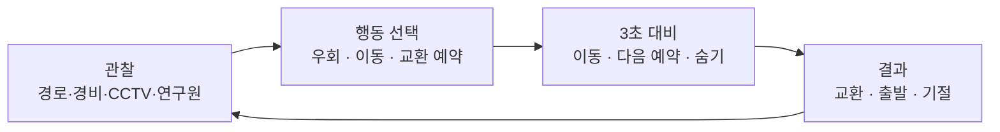

- 예약은 여러 개 쌓을 수 있습니다. 첫 교환을 기다리는 동안 두 번째를 예약해 "3초 뒤 A로, 6초 뒤 B로" 이어 갈 수 있습니다.
- 대비 시간에 하는 일이 없으면 3초는 지루한 대기가 됩니다. 방 설계는 **대비 시간에 할 일**을 반드시 만듭니다. 🟡 플레이 테스트로 확인

### 3.2 구역 탐색 루프 (몇 분 단위)

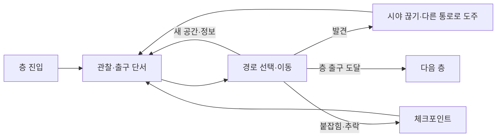

---

## 4. 시스템 규칙

### 4.1 예약 큐

지연된 모든 결과는 **예약(이벤트)** 으로 만들어져 하나의 큐에 들어가고, 시간순으로 처리됩니다.

| 예약 종류 | 언제 생기나 | 처리될 때 |
| --- | --- | --- |
| 교환 | 총알 명중, 던진 물체 명중 | 그 시각 나와 대상의 발 위치를 바꿈 |
| 출발 | 물체를 던짐 | 공중에 멈춰 있던 물체가 저장된 속도로 날아감 |
| 기절 | 뒤에서 제압 | 경비가 그 자리에서 쓰러짐 |

**처리 규칙**

1. 시각이 빠른 것부터 처리합니다. 같은 시각이면 먼저 예약한 것부터 처리합니다.
2. 교환은 예약한 순간이 아니라 **처리하는 순간의 위치**로 바꿉니다. 대상이 움직였으면 움직인 자리로 갑니다.
3. 연쇄 교환은 앞 교환으로 옮겨 간 자리를 기준으로 일어납니다.
4. **예외는 아무 일도 일어나지 않는 쪽으로 정합니다.** 대상이 사라졌거나(구덩이에 떨어짐) 내 손에 들려 있으면 그 교환은 조용히 취소됩니다.
5. 내가 붙잡히면 남은 교환 예약은 모두 취소됩니다. 이미 준 힘(출발·기절)은 취소되지 않습니다.

### 4.2 교환

- **교환을 일으키는 것:** 총알 명중(즉시 판정), 던진 물체가 날아가는 동안의 첫 충돌. 한 번 날아가는 동안 같은 대상은 한 번만 맞습니다.
- **교환 후 속도:** 💡 0으로 초기화. 실험 설정에서 "속도 유지"를 켜면 떨어지던 속도 그대로 옮겨 갑니다.
- **끼임 처리:** 교환 후 벽이나 철창에 겹치면 먼저 옆으로 밀어 내고, 그래도 겹치면 위로 올립니다. (경비가 나보다 몸이 넓기 때문)
- **경비와 교환하면:** 경비는 💡 1.2초 동안 멍해져서, 그동안 보지도 잡지도 못합니다.
- **공중에 멈춘 물체와 교환하면:** 나는 그 공중 자리로 가고, 물체는 내 자리로 와서 남은 대기 시간이 끝나면 그 자리에서 출발합니다. (힘은 물체를 따라감)

### 4.3 손의 힘

| 행동 | 규칙 | 지연 동안 |
| --- | --- | --- |
| 던지기 | 놓는 순간 그 자리에 3초 멈췄다가, 던진 속도로 날아감 | 공중에 떠 있고, 날아갈 궤적이 보임 |
| 뒤에서 제압 | 경비가 나를 보지 못할 때, 💡 1.8m 안에서 E. 3초 뒤 기절 | 경비는 아무것도 모른 채 하던 일을 계속함 |
| 정면 주먹 💡 | 경비가 나를 보고 있어도 💡 1.8m 안에서 E. 3초 뒤 경비가 내가 바라본 방향으로 💡 3m 밀려남. 쓰러지지 않고 멍함 | 경비는 이미 나를 보고 있으므로 그대로 붙잡으러 옴. 철창 너머처럼 손만 지나가는 곳에서만 안전 |

- 정면 주먹은 규칙 2(손의 힘은 3초 뒤)에 그대로 들어가므로 플레이어 규칙이 늘지 않습니다. 💡 본편 10개 방에는 넣지 않고 확장 요소로 둡니다. 예: 철창 너머 경비를 구덩이로 밀어 넣는 퍼즐.
- 제압한 경비가 다른 경비의 시야 안에서 쓰러지면, 본 경비가 그 자리로 달려옵니다.
- 쓰러진 경비는 움직이지 않는 대상이 됩니다. 쏘면 정확히 그 자리로 가는 **고정 발판**이 되고, 압력판 위라면 계속 누르는 무게가 됩니다.

### 4.4 총

- 처음에는 총이 없습니다. 잠든 경비에게서 **빼앗습니다.** 시작 공간의 경계·접근 방식은 9.2의 제작 상태와 검토 항목을 따릅니다.
- 쏘면 바로 날아갑니다. 시작 탄약은💡3발이며 잠입 구역의 자원 가안입니다. 새 층에서는 방마다 초기화되는 예약 횟수로 취급하지 않습니다.
- 💡 **탄약 보충:** 기존 방 원안은 통로마다 3발을 채웠습니다. 새 층별 잠입 구역에서는 일반 문·복도를 지날 때 자동 보충하지 않습니다. 안전 지점·층 전환 시의 보충 여부와 횟수는 진행 불가 및 무한 재보충을 확인한 뒤 정합니다. 시작 탄약3발도 검증 가안입니다.
- 탄약이 없으면 **총을 던질 수 있습니다**(Q). 던진 총도 손의 힘이므로 3초 멈췄다 날아가고, 맞은 것과 교환됩니다. 총은 대상 근처에 떨어지므로 교환 후 다시 줍습니다.
- 총이 구덩이에 떨어지면 다시 손에 돌아옵니다. (진행 불가 방지)
- 💡 총이 **손이 닿지 않는 곳**(높은 선반 위, 우리 안 등)에 멈춰도 구덩이와 똑같이 손에 돌아옵니다. 손이 닿지 않는 바닥은 레벨 데이터에 표시해 둡니다(`unreachable`).

### 4.5 경비

**상태**

| 상태 | 하는 일 | 보는가 | 잡는가 |
| --- | --- | --- | --- |
| 잠듦 | 그 자리에 있음 | ✕ | ✕ |
| 순찰 | 두 지점 사이를 왕복 | ○ | ○ |
| 경계 | 💡 0.35초 뒤, 범인 자리로 달려감 | ○ | ○ |
| 수색 | 💡 2.5초 동안 두리번거림 | ○ | ○ |
| 복귀 | 순찰 지점으로 걸어서 돌아감 | ○ | ○ |
| 추격 | 나를 향해 달려감. 💡 2초 놓치면 수색 | ○ | ○ |
| 멍함 | 교환 직후 💡 1.2초 | ✕ | ✕ |
| 기절 | 쓰러져 있음 | ✕ | ✕ |

**반응 규칙**

| 일어난 일 | 경비가 가는 곳 | 의미 |
| --- | --- | --- |
| 총에 맞음 | 쏜 곳 | 빠르지만 내 위치가 들킴 |
| 던진 것에 맞음 | 그 물체가 멈춰 있던 공중 지점 아래 | 느리지만 지연이 내 위치를 숨겨 줌 |
| 동료가 쓰러지는 걸 봄 | 쓰러진 자리 | 제압 위치를 골라야 함 |

**공통 규칙**

- 경비는 **스스로 낭떠러지에서 떨어지지 않습니다.** 땅이 없거나 높이 차가 큰 곳 앞에서 멈춥니다. 교환으로 허공에 놓였을 때만 떨어집니다.
- 붙잡기는 💡 0.9m 안에서, **손이 지나갈 틈**이 있을 때만 됩니다. 철창 너머로는 잡지 못합니다.
- 시야는 💡 5m · 좌우 40°이며, 벽과 단상에 가려지면 보지 못합니다.
- 💡 **앉기:** 플레이어가 앉아 있으면 경비에게 들키기까지 걸리는 시간이 늘어납니다. 현재 경비는 시야에 들어오면 바로 반응하므로, 발견 시간과 앉았을 때의 배율은 경비 감지를 구현할 때 함께 정합니다. 앉기는 낮은 통로를 지나가는 이동 수단이기도 합니다.
- **경비 행동에는 무작위가 없습니다.** 같은 상황이면 항상 같은 곳으로 갑니다. 이것이 7장의 미리보기가 가능한 조건입니다.

### 4.6 발판과 문

웹 프로토타입(코덱스 버전)의 압력판·셔터·감금 구역 아이디어를 하나의 규칙으로 정리합니다.

> **발판은 무게가 올라가 있는 동안 켜진다.** 켜진 발판은 연결된 문(셔터)을 연다.

| 올라간 것 | 무게 | 비고 |
| --- | --- | --- |
| 나 | ○ | |
| 무거운 궤짝 | ○ | 들 수 없음. 교환으로만 옮길 수 있음 |
| 쓰러진 경비 | ○ | 계속 누름 |
| 서 있는 경비 | ○ | 멍함이 끝나면 걸어 나가므로 잠깐만 누름 |
| 상자 | ✕ | 가벼움. 들어서 옮길 수 있으므로 무게로 치지 않음 |

- 핵심 활용: **궤짝을 맞히고, 교환되는 순간 판 위에 서 있는다 → 궤짝은 판 위로, 나는 궤짝 자리로.** 교환의 반대쪽(상대를 어디로 보내나)이 목표가 됩니다.
- 💡 **우리:** 바닥이 💡 1.2m 낮은 좁은 칸입니다. 감금 구역을 따로 만들지 않고 기존 규칙으로 표현합니다.
  - 경비는 낭떠러지에서 스스로 내려가지 않고, 올라오지도 못합니다. 나도 기어오르기(1.1m)로는 못 나옵니다. **우리에서 나오는 길은 교환뿐**입니다.
  - 교환으로 경비를 우리에 넣으면 그 경비는 계속 거기 있습니다.
  - 우리 바닥 전체가 발판이면, 갇힌 경비가 계속 누르는 무게가 됩니다(6·10번 방). 우리가 발판보다 넓으면 경비가 걸어서 발판을 벗어나므로, 우리 바닥은 통째로 발판으로 만듭니다.
- 💡 발판 종류: 유지형(밟는 동안), 고정형(한 번 밟으면 계속), 시한형(밟고 N초 동안). 본편은 유지형만.
- 💡 **문이 닫힐 때 그 자리에 있던 것은 밀어 냅니다.** 몸의 중심이 있는 쪽으로 밀고, 정확히 가운데면 들어온 쪽으로 밉니다. "닫히지 않음"으로 하면 상자를 문 밑에 끼워 발판 없이 문을 열어 두는 지름길이 생기기 때문입니다.
- **층 안 연결:** 일반 복도와 지원실은 양방향으로 오갈 수 있게 연결합니다. 방을 나왔다는 이유만으로 뒤 문을 닫거나 이전 구역을 초기화하지 않습니다. 방 사이 사격·교환은 실제 벽·문·유리·사거리로 판단하고, 구역을 넘었다는 이유로 일괄 취소하지 않습니다.
- 💡 **차폐 전실:** 제염실처럼 시설 용도가 있는 위치에만 앞뒤 문 연동을 검토합니다. 모든 방을 독립 퍼즐로 만드는 기본 규칙으로 쓰지 않습니다. 작동 시간·닫힘 처리·경비의 통과 규칙은 검증 대상입니다.
- **층 전환:** 계단·리프트·점검 사다리를 실제 평면 위치로 맞춥니다(9.0). 자동 탄약 보충·안전 저장·방송 발생은 각각 별도로 설정합니다.

### 4.7 실패와 체크포인트

- **실패:** 경비에게 붙잡힘, 구덩이로 추락.
- **처리:** 마지막 체크포인트로 돌아갑니다. 총은 다시 손에 돌아오고, 탄약은 체크포인트 때 이상으로 맞춥니다. 추격·경계 중이던 경비는 복귀 상태로 돌아갑니다.
- 💡 **체크포인트:** 포드 탈출·층 진입 등 주요 진행과 안전한 재시작 지점을 기준으로 둡니다. 일반 문마다 저장하지 않으며 경보 중 저장·적 상태 복원·탄약 보충은 별도 검증합니다. 발견만으로 즉시 실패하지 않고 도주·수색 대응을 이어갑니다.

---

## 5. 대상과 적

### 5.1 대상 종류

| 대상 | 들기 | 교환 | 무게 | 쓰임 |
| --- | --- | --- | --- | --- |
| 상자 | ○ | ○ | ✕ | 던지기 탄, 공중 발판 (던져서 띄우고 쏘기) |
| 무거운 궤짝 | ✕ | ○ | ○ | 압력판 누르기 |
| 총 | ○ | ○ | ✕ | 탄약이 없을 때 던지는 탄 |
| 경비(깨어 있음) | ✕ | ○ | ○ | 이동 수단, 함정에 빠뜨리기 |
| 경비(쓰러짐) | ✕ | ○ | ○ | 고정 발판, 압력판 누르기 |
| CCTV | ✕ | 🟡 | ✕ | 플레이어 감지 후 담당 경비를 호출. 본편 감시 역할로 사용. 교환·파괴·무력화 가능 여부는 별도 검증 |
| 연구원 | ✕ | 🟡 | 🟡 | 발견하면 도망가며 주변에 알림. 교환·제압·무게 판정은 역할과 별도로 검증 |
| 연구소장 | ✕ | ○ | ○ | 마지막 외부 출구의 엔딩 역할. 전투·추격 보스 AI를 추가하지 않음 |

### 5.2 경비 종류

2026-11-05 사용자 확정 역할: 경비병은 플레이어를 추격하고, CCTV는 경비를 호출하며, 연구원은 도망가면서 주변에 알립니다. 연구소장은 엔딩 역할입니다. 아래 경비 세부 타입과 최초 등장 방 번호는 기존 기믹 원안이며 새 층의 배치 수·순서로 확정하지 않습니다.

💡 알림 처리 가안: 연구원의 외침은 주변에서 들을 수 있는 경비에게, CCTV 알림은 담당 구역의 경비에게 전달합니다. 경비는 전달받은 마지막 발견 위치를 확인하고 직접 시야를 확보하면 추격합니다. 시야를 놓치면 수색합니다. 연구원의 피난·호출 지점과 도주 경로는 도면에 표시하며, 경비 반응처럼 동일한 입력·상태에서 예측 가능하게 처리합니다. 외침의 벽/문 감쇠·무전 지속·중복 호출·수색 시간은 미확정입니다.

| 종류 | 처음 상태 | 특징 | 처음 나오는 방 |
| --- | --- | --- | --- |
| 잠든 경비 | 잠듦 | 총을 차고 있음. 튜토리얼 전용 | 1 |
| 순찰 경비 | 순찰 | 기본형 | 2 |
| 단상 경비 | 순찰 | 높은 곳에 있어 아래에서는 서로 보이지 않음 | 4 |
| 방탄 경비 💡 | 순찰 | 총알로는 교환 안 됨. 맞으면 쏜 곳으로 달려오는 반응은 그대로. 던진 것만 통함 | 💡 10 |

- 방탄 경비는 경비 데이터 하나(`bulletproof`)로 검토한 기존 기믹 후보입니다. 새 잠입 평면에서의 사용 여부·필수 던지기 여부는 아직 확정하지 않습니다.

---

## 6. 데이터

형식: `기획 명칭 | 변수명 | 타입 | 초기값 | 비고`. 모든 초기값은 💡 가안입니다.

### 6.1 지연

| 기획 명칭 | 변수명 | 타입 | 초기값 | 비고 |
| --- | --- | --- | --- | --- |
| 교환 지연 | swapDelay | float | 3 | 초. 맞은 순간부터 |
| 손 힘 지연 | forceDelay | float | 3 | 초. 던지기 출발·제압 기절까지 |

### 6.2 플레이어

| 기획 명칭 | 변수명 | 타입 | 초기값 | 비고 |
| --- | --- | --- | --- | --- |
| 이동 속도 | moveSpeed | float | 4.6 | m/s. 던지기 충전 중 60% |
| 점프 속도 | jumpSpeed | float | 6.6 | m/s |
| 손 닿는 거리 | reach | float | 2.6 | m. 줍기·빼앗기 |
| 제압 거리 | takedownRange | float | 1.8 | m. 수평 거리 |
| 기어오르기 높이 | mantleHeight | float | 1.1 | m. 물체 위로 |
| 정면 주먹 거리 | punchRange | float | 1.8 | m. 확장 요소 |
| 정면 주먹 밀기 | punchPush | float | 3 | m. 3초 뒤 경비가 밀려나는 거리 |
| 앉은 높이 | crouchHeight | float | 💡 1.2 | m. 서 있는 높이 1.8. 앉아야만 지나가는 통로는 이보다 높고 1.8보다 낮게 설계 |
| 앉아서 이동 속도 | crouchSpeed | float | 💡 3.0 | m/s. 걷기의 60%. Unity 테스트 걷기 5.0 기준 가안 |
| 앉아서 달리기 속도 | crouchSprintSpeed | float | 💡 4.5 | m/s. 달리기의 60%. 앉은 채 앞으로 이동하며 달리기 키. Unity 테스트 달리기 7.5 기준 가안 |

### 6.3 총 · 던지기

| 기획 명칭 | 변수명 | 타입 | 초기값 | 비고 |
| --- | --- | --- | --- | --- |
| 탄약 | ammo | int | 3 | 빼앗을 때 받는 수 |
| 탄약 보충 | ammoRefill | int | 3 | 기존 원안 값. 새 잠입 구역의 보충 위치·횟수는 검증 후 결정 |
| 조준 보정 반경 | aimAssist | float | 0.2 | m. 교환할 수 있는 대상의 판정을 이만큼 넓힘 |
| 사거리 | gunRange | float | 30 | m. 즉시 판정 |
| 최소 던지기 속도 | throwMin | float | 4 | m/s |
| 최대 던지기 속도 | throwMax | float | 12 | m/s |
| 최대 충전 시간 | chargeTime | float | 0.9 | 초 |
| 던지기 보정 각 | throwLift | float | 10 | 도. 조준보다 위로 |
| 중력 | gravity | float | 20 | m/s² |

### 6.4 경비

| 기획 명칭 | 변수명 | 타입 | 초기값 | 비고 |
| --- | --- | --- | --- | --- |
| 걷는 속도 | walkSpeed | float | 1.0~1.5 | m/s. 경비마다 |
| 달리는 속도 | runSpeed | float | 3.0 | m/s. 경계·추격 |
| 반응 시간 | reactTime | float | 0.35 | 초. 맞고 달려가기까지 |
| 수색 시간 | searchTime | float | 2.5 | 초 |
| 멍함 시간 | confusedTime | float | 1.2 | 초. 교환 직후 |
| 시야 거리 | visionRange | float | 5 | m |
| 시야 각 | visionAngle | float | 40 | 도. 좌우 각각 |
| 놓침 시간 | loseTime | float | 2 | 초 |
| 붙잡기 거리 | catchRange | float | 0.9 | m |
| 방탄 | bulletproof | bool | false | 방탄 경비만 true. 총알에 맞아도 교환 없이 반응만 |

### 6.5 발판 · 문

프로토타입에 없던 값입니다. 5·6번 방(9.6·9.7)을 설계하며 정한 초안입니다.

| 기획 명칭 | 변수명 | 타입 | 초기값 | 비고 |
| --- | --- | --- | --- | --- |
| 발판 크기 | plateSize | float | 1.5 | m. 정사각형 |
| 문 열리는 시간 | doorOpenTime | float | 0.3 | 초 |
| 문 닫히는 시간 | doorCloseTime | float | 0.3 | 초. 무게가 빠진 뒤 다 닫히기까지 |
| 궤짝 크기 | crateSize | float | 1.0 | m. 정육면체 |
| 우리 깊이 | penDepth | float | 1.2 | m. 기어오르기 높이(1.1)보다 커야 함 |
| 우리 크기 | penSize | float | 2.4 | m. 정사각형. 바닥 전체가 발판. 가장자리에 멈춘 경비와 반대쪽 벽 사이가 붙잡기 거리(0.9)보다 멀어야 함 |

- **방 설계 규칙:** 발판에서 문까지 걷는 거리는 `moveSpeed × doorCloseTime`(4.6 × 0.3 ≈ 1.4m)보다 충분히 길어야 합니다. 이보다 가까우면 발판을 밟고 뛰어서 문을 지나가는 지름길이 생깁니다.

---

## 7. UI · 피드백

### 7.1 원칙

> **계산은 전부 미리 보여 주고, 확정한 뒤에는 보여 준 그대로 일어난다.**

공식은 숨기고 결과를 보여 줍니다. 플레이어는 "왜"를 몰라도 "무엇이 언제 일어날지"는 알 수 있어야 합니다.

큰 방 이름·번호와 풀이를 직접 설명하는 월드 표지는 기본으로 두지 않습니다. `WEIGHT REQUIRED`, `SWAP REQUIRED`, 예약 순서와 경비 역할을 설명하는 표지 대신 공간 배치와 상태 변화로 상황을 파악하게 합니다. 실제 출구·계단·리프트, 추락 위험과 피험체 식별처럼 시설 안에 필요한 표식만 최소한으로 남깁니다.

방 이름은 표시하지 않고 시작합니다. 💡 플레이 테스트에서 필요성이 확인되면 첫 진입 때 작은 UI로 잠깐 표시합니다. 조작·상호작용 안내도 필요한 대상을 바라보거나 접근했을 때만 보여 주는 방향이며, 이번 표지 정리에서 새 UI나 상호작용 기능을 구현하지는 않습니다. 안내가 부족한 지점은 실제 플레이 테스트를 통해 보충합니다.

### 7.2 요소

| 요소 | 보여 주는 것 | 언제 |
| --- | --- | --- |
| 예약 타임라인 | 앞으로 7초 안의 교환·출발·기절을 시간순으로 | 항상 (화면 아래) |
| 미래의 나 | 예약된 교환마다 그 시각 내가 설 자리. 발밑이 비면 빨간색 | 예약이 있을 때 |
| 쏘면 미리보기 | 지금 쏘면 3초 뒤 내가 설 자리 (경비가 달려오는 반응 포함) | 총으로 대상을 겨눌 때 |
| 던지기 명중 예측 | 3초 대기 + 비행 뒤 경비가 있을 자리. 맞으면 궤적이 보라색, 빗나가면 경비의 그때 위치 | 던지기 충전 중 |
| 공중 대기 표시 | 회전하는 링, 남은 초, 바닥까지 지지선, 날아갈 궤적 | 물체가 멈춰 있을 때 |
| 경비 상태 | Zz(잠듦) · !(경계) · !! 추격 · ?(수색) · ?!(멍함) · 기절 남은 초 | 항상 |
| 경비 시야·동선 | 검증 모드의 바닥 부채꼴·순찰 점선. 본편에서 관찰 범위 밖 정보를 어디까지 보여 줄지는🟡 | 검증 모드 / 본편 범위 미정 |
| 교환 예약 표시 | 대상 머리 위 보라색 링 | 예약이 있을 때 |
| 탄약 | 화면 오른쪽 위 ●●○ | 총을 가졌을 때 |
| 발판·문 연결 💡 | 발판에서 문까지 바닥에 이어진 선(꺼짐 회색 · 켜짐 노란색), 문 위 램프 | 항상 |
| 시야 창 💡 | 맞힌 대상의 시야를 화면 오른쪽 아래 작은 창으로. 다른 경비가 오는지 보며 다음 행동을 짬 | 맞힌 순간부터 교환까지 3초. B안 중심, A안에서도 실험 |

- 🟡 시야 창에서 정할 것: 예약이 여러 개일 때 어느 창을 보여 줄지(먼저 처리될 것 / 전환), 눈이 없는 물체(상자)는 무엇을 보여 줄지.

- 🟡 **미리보기를 어디까지 보여 줄지**가 핵심 밸런스입니다. 너무 친절하면 퍼즐이 "표시 맞추기"가 되고, 없으면 너무 어렵습니다.
- 💡 **검증 모드 초안:** 기믹 검증에서는 정보를 전부 표시하고 「미리보기 줄이기」로 켬/끔을 비교합니다. 새 잠입 본편에서는 보지 못한 방의 경비·연구원·출구 정보를 자동으로 공개할지 별도 검증합니다. 예약 타임라인과 이미 보여 준 교환 결과의 신뢰성은 유지합니다. 탐색 정보의 범위와 교환 예측 정확도를 같은 설정으로 묶지 않습니다.

---

## 8. 조작

| 입력 | 동작 |
| --- | --- |
| 마우스 | 둘러보기 |
| W A S D · Space | 이동 · 점프 |
| 왼쪽 Shift | 누르고 있는 동안 달리기(앞으로 이동할 때만) |
| C | 앉기 · 일어서기 (토글). 머리 위 공간이 없으면 일어서지 않고 앉은 채 유지 |
| 왼쪽 클릭 / F | 총 쏘기(즉시). 상자를 들고 있으면 누르고 있다 떼서 던지기 |
| E | 총 빼앗기 · 줍기 · 들키지 않은 경비 뒤에서 제압 · (💡 확장) 보고 있는 경비에게 정면 주먹 |
| Q | 누르고 있다 떼면 총 던지기 |
| R | 방 처음부터 |

- 🟡 1인칭 조준이 퍼즐을 방해하는지 테스트 후, 조준 보정 여부를 정합니다.
- 💡 **초안:** 교환할 수 있는 대상은 판정을 0.2m 넓힙니다(6.3 `aimAssist`). 조준점을 끌어당기는 보정은 하지 않습니다. 쏘면 미리보기가 떠 있으면 반드시 맞습니다(보이는 판정과 실제 판정이 같음). 효과는 플레이 테스트(11장 2번)에서 확인합니다.

---

## 9. 층별 공간과 기믹 검증 원안 💡

새 공간 제작은9.0의 잠입·탐색 평면을 따릅니다. 아래 방1~10의 목록과9.2~9.11은 기존 능력 학습·단일 풀이 검증 원안입니다. 새 층에서 모든 방을 이 순서대로 풀거나 같은 금지 조건을 적용해야 한다는 뜻은 아닙니다. 학습에 필요한 상황을 골라 실제 시설 구역에 통합합니다.

| # | 방 | 시설 공간 💡 | 새로 배우는 것 | 풀이 핵심 |
| --- | --- | --- | --- | --- |
| 1 | 감방 | 피험체 격리실 | 총 빼앗기, 쏘기 → 3초 뒤 교환 | 쏜 경비가 격리 경계로 달려오고, 교환되면 경비가 격리 공간 안에 갇힘. 유리 관찰 포드의 상호작용 경로는 9.2에서 검토 |
| 2 | 구덩이 | 냉각조 연결 통로 | 경비는 낭떠러지 앞에서 멈춤 | 건너편 경비를 쏴서 건넘. 보너스: 교환 직전 구덩이로 뛰어들면 경비가 대신 떨어짐 |
| 3 | 순찰 복도 | 관찰 복도 | 시야, 뒤에서 제압 | 시야 밖으로 다가가 제압. 3초 뒤 어디서 쓰러질지 계산 |
| 4 | 단상 | 관제 데크 | 높이와 시야 가림 | 단상 바로 밑에서는 서로 안 보임. 조금 물러나야 쏠 수 있음 |
| 5 | 압력판 | 시료 저장고 | 무거운 궤짝, 무게 | 궤짝을 쏘고 3초 안에 판 위에 서면 궤짝이 판 위로 |
| 6 | 셔터 | 오염 제거 에어록 | 우리, 서 있는 경비도 무게 | 우리 안 발판에 서야 셔터 너머가 보임. 쏘고 기다리면 경비는 우리로, 나는 밖으로 |
| 7 | 던진 상자 | 원심분리기 홀 | 교환은 처리하는 순간의 위치로 | 상자를 구덩이 너머로 던짐. 아직 떠 있을 때 쏴도 3초 뒤엔 건너편 착지점으로 |
| 8 | 소리 없는 손 | 중앙 관제실 | 던지기로 위치 숨기기 | 단상 뒤에서 던져 맞히면 경비는 뒤쪽 가장자리로 오고 나는 출구 옆에 내림. 앞에서 쏘면 다른 경비 시야에 내림 |
| 9 | 연쇄 | 피험 챔버 | 예약 2개 이상, 순서 | 상자 → 경비 순서로 미리 예약해야 경비가 발판 부스에 갇힘 |
| 10 | 탈출 | 출입 검문소 | 종합 (+ 방탄 경비) | 제압으로 다가가 우리에 뛰어들고, 방탄 경비를 던져 맞혀 가둠. 마지막 한 발로 연구 책임자와 바뀜 |

- 1, 2, 4번은 웹 프로토타입에서 이미 동작을 확인했습니다. 3번 제압도 스크립트로 확인했습니다.
- 5, 6번은 코덱스 프로토타입의 01·03 실험에서 출발해 무게·우리 규칙으로 다시 정리한 것입니다.
- 💡 6·7·8번의 처음 안을 바꿨습니다. 6번 "던진 것이 지나갈 땐 판 위에"는 총으로 쏘면 판 위에서 바로 풀려서, 7번 "상자를 높이 던져 두고 쏘기"는 공중에서 바뀌면 떨어지기만 해서, 8번 "탄약 0"은 총을 빼앗는 예외 규칙이 따로 필요해서입니다. 바꾼 이유는 각 방 점검표에 있습니다.
- 💡 시설 공간: 퍼즐 장치를 연구 시설 안에 있을 법한 공간으로 다시 해석한 이름입니다. 배치·수치는 바꾸지 않았습니다(구덩이 → 냉각조·수직갱·기계실, 단상 → 관측 데크·관제 데스크, 우리 → 세척·검색 피트 등).
- 평면도: `Docs/도면/`의 SVG(건축 평면도 양식). `make_plans.py`로 배치 표에서 다시 그립니다.
- 모든 방에 도면 초안이 있습니다(9.2~9.11). 3번과 6~10번은 새 설계라 전부 💡이고, 프로토타입으로 확인하지 않았습니다.

**층 배치 💡**

지하에서 지상으로 올라가며 탈출합니다. 떨어지는 것(구덩이)이 실패라서 "위로 = 목표, 아래로 = 위험"이 직관적으로 맞고, 위험한 피험체를 가장 깊은 곳에 격리한다는 시설 논리(1.4)와도 맞습니다.

| 층 | 이름 | 방 | 위층으로 가는 길 |
| --- | --- | --- | --- |
| B5 | 격리층 | 실험체 격리·기본 측정/실험·상태 관리 · 냉각조 연결 통로 | 2번 방 북쪽 계단 |
| B4 | 능력 측정·발달·강화층 | 정밀 측정·능력 발달/강화 시험·진행 기록·관찰/분석·지원실 | 독립 계단B 구간으로 B3 |
| B3 | 시료층 | 5 시료 저장고 · 6 오염 제거 에어록 | 6번 방 북쪽 화물 엘리베이터 |
| B2 | 기계층 | 원심분리기 홀·중앙 관제실·설비 구역 | 관제실 점검 사다리 → B1 남측 관찰 부스 |
| B1 | 실험층 | 피험 챔버·준비실·기록실·관찰 부스 | 계단B의 독립 비상계단 구간으로 1F |
| 1F | 지상 | 10 출입 검문소 | 외부 출구 |

- 층 전환의 위치·연결 구간은9.0의 새 평면을 따릅니다. 탄약 보충·체크포인트·층 사이 연출은 각각 검증합니다.
- 같은 층에서는 복도와 지원실을 여러 경로로 연결합니다. 모든 주요 방을 정해진 순서로 통과할 필요는 없습니다.

### 9.0 연구소 잠입·탐색 공간 구성 💡

외딴 폐공장 아래의 지하5층 연구소에서 출구를 찾습니다. 층별 시설 용도와 B5→1F 진행을 유지하며, 지원실·직원 복도·관찰 위치·돌아오는 연결을 실제 실내로 만듭니다. 감시를 피하며 경로를 판단하는 것이 주된 퍼즐입니다. 새 원형 공동·터널 설계의 진행 상황은 [현재 작업 목록](회사_작업목록_2026-11-06.md)을 따릅니다.

#### 바닥 안내선과 기록을 통한 길 찾기 — 사용자 합의

- 넓은 시설을 이용하는 경비·연구원·작업자를 위해 바닥에 실제 업무용 안내선을 둔다. 직원 이동·시료 운반·정비 등 용도로 구분하고, 색과 함께 선 모양·코드를 사용한다.
- 행정·감독·인수인계 기록에서 안내선과 목적지의 관계를 알 수 있게 한다. 플레이어는 이를 읽고 지상 출입 구역으로 이어지는 노선을 추론한다.
- 안내선은 시설의 이동 방향을 알려 준다. 해당 통로에도 경비·CCTV·연구원이 있으므로 주변을 관찰하고 우회한 뒤 같은 안내선에 다시 합류할 수 있게 설계한다.
- 먼지·닦임·바퀴 자국·부분 마모는 실제 사용 위치에 맞게 표현하되, 갈림길·문·계단의 핵심 표식은 읽을 수 있게 남긴다.
- 💡 선의 개수·색·패턴·코드·기록 문구와 정확한 경로는 새 설계도 설명 후 확정한다. 앞서 언급한 흰색 이중선은 예시이며 확정 색상이 아니다.
- 현재는 설계 기준만 채택했다. 도면 표기·Unity 배치·UI·미니맵·게임 코드는 아직 적용하지 않았다.

#### 관찰·생활·순환 공간 — 사용자 합의 방향

- 문 관찰창·데크 등에서 진입 전에 상황을 살필 수 있게 하고, 직원의 업무 동선을 관찰해 이동 기회를 판단하게 한다. 구체적인 업무 주기·타이밍은💡 가안이다.
- 우회로는 기존 안내선이나 기억할 수 있는 장소에 다시 연결한다. 주 동선에서 벗어나 기록을 읽고 다음 구간을 살필 공간을 둔다. 절대 안전 구역 여부는 아직 정하지 않는다.
- 다른 실험체의 침구·식판·작은 개인 흔적과 연구원의 기록을 연결해 실제 생활과 시설의 비윤리성을 공간으로 드러낸다.

#### B2 냉각·펌프 공동의 메자닌 — 사용자 합의

외부 원형 공동 설계 V0.02에서 B2는 전력·공조·물·폐기물 처리층이며, 핵심 C02가 「냉각·펌프 공동」이다. 배관이 모인 구역을 복층으로 만드는 우선 대상은 이 공동으로 잡고, 최종 적용 범위는 사용자 설계도 설명과 함께 확인한다. B2 안의 하부 설비 구역과 상부 정비 메자닌이며 B2·B1 사이의 층간 이동과 구분한다.

- **하부:** 펌프·탱크·배관 헤더 사이를 이동한다. 설비 몸체와 배관 묶음으로 시야를 끊고, 틈과 열린 중앙부에서는 상부 이동을 확인할 수 있게 한다.
- **상부:** 스틸 그레이팅 보행면에서 하부를 내려다보며 이동한다. 아래 경비도 위의 이동을 관찰할 수 있다. 그레이팅과 난간만 있는 구간을 완전한 엄폐로 취급하지 않는다.
- **💡 부분 복층:** 원형 공동의 일부를 둘러가는 정비 데크와 연결 보행교를 후보로 둔다. 큰 설비가 보이는 중앙 공간을 남기고, 불투명한 작업 발판·제어반·배관 묶음으로 관찰 위치와 숨을 위치를 나눈다. 양쪽에서 모두 모든 곳이 보이는 배치를 피한다.
- **💡 왕복 경로:** 떨어진 위치의 계단 두 곳을 후보로 삼아 하부 진입 → 한쪽 계단으로 상승 → 상부 우회 → 다른 계단으로 하강 → 출구 방향 재합류의 순환을 만든다. 높이 전환을 이용해 적을 피할 수 있게 하되, 적의 실제 추적 가능 범위와 감지 규칙은 이후 사용자 구현 때 정한다.
- **구조 외형:** 기둥·주보·보조보·그레이팅 패널 테두리·받침·연결판·볼트, 계단참·난간·발끝막이까지 지지 관계가 보이도록 모델링한다. 대형 펌프·탱크는 하부에 두고, 상부는 정비 보행과 작업 영역을 중심으로 검토한다. 그레이팅 구멍만 반복한 판으로 끝내지 않는다. 새 예각은 베벨하고 사용 흔적·금속 재질·연결부를 검수한다.
- **💡 시야와 단면 검수:** 상부 전체가 안전한 전망대가 되거나 하부 전체가 사각지대가 되지 않게 한다. 플레이어와 경비의 눈높이에서 격자·보·장비가 만드는 가시 구간을 확인한다. 추후 감지 판정도 화면에서 보이는 차폐와 맞추도록 검토한다. 곡면 천장 아래 머리 공간, 계단 출입, 설비 정비 공간과 안내선 연결을 단면·평면에 함께 표시한다.
- 메자닌 높이·폭·지지 부재 치수·격자 간격·계단 위치·프랍 수량은 미정이다. 새 외부 설계 데이터·도면, Unity 씬·에셋, 게임 C#·AI·UI는 이번 단계에서 변경하지 않는다.

#### B5 기본 관리와 B4 심화 연구 — 사용자 확정

2026-11-08 사용자 결정이다. B5와 B4 모두 측정·실험을 수행하며, 목적과 정밀도 및 기록 범위로 역할을 나눈다.

| 층 | 확정 용도 | 측정·실험의 목적 |
| --- | --- | --- |
| B5 격리층 | 실험체 수용·격리와 기본 관리 | 기본적인 측정·실험으로 실험체의 상태와 능력을 파악하고 관리한다. 기존 실험동과 의료검사·격리 구역을 이 역할로 유지한다. |
| B4 능력 측정·발달·강화층 | 정밀 측정과 발달·강화 진행의 심화 연구 | 각 실험체의 능력을 정밀하게 측정하고 발달시키기 위한 자료를 모으며, 발달·강화 진행도를 기록한다. B5의 기본 측정 결과를 토대로 더 깊이 연구하는 층이다. |

B4를 단순 관찰·일회성 능력 검사로 한정하지 않는다. 실험체별로 반복 측정한 결과와 발달·강화 진행을 비교할 수 있는 공간이 필요하다. 연구 자료를 작성·분석하는 B4의 역할과 B3 E02 주 서버·관측 데이터 보관의 역할은 함께 유지한다. B1의 별도 연구·통제·직원 운영 범위는 이번 결정으로 새로 확정하거나 바꾸지 않는다.

**💡 기존 B4 공간의 후속 제작 방향 — 상세 방식은 미확정**

| 기존 구역 | 새 목적에 맞춘 검수 방향 |
| --- | --- |
| C01 중앙 관찰 공동 | 정밀 측정 중인 실험체와 이를 관측·제어하는 연구원이 구분되는 중심 시험 공간 |
| W01 투척 지연 / W02 궤적 / W03 반응시간 | 같은 실험체의 반복 시험과 조건별 변화, 발달·강화 전후 차이를 읽을 수 있는 계측 공간 |
| C02 진단 / E03 진단·회복 | 심화 시험 전후의 상태 확인과 회복 관찰. 기본 관리층의 상시 의료 업무와 구분 |
| C04 분석 / E01 영상 판독 | 정밀 계측·영상 비교를 통해 능력 변화와 진행도를 분석하는 작업 구역 |
| C05 기록 / N01 통합 관찰 | 실험체별 측정 회차·조건·결과·진행도를 연결해 기록·검토하는 구역 |
| C03 지원 / E02 연구원 작업 | 측정 장비 교정·준비와 시험 조건·기록 검토 |
| S01 차폐 실험 | 차폐가 필요한 능력 측정·발달 시험. 구체적 강화 수단·부하·위험 조건은 후속 설계 |

💡 화면·기록 표현에는 실험체 식별자, 측정 회차, 시험 조건, 기준값 대비 변화와 상태를 후보로 둔다. 강화 방식·약물·장치·성공 조건·게임 기믹·능력 성장 수치는 아직 정하지 않았다. 기존 정적 모니터와 장비를 실제 작동 구현으로 간주하지 않는다.

기존13돔·3코어·22복도는 유지한 채 이 용도를 기준으로 후속 외형을 검수한다. 이번 변경에서는 Unity 씬·에셋·런타임 코드·기존 도면 좌표를 수정하지 않는다.

#### 층별 공간 특색과 분위기·색감

**사용자 요청 원칙:** 각 층은 시설 역할에 맞는 구조적 특색을 갖고, 그에 따라 분위기와 색감을 구분한다. B2의 상하 메자닌처럼 플레이어가 공간을 이용하는 방법까지 달라지게 한다. 원형 공동·반구 돔·터널과 공용 문·설비의 제조 양식은 같은 연구소의 기반으로 유지한다.

아래 색감과 B3 소등 방향은2026-11-06 사용자 수정안을 우선한다. 구체적인 재질 수치·광량·광원 위치는💡 제작 가안이다. Reference_004의 곡면 실내 분위기를 유지한다.

| 층 | 기억할 구조와 잠입 경험 💡 | 재질·바탕색·부분 강조색 💡 | 빛과 분위기 💡 |
| --- | --- | --- | --- |
| B5 격리 | 작은 격리·생활 구획과 이를 보는 관찰 공간. 문·창 너머를 확인하며 통제 구역을 빠져나간다. | 창백한 흰색·옅은 청색 무광 패널·유리. 개인 생활 흔적과 반복된 청소 자국. | 낮은 채도의 청백색과 절제된 백색 작업광. 실험체가 격리되어 생활하는 차갑고 창백한 분위기. |
| B4 능력 측정·발달·강화 | 정밀 측정과 발달·강화 진행을 기록하는 큰 시험 공동·관찰창·데크. 시험 구역과 옆쪽 관찰·준비 통로의 시야를 비교한다. | 무채색 회색·흑연색·검은 장비·유리와 무광 금속. 기존 청회색 강조안은 대체한다. | 어두운 연구 공간에서 시험 대상·조작부·기록 지점만 중성 작업광으로 읽히게 한다. |
| B3 시료·분석·기록 | 랙·냉동고 사이의 보관 통로. 사람이 적은 창고에서 구역 조명을 켜며 길과 시료를 파악한다. | 어두운 중성 회색 보관 설비·금속·흰 작업면. 카트 마찰·손잡이 마모·닦임 흔적. | 보관부는 기본 소등, 구역별 점등. 출입부·계단·스위치 위치는 최소 안내광, 실제 시료 처리 작업대·제염부는 별도 작업광. |
| B2 기계 | 펌프·탱크·배관을 감싸는 그레이팅 메자닌. 상하 관찰과 계단을 이용한 우회·재합류. | 짙은 철색·아연도금 회색·낡은 도장. 접합부의 국부적인 기름때·먼지·산화 흔적. | 붉은 보조 조명과 중성 정비등. 밸브·계단·통행 경계가 읽히게 하고, 상시 붉은 등과 경보는 위치·점멸로 구분하도록 후속 설계한다. |
| B1 연구·통제·직원 운영 | 관제·기록·실험 공간과 직원 생활 구역이 맞물린다. 유리 너머 관찰과 직원 업무 흐름을 읽는다. | 따뜻한 회색·아이보리·낮은 채도의 갈색 가구와 직물. 정밀 실험부는 유리·스테인리스 유지. | 직원 구역은 부드러운 따뜻한 빛, 연구부는 중성 작업광. 사람이 생활하는 편안함과 감시 공간의 긴장 공존. |
| 1F 폐공장 위장 | 큰 공장 공동·폐설비·상부 창. 외부 방향을 짐작할 수 있지만 사용 중인 검문 동선을 피해 이동한다. | 먼지 낀 콘크리트 회색·녹슨 갈색·벗겨진 짙은 녹색 도장. 방치된 구역과 최근 사용 흔적의 차이. | 가안인 시간대에 맞춘 외광과 일부 살아 있는 작업등. 지하와 다른 공기감, 출구가 가까워지는 느낌. |

- 층의 대표색은 벽 일부·설비 도장·가구·직물 등 실제 표면에 배분한다. 중성 바탕과 재질 차이를 유지하고, 조명은 작업 위치·시야·분위기를 함께 고려해 조정한다. 한 층 안에서도 작업실·직원실·정비실의 용도 차이를 남긴다.
- 바닥 안내선의 색·선 모양·코드는 모든 층에서 같은 용도를 뜻하게 한다. 층별 분위기 색과 혼동하지 않도록 구분하고, 경보·위험·출구 표식의 의미도 일관되게 유지한다. 현재 Decision 설계의 R1 흰 이중선(#DEE6E9), S1 청록 단선·사각(#5E9C9A), M1 황토 점선(#BC9B5A)을 C01에 적용했다. 다른 공동·층의 실제 경로 좌표는 해당 구역 제작 때 검수한다.
- 이전의 과도한 밝기 문제를 반영해 광원 수·노출·발광·반사를 함께 검토한다. 어두운 분위기에서도 문·계단 끝·엄폐물 경계·적의 실루엣은 읽을 수 있어야 한다. 그림자의 어두움과 실제 시야 차단·AI 감지 판정은 구분하며 새로운 감지 기능을 가정하지 않는다.
- 도면 확정 후 각 층의 대표 구역 하나에서 먼저 구조·재질·조명 시안을 비교한다. 색을 제거한 화면에서도 공간의 실루엣과 배치로 층을 구별할 수 있는지, 연속 이동 시 같은 시설로 느껴지는지 검수한 뒤 확대한다. 색상 수치·광량·광원 위치·구체적 배치는 미정이다.

#### B5 구역 명칭과 안내선 연결 — 초안

2026-11-07 사용자 확정 방향: 구역 분할·이름 → 각 노선의 출발/경유/목적지 → 돔 사이 전체 연결 → 안내선 표면 제작 순서로 진행한다. 구역명은 안내선 위·옆의 바닥 도장으로 표현하며 별도 구역 명판을 제작·부착하지 않는다. 실험동 안내선과 다른 돔 안내선, 목적지 글자가 겹치지 않아야 한다.

사용자의 다음 작업 진행 요청에 따라 아래 5섹터 구분과 목적지 이름을 전체 안내선 배치안의 작업 기준으로 사용했다. 기존 돔 위치·연결·내부 관리 코드는 유지한다. 중앙 C와 서측 W·동측 E·북측 N·남측 S를 상위 섹터로 읽고 개별 돔을 목적지로 사용한다. 구체적인 바닥 도장 배치와 노선 구분 방식은 위 V0.01 검토안을 따른다.

| 섹터 코드 | 섹터 이름 제안 | 포함 돔과 목적지 이름 제안 |
| --- | --- | --- |
| C | 중앙 실험·운영 | C01 실험동 / C02 보안관제동 / C03 냉각설비동 / C04 유틸리티동 |
| W | 격리·의료 | W01 제1격리생활동 / W02 제2격리생활동 / W03 의료검사동 |
| E | 생활지원 | E01 물자보급동 / E02 급식지원동 / E03 제염동 |
| N | 중앙관제 | N01 중앙관제동 |
| S | 폐쇄시험 | S01 폐쇄시험동 |

C01의 사용자 호칭 ‘실험동’은 유지한다. 다른 표시 이름과 상위 섹터 경계는 제안이다. VA 계단 A·VB 계단 B·VL 화물 승강기는 공용 이동 목적지로 별도 관리하고, T01~T19는 연결 복도 식별자로 유지한다. 기존 R1/S1/M1은 업무 용도 코드이며 C01/W01 등의 목적지 코드와 뜻을 혼동하지 않도록 표기 체계를 정한다. S1 시료 노선과 S01 남측 시험동도 글자 형식·배치로 구분해야 한다.

전체 노선 설계 시 확인할 사항:

- 필요한 직원 이동·시료 인계·정비 동선을 목록화하고 출발점·경유지·실제 도착점을 명시한다. 돔 출입부에서 임의로 끊긴 선을 완성된 안내선으로 판정하지 않는다.
- 모든 돔의 노선을 같은 평면도에 겹쳐 검토하되, 실제 바닥에서는 선·화살표·글자가 서로 포개지지 않도록 배치한다.
- 공용 복도에는 노선별 평행한 표시 공간과 읽을 수 있는 간격을 확보하고, 구간마다 선의 좌우 순서가 뒤바뀌어 교차하지 않도록 한다. 폭·간격 수치는 실제 복도와 통행 여유를 확인한 뒤 정한다.
- 분기점에 도착하기 전 목적지와 방향을 읽을 수 있어야 하며, 분기 뒤와 목적지 입구에서도 같은 코드를 확인할 수 있어야 한다. 분기·합류 지점의 표기 방법은 전체 경로도에서 검토한다.
- 다른 목적지의 선을 같은 색이라는 이유로 포개지 않는다. 색 외에도 목적지 이름·코드·선 모양을 함께 사용한다.
- 계단·승강기에서 층이 바뀌는 연결은 실제 층간 구조와 일치시킨다. B5의 계단 입구까지 연결한 것을 지상 출입구까지 연결한 것으로 보고하지 않는다.

이 변경은 설계 기준과 명칭 초안 기록이다. Unity 씬·기존 출입부 소형 코드판·게임 코드는 이번 논의에서 수정하지 않았다. 다음 작업은 명칭과 목적지 정리 → B5 전체 노선 설계 및 겹침 검토이며, 복도별 아트 마감은 그 결과를 따른다.

#### 기존 제작 도면과 검증 이력

**기존 Unity 제작에 사용한 도면은 `도면/잠입_탐색/`의6개 층별 SVG와 `layout.json`입니다.** 새 원형 공동 설계와 좌표·치수를 혼용하지 않습니다. JSON에는 방 범위, 출입구 양쪽 실내, 문 상태, 가림물, 순찰, CCTV, 연구원 도주 경로를 같은 좌표로 기록합니다. 원본6개 Unity 씬은 보존했으며, 새 `Level_B5_Stealth.unity`와 `Level_B4_Stealth.unity`에 B5·B4 평면을 별도로 제작했습니다. 기존 `01_감방.svg`~`10_탈출.svg` 및9.2~9.11은 기믹 검증 원안입니다.

| 층 | 최신 도면 | 주요 선택 |
| --- | --- | --- |
| B5 | [격리층 SVG](도면/잠입_탐색/B5_격리층_잠입.svg) · [PNG](도면/잠입_탐색/B5_격리층_잠입.png) | 격리실·초소·전실·모니터링·유틸리티를 연결. 냉각조 교환 후 위치와 직원 복도 보행 경로 비교 |
| B4 | [관찰층 SVG](도면/잠입_탐색/B4_관찰층_잠입.svg) · [PNG](도면/잠입_탐색/B4_관찰층_잠입.png) | 관찰실·복도·분석실·데크·지원실을 연결. 먼저 관찰할 위치와 접근 방향 선택 |
| B3 | [시료층 SVG](도면/잠입_탐색/B3_시료층_잠입.svg) · [PNG](도면/잠입_탐색/B3_시료층_잠입.png) | 랙 사이와 냉동/전처리/폐기물/환복실 연결. 연구원 전파와 제염실 접근 방향 판단 |
| B2 | [기계층 SVG](도면/잠입_탐색/B2_기계층_잠입.svg) · [PNG](도면/잠입_탐색/B2_기계층_잠입.png) | 기계·전기실·관제실·설비 복도로 우회. 관제실 점검 사다리 탐색 |
| B1 | [실험층 SVG](도면/잠입_탐색/B1_실험층_잠입.svg) · [PNG](도면/잠입_탐색/B1_실험층_잠입.png) | 남측 관찰 부스 도착. 챔버·준비실·기록실·관찰 구획에서 비상계단 접근 |
| 1F | [물류층 SVG](도면/잠입_탐색/1F_물류_위장층_잠입.svg) · [PNG](도면/잠입_탐색/1F_물류_위장층_잠입.png) | 창고·사무실·탈의실·검문소에서 외부 전실로. 마지막 교환과 소장은 엔딩 역할 |

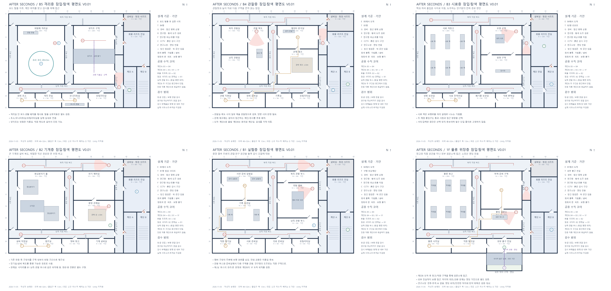

**치수·좌표:** 모든 신규 치수는💡 가안입니다. 비교용 외곽48×32m, 직원 복도 폭3~4m, 출입구 폭1.5m를 두었습니다. B5 격리실16×20m 등은 별도 제작 씬에 적용한 검토 치수이며, 플레이 검증 뒤 조정합니다. 원점은 북서(u0,v0), u 동쪽+, v 남쪽+, 단위m입니다. 기존 방별x/z 표와 그대로 겹치지 않습니다. Unity 새씬 배치는 층/방 부모에서 변환하고 원본 씬과 사용자 포드의 자식 Transform·스케일을 보존합니다.

**2026-11-06 단면 제작 기준:** [B5–B4–B3 층간 단면](도면/잠입_탐색/층간_단면.md)의 계단A7.8m/40단, 계단B6.4m/36단을 유지한다. B4 도착문은(u39,v28.25), B3 도착문은(u43.5,v23.5)에 맞추고 아래층 계단을 도착층에도 이어 만든다. 실제 씬 전환은 미구현이다.

**이전 수직 연결 가안:** 계단A는B5↔B4, 계단B는B4↔B3 및B1↔1F의 분리 구간입니다. 계단B를B3와B1 사이에서 직통 연결하지 않습니다. 화물 리프트는B3↔B2입니다. B3는 계단 전실의 남측 출입구로 나오고 리프트는 북측에서 접근해, 도착 직후 옆 승강기로 빠지는 구성을 피했습니다. B2 관제실과B1 남측 관찰 부스의 점검 사다리는 동일한(u34.5,v22.5)에 둡니다. 공용 계단/리프트/설비 코어의 평면 위치를6층에서 맞췄습니다. 실제 층고·계단 단수·방화 구획·개구·승강장 단면은🟡 후속 설계입니다.

**B5:** 최신 유리 포드 지름 약8.43m·스케일(3,2,3)·생활 배치·높은 천장을 재사용합니다. 포드P→외부E의 탈출 상호작용은 미확정이며 보행 검사는E부터입니다. 초소·모니터링·유틸리티를 실제 실내로 만들고 냉각조 교환과 직원 통로 우회를 선택하게 합니다. G0는 시작 경비, G1/G2는 순찰, R1은 도주·주변 알림, C1은 경비 호출 위치의 가안입니다. 도면의 적 표시를 실제 HUD로 전부 보여 준다는 뜻은 아닙니다.

**연결·감시:** 일반 문은 양쪽 실내가 실제로 맞닿습니다. 잠긴 점검문도 뒤 공간을 만들고 통행 상태·연결 구간을 표시합니다. 복수 경로 중간에서 돌아가거나 갈아탈 수 있게 합니다. 코너·관찰 지점·문 근처 은신 위치는 그레이박스에서 조정합니다. CCTV 부채꼴은 현재 방 내부의 설계 범위이며 실제 문 너머 시야·가림물 차폐·소리 전파 결과가 아닙니다. 연구원 도주 목표는 피난·호출 지점의 가안이며 경비 존재·전파 반경은 별도 구현합니다.

**재생성:** 저장소 루트에서 `powershell.exe -NoProfile -ExecutionPolicy Bypass -File "Docs/도면/잠입_탐색/make_stealth_plans.ps1"`를 실행하면 SVG/PNG/JSON을 같은 데이터에서 만듭니다. [평면 검사](도면/잠입_탐색/validation.json)는 방 겹침·공유 벽 문 위치·문 연결 순환과0.25m 격자/몸 지름0.6m 가정의 정적 통행을 확인합니다. 피트·포드·가림물·높은 단상은 보행 차단으로 계산했습니다.6층 모두E→T 및R1→피난 지점이 연결됩니다.1F 보행 목표T는 외부 전실이며 바깥Z와의 마지막 교환은 검사에 포함하지 않습니다. [층간 위치 검사](도면/잠입_탐색/transitions.json)는5쌍의 평면 좌표가 일치함을 확인합니다. [파일 검사](도면/잠입_탐색/file_verification.json)에는 원안·씬 보존과 재생성 일치 결과를 기록했습니다. 별도 B5·B4 씬의 문·정적 경로·CharacterController 계단 보행은 검사했습니다. AI·시야·경보·실제 층간 통행·완주·난이도·성능 검증은 남아 있습니다. B3~1F의 새 평면은 Unity 미적용입니다.

**현재 B3 제작 상태 V0.01:** 별도 시료층 씬에17구역·일반 문27곳·시료 랙6개·세척 피트·검수대·지원실4개·정적 리프트·계단B 하강부와 프랍18개를 제작했다. 계단A/B의 연결 단면은 위 제작 기준을 따른다. B5/B4/B3 경로2,627표본과 Controller19검사, 실제 W 입력·Editor 성능 기록을 남겼다. 적은 정적 외형이며 층 전환과 잠입 성공은 미검증이다. [최신 검수](검수/2026-11-06_LevelContinuation/검수결과.md)를 우선한다.

**이전 B5 제작 상태 V0.02:** [예상 경로 A/B/C 비교](도면/잠입_탐색/플레이어_예상이동/B5_경로비교.png)는 도면 복사본입니다. Unity 씬에 경로선이나 미니맵은 추가하지 않았습니다. 새 씬은 문 너머 지원실·직원 복도·냉각 피트·계단A와 정적 NPC 배치를 포함합니다. 실제 W 입력 이동, A/B/C 경로의 CharacterController 통행과 계단 상부까지의 상승을 검사했습니다. [검수 결과](검수/2026-11-05_B5_Stealth/검수결과.md)에 범위와 사진이 있습니다. 계단A 상승7.8m·40단은 포드 천장7.2m를 고려한 단면 가안이며 B4 연결은 아직 없습니다. 원 도면의 냉각조 교환은 남측에서 북측으로 향해 계단 목표와 멀어지므로 지름길로 확정하지 않습니다.

**이전 B4 제작 상태 V0.01:** 관찰실/복도와 양면 관찰창4곳, 분석실, 지원실, 계단A 도착 전실, 계단B를 제작했습니다. 높이2.5m 관제 데크는 플랫폼 범위 안의14단 계단으로 걸어 올라갑니다. 일반 천장4m·관제실5.6m, 계단B 상승6.4m·36단은 💡보행 검토 치수입니다. 계단B의 B3 도착 단면·씬 전환은 아직 없고, B5 계단A 상부참(v26부터)과 B4 문(v25)도 추가 정합이 필요합니다. A/B/C1,077표본, Controller 경로/계단 왕복7개와 실제 W 입력을 확인했습니다. 경비3·연구원1·CCTV2는 정적 외형이며 게임 동작은 없습니다. [사진·검사 범위](검수/2026-11-06_B5_B4/검수결과.md)를 따릅니다. B3~1F의 새 평면은 아직 Unity 미적용입니다.

**아트 검수 후속:** 건축은 베벨 폭을 유지한1분할 챔퍼·Weighted Normal로 줄이고 소품은 UV 재전개 없이 감면/LOD를 적용했습니다. 최고 LOD 전체 배치 삼각형은2,439,679→949,363입니다. 경비·연구원은 정적 메시/웨이트와 임시 변형 포즈를 검사했습니다. CCTV는 Enemy 아트 프리팹의 고정부·좌우 목·상하 헤드로 분리했습니다. 사용자가 내부 C#을 질문하며 직접 작성하므로 현재 레벨 작업에 AI·감지·자동 회전·교환 코드를 추가하지 않습니다.

**다음 구현:** 사용자 길 찾기 플레이 → 경비 추격/수색·CCTV 호출·연구원 도주/알림 →3초 교환으로 경로 변화 → 완주 플레이 → 치수·아트 수정 순서입니다. 탄약·체크포인트·유리 판정·연구원/CCTV 상호작용·마지막 엔딩 경계는 검증 대상입니다. A/B 손 힘 모델은 이 작업에서 확정하지 않습니다.

기존 [외관·단면 시안](도면/연구소_전체_시안/01_외관과_단면_V0.01.png)은 미술 참고로 사용합니다. 과거 전체층 개념 이미지보다 위 벡터 평면의 실내 연결을 우선합니다.


### 9.1 도면 양식

아래9.1~9.11의 방별 좌표와 도면은 **기믹 검증 원안**입니다. 현재 구현 씬의 제작 이력 및 능력 실험용으로 보존하며, 새 잠입 층의 전체 동선·우회 금지·방별 탄약 보충 기준으로 사용하지 않습니다. 새로운 좌표·문 연결은9.0의 도면/JSON을 우선합니다.

- 위에서 내려다본 평면도입니다. **위쪽이 출구 방향**입니다.
- 가로 한 칸은 0.5m입니다. 세로는 줄마다 왼쪽에 z값을 적습니다(간격이 고르지 않음). 도면은 개략이고, **정확한 값은 배치 표**가 기준입니다.
- 좌표: x는 오른쪽이 +, z는 **출구 쪽이 −** 입니다(웹 프로토타입 좌표 그대로). 높이 y는 바닥이 0이고 단위는 m입니다. Unity로 옮길 때 축 방향을 맞춥니다.
- 1·2번은 프로토타입 좌표, 3번부터는 방마다 가운데를 (0, 0)으로 둔 방 안 좌표입니다.
- 방마다 같은 순서로 적습니다: 목표 → 도면 → 배치 → 풀이 → 대비 시간에 할 일 → 다른 풀이·지름길 점검.

| 기호 | 뜻 |
| --- | --- |
| `+` `-` 세로 막대 | 벽 (높이 4m) |
| `:` | 철창. 틈으로 쏘거나 E로 손을 뻗을 수 있지만, 사람과 경비의 손은 못 지나감 |
| `~` | 구덩이 |
| `#` | 가림벽 (천장까지) |
| `%` | 높은 선반 (올라갈 수 없음) |
| `=` | 셔터 문 |
| `o` | 발판 |
| `^` | 단상 (높이 2.5m, 올라갈 수 없음) |
| `v` | 우리 (바닥이 1.2m 낮은 칸, 바닥 전체가 발판) |
| `*` | 출구 지점 |
| `.` | 순찰 경로 (세로) |
| `P` | 시작 위치 |
| `S` | 체크포인트 |
| 그 밖의 대문자 (`A` `B` `D` …) | 경비·인물. 화살표는 처음 순찰 방향 |
| `b` | 상자 |
| `X` | 무거운 궤짝 |
| `@` | 쏘는·던지는 자리 (예시) |

### 9.2 1번 감방

**목표:** 총을 빼앗고, 경비와 자리를 바꿔 감방을 나간다.
**배우는 것:** 빼앗기(E), 쏘기, 3초 뒤 교환, 총에 맞은 경비는 쏜 곳으로 달려온다.

**생활·실험형 격리 공간 · 2026-11-03:** 사용자가 직접 조정한 포드 위치 `(0,0,10.32)`와 스케일 `(3,2,3)`을 기준으로 합니다. 외경 약 8.43m, 안쪽 지름 약 7.872m, 높이 약 6.442m로 침상·침구, 식탁·고정 스툴·식판, 개인 수납, 세면대·변기·차폐판, 검사 모니터를 둡니다. 가구는 사람 크기를 유지합니다. 포드 바깥에는 관찰 콘솔·시료 처리대·의료 트롤리를 두어 생활하는 피험체와 관찰하는 직원의 공간을 구분합니다.

**돔 내부 조명:** 가운데 등은 돔 안쪽 꼭대기의 고정 캡에서 세 가닥 지지선으로 매단 얇은 링 조명으로 구성합니다. 지름 약1.4m, 고정부부터 아래 발광면까지 약1.23m이며 아래 생활 공간을 향해 비춥니다. 기존 격리실 천장의 네 조명은 유지합니다.

**방과 배식구:** B5 Room01은 폭 12m, 깊이 14m(z 2~16), 천장 아래 7.2m를 기준으로 포드 위와 뒤의 여유를 확보합니다. 출입 통로는 z 2의 기존 위치를 유지합니다. 경비 A는 유리 밖에 두며 사용자가 조정한 외부 관찰 위치를 보존합니다. 포드 내부 바닥 높이는 약 0.28m이므로 플레이어 시작 높이와 가구 바닥을 맞춥니다. 안팎에 같은 문짝·손잡이·힌지가 있는 양문 배식구와 실제 빈 전달함을 구성합니다. 개구 약 0.78×0.51m, 문 약 0.72×0.45m, 전달함 깊이 약 0.42m입니다. 문 회전 피벗·충돌 구성과 입력에 따른 개폐 게임 로직은 구분합니다.

**검토 중:** 아래 사각 감방 도면·철창 치수·풀이는 기존 프로토타입 원안입니다. 유리의 사격·상호작용 판정, 총 빼앗기 접근 경로, 배식구 개폐와 탈출 방식은 아직 확정·구현하지 않았습니다. 총 빼앗기·사격·3초 뒤 교환이라는 학습 목표를 유지하면서 이 경로를 검토한 뒤 도면과 풀이를 개정합니다.

**기존 프로토타입 원안 — 사각 감방과 철창**

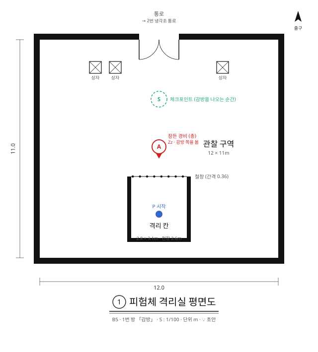

```
x:    -6            0          +6
z= 2   +------------------------+   북쪽: 구덩이 (2번 방)
z= 3.4 |     b b          b     |
       |                        |
z= 5   |            S           |
       |                        |
z= 7.4 |            A           |
z= 8.9 |         |:::::|        |
z=10.8 |         |  P  |        |
z=12   |         +-----+        |
z=13   +------------------------+
```

| 대상 | 위치 (x, z) | 메모 |
| --- | --- | --- |
| 방 | x −6~6, z 2~13 | 12 × 11m. 북쪽 끝이 구덩이 |
| 감방 | x −1.4~1.4, z 8.9~12 | 안쪽 2.8 × 3.1m, 천장 2.6m. 앞면만 철창 |
| 철창 | z 8.9 | 막대 간격 0.36m |
| 시작 위치 P | (0, 10.8) | |
| 잠든 경비 A | (0, 7.4) | 철창에서 1.5m. 총을 차고 있고, 감방 쪽을 봄 |
| 상자 b × 3 | (−3.2, 3.4) · (−2.2, 3.4) · (3.2, 3.4) | 다음 방에서 던질 것 |
| 체크포인트 S | (0, 5) | 감방을 나오는 순간 |

**풀이**

1. 철창 앞에서 A에게 E → 총을 얻습니다(탄약 💡 3발). 손 닿는 거리(2.6m)가 철창 너머 A까지 닿습니다.
2. A를 쏩니다. A는 깨어나 0.35초 뒤 쏜 곳(감방 안)으로 달려오다 철창에 막힙니다.
3. 3초 뒤 교환. 나는 A가 있던 철창 앞으로, A는 감방 안으로 갑니다. A는 철창 너머로 나를 붙잡지 못합니다.

**대비 시간에 할 일:** 🟡 거의 없습니다. A가 철창으로 달려오는 걸 보는 시간입니다. 첫 방이라 규칙을 보여 주는 시간으로 두고, 지루한지는 플레이 테스트(11장 1번)에서 봅니다.

**다른 풀이·지름길 점검**

| 경우 | 결과 | 판단 |
| --- | --- | --- |
| 총을 빼앗기 전 | 철창·벽·천장(2.6m) 때문에 나갈 길이 없음 | 의도대로 |
| 감방 안에서 상자를 쏨 | 상자와 바뀌어 나감. A는 계속 잠듦 | 💡 허용(다른 풀이). 다만 "경비는 쏜 곳으로 달려온다"를 못 배우므로, 상자를 감방에서 안 보이는 곳으로 옮길지 테스트 뒤 결정 |
| 감방 안에서 구덩이 건너편 경비 B를 쏨 | 프로토타입은 1·2·4번 방이 한 공간이라 B까지 약 15m로 사거리(30m) 안. 한 발로 1·2번 방을 건너뛸 수 있어 보임 | 💡 막음. 1번 방 북쪽 끝(z 2)에 벽과 방 사이 통로(4.6)를 둬서 감방에서 구덩이 쪽이 보이지 않게 함. 2번 방 남쪽 바닥은 통로 너머로 옮김 |

### 9.3 2번 구덩이

**목표:** 건너편 경비와 바꿔 구덩이를 건넌다.
**배우는 것:** 경비는 낭떠러지 앞에서 멈춘다. 쏘는 자리가 곧 내가 도착할 자리를 정한다.

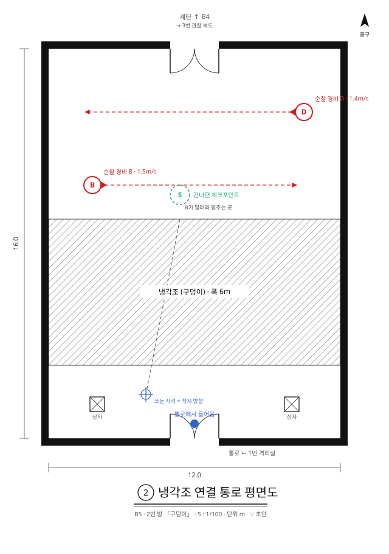

```
x:    -6            0          +6
z=-11  +----------    ----------+   북쪽: 통로 → 3번 순찰 복도
z=-8.4 |   <-----------------D  |
z=-5.4 |   B---------------->   |
z=-4   |~~~~~~~~~~~~~~~~~~~~~~~~|
       |~~~~~~~~~~~~~~~~~~~~~~~~|
z= 2   |~~~~~~~~~~~~~~~~~~~~~~~~|
z= 3.4 |     b b          b     |
z= 5   |            S           |   남쪽: 1번 방
```

| 대상 | 위치 (x, z) | 메모 |
| --- | --- | --- |
| 구덩이 | z −4~2, 방 너비 전체 | 폭 6m. 점프로는 약 3m밖에 못 감 |
| 순찰 경비 B | (−4.2, −5.4) ↔ (4.2, −5.4) | 걷는 속도 1.5m/s. 처음엔 오른쪽으로 감 |
| 순찰 경비 D | (4.5, −8.4) ↔ (−4.5, −8.4) | 1.4m/s. 건넌 뒤의 위험 |
| 상자 (건너편) | 💡 없음 | 프로토타입에는 (−4.6, −6.3) · (4.6, −6.3) · (−4.6, −10.2)에 3개 있었음. 조용히 건너는 풀이를 막으려고 치우고, 4번 방으로 옮김 |
| 체크포인트 | 건너편에 처음 선 자리 | |

- 💡 슬라이스에서는 1번 방과 사이에 통로를 두므로(9.2 점검표), 남쪽 바닥(z 2~5)은 통로 출구 앞 공간이 됩니다. 위 좌표는 프로토타입 기준입니다.

**풀이**

1. 남쪽에서 B를 쏩니다(약 7~10m). B는 쏜 곳을 향해 똑바로 달려오다 구덩이 앞에서 멈춥니다.
2. 3초 뒤 교환. 나는 B가 멈춘 북쪽 가장자리로, B는 내 자리(남쪽)로 갑니다. B는 다시 건너오지 못합니다.
3. 건너편에 서면 체크포인트. D의 시야(5m · 좌우 40°)를 피해 단상 쪽으로 갑니다.

**대비 시간에 할 일**

- **쏘는 자리를 고르는 것이 곧 착지할 자리를 고르는 것입니다.** B는 쏜 곳을 향해 똑바로 달려오므로, B의 위치와 쏜 자리를 잇는 선이 구덩이 가장자리와 만나는 곳에 내가 내립니다. D가 어느 쪽을 보고 있는지 보고 시야 밖에 내리도록 쏘는 자리를 고릅니다.
- 보너스: 교환 직전에 구덩이로 뛰어들면 B가 내 자리(구덩이 속)로 와서 떨어집니다. 뛰어든 뒤 실패 판정까지 💡 약 0.6~1초 안에 교환이 일어나야 합니다(중력 20 기준 계산).

**다른 풀이·지름길 점검**

| 경우 | 결과 | 판단 |
| --- | --- | --- |
| D를 쏨 | D도 구덩이 앞에서 멈춤. 같은 풀이 | 허용 |
| 건너편 상자를 쏨 | 💡 건너편 상자를 치워서 불가 | 막힘. 남겨 두면 이 방이 가르치는 "경비는 낭떠러지 앞에서 멈춘다"를 건너뛰게 됨 |
| 상자를 던져 B를 맞힘 | B는 상자가 멈춰 있던 곳 아래로 달려가다 구덩이 앞에서 멈춤 | 허용. 탄약이 없을 때의 풀이 |

### 9.4 3번 순찰 복도 💡

**목표:** 출구 앞을 지키는 경비를 자리에서 떼어 내고 지나간다.
**배우는 것:** 경비의 시야(5m · 좌우 40°, 벽에 가려짐). 뒤에서 제압하면 3초 동안 모른 채 걷다 쓰러진다. **동료가 쓰러지는 걸 본 경비는 그 자리로 간다** — 쓰러질 자리를 고르면 경비를 부를 자리를 고르는 것이다.

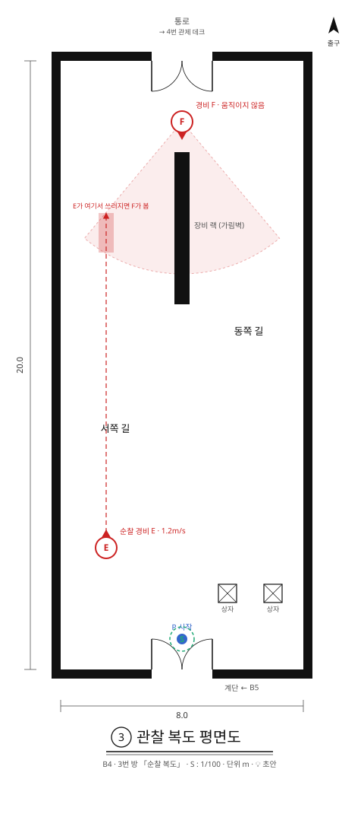

```
x:    -4       0       +4
z=-10  +------    ------+   북쪽: 통로 → 4번 단상
z=-8   |       F        |   F: 남쪽을 보고 서 있음
z=-7   |       #        |
z=-5   |   .   #        |   E 순찰 북쪽 끝
z=-2   |   .   #        |   가림벽 남쪽 끝
z= 0   |   .            |
z= 6   |   E            |   E 순찰 남쪽 끝. 처음엔 북쪽으로
z= 7.5 |          b  b  |
z= 9   |       S P      |
z=10   +------    ------+   남쪽: 통로 ← 2번 구덩이
```

| 대상 | 위치 (x, z) | 메모 |
| --- | --- | --- |
| 방 | x −4~4, z −10~10 | 8 × 20m 복도 |
| 입구 · 시작 P | 남쪽 벽 x −1~1 · (0, 9) | 체크포인트 S도 입구 |
| 출구 | 북쪽 벽 x −1~1 | 통로로 이어짐. 다가가면 열림 |
| 가림벽 # | x −0.25~0.25, z −7~−2, 천장까지 | 복도 북쪽 절반을 서쪽 길·동쪽 길로 나눔 |
| 순찰 경비 E | (−2.5, 6) ↔ (−2.5, −5) | 1.2m/s. 서쪽 길을 오감 |
| 경비 F | (0, −8) | 움직이지 않음. 남쪽을 봄. 등 뒤는 출구 벽이라 돌아 들어갈 수 없음 |
| 상자 b × 2 | (1.5, 7.5) · (3, 7.5) | 다른 풀이용 |
| 체크포인트 | 입구, 출구 | |

**계산**

- F의 시야로 서쪽 길(x −2.5)을 보면, 보이는 구간은 **z −5.0~−3.7** 입니다(5m 안이면서 40° 안).
- E는 1.2m/s로 걸으므로 3초면 3.6m를 갑니다. E가 북쪽으로 걸으며 **z 0~−1.4** 에 있을 때 제압하면 그 구간에서 쓰러집니다.
- F는 E가 쓰러진 자리까지 4.3m를 달려가(약 1.8초) 2.5초 수색하고, 걸어서 돌아옵니다(약 4.3초). **약 8.6초 동안 출구 앞이 빕니다.**
- F가 수색하는 자리에서 출구까지 5.8m라 시야 밖이고, 가림벽이 동쪽 길을 가립니다.

**풀이**

1. F가 출구 바로 앞에서 남쪽을 보고 있어 그대로는 지나갈 수 없습니다.
2. E가 북쪽으로 걸어갈 때(나에게 등을 보일 때) 서쪽 길로 따라붙어 뒤에서 제압합니다. 이때 나는 F에게서 8m 넘게 떨어져 있어 보이지 않습니다.
3. E는 3초 동안 계속 북쪽으로 걷다가 F의 시야 안에서 쓰러집니다.
4. F가 E에게 달려가면, 동쪽 길로 출구까지 갑니다.

**대비 시간에 할 일:** 제압한 뒤 3초 동안 E 머리 위 기절 남은 초를 보며 동쪽 길로 옮겨 가, F가 떠나기를 기다립니다. **제압하는 시점이 곧 F를 어디로 부를지 고르는 것**이라, 3초를 기다리는 게 아니라 계산하는 시간이 됩니다.

**다른 풀이·지름길 점검**

| 경우 | 결과 | 판단 |
| --- | --- | --- |
| E를 너무 일찍 제압 (z −3.7보다 남쪽에서 쓰러짐) | F가 못 봄. F는 자리를 지킴 | 실패 아님. 아래 총·상자 풀이로 넘어감 |
| F를 쏨 | F가 쏜 곳으로 달려오고, 3초 뒤 나는 달려오던 F 자리로, F는 내 자리로 감. 출구가 가까워짐 | 💡 허용(탄약 1발). 다만 F가 수색하는 동안 5m 안에 있으면 들킴 |
| F에게 상자를 던짐 | F는 상자가 멈춰 있던 곳으로 달려감 | 허용 |
| F 옆을 뛰어 지나감 | F는 출구에서 2m. 보는 순간 추격, 붙잡기 0.9m | 🟡 막힐 것으로 보지만, 내 속도(4.6m/s)가 경비 달리기(3.0m/s)보다 빨라 직접 확인 필요 |
| E가 남쪽으로 돌아올 때 정면에서 다가감 | E에게 보임 → 추격 | 막힘 (시야를 배우는 장면) |

### 9.5 4번 단상 💡

**목표:** 단상 위 경비와 바꿔 단상 위 출구에 선다.
**배우는 것:** 단상 바로 밑에서는 서로 안 보인다. 조금 물러나야 쏠 수 있다. 경비는 단상 가장자리에서도 멈춘다(2번 방 낭떠러지와 같은 규칙).

프로토타입 배치를 옮겼습니다. 프로토타입에서는 2번 방 건너편 북쪽 끝이고, 여기서는 방 안 좌표(프로토타입 z + 9)로 적습니다.

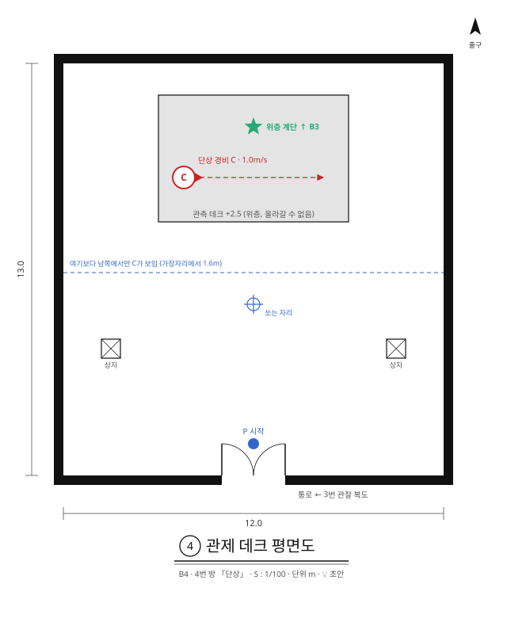

```
x:    -6            0          +6
z=-7   +------------------------+   북쪽 벽
z=-6   |      ^^^^^^^^^^^^      |   단상 북쪽 끝 (높이 2.5m)
z=-5   |      ^^^^^^*^^^^^      |   * 출구 (단상 위)
z=-3.4 |      ^C-------->^      |   C 순찰 (단상 위)
z=-2   |      ^^^^^^^^^^^^      |   단상 남쪽 가장자리
z=-0.4 |            @           |   여기보다 남쪽이어야 C가 보임
z= 2   |   b                 b  |
z= 5   |            P           |
z= 6   +----------    ----------+   남쪽: 통로 ← 3번 복도
```

| 대상 | 위치 (x, z) | 메모 |
| --- | --- | --- |
| 방 | x −6~6, z −7~6 | 12 × 13m |
| 단상 ^ | x −3~3, z −6~−2, 높이 2.5m | 올라갈 수 없음 (기어오르기 1.1m) |
| 단상 경비 C | (−2.2, −3.4) ↔ (2.2, −3.4), 단상 위 | 1.0m/s |
| 출구 * | (0, −5), 단상 위 | 프로토타입의 초록 원판 |
| 입구 · 시작 P | 남쪽 벽 x −1~1 · (0, 5) | |
| 상자 b × 2 | (−4.5, 2) · (4.5, 2) | 2번 방 건너편에서 옮겨 온 상자 |
| 쏘는 자리 @ | 예: (0, −0.4)보다 남쪽 | |
| 체크포인트 | 출구 * | |

**계산:** 눈높이 1.5m에서 C의 가슴(단상 2.5m + 0.9m = 3.4m)을 보려면, C가 가장자리에서 1.4m 안쪽에 있으므로 **가장자리에서 1.6m 이상** 물러나야 시선이 단상 모서리 위로 지나갑니다.

**풀이**

1. 단상 밑으로 바로 가면 C가 안 보여 쏠 수 없습니다. C도 나를 못 봅니다.
2. 1.6m 이상 물러나 C를 쏩니다. C는 쏜 곳으로 달려오다 단상 남쪽 가장자리에서 멈춥니다.
3. 3초 뒤 교환. 나는 단상 가장자리로, C는 내 자리(바닥)로 갑니다. C는 단상에 올라오지 못합니다.
4. 출구까지 약 3m 걸어갑니다.

**대비 시간에 할 일:** 🟡 적습니다. C가 달려와 가장자리에서 멈추는 걸 보며 "낭떠러지 규칙이 단상에도 통한다"를 확인하는 시간입니다. 쏜 자리에 그대로 있어도 C는 바닥에서 단상으로 못 올라오므로 위험은 없습니다.

**다른 풀이·지름길 점검**

| 경우 | 결과 | 판단 |
| --- | --- | --- |
| 단상 밑에서 C를 쏨 | 단상 모서리에 가려 안 보임 | 막힘 (의도한 학습) |
| 상자를 단상 위로 던지고 쏨 | 상자가 단상 위에 떨어진 뒤, 물러나서 보이면 쏠 수 있음. C를 깨우지 않고 올라감 | 💡 허용. 7번 방(던진 상자)의 예고 |
| C에게 상자를 던짐 | C는 상자가 멈춰 있던 곳 아래로 가다 가장자리에서 멈춤. 결과는 총과 같음 | 허용 |
| 상자를 딛고 기어오름 | 0.6 + 1.1 = 1.7m < 2.5m | 막힘 |
| 상자 두 개를 쌓고 오름 | 1.2 + 1.1 = 2.3m < 2.5m | 막힘 (쌓기가 되는지와 상관없이) |

### 9.6 5번 압력판 💡

**목표:** 무거운 궤짝을 발판 위로 보내 문을 연다.
**배우는 것:** 발판은 무게가 올라가 있는 동안 켜진다. 상자는 무게가 아니다. **교환의 반대쪽(상대를 어디로 보내나)이 목표**가 된다.

프로토타입이 없는 새 설계입니다. 아래는 전부 💡 초안이고, 좌표는 이 방 가운데를 (0, 0)으로 둡니다.

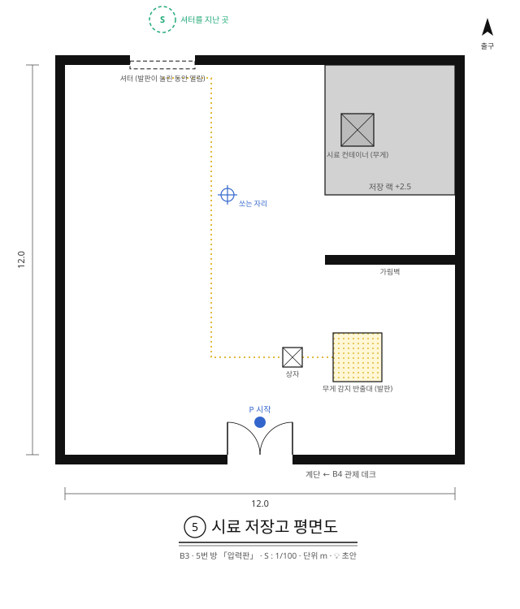

```
x:    -6            0          +6
z=-6   +----====----------------+   북쪽: 셔터 문 → 다음 방
z=-5   |                %%%%%%%%|
z=-4   |                %%X%%%%%|
z=-3   |                %%%%%%%%|
z=-2   |          @             |
z= 0   |                ########|
z= 3   |              b oooo    |
z= 5   |            P           |
z= 6   +----------    ----------+   남쪽: 입구
```

| 대상 | 위치 (x, z) | 메모 |
| --- | --- | --- |
| 방 | x −6~6, z −6~6 | 12 × 12m |
| 입구 · 시작 P | 남쪽 벽 x −1~1 · (0, 5) | |
| 셔터 문 | 북쪽 벽 x −4~−2 | 발판이 켜져 있는 동안 열림 |
| 발판 | (3, 3) | 유지형, 크기는 6.5 참고 |
| 상자 b | (1, 3) | 가벼움. 발판에 올려도 안 켜짐 |
| 가림벽 # | x 2~6, z 0, 천장까지 | 발판에서 궤짝이 안 보이게 가림 |
| 선반 % | x 2~6, z −6~−2, 높이 2.5m | 올라갈 수 없음 (기어오르기 1.1m) |
| 궤짝 X | (3, −4), 선반 위 | 들 수 없음. 교환으로만 옮김 |
| 쏘는 자리 @ | 예: (−1, −2) | 가림벽 북쪽이면 어디든. 선반에서 멀수록 궤짝이 잘 보임 |
| 체크포인트 | 문을 지난 곳 | |

**풀이**

1. (학습) 발판에 올라서면 북서쪽 문이 열리고, 내려오면 닫힙니다. 문까지 약 11m라 밟고 뛰어도 못 들어갑니다.
2. (학습) 상자를 발판에 올려도 켜지지 않습니다.
3. 가림벽 북쪽으로 가면 선반 위 궤짝이 보입니다. 발판에서는 가림벽 때문에 궤짝을 쏠 수 없습니다.
4. 궤짝을 쏘고, 3초 안에 가림벽을 돌아 발판 위에 섭니다(약 7m, 달려서 약 1.5초).
5. 교환: 궤짝은 발판 위로, 나는 선반 위로 갑니다. 이제 문은 계속 열려 있습니다.
6. 선반에서 뛰어내려 문으로 나갑니다.

**대비 시간에 할 일:** 쏜 뒤 발판까지 달려가는 것 자체입니다. 3초 기다림을 "3초 뒤에 어디 서 있을지"로 바꾸는 방이고, 6번 셔터 방("시간마다 다른 곳에 있기")의 예고입니다.

**다른 풀이·지름길 점검**

| 경우 | 결과 | 판단 |
| --- | --- | --- |
| 발판을 밟고 문까지 달림 | 문 닫히는 시간(💡 0.3초) 동안 1.4m밖에 못 감. 문까지 약 11m | 막힘 |
| 상자를 발판에 올림 | 무게가 아님 | 막힘 (의도한 학습) |
| 상자를 딛고 선반에 오름 | 상자 0.6m + 기어오르기 1.1m = 1.7m로 2.5m에 못 미침 | 막힘. 올라가도 궤짝은 못 듦 |
| 발판 위에서 궤짝을 바로 쏨 | 가림벽에 가려 안 보임 | 막힘 |
| 쏘고 그 자리에 가만히 있음 | 궤짝이 쏜 자리 바닥으로 오고, 나는 선반 위로 감 | 실패 아님. 내려와서 발판 위에서 바닥의 궤짝을 다시 쏘면 됨(가림벽 서쪽이라 보임). 탄약 1발을 더 씀 |
| 상자를 던져 궤짝을 맞힘 | 총과 같은 결과 | 허용 |

**이 방을 만들기 전에 정할 것 → 💡 초안**

- 발판·문 연결 표시: 바닥에 발판에서 문까지 이어진 선, 문 위 램프(7.2).
- 탄약 보충: 방 사이 통로에서 3발로 채움(4.4). 이 방에서 한 번 빗나가도 2발이 남습니다.
- 선반 위에 떨어진 총: 손이 닿지 않는 곳이라 손에 돌아옴(4.4).
- 문이 닫힐 때 끼인 것: 밀어 냄(4.6). 이 방에서는 궤짝이 올라간 뒤로 문이 닫히지 않아 생기지 않습니다.

### 9.7 6번 셔터 💡

**목표:** 셔터 너머 경비를 우리에 가둬 셔터를 계속 열어 둔다.
**배우는 것:** 우리(4.6). 우리에서 나오는 길은 교환뿐이다. 서 있는 경비도 무게라서, 우리에 가두면 계속 누른다. 셔터는 시선과 총알을 막는다.

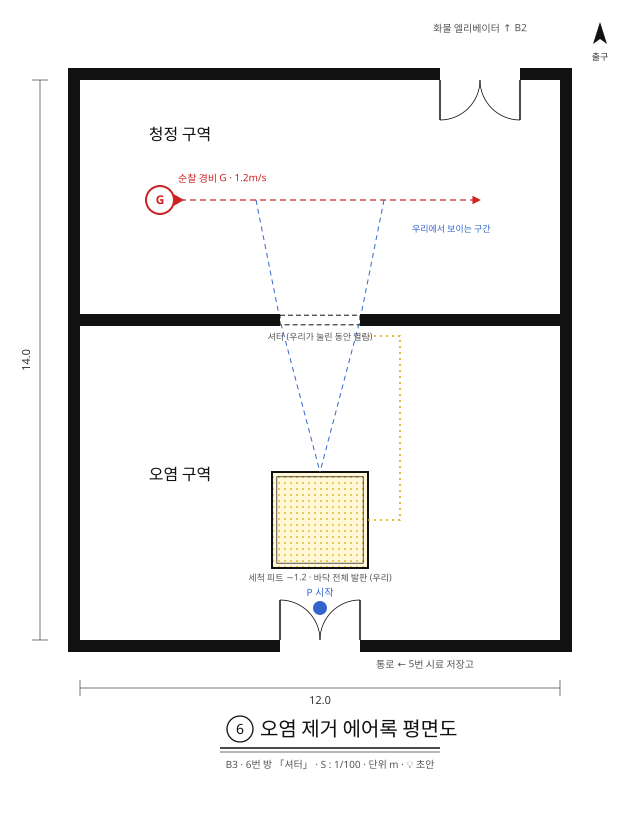

```
x:    -6            0          +6
z=-8   +------------------    --+   북쪽: 출구 (x 3~5) → 통로
z=-5   |    G-------------->    |   G 순찰
z=-2   +----------====----------+   셔터 (우리가 눌린 동안 열림)
z= 3   |          vvvv          |   우리 (가운데 (0, 3))
z= 5   |            P           |
z= 6   +----------    ----------+   남쪽: 통로 ← 5번 압력판
```

| 대상 | 위치 (x, z) | 메모 |
| --- | --- | --- |
| 방 | x −6~6, z −8~6 | 12 × 14m. z −2의 벽이 남쪽(입구 쪽)과 북쪽(출구 쪽)을 나눔 |
| 셔터 = | 가운데 벽 x −1~1 | 우리 바닥(발판)이 눌린 동안 열림. 닫혀 있으면 시선도 총알도 못 지나감 |
| 우리 v | 가운데 (0, 3), 2.4 × 2.4m, 깊이 1.2m | 바닥 전체가 발판. 들어가면 혼자 못 나옴 |
| 순찰 경비 G | (−4, −5) ↔ (4, −5) | 1.2m/s. 처음엔 동쪽으로. 동서로 걸으므로 남쪽(셔터)을 보지 않음 |
| 입구 · 시작 P | 남쪽 벽 x −1~1 · (0, 5) | |
| 출구 | 북쪽 벽 x 3~5 | 다가가면 열림 |
| 체크포인트 | 입구, 그리고 G가 우리에 갇힌 순간 | |

**풀이**

1. 우리에 뛰어듭니다. 발판이 눌려 셔터가 열리고, 셔터 너머 G가 보입니다. 이제 혼자서는 우리를 못 나옵니다.
2. G가 셔터 틈으로 보이는 구간(x 약 −1.6~1.6)을 지날 때 쏩니다.
3. G는 쏜 곳(우리)으로 곧장 달려오고, 셔터를 지나 우리 북쪽 가장자리에서 멈춥니다(낭떠러지 규칙). 약 6.8m, 2.6초.
4. 3초 뒤 교환. 나는 우리 밖 가장자리로, G는 우리 안으로 갑니다. G는 나오지 못하고, 서 있는 경비는 무게이므로 셔터가 계속 열려 있습니다.
5. G가 멍한 1.2초 안에 우리 가장자리에서 떨어진 뒤, 셔터를 지나 출구로 갑니다.

**보이면 달려올 수 있다:** G가 보였다는 건 G와 나를 잇는 직선이 셔터 틈을 지난다는 뜻입니다. G는 쏜 곳을 향해 똑바로 달려오므로 항상 셔터를 지나옵니다. 따로 경로를 계산하지 않아도 됩니다.

**대비 시간에 할 일:** G가 멈출 북쪽 가장자리에서 먼 **우리 남쪽 벽에 붙어 섭니다.** 가장자리에 멈춘 G와 붙잡기 거리(0.9m) 넘게 떨어져야 합니다. 우리 크기(2.4m)는 이 거리를 기준으로 정했습니다(6.5).

**다른 풀이·지름길 점검**

| 경우 | 결과 | 판단 |
| --- | --- | --- |
| 우리 밖에서 셔터 너머를 쏨 | 셔터가 닫혀 있어 안 보임 | 막힘 |
| 우리에 상자를 던져 넣음 | 상자는 무게가 아님 | 막힘 |
| 우리 안에서 기다리기만 함 | 아무 일도 없음 | R(방 처음부터) 또는 체크포인트. 💡 재시도가 필요할 때만 UI로 "R: 다시 하기" 안내 |
| 탄약 없이 우리에 들어감 | 총을 던지면(Q) G는 총이 멈춰 있던 곳(우리)으로 와서 같은 결과 | 허용 |
| 우리 북쪽 가장자리에 그대로 서 있음 | 멈춘 G의 붙잡기 거리 안 | 붙잡힘 (대비 시간에 피해야 할 것) |

- 처음 안("던진 것이 지나갈 땐 판 위에, 교환될 땐 우리 안에")은 판 위에서 총으로 쏘면 바로 풀려서 바꿨습니다. 지금 안은 우리 안에서만 셔터 너머가 보이므로 총으로도 같은 순서를 밟아야 합니다.

### 9.8 7번 던진 상자 💡

**목표:** 교환할 대상이 없는 건너편으로, 상자를 던져 보내고 그 상자와 바꿔 건넌다.
**배우는 것:** 교환은 맞힌 순간이 아니라 **처리하는 순간의 위치**로 일어난다(4.1 처리 규칙 2).

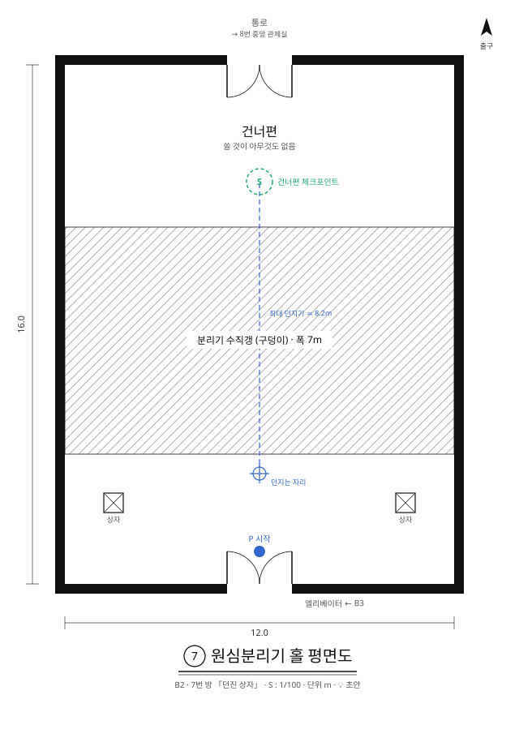

```
x:    -6            0          +6
z=-10  +----------    ----------+   북쪽: 출구 → 통로
z=-7   |                        |   건너편: 쏠 것이 아무것도 없음
z=-5   |~~~~~~~~~~~~~~~~~~~~~~~~|
z=-1.5 |~~~~~~~~~~~~~~~~~~~~~~~~|   구덩이 폭 7m
z= 2   |~~~~~~~~~~~~~~~~~~~~~~~~|
z= 3.5 |   b        @        b  |
z= 5   |            P           |
z= 6   +----------    ----------+   남쪽: 통로 ← 6번 셔터
```

| 대상 | 위치 (x, z) | 메모 |
| --- | --- | --- |
| 방 | x −6~6, z −10~6 | 12 × 16m |
| 구덩이 | z −5~2, 방 너비 전체 | 폭 7m. 점프로는 약 3m |
| 상자 b × 2 | (−4.5, 3.5) · (4.5, 3.5) | 하나를 빠뜨려도 하나 남게 |
| 건너편 | z −10~−5 | 경비·상자 없음 |
| 던지는 자리 @ | 구덩이 가장자리 근처, 예: (0, 2.5) | |
| 체크포인트 | 건너편에 처음 선 자리 | |

**계산:** 최대 던지기(12m/s, 보정 포함 약 45°)는 놓는 높이 1.3m 기준 약 8.2m를 갑니다(중력 20). 가장자리에서 던지면 건너편 가장자리를 1~2m 넘겨 떨어집니다. 상자는 손앞에 3초 떠 있다가 약 1.3초 날아갑니다.

**풀이**

1. 건너편에는 쏠 것이 없습니다. 상자를 들고 구덩이 가장자리로 갑니다.
2. 거의 끝까지 충전해 건너편으로 던집니다. 명중 예측 궤적이 건너편 바닥에 닿는지 확인합니다.
3. 상자를 쏩니다. **아직 눈앞에 떠 있는 상자를 쏴도 됩니다.**
4. 3초 뒤 나는 그때 상자가 있는 자리(건너편 바닥)로, 상자는 내 자리로 갑니다.

**언제 쏘나:** 교환 지연과 손 힘 지연이 같은 3초라서 생기는 규칙입니다.

- 던지고 **s초 뒤에 쏘면**, 교환 때 상자는 **날아간 지 s초 된 자리**에 있습니다.
- s가 비행 시간(약 1.3초)보다 크면 상자는 이미 건너편에 내려앉아 있습니다.
- s가 그보다 작으면 나는 구덩이 위 공중으로 가서 떨어집니다. 미래의 나가 빨간색(발밑이 빔)으로 미리 알려 줍니다.

**대비 시간에 할 일:** 🟡 적습니다. 미래의 나가 건너편에 서 있는지 확인하는 시간입니다. 방을 작게 만들어 시도 사이 시간을 줄입니다.

**다른 풀이·지름길 점검**

| 경우 | 결과 | 판단 |
| --- | --- | --- |
| 상자를 약하게 던져 구덩이에 빠뜨림 | 교환 예약이 있었다면 조용히 취소 | 실패 아님. 두 번째 상자로 다시 |
| 상자 두 개를 모두 빠뜨림 | 건널 방법 없음 | 💡 구덩이에 빠진 상자는 처음 자리에 다시 나타남(총과 같은 진행 불가 방지) |
| 너무 일찍 쏨 | 공중에서 바뀌어 추락 | 체크포인트. 미래의 나가 빨간색으로 경고함 |

- 처음 안("상자를 높이 던져 두고 쏘면 그 공중으로")은 공중에서 바뀌면 떨어지기만 하고 오를 곳이 없어서 바꿨습니다. "공중에서 바뀐다"는 이 방에서 실패 쪽으로 배우고, 9번 방에서 다시 씁니다.

### 9.9 8번 소리 없는 손 💡

**목표:** 단상 위 출구를 지키는 경비를, 다른 경비에게 들키지 않는 쪽 가장자리로 불러 바꾼다.
**배우는 것:** 던진 것에 맞은 경비는 **나에게가 아니라 물체가 멈춰 있던 곳으로** 간다. 그래서 내가 내릴 자리를 고를 수 있다. 총은 빠르지만 내 쪽으로 부른다.

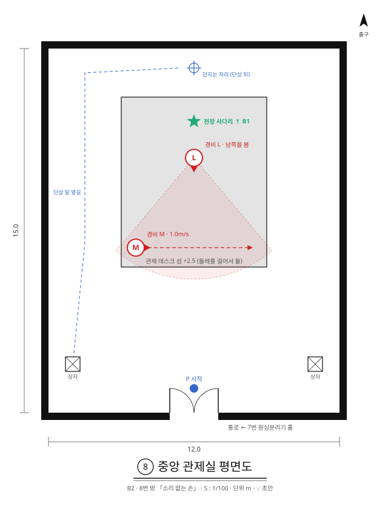

```
x:    -6            0          +6
z=-9   +------------------------+
z=-8   |            @           |   단상 뒤 틈 (폭 2m). 던지는 자리
z=-7   |      ^^^^^^^^^^^^      |
z=-6   |      ^^^^^^*^^^^^      |   * 출구 (단상 위, 천장 사다리)
z=-4.5 |      ^^^^^^L^^^^^      |   L: 남쪽을 보고 서 있음
z=-0.8 |      ^M-------->^      |   M 순찰 (단상 위)
z= 0   |      ^^^^^^^^^^^^      |   단상 남쪽 가장자리
z= 4   |  b                  b  |
z= 5   |            P           |
z= 6   +----------    ----------+   남쪽: 통로 ← 7번 던진 상자
```

| 대상 | 위치 (x, z) | 메모 |
| --- | --- | --- |
| 방 | x −6~6, z −9~6 | 12 × 15m |
| 단상 ^ | x −3~3, z −7~0, 높이 2.5m | 방 가운데 섬. 둘레를 걸어서 돌 수 있음 |
| 출구 * | (0, −6), 단상 위 | |
| 경비 L | (0, −4.5), 단상 위 | 움직이지 않음. 남쪽을 봄 |
| 경비 M | (−2.4, −0.8) ↔ (2.4, −0.8), 단상 위 | 1.0m/s. 단상 남쪽 가장자리를 순찰 |
| 상자 b × 2 | (−5, 4) · (5, 4) | |
| 입구 · 시작 P | 남쪽 벽 x −1~1 · (0, 5) | |
| 던지는 자리 @ | 단상 뒤 틈 (0, −8) | L도 M도 안 보이는 곳 |
| 체크포인트 | 출구 * | |

**풀이**

1. 상자를 들고 단상 옆길로 단상 뒤 틈까지 갑니다. 단상 위 경비는 단상 바로 밑을 보지 못합니다(4번 방).
2. 단상 뒤에서는 L이 보이지 않지만, **명중 예측 궤적이 보라색이면 맞습니다.** 단상 너머로 높이 던져 L의 등을 맞힙니다.
3. 상자는 손앞에 3초 떠 있다가 날아갑니다. 맞은 L은 상자가 멈춰 있던 곳(단상 뒤 틈)으로 달려가다 단상 북쪽 가장자리에서 멈춥니다.
4. 맞고 3초 뒤 교환. 나는 단상 북쪽 가장자리(출구에서 1m)로, L은 내 자리(단상 밑)로 갑니다. M은 6m 떨어져 있어 보지 못합니다.
5. 출구로.

**대비 시간에 할 일:** 상자가 떠 있는 3초와 날아가는 동안 단상 바로 밑으로 붙어 섭니다. L이 북쪽 가장자리에 와서 내려다봐도 단상 바로 밑은 보이지 않습니다. 들켜도 L은 내려오지 못합니다.

**다른 풀이·지름길 점검**

| 경우 | 결과 | 판단 |
| --- | --- | --- |
| 앞(남쪽)에서 L을 쏨 | L의 몸이 보이려면 단상에서 5m 넘게 물러나야 함. L은 남쪽 가장자리로 와서 멈추고, 교환되면 나는 M의 순찰로 바로 앞(0.8m)에 내림 | 대부분 붙잡힘. M이 등을 보인 순간을 맞추면 가능 → 💡 허용(어려운 풀이). "총은 빠르지만 위치가 들킨다" |
| M을 쏘거나 맞힘 | 나는 단상 남쪽에 내림. 남쪽을 보는 L의 시야(3.7m) 안 | 막힘 |
| 상자를 단상 위로 던지고 쏨 | 상자가 떨어진 자리로 감. 그 자리가 L·M 시야 밖이면 됨 | 💡 허용. 떨어진 자리에 따라 다름 |
| 단상 뒤에서 L에게 총을 던짐(Q) | 상자와 같은 결과 | 허용 (탄약 0일 때) |

- 처음 안의 "탄약 0"은 빼앗는 예외 규칙이 따로 필요해서 뺐습니다. 대신 총으로 풀면 M에게 들키도록 배치해, 탄약이 있어도 던지기를 고르게 합니다.

### 9.10 9번 연쇄 💡

**목표:** 구덩이 한가운데 발판 부스에 경비를 가둬 출구 문을 연다.
**배우는 것:** 예약을 두 개 이상 쌓는다. 두 번째 교환은 **첫 교환으로 옮겨 간 자리**를 기준으로 일어난다(4.1 처리 규칙 3). 순서가 결과를 바꾼다.

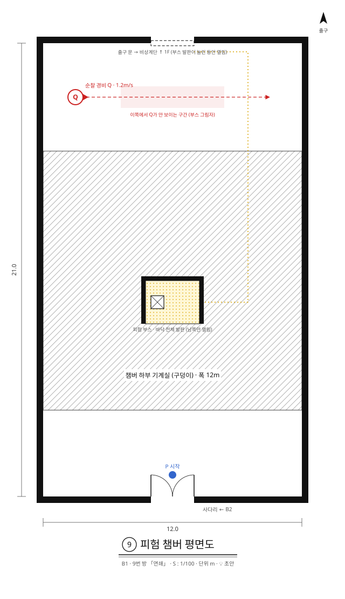

```
x:    -6            0          +6
z=-13  +----------====----------+   북쪽: 출구 문 (부스 발판이 눌린 동안 열림)
z=-10.5|   Q---------------->   |   Q 순찰
z=-8   |~~~~~~~~~~~~~~~~~~~~~~~~|
z=-5   |~~~~~~~~~~~~~~~~~~~~~~~~|
z=-2   |~~~~~~~~~+----+~~~~~~~~~|   부스 북·동·서 벽 (천장까지)
z=-1   |~~~~~~~~~|b o |~~~~~~~~~|   발판 부스. 남쪽만 열림
z= 0   |~~~~~~~~~      ~~~~~~~~~|
z= 2   |~~~~~~~~~~~~~~~~~~~~~~~~|
z= 4   |~~~~~~~~~~~~~~~~~~~~~~~~|
z= 7   |            P           |
z= 8   +----------    ----------+   남쪽: 통로 ← 8번 소리 없는 손
```

| 대상 | 위치 (x, z) | 메모 |
| --- | --- | --- |
| 방 | x −6~6, z −13~8 | 12 × 21m |
| 구덩이 | z −8~4, 방 너비 전체 (부스 자리 빼고) | |
| 발판 부스 | x −1.25~1.25, z −2~0 | 구덩이 한가운데 섬. 이쪽에서 4m, 건너편까지 6m(점프 불가). 북·동·서 벽은 천장까지, 남쪽만 열림. 바닥 전체가 발판 |
| 상자 b | 부스 안 (−0.8, −1) | 가벼움. 발판을 못 누름 |
| 출구 문 = | 북쪽 벽 x −1~1 | 부스 발판이 눌린 동안 열림 |
| 순찰 경비 Q | (−4.5, −10.5) ↔ (4.5, −10.5) | 1.2m/s. 처음엔 동쪽으로 |
| 입구 · 시작 P | 남쪽 벽 x −1~1 · (0, 7) | |
| 체크포인트 | 입구, 출구 | |

**보이는 것**

- 이쪽(z 4~8)에서는 부스 안 상자가 보입니다(남쪽이 열려 있음). Q는 부스 그림자 밖(|x| > 약 2.4)에 있을 때만 보입니다.
- 부스 안에서는 북·동·서 벽 때문에 Q가 보이지 않습니다. **부스에 들어간 뒤에는 Q를 쏠 수 없습니다.**

**풀이**

1. 상자를 쏩니다(0초). 3초 뒤 나는 부스 안으로 갑니다.
2. 3초가 지나기 전에, Q가 부스 그림자 밖에 있을 때 Q를 쏩니다(예: 1.5초). Q는 쏜 곳으로 달려오다 건너편 가장자리(z −8)에서 멈춥니다.
3. 3초: 첫 교환. 나는 부스 안 발판 위로, 상자는 이쪽으로. 내가 무게라 출구 문이 열립니다.
4. 4.5초: 두 번째 교환. 처리하는 순간의 내 자리(부스) 기준이므로, 나는 건너편 가장자리로, Q는 부스 안으로 갑니다. Q는 부스를 나오지 못하고, 서 있는 경비는 무게라 문이 계속 열려 있습니다.
5. 출구로.

**대비 시간에 할 일:** 이 방의 3초는 **두 번째 예약을 넣을 수 있는 시간**입니다. Q는 부스 그림자 안을 약 4초 동안 지나가므로, Q가 곧 그림자 밖으로 나올 때를 보고 상자를 쏘는 시점부터 고릅니다. 예약 타임라인에 두 교환이 순서대로 뜨고, 미래의 나가 둘 다 보입니다.

**다른 풀이·지름길 점검**

| 경우 | 결과 | 판단 |
| --- | --- | --- |
| 상자만 쏘고 부스에서 기다림 | Q가 안 보임. 내 무게로 문은 열리지만 못 건넘 | 막힘. 체크포인트 |
| Q만 쏨 | 나는 건너편, Q는 이쪽. 문은 닫혀 있음. 건너편에서 부스 안 상자는 북쪽 벽에 가려 안 보임 | 막힘. 이쪽의 Q를 다시 쏘면 되돌아올 뿐 |
| Q를 먼저, 상자를 나중에 예약 | 건너편으로 갔다가 다시 부스로 끌려와 갇힘 | 막힘. 탄약 3발로는 되돌릴 수 없어 체크포인트. 미래의 나 순서로 미리 보임 |
| 부스로 점프 | 4m. 점프는 약 3m | 막힘 |
| 상자를 건너편으로 던짐 | 이쪽 가장자리에서 건너편까지 약 12m, 던지기 최대 약 8.2m | 막힘 |
| 상자를 부스 안으로 던져 넣고 쏨 | 부스 안 상자와 같은 역할 | 허용 |

### 9.11 10번 탈출 💡

**목표:** 방탄 경비를 우리에 가둬 출구 셔터를 열고, 마지막 한 발로 시설을 나간다.
**배우는 것:** 새 규칙 없음. 방탄 경비(5.2)는 데이터 하나로, 8번 방의 던지기를 강제로 쓰게 합니다.
**쓰는 것:** 3번 제압 · 6번 우리 · 8번 던지기 · 2번 구덩이.

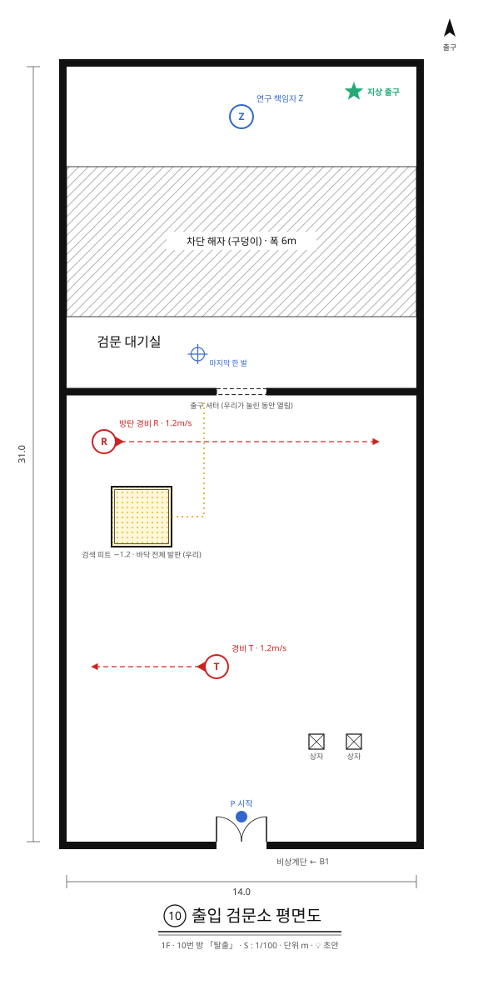

```
x:    -7              0              +7
z=-22  +----------------------------+
z=-20  |             Z              |   출구 플랫폼. 연구 책임자 Z
z=-18  |~~~~~~~~~~~~~~~~~~~~~~~~~~~~|
z=-15  |~~~~~~~~~~~~~~~~~~~~~~~~~~~~|   구덩이 6m
z=-12  |~~~~~~~~~~~~~~~~~~~~~~~~~~~~|
z=-10.5|          @                 |   착지대 (셔터 너머). 마지막 한 발
z=-9   +------------====------------+   출구 셔터 (우리가 눌린 동안 열림)
z=-7   |   R------------------->    |   방탄 경비 R
z=-4   |   vvvvv                    |   우리 (가운데 (−4, −4))
z= 2   | <---------T                |   경비 T 순찰
z= 5   |                   b  b     |
z= 8   |             P              |
z= 9   +------------    ------------+   남쪽: 통로 ← 9번 연쇄
```

| 대상 | 위치 (x, z) | 메모 |
| --- | --- | --- |
| 방 | x −7~7, z −22~9 | 셔터 남쪽(z −9~9)이 본 방, 북쪽이 착지대·구덩이·출구 플랫폼 |
| 출구 셔터 = | z −9 벽, x −1~1 | 우리 바닥(발판)이 눌린 동안 열림 |
| 우리 v | (−4, −4), 2.4 × 2.4m, 깊이 1.2m | 6번 방과 같은 규격 |
| 방탄 경비 R | (−5.5, −7) ↔ (5.5, −7) | 1.2m/s. 총알로는 교환 안 됨 |
| 경비 T | (−1, 2) ↔ (−6, 2) | 1.2m/s. 처음엔 서쪽으로. 우리로 가는 길을 지킴 |
| 상자 b × 2 | (3, 5) · (4.5, 5) | |
| 착지대 | z −12~−9 | 셔터 너머 |
| 구덩이 | z −18~−12 | 폭 6m |
| 연구 책임자 Z | (0, −20), 출구 플랫폼 | 움직이지 않음(5.1) |
| 입구 · 시작 P | 남쪽 벽 x −1~1 · (0, 8) | |
| 체크포인트 | 입구, R이 우리에 갇힌 순간 | |

**풀이**

1. T가 서쪽으로 걸어갈 때 뒤에서 제압합니다(3번 방). T가 쓰러지는 자리는 R에게서 9m 떨어져 있어 아무도 오지 않습니다.
2. 동쪽에서 상자를 들고 우리로 가 뛰어듭니다. 우리 바닥이 눌려 셔터가 열립니다. (E는 손이 비어야 하므로 제압이 먼저입니다.)
3. R에게 총을 쏘면 튕겨 나가고 교환되지 않습니다. R이 가까이 올 때 상자를 던져 맞힙니다(8번 방).
4. R은 상자가 멈춰 있던 곳(우리)으로 달려와 우리 가장자리에서 멈춥니다. 그동안 우리 반대쪽 벽에 붙어 섭니다(6번 방).
5. 교환. 나는 우리 밖, R은 우리 안으로. 셔터가 계속 열립니다. 체크포인트.
6. 셔터를 지나 착지대에 서면, 구덩이 건너 연구 책임자 Z가 보입니다. Z를 쏩니다.
7. 3초 뒤 나는 출구 플랫폼에, Z는 착지대에. 결말(1.4).

- 우리에서는 셔터 틈으로 Z가 보이지 않습니다(각도). R을 가두기 전에는 Z를 쏠 수 없습니다.

**대비 시간에 할 일:** 4번은 R이 달려오는 동안 자리 잡기. 7번 마지막 3초는 연출입니다. 💡 교환 전까지 화면이 천천히 어두워지고, Z가 나를 알아봅니다.

**다른 풀이·지름길 점검**

| 경우 | 결과 | 판단 |
| --- | --- | --- |
| 우리에서 R을 총으로 쏨 | 방탄. 교환 없이 R이 우리 가장자리로 달려옴 | 막힘. 탄약 1발 낭비. 상자로 다시 |
| 상자 없이 우리에 들어감 | 총알은 R에게 안 통함 | 탄약을 다 쓰고 총을 던지면(Q) 풀림. 총은 R 근처에 떨어지므로 교환 뒤 주워서 Z에게 다시 던짐 |
| T를 제압하지 않고 지나감 | T가 동서로 걸으므로 등을 보일 때 지나갈 수 있음 | 허용. 다만 상자를 든 채로는 제압을 못 하므로 순서에 주의 |
| R을 우리 밖에서 맞힘 | R이 내 쪽으로 옴. 우리에 아무도 없음 | 막힘. 다시 |
| 착지대에서 Z 대신 아무것도 안 쏨 | 구덩이 6m, 건널 길 없음 | 막힘 (결말은 Z와 바뀌는 것) |

---

## 10. 개발 계획

| 단계 | 내용 | 끝나는 기준 |
| --- | --- | --- |
| 0. 프로토타입 | 웹 3D 탈출 방 (감방·구덩이·제압·단상) | ✅ 완료 |
| 1. 플레이 테스트 | 직접 + 2~3명에게 설명 없이. 💡 프로토타입에 A안·B안 전환을 넣어 같은 방을 두 안으로 플레이 | 11장 질문 1~3, 6에 답이 나옴 |
| 2. 기획서 개정 | 잠입·탐색 방향과 층별 평면 V0.01 반영. 테스트 후 치수·감시·경보 보완 | 새 도면과 원안의 범위가 구분되고13장 검증 항목이 정해짐 |
| 3. 버티컬 슬라이스 | 기존 씬을 보존한 B5 연결 구역 그레이박스. 경비·CCTV·연구원·교환 통합 | 출구 탐색·복수 동선·발각 후 도주·교환 선택을 실제 플레이로 확인 |
| 4. 본 개발 | 검증된 구조를 B4~1F로 확장, 연출·사운드 | 💡 처음 하는 사람이 출구를 찾아가고 경로 선택의 이유를 설명할 수 있음 |

### 10.1 Unity 구조 💡

프로토타입에서 얻은 가장 중요한 기술 결정입니다.

- **예약 큐는 순수 C# 클래스**로 만듭니다. MonoBehaviour가 아니라서 시간을 직접 넣어 테스트할 수 있습니다.
- **경비 상태는 순수 데이터 + 한 걸음 함수**로 만듭니다. 실제 게임과 모든 미리보기(미래의 나, 명중 예측)가 **같은 함수**를 돌립니다. 그래서 "보여 준 대로 일어난다"가 코드로 보장됩니다.
- 6장의 수치는 ScriptableObject로 둡니다. 코드에 숫자를 쓰지 않습니다.
- 교환 판정, 무게, 문은 Unity 물리와 별개로 규칙 코드에서 판정합니다. 물리 엔진의 미세한 차이가 미리보기와 결과를 어긋나게 하지 않도록 합니다. 🟡 캐릭터 이동까지 직접 구현할지는 슬라이스에서 결정. 💡 초안: 미리보기는 경비만 계산하고 플레이어 이동은 계산하지 않으므로, 이동은 Unity CharacterController로 시작하고 교환·끼임 처리만 규칙 코드로 합니다.

---

### 10.2 에셋 제작·더미·Unity 학습 진행

레벨은 완성된 방 한 덩어리로 생성하지 않고 부위별 모듈로 제작합니다. 벽·바닥·천장·문틀·문짝·레일·관찰 유리·배관·표시등을 나누고, 장비도 본체·덮개·모니터·손잡이 등 교체 부위로 나눕니다. 생성 메쉬는 후보이며 실제 치수·pivot·접합면·UV·충돌체·LOD는 Unity 반입 전에 검수합니다.

톤앤매너: 공통 STYLE 프롬프트를 고정하고 OBJECT에 대상·부위·형태 제시어만 바꿉니다. 무광 회색 강철, 따뜻한 아이보리 패널, 절제된 주황 포인트, 가벼운 사용감, 같은 조명·배경·시점을 사용합니다. 바르코는 텍스트 합성 노드가 없어 같은 STYLE을 각 Text 노드에 복제하고 공통 템플릿 Note를 둡니다. 캐릭터 더미는 별도 공통 템플릿에서 색만 구분합니다.

제작 플로우: https://3d.varco.ai/flow/b7248081-b012-4913-87ba-4b056a7381ea (After_Seconds). Text → Generate Image → Generate 3D. Private, Triangle, 목표 8,000 triangles, 1K texture, count 1. 수치는 후보 생성 설정이며 최종 게임 예산·실측 결과가 아닙니다.

후보 AS01 무거운 시료 궤짝 본체: 5번 시료 저장고, 발판 무게·교환 대상. 가벼운 던지기 상자와 외형 구분. 손잡이 등 부품 별도.

후보 AS02 관제 콘솔 베이스: 8번 중앙 관제실, 시야 가림과 관제 데스크 섬 시각화. 모니터·조작 패널·케이블 별도.

후보 AS03 원심분리기 본체: 7번 원심분리기 홀의 산업 설비. 덮개·배관·조작 패널 별도. 기획서에 없는 장식 설비는 새 교환 대상으로 자동 취급하지 않습니다.

후보 AS04 에어록 문짝 한 장: 6번 오염 제거 에어록. 문틀·레일·표시등을 별도 모듈로 조립. 가동부와 고정 충돌체 분리.

후보 AS05 플레이어 더미: 회색 무채색 인체 마네킹, 전신 T-pose, 캐릭터 디자인 전 크기·시야·동작 확인용.

후보 AS06 경비 더미: 주황색 인체 마네킹, AS05와 같은 비례·T-pose 방향. 하나를 여러 경비에 재사용하고 위치·순찰·기절 등 상태를 따로 설정합니다. 생성만으로 동일 토폴로지·리깅·애니메이션은 보장되지 않습니다.

공통 STYLE 원문: Grounded contemporary industrial research facility, modular game prop, matte medium-gray painted steel, warm off-white removable panels, restrained amber accents only if specified, subtle edge wear, light dust, no rust damage, realistic PBR appearance, clean silhouette, one isolated component centered, three-quarter eye-level view, soft neutral studio lighting, plain light-gray background, full object visible, no environment, no labels, no logo, no people, no extra objects.

캐릭터 공통 원문: nonmetallic featureless human mannequin, adult human proportions, clean human silhouette, full-body symmetrical T-pose, two arms two legs, no face detail, no accessories, no weapons, no base, soft neutral studio lighting, plain gray background, full body visible. COLOR = neutral matte gray (player) / matte orange (guard).

Unity 진행 방식: 사용자가 `Unity/After_Seconds_Build_V0.01`에 초기 프로젝트를 생성했습니다. Unity 6000.4.0f1 / URP 17.4.0 / Input System 1.19.0입니다. 사용자가 분석·의사코드·구현을 직접 진행하고 Codex는 구조 분석·설계·질문 대응을 지원합니다. 게임 로직·계층별 asmdef는 아직 구현 전입니다.

참고: https://github.com/Jin-o12/Document_LucidDiver 및 https://github.com/Jin-o12/UnityProject_LucidDiver . 원본 Define → Utils → System·UI → Manager·Presenter 분리와 asmdef 의존성 관리를 참고합니다. 원본 UI가 System을, Presenter가 Manager를 참조한다는 실제 구조도 함께 확인했습니다.

After Seconds 제안: Define은 순수 데이터·계약, Simulation은 Unity에 의존하지 않는 예약·교환·경비 예측, System은 입력·물리·SO 변환, UI는 표시, Manager는 세션 조립, Presenter는 시스템·표시 연결. 폴더 분리뿐 아니라 asmdef로 참조를 제한합니다.

학습·구현은 분석 → 의사코드 → 작은 구현 → 확인 순서로 진행합니다. 기존 식별자·설정 데이터·예약 큐·교환 규칙 학습을 유지하고, 실제 공간 검증 대상은 방3개에서 B5 연결 구역으로 바꿉니다. 보행 그레이박스 → 경비 상태/수색·CCTV 알림·연구원 도주 → 교환/동일 Step 예측 통합 → 실제 플레이를 먼저 확인합니다. A/B 손 힘 비교·총/상호작용·발판/문·HUD는 관련 규칙이 검증되는 순서로 연결합니다. 이번 도면 작업에서 게임 코드를 구현하지 않았습니다.

상세 학습 자료: 저장소 Docs/Unity_계층_설계와_학습_순서.md . 첫 과제는 EntityState·ScheduledAction 필드와 ScheduleSwap / AdvanceTo / ExecuteSwap 의사코드입니다.


---

바르코 생성 결과 (2026-10-26): AS01~06 기준 이미지와 3D 후보 6종 생성 완료. Unity 반입·치수·리깅·충돌·게임 플레이 검수 전입니다.

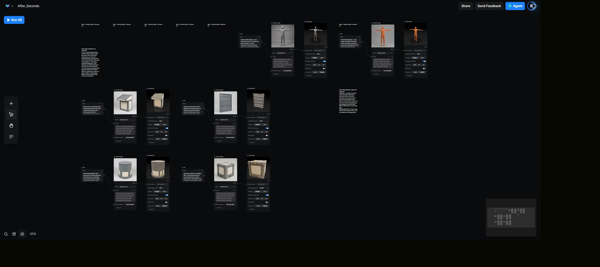

## 11. 위험과 확인할 것

| # | 위험 | 확인 방법 |
| --- | --- | --- |
| 1 | 3초 기다림이 지루한가 | 대비 시간에 플레이어가 무엇을 하는지 관찰 |
| 2 | 1인칭 조준이 퍼즐을 방해하는가 | 풀이를 알고도 조준 때문에 실패하는 횟수 |
| 3 | 미리보기가 너무 친절한가, 부족한가 | 미리보기 켬/끔으로 같은 방을 풀게 함 |
| 4 | 방 하나 만드는 비용이 큰가 | 버티컬 슬라이스에서 방 1개 제작 시간 측정 |
| 5 | 경비·시야·발판이 얽혀 의도하지 않은 지름길이 생기는가 | 방마다 풀이 경로 목록을 만들고 테스트 |
| 6 | A안(손의 힘 3초 뒤)과 B안(손의 힘 즉시) 중 어느 쪽이 더 납득되고 재미있는가 | 1·3·8번 방을 두 안으로 플레이. 경비와 마주쳤을 때 억울함을 느끼는지, 3초 동안 무엇을 하는지 관찰 |

---

## 12. 참고 자료

| 자료 | 위치 | 비고 |
| --- | --- | --- |
| 출발 인사이트 | 노션 인사이트 2026-10-22 "총을쏘면 3초뒤에 나가는 게임?" | |
| 탈출 프로토타입 (총·경비·제압·명중 예측) | https://claude.ai/artifact/9yk2t6TGWsFJLXtRt3HRCR | 비공개. 공유하려면 페이지의 공유 메뉴에서 열어야 함 |
| 던지기 샌드박스 (1인칭, 3초 멈춤) | https://claude.ai/artifact/Y82bcBZsSGuMfKCMD6QeQv | 비공개 |
| 도화선 퍼즐 2D / 3D | https://claude.ai/artifact/99dz98oTHXcNfSBLWiyVN8 · https://claude.ai/artifact/MTY2KaR4rwdjd1f31fdmLc | 초기 컨셉 실험, 비공개 |
| 코덱스 프로토타입 (압력판·셔터·감금) | `Desktop/MCP_Test/after-seconds-web` | 아이디어만 가져옴. 코드는 레벨별 하드코딩이라 재사용하지 않음 |
| Swap Lab | https://after-seconds-swap-lab.peppy-fawn-2065.chatgpt.site/ | 손댄 대상과 3초 뒤 교환 실험 |

---

## 13. 결정 필요 목록

2026-10-25에 빈칸을 모두 💡 초안으로 채웠습니다. 검토 후 확정하면 표시를 지웁니다.

| 항목 | 초안 | 상태 |
| --- | --- | --- |
| 엔진·플랫폼 확정 (Unity / PC) | Unity 사용. URP / PC 세부 설정은 프로젝트 생성 시 기록 | Unity 확정 · 나머지 💡 |
| 교환 지연·손 힘 지연을 같은 3초로 둘지 | 같은 3초. 7번 방 "s초 뒤에 쏘면 날아간 지 s초 된 자리"가 이 조건에서 나옴 | 💡 |
| 탄약 수 | 3발 | 💡 |
| 미리보기 수준 (후반 방에서 줄일지) | 기본 전부 표시 + 설정에서 「미리보기 줄이기」(7.2). 자동으로 줄일지는 테스트 후 | 💡 🟡 |
| 1인칭 조준 보정 | 교환 대상 판정 0.2m 확대, 끌어당기기 없음(8장) | 💡 🟡 |
| 정면 주먹 (반격·넉백) | 3초 뒤 3m 밀기, 그동안 붙잡힐 수 있음. 본편 제외, 확장 요소(4.3) | 💡 |
| 발판 종류 (유지형 외) | 본편은 유지형만 | 💡 |
| 문이 닫힐 때 끼인 것 처리 | 밀어 냄(4.6) | 💡 |
| 적 역할 | 경비 추격·CCTV 호출·연구원 도주/주변 알림·연구소장 엔딩 | 사용자 확정. 수치·경보 전달은🟡 |
| 연구원/CCTV 상호작용 | 교환·제압·파괴·무력화 판정은 역할과 별도 검증 | 🟡 |
| 방탄 경비 | 기존10번 방 기믹 후보. 새 잠입 본편 적용 여부 별도 검증 | 💡 |
| 세계관·결말 | 제7 반응연구소, 피험체 S-03, 지하 B5에서 지상 1F로 올라가는 탈출, 책임자의 현장 관찰 실험과 책임자와 바뀌는 결말(1.4, 9장 층 배치) | 💡 |
| 층별 도면 | 잠입·탐색6층 V0.01. 기존1~10번은 기믹 검증 원안 | 치수·배치💡 / 별도 B5·B4 제작·보행 검증, B3~1F 미적용 |
| 탄약 보충 | 일반 문마다 자동 보충하지 않음. 안전 지점·층 전환 보충 위치·횟수는 검증 | 🟡 |
| 손이 닿지 않는 곳에 떨어진 총 처리 | 구덩이처럼 손에 돌아옴(4.4) | 💡 |
| 구역을 넘는 사격·교환 | 실제 벽·문·유리·사거리로 판정. 일반 문마다 앞뒤 자동 폐쇄로 차단하지 않음 | 전실 연동·유리 판정🟡 |
| 2번 방 건너편 상자 (조용히 건너는 풀이를 허용할지) | 기믹 원안은 건너편 상자를 치웠음. 새 본편은 우회·교환 경로 선택과 함께 배치 검증 | 💡 |
| 도주·우회와 속도 | 정식 대응으로 허용. 모든 구역을 달리기 하나로 통과하는지와 추격 중 경로 변경 가능성을 함께 검증 | 🟡 |
| 층간 단면 | 계단A/B의 분리 구간·층고·리프트·B2/B1 사다리 개구와 도착 위치 | B5–B4–B3 계단 단면/보행 확인 · 나머지 단면/전환🟡 |
| 손의 힘 타이밍 (A안 지연형 / B안 예지형) | 두 안 모두 프로토타입으로 실험 후 결정(2.1, 11장 6번) | 🟡 |
| 시야 창 (맞힌 대상의 시야를 3초 동안) | 7.2에 초안. 여러 예약·물체일 때 규칙 미정 | 🟡 |

---

## 변경 기록

| 버전 | 날짜 | 작성자 | 변경 내용 |
| --- | --- | --- | --- |
| V0.47 | 2026-11-08 | 송예찬 | 이동 안내선을 복도에만 유지하고 돔/코어 내부 노선·목적지 문자·범례를 제거하도록 변경. |
| V0.46 | 2026-11-08 | 송예찬 | 사용자 위임에 따라 S01 계측시험·E03 제염 흐름·E02 직원식/피험체 물품 인계·E01 창고·VL 화물 설비의 목적과 상세 제작 기준을 구체화. |
| V0.45 | 2026-11-08 | 송예찬 | C01 보존, 나머지11돔·3코어 기능별 내부 구조/상세 프랍 재제작, 안내·통행·Play 재검수. |
| V0.44 | 2026-11-08 | 송예찬 | 남은10돔·2코어·17복도 제작,15목적지 안내 확장, 프리팹 좌표/통행/Play/가림 검수와 일괄 사용자 검수 순서 기록. |
| V0.43 | 2026-11-08 | 송예찬 | T02/VA 16m 계단 코어 제작, 목적지3색 확장, 통행/실제 Play 검수, B4 연결 미완료 범위 구분. |
| V0.42 | 2026-11-08 | 송예찬 | 각 돔의 도달 목적지별 안내 확정. 현재 C01/C02 두 선만 반영하고 다른 돔 안내는 해당 구역 제작 시 확장. |
| V0.41 | 2026-11-08 | 송예찬 | 네 목적지 색 안내선6경로·바닥 표기·정적 피드 갱신, 간격/통행 검수와 전체 확장 미완료 범위 기록. |
| V0.40 | 2026-11-08 | 송예찬 | C02 밀도·모니터 디테일·현재 구조 지도 보강과 통행/Play검수, 각 돔 안내체계 후속 의견. |
| V0.39 | 2026-11-08 | 송예찬 | T01 사용자 확인, C02 관제동 모델14종·문2세트·C04 안내선 연결 구현 및 통행/Play/기존 편집 보존 검증. |
| V0.38 | 2026-11-07 | 송예찬 | T01 복도 마감·C02 문 교체·목적지 바닥 표기4개·안내선 정렬 구현, 통행/Play/기존 자산 보존 검증 및 C02 후속 범위 기록. |
| V0.37 | 2026-11-07 | 송예찬 | 승인한 5섹터 구분 기반 15목적지·19복도 전체 배치안, 76개 바닥 글자 영역과 용도별 비중첩 노선 검증. 검토 도면·HTML·JSON/CSV 작성, 씬 읽기 전용 대조. |
| V0.36 | 2026-11-07 | 송예찬 | 구역명·목적지 선행 확정, 안내선에 구역명 표기, 돔 사이 선·글자 비중첩 기준 기록. 기존 공간 코드를 유지한 B5 5섹터 명칭 초안 제안. 전체 노선 설계 우선, 씬 미변경. |
| V0.35 | 2026-11-07 | 송예찬 | 실험동 확인 완료 및 B5 전체 제작 후 조명·색감 일괄 조정 결정. C01 업무 안내선과 소형 출입 표식 제작 범위·기존 Decision 코드 사용·국소 경로 제작 및 검수 완료 기록. 게임 규칙 유지. |
| V0.27 | 2026-11-06 | 송예찬 | 외부 설계 완성본 검수·수정과 원형 레벨 제작 재개. B5 청백색·B4 어두운 무채색·B2 철색/붉은 보조등·B3 저인원 보관부 소등 및 구역 점등의 사용자 수정안 반영. B1 유지. 런타임 코드는 사용자 직접 작성. |
| V0.26 | 2026-11-06 | 송예찬 | 층별 역할·구조·이동 경험으로 분위기와 색감을 구분하는 사용자 방향 반영.6층 재질·색·조명 가안, 공용 건축·안내선 의미의 일관성, 낮은 눈부심과 시야 가독성, 대표 구역 선행 검수 기준 정리. 외부 도면·Unity·게임 코드 미변경. |
| V0.25 | 2026-11-06 | 송예찬 | B2 냉각·펌프 공동의 스틸 그레이팅 메자닌과 상하 상호 관찰·잠입 방향 채택. 부분 데크·복수 계단 순환·차폐·지지 구조 외형과 검수 기준을 가안으로 정리. 앞선 관찰·업무·순환·생활 흔적 방향 반영. 외부 도면·Unity·게임 코드 미변경. |
| V0.24 | 2026-11-06 | 송예찬 | 직원용 바닥 안내선과 행정·감독·인수인계 기록을 통한 출구 방향 추론 채택. 감시 구간 우회·재합류와 표식 가독성 기준 정리. 색·코드·좌표는 미정이며 새 원형 공동 설계와 기존 Unity 제작 이력을 구분. 씬·게임 코드 변경 없음. |
| V0.23 | 2026-11-06 | 송예찬 | 큰 차폐벽12개 철거·벽면 설비 엄폐12개, 평면V0.04/터널·돔 단면 재작성, 돔10곳과 조명/충돌 정합, 현재 정적 공간 기준 예상 이동 재계산. 게임 코드 보존. |
| V0.22 | 2026-11-06 | 송예찬 | Reference_004 실내, 벽·상자 생활 흔적, B5/B4/B3 복도4.2m·북측4.8m 확장과 굵은 원호 아치·복도 조명 감축. 방·문 폭·계단 치수 보존, 도면/예상 동선 좌표 갱신. 게임 기능은 미구현 유지. |
| V0.01 | 2026-10-23 | 송예찬 | 초안 작성. 웹 프로토타입(탈출 방)과 코덱스 프로토타입(발판)의 규칙을 정리 |
| V0.02 | 2026-10-23 | 송예찬 | 9장에 방 도면 추가: 1 감방·2 구덩이는 프로토타입 배치를 옮김, 5 압력판은 새로 설계(💡). 5번 방 풀이 핵심을 "궤짝을 쏘고 3초 안에 판 위에 서기"로 수정. 6.5 발판·문 데이터 추가. 13장에 탄약 보충·손 닿지 않는 총·방 건너뛰기·2번 방 상자 추가 |
| V0.03 | 2026-10-25 | 송예찬 | 🔴·🟡 빈칸을 모두 💡 초안으로 채움(검토 전). 9장에 3·4·6~10번 방 도면 추가(9.4~9.11, 5번은 9.6으로 옮김). 6·7·8번 방의 풀이 핵심을 바꿈(6 셔터: 우리에 경비 가두기, 7 던진 상자: 처리 순간의 위치, 8: 탄약 0 대신 단상 뒤에서 던지기). 4.6에 우리·문 끼임(밀어 냄)·방 사이 통로 추가. 4.4 탄약 보충(통로에서 3발)·손 닿지 않는 총. 4.3 정면 주먹 초안(확장). 1.4 세계관·결말 초안. 5장 연구 책임자·방탄 경비(10번 방). 6장 데이터 추가(ammoRefill, aimAssist, bulletproof, penDepth, penSize, punchRange, punchPush). 7.2 발판·문 연결 표시·미리보기 수준, 8장 조준 보정. 2번 방 건너편 상자 치움. 13장에 초안 칸 추가 |
| V0.04 | 2026-10-25 | 송예찬 | 2.1 추가: 손의 힘 타이밍을 A안(지연형)·B안(예지형) 두 안으로 들고 가고 프로토타입으로 비교해 결정. A안 약점 보충책(공간에 남는 주먹·도망·붙잡힘 유예·발견 여유) 기록. 1.4 실험의 정체를 두 안으로 나눔. 7.2 시야 창 추가. 10장 1단계·11장 6번·13장에 반영 |
| V0.05 | 2026-10-25 | 송예찬 | 구글 문서 검토 댓글 반영. 1.1 기획 의도를 "3초 뒤 상호작용을 재미로 만드는 과정"으로 다시 씀, 설계 원칙은 1.5로 분리. 1.4 세계관 보강(제7 반응연구소, 피험체 S-03, 실패작 판정과 폐기 대기, 책임자의 현장 관찰 실험, 층 사이 연출, 지상 출구 결말). 9장에 층 배치(B5 → 1F, 지하에서 올라가며 탈출)와 시설 공간 열 추가. 방 평면도 SVG(`Docs/도면/`)와 생성 스크립트 추가 |
| V0.06 | 2026-10-25 | 송예찬 | 버전 표기 도입: 제목 뒤에 V0.01부터 붙이고 고칠 때마다 0.01씩 올림, 완성되면 1.0. 지금까지의 변경 기록에 V0.01~V0.05를 소급해 붙임. 10장 2단계 이름을 「기획서 V0.2」에서 「기획서 개정」으로 바꿈 |
| V0.07 | 2026-10-26 | 송예찬 | 문서 안에서 서로 안 맞던 4곳 수정. 1.2 「시간마다 다른 곳에」 예시를 바뀌기 전 6번 방 안(공)에서 5번 방으로 바꿈. 4.6 핵심 활용을 9.6에 맞춰 "교환되는 순간 판 위에 서 있는다"로 바꿈. 10장 2단계 끝나는 기준을 "13장 🟡 항목이 플레이 테스트로 정해짐"으로 바꿈(빈칸은 V0.03에 이미 다 채워짐). 2.1 보충책 2(도망)가 3번 방 지름길이 될 수 있음을 적고 13장 해당 행을 맞춤 |

| V0.08 | 2026-10-26 | 송예찬 | 연구소 전체 건물 시안 V0.01 반영. 9.0에 외관·층별 지원 공간·보안 및 직원 동선·층 연결 유지·치수 가안·검증 항목 추가. 외관·단면과 전체 층별 평면 이미지 수록. 기존 방별 좌표·SVG 보존 |

| V0.09 | 2026-10-26 | 송예찬 | 부위별 모듈 제작·공통 STYLE/OBJECT 템플릿·에셋 후보 AS01~06·회색 플레이어와 주황 경비 더미 추가. Unity 사용 및 사용자 주도 프로젝트 생성·의사코드 학습 진행 반영. 루시드 다이버 계층 분석을 바탕으로 순수 Simulation 분리와 단계별 구현 순서 제안 |

| V0.10 | 2026-10-30 | 송예찬 | 로컬 프로젝트를 Desktop/Projects 아래로 이동하고 Unity 상위 폴더 경로를 Unity로 갱신. 게임 규칙·수치 변경 없음. 구글 문서는 이번 로컬 경로 정리에서 수정하지 않음 |
| V0.11 | 2026-11-03 | 송예찬 | 시작 공간의 유리 관찰 포드 제작 상태와 기존 철창 프로토타입 원안을 구분. 배식구·사격·총 빼앗기 경로는 검토 중이며 핵심 규칙 유지 |
| V0.12 | 2026-11-03 | 송예찬 | 사용자 확대 포드(3,2,3)를 기준으로 생활·실험형 격리 공간, 높은 천장, 외부 경비, 안팎 동일한 양문 배식구와 전달함 구성. 가구·바닥 높이 정렬, 탈출 규칙은 검토 유지 |
| V0.13 | 2026-11-03 | 송예찬 | 가운데 등을 돔 안쪽 고정부·3지지선·하부 발광 링 조명으로 교체. 외부 천장 조명과 생활 배치 유지 |
| V0.14 | 2026-11-05 | 송예찬 | 사용자 결정: 큰 방 이름·번호 및 퍼즐 풀이 설명 표지를 제거하고 최소 시설 표식만 유지. 방 이름 UI는 보류하고 필요할 때만 안내하는 방향을 명시. 조작·게임 규칙·수치는 유지 |
| V0.15 | 2026-11-05 | 송예찬 | 사용자 결정: 방별 정형 퍼즐에서 연구소 잠입·탐색으로 중심 전환. 경비/CCTV/연구원/소장 역할 반영. 직원 통로 우회·복수 동선·도주 허용, 일반 문별 분리/자동 탄약 보충 기준 개정.6개 층별 SVG·PNG·좌표JSON과 평면 검사 V0.01 제작. 기존1~10번은 기믹 검증 원안으로 보존. A/B 손 힘 미확정·Unity 씬 미변경 |

| V0.16 | 2026-11-05 | 송예찬 | 예상 플레이어 경로18개를 도면 복사본에 표시. 원본 씬 보존·별도 B5 제작과 베벨/VARCO V03 반입, 실제 입력·경로·계단 보행 검증 범위 기록. NPC AI/교환/층간 전환 미구현, 냉각조 교환 방향과 층고 가안 명시 |

| V0.17 | 2026-11-05 | 송예찬 | B5 베벨 폭 유지 감면과 소품 LOD, 인물 메시/웨이트/검토 포즈 및 CCTV Enemy 아트 분류·Y/X 피벗 분리 반영. 게임 C#은 사용자가 질문하며 직접 작성, 현재 작업은 레벨·아트에 한정. 원본6씬 보존 |
| V0.18 | 2026-11-06 | 송예찬 | B5 현재 외형/정적 경로 재검수, 새 B4 잠입씬 제작 상태 반영. 관찰창4곳·2.5m 데크14단·계단B6.4m/36단 가안, A/B/C와 계단 왕복 및 실제 W 입력 검증. B5↔B4 단면 불일치와 층간 전환/AI 미구현 명시. 원본6씬·새 B5·게임 코드/설정 보존 |
| V0.19 | 2026-11-06 | 송예찬 | 사용자 이동 확인 뒤 B5·B4 문틀/슬라이딩문53세트·양면 키패드106개·프랍15개와 작업등5개 적용. 벽/배관 PBR·낮춘 조명·정적 반사 갱신. 캡슐1,725표본 막힘0, 열린 문49곳 통행 및 기존 잠금4곳 확인. 문/키패드 기능·게임 C#은 미구현, 원본6씬·게임 코드 보존. FPS 측정은 별도 |

| V0.20 | 2026-11-06 | 송예찬 | B5/B4 실제 플레이 성능 확인 후 계단A/B 상부참·도착문 정합 치수 채택, B4/B3 내려가는 계단과 별도 B3 잠입층17구역·문27세트·프랍18개 제작. 경로2,627표본·Controller19검사·실제 Play 성능 기록, 리프트 캐빈을 도면/예상 경로에 반영. 게임 기능은 사용자 직접 작성 범위 유지 |

| V0.21 | 2026-11-06 | 송예찬 | 제작된 B5/B4/B3 프랍 보강: VARCO V0.03 6종 생성·리메시 후 Blender 베벨/치수/LOD/PBR 정리, 추가101개와 B3 상자288개·6패턴 적용. 기존 랙 충돌·게임 규칙/코드 보존. |

- V0.28 (2026-11-06): 프랍·환경 제작 목록 V0.03, 환경32종과 바닥형 보급장2종 추가. B5 기준 구간42배치 및 구버전 씬 Old 정리. 송예찬.

- V0.29 (2026-11-06): 현재 B5 돔7개를 1~7섹터, 터널7개를 별도 복도 구역으로 구분. 실제 씬의7돔·7터널 대조, 번호 도면과 완료 기준·작업 순서 기록. Unity 씬과 기존 설계 좌표는 변경하지 않음. 송예찬.

- V0.30 (2026-11-06): 1섹터 내부 생활·외부 관찰/진료/보급 구획과 제작·검수 범위 명시. 성인 침상, 일체형 위생 유닛, 생체신호 기록기와 곡면 건축 마감. 송예찬.

- V0.31 (2026-11-06): Decision 조감도의 참고 범위와 C01 내부 생활 배치 유지 확인. 1섹터 레벨·아트 검수 완료, T01로 다음 단위 이동. 송예찬.

- V0.32 (2026-11-06): C01 실험용 격리·별도 생활 공동 역할 구분, 조감도 기준 섹터와 전체 돔11개 개편 논의. C01 완료 보고 철회 및 아트 재작업. 송예찬.

- V0.33 (2026-11-06): B5 조감도 전체 12공동·3이동 코어·19복도, 총34작업 단위로 확정. 11개 통합안 취소. C01 실험 / W01·W02 생활 역할 분리. 송예찬.

- V0.34 (2026-11-06): B5 전체12공동·3코어·19복도와 C01 실험 배치를 Unity에 반영. 통행·문·Play 검수, 외곽 세부 아트와 층간 구조의 미완료 범위를 구분. 송예찬.

- V0.48 (2026-11-08): 돔12곳 천장등80개·13복도98등 리브 사이 정렬·29등 외형 보강, 기하/보존/전후/Play 검수. 기존 작업등 설정과 복도 전용 안내선 유지. 송예찬.

- V0.49 (2026-11-08): B5 1차 확인 수용, B4 중앙 관찰동 대표 구역 제작과 확장 순서. 송예찬.

- V0.50 (2026-11-08): B4 C01/T02 대표 구역 구현과 검수 결과·후속 확장 순서. 송예찬.

- V0.51 (2026-11-08): 사용자 요청에 따른 B4 전체 일괄 제작 범위와 후속 일괄 검수. 송예찬.

- V0.52 (2026-11-08): B4 전체 첫 외형·배치·이동/Play 검수와 사용자 일괄 검수 단계. 송예찬.

- V0.53 (2026-11-08): B5 기본 측정·실험 관리와 B4 정밀 측정·발달·강화 진행 기록의 역할 구분 확정. 송예찬.

- V0.54 (2026-11-08): B5 생활 중심/B4 본격 실험의 역할 확정과 실험체·경비·연구원 관점의 설비 보강 착수. 송예찬.

- V0.55 (2026-11-08): B4 시험·보호 관측·준비/기록·회복 설비 보강과 접근/Play 검수. 송예찬.

- V0.56 (2026-11-08): 프로젝트 내부 이름의 간결한 영어 표기 규칙과 기존 이름 마이그레이션. 송예찬.

- V0.57 (2026-11-08): 제작 커밋·push와 블로그 배포·공개 페이지 확인. 송예찬.

- V0.58 (2026-11-09): 달리기(Shift)·앉기(C 토글) 조작과 앉은 높이·앉아서 이동/달리기 속도 가안, 앉기의 경비 발견 지연 방향 추가. 송예찬.
