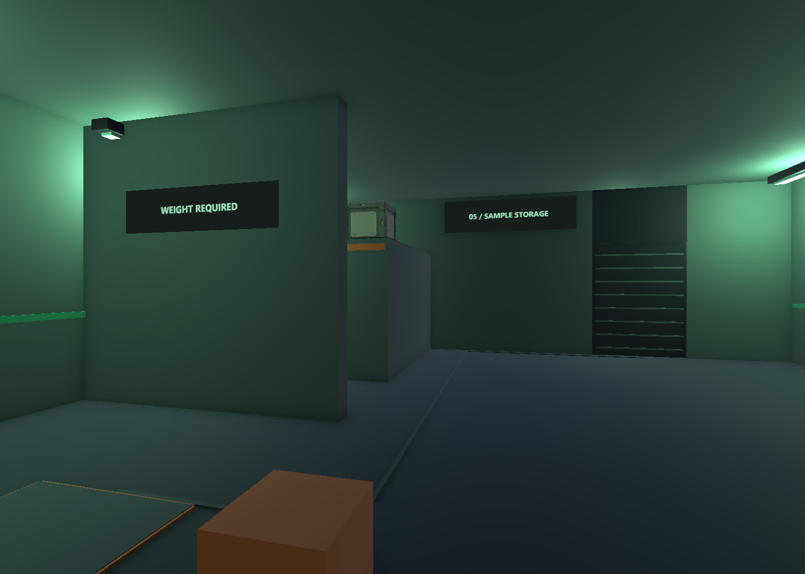
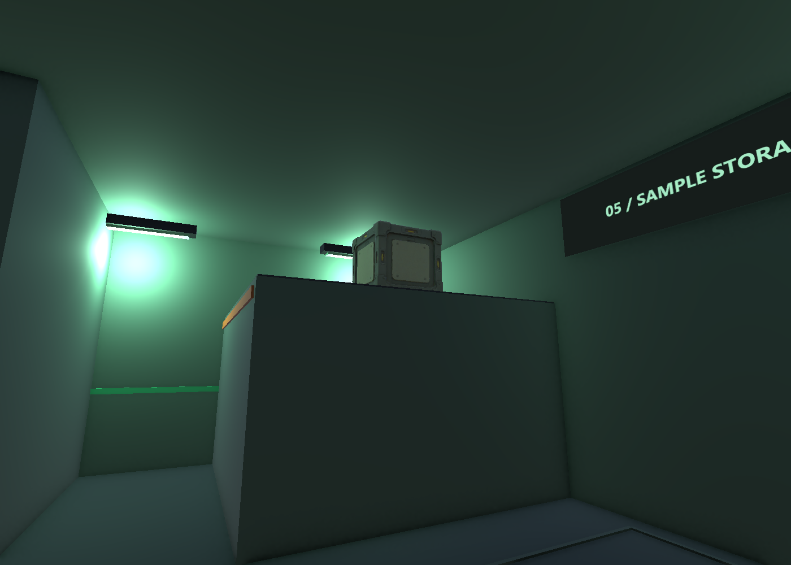
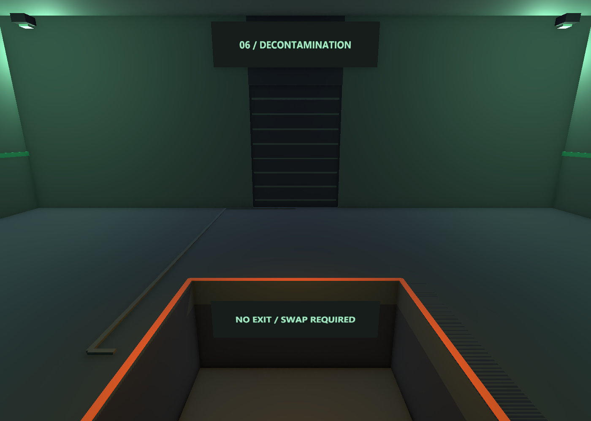
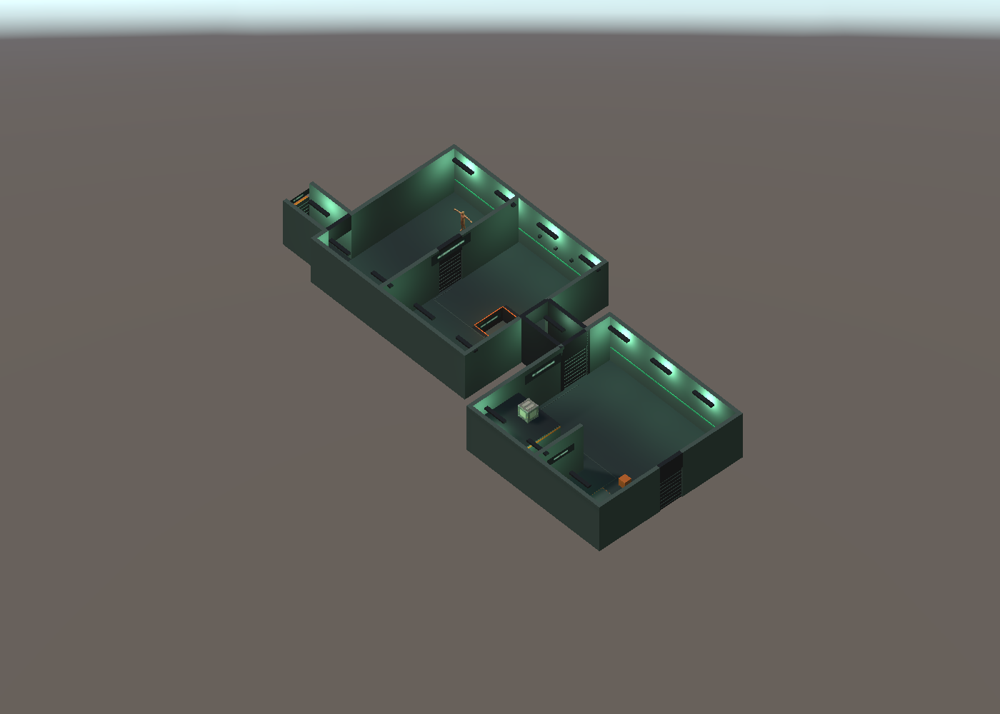

# B3 시료층 레벨 구성 V0.05

2026-11-05 설계 개정: 최신 제작 가안은 [시료층 잠입 평면](도면/잠입_탐색/B3_시료층_잠입.svg)과 메인 기획서V0.15의9.0이다. 시료 랙과 냉동/전처리/폐기물/환복 구역을 연결한다. 계단 도착 출입구와 리프트 접근 방향을 분리했다. 아래는 기존 셔터·발판 기믹의 제작 이력이며 새 전체 동선의 필수 풀이가 아니다. Unity 씬은 아직 새 평면으로 수정하지 않았다.

2026-11-03 · 작성자 송예찬

## 범위

추가 층 제작 요청으로 B4 다음 B3를 별도 씬으로 구성함. 기준은 메인 기획서 9.6·9.7 및 6.5의 치수, `도면/05_압력판.svg`, `도면/06_셔터.svg`임.

씬: `Assets/Afrer_Seconds/01.Scenes/Stage/Level_B3_SampleStorage.unity`.

5번 시료 저장고와 6번 오염 제거 에어록의 외형·충돌·조명·설계 마커 초안임. 플레이어·카메라는 기존 Player 씬의 구성을 함께 복제함. **B3 씬 하나만 열어** 확인하며 Player 씬과 함께 로드하면 중복될 수 있음.

발판 판정·셔터 작동·경비 AI·사격·교환·체크포인트·엘리베이터·층 이동은 구현하지 않음. 닫힌 셔터로 정상 이동이 막힌 것은 현재 기능 범위에 따른 상태임. 기획 규칙이나 수치를 변경하지 않음.

## 배치

단위 m, 출구 방향 −Z, 바닥 Y=0. 부모 오프셋·연결 통로·외형 두께는 💡 제작 가안임.

| 구역 | 방 안 좌표·치수 | 부모 월드 위치 |
| --- | --- | --- |
| Room05_SampleStorage | x −6~6, z −6~6, 높이 4 | (0,0,0) |
| 발판 | 중심 (3,3), 1.5×1.5 | Room05 내부 |
| 가벼운 상자 | (1,3), 변 길이 0.6 | Room05 내부 |
| 가림벽 | x 2~6, z 0, 높이 4 | Room05 내부, 💡 두께 0.3 |
| 높은 선반 | x 2~6, z −6~−2, 높이 2.5 | Room05 내부 |
| 무거운 궤짝 X | (3,−4), 바닥 Y 2.5 | 기존 Props_Crate_V0.1 프리팹의 정적 후보 |
| 시작 | (0,5), 플레이어 루트 Y 0.65 | 기존 Controller 치수 유지 |
| Room05 셔터 | 북쪽 x −4~−2 | 중심 x −3, 닫힌 충돌 외형 |
| 연결 통로 | 폭 2, 길이 4 | 💡 (−3,0,−8) |
| Room06_DecontaminationAirlock | x −6~6, z −8~6, 높이 4 | 💡 (−3,0,−16) |
| 에어록 가운데 벽·셔터 | z −2, 셔터 x −1~1 | 닫힌 상태로 시야·통행 차단 |
| 피트 | 중심 (0,3), 2.4×2.4, 바닥 Y −1.2 | Room06 내부 |
| 순찰 경비 G | (−4,−5), +X 방향 | 기존 정적 경비 외형 |
| G 순찰 표시점 | (−4,−5) ↔ (4,−5) | 빈 Transform, 이동 없음 |
| Room06 출구 | 북쪽 x 3~5 | 중심 x 4 |
| B2행 화물 리프트 외형 | 폭 2, 길이 4 | 💡 (1,0,−26), 북쪽 연결부 닫힘 |

5번 발판은 바닥 위 4cm 두께의 비활성 외형임. 실제 무게 판정과 연결 상태는 없음. 바닥의 회색 연결선·꺼진 표시등도 정적 표시이며 동적 UI가 아님.

6번 피트는 전체 바닥을 깐 뒤 덮은 장식이 아님. 남·북·동·서 네 바닥으로 구멍을 남기고 −1.2m에 2.4×2.4 바닥판을 별도 배치함. 가장자리 표시와 노즐은 충돌 없는 장식이라 발판·계단을 만들지 않음. 피트 바닥 전체가 압력판이라는 기획은 외형으로만 표현함.

셔터는 닫힌 상태이며 압력판 기능이 생기기 전에는 다음 구역으로 정상 통과할 수 없음. Scene View와 검수 이미지로 뒤 구역을 살펴볼 수 있고, `Spawn_Room06_InspectionOnly`는 검수 위치 마커일 뿐 플레이 중 이동 기능은 아님. 재시작 기능이 없으므로 현재 초안의 피트에서 복귀하려면 Play를 종료 후 다시 시작함.

## 에셋 분류

- 씬: `01.Scenes/Stage/Level_B3_SampleStorage.unity`.
- 새 구조 재질·표지 재질: `05.Model/Environment/B3/Materials/`.
- 새 2D 표지 PNG: `03.Art/Environment/B3/Signs/`.
- 기존 무거운 궤짝과 경비 프리팹을 참조함. 원본 프리팹·재질·모델은 수정하지 않음.
- 건축·가벼운 상자·리프트 외형은 Unity 기본 메시로 구성함. Environment Training 원본 에셋은 반입하지 않음.

B4와 구분되는 녹색 계열 조명·시료 구역 표지·제염 노즐을 배치함. 최종 아트 품질·조명 베이크·성능 예산이 확정된 상태는 아님.

## 검수

### 2026-11-03 조명·최적화 추가

후속으로 방 벽과 통로 벽·천장의 0.3m 중첩을 확인하고 연결부 6개를 정리함. 연결 통로의 벽·천장만 3.4m, 리프트 벽·천장만 3.7m로 다듬음. 연결부 BoxCollider도 함께 조정했으나 바닥 길이·유효 통로 폭·문 위치·방 치수는 유지함. 형상 검사 18/18 및 해당 연결부의 같은 방향 겹친 면 0건을 확인함.

이후 벽·차폐막 깜빡임 제보에 따라 겹친 벽 띠 끝면과 조명 관통을 정리함. 차폐벽 외형의 감춰진 끝면은 벽 안으로 2cm 넣었으며 BoxCollider·방 치수는 유지함. 오클루전 재베이크와 형상 검사 18/18을 확인함. 상세 내용은 최적화 문서의 접합부 수정 기록을 따름.

후속 요청으로 노출 +0.25·약한 Bloom·궤짝 Spot Light·측면 증기 하나를 적용함. 천장 광원 정리, 장식 그림자 제외, 표지 5종의 공유 아틀라스, 오클루전 베이크도 수행함. 씬 사용 머티리얼 15→12, 광원 18→12, 그림자 투사 Renderer 150→51이며 Collider는 50개로 유지함. LOD는 현재 메시 복잡도와 실내 규모를 고려해 적용 후보·제작 방안을 정리한 상태임.

아래 최초 생성 검수와 현재 변경을 구분함. 후속 작업에서 B3 씬과 B3_Lamp.mat만 기존 파일에서 변경했고, 새 효과·최적화 에셋을 추가함. 구성·전후 집계·한계·컬링 및 LOD 방안은 [B3 조명과 최적화](B3_조명과_최적화.md)를 참고함. FPS 향상을 측정한 결과는 아님.

편집 검수 **18/18**:

- 누락 스크립트 0, Renderer의 재질·셰이더 참조, 플레이어·카메라 중복 없음.
- 시작점, 선반 4×2.5×4, 가림벽 4×4×0.3, 발판 1.5×1.5, 궤짝 위치 확인.
- 발판 위치에서 궤짝 방향으로 향하는 시선이 가림벽에 먼저 맞는지 확인.
- 저장고 통로의 캡슐 표본 6곳에서 통행 충돌 없음.
- 피트 2.4×2.4, 바닥 −1.2, 위를 덮는 바닥 없음, 주변 바닥 3곳 확인.
- 닫힌 에어록 셔터가 시선을 막는지 확인.
- Room06 부모 위치·경비 G 위치, 동적 TextMesh 없음, 표지 텍스처 참조 확인.

Play Mode에서 기존 `PlayerMotor.Move`를 dt=1/60으로 직접 호출해 **3/3** 확인:

1. 시작 z 5→2.75, 2.25m 이동·접지.
2. 검수용으로 피트 위에 임시 이동 후 낙하, 루트 Y 약 −0.52에서 접지. Controller의 기준점을 포함한 값이며 실제 피트 바닥은 −1.2임.
3. 피트에서 북쪽으로 이동시 벽에 막히며 탈출하지 않음.

실제 키보드 이벤트·시간에 따른 프레임 흐름·점프·기어오르기·경비 행동·퍼즐 풀이 검증은 아님. 임시 위치 이동은 게임 기능으로 계산하지 않음.

작업 시작 시 존재한 Assets·Packages·ProjectSettings **482개 파일의 해시가 모두 동일함**. 기존 B5·B4·Player·사용자 코드·애니메이션·씬 이동·Build Settings를 보존함. B3는 Build Settings에 자동 추가하지 않음. 커밋·push는 하지 않음.

기록: [검수/2026-11-03_B3](검수/2026-11-03_B3). 생성·검수 도구는 Assets 밖 `Projects/Management/AfterSeconds_B3_20261103/`에 보관함.

