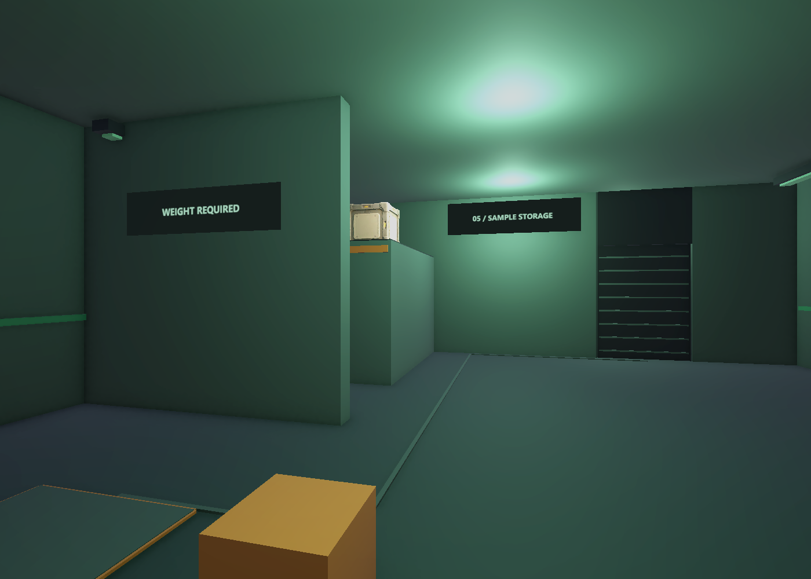
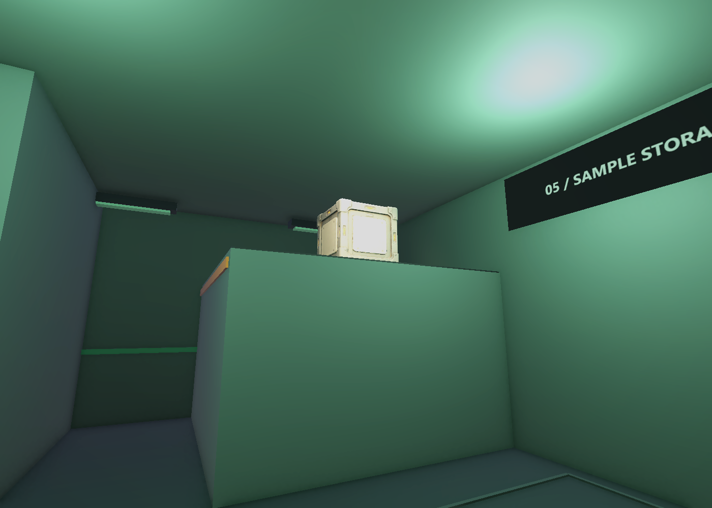
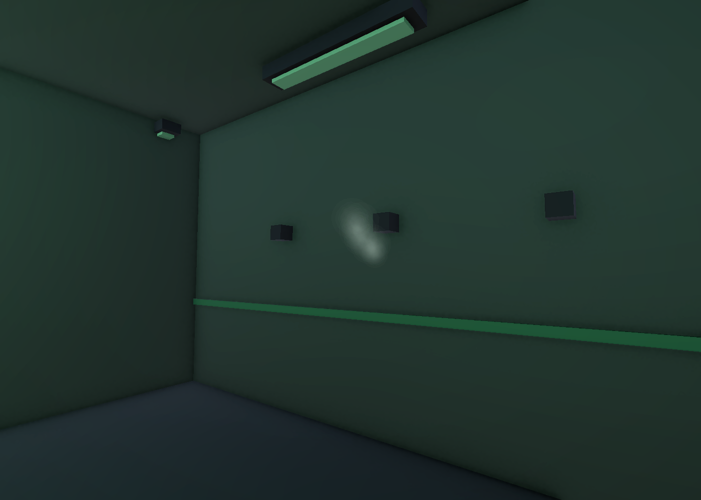

# B3 조명과 최적화 V0.03

2026-11-03 · 작성자 송예찬

## 적용 결과

B3 씬에 노출·궤짝 조명·약한 Bloom·에어록 측면 증기 한 곳을 적용함. 표지 아틀라스와 그림자·광원 정리, 오클루전 베이크도 함께 수행함. 적용 대상은 `01.Scenes/Stage/Level_B3_SampleStorage.unity`임.

원래 있던 Assets·Packages·ProjectSettings 523개 중 변경한 파일은 **B3 씬과 B3_Lamp.mat 두 개**임. 새 Volume Profile·증기 텍스처와 재질·표지 아틀라스와 UV 메시·오클루전 데이터를 추가함. B4·B5·Player·사용자 코드·애니메이션·공용 URP 설정·Build Settings는 작업 시작 시 해시와 동일함. 커밋·push는 수행하지 않음.

| 항목 | 적용 전 | 적용 후 |
| --- | ---: | ---: |
| 씬에서 참조하는 서로 다른 머티리얼 | 15 | 12 |
| 표지에 사용하는 머티리얼 | 5 | 1 |
| 광원 | 18 | 12 |
| Point Light | 17 | 10 |
| Spot Light | 0 | 1 |
| 그림자를 만드는 광원 | 1 | 1 |
| 그림자 투사 Renderer | 150 | 51 |
| Renderer | 150 | 154 |
| 씬 내 메시 인스턴스의 삼각형 합계 | 33,702 | 33,738 |
| Collider | 50 | 50 |
| Particle System | 0 | 1 |
| LOD Group | 0 | 0 |

이 표는 씬 구성 집계이며, 한 프레임에 실제 그려진 수나 FPS 개선률은 아님. Renderer는 증기 하나와 접합부 수정으로 나눈 벽 띠 3개 때문에 늘었고, Bloom·투명 파티클은 새 GPU 비용을 추가함. 광원·그림자 감소만으로 전체 프레임이 빨라졌다고 단정하지 않음.

## 조명과 효과

- 새 Profile: `06.Data/Rendering/B3/B3_ReadabilityVolume.asset`.
- Post Exposure +0.25, Contrast 4, Saturation −4. 모두 💡 시각 조정 가안임.
- Bloom Intensity 0.12, Threshold 1.2, Scatter 0.5, Quarter 해상도, 최대 반복 3, 고품질 필터 끔, Dirt 0.
- 카메라의 후처리·HDR를 켜고 B3의 Global Volume을 Priority 20으로 연결함. 새 효과 때문에 DOF·Motion Blur·추가 카메라를 넣지 않음.
- 천장 양쪽의 Point Light 쌍을 같은 Z의 중앙 광원 하나로 묶어 7개를 줄임. 조명 메시 외형은 유지함.
- 선반 위 궤짝에는 따뜻한 색의 Spot Light 하나를 추가함. 그림자를 추가 생성하지 않음. 기존 Directional Light의 그림자만 유지함.
- 표지·경고 띠·연결선·조명 외형 등 99개 장식 Renderer의 그림자 투사를 끔. 구조물과 주요 대상의 그림자는 유지함.

증기는 `Decon_Steam_VisualOnly` 하나이며 에어록 서쪽 노즐 근처에 배치함. 중앙 조준 통로와 피트·셔터 판정에는 개입하지 않음.

- 64×64 자체 제작 알파 텍스처, URP Particles/Unlit 알파 블렌딩.
- 초당 4개, 수명 1.8~2.5초, 최대 36개. 고정 시드의 시각 효과임.
- 충돌·파티클 광원·노이즈·Trail·Soft Particles 비활성.
- 그림자·Light Probe·Reflection Probe 비활성. 화면 밖에서는 ParticleSystem의 Pause 컬링 모드를 사용함.
- Editor에서 2.2초를 직접 시뮬레이션한 검수 시 입자 8개를 확인함. 실제 전체 플레이의 평균 입자 수 측정치는 아님.

## 머티리얼 수를 줄이는 방법

### 이번에 적용한 표지 아틀라스

기존 표지 5장은 Shader가 모두 URP/Unlit이며 텍스처만 달랐음. `03.Art/Environment/B3/Signs/B3_Signs_Atlas.png` 한 장에 넣고 `B3_Signs_Shared.mat` 하나를 공유하게 바꿈. 각 Quad의 UV를 서로 다른 영역으로 저장한 메시 5개를 `05.Model/Environment/B3/Meshes/`에 보관함.

텍스처 Offset을 머티리얼마다 다르게 설정하면 다시 머티리얼이 늘어나므로, 이번에는 **같은 sharedMaterial + 메시 UV**를 사용함. 원본 PNG·기존 재질은 편집 원본으로 보존하며 사용 중인 머티리얼 수와 프로젝트에 남아 있는 재질 파일 수를 구분함.

아틀라스는 1024×512, 표지 하나의 실제 영역은 496×124이며 패딩을 둠. 가까운 실제 카메라 렌더에서 글자를 확인함. 먼 거리·다른 해상도에서 글자가 흐려지면 원본을 사용해 더 높은 해상도로 다시 구성할 수 있음.

씬에서 참조하는 표지 텍스처의 Editor 런타임 메모리 추정 합계는 1,861,520→1,420,888바이트로 줄었음. 증기 텍스처 9,096바이트가 추가돼 전체 참조 텍스처 추정 합계는 39,811,928→39,380,392바이트임. `Profiler.GetRuntimeMemorySizeLong`의 Editor 값이며 독립 실행 빌드의 GPU 메모리·전체 프로세스 사용량이 아님. 기존 원본 텍스처가 Editor에 로드돼 남은 메모리도 별도임.

### 다른 대상에 사용할 방안

| 방법 | 적합한 대상 | 주의점 |
| --- | --- | --- |
| 공유 머티리얼 | 같은 표면을 쓰는 벽·바닥·문틀 | Renderer.material 접근으로 복제하지 않고 sharedMaterial 사용 |
| 텍스처 아틀라스·트림 시트 | 표지·경고 띠·같은 계열 소품 | UV·패딩·텍셀 밀도·밉맵·한꺼번에 로드되는 메모리 확인 |
| 버텍스 컬러 + 전용 Lit 그래프 | 단색 건축 모듈의 색 차이 | 색뿐 아니라 금속성·매끄러움·발광 마스크 차이도 설계해야 함 |
| 저해상도 모델의 재질 통합 | 멀리 보이는 복잡한 소품 | 별도 UV·텍스처 베이크와 외형 검수 필요 |

불투명 벽, 알파 증기, 발광 표지, 노멀맵을 쓰는 궤짝을 하나로 묶는 것은 이번 대상에서 제외함. 투명·불투명 패스와 필요한 셰이더 기능이 다름. 재질 하나에 기능을 과하게 몰면 오히려 비용과 관리 난도가 늘 수 있음.

SRP Batcher는 이미 켜져 있음. 같은 Shader Variant의 준비 비용을 줄이는 것과 실제 Draw Call 수를 하나로 합치는 것은 다름. 이번 표지 5개도 공유 재질로 바뀌었다는 이유만으로 무조건 1 Draw Call이라고 기록하지 않음. 이후 Frame Debugger에서 확인할 항목임.

## 컬링 적용

### 프러스텀 컬링

화면 밖 Renderer를 제외하는 기본 카메라 컬링을 사용함. 별도의 거리 판정 스크립트로 오브젝트를 끄지 않음. 특히 경비·궤짝을 GameObject.SetActive로 끄면 게임 판정·미리보기와 연결될 위험이 있으므로 시각 최적화와 규칙을 분리함.

### 오클루전 컬링

고정 벽·바닥·천장·선반을 차폐물 후보로 설정하고 B3 단독 씬의 데이터를 베이크함. 작은 장식은 큰 차폐물로 사용하지 않음. 셔터·문의 가동부·경비·플레이어·교환할 궤짝은 Static Occluder에서 제외함.

- 카메라 `useOcclusionCulling=true`.
- 시점 영역 가안: 중심 (−1,0.5,−11), 크기 20×9×38m.
- Smallest Occluder 2m, Smallest Hole 0.25m, Backface Threshold 100.
- 데이터: `01.Scenes/Stage/Level_B3_SampleStorage/OcclusionCullingData.asset`.
- 접합부 수정 후 재베이크한 저장 파일 36,541바이트. 씬을 다시 열어 데이터 GUID 연결을 확인함.

닫힌 셔터를 영구 차폐물로 굽지 않았으므로, 향후 열렸을 때 뒤 구역이 계속 사라지는 문제를 피하도록 구성함. Occlusion Portal의 동적 개폐 연결은 아직 없음. 실제 셔터 로직이 생긴 뒤 필요하면 추가 검토함.

아직 여러 카메라 각도·실제 개폐 동작·독립 빌드에서 가려진 Renderer 수와 성능 차이를 측정한 상태는 아님. 문틀·피트·선반 경계에서 물체가 갑자기 사라지는지 직접 검수해야 함. 벽·배치·씬 합성 방식이 바뀌면 다시 베이크하며, 다른 층과 Additive 로딩을 구성할 때도 함께 재검토함.

## LOD 방안

현재는 추가하지 않음. 건축물 대부분이 12삼각형 기본 박스이고, 전체 인스턴스 합계가 약 3.37만 삼각형인 작은 실내임. 박스마다 LODGroup을 추가해도 줄일 형상이 거의 없고 구성 비용만 늘어날 수 있음.

도입 후보는 다음과 같음. 아래 삼각형 목표는 💡 제작 제안이며 만들어져 있거나 성능 검증된 값이 아님.

| 후보 | LOD0 | LOD1 제안 | LOD2 제안 | 조건 |
| --- | ---: | ---: | ---: | --- |
| 무거운 궤짝 | 기존 약 8천 | 약 2천 | 약 500 | 모서리 실루엣·UV·노멀·조준 판정 보존 |
| 경비 외형 | 기존 약 8천 | 약 3천 | 약 1천 | 같은 본·Avatar·스킨 가중치와 애니메이션 연결 유지 |
| 향후 복잡한 설비 | 실제 원본 기준 | 원본의 30~50% | 원본의 10~20% | 복잡한 메시가 늘어난 뒤 화면 점유율로 판단 |

전환은 고정 거리만 정하기보다 화면에서 차지하는 높이로 맞춤. 경비·궤짝은 퍼즐 대상으로 중요하므로 마지막 LOD를 유지하는 방향부터 검토하고, 멀다는 이유로 통째로 숨기지 않음. Collider·교환 판정은 LOD 바깥에 유지함. 1인칭 플레이어의 몸·손은 별도 가시성 정책이 필요해 이번 작업에서 바꾸지 않음.

LODGroup 컴포넌트를 넣는 것만으로 저해상도 메시가 만들어지는 것은 아님. Blender 등에서 파생 모델을 제작하고 1080p 기준 근·중·원거리 렌더, 전환 순간, 애니메이션 변형을 비교한 뒤 연결하는 순서임.

## URP 상태와 다음 측정

현재 Quality는 PC, PC_RPAsset / Forward+ 구성임. SRP Batcher·HDR·Depth Texture·Opaque Texture·SSAO가 켜져 있고 Render Scale 1, MSAA 1, 주광원 그림자 2048·거리 50·Cascade 4임. 값은 이번 작업에서 변경하지 않음. Depth는 SSAO 등에 필요할 수 있으므로 증기가 Soft Particle을 쓰지 않는다는 이유만으로 끄지 않음.

다음은 독립 Development Build의 같은 해상도·카메라에서 CPU Main/Render Thread·GPU 시간과 Draw Calls·SetPass·그림자 패스·투명 Overdraw를 비교하는 단계임. Bloom·증기·오클루전 각각 켬/끔을 비교해야 순효과를 판단할 수 있음. 궤짝·경비의 2K 노멀맵도 실제 시야에서 1K 후보와 비교할 수 있지만, 공용 원본은 이번에 수정하지 않음.

조명 베이크와 Light Probe는 구조·문 작동·동적 대상이 정리된 뒤 검토함. 방별 메시 결합은 머티리얼별·작은 구역별로 진행해야 컬링 범위를 지나치게 크게 만들지 않음. 씬 전체를 메시 하나로 합치는 방법은 채택하지 않음.

## 검수 기록

### 차폐벽 접합부 깜빡임 후속 수정

**추가 확인 — 방 벽·통로 벽 중첩:** 앞선 수정은 차폐벽·장식에 한정돼 실제 방 출구와 통로 접합부의 중첩을 놓쳤음. 사용자의 재확인 후, 방 벽 두께 0.3m를 통로 길이에서 빼지 않아 통로 벽·천장이 양쪽 방 벽 안으로 겹쳐 있었음을 확인함. 저장고↔에어록 연결 벽·천장 3개는 길이 4→3.4m, 에어록↔리프트 벽·천장 3개는 길이 4→3.7m와 중심 −0.15m로 정리함. 이 6개는 BoxCollider도 외형과 함께 다듬었으며, 바닥·문·유효 통로 폭과 방별 퍼즐 좌표는 유지함.

해당 방·통로·리프트 벽과 천장의 같은 방향 겹친 면은 전체 단순 박스 검사에서 0건을 확인함. 다른 장식·피트의 겹침까지 모두 제거했다는 의미는 아님. 형상 검사 18/18, 오클루전 재베이크, 씬 저장·재로딩과 근접 렌더를 다시 확인함. `corridor-fix.json`, `all-coplanar.json`, `corridor-*-after.png`를 검수 폴더에 보관함.

사용자가 벽·차폐막 사이의 깜빡임을 제보함. 처음 확인한 조명 관통 문제 외에, 에어록 양옆 벽 띠와 차폐벽의 같은 방향 끝면이 같은 평면에 놓인 2건을 확인함. 벽 띠를 차폐벽 앞뒤로 분리하고, 차폐벽 3개의 보이지 않는 외형 끝면을 고정 벽·바닥·천장 안으로 2cm 넣는 파생 메시로 교체함. 충돌체와 퍼즐 치수는 유지함. 저장고 차폐벽을 관통하던 천장 조명 외형도 이동함.

같은 방향의 겹친 끝면은 해당 차폐벽 검사에서 2→0건이며, 형상 검사 18/18을 다시 통과함. 오클루전 재베이크·재로딩 참조도 확인함. 이 검사는 해당 접합부 대상이며 씬의 모든 카메라 이동에서 깜빡임이 없다는 전수 검증은 아님. 수치·수정 후 근접 렌더는 검수 폴더의 `coplanar-*.json`, `junction-*.png`에 보관함.

- 기존 형상·시야·통행 검사 18/18 재통과.
- Bloom·노출·공유 재질·증기 상한·Collider 보존 등 11/11 통과.
- 재로딩 후 Volume 값·서브에셋·아틀라스·오클루전 데이터 연결, 가동부 차폐 제외, 누락 스크립트 0 확인.
- 이미지와 집계: [검수/2026-11-03_B3_Lighting](검수/2026-11-03_B3_Lighting).

## 공식 참고

- [URP 성능 설정](https://docs.unity.com/en-us/engine/6000.5/manual/render-pipelines/universal-render-pipeline/introduction/configure-for-better-performance)
- [공유 재질·아틀라스와 배칭 설정](https://docs.unity3d.com/cn/6000.0/Manual/DrawCallBatching-SetUp.html)
- [SRP Batcher](https://docs.unity.com/en-us/engine/6000.6/manual/analysis/graphics-performance-profiling/in-urp/reduce-draw-calls-urp/srpbatcher)
- [오클루전 씬 설정](https://docs.unity.com/en-us/engine/6000.0/manual/cameras/occlusion-culling/getting-started)
- [움직이는 오브젝트와 컬링](https://docs.unity.com/en-us/engine/6000.6/manual/cameras/occlusion-culling/dynamic-gameobjects)
- [LOD 구성](https://docs.unity.com/en-us/engine/6000.0/manual/analysis/graphics-performance-profiling/simplifying-distant-meshes-with-level-of-detail-lod/configure-mesh-lod)
