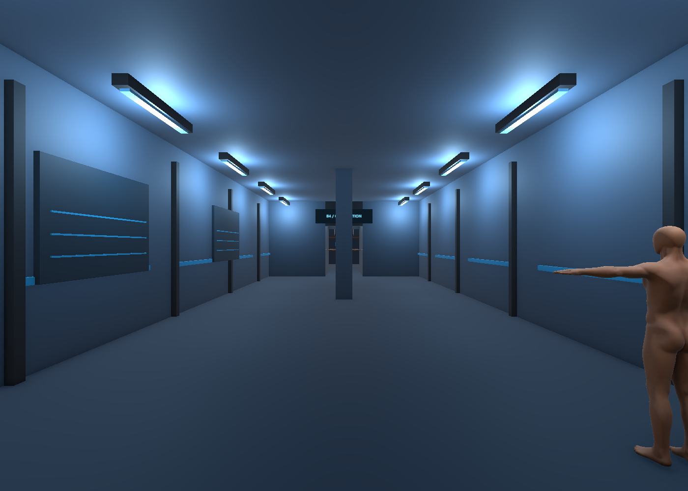
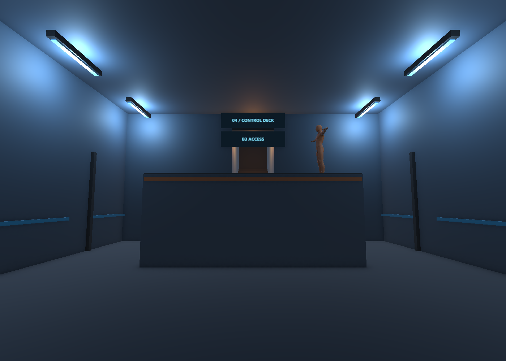
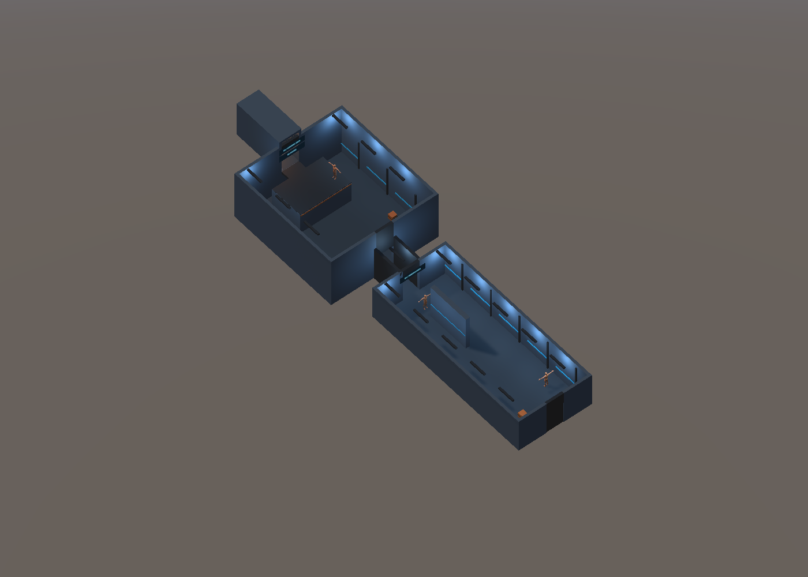

# B4 관찰층 레벨 구성 V0.03

2026-11-06 · 작성자 송예찬

최신 잠입 도면을 별도 `Level_B4_Stealth.unity`로 제작했다. 관찰실/복도·양면 관찰창4곳·분석실·관제 데크·지원실·계단A 도착 전실·계단B를 포함한다. 원본 `Level_B4_Observation.unity`는 보존했다. 아래11월3~5일 문단은 이전 제작 이력이며 현재 제작/검수는 [최신 검수 결과](검수/2026-11-06_B5_B4/검수결과.md)를 따른다.

새 씬 좌표는 Unity `(u-24, 높이, v-16)`이다. 일반 천장4m, 관제실5.6m, 데크2.5m·14단, 계단B 상승6.4m·36단은 검토 치수다. 데크 계단은 도면의 플랫폼 범위 안에 넣어 바닥 A/B/C 경로를 유지했다. B5 계단A 상부참과 B4 문 단면은 아직 정합하지 않았고 층 전환은 없다.

실내19구역·문28곳(열림27·잠김1)·정적 소품30개와 인물/CCTV6개를 배치했다. A/B/C 통행·데크/계단B 왕복·유리 양면 충돌·실제 W 입력 이동을 확인했다. 보호95파일 보존, 마지막 플레이 검사 새 경고/오류0건이다. AI·교환·애니메이션·UI와 사람의 잠입 완주/FPS 검증은 별도다.

2026-11-05 설계 개정: 최신 제작 가안은 [관찰층 잠입 평면](도면/잠입_탐색/B4_관찰층_잠입.svg)과 메인 기획서V0.15의9.0이다. 관찰실·분석실·지원 구역을 연결하고 별도 계단A/B 사이를 탐색한다. 아래는 기존 씬 제작 이력이다. 새 치수·동선은 도면/JSON을 우선하며 Unity 씬은 아직 새 평면으로 수정하지 않았다.

2026-11-03 · 작성자 송예찬

## 제작 범위

사용자의 추가 스테이지 제작 요청으로 B5 다음 층인 B4를 별도 씬으로 구성함. 기준은 메인 기획서 9.4·9.5와 `도면/03_순찰복도.svg`, `도면/04_단상.svg`임.

씬: `Unity/After_Seconds_Build_V0.01/Assets/Afrer_Seconds/01.Scenes/Stage/Level_B4_Observation.unity`.

기본 구조·충돌·조명·고정 표지와 정적 경비·상자 후보를 배치한 초안임. 사격·교환·제압·경비 AI·문 작동·체크포인트·층 이동은 구현하지 않음. 기존 B5와 Player 씬, 플레이어 코드·모델·Animator·설정은 보존함.

## 좌표

단위 m. 방 안 출구 방향은 −Z. 방별 원래 배치 표를 유지하고 연결을 위한 부모 위치만 제작 가안으로 둠.

| 구역 | 로컬 범위·치수 | 부모 월드 위치 |
| --- | --- | --- |
| Room03_ObservationCorridor | x −4~4, z −10~10, 높이 4 | (0,0,0) |
| 가림벽 | x −0.25~0.25, z −7~−2, 높이 4 | Room03 내부 |
| Connector_Lightlock_Draft | 폭 2, 길이 4 | 💡 (0,0,−12) |
| Room04_ControlDeck | x −6~6, z −7~6 | 💡 (0,0,−20) |
| 관제 단상 | x −3~3, z −6~−2, 높이 2.5 | Room04 내부 |
| 단상 출구 연결 바닥 | x −1~1, z −7~−6, 높이 2.5 | 💡 Room04 내부 |
| B3행 계단 전실 | 폭 2, 전실 2 + 계단 4 | 💡 (0,2.5,−27) |

4번 방 천장은 💡 6m, 계단은 💡 8단·단높이 0.2·디딤판 0.5로 구성함. 계단 충돌은 연속 경사 메시로 분리함. B3 쪽 끝은 막힌 연결부이며 다음 층을 구현한 것이 아님. 3번 방 남쪽 B5행 문도 외형과 충돌만 있는 상태임.

| 대상 | 방 안 위치 | 현재 상태 |
| --- | --- | --- |
| 시작점 | Room03 (0,9), 루트 Y 0.65 | Player 씬의 플레이어·카메라 구성을 함께 복제해 참조 유지 |
| 경비 E | Room03 (−2.5,6), −Z 방향 | 정적 기존 경비 외형 |
| E 순찰 표시점 | (−2.5,6) ↔ (−2.5,−5) | 빈 Transform 마커, 이동 없음 |
| 경비 F | Room03 (0,−8), +Z 방향 | 정적 기존 경비 외형 |
| 상자 2개 | Room03 (1.5,7.5), (3,7.5) | 변 길이 0.6 기본 외형·충돌, 상호작용 없음 |
| 경비 C | Room04 (−2.2,−3.4), Y 2.5 | 정적 기존 경비 외형 |
| C 순찰 표시점 | (−2.2,−3.4) ↔ (2.2,−3.4), Y 2.5 | 빈 Transform 마커 |
| 상자 2개 | Room04 (−4.5,2), (4.5,2) | 기본 외형·충돌 |
| 단상 위 출구점 | Room04 (0,−5), Y 2.5 | 체크포인트 설계 마커, 기능 없음 |

## 외형과 분류

새 재질·계단 충돌 메시·고정 표지는 `Assets/Afrer_Seconds/05.Model/Environment/B4/`에 보관함. 기존 VARCO 경비 프리팹을 참조하고, 건축 구조는 기본 메시로 구성함. Environment Training 원본 에셋을 반입하지 않음.

관찰 패널은 불투명 배경 외형임. 관찰 유리의 투과·시야·사격 판정을 새로 확정하지 않음. 장식 라인·조명·표지에는 추가 통행 충돌체를 넣지 않음. 단상 앞·옆에 기어오르기용 장식 발판을 추가하지 않음.

천장 조명, 차가운 벽면 색과 청록 표지로 B5와 다른 관찰층 분위기를 구성함. 표지는 PNG와 Quad로 저장하며 동적 TextMesh는 제거함. 조명 강도·외형·연결부 치수는 💡 제작 가안으로 최종 아트·성능 기준은 아님.

## 검수와 한계

- 편집 검수 12/12: 누락 스크립트 0, Renderer 재질·셰이더 참조, 가림벽 0.5×4×5, 단상 6×2.5×4, 방 부모 위치, 플레이어·카메라 수, 시작 XZ, 통로 8개 캡슐 표본, 단상 앞 충돌, 바닥·단상 상면 확인.
- Play Mode에서 기존 PlayerMotor.Move를 dt=1/60으로 90회 직접 호출함. z 9→6.75로 2.25m 이동했고 접지를 확인함. 실제 키보드 이벤트·시간에 따른 애니메이션·전체 프레임 흐름 검증은 아님.
- 별도의 입력값 주입 실험은 Editor 비활성 상태에서 시간이 진행되지 않아 이동 검증으로 계산하지 않음.
- 실제 카메라 렌더 3장: 복도 입구·관제 데크·천장을 임시로 숨긴 전체 배치. 촬영 후 Renderer 상태를 복원함.
- 작업 시작 전에 존재한 Assets·Packages·ProjectSettings 파일의 SHA256이 모두 동일함. 사용자 작업 중이던 씬 이동과 Build Settings도 유지함.
- Build Settings에 B4를 자동 추가하지 않음. Editor에서 이 씬 하나를 열어 확인 가능하며 플레이어·카메라가 포함돼 있으므로 Player 씬을 함께 로드하면 중복될 수 있음.

현재 경비는 T포즈 정적 후보임. 조명 베이크·최종 성능·사람의 키보드 이동·퍼즐 풀이·단상 도달·층 전환은 추가 검수 대상임. 단상은 교환 구현 전 정상 이동으로 올라가지 못하는 것이 현재 구조임.

검수 파일: [검수/2026-11-03_B4](검수/2026-11-03_B4). 생성·검수 도구는 프로젝트 Assets 밖 `Projects/Management/AfterSeconds_B4_20261103`에 보관함.

