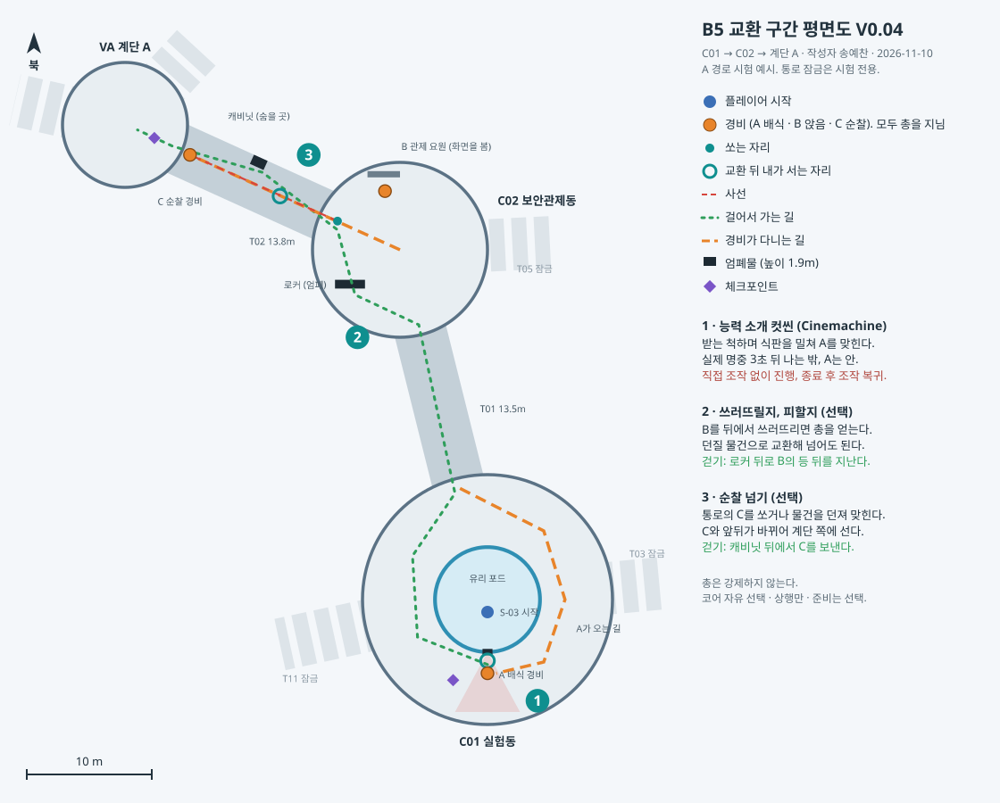

# B5 교환 구간 설계 V0.12

작성자 송예찬 · 2026-11-10

B5의 C01 실험동 → C02 보안관제동 → 계단 A 구간(주 경로 47.6m)에 3초 교환을 쓰는 자리를 넣는 제안이다. 현재 네 층은 정적 보행 연결을 검수한 상태이고 감시·추격·도구를 연결한 본편 위험은 미구현이다. 준비 부족으로 실패하는 실제 구간은 아직 검증하지 않았다. 이 구간 하나에서 "교환이 유리한가, 걸어서 우회해도 되는가"를 먼저 시험한다.

**이 문서의 범위.** [메인 기획서](AfterSeconds_메인기획서.md) V0.71의 확정 규칙과 미정 항목 구분을 따른다. 첫 포드 탈출은 Cinemachine 컷씬으로 능력을 보여 주고, 이후 도구 수집·경비 제압·우회·상행 코어 선택은 플레이어가 정한다. 포드 유리는 총알·투척물을 막는다. B안의 실제 유효 명중 후 3초 교환, 양쪽 공간 검사, 피격 뒤 추적 규칙은 그대로다. 그 밖의 배치와 수치는 💡 제안이다. 반응 시간 0.35초, 경비 달리기 3.0m/s, 붙잡기 0.9m, 시야 5m는 V0.58 가안이며 현행 확정값이 아니다. 좌표는 [층별 배치 데이터](도면/Decision/원형공동/facility_layout.json)의 (x, v), Unity Z = −v, B5 바닥 Y = −82다. 실제 씬의 사선·충돌·착지는 후속 검수하며 이번 문서 개정에서 씬·게임 코드·컷씬은 제작하지 않았다.

**이 구간의 위치.** 사용자 결정에 따라 본편에서는 계단 A·계단 B·화물 승강기가 모두 열려 있고 어느 코어로 올라갈지는 플레이어가 고른다([층간 코어 연결 대조](층간_코어_연결_대조.md)). 이 문서는 그중 시작점에서 가장 가까운 계단 A 쪽 길 하나를 다룬다. 5장과 7장에서 T03·T05·T11을 잠그는 것은 1차 시험의 범위를 줄이기 위한 것이고 본편의 통행 제한이 아니다.

## 1. 이 구간에서 배우는 것

| 순서 | 장소 | 배우는 것 | 도구 | 걸어서 |
| --- | --- | --- | --- | --- |
| 1 | C01 유리 포드 | 컷씬으로 식판 명중 → 3초 뒤 위치 교환이라는 능력을 본다 | 식판 (연출 고정) | 직접 조작 없음 |
| 2 | C01 → C02 | 문턱에서 먼저 본다. 경비를 쓰러뜨릴지 피할지 고른다 | 던질 물건, 제압, 경비의 총 (모두 선택) | 로커 뒤로 통과 |
| 3 | C02 → T02 → 계단 A | 3초 동안 내가 물러난 만큼 경비가 멀리 놓인다 | 던질 물건 또는 총 (교환 선택) | 캐비닛 뒤에서 순찰을 보냄 |

컷씬에서 능력을 본 뒤에는 무엇을 챙기고 어디서 쓸지를 플레이어가 정한다. 총 획득이나 첫 수동 투척 성공을 상행 조건으로 강제하지 않는다. 준비 부족으로 이후 게임 오버가 생기는 것도 학습 과정에 포함한다.

## 2. 교환 지점 ① 배식 때의 포드 탈출 컷씬

**사용자 확정 (2026-11-10).** Cinemachine을 사용하는 컷씬으로 S-03의 능력을 보여 준다. 이 장면은 플레이어가 직접 줍기·조준·던지기를 입력하는 튜토리얼이 아니다.

| 순서 | 장면 | 지켜야 할 규칙 |
| --- | --- | --- |
| 1 | 배식 경비 A가 배식구로 식판을 건넨다. S-03은 받는 척한다 | 카메라와 인물 동작으로 배식 상황과 안팎의 위치 관계를 보여 준다 |
| 2 | S-03이 식판을 밀쳐 A에게 맞힌다 | 손을 떠난 식판의 실제 명중이 교환 예약을 만든다. 손의 직접 접촉은 예약 조건이 아니다 |
| 3 | 명중 순간부터 3초가 흐른다 | 밀친 순간이나 컷씬 시작부터 세지 않는다. 경비를 즉시 기절·사망시키지 않는다 |
| 4 | S-03과 A의 위치가 교환된다 | 실행 직전 양쪽 현재 자세·몸 크기·바닥을 검사하는 기존 규칙을 따른다. S-03은 밖, A는 포드 안에 도착한다 |
| 5 | 컷씬이 끝나고 플레이어 조작으로 복귀한다 | 이후 출구·도구·경비 대응은 플레이어가 선택한다 |

**통과와 착지.** 포드 유리는 총알과 투척물을 막고 배식구만 통한다. 식판이 개구부를 완전히 벗어날 때까지 문·틀·유리에 걸리지 않는 경로를 확보한다. 명중 전에 문이 닫혀 식판을 막았다면 유효 명중으로 처리할 수 없다. 명중 이후의 폐쇄나 시야 단절만으로는 예약을 취소하지 않는다. 연출에서 S-03과 A를 교환 가능한 공간에 배치해 기존 규칙을 우회하는 순간이동으로 보이지 않게 한다.

**배치 후보 💡**

| 대상 | 위치 (x, v) | 검수할 것 |
| --- | --- | --- |
| 유리 포드 | 중심 (−15, 10), 바깥 반지름 4.2m | 기존 구조와 카메라 시야 |
| 배식구 | (−15, 14.2), 포드 남쪽 | 기존 명세 개구 0.78 × 0.51m·전달함 깊이 0.42m. 방향·양문 개폐와 식판 통과 검수 |
| S-03 시작 | (−15, 11) | 포드 안 후보. 이전 씬 시작 (−9.2, 10)은 포드 밖이므로 조정 필요 |
| 배식 경비 A | T01 문 (−17.2, 1.1) → 배식구 앞 (−15, 15.9) | 식판을 받는 척하는 동작·명중 순간·교환 직전 발 위치 |
| 조작 복귀·체크포인트 후보 S1 | 포드 밖 안전한 착지 자리 | 정상 착지와 카메라/입력 복귀를 확인한 뒤 저장하는 안 |

경비가 포드 안에 놓이는 것은 관찰자와 피험체의 자리가 바뀌는 장면이다. 갇힌 경비를 자동으로 삭제하거나 무조건 아무에게도 알리지 않는 것으로 확정하지 않는다. 경비의 추격 중 무전 원칙은 확정됐으며, 포드 안의 A가 언제 무전을 시작하는지와 첫 연습 사각에 미칠 영향은 연출 상세 설계로 정한다.

**🟡 상세 설계.** 카메라 컷·블렌딩·인물/식판 애니메이션, 3초 외 연출 길이, 컷씬 스킵과 재시작 때 최종 상태를 일치시키는 방식, 조작 복귀 시점, 경비의 경계·신고, 첫 체크포인트를 정한다. 기존의 10초 내 수동 투척·45초 뒤 재배식·플레이어가 직접 물러나야 탈출하는 과제는 이 컷씬 설계로 대체한다. Cinemachine 및 연출 기능의 구현은 후속 작업이다.

## 3. 지점 ② 관제동: 쓰러뜨릴지, 피할지 (선택)

**사용자 결정 (2026-11-10)**

- 총을 얻도록 강제하지 않는다. 플레이어는 총 말고도 던질 수 있는 물건을 챙겨 교환에 쓸 수 있다.
- 총은 경비라면 모두 지니고 있다. 경비를 쓰러뜨리면 그 총을 얻을 수 있다.
- 경비를 쓰러뜨릴지, 피하거나 숨어서 지나갈지는 플레이어가 정한다.

따라서 총을 주는 전용 자리는 두지 않는다. 관제동의 경비 B와 C가 곧 총을 얻을 수 있는 대상이자 피해 갈 수 있는 감시다.

컷씬에서 맞힌 식판은 물리적으로 떨어진 자리에 남기는 방향으로 설계한다. 💡 조작 복귀 후 플레이어가 알아보고 직접 다시 주울 수 있는 착지 위치를 검수한다. 발밑에 자동 생성하거나 소지품에 자동 지급하지 않는다. 실험동과 관제동의 휴대품은 층별 명세를 따르며 챙길지는 플레이어가 결정한다.

| 도구 | 닿는 거리 | 쓸 수 있는 횟수 | 치르는 값 |
| --- | --- | --- | --- |
| 던질 물건 | 짧다. V0.58 가안 수치로 약 7m | 물건이 남은 실제 위치에 접근할 수 있으면 다시 줍는다. 교환 대상과 함께 자동 이동하지 않는다 | 대상에게 가까이 가야 한다 |
| 총 | 30m | 3발 | 경비 한 명을 쓰러뜨려야 얻는다. 🟡 소리로 위치가 드러나는지는 미정 |

소지 기준과 🟡 남은 결정

- **확정:** 손에 든 물건을 포함해 개별 객체 최대 5개·수량 1·비합산, 우하단 마우스 휠 선택. [층별 명세](층별_획득오브젝트_명세.md)의 38종을 따른다. 🟡 남은 것은 획득 가능 표식·교체 조작과 구체 배치다.
- 소지 탄약은 소지 중인 총별 남은 탄약의 합이다. 총 한 자루 N발·총만 5개면 최대 5N발로 한정되므로 별도의 무한 탄약 누적을 전제하지 않는다. 🟡 한 자루당 탄약 수를 정한다. 표의 3발은 가안이다.
- 경비 사격 여부는 최우선 결정이다. 현재 기획의 실패는 붙잡힘·위험한 추락·준비 부족이며 피격 사망은 확정되지 않았다. [상세 설계](잠입_상호작용_상세설계.md)의 선택지를 검토한다.
- 포드에 갇힌 A의 총을 배식구로 얻을 수 있게 할지.

**배치**

| 대상 | 위치 (x, v) | 메모 |
| --- | --- | --- |
| 관제 요원 B | (−23.2, −22.7) | 관제석에 앉아 북쪽 화면을 본다. 방을 등지고 있다 |
| 순찰 경비 C | C02 중심 ↔ T02 끝 | 4장 참고. C02 중심에서 T01 문 쪽을 보고 2초 선다 |
| 로커 (엄폐) | (−26, −15) 부근 | C02 남서쪽의 기존 장비 로커. 높이 1.9m |

**문턱에서 보이는 것.** T01 통로의 축은 C01 문에서 C02 중심까지 일직선이라 C01 문턱에서 관제동 안이 보인다. B는 등을 돌리고 앉아 있고, C는 C02 중심과 T02 끝을 오간다. C가 중심에서 돌아서 T02로 들어가면 돌아올 때까지 약 27초가 빈다.

**플레이어가 고를 수 있는 것**

| 선택 | 하는 일 | 얻는 것 | 치르는 값 |
| --- | --- | --- | --- |
| 쓰러뜨린다 | 💡 C가 T02에 있을 때 B의 뒤로 접근한다. 제압 성립 방향·거리·차폐 조건은 상세 설계 후 적용 | B의 총. 3발은 가안 | 💡 C의 동료 발견→신고·수색 반응을 시험. 현재 플레이어 위치를 자동 인지하지 않음 |
| 숨어서 지난다 | 남서쪽 로커 뒤로 붙어 B의 등 뒤 3~4m를 지난다 | 아무도 모른 채 통과 | 총이 없다. C의 순찰 시간에 맞춰야 한다 |
| 교환으로 넘는다 | 챙겨 온 식판 같은 물건을 B나 C에게 던져 맞히고 물러난다 | 맞힌 경비와 자리가 바뀐다 | 맞은 경비는 쓰러지지 않고 나를 쫓는다 |

세 가지는 섞을 수 있다. B를 쓰러뜨려 얻은 총으로 통로 끝의 C와 교환해도 되고, 아무도 건드리지 않고 4장의 캐비닛 길로 가도 된다.

**총을 얻은 뒤.** T01로 되돌아가 통로 축을 따라 쏘는 것도, 관제동 안에서 C를 쏘는 것도 사거리 30m 안이다. 이 구간에서 반드시 써야 하는 곳은 없다.

🟡 확인할 것: 로커가 C02 중심에 선 C의 시야를 실제로 가리는지, B의 등 뒤로 다가가는 길에 가려 주는 것이 있는지.

## 4. 교환 지점 ③ 순찰 넘기 (선택)

T02는 길이 13.8m, 폭 4.2m의 직선 통로다. 💡 순찰 중 정면으로 지나가기 위험한 구간으로 시험하고, 아래 캐비닛을 이용한 걷기 대안과 교환을 비교한다. 감시·붙잡기 연결 전에는 실제 통과 가능 여부를 확정하지 않는다.

**배치**

| 대상 | 위치 (x, v) | 메모 |
| --- | --- | --- |
| 순찰 경비 C | C02 중심 (−22, −18) ↔ T02 끝 (−38.8, −25.6) | 걷기 1.5m/s, 한쪽 약 12초, 양 끝에서 2초 정지 |
| 쏘는 자리 | (−27.0, −20.3) | C02 쪽 T02 문턱 |
| 교환 뒤 내 자리 | 약 (−31.6, −22.3) | C가 통로 끝에서 맞았을 때. 계단 A 문까지 9.5m |
| 캐비닛 (새로 놓음) | (−33.3, −25.0), 북쪽 벽 | 0.8 × 1.2 × 1.9m 회색 상자. T02 중간 |
| 체크포인트 S2 | 계단 A 문 안 | |

**교환하면.** C가 통로 끝에 있을 때 쏜다. C는 나를 보고 있으면 내 현재 위치로, 보지 못하면 발사 위치로 온다. 3초 동안 약 8m를 달려오고, 그 뒤 서로 자리가 바뀐다. 얻는 것은 거리가 아니라 순서다. 앞에 있던 C가 내 뒤로 간다. 쏜 뒤 관제동 안으로 물러나 있으면 C는 그만큼 통로에서 멀리 놓인다. 컷씬에서 본 지연 교환을 직접 사용하며, 기다리는 동안 움직여 상대의 도착 자리를 고르는 방법을 익힌다.

**대기 거리의 옛 계산.** V0.58의 경비 달리기 3.0m/s·반응 0.35초·붙잡기 0.9m를 쓴 직선 가정에서는 `3.0 × (3 − 0.35) + 0.9 ≈ 8.9m`다. 이 값으로 현재 T01/T02의 끝에서 쏘면 안전하다고 판정하지 않는다. 추격 6.0m/s를 시험하면 같은 가정에서도 16.8m가 필요하므로 물러남·엄폐·경로 변화와 실제 몸체 간 거리를 함께 검증한다. 값과 측정 기준은 6장의 상세 설계 참조를 따른다.

**걸어서 가면.** C가 통로 끝으로 걸어갈 때 뒤따라 들어가 캐비닛의 C02 쪽 면에 붙는다. C가 돌아와 옆을 지나가면 계단 A로 간다. 캐비닛 크기는 시야각 좌우 40° 기준으로 C가 옆을 지날 때까지 가려지도록 잡았다. 총을 얻지 않고도 이 길로 계단에 닿을 수 있다.

## 5. 지름길과 다른 풀이 점검

| 경우 | 결과 | 판단 |
| --- | --- | --- |
| 포드 안에서 유리 너머로 던짐 | 유리가 막아 불가 | 결정됨 |
| 컷씬 중 직접 줍기·조준·투척을 시도함 | 도입 장면은 연출로 진행하고 완료 후 조작 복귀 | 수동 성공·실패 튜토리얼과 구분 |
| 밀친 식판이 유리·문틀·닫힌 문에 먼저 맞음 | 경비 유효 명중이 아니므로 교환을 예약할 수 없음 | 연출 궤적과 개폐를 수정해 실제 명중을 보장할 것 |
| 명중 뒤 배식구가 닫힘 | 예약은 유지됨 | 실행 때 양쪽 공간과 바닥은 별도 검사 |
| 컷씬 스킵·재시작 | 중복 식판·경비·예약이나 입력 잠금이 남지 않아야 함 | 🟡 스킵 허용과 최종 상태 상세 설계 |
| B와 C를 뒤에서 제압함 | 즉시 쓰러지고 총을 얻는다. 걸어서 통과 | 제압 즉시 효력·총 획득 선택은 확정. 후방 성립 조건·회복·동료 발견 반응은 미정 |
| 총을 얻지 않고 계단 A로 감 | 던질 물건만 챙기거나 빈손으로 B4에 오른다 | 의도대로. 수집·무장 상태를 상행 조건으로 강제하지 않는다. 준비하지 않으면 이후 게임 오버가 생길 수 있고 보충품을 보장하지 않는다 |
| 3번에서 총 대신 물건을 던짐 | 약 7m 안으로 다가가야 한다. C의 뒤를 따라가 던지고 물러난다 | 💡 허용. 총보다 위험하고 탄약을 쓰지 않는다 |
| 달려서 경비를 지나침 | 플레이어 달리기 7.5m/s, 경비 달리기 3.0m/s. 폭 4.2m 통로에서 벽 쪽으로 달리면 붙잡기 0.9m 밖 | 🔴 현재 수치로는 2·3번 모두 달리기로 끝난다. 6장 참고 |
| 생활동으로 우회 (T11 → W03 → W02 → W01 → T08) | 관제동을 거치지 않고 계단 A 도착. 약 210m | 1차 시험은 잠금. 2차에서 열고 선택 비율을 본다 |
| 냉각동으로 우회 (T03 → C03 → C04 → T05) | 관제동 동쪽 문으로 들어옴. 관제석 바로 옆을 지남 | 1차 시험은 잠금 |

## 6. 수치 위험

**아래는 옛 가안의 문제 분석이다.** 현행 첫 시험 후보(추격 6m/s·시야 15m 등)와 거리 기준은 [상세 설계 4장](잠입_상호작용_상세설계.md#4-경비-수치와-공간-시험)을 따른다. 모두 미확정이며 실제 보행 거리만으로 안전을 판정하지 않는다.

이전 가안 수치는 12 × 11m 방의 웹 프로토타입 기준이라 지금 공간 크기와 맞지 않는다. 이 구간을 시험할 때 함께 정해야 한다.

| 항목 | 이전 가안 | 문제 | 시험 제안 💡 |
| --- | --- | --- | --- |
| 경비 시야 거리 | 5m | 공동 지름이 12~20m라 경로 감시에 부족할 수 있다 | 15m에서 시작해 10~20m 비교 |
| 경비 달리기 | 3.0m/s | 플레이어 걷기 5m/s보다 느려 직선 추격만으로 거리를 좁히기 어렵다 | 6.0m/s (걷기보다 빠르고 달리기보다 느림) |
| 플레이어 걷기 / 달리기 | 5 / 7.5m/s | 주 경로 47.6m를 약 10초에 통과한다 | 값을 유지하고 경비 쪽을 먼저 조정 |

경비 달리기를 바꾸면 안전 사격 거리도 바뀐다. 6.0m/s면 6.0 × 2.65 + 0.9 ≈ 16.8m로 T01·T02 길이(약 13.5m)를 넘는다. 그러면 통로 끝에서 쏴도 서서 기다릴 수 없고, 쏜 뒤 물러나야 한다. 이 변화가 재미있는지가 시험의 핵심 질문이다.

### 컷씬 이후 직접 조작

💡 C01 감시 사각에 선택형 연습 구간을 두어 실제 줍기·휠 선택·투척·명중 후 3초를 경험할 기회를 제공한다. 성공을 상행 조건으로 강제하지 않는다. 식판 같은 독립 물체의 교환 허용은 확정됐으므로 충분한 착지 공간을 갖춘 식판 연습을 제안한다. 고정 설비와 다른 종류까지 임의로 허용하지 않는다. 후속에는 한 투척으로 경비→식판에 명중해 각 명중 +3초에 교환하는 연속 예약을 시험한다. [연습 조건과 경비 신고 충돌 검토](잠입_상호작용_상세설계.md#5-컷씬-이후-첫-수동-학습)

## 7. 씬에 필요한 것

회색 상자 수준으로 충분하다. 기존 아트는 건드리지 않는다.

- 포드 안으로 시작 위치 이동. 배식구가 남쪽을 향하는지 확인.
- 경비 더미 3개(A·B·C), 식판 1개, 집을 수 있는 소품 몇 개.
- T02 북쪽 벽에 캐비닛 1개.
- T03·T05·T11 문은 닫힌 상태, T01·T02 문은 열린 상태.

게임 로직은 사용자가 의사코드부터 직접 작성하는 범위다. 다음은 문서상의 제작 순서이며 이 개정에서 구현하지 않는다.

1. 컷씬 카메라와 배식 인물·식판 동작의 동선을 잡고, 받는 척하다 밀치는 장면의 전달력을 확인한다.
2. 식판의 실제 유효 명중과 3초 지연, 양쪽 공간 검사를 기존 교환 규칙에 맞춰 연출과 동기화한다.
3. 교환 뒤 착지·카메라·입력 복귀와 재시작 때 상태를 검수한다. 체크포인트와 스킵은 상세안 확정 후 연결한다.
4. 자유 조작 구간의 줍기·휠 선택·즉시 투척·직접 제압·총 획득/사격을 연결한다. 최대 5개와 객체별 상태를 지킨다. 표의 3발은 가안이다.
5. 순찰·경계·추격·통보와 자유로운 세 코어 상행을 연결한다. 소지품/진행 및 발각·경보 정보 전달, 준비 부족 실패와 재도전을 검수한다.

## 8. 플레이해서 확인할 질문

| 장소 | 질문 | 볼 것 |
| --- | --- | --- |
| 포드 컷씬 | 식판을 받는 척하다 밀치는 행동과 능력의 인과관계를 이해하는가 | 실제 명중부터 교환까지 3초, 안팎 위치 변화의 가독성 |
| 컷씬 종료 | 카메라와 조작이 자연스럽게 복귀하는가 | 올바른 착지·입력 복귀, 컷씬 중 수동 과제 없음 |
| 포드 밖 | 어느 문으로 먼저 가는가 | 첫 이동 방향, T01 안내선을 본 시점 |
| C01 문턱 | 멈춰서 관제동을 보는가. C가 비우는 때를 기다리는가 | 쓰러뜨린 사람, 숨어서 지난 사람, 교환을 쓴 사람의 비율 |
| T02 | 쏜 뒤 물러나는가, 그 자리에 서 있는가 | 붙잡힌 횟수, 캐비닛을 발견한 사람 수 |
| 전체 | 달리기만으로 끝나는가. 준비하지 않은 실패가 수집 선택 학습으로 이어지는가 | 총 없이 계단에 닿은 방법, 빈손 상행 후 실패·재도전에서 바꾼 준비 |

## 변경 기록

| 버전 | 날짜 | 작성자 | 변경 내용 |
| --- | --- | --- | --- |
| V0.12 | 2026-11-10 | 송예찬 | 메인 V0.71의 식판 교환 대상·한 투척 연속 예약을 연습 후보에 반영하고 컷씬 경비 무전과 안전 연습의 관계를 상세 과제로 구분. |
| V0.11 | 2026-11-10 | 송예찬 | 총별 탄약 한도·사격과 제압 미정 범위 정리. 정적 보행과 실제 준비 부족 실패 구분, 현행 경비 시험안·선택형 수동 학습 연결. 기존 배치와 수치를 확정으로 오해할 문구 보수. |
| V0.10 | 2026-11-10 | 송예찬 | 첫 탈출을 Cinemachine 식판 밀침 컷씬으로 변경. 실제 명중 후 3초·배식구 통과·조작 복귀 기준, 개별 5개 소지·준비 부족 실패를 반영. 수동 배식 과제 폐기, 평면도 V0.04 동기화. 제목의 V0.08/이력 V0.09 불일치 해소. |
| V0.09 | 2026-11-10 | 송예찬 | 사용자 결정 반영: 총은 모든 경비가 지니고, 쓰러뜨릴지 피할지는 플레이어가 정한다. 잠든 경비 D 삭제, 3장을 세 가지 선택(쓰러뜨림·숨기·교환)으로 다시 씀. 평면도 V0.03. |
| V0.08 | 2026-11-10 | 송예찬 | 세 코어 자유 선택 결정에 맞춰 이 구간이 계단 A 쪽 길 하나임을 밝히고, 통로 잠금이 1차 시험 범위임을 명시. |
| V0.07 | 2026-11-10 | 송예찬 | 사용자 결정 반영: 총을 강제하지 않는다. 3장을 "도구 챙기기"로 바꾸고 던질 물건과 총의 차이, 식판 다시 집기를 추가. |
| V0.06 | 2026-11-10 | 송예찬 | 기획서 V0.61의 B안 확정에 맞춤: A/B 비교 삭제, 던지기 즉시, 실행 직전 양쪽 공간 검사, 피격 뒤 추적 기준, 즉시 제압이라는 다른 길을 반영. 멍함 1.2초는 미확정으로 표시. |
| V0.05 | 2026-11-10 | 송예찬 | 사용자 결정 반영: 첫 교환은 총 없이 받은 식판을 A에게 던져 일으킨다. 2장을 던지기 풀이와 A/B안 비교로 다시 씀. 총은 관제동의 잠든 경비 D에게서 얻는 제안으로 3장을 바꿈. 평면도 V0.02. |
| V0.04 | 2026-11-10 | 송예찬 | 사용자 결정 반영: 첫 교환은 배식하는 경비 A와 일어난다. 2장을 배식 순서와 3초 동안 물러나기로 다시 씀. 잠든 경비 배치 삭제. |
| V0.03 | 2026-11-10 | 송예찬 | 사용자 구상 기록: 첫 교환은 배식을 받을 때 일어난다. 2장의 잠든 경비 배치를 개정 예정으로 표시. |
| V0.02 | 2026-11-10 | 송예찬 | 사용자 결정 반영: 포드 유리는 총알을 막고 배식구만 사선. 기획서 V0.60과 맞춤. 다른 유리 판정은 미정으로 표시. |
| V0.01 | 2026-11-10 | 송예찬 | C01 → C02 → 계단 A 구간의 교환 지점 3곳, 경비 3명, 걷기 대안, 지름길 점검, 수치 위험 초안. 기획서·씬 미변경. |
