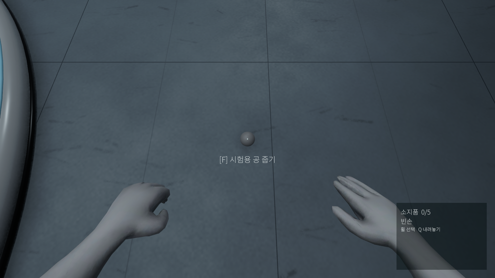
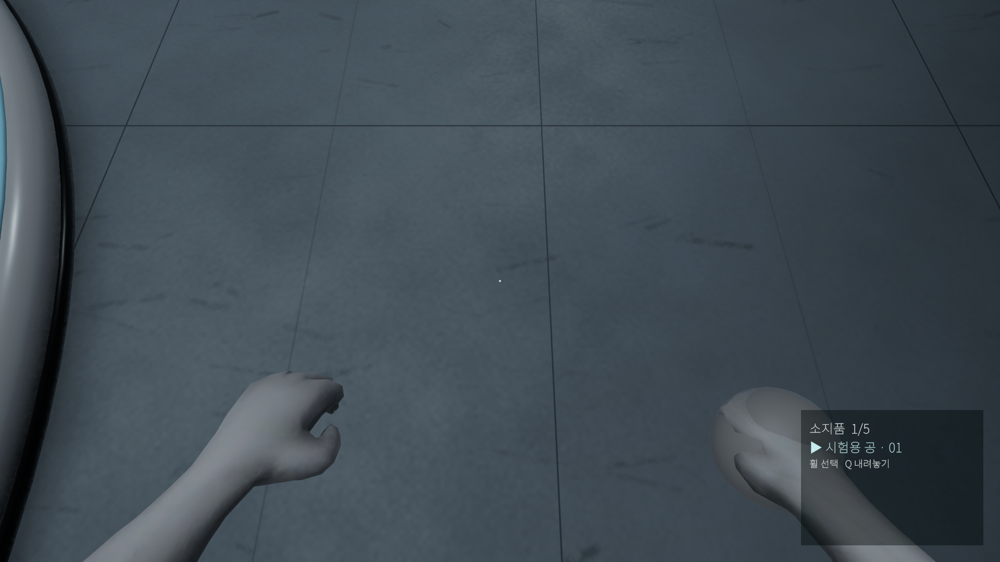
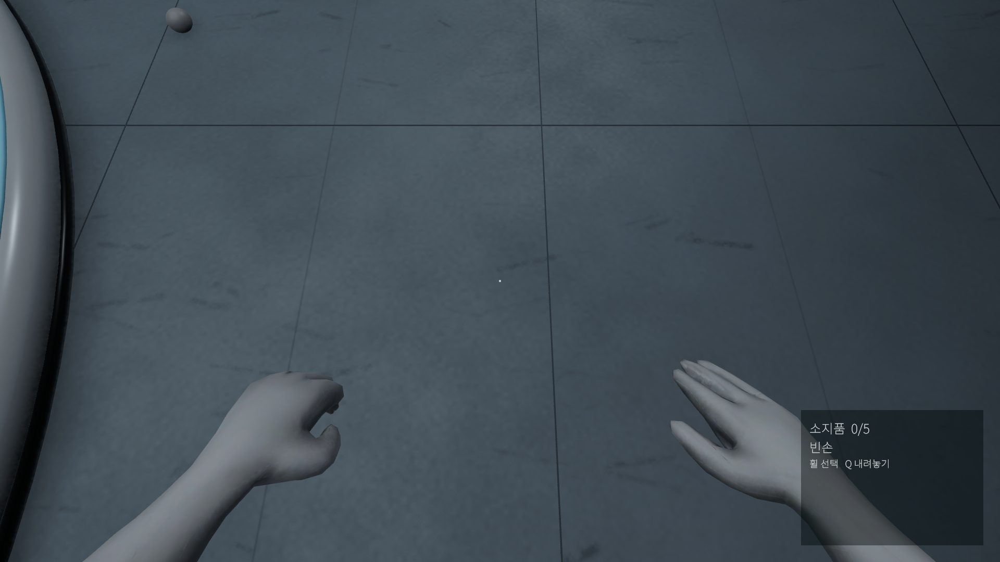
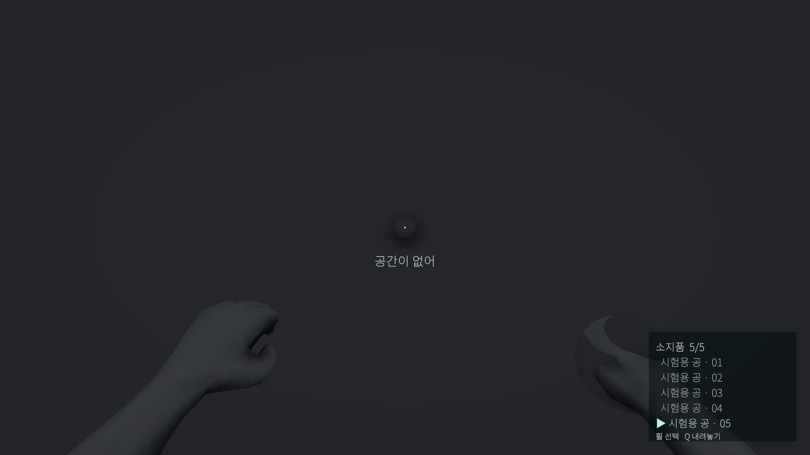

# 줍기·소지품·투척·재획득 연결 검수 V0.01

작성일 2026-11-17 · 작성자 송예찬

현재 B5에서 빈손으로 시작해 앞바닥의 시험용 공을 F로 줍고, 좌클릭으로 던진 뒤 같은 공을 다시 주울 수 있다. Q 내려놓기, 휠 선택, 최대5개 개별 소지품, 한글 안내를 연결했다. Unity6000.4.0f1의 저장된 `Level_B5_Circular` 편집 상태로 마감했다. 이번 작업은 로컬 저장이며 커밋·push는 하지 않았다.

## 조작과 동작

| 조작 | 결과 |
| --- | --- |
| 가까운 물건을 보고 F | 2.2m 이내, 직접 시야가 열린 물건1개 획득 |
| 좌클릭 누름 / 해제 | 기존 궤적으로 조준 / 선택 물건 투척 |
| R | 기존 위·아래 투척 전환 |
| Q | 막히지 않은 손 앞에서 선택 물건을 속도0으로 내려놓기 |
| 마우스 휠 | 개별 물건을 순환 선택 |
| 가득 찬 상태에서 F | “공간이 없어” 안내, 월드 물건 보존 |

같은 종류도 하나로 합치지 않는다. `WorldItem` 객체 자체를 비활성 보관하고 방출할 때 같은 객체를 돌려놓는다. 자동 시험용 공 공급과 소지품의20초 자동 소멸을 제거했다. 방출 후0.25초가 지나면 다시 획득 가능하다. 위·아래 투척 속도는 작업 시작 당시 에셋의15/10m/s를 유지했다.

## 검증 결과

- 실제 Keyboard/Mouse 입력·Rigidbody 검사 **36/36 통과**. 프레임72→1368, 최초 방출 후21.01초까지 확인. [전체 결과](validation.txt)
- B5의 실제 공으로 F 획득→손 표시→좌클릭 아래 투척→동일 인스턴스 재획득을 확인했다.
- 임시 격리 바닥에서 중복 획득 차단,5개 한도,6번째 거절,휠 양방향/순환,벽·거리 차단,막힌 방출의 소지품 보존,입력 취소 우선순위를 확인했다. 임시 물건과 바닥은 검수 종료 때 정리했다.
- Q는 투척 횟수나 명중 이벤트를 발생시키지 않는다. 아래 투척 뒤 Q·위 투척에서 원래 감쇠·재질·회전 프로필이 복원된다.
- 소지품 비활성화 시 투척 차단, 다시 활성화 시 선택 복구, 입력 맵 해제 시 방출 차단을 확인했다.
- 비활성 소지품을 플레이어 충돌체로 잘못 분류해 서로 충돌하지 않던 문제를 발견했다. 충돌 제외 대상을 찾을 때 비활성 `WorldItem`도 구분하도록 수정한 뒤, 두 물건의 실제 방출과 충돌 제외 상태 해제를 검증했다. [보수 전 결과](validation_collision_before.txt)
- 마지막 C# 컴파일 오류0. 관련 컴포넌트428개 검사에서 누락 스크립트0·깨진 참조0, 씬 Canvas1·시험용 공1·소지 한도5. [저장 상태](final_state.json)
- 콘솔에는 게임 예외가 없었다. Unity AI Assistant의 성능 로그 공유 잠금 오류1종, 구독 상태 메시지와 기존 그림자 아틀라스 축소 안내는 별도로 기록했다. [콘솔 원문](console.json)

초기 검수는 이전 투척 속도를 고정값으로 가정하고 움직이는 공에 접근하는 조건이 부족해6개가 실패했다. 현행 설정을 읽고 실제 공 위치에 접근하도록 검수 절차를 수정했다. 사용자 투척 설정을 이전 값으로 되돌리지 않았다. [초기 결과](validation_initial.txt)

## 화면

## 저장·보존과 범위

기존 배치 Transform은 적용 시 변경0개였다. 작업 시작493개 파일 중 이번에 수정한 기존 문서3개·C#3개·asmdef1개·프리팹2개·B5 씬1개를 제외한483개가 해시 일치했다. 기존 `.meta`256개 전부, 입력 에셋, Animator, 사용자 투척 설정을 보존했다. `ProjectSettings.asset`와 백그라운드 실행 설정도 작업 시작 상태로 복원했다. [보존 확인](preservation.json). 새 파일과 경로 안내를 갱신한 Unity/README.md는 이493개 기준 밖이다.

Git 공백 검사에서는 Unity가 저장한 Player 프리팹의 빈 YAML 문자열 뒤 공백을 보고했다. 네이티브 직렬화 결과를 임의로 다시 편집하지 않았다.

한글은 Noto Sans KR(OFL)과 TMP 동적 폰트를 사용한다. 프로젝트 전용 폰트는 `Assets/Afrer_Seconds/06.Data/UI/`, TMP 기본 리소스는 `Assets/TextMesh Pro/`다. 기본 폴더 이동은 Windows 접근 거부로 실패해 대화상자를 취소했고, Unity 표준 경로의 정상 참조를 유지했다. [도구·에셋 안내](../../../SourceAssets/PickupLoop/README.md)

현재 지원하는 물건은 기존 구체형 시험용 공이다. 형상이 다른 소품, 저장/불러오기와 씬 간 소지품 유지,3초 교환,경비 AI는 이번 검수 범위에 포함하지 않는다. 손/하체의 기존 시험 모델과 동작은 유지한다.

## 변경 기록

- V0.01 (2026-11-17): 줍기·개별 소지품·방출·재획득과36개 검수 및 보존 결과. 송예찬.
