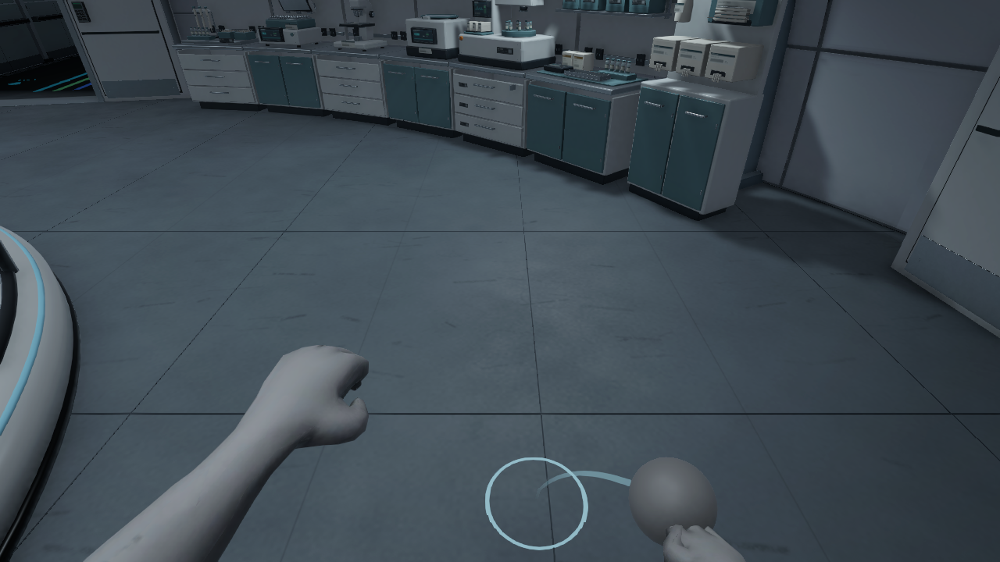
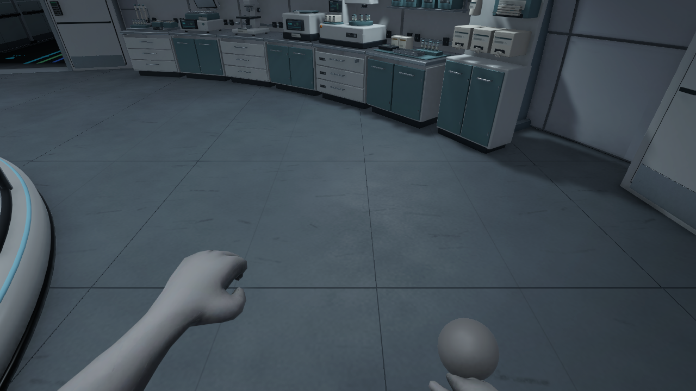
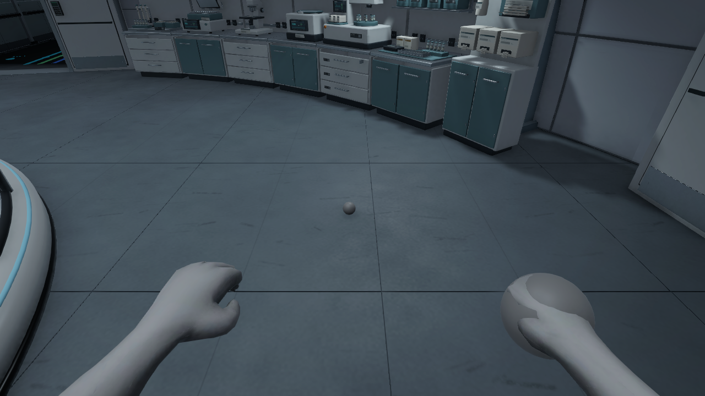

# 아래 투척 굴림 보수 검수 V0.01

2026-11-17 · 작성자 송예찬

사용자 정정에 따라 아래 투척을 낮게 밀어 바닥에서 굴러가는 동작으로 변경했다. 위로 띄우던35도·6m/s는 이전 값이다. 실제 오른손에서 즉시 방출하며, 바닥으로 순간이동시키거나 접촉 후 위치/속도를 강제로 덮어쓰지 않는다.

| 항목 | 반영 값/행동 |
| --- | --- |
| 아래 투척 | 4.5m/s, 시선 대비-12도, 최종 고도각-75~-5도 |
| 회전 | 수평 속도÷구체 반지름에 맞춘 전진 회전, 각속도 상한 보정 |
| 감속 | 선형·각 감쇠 최소0.8 |
| 아래 물리 재질 | 동/정 마찰0.2, Minimum 결합, 반발0 |
| 손 후속 동작 | 앞18cm·아래6cm 목표로 밀고 복귀, 실제 스무딩 적용 |
| 팔 가림 보수 | 후속 동작의 시각 검사에서만 방금 놓은 공 제외. 벽·새 발사·예측 검사는 유지 |
| 위 투척 | 12m/s·8도, 원래 감쇠·재질·VARCO 클립 유지 |
| 조작/표시 | E 없이 좌클릭 누름→조준/해제→투척, R 전환, 짧고 흐린 선과 선이 닿을 때만 원 유지 |

실제 InputSystem 입력과 Rigidbody로 **29/29** 통과했다. 프레임43→735가 진행했고 B5 실제 바닥에서도 방출/접촉/굴림을 촬영했다. [검증 원문](validation.txt).

| 평평한 시험 바닥 실측 | 결과 |
| --- | --- |
| 첫 접촉 | 방출 직후 검사 시작에서0.484초 |
| 예측과 실제 접촉 오차 | 4.38cm |
| 접촉 뒤 수평 이동 | 2.568m |
| 바닥 접촉 뒤 회전 | 약7.01회 |
| 접촉 뒤 과도한 반발 | 측정 범위 내 없음 |
| 초기 구름 속도 / 6초 시점 속도 | 1.746 / 0.0249m/s |
| 손 후속 동작 실측 | 아래3.8cm·앞11.5cm, 양팔 가림 없음 |

위를 보아도 로브가 되지 않는지, 아래/확대 조준, 빠른 클릭, 손 막힘, 위 투척의 원래 속도/회전, 표시선 밖 착지 원 숨김도 통과했다. 구름 거리는 이 구체·바닥에서의 측정값이며 지형이나 물체 형상에 따라 달라진다. 6초 시점에는 거의 멈췄지만 Rigidbody sleep 상태는 아니므로 완전 정지로 기록하지 않는다.

컴파일 오류0. 최종 콘솔에는 게임 코드 예외0·경고0이며 Unity AI Assistant의 `assistant-perf.jsonl` 파일 공유 잠금 오류1건이 있다. 해당 오류는 AssistantPerfRecorder.Open의 에디터 패키지 로그이며 투척 동작 실패가 아니다. [편집 상태/설정 감사](audit.json). 콘솔 오류를 지워서0으로 보고하지 않았다.

140개 보호 대상 중 이번 작업의4개 C#만 변경했고 나머지136개와 .meta를 보존했다. Presenter/Input/기존 Animator/시험용 프리팹을 이번에 수정하지 않았다. 두 설정 에셋은 기존 GUID를 유지하며 전용 PhysicsMaterial만 추가했다. 프로젝트 설정 해시가 작업 전과 일치하며 B5 씬은 변경 없는 편집 상태, 입력 설정과 백그라운드 실행도 복원했다. 이번 변경은 로컬 저장이며 커밋/push하지 않았다.

첫 시험에서는 착지 뒤0.695m 만에 감속되어 `validation_initial.txt`에2건 실패를 남겼다. 물리 재질 보수 후 위 최종 결과로 통과했다. 회전 CCD 대안도 조사했지만 첫 접촉 이벤트가 앞당겨지는 시험 결과가 있어 적용하지 않고 기존 ContinuousDynamic을 유지했다. 회전 운동을 고려하는 CCD의 특성과 부정확한 접촉 가능성은 [Unity 공식 Speculative CCD 문서](https://docs.unity.com/en-us/engine/6000.7/manual/physics-section/physics-overview/collision-section/collision-detection/continuous/speculative-ccd)를 참고했다. 최종 구현은 네이티브 마찰·회전과 감쇠를 사용한다.

현재 지원 형상은 기존과 같은 중심 구체1개다. 전용 underhand 모션 캡처 클립을 새로 반입한 것은 아니며 손 동작은 절차식 보수다. 기존 전신/이동 클립과 첫 접촉 이후의 교환/인벤토리 로직은 유지한다.

낮은 준비 자세:

낮게 밀어 방출하는 순간:

바닥을 구르는 공:

[반영/검수 도구](../../../SourceAssets/UnderhandRoll/README.md)
