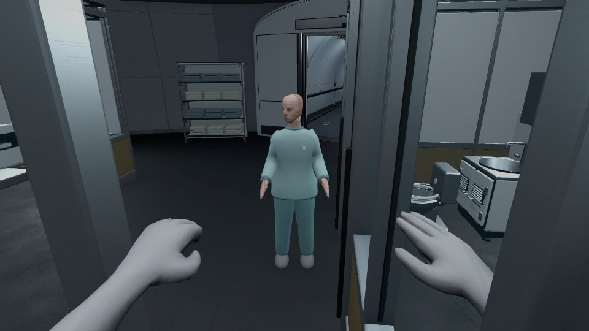
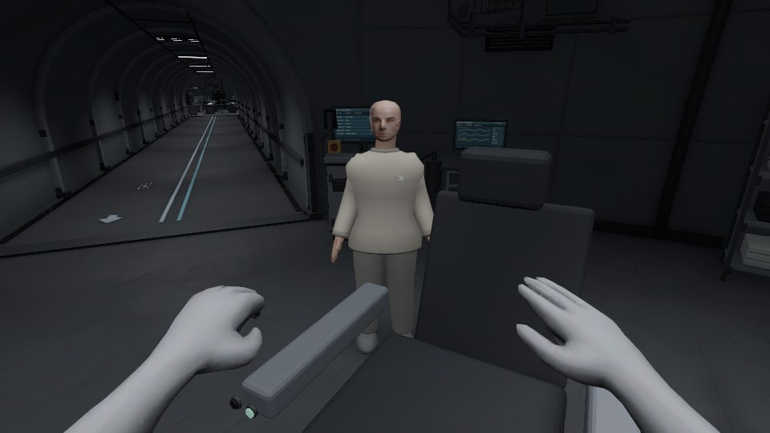

# 경비 장비와 다른 실험체

2026-11-19 · Unity 6000.4.0f1 플레이 검수

## B5와 B4에서 만나는 실험체

프로젝트의 실험체 콘셉트 두 장을 각각 한 인물의 기준으로 삼았다. B5 W01에는 생활·격리 구역에 머무는 실험체가, B4 E03에는 진단을 마친 뒤 회복 의자 곁에 서 있는 실험체가 있다. 두 사람은 키와 체형, 환자복 색, 서 있는 자세가 다르다. 플레이어가 근처에서 던진 물건이 부딪히면 소리가 난 쪽을 잠시 바라본다. [두 모델 비교](SubjectStudy.jpg)

| B5 W01 생활·격리 구역 | B4 E03 진단·회복 구역 |
| --- | --- |
|  |  |

## 진압봉과 근무 장비

B5 격리 지원 예비 경비는 진압봉을 차고 출동한다. 제압하면 진압봉과 그 경비가 사용하던 권총이 따로 떨어진다. 플레이어는 진압봉을 F로 집어 던질 수 있다. 바닥에 떨어진 진압봉을 권총으로 맞히면 3초 뒤 플레이어와 진압봉이 서로 자리를 바꾼다. [진압봉 모델](../../../SourceAssets/GuardPostGear/SecurityBaton_Study.jpg)

거점 감시 경비와 복도 순찰 경비는 인계점에서 호출기와 손전등을 주고받는다. 각자의 권총에는 자신이 쓰고 남긴 탄환이 들어 있다. 제압한 경비의 보조 장비와 권총을 각각 회수할 수 있다.

## 플레이 검수 결과

- B5에서 거점·복도 경비의 장비 인계, 경보 증원, 진압봉 회수·투척·위치 교환까지 25개 항목을 통과했다. 진압봉의 위치 교환은 B5에 마련한 빈 시험 공간에서 착지 위치까지 확인했다.
- B5 기본 아이템·제압 시나리오 67개 항목을 통과했다. 뒤에서 제압하거나 사격으로 제압했을 때 실제 들고 있던 장비가 떨어지는 동작을 포함한다.
- B5에서 1층 출구까지 58개 항목을 통과했다. B5·B4에서는 실험체가 한 명씩 보이고 가까운 충돌 방향으로 고개를 돌리는 것을 확인했다.
