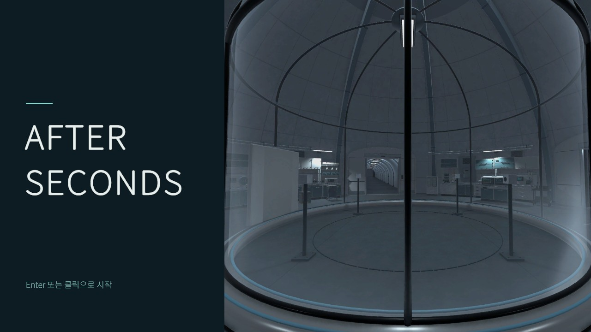
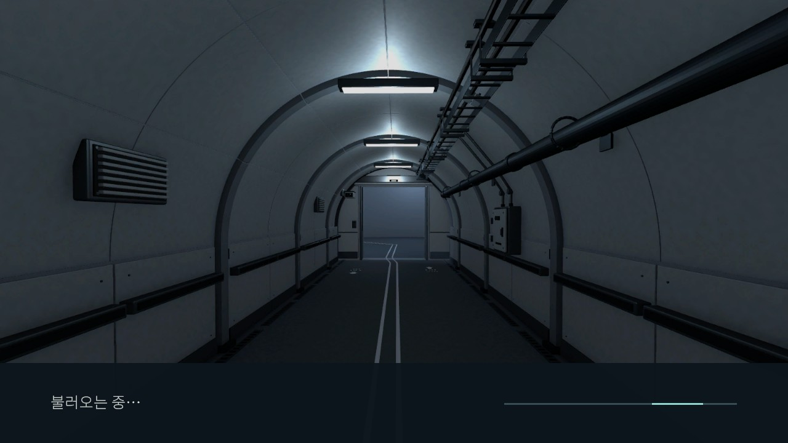
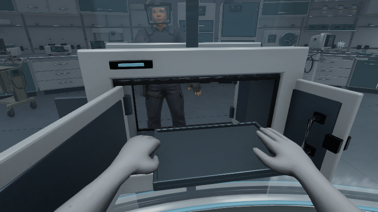

# After Seconds 시작·로딩 씬 V0.01

2026-11-19 · Unity 6000.4.0f1 · 송예찬

빌드의 첫 씬은 `Intro`다. Enter 또는 클릭으로 시작하면 `Loading`을 거쳐 `GameRoot`와 B5가 열린다. B5에서 직접 Play할 때는 곧바로 해당 층을 시험할 수 있다. 층 이동과 재시도에는 같은 로딩 화면을 다시 사용한다.

## 인트로 교체

[Intro 씬](../../../Unity/After_Seconds_Build_V0.01/Assets/Afrer_Seconds/01.Scenes/Intro.unity)에서 다음 오브젝트를 편집한다.

| 오브젝트 | Inspector에서 바꿀 항목 |
| --- | --- |
| `IntroVideo` | 프로젝트로 가져온 영상을 Video Player의 **Video Clip**에 넣는다. 시작 입력 후 영상이 재생된다. 영상이 끝나거나 재생 중 Enter 또는 클릭을 받으면 게임을 시작한다. 슬롯이 비어 있으면 곧바로 로딩한다. |
| `IntroArtwork` | **Raw Image → Texture**에서 관찰 포드 스틸을 교체한다. |
| `GameTitle`, `StartHint` | **TextMeshPro**에서 게임 제목과 시작 안내를 편집한다. |

## 로딩 화면 교체

[Loading 씬](../../../Unity/After_Seconds_Build_V0.01/Assets/Afrer_Seconds/01.Scenes/Loading.unity)에서 `LoadingArtwork`의 **Raw Image → Texture**를 교체한다. `LoadingStatus`에는 문구를, `ActivityTrack`과 `Activity`에는 표시 막대의 색과 배치를 설정한다. 막대는 게임 시간이 멈춘 동안에도 움직이는 활동 표시다.

두 배경의 기본 원본은 1600×1000이다. 다른 비율의 이미지로 교체할 때 같은 오브젝트의 **Aspect Ratio Fitter → Aspect Ratio**에 새 이미지의 가로÷세로 값을 넣는다. 화면 너비에 맞춰 가운데를 기준으로 잘린다.

## 플레이 검수

Unity 6000.4.0f1에서 빈 영상 슬롯으로 시작하는 경로, 임시 영상을 끝까지 재생하는 경로, 재생 중 건너뛰는 경로를 각각 확인했다. B5 최초 진입에서 플레이어와 GameRoot는 한 세트였다. 재시도와 B5→B4 계단 이동에서는 같은 Loading 씬이 다시 표시됐다. 영상 슬롯은 비워 두었다.

## 2026-11-20 층 전환 선로딩 검수

상행을 열면 계단 A·B와 화물 승강기가 공유하는 다음 층을 읽는다. 출구에 도착하면 그 층을 활성화하고, 같은 코어의 착지와 조작 복귀를 확인한 뒤 다음 층에서 계속 진행한다. 재시도하면 준비 중이던 층을 정리한다.

Windows 개발 빌드(D3D11, 960×540, 60fps 제한)에서 B5→B4를 비교했다. 표는 로딩 화면이 활성화된 시간이며 경로별로 각 빌드를 세 번씩 실행했다. 계단 A에서는 상행을 연 뒤 출구에서 떨어진 곳에서 9초를 보내고 계단 근처에서 1.6초를 더 기다렸다. 계단 B에서는 개방 두 프레임 뒤에 바로 계단참에 진입했다.

| 경로 | 변경 전 중앙값 (범위) | 변경 후 중앙값 (범위) |
| --- | --- | --- |
| 이동 시간을 둔 계단 A | 75ms (74~75ms) | 65ms (63~66ms) |
| 개방 직후 진입한 계단 B | 749ms (743~1,513ms) | 664ms (660~674ms) |

- 계단 A에서 개방부터 출구 진입까지 가장 긴 프레임은 변경 전 40~63ms, 변경 후 26~41ms였다. 두 계단의 측정 구간에서 Unity 예약 메모리 최고치는 변경 전 2,073~2,082MiB, 변경 후 2,074~2,078MiB였다.
- 화물 승강기는 호출·탑승·상행·B4 조작 복귀를 확인했다. 한 번 측정한 운행 구간은 4.61초, 그중 로딩 화면은 64ms였으며 가장 긴 프레임은 104ms였다.
- 선로딩 중 B5에서 체력을 소진하고 재시도하자 새 플레이어가 잠긴 B5에서 시작했고 이전 B4 요청은 정리됐다.
- 격리된 Unity 에디터에서 타이틀의 시작 동작부터 B5와 계단 A를 거쳐 B4까지 재생했다. B5 상행을 열기 전에는 B4 요청이 없었고, B4 조작 복귀 시 B5는 해제됐고 B3는 대기열에 없었다. 이 실행에서 에디터가 기록한 B5 씬 자체의 로드 시간은 11.91초였다. 표의 Windows 층 전환 시간과는 측정 구간이 다르다.

## B5 배식과 로딩 페이드

타이틀의 `StartHint`를 선택하고 Inspector의 **Start Hint Dots**에서 `Prefix`와 `Interval`을 조정한다. 기본 문구는 `Click To Start`이며 점이 한 개에서 세 개까지 0.4초 간격으로 반복된다. `Prefix`를 비우면 점만 보인다.

`Loading` 씬의 **Loading Screen**에서 `Fade To Black`과 `Reveal Scene`을 조정한다. 리소스 준비가 끝나면 0.16초 동안 로딩 그림을 검게 덮고, 그 아래에서 게임 카메라로 전환한 뒤 0.52초 동안 장면을 밝힌다. 이 두 시간은 위 표를 측정한 뒤 추가한 연출 시간이다.

B5는 포드 안에서 시작한다. 카메라가 배식 경비에서 식판으로 내려가고 플레이어가 양손으로 식판을 밀어낸다. 식판은 열린 배식구를 통과해 경비에게 실제로 충돌하고 월드 아이템으로 남는다.

- 실제 Play에서 명중 즉시 경비가 쓰러졌고 3.00게임초 뒤 두 사람의 위치가 바뀌었다. 조작이 돌아올 때 C01 경보 단계는 0이었다.
- 플레이어를 숨긴 두 실행에서 복도 짝이 약 7m 걸은 뒤 동료를 발견하고 4.76~4.92게임초에 구역 비상을 울렸다. 목격 전에 뒤에서 맨손으로 순찰원을 제압하는 경로도 확인했다.
- 타이틀 시작, B5 재시도, 계단 A와 화물 승강기를 통한 B4 진입에서 암전·장면 복귀와 입력 재개를 확인했다.
