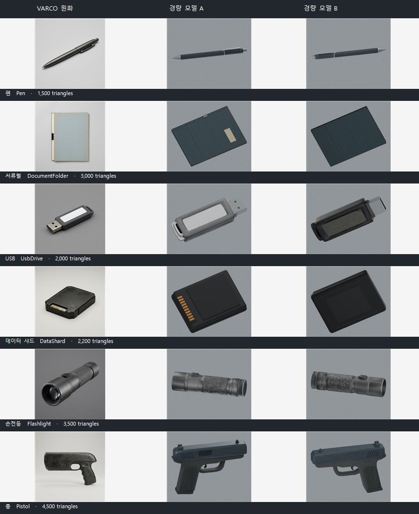
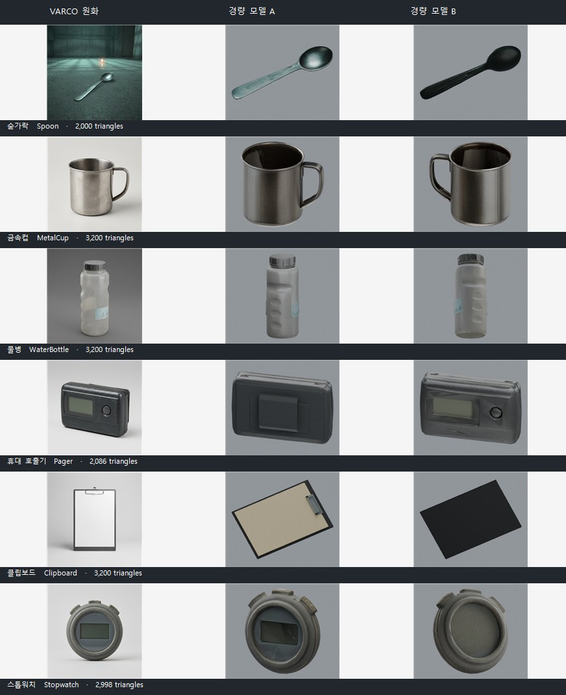
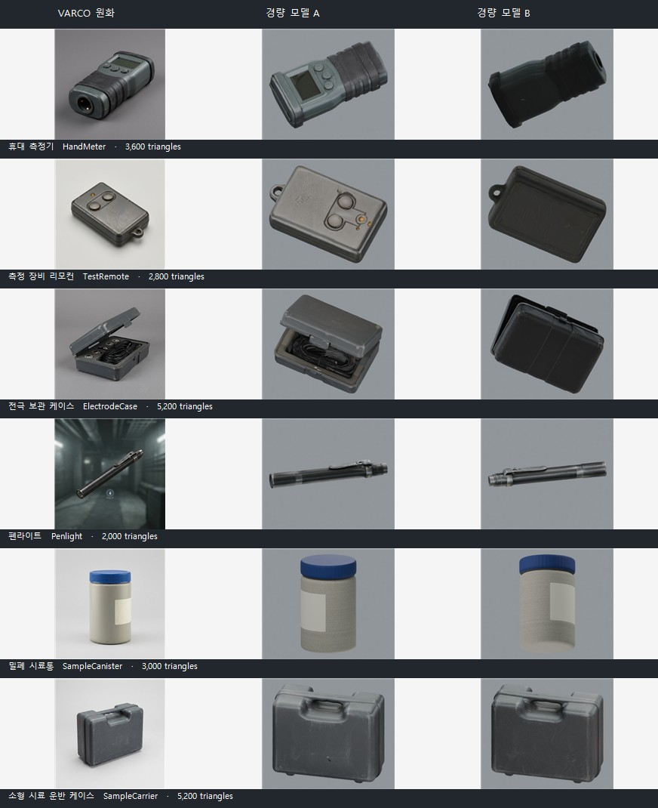
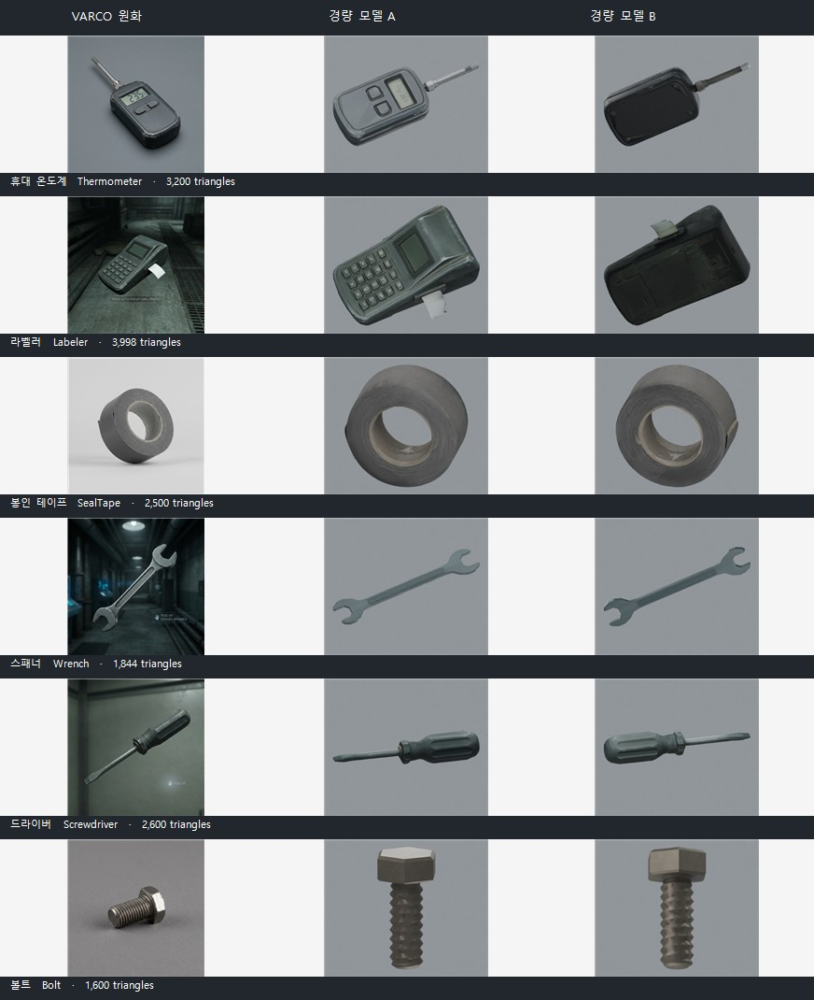
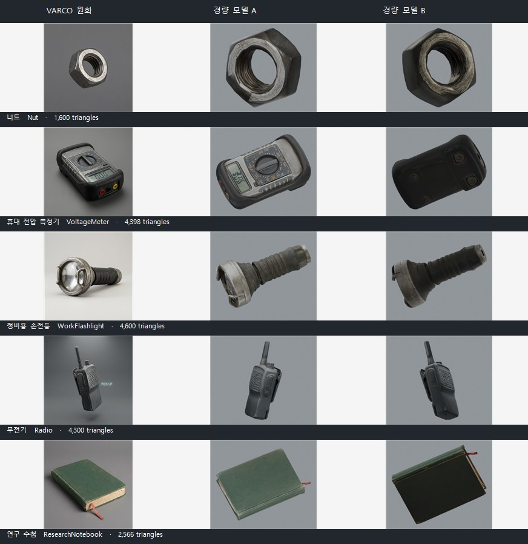
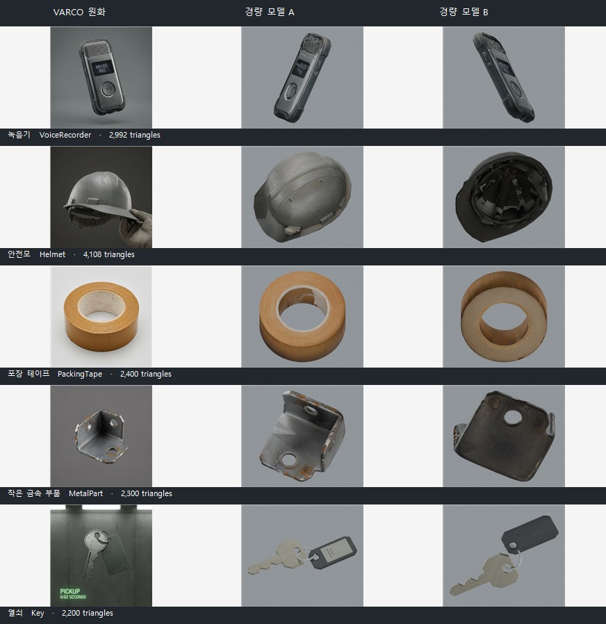
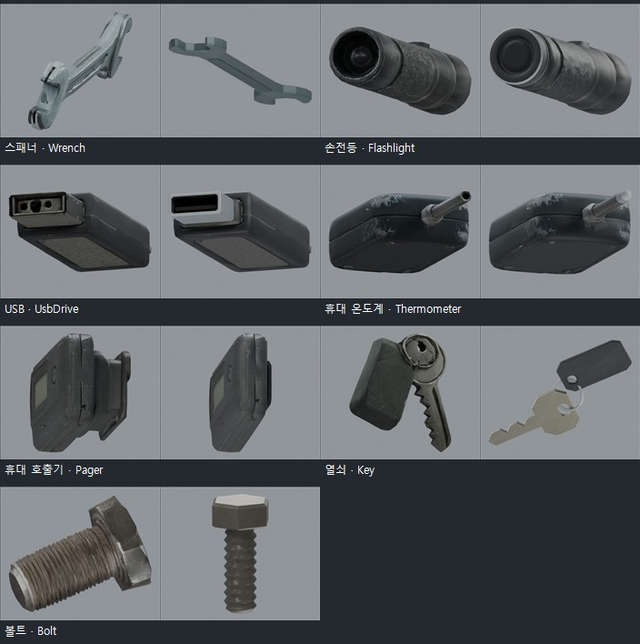
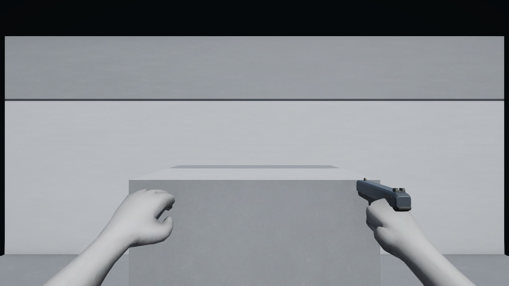
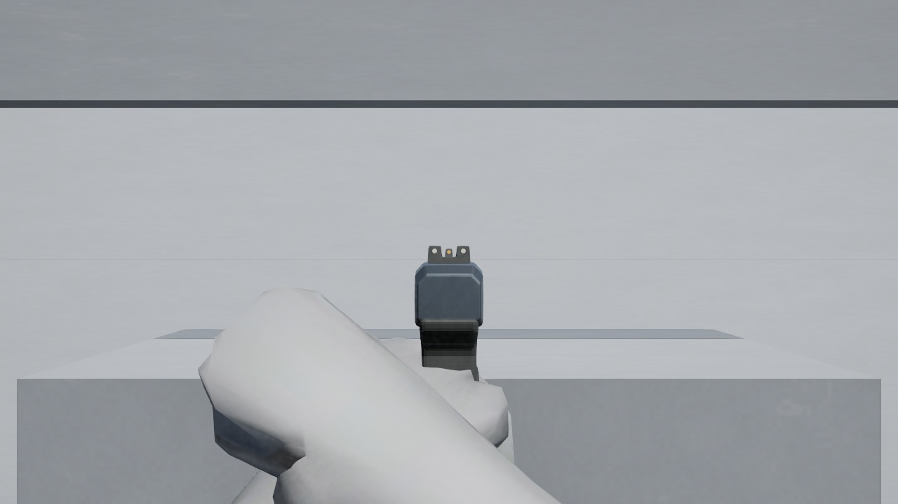

# After Seconds 획득 아이템 모델 검수

2026-11-19 · Unity 6000.4.0f1

현행 35종 중 기존 식판을 제외한 34종의 독립 모델을 반입했다. 1차 검수에서 첫 생성본 20종과 재생성본 10종을 채택했다. 서류철, 클립보드, 데이터 샤드, 밀폐 시료통은 재생성 결과에도 결함이 남아 Blender에서 형태를 다시 만들었다.

최종 FBX의 삼각형은 품목당 1,500~5,200개, 합계 102,390개다. Unity 미리보기 씬에 34개를 하나씩 인스턴스화해 메시, UV, 재질과 텍스처, 실제 크기와 하단 피벗을 검사했다. 크기 수치는 모델의 가장 긴 축을 기준으로 한다. 권총은 검수 씬에서 손에 든 모습과 조준 전환을 확인했다. B5에 연결한 권총·일반 소품과 검수용 손전등의 플레이 결과는 [B5 아이템 검수](../2026-11-19_B5ItemLoop/Review.md)에 기록한다.

[Unity 임포트 검사 기록](unity-import.json) · [생성 이력과 파일 해시](../../../Unity/After_Seconds_Build_V0.01/Assets/Afrer_Seconds/06.Data/AssetSources/PickupItems_VARCO.json) · [VARCO 생성 흐름](https://3d.varco.ai/flow/fb981dd5-dfb9-4499-94b2-9e0ae0537f4c)

[VARCO V0.02 검수 보드](https://3d.varco.ai/flow/686efa59-a050-4df1-a9a1-9cdeac4ef136)에는 기존 생성 결과를 참조하는 3D 노드 34개와 품목별 판정표 6개, 비교 이미지 6장이 있다. 생성본을 회전하며 참고할 수 있고, 각 줄의 비교 이미지는 Unity용 경량 FBX의 최종 외형을 보여 준다. 보드 구성에는 별도의 생성 실행을 사용하지 않았다.

## 원화와 최종 모델

각 줄의 왼쪽은 채택한 원화다. 가운데와 오른쪽은 Unity에 넣은 FBX를 다시 불러와 실제 1,024픽셀 텍스처로 렌더링한 두 방향이다.

## 근접 검수

품목당 네 방향에서 Unity용 FBX를 검수했다. 양옆과 양 끝을 따로 보면서 턱의 두께, 렌즈와 뒤캡, 단자 내부, 클립의 틈을 대조했다. 스패너·볼트·열쇠는 Blender에서 다시 모델링했고, USB·손전등·온도계·호출기는 원형을 살려 해당 부위만 고쳤다. 분리 조각을 제거한 6종은 다시 불러와 연결된 메시가 하나씩 남았는지 확인했다.

각 품목의 왼쪽은 보수 전, 오른쪽은 보수 후다.

[추가 각도 1](close-1.jpg) · [추가 각도 2](close-2.jpg) · [추가 각도 3](close-3.jpg)

## 펜 직선도와 권총 조준 시야

펜 몸통 길이의 10~90% 구간에서 33개 단면의 중심을 측정했다. 이전 FBX의 최대 편차는 3.18 mm였고, 수정본은 0.01 mm 미만이다. 수정본에서 펜촉부터 누름 버튼까지의 길이는 145 mm다.

[펜 중심선 보수 전후](pen-axis.png)

권총을 받침대에 둔 검수 씬에서 실제 플레이어 리그로 F 획득, 우클릭 유지와 해제, 조준 중 내려놓기, 일반 아이템의 확대 전환을 포함한 11개 항목을 통과했다. 아래는 같은 씬에서 캡처한 두 자세다.

[검수 씬](../../../Unity/After_Seconds_Build_V0.01/Assets/Afrer_Seconds/01.Scenes/Review/PistolSightReview.unity) · [플레이 검사 기록](pistol-play.json)

## 품목별 판정

| 품목 | 근접 검수 결과 | 확인 및 수정한 부분 | 삼각형 | FBX |
| --- | --- | --- | ---: | --- |
| 펜 | 형태 재제작 | 펜촉·몸통·버튼을 한 축에 놓고 클립에 곡선을 남겼다. 몸통 33개 단면의 최대 편차가 3.18 mm에서 0.01 mm 미만으로 줄었다. | 1,500 | [Pen](../../../Unity/After_Seconds_Build_V0.01/Assets/Afrer_Seconds/05.Model/Props/Common/Pickup_Pen.fbx) |
| 서류철 | 형태 유지 | 비스듬한 측면에서 앞뒤 표지 사이로 종이 단면과 책등 고정쇠가 보인다. | 3,000 | [DocumentFolder](../../../Unity/After_Seconds_Build_V0.01/Assets/Afrer_Seconds/05.Model/Props/Common/Pickup_DocumentFolder.fbx) |
| USB | 부위 수정 | 단자 안의 세 원형 자국을 없애고 금속 셸, 절연판과 네 접점을 모델링했다. 몸체와 고리는 보존했다. | 2,000 | [UsbDrive](../../../Unity/After_Seconds_Build_V0.01/Assets/Afrer_Seconds/05.Model/Props/Common/Pickup_UsbDrive.fbx) |
| 데이터 샤드 | 형태 유지 | 앞면 접점 열과 뒷면 가이드 레일이 분리되어 삽입 방향을 읽을 수 있다. | 2,200 | [DataShard](../../../Unity/After_Seconds_Build_V0.01/Assets/Afrer_Seconds/05.Model/Props/Common/Pickup_DataShard.fbx) |
| 손전등 | 부위 수정 | 뒤쪽의 두 번째 렌즈처럼 보이던 홈을 잘라내고 배터리 캡과 오목한 고무 버튼으로 마감했다. | 3,500 | [Flashlight](../../../Unity/After_Seconds_Build_V0.01/Assets/Afrer_Seconds/05.Model/Props/Common/Pickup_Flashlight.fbx) |
| 총 | 형태 재제작 | 금속 상부와 무광 손잡이의 윤곽을 새로 잡았다. 1인칭 조준 자세에서 흰 가늠자 표식 두 개 사이로 황색 가늠쇠가 보인다. | 4,500 | [Pistol](../../../Unity/After_Seconds_Build_V0.01/Assets/Afrer_Seconds/05.Model/Props/Common/Pickup_Pistol.fbx) |
| 숟가락 | 재질 조정 | 오목한 볼과 목이 연속된 형태다. 금속 하이라이트로 볼 안팎을 구분했다. | 2,000 | [Spoon](../../../Unity/After_Seconds_Build_V0.01/Assets/Afrer_Seconds/05.Model/Props/B5/Pickup_Spoon.fbx) |
| 금속컵 | 재질 조정 | 손잡이 양 끝이 몸체에 닿고 컵 안이 비어 있다. 입구와 옆면에 스테인리스 반사를 조정했다. | 3,200 | [MetalCup](../../../Unity/After_Seconds_Build_V0.01/Assets/Afrer_Seconds/05.Model/Props/B5/Pickup_MetalCup.fbx) |
| 물병 | 형태 유지 | 뚜껑과 병목, 눌린 옆면 및 바닥을 확인했다. 표면의 생활 흠집은 유지했다. | 3,200 | [WaterBottle](../../../Unity/After_Seconds_Build_V0.01/Assets/Afrer_Seconds/05.Model/Props/B5/Pickup_WaterBottle.fbx) |
| 휴대 호출기 | 부위 수정 | 두 번째 본체처럼 두꺼웠던 뒷부분을 덜어내고 배터리 덮개와 안쪽에 틈이 있는 벨트 클립을 만들었다. | 2,086 | [Pager](../../../Unity/After_Seconds_Build_V0.01/Assets/Afrer_Seconds/05.Model/Props/B5/Pickup_Pager.fbx) |
| 클립보드 | 형태 유지 | 옆에서 보았을 때 보드·종이·집게 사이의 높이 차이가 유지된다. | 3,200 | [Clipboard](../../../Unity/After_Seconds_Build_V0.01/Assets/Afrer_Seconds/05.Model/Props/B4/Pickup_Clipboard.fbx) |
| 스톱워치 | 분리 조각 제거 | 독립된 면 조각을 제거했다. 상단 버튼과 꺼진 상태의 LCD 테두리를 확인했다. | 2,998 | [Stopwatch](../../../Unity/After_Seconds_Build_V0.01/Assets/Afrer_Seconds/05.Model/Props/B4/Pickup_Stopwatch.fbx) |
| 휴대 측정기 | 형태 유지 | 정면 버튼과 후면 그립, 측정부의 센서 포트가 독립된 윤곽으로 보인다. | 3,600 | [HandMeter](../../../Unity/After_Seconds_Build_V0.01/Assets/Afrer_Seconds/05.Model/Props/B4/Pickup_HandMeter.fbx) |
| 측정 장비 리모컨 | 형태 유지 | 두 버튼, 상태등, 끈 고리가 몸체에 붙어 있고 바닥면이 막혀 있다. | 2,800 | [TestRemote](../../../Unity/After_Seconds_Build_V0.01/Assets/Afrer_Seconds/05.Model/Props/B4/Pickup_TestRemote.fbx) |
| 전극 보관 케이스 | 형태 유지 | 열린 덮개와 힌지의 연결, 내부에 감긴 선 및 완충재를 확인했다. | 5,200 | [ElectrodeCase](../../../Unity/After_Seconds_Build_V0.01/Assets/Afrer_Seconds/05.Model/Props/B4/Pickup_ElectrodeCase.fbx) |
| 펜라이트 | 재질 조정 | 끝 렌즈와 뒤 스위치, 옆 클립을 확인했다. 금속 몸통의 무광 반사를 조정했다. | 2,000 | [Penlight](../../../Unity/After_Seconds_Build_V0.01/Assets/Afrer_Seconds/05.Model/Props/B4/Pickup_Penlight.fbx) |
| 밀폐 시료통 | 형태 유지 | 마개와 봉인 이음새가 원통을 둘러싼다. 곡면의 종이 라벨 가장자리는 의도된 열린 면이다. | 3,000 | [SampleCanister](../../../Unity/After_Seconds_Build_V0.01/Assets/Afrer_Seconds/05.Model/Props/B3/Pickup_SampleCanister.fbx) |
| 소형 시료 운반 케이스 | 형태 유지 | 손잡이 안쪽이 열려 있고 운반함 몸체와 덮개의 이음새가 이어진다. | 5,200 | [SampleCarrier](../../../Unity/After_Seconds_Build_V0.01/Assets/Afrer_Seconds/05.Model/Props/B3/Pickup_SampleCarrier.fbx) |
| 휴대 온도계 | 부위 수정 | 열린 관처럼 보이던 탐침 끝을 둥근 밀폐 금속 팁으로 바꿨다. 센서 축과 화면은 보존했다. | 3,200 | [Thermometer](../../../Unity/After_Seconds_Build_V0.01/Assets/Afrer_Seconds/05.Model/Props/B3/Pickup_Thermometer.fbx) |
| 라벨러 | 분리 조각 제거 | 본체와 떨어진 삼각면을 제거했다. 배출구 밖의 라벨 조각과 키패드는 유지했다. | 3,998 | [Labeler](../../../Unity/After_Seconds_Build_V0.01/Assets/Afrer_Seconds/05.Model/Props/B3/Pickup_Labeler.fbx) |
| 봉인 테이프 | 형태 유지 | 중앙 심이 실제로 관통하고 감긴 단면과 바깥쪽 테이프 끝이 구분된다. | 2,500 | [SealTape](../../../Unity/After_Seconds_Build_V0.01/Assets/Afrer_Seconds/05.Model/Props/B3/Pickup_SealTape.fbx) |
| 스패너 | 형태 재제작 | 끝에서 보이는 겹턱을 없애고 양쪽 턱과 자루를 한 몸으로 다시 만들었다. 자루 중앙에는 단조 보강선을 넣었다. | 1,844 | [Wrench](../../../Unity/After_Seconds_Build_V0.01/Assets/Afrer_Seconds/05.Model/Props/B2/Pickup_Wrench.fbx) |
| 드라이버 | 형태 유지 | 끝에서 확인한 일자 날과 금속 축이 손잡이 중심에 이어진다. | 2,600 | [Screwdriver](../../../Unity/After_Seconds_Build_V0.01/Assets/Afrer_Seconds/05.Model/Props/B2/Pickup_Screwdriver.fbx) |
| 볼트 | 형태 재제작 | 찌그러진 머리 윗면을 평평한 육각 머리로 다듬고 축에 연속된 나사산을 모델링했다. | 1,600 | [Bolt](../../../Unity/After_Seconds_Build_V0.01/Assets/Afrer_Seconds/05.Model/Props/B2/Pickup_Bolt.fbx) |
| 너트 | 재질 조정 | 관통 구멍과 안쪽 나사산을 유지하고 육각 외면의 금속 반사를 조정했다. | 1,600 | [Nut](../../../Unity/After_Seconds_Build_V0.01/Assets/Afrer_Seconds/05.Model/Props/B2/Pickup_Nut.fbx) |
| 휴대 전압 측정기 | 분리 조각 제거 | 떨어진 면 조각을 제거했다. 다이얼, 창, 색으로 구분된 단자 3개를 확인했다. | 4,398 | [VoltageMeter](../../../Unity/After_Seconds_Build_V0.01/Assets/Afrer_Seconds/05.Model/Props/B2/Pickup_VoltageMeter.fbx) |
| 정비용 손전등 | 형태 유지 | 렌즈 앞 보호대와 그립, 꼬리 쪽 고정부가 보인다. 일반 손전등과 다른 산업용 실루엣을 유지했다. | 4,600 | [WorkFlashlight](../../../Unity/After_Seconds_Build_V0.01/Assets/Afrer_Seconds/05.Model/Props/B2/Pickup_WorkFlashlight.fbx) |
| 무전기 | 형태 유지 | 안테나, 상단 노브, 후면 벨트 클립과 스피커 그릴의 방향을 확인했다. | 4,300 | [Radio](../../../Unity/After_Seconds_Build_V0.01/Assets/Afrer_Seconds/05.Model/Props/Common/Pickup_Radio.fbx) |
| 연구 수첩 | 분리 조각 제거 | 책갈피 끝에서 약 4 mm 떨어진 조각을 제거하고 표지 사이로 이어지는 리본을 남겼다. | 2,566 | [ResearchNotebook](../../../Unity/After_Seconds_Build_V0.01/Assets/Afrer_Seconds/05.Model/Props/B1/Pickup_ResearchNotebook.fbx) |
| 녹음기 | 분리 조각 제거 | 마이크 부근의 독립 삼각면을 제거했다. 그릴, 버튼, 표시창의 구분을 확인했다. | 2,992 | [VoiceRecorder](../../../Unity/After_Seconds_Build_V0.01/Assets/Afrer_Seconds/05.Model/Props/B1/Pickup_VoiceRecorder.fbx) |
| 안전모 | 분리 조각 제거 | 외피 안쪽에 떠 있는 메시 조각을 제거하고 외피에 이어진 서스펜션을 보존했다. | 4,108 | [Helmet](../../../Unity/After_Seconds_Build_V0.01/Assets/Afrer_Seconds/05.Model/Props/1F/Pickup_Helmet.fbx) |
| 포장 테이프 | 형태 유지 | 심이 관통하며 종이 심의 이음매와 갈색 테이프 층이 각각 보인다. | 2,400 | [PackingTape](../../../Unity/After_Seconds_Build_V0.01/Assets/Afrer_Seconds/05.Model/Props/1F/Pickup_PackingTape.fbx) |
| 작은 금속 부품 | 재질 조정 | 꺾인 브래킷의 두께와 실제 체결 구멍을 유지하고 녹이 슨 강재의 반사를 낮게 맞췄다. | 2,300 | [MetalPart](../../../Unity/After_Seconds_Build_V0.01/Assets/Afrer_Seconds/05.Model/Props/1F/Pickup_MetalPart.fbx) |
| 열쇠 | 형태 재제작 | 옆에서 겹쳐 보이던 고리와 두꺼운 태그를 다시 만들었다. 얇은 태그와 열쇠 머리에 각각 구멍을 뒀다. | 2,200 | [Key](../../../Unity/After_Seconds_Build_V0.01/Assets/Afrer_Seconds/05.Model/Props/1F/Pickup_Key.fbx) |

## 1차 생성 및 재작업 이력

| 품목 | 첫 생성본에서 발견한 문제 | 최종 처리 |
| --- | --- | --- |
| 펜 | 펜 두 자루가 십자로 붙어 있음 | 원화에서 단일 물체와 윤곽을 확인한 뒤 재생성본을 채택했다. |
| 서류철 | 접힌 사각 표지의 하단 윤곽과 라벨이 찌그러짐 | 재생성한 메시에서도 서류철이 상자 두께로 복원되어 표지·책등·종이 묶음·고정쇠를 재모델링했다. |
| 데이터 샤드 | 카트리지 뒷면 피복 손상 | 재생성 후에도 뒷면에 삼각형 모양의 얼룩이 남아 밀폐 케이스·가이드 레일·금속 접점을 재모델링했다. |
| 총 | 여러 시점의 소품이 분리된 형상으로 생성됨 | 원화에서 단일 물체와 윤곽을 확인한 뒤 재생성본을 채택했다. |
| 금속컵 | 한 모델에 떨어진 컵 두 개 | 원화에서 단일 물체와 윤곽을 확인한 뒤 재생성본을 채택했다. |
| 휴대 호출기 | 분리된 호출기 세 개 | 원화에서 단일 물체와 윤곽을 확인한 뒤 재생성본을 채택했다. |
| 클립보드 | 집게 아래 종이 중앙과 모서리 경계가 뭉개짐 | 정면 원화의 깊이가 상자로 복원되어 얇은 보드·종이·스프링 클립을 재모델링했다. |
| 스톱워치 | LCD 숫자 윤곽이 겹쳐 보임 | 원화에서 단일 물체와 윤곽을 확인한 뒤 재생성본을 채택했다. |
| 측정 장비 리모컨 | 본체에서 끊긴 여러 줄이 늘어짐 | 원화에서 단일 물체와 윤곽을 확인한 뒤 재생성본을 채택했다. |
| 밀폐 시료통 | 밀폐통 몸체에 큰 측면 개구부 | 뚜껑 색이 몸체에 남아서 몸체, 골이 있는 마개, 봉인 이음새와 곡면 라벨을 재모델링했다. |
| 소형 시료 운반 케이스 | 운반함 두 개와 손 조각이 함께 생성됨 | 원화에서 단일 물체와 윤곽을 확인한 뒤 재생성본을 채택했다. |
| 봉인 테이프 | 손과 장갑이 테이프에 붙어 있음 | 원화에서 단일 물체와 윤곽을 확인한 뒤 재생성본을 채택했다. |
| 정비용 손전등 | 보호망과 고리 뒤틀림 | 원화에서 단일 물체와 윤곽을 확인한 뒤 재생성본을 채택했다. |
| 포장 테이프 | 테이프 롤이 길게 늘어나고 옆면과 심이 찢어짐 | 원화에서 단일 물체와 윤곽을 확인한 뒤 재생성본을 채택했다. |

VARCO 실행 응답의 예상 포인트는 최초 생성 8,500, 재생성 3,500으로 합계 12,000이다.
