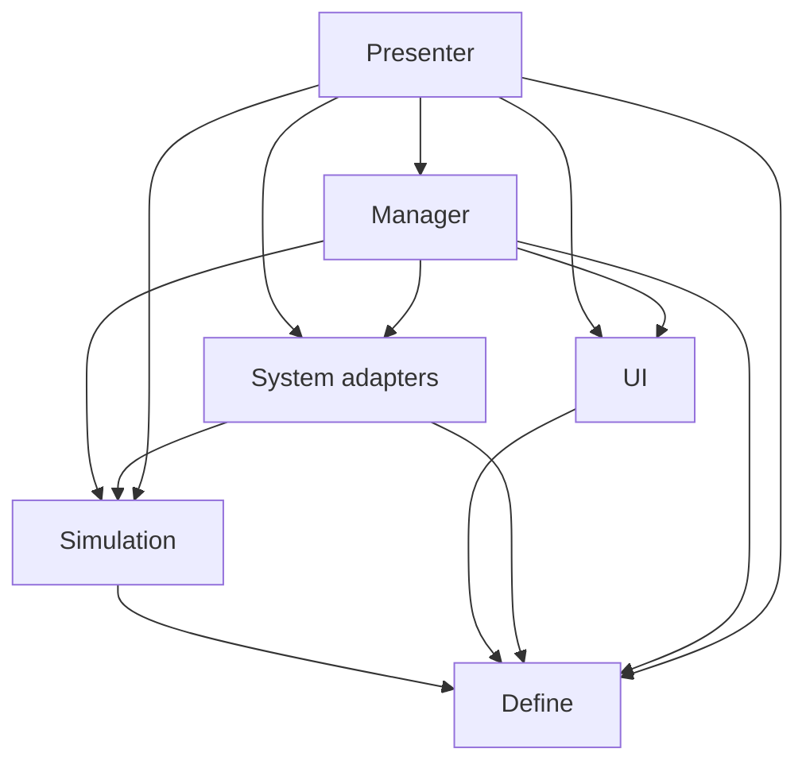

# After Seconds — Unity 계층 설계와 학습 순서 V0.01

2026-10-26 · 작성자 송예찬 · 설계 제안. 사용자가 Unity 프로젝트를 만들고 직접 분석·의사코드·구현한다. 이 문서는 구현 완료 보고가 아니다.

## 1. 루시드 다이버에서 실제 확인한 구조

- [문서 저장소](https://github.com/Jin-o12/Document_LucidDiver), 확인 커밋 `d20c7ccef8489d47c38f9db87e8693571bff2f33`.
- [Unity 저장소](https://github.com/Jin-o12/UnityProject_LucidDiver), 확인 커밋 `11d112f7a61de5aa1932ba14c88021498164fde5`.
- 문서: `web/presentation/submissions/[TD]강다영_발표자료.md`의 3장·발표 대본, `web/presentation/assets/[TD]강다영/images/TD_ProjectArchitecture.png`.
- 코드: `Assets/02_Scripts/`의 Define·Utils·System·UI·Manager·Presenter 및 각 asmdef, `EnemyPresenter.cs`, `LocalInputReader.cs`, `GlobalEventBus.cs`, `ICharDataRepository.cs`, `SOCharacterRepository.cs`.

구조도는 상위에서 하위로 의존하고 이벤트는 위쪽으로 전달하는 5단계다. asmdef는 Manager와 Presenter를 별도 어셈블리로 나누어 총 6개다. 원본 Unity는 2022.3.62f3이다. After Seconds가 같은 에디터·패키지 버전을 써야 한다는 뜻은 아니다.

| 단계 | 원본 역할 | 실제 내부 어셈블리 참조 (외부 패키지 제외) |
| --- | --- | --- |
| 0 Define | 데이터·enum·인터페이스 | 다른 내부 계층 참조 없음 |
| 1 Utils | 이벤트 버스·공통 도구 | Define |
| 2 System | 플레이어·적·저장소 등 로직 | Utils, Define |
| 3 UI | 표시·UI 입력 | System, Utils, Define |
| 4 Manager | 수명·세션·하위 기능 조립 | System, UI, Utils, Define |
| 4 Presenter | 시스템과 표시 연결 | Manager, System, UI, Utils, Define |

원본 구조도에서 UI와 System은 나란히 보이지만 실제 UIAD는 SystemAD를 참조한다. 원본 DefineAD는 `noEngineReferences=false`이고 데이터에 Unity 타입·패키지가 쓰인다. 따라서 원본을 순수 C# 도메인 구조라고 부르지는 않는다. 원본 코드와 리소스를 복사하지 않고 책임 분리·명시적 참조 원칙을 참고한다.

## 2. After Seconds에 적용할 제안

폴더는 역할 이름만으로 끝내지 않고 하위에 Swap·Guard·Interaction처럼 기능을 나눈다. 현재는 설계이므로 아래 폴더·asmdef를 이미 만들었다고 보지 않는다.

```text
Assets/_AfterSeconds/
  Scripts/
    Define/                 # 식별자, 값, 상태, 명령·결과 계약 (순수 C#)
    Simulation/             # 시간, 예약, 교환, 경비 Step, 발판·문 규칙 (순수 C#)
    System/                 # 입력·물리·Transform·SO 변환 어댑터
    UI/                     # HUD, 카운트다운, 미리보기 표시
    Manager/                # Bootstrap, 세션 생성·종료·재시작
    Presenter/              # 입력 요청 → 규칙 호출 → View 갱신
    Editor/                 # 레벨·데이터 검증 도구, Editor 전용
  Data/                     # 조정용 ScriptableObject 에셋
  Art/Candidates/           # 원본 생성 후보, 아직 채택 전
  Art/Approved/             # 검수한 메쉬·재질
  Prefabs/{Characters,Environment,Gameplay}/
  Scenes/{Bootstrap,Tests,Levels}/
  Tests/{EditMode,PlayMode}/
```

| 제안 어셈블리 | 허용하는 프로젝트 내부 참조 | 넣지 않을 것 |
| --- | --- | --- |
| AfterSeconds.Define | 없음, noEngineReferences=true | MonoBehaviour, ScriptableObject, Transform |
| AfterSeconds.Simulation | Define, noEngineReferences=true | UnityEngine, 실제 Raycast·Rigidbody, UI |
| AfterSeconds.System | Define, Simulation | Manager·Presenter·UI 직접 참조 |
| AfterSeconds.UI | Define | 게임 판정·예약 처리 |
| AfterSeconds.Manager | Define, Simulation, System, UI | 모든 규칙을 처리하는 거대 GameManager |
| AfterSeconds.Presenter | Define, Simulation, System, UI, Manager | 개별 View에 퍼즐 판정 복제 |
| AfterSeconds.Editor | 필요한 런타임 어셈블리, Editor 전용 | 런타임에서 참조 |

Utils는 처음부터 비우거나 잡다한 코드를 넣을 장소로 만들지 않는다. 순수 공통 도구가 반복될 때만 Define 아래의 독립 어셈블리로 도입한다. ScriptableObject 정의와 로딩은 System에 두고, 세션 시작 시 순수 설정 값으로 변환한다. 규칙은 그 값만 받는다. UI는 원본보다 좁게 Define만 참조하며 Presenter가 표시용 상태를 전달한다. 이 두 가지는 원본 복제가 아닌 After Seconds용 제안이다.

의존성 화살표는 '참조하는 쪽 → 참조받는 쪽'이다.



호출 흐름 예: InputAdapter가 사격 요청을 전달 → Presenter가 판정된 대상 ID를 Simulation에 전달 → 예약 큐에 교환 등록 → 세션 tick에서 처리 → 결과를 Presenter가 받아 Transform과 HUD 갱신. Simulation은 Presenter를 모르며, 반환값이나 이벤트 계약으로 결과를 알린다.

전역 이벤트 버스는 원본에서 사용하지만 처음부터 전 기능을 static 버스에 넣지는 않는다. 세션 인스턴스 이벤트와 명시적 연결로 시작하고 OnEnable/OnDisable 또는 생성/Dispose에서 구독 수명을 짝짓는다.

## 3. 순서대로 만들기

각 단계는 **분석 메모 → 의사코드 → 작은 구현 → 확인**으로 진행한다. 다음 단계로 넘어가기 전에 완료 조건을 직접 설명할 수 있어야 한다. 한 번에 10개 방을 만들지 않는다.

| 순서 | 만들 것 | 먼저 답할 질문·의사코드 과제 | 완료 조건 |
| --- | --- | --- | --- |
| 0 | 프로젝트·버전 기록 | 사용할 Unity 버전·URP 템플릿 기록, Bootstrap/TestRoom 씬 역할, 폴더와 asmdef 참조표 작성 | 빈 프로젝트 컴파일, 순환 참조 없음 |
| 1 | Define 계약 | EntityId, EntityState, Position, RuleModel, SimulationTime, ScheduledAction, RuleSettings에 필요한 최소 필드 작성 | 순수 데이터만으로 플레이어·상자 상태 설명 가능 |
| 2 | Simulation 시간·예약 큐 | now를 밖에서 받는 AdvanceTo, dueTime·sequence 순 정렬, 처리·취소·재시작 흐름 작성 | 2.99초 미처리·3초 처리, 같은 시각 입력 순서, 큰 tick으로 지나가도 누락 없음 |
| 3 | 교환 규칙 | 명중은 즉시 예약하고 위치는 처리 시점에 읽기, 대상 무효·손에 든 대상 취소 | 이동한 대상의 현재 자리와 바뀜, 두 대상 위치를 원자적으로 교환 |
| 4 | 세션 조립 최소 골격 | Manager가 설정·world·queue 생성, Presenter가 시작·종료 연결 | 재시작 시 이전 큐·이벤트가 남지 않음 |
| 5 | 더미 프리팹·이동·조준 | CharacterController와 VisualRoot 분리, 1인칭 CameraRoot, 이동 입력과 이동 수행 분리 | 회색 플레이어·주황 경비 구분, Visual 교체가 충돌체를 바꾸지 않음 |
| 6 | 총·상호작용 | Raycast 결과를 ID로 변환, 즉시 명중·지연 교환 구분, 손 접촉은 교환 없음 | 정지 상자에 쏘고 3초 뒤 교환, 탄약·취소 피드백 |
| 7 | 경비 상태·동일 Step | Idle/Patrol/Investigate/Chase/Unconscious 최소 전이표, 고정 시간 간격 입력 | 동일 상태·입력으로 동일 결과, 실제 진행과 예측이 같은 함수 사용 |
| 8 | A/B 손 힘·던지기 | A=손 힘 3초 뒤, B=즉시. 교환 지연은 양쪽 3초. 대상 추적 제압과 고정 위치 힘 구분 | 규칙 전환은 새 세션에서 적용, 두 모델 비교 가능 |
| 9 | 발판·문·방 통로 | 발판 무게·문 상태를 데이터로 계산, 뒤 문 닫힘 후 앞 문 열림 | 가벼운 상자로 발판 해결 불가, 벽·문 끼임·우회 점검 |
| 10 | 미리보기·HUD | 월드·큐 복사본을 같은 Step으로 3초 진행, 표시만 UI가 담당 | 미리보기가 실제 상태를 바꾸지 않음, 본 시뮬레이션과 결과 비교 |
| 11 | 감방·냉각조·단상 3개 방 | 기존 좌표로 그레이박스 → 검증 → 부위별 미술 적용 | 퍼즐 풀이·지름길·1인칭 조준을 사람이 검증 |

UI는 초기에 디버그 상태 표시만 가능하며, 정식 HUD·시야 창은 10단계에서 확장한다. 인간형 메쉬가 없어도 5단계는 캡슐로 가능하다. 생성 더미는 리깅된 캐릭터가 아니므로 별도의 Humanoid 리깅·애니메이션 검수가 필요하다.

## 4. 첫 번째 의사코드 과제

완성 구현을 받아 쓰기보다 먼저 아래 빈칸의 이유를 적는다.

```text
예약 데이터에는 무엇이 필요한가?
  actionId / kind / targetId / dueTime / sequence / payload ...?
  예약 시 좌표와 처리 시 좌표 중 어느 것을 저장·조회할까?

ScheduleSwap(hitTarget, now):
  [대상 유효성은 지금 무엇을 확인할까?]
  [dueTime은 설정에서 어떻게 계산할까?]
  [같은 시각 순서는 어떻게 남길까?]

AdvanceTo(now):
  [now가 이전 시간보다 작으면 어떻게 할까?]
  [어떤 예약부터 몇 개까지 처리할까?]
  [두 tick 사이의 dueTime은 어떻게 빠짐없이 처리할까?]
  [처리 중 추가된 예약도 이번 tick에서 처리할까?]
  [취소 결과와 정상 결과를 누가 표시할까?]

ExecuteSwap(action, world):
  [없어진 대상·손에 든 대상이면?]
  [현재 두 좌표를 읽고 어떤 순서로 덮어쓸까?]
  [실행 결과에는 UI가 필요한 어떤 정보가 있어야 할까?]
```

예상 점검 사례: `t=0` 예약 → `t=2` 대상 이동 → `t=3` 이동한 자리와 교환. 두 예약의 dueTime이 같으면 sequence로 처리. `t=2.9→3.2`로 tick이 건너뛰어도 처리. 재시작 뒤 이전 action은 실행되지 않음. 예측용 world를 바꿔도 원본은 그대로.

## 5. 레벨 모듈과 캐릭터 계층

```text
LevelRoot
  Architecture/{Floors,Walls,Ceilings,DoorFrames}
  Gameplay/{DoorLeaves,PressurePlates,SwapTargets,Guards,Checkpoints}
  SetDressing/{Pipes,CableTrays,Panels,Lights}
  Lighting
  Navigation

PlayerRoot (EntityId, 이동·충돌)
  CameraRoot
  VisualRoot (교체 가능한 회색 더미)
  InteractionOrigin

GuardRoot (EntityId, 상태 연결·충돌)
  VisualRoot (공통 주황 더미)
  EyeOrigin
  PatrolRouteReference
```

AI 메쉬 자체를 게임 규칙의 단위로 삼지 않는다. 문틀은 고정 구조, 문짝은 작동부, 표시등은 별도 표시다. 손잡이·모니터·배관도 필요한 부위로 나눈다. 모듈은 Unity에서 실제 치수·pivot·접합면을 맞추고 콜라이더는 별도로 만든다. 장식용 배관은 필수 이동 폭을 침범하지 않는다.

검수 가안: 1 Unity unit=1m, 배치 스냅 0.5m, 미세 부품 0.1m. 최종 치수는 기획서 방별 표와 플레이 테스트로 확정한다. 생성 이미지에 적은 8k triangles는 후보 생성 목표이며 최종 예산이나 실측 결과가 아니다.
