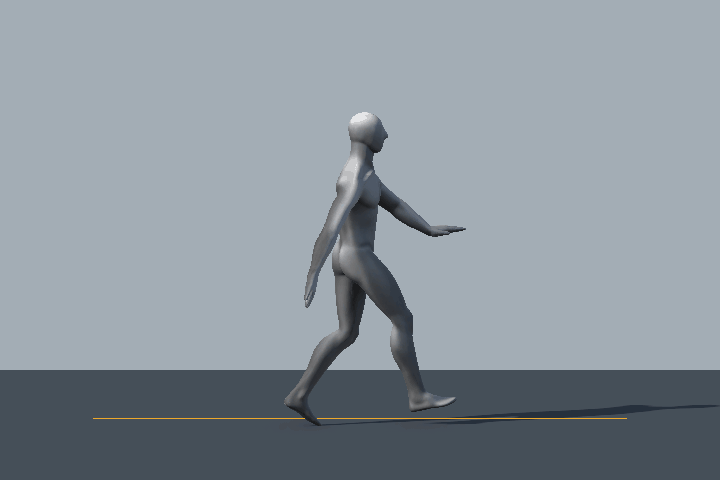

# 플레이어 걷기 루프 검수 V0.01

작성: 송예찬 · 2026-10-29

전체 7.5초의 걷기 후보에는 출발 대기와 정지 동작이 포함되어 있었다. 이동 코드는 계속 실행되는 동안 이 구간까지 반복되어 발이 멈춘 채 미끄러지는 문제가 발생했다. 원본 FBX는 보존하고 Unity에서 사용하는 `Player_Walk` 클립의 구간을 반복 보행 한 주기로 좁혔다.

## 적용 설정

| 항목 | 현재 값 |
| --- | --- |
| V0.3 걷기 소스 프레임 | 124–160, 30fps |
| 클립 길이 | 약 1.2초 |
| Loop Time / Loop Pose | 켬 / 켬 |
| Root Transform Position (Y) Offset | 0.227 |
| Animator 걷기 State Speed | 1.5 |
| 실제 반복 주기 | 약 0.8초 |
| PlayerMotorSettings 이동 속도 | 1.5m/s, 테스트 설정 |
| 모델 Animator Apply Root Motion | 끔 |

구간을 자르기 전 높이 Offset은 0.164였다. 구간 변경 후 높이 기준이 달라져 0.227로 다시 보정했다. 현재 씬의 모델 로컬 Y 0.4와 CharacterController 높이 1.8·Center Y 0.3을 기준으로 검수했다.

## 확인 결과

- 실제 Play Mode에서 약 3.30초 동안 4.13회 반복했고, 원래 출발·정지 구간이 재생되지 않았다.
- 측정 51회 모두 CharacterController가 접지 상태였고 수평 이동 속도는 약 1.50m/s였다.
- 모델의 추가 로컬 Y축 회전은 0도였다.
- 렌더 메시의 최저점은 지면 기준 약 −0.016~+0.045m였다. 발 높이의 잔차와 미끄러짐, 전환의 자연스러움은 사용자 플레이로 추가 판단한다.
- 이 검수는 걷기 반복과 이동 보정에 한정한다. 점프·달리기·상호작용 및 기존 Run·Land·Pickup 전이 조건은 별도 구현·검수 대상이다.

[실행 측정 기록](runtime-loop-verified.json)

아래 이미지는 같은 V0.3 모델과 수정된 걷기 클립을 별도 PreviewScene에서 24개 시점으로 렌더한 제자리 반복 미리보기다. 표시 속도는 현재 State Speed 1.5에 맞췄다. 실제 이동 속도·접지 검수는 위 Play Mode 측정 기록을 기준으로 한다.

설정과 다음 작업은 [이어하기 문서](../../이어하기_2026-10-26.md)를 참고한다.
