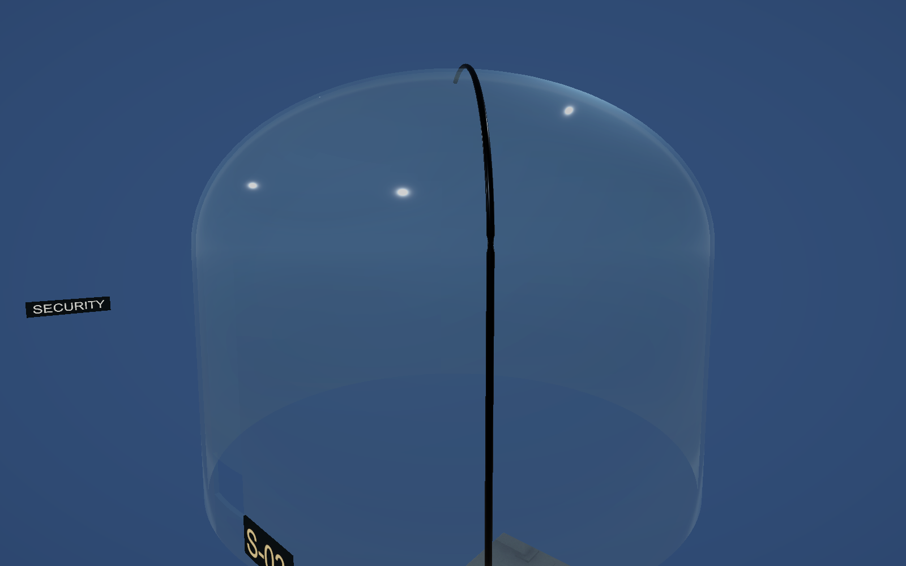
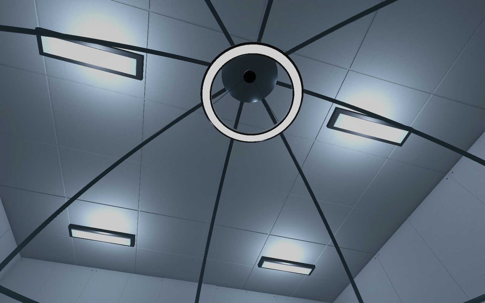

# 돔 내부 중앙 조명 교체 V0.01

2026-11-03 · 작성자 송예찬

가운데 등을 돔 바깥 천장 조명에서 돔 안쪽 꼭대기에 매단 링 조명으로 교체했다. 상부 고정 캡·장력선3개·흰색 링 본체·검은 프레임·아래쪽 발광면으로 구성한다. 외경1.404m, 고정부부터 전체 높이1.231m, 3,348삼각형이다.

실제 돔 안쪽 곡면에 위쪽 Raycast를 해 높이6.3417m를 얻고 고정 캡 상면을 약4mm 아래에 맞췄다. 본체 하단은 약5.1067m, 실제 광원은 약5.0807m다. 아래 생활 공간을 향하는 Realtime Spot, 범위8m·강도7·각도82도다. 발광면은 청백색이며 노출 아래에서도 켜진 면이 보이게 강도4로 설정했다. 기존 흰색·검은색·금속 재질을 재사용하고 새 발광 재질만 추가했다.

기존 Cell_Lamp의 외형과 광원은 비활성화해 보존했다. 바깥 천장 조명4개, 돔 위치·스케일, 생활 가구·배식구·경비는 유지했다. 새 등은 돔 비균일 스케일을 역보정해 실제 크기로 배치했다.

모델·외형 프리팹은 `05.Model/Environment/B5/DomePendantLight`, 조립 조명 프리팹은 `04.Prefabs/Environment/DomePendantLight.prefab`이다. 생활형 포드 프리팹에도 연결했다. 원본은 `SourceAssets/SubjectHabitat/DomePendantLight.blend`, 출처와 실제 Unity 재질 보정은 `06.Data/AssetSources/DomePendantLight_source_manifest.json`을 따른다.

저장 씬 재열기 후 기존 Transform·다른 조명의 설정 동일, 등 메시의 모든 정점이 돔 내경 안에 위치, 누락 스크립트0, 신규 Collider0을 확인했다. 모델 FBX 재반입에서 열린 경계·비다양체·영면적0이다. 실제 FPS·새 조명 베이크 검수는 포함하지 않는다.
