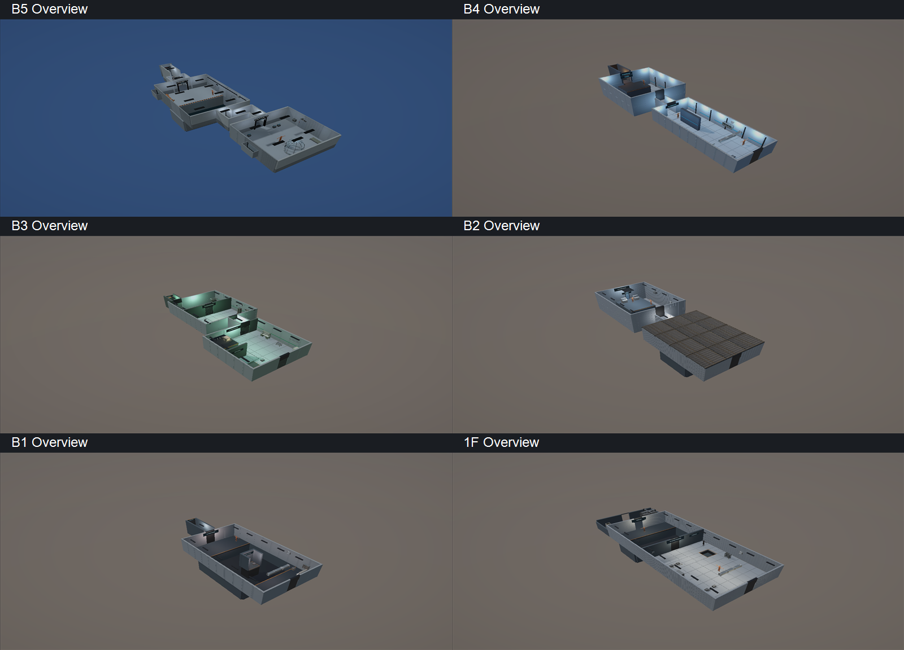
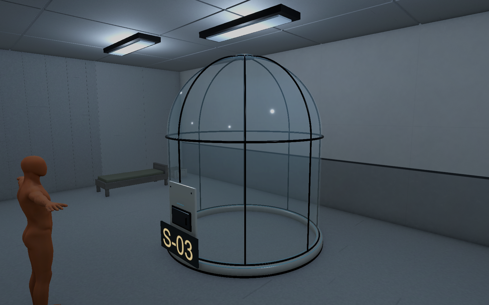
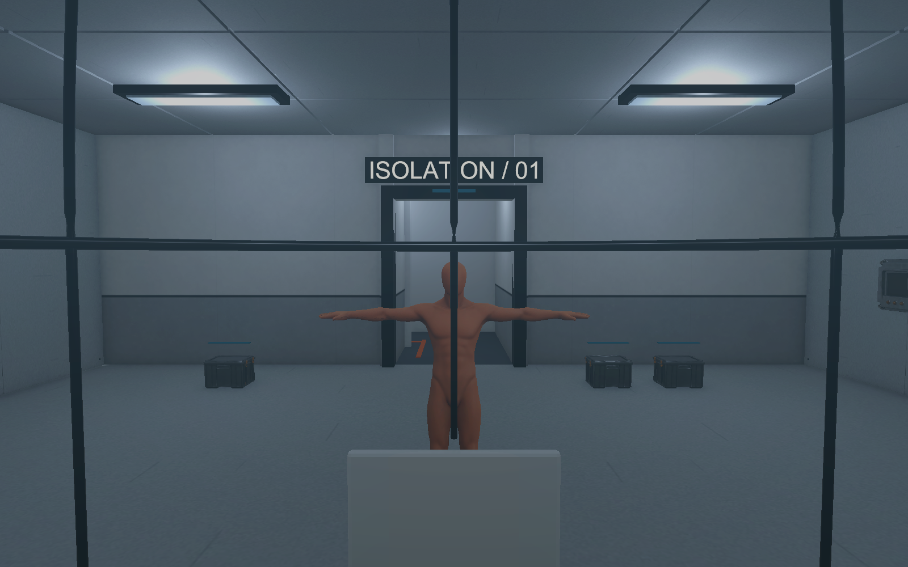

# 6층 에셋 배치와 유리 관찰 포드 검수 V0.01

2026-11-03 · 작성자 송예찬

## 적용 결과

기존 VARCO V0.01 22종과 V0.02 26종의 환경·소품 48종을 모두 현행 씬에서 사용한다. 원본 건축 6종은 앞서 재제작한 모듈을 사용하며, 폐기된 파생본이나 기본 도형 보조 프리팹을 새 장식으로 중복 배치하지 않았다.

이번에는 남아 있던 14종을 반입해 29개 외형을 배치했다. FBX는 원본 약 700만에서 총 1,358,756 삼각형으로 정리했고 BaseColor·Normal 28장은 최대 2K다. 저장 FBX를 다시 열어 면 교차·열린 경계·비다양체·영면적·잘못된 UV 검사를 통과했다. 셔터와 그레이팅은 원본 미세 구조를 보존하려 각각 약 25.6만 삼각형을 사용하며 씬에 하나씩만 배치했다. 목표 기기 FPS와 LOD 검수는 후속 작업이다.

| 층 | 이번 14종의 추가 외형 | 가벼운 상자 외형 | 추가 배치 요점 |
| --- | ---: | ---: | --- |
| B5 | 0 | 3 | 별도 제작한 유리 관찰 포드 1개, 침상을 포드 옆으로 이동 |
| B4 | 2 | 4 | 공구 카트·상단 팬, 떠 있던 서류장을 바닥에 배치 |
| B3 | 2 | 1 | 시료 실험대·가스 실린더 랙 |
| B2 | 20 | 4 | 원심분리기·반응 탱크·HVAC, 기둥 4개, 피트 바닥 그레이팅 1개, 지붕 패널 12개 |
| B1 | 1 | 1 | 남서쪽 실험 준비대 |
| 1F | 4 | 2 | 물류 랙, 외부 랜딩 양옆의 셔터 박스·코너 설비·상부 십자 빔 |
| 합계 | 29 | 15 | 기존 배치와 별도 집계 |

B4~1F의 기본 건축 80개 표면에는 기존 모듈 318개를 반복 적용했다. 원래 Cube Renderer만 끄고 Transform·Collider를 유지했다. 퍼즐 가림벽·단상·셔터·계단·구덩이 경계는 그대로다. 공용 건축 프리팹은 기존 B5 경로의 한 벌을 참조한다. 신규 공용 실험대·기둥·빔은 Common 폴더에 있다. 새 복제본이나 VARCO/Batch/Models 중간 폴더를 만들지 않았다.

## 유리 관찰 포드

B5 Room01 로컬 `(0,0,10.45)`, 외경 2.81m·높이 3.221m·유리 내경 2.624m다. 직벽 위 반구 캡, 흰 받침·검은 프레임·투명 유리·청백 LED·닫힌 배식구를 구성했다. 모델과 외형 프리팹은 `05.Model/Environment/B5`, 조립 프리팹은 `04.Prefabs/Environment/ObservationPod.prefab`이다. 원본은 `SourceAssets/ObservationPod/ObservationPod.blend`다.

기존 사각 감방의 벽·지붕·철창·벤치 Collider 17개는 비활성화해 원본을 보존했다. 돔에는 정적 곡면 MeshCollider 24개를 연결했다. 이 승인된 변경 이외의 기존 Collider, 플레이어 시작 위치와 설정, 사용자가 뒤집은 천장 Transform은 유지했다. 침상은 원형 쉘과 겹치지 않게 옆으로 옮겼고 S-03 표지를 전면에 붙였다.

## 검증과 한계

- 6개 저장 씬 재열기, 메시·재질·프리팹 GUID 참조, 누락 스크립트 검사 통과. 최종 독립 감사 pass=true, 보호 파일 155개 SHA 동일, 누락·중복 GUID 0건이다. Unity 현재 Console은 컴파일 실패 없음·오류 0·경고 0이다.
- 승인된 포드 변경을 제외한 기존 Collider 정의와 Transform 동일. 원래 천장 Transform 동일.
- 기존 게임 코드·Player 씬·Player/Enemy 모델·Animator·Packages는 작업 전 SHA와 동일하다. 최종 독립 감사는 `final_independent_audit.json`을 따른다.
- 추가 설비 외형에는 Collider·Rigidbody·교환 태그·게임 스크립트를 추가하지 않았다. 실제 물리 소품·교환 대상 구현과 구분한다.
- 새 설비의 기존 Collider AABB 접촉은 B2 지붕 패널 12개와 기존 천장, 피트 바닥 그레이팅 1개와 기존 피트 바닥뿐이다. 의도한 표면 대체·접합이다. 다른 설비의 통로 침범 접촉은 없었다.
- 포드 시작 capsule 겹침 0, 내부 16방향 Raycast가 곡면에 적중, 기존 CharacterController를 8방향으로 이동시켜 벽에 막힘을 확인했다. 이동 후 원래 Transform을 복원했다.
- 검수 카메라에서만 플레이어 몸과 천장 일부를 숨겨 찍었고 저장 상태는 복원했다. 전체 배치 이미지는 천장을 임시로 숨긴 그림이다.
- 실제 키보드 플레이·퍼즐 완주·목표 FPS·신규 외형을 반영한 오클루전/조명 재베이크는 검증하지 않았다. 배식구 개폐·기어 나가기·사격·교환·AI·층 전환은 미구현이다.
- 기존 B5 접합 후보 26쌍 전체를 이번 작업에서 해결한 것으로 판정하지 않는다. 포드로 꺼진 감방 표면도 섞여 있으므로 다음 검수에서 재분류한다.

기획서 V0.11의 9.2에는 현재 포드 제작 상태와 기존 철창 원안을 구분했다. 유리 너머 총 빼앗기·사격과 배식구 역할은 다음 기획 검토 대상이다.

## 확인 방법

Unity `Unity/After_Seconds_Build_V0.01`을 열고 `Assets/Afrer_Seconds/01.Scenes/Stage/Level_B5_Isolation.unity`부터 확인한다. B4·B3·B2·B1·1F도 같은 폴더에 있다. 씬마다 플레이어·카메라가 있으므로 하나씩 연다. 사용자 검수용으로 B5의 관찰 포드를 선택해 두었다.

배치 수·좌표·bounds는 `placement_facts.json`, 재반입 FBX 검사는 `fbx_verification.json`, 승인된 감방 충돌 변경은 `authorized_collider_changes.json`, 포드 기하 검사는 `pod_physics_review.json`에 있다. `tools/`는 이번 검수 도구의 보관본이며 실제 게임에는 Editor 스크립트를 남기지 않는다. 로컬 tmp 원본 경로와 당시 반입 순서가 필요하므로 오래된 스크립트를 바로 재실행하지 않는다.
