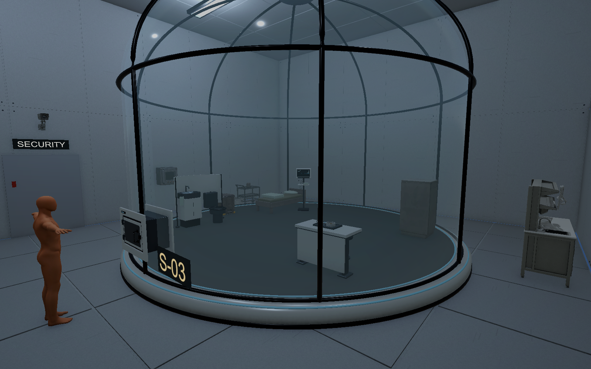
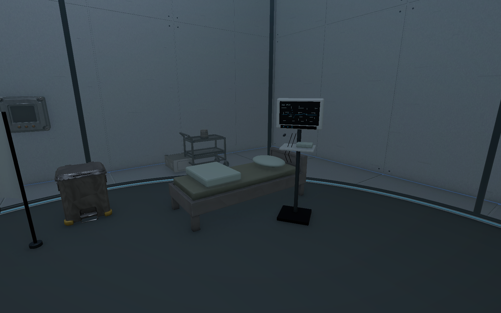
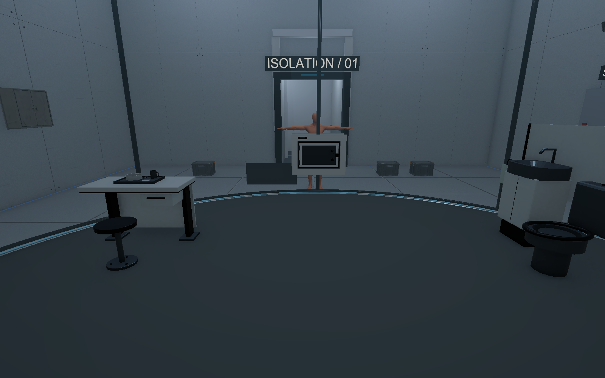
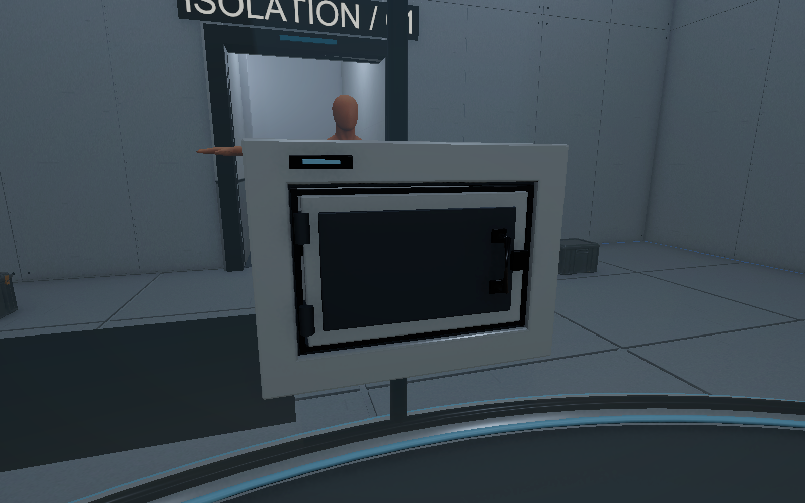
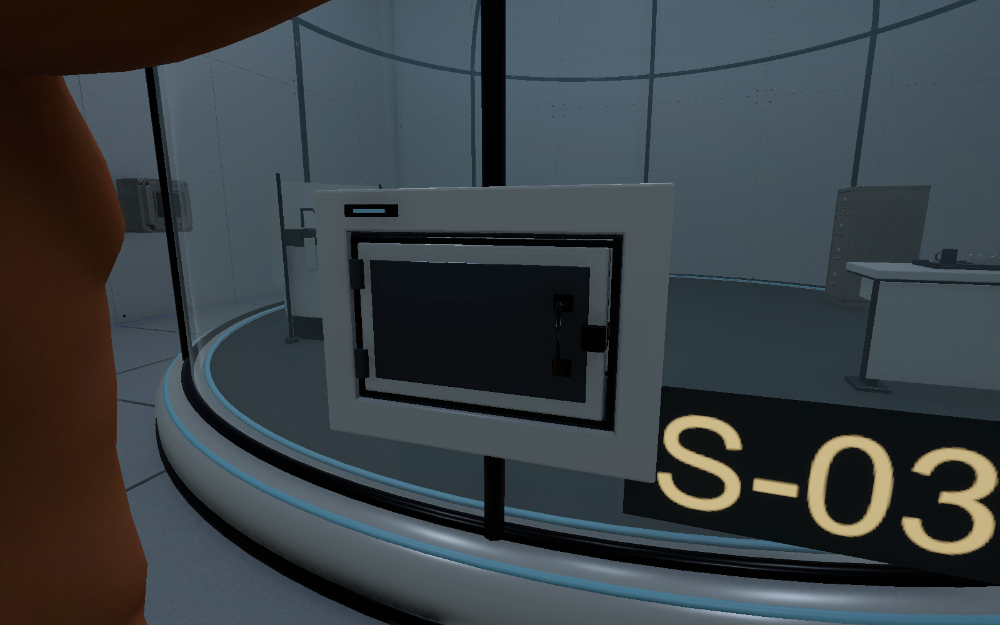
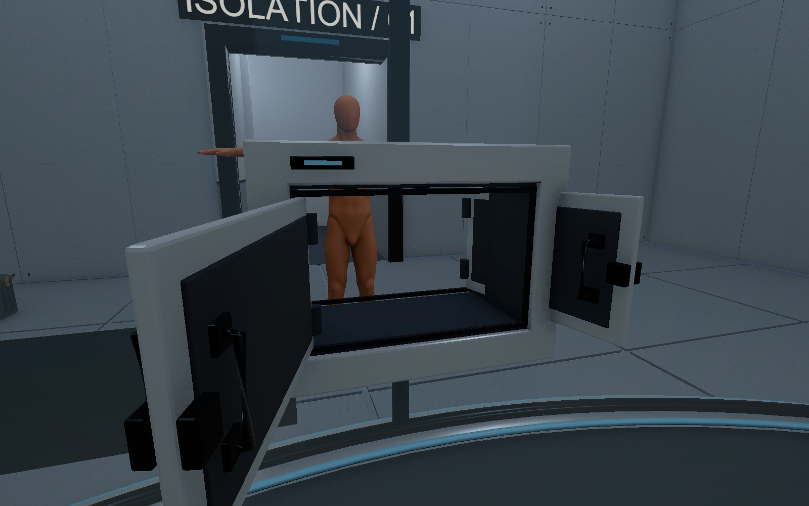

# 생활·실험형 관찰 포드 구성 V0.01

2026-11-03 · 작성자 송예찬

사용자가 직접 늘린 포드 크기와 위치를 기준으로, 오래 생활하면서 실험을 받는 격리 공간으로 구성했다. 작업 시작 때 저장되지 않은 Unity 씬도 별도 사본으로 보관했고, 현재 씬을 과거 크기로 되돌리지 않았다.

| 항목 | 적용 |
| --- | --- |
| 사용자 포드 Transform | 위치 `(0,0,10.32)`, 스케일 `(3,2,3)` 그대로 |
| 포드 실측 | 외경8.43m·내경7.872m·높이6.442m |
| 격리실 | 폭12m·깊이14m(z2~16), 천장 아래7.2m |
| 천장 여유 | 돔 꼭대기부터 약0.758m |
| 경비 A | 사용자 현재 위치 `(0,0,5.064)` 유지, 돔 밖 |
| 생활 바닥 | 물리상면0.28m, 시각면은 겹침 방지용+2mm |
| 플레이어 | X/Z `(0,10.8)` 유지, 바닥에 맞춰 시작Y0.885m. Controller 수치는 동일 |

## 생활 구역과 실험 구역

돔 안에는 기존 침상에 베개·접힌 담요를 놓고, 식탁·고정 스툴·식판·컵·식사, 개인 수납, 세면대·변기·차폐판·폐기함, 검사 모니터를 배치했다. 가구에 돔 확대 배율을 곱하지 않고 사람 크기를 유지했다. 음식과 침구가 생활 흔적이 되고, 같은 침상 옆의 검사 모니터가 피험체라는 맥락을 만든다.

돔 밖에는 벽 관찰 콘솔, 시료 세척·준비대, 의료 트롤리와 시료 용기를 둔다. 경비·직원이 쓰는 장비와 피험체의 생활 공간을 유리로 구분했다. 방을 뒤로3m 늘려 돔과 뒤 벽의 관통을 해소했다. 기존 전면 출입 통로는 그대로다. 기존 건축 Renderer는 보존 상태로 숨기고 55개 시각 모듈로 새 크기를 채웠다. 천장 패턴 방향을 유지했고 조명 색은 같은 청백색이다.

## 양면 배식구

양쪽에 같은 문짝·손잡이·힌지·패킹·표시등이 있다. 각 문짝의 앞뒤 네 면 모두 같은 금속 인셋·검은 손잡이·힌지·래치로 마감했다. 두 문을 열어도 흰 판만 노출되는 면이 없다. 뒷면 손잡이를 포함한 전달함 중앙 빈 깊이는 실측0.314123m다. 두 문 사이에는 깊이0.42m의 빈 전달함이 있고 유리와 곡면 Collider에도 실제 개구0.78×0.51m를 냈다. 양쪽 문은0.72×0.45m이며 각각 독립 회전축을 갖는다. 단순히 뒷면에 그림을 붙인 구조가 아니다.

저장 상태는 닫힘이다. 문짝 Collider는 각 회전축에 연결했다. Editor에서 임시 개방해 닫힘18/18 차단, 열림18/18 관통, 옆 유리12/12 차단을 검사하고 원래 닫힌 pose로 복원했다. 입력에 따른 개폐·잠금·배식·탈출 게임 로직은 아직 연결하지 않았다.

## 파일과 검증

- 생활 소품5종 총13,872삼각형, 공유 재질8개. 저장FBX 재반입에서 열린 경계·비다양체·영면적0건, Unity bounds와 실측 일치.
- `05.Model/Props/B5`: LivingDesk·MealTraySet·BedLinen·HygieneStation·TestMonitorStand 모델과 외형 프리팹.
- `05.Model/Environment/B5`: HabitatShell/Collision·DualFoodHatch Visual/Collision, 내부 바닥 메시·재질.
- 조립 포드: `04.Prefabs/Environment/ObservationPod_Habitat.prefab`. 사용자 스케일을 반영한 구성이다. 기존 포드 원본과 프리팹은 보존한다.
- 원본: `SourceAssets/SubjectHabitat/SubjectHabitat.blend`, `DualFoodHatch.blend`. 제작/반입 JSON은 `06.Data/AssetSources/SubjectHabitat_*`다.
- 저장 씬을 다시 열어 포드 위치·스케일·외부 경비와 누락 스크립트0건을 확인했다. 생성 가구가 모두 유리 내경 안에 들어가며 시작 capsule 겹침0, 8방향 이동이 벽 또는 가구에 막히는 것을 확인했다.
- Room01 밖의 원래 방·연결 통로·계단 Transform을 비교했다. 동명이름 오브젝트는 instanceID와 원래 위치로 구분했다. 카메라는 높아진 시작점을 자동 추종한다.
- 다른5개 층, Player 씬, 원래 게임 코드·Animator·Packages·기준 모델은 보존했다. 실제 파일 SHA와 GUID 검사는 `independent_audit.json`을 따른다.
- 실제 키보드 플레이·퍼즐 완주·FPS·새 조명/오클루전 재베이크는 후속 검수다. 새 가구는 정적 충돌만 연결했고 게임 상호작용·AI·사격·교환을 추가하지 않았다.

이 결과는 이전 `2026-11-03_Full_Asset_Placement`의 작은 포드 치수·닫힌 장식 배식구 기록보다 최신이다. B5 씬과 최신 이어하기를 기준으로 확인한다.

최종 Unity Console은 컴파일 실패 없음·오류0·경고0이다. 임시 Editor 도구는 Assets 밖으로 보관했고 프로젝트 설정의 자동 줄끝 변화도 원래 바이트로 복원했다.
