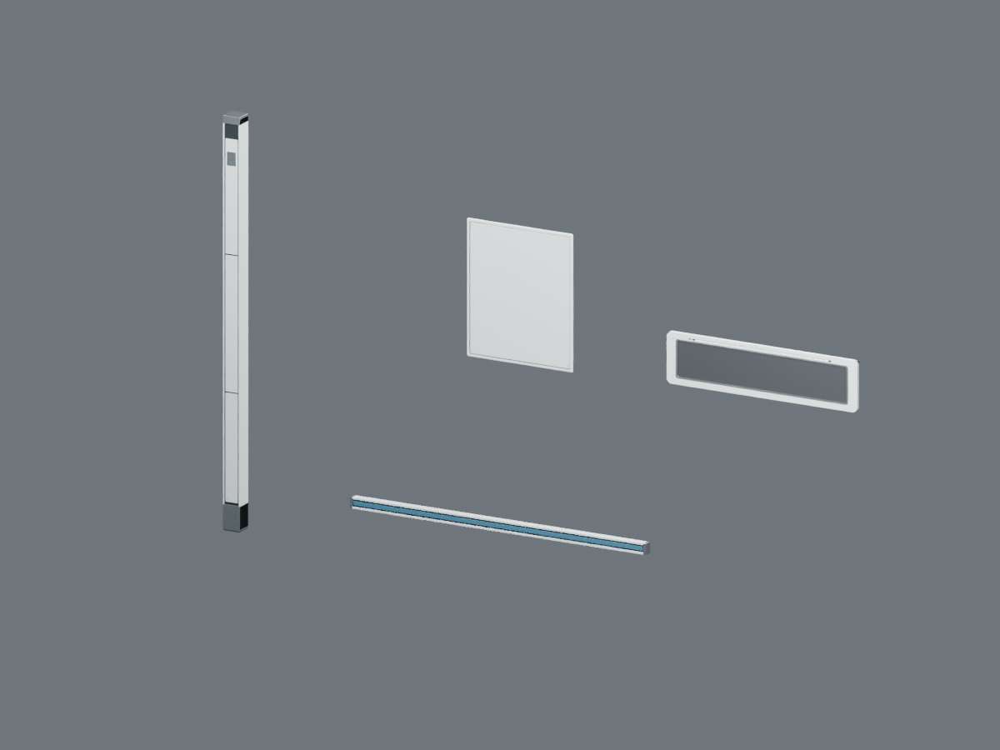
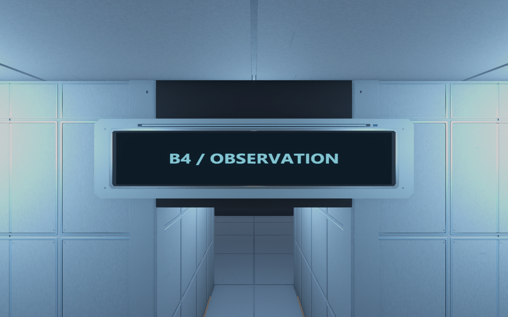
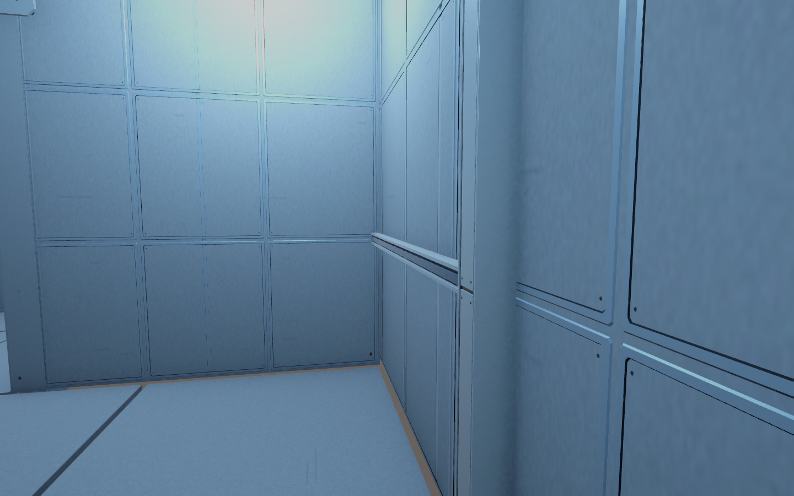

# 건축 마감 제작·전층 적용 검수 V0.02

작성자 송예찬 · 2026-11-04 · Unity 6000.4.0f1

내부 벽·`Wall_Reveal`·`Wall_Pillar`·`Sign_Observation`의 단순한 외형을 제조 부품 형태로 교체하고 **B5~1F의 원본 6개 씬에 저장했다.** 이전 세션은 중지·인계 완료 상태이며, Unity 공식 MCP로 실행 중인 에디터에서 반영했다. 패키지나 Unity 버전을 업그레이드하지 않았다.

## 최종 반영

| 대상 | 적용 수 |
| --- | ---: |
| 벽·부스·독립 칸막이 마감 메시 | 237곳 |
| 표지판 하우징 | 30곳 |
| 수평 마감 레일 | 16곳 |
| 기둥 마감 | 16곳 |
| 문틀 마감 | 12곳 |
| 합계 | 311곳 |

벽 마감은 실제 기존 삼각형이 타일 전체를 덮는 영역만 선택해 패널3,747장을 묶은237개 메시로 구성했다. 문·창 개구를 가로질러 배치하지 않도록 면 피복 검사를 사용했다. B1 부스·독립 칸막이도 새로 추출해 포함했다. 원래 벽 메시를 삭제하거나 WF 공면 보수본을 되돌리지 않고 시각 자식만 추가했다. 원래 충돌체를 사용한다.

표지판의 원래 글자·텍스처는 앞면 자식으로 유지하고 하우징·고정부·베젤을 추가했다. 기존 기둥·레일·문틀은 원래 bounds와 Transform에 맞춘 파생 메시로 연결했다. 전체 배치·Collider·런타임 Behaviour 구성·TMP 문구는 저장 후 다시 읽은 검사에서 일치한다.

## 제작물과 배치

공용 FBX·외형 프리팹은 `Assets/Afrer_Seconds/05.Model/Environment/Common/AD_{pillar,reveal,sign,panel}_Manufactured.*`다. 기둥8,108tri·레일3,204tri·표지판4,740tri·패널208tri이며 프리팹에는 Collider·런타임 Behaviour가0개다. 공용 부품 재질은 `Materials/AD_Manufactured_URP.mat`, 최종 패널 프리팹 재질은 `Materials/AD_WallPanel_Common.mat`다. 배치 패널 재질은 같은 위치의 `AD_WallPanel_{층}.mat`를 사용한다.

모델에 쓰는2048 PBR5종은 `Common/Textures/AD_Manufactured_{BaseColor,Normal,MetallicSmoothness,Occlusion,Emission}.png`다. 최종 패널은 단일 닫힌 단면과 고정 나사로 제작했다. 판재 색 샘플을 안정된 아틀라스 영역에서 사용하며 옛 프레임용 노멀맵은 최종 패널 재질에서 사용하지 않는다. 입체 모서리는 실제 메시 노멀로 표현한다. 패널만의 삼각형 합계는779,376개이며6개 씬에 나뉘어 있다.

Blender 원본은 `SourceAssets/ArchitectureDetail/ArchitectureDetail_Clean.blend`다. 초기 프레임 시도와 제작 자료는 보존했고 최종 출력 패널은 `AD_panel_Manufactured` 오브젝트다. 재현·분석 스크립트는 `tools/`에 보관했다. 제작 기록은 Unity `06.Data/AssetSources/ArchitectureDetail_20261104.json`에 있다. 현재 적용본에 이전 Apply/Export를 그대로 재실행하지 않는다.

## 이음 표시 보수와 AA

초기 조립형 패널에는 프레임과 가운데 판 옆면의 반대 방향 공면 삼각형16쌍이 있었다. 한쪽당2mm 간격을 두어0쌍으로 줄였지만 고정 렌더에서 가는 이음의 점선 표시가 남았다. 단색·그림자·노멀·SSAO 분리 진단만으로 그 표시의 단일 원인을 확정하지는 않았다. 최종판은 별도 프레임과 가운데 판을 포개지 않는 닫힌 단면으로 재제작했다. 최종 패널 내부 공면 겹침은0쌍이고 B4 배치끼리의 평면 중복 검사도0쌍이다. 이를 전층의 모든 종류의 접촉이0건이라는 뜻으로 확대하지 않는다.

기존 PC RP의 MSAA가1(비활성)이었다. MSAA4와 SMAA High 비교에서 가는 이음이 연속적으로 표시되는 것을 확인해 PC RP와6개 씬의 기존 카메라에 반영했다. `Assets/Settings/PC_RPAsset.asset`의 MSAA, QualitySettings의 AA 값과 에디터 직렬화, 각 카메라 AdditionalCameraData의 AA 설정이 의도적 변경이다. 기존 SSAO·조명 배치·렌더 스케일은 유지했다. AA의 GPU 비용은 늘 수 있으며 실제 목표 기기의 FPS는 측정하지 않았다.

비교 근거: [초기 공면 겹침](panel_internal_overlap_before.json), [최종 내부 검사](panel_internal_overlap.json), [최종 단면](panel_solid_profile.json), [카메라 AA](graphics_qa_final.json).

## 최종 화면

방20곳·표지6곳·B4 기둥/레일2곳의28개 시점을1440×900으로 캡처했다. 각 층 대표 화면과 주요 근접 시점을 직접 확인했다. `_before`는 반영 전, `_final`은 채택한 원본 씬의 결과다. `_after`·`candidate`·`probe`는 이전 시도와 진단이며 최종 결과로 사용하지 않는다.

| 층 | 반영 전 | 최종 |
| --- | --- | --- |
| B5 | [시작 포드](B5_Room_00_before.png) | [시작 포드](B5_Room_00_final.png) |
| B4 | [복도](B4_Room_00_before.png) | [복도](B4_Room_00_final.png) |
| B3 | [시료층](B3_Room_00_before.png) | [시료층](B3_Room_00_final.png) |
| B2 | [기계층](B2_Room_00_before.png) | [기계층](B2_Room_00_final.png) |
| B1 | [실험 부스](B1_Room_00_before.png) | [실험 부스](B1_Room_00_final.png) |
| 1F | [검문소](1F_Room_00_before.png) | [검문소](1F_Room_00_final.png) |

## 저장 후 보호 검사

6개 씬을 다시 열어 기존 Transform·Collider·Behaviour 타입 구성·문구 일치, 누락 메시0개, 신규 시각 오브젝트의 Collider·Behaviour0개를 확인했다. 검수 중 무조건적인 회전 재대입으로 B4 플레이어 본1개의 Quaternion에 약2×10⁻⁹ 차이가 생겼으나 원래 직렬화 값을 복원했고 최종 비교는 정확히 일치한다. 기존 Animator·이동·예약·교환·경비 코드를 변경하지 않았다. 카메라 AA의 의도적 속성 변경은 위에서 별도로 기록했다.

재개 시점 보호 파일1,523개 중1,519개는 SHA-256까지 동일하다. 차이는 신규 AD 텍스처3종의 Importer 설정과 QualitySettings AA/직렬화이며 예상 밖 변경은0개다. 기존 소품 베벨·작업대 보정·WF 메시·게임 스크립트·애니메이션·Packages의 Unity AI Assistant 설정을 보존했다. 이전 원본 씬 백업과 제작 원본은 보관한다.

근거는 [전층 최종 보존](preservation_final_all.json), [파일 보호](resume_source_preservation_final.json), [적용 경로](application_final.json), [최종 수치](final_verification.json), [모델 반입](model_import.json)이다. 컴파일 실패 상태는 false이며 Unity 버전은6000.4.0f1이다. 임시 검수 Editor 스크립트와 meta는 `tools/EditorHelperArchive_20261104/`로 보관 이동해 Unity 컴파일 대상에서 제거했다. 6개 씬이 이 도구를 참조하지 않는 것도 확인했다. 과거 실패 진단의 Console 로그를 현재 컴파일 오류로 해석하지 않는다.

이번 검수는 저장·참조·보호 검사와 고정 화면 확인이다. 실제 키보드 이동 중 깜박임·퍼즐 완주·FPS 검증은 하지 않았다. 문·경비·사격·교환 등의 미구현 기능이 추가된 것으로 기록하지 않는다.

## 비용과 이전 기록

앞선 세션에서 VARCO 이미지3장150점·3D3종600점, 합계750점을 사용했다. 변형이 있는 생성 메시 대신 이미지의 디자인을 참고해 Blender로 제작했다. 이번 재개 작업에서는 추가 유료 생성을 하지 않았다. 이전 세션의 작업 전용 Unity/Blender 검증 프로세스는 중지·인계 시 종료됐으며 원본 Unity는 종료하지 않았다. 커밋·push는 하지 않았다.

`{"detail":"Bad Request"}`의 정확한 발생 앱·요청은 이전 기록만으로 특정하지 못했다. 생성 파일 파싱은 성공했으며 이 오류 자체로 씬 손상이 확인된 것은 아니다.
