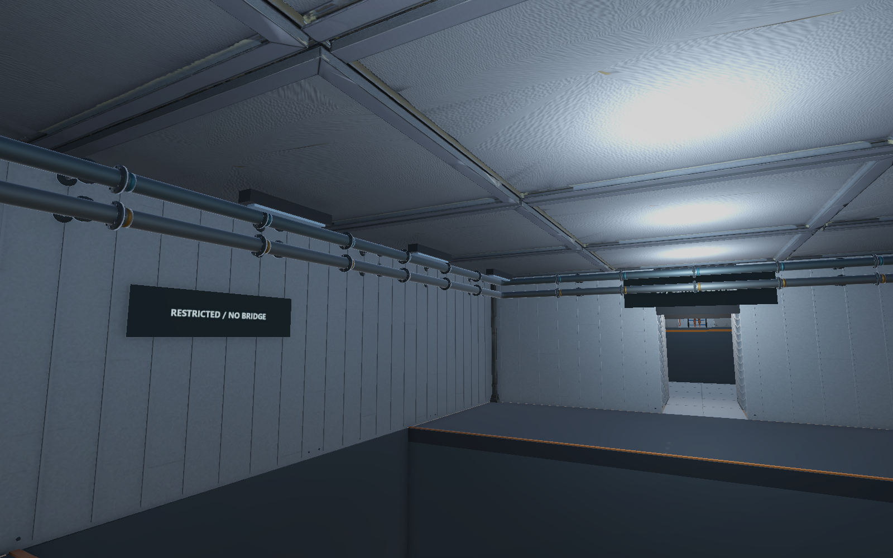
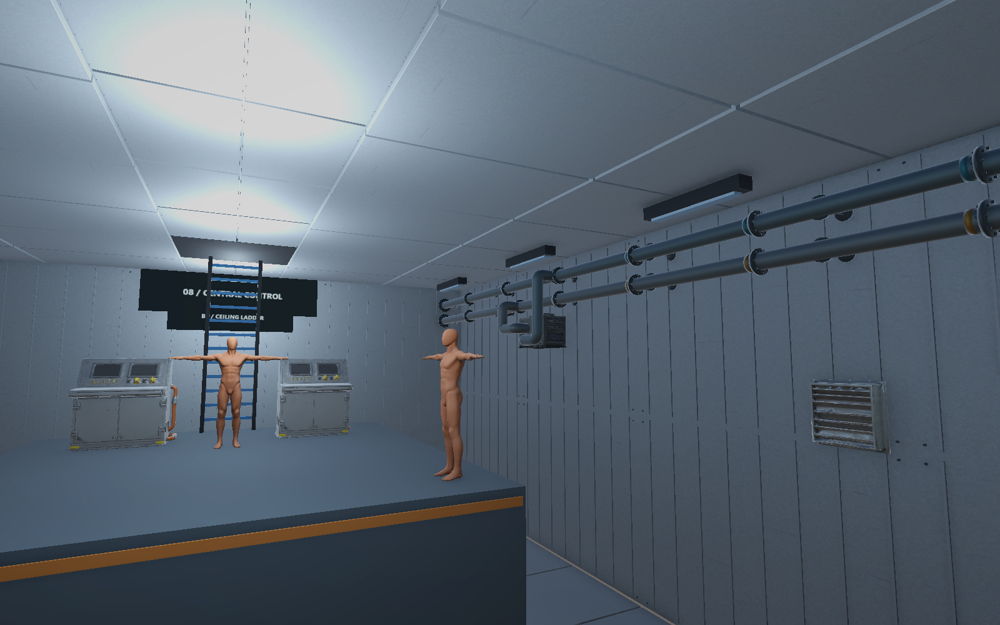
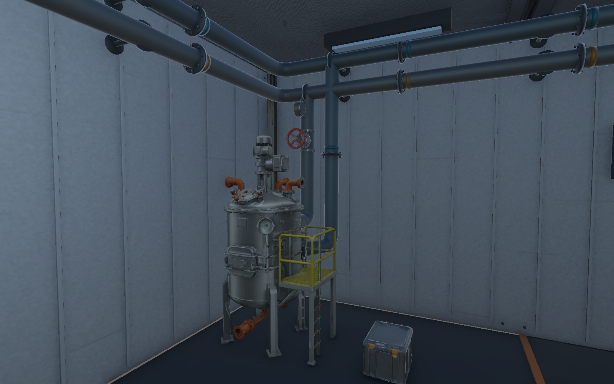
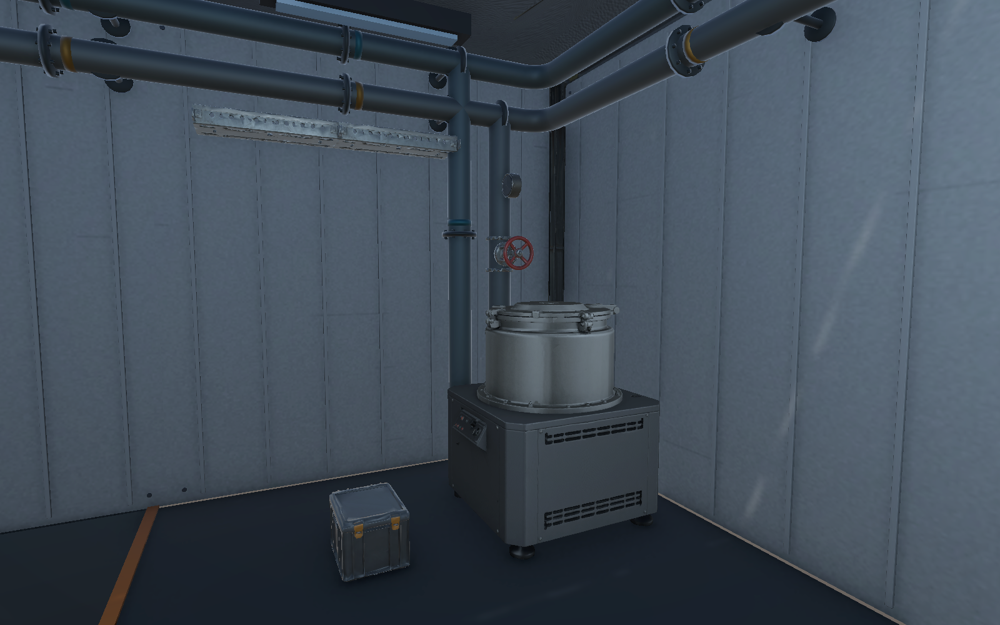
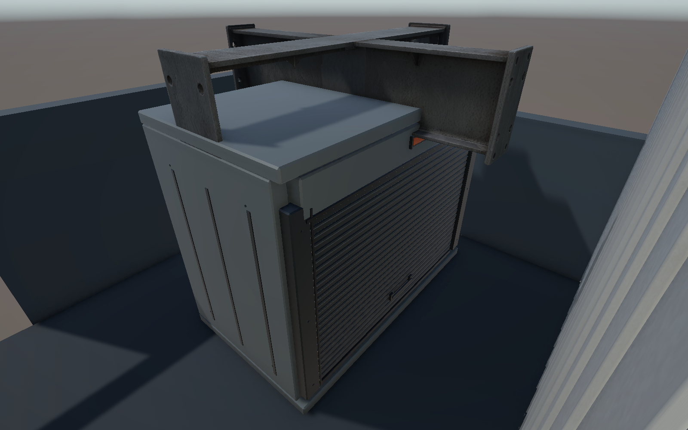
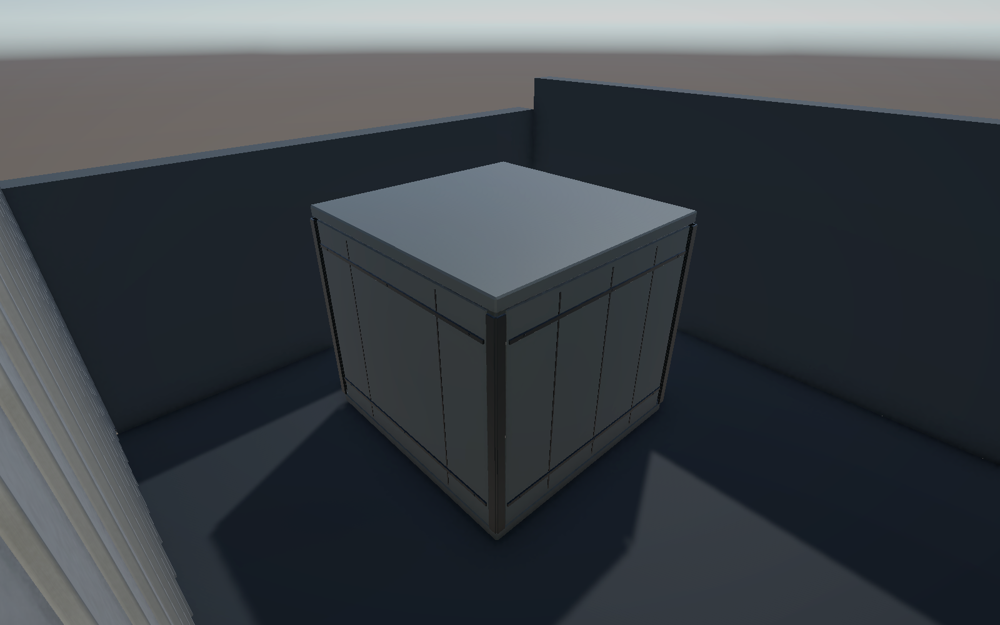

# B2 배관·1F 외장 보수 검수 V0.01

작성자 송예찬 · 2026-11-04

## 완료한 외형 작업

B2 Room07·Room08에 공급·회수 주 배관4개, 기계 연결4개, HVAC 연결2개를 배치했다. 관망은 시각 프리팹1개·절차 메시12개이며, 곡관·볼트 플랜지·벽 클램프·공급/회수 식별 띠를 포함한다. 기존 밸브와 게이지 프리팹을 각각2개 연결했다. 기존 미완성 예시6개는 오브젝트와 위치를 보존하고 Renderer만 껐다.

Room07 주 배관 중심 높이는3.38/3.78m, Room08은5.05/5.50m다. 기계 연결은 전체 AABB에만 맞췄을 때 끝단이 떠 보여 실제 삼각형 표면에 ray를 쏘아 접속점을 다시 계산했다. 원자로1.45/1.10m, 원심분리기1.10/0.80m 높이에서 표면 뒤12cm까지 관을 삽입하고 접속 플랜지를 붙였다. 네 끝점의 표면 교차 기록과 내부 parity 판정은 [최종 보정 기록](B2_update_report.json)에 있다. Unity 메시의 GPU 버퍼도 갱신한 뒤 새 렌더로 확인했다.

1F의 찌그러진 셔터와 외장 코너를 평면 패널·금속 프레임으로 재제작해 기존 프리팹에 연결했다. 두 모델은 합6,412삼각형이며 원본 FBX·이전 외형을 보존했다. 기존 프리팹 GUID와 바닥 중앙 피벗·모델 크기·축을 유지했다. 1F 씬 파일 자체는 작업 시작 사본과 동일하다. 반입 수치는 [1F 반입 기록](1F_import.json), 소스·재반입 검사는 [모델 기록](1F_model_manifest.json)을 따른다.

## 저장 상태와 보호 검사

- [B2 저장 프리팹 검증](B2_verification.json): 새 Collider0·런타임 Behaviour0, 보호 구역7곳의 내부 정점0, 절차 메시의 열린 경계0·과다 사용 모서리0.
- [6층 보호 검사](protected_six_floors.json): 기존 Collider와 기존 Transform 유지. 저장 중 자동 추적으로 바뀐 Cinemachine 카메라 직렬화 위치는 원본으로 복원한 뒤 검사했다.
- [6층 참조 검사](asset_links_verification.json): Missing Script·누락 메시·잘못된 재질0.
- [파일 보존 검사](preservation_final.json): 런타임 코드·Player/Enemy 모델·Animator·Packages·ProjectSettings 등137개 파일 해시 유지.
- [작업 시작 기준 파일 검사](file_audit.json): 기존2,539개 중 허용한7개만 변경, 나머지2,532개 유지. 이전 미커밋 작업을 기준에 포함했다.
- [Unity Console](console_final.json): 마감 시 실제 Console 오류0·경고0·컴파일 실패 없음. 과거 도구 버퍼의 누적 개수와 실제 Console 상태는 다르다.

메시 경계 검사는 닫힌 개별 튜브·플랜지에 대한 검사다. 이음부는 외형을 겹쳐 조립했으며 전체를 하나의 불리언 솔리드로 합친 결과는 아니다. 검사용 Editor 코드는 작업 후 Assets 밖으로 보관했다.

## 실제 씬 렌더

## 다음 작업으로 남긴 범위

오늘 B2·1F 수정 결과를 전층 배치 완료로 판정하지 않는다. [기존 자료에 근거한 시각 검수 사전 보고서](visual_audit.json)는 과거 이미지의 문제와 미확정 후보를 구분한 자료다. 작업대3개·덕트9개·실제 보이는 건축 접촉면을 새 근접 렌더에서 우선 확인한다.

추가 프랍 수급·전층 배치, Player·Enemy 기능, 실제 퍼즐 완주·난이도 검증은 하지 않았다. 구체적인 다음 순서는 [최신 이어하기의 다음 작업 세션 우선순위](../../이어하기_2026-11-04.md#다음-작업-세션의-우선순위)에 기록했다.
