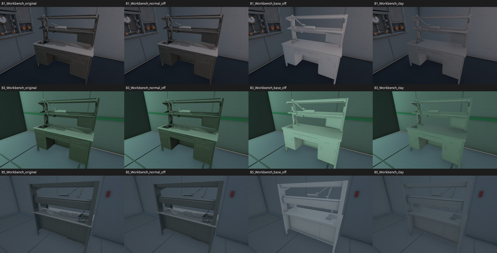
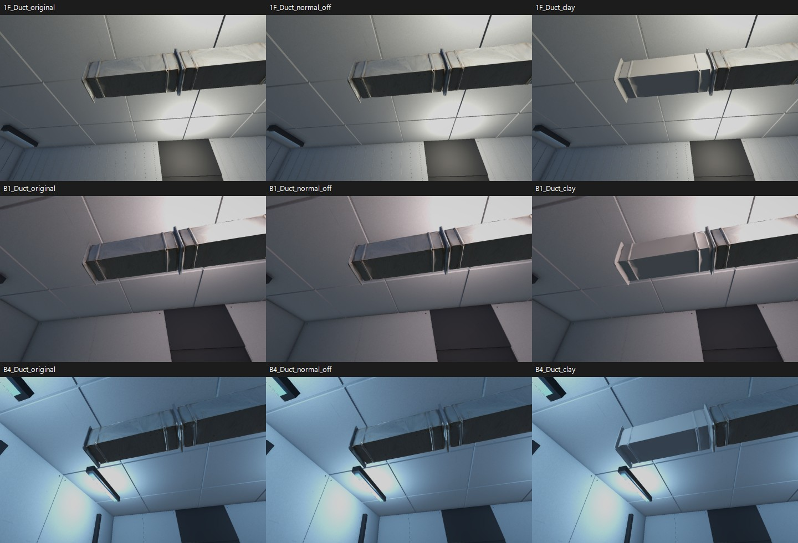
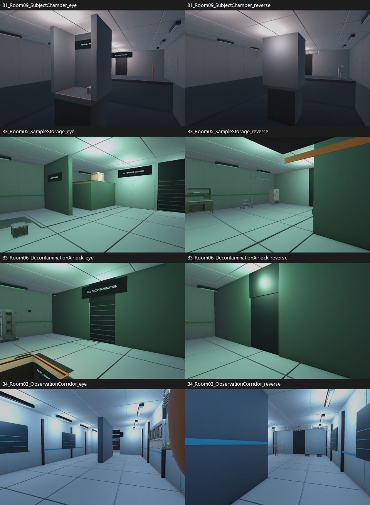
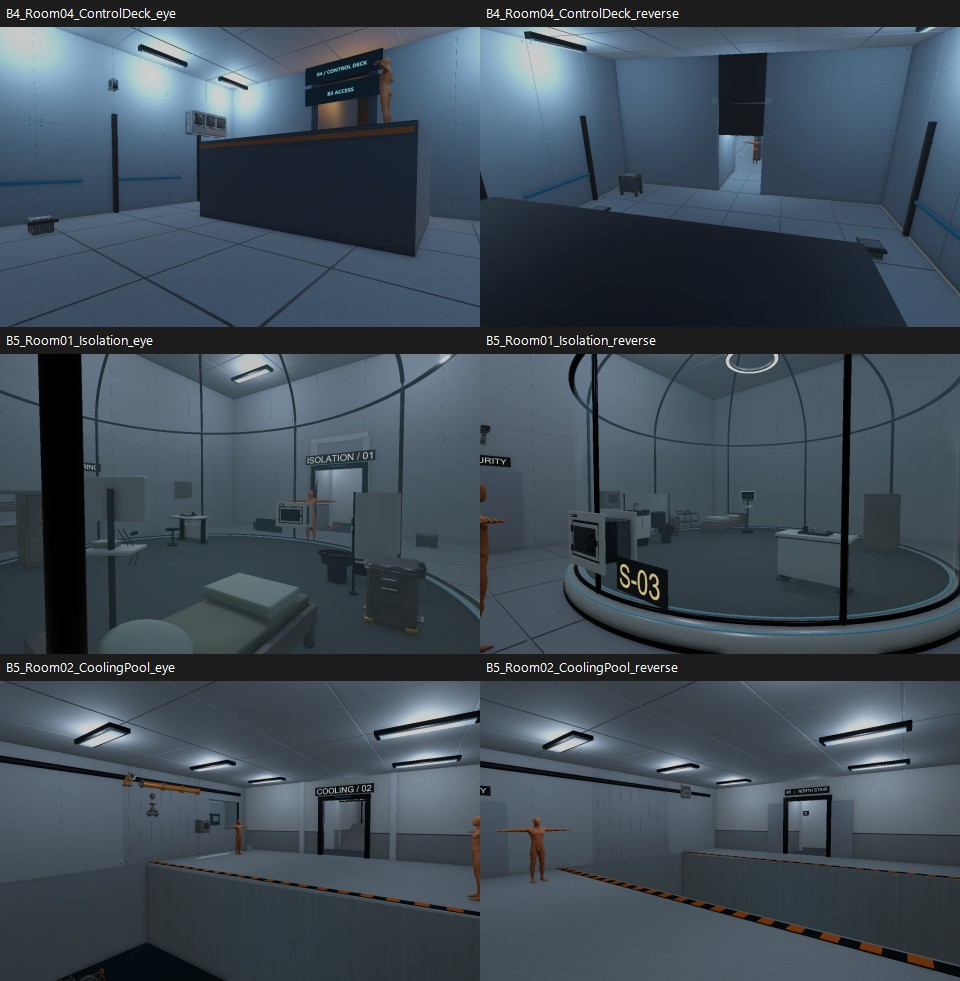
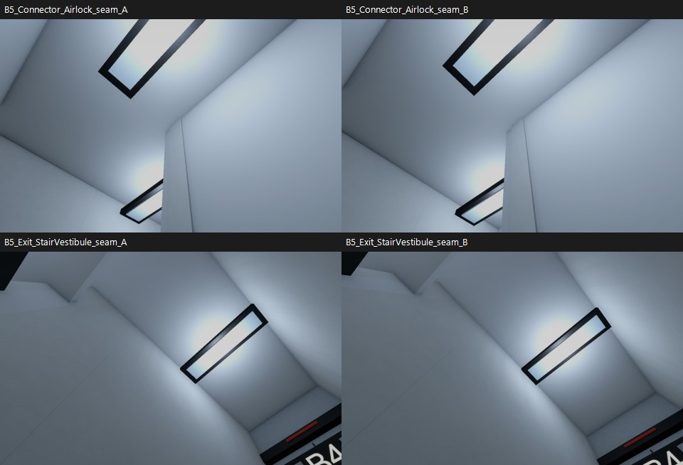

# After Seconds — 다른 구역 메시 검수 V0.01

작성자 송예찬 · 2026-11-04 · 기준 커밋 `95412ca`

이 문서는 수정 전 검수 기록이다. 이후 작업대 색 보정과 가구·소품·설비 베벨·스무스를 적용했다. 현재 반영 결과와 벽·문틀 추가 진단은 [후속 결과](../2026-11-04_Prop_Finish/검수결과.md)를 따른다.

## 검수 결과

작업대 3개의 큰 삼각형 얼룩은 색 텍스처에서 생기는 현상으로 확인했다. 직선 덕트는 재질을 제외해도 연결 테두리의 굴곡이 남아 형상 보수 후보로 분류했다. 전 모델을 다시 감량하거나 리메시할 근거는 없다.

사용자가 B2 배관·1F 외장 수정 구역 확인을 마쳤다고 알려 준 뒤 진행한 추가 검수다. 이번 작업은 검사와 자료 작성이며 씬·프리팹·모델·머티리얼을 수정하거나 저장하지 않았다.

## 확인 범위와 방법

- Unity **6000.4.0f1**에서 Stage 씬 6개를 하나씩 읽었다. 에디터 버전을 바꾸지 않았다.
- 활성 MeshRenderer에 연결된 **정적 메시 인스턴스 1,206개, 고유 메시 143개**를 검사했다. 이 중 FBX에서 가져온 메시 파트는 76개다. SkinnedMeshRenderer의 리깅·애니메이션 검수는 포함하지 않는다.
- 새 렌더 **49장**을 생성했다. B5·B4·B3·B1의 방 7곳은 양방향 시점, 작업대 3곳·덕트 대표 3곳·계측기 1곳은 근접 비교, B5 에어록·계단은 각각 인접 두 시점을 남겼다.
- 덕트는 B4·B1·1F에 3개씩, 총 9개가 동일한 메시를 참조한다. 근접 재질 비교는 층당 대표 1개다. 1F의 확인 완료된 외장을 다시 불량으로 분류한 것은 아니다.
- 원래 재질, 노멀맵 제외, 단색 재질을 비교했다. 작업대는 **BaseMap만 흰색으로 바꾸고 기존 노멀과 재질 설정은 유지한 화면**도 추가했다. 모든 변경은 임시 머티리얼 복제본에만 적용하고 렌더 뒤 복원했다.
- 촬영 위치와 대상 경로는 [photos.json](photos.json)에 있다. B4 관제 데크 역방향은 데크 상면을 Raycast로 확인한 뒤 그 위 1.65m에서 촬영했다.

## 항목별 판정

| ID | 대상·영향 범위 | 판정 | 근거와 다음 조치 |
| --- | --- | --- | --- |
| MR01 | `Props_LaboratoryWorkbench` — B5·B3·B1 각 1개 | **우선 보수: 색 텍스처** | 상판과 뒷판의 큰 삼각형 무늬가 노멀맵을 꺼도 남지만 BaseMap만 제외하면 사라진다. 형상이 크게 접힌 증거로 해석하지 않는다. 상판·판재 부분의 BaseColor/베이크·UV 대응을 먼저 보수하고 같은 세 위치에서 다시 확인한다. |
| MR02 | `U04_DuctStraight` — B4·B1·1F 총 9개, 대표 3개 근접 비교 | **형상 보수 후보: 연결 테두리** | 단색에서도 연결 플랜지와 테두리의 눌림·굴곡이 남는다. 닫힌 메시이며 파열 구멍으로 확인한 것은 아니다. 가까운 시점에서 외형이 거슬리므로 기존 크기·좌표·참조를 유지한 몸체/플랜지 평탄화가 다음 보수 후보다. |
| MR03 | `P08_BenchtopInstrument` — B1 | **후순위 품질 후보** | 작은 루버와 테두리가 뭉개져 보인다. 단색에서도 작은 요철이 남지만 이번 거리에서는 작업대만큼 큰 시각 결함은 아니다. 수치 검사에 열린 경계나 퇴화 삼각형은 없고, 찢어진 메시로 확정하지 않는다. |
| MR04 | B5 에어록·계단의 접합 | **추가 확인 유지** | 두 위치를 각각 10cm 차이의 두 시점에서 촬영했다. 이 표본에서는 큰 파손이나 명백한 깊이 충돌 무늬를 새로 확인하지 못했다. 기존 접촉 후보 26쌍을 전부 해결/통과로 바꾸지는 않는다. 냉각조 가장자리와 실제 카메라 이동 검수는 남는다. |
| MR05 | B5 생활실 밖 작업대 방향 | **배치 검토 후보** | 방 안쪽의 이번 촬영 위치에서 작업대 뒷판과 뒤쪽 선반이 보인다. B1·B3의 정면 배치와 다르다. 메시 손상과 별개로 사용 방향이 의도한 배치인지 확인할 대상이며 자동 회전하지 않았다. |
| MR06 | B4 관제 데크 위에서 보이는 벽·천장 이음 | **접합 추가 확인 후보** | 데크 위 4.15m 눈높이의 역방향 렌더에서 일부 이음이 검은 점선처럼 끊겨 보인다. 리벳/표면 디테일과 공면 간섭을 정지 이미지 하나로 확정하지 않는다. 해당 위치의 작은 카메라 이동·깊이 비교를 다음 검수 대상으로 남긴다. |

### 작업대: 원래 재질 → 노멀맵 제외 → 색 텍스처 제외 → 단색

각 행은 B1·B3·B5다. 색 텍스처만 제외한 세 번째 열에서도 큰 삼각형 무늬가 사라진다. 원본 BaseColor 이미지에도 불규칙한 삼각형·늘어진 색 띠가 있다. **색 텍스처의 영향은 확인했지만, 원본 생성과 베이크 중 어느 단계에서 생겼는지는 이번 검수로 확정하지 않는다.**

선반·손잡이의 작은 형상 요철까지 모두 해결됐다는 판정은 아니다. 보수는 우선 색 텍스처부터 진행하는 것이 합리적이다.

### 덕트: 원래 재질 → 노멀맵 제외 → 단색

단색으로 바꾼 것은 해당 시점에서 선택한 덕트 1개뿐이다. 옆의 다른 덕트가 원래 재질인 것은 정상적인 비교 조건이다. 플랜지의 불규칙한 윤곽이 단색에서도 남으며, 색 얼룩과 형상 문제를 구분할 수 있다.

### 방별 시야와 B5 접합

단순한 데크·가림벽·문 블록아웃과 정적 경비 T포즈는 현재 제작 단계와 구분한다. 이번 이미지에서 새로 확정한 큰 건축 메시 파열은 없다. 촬영 시야 밖의 면까지 모두 통과했다는 의미는 아니다.

## 수치 검사 결과

| 검사 | 결과 |
| --- | ---: |
| 씬의 누락 MeshFilter 참조 | 0 |
| 활성 Renderer의 누락 머티리얼 슬롯·오류 셰이더 | 0 |
| 유한하지 않은 정점·UV·노멀 값 | 0 |
| 잘못된 삼각형 정점 인덱스 | 0 |
| 정확히 면적 0인 삼각형 | 0 |
| 메시 크기에 비례한 임계값 이하의 퇴화 후보 | 0 |
| 위치를 묶은 뒤 3개 이상 면이 공유하는 모서리 | 0 |
| 같은 위치를 사용하는 중복 삼각형 후보 | 0 |
| FBX 메시 파트 76개의 열린 경계 | 0 |

표지·경고 띠·시각 접합용 `.asset`에는 의도적으로 열린 표면이 있다. 이 열린 경계를 건물의 구멍이나 파손으로 합산하지 않았다. 위치 묶음은 메시 크기를 고려한 임시 인덱스 계산이며 원본을 용접하지 않았다.

일부 FBX의 내부 정점 좌표는 실제 씬 크기의 1/100이다. 작은 장식 면을 퇴화 면으로 오인하지 않도록 면적은 double 계산과 메시 크기에 비례한 임계값으로 검사했다. [수치 원본](mesh_audit.json)에 임계값도 기록했다.

이번 검사는 모든 삼각형의 자기 교차, UV 겹침·텍스처 신장, 모든 면의 뒤집힘을 증명하는 검사가 아니다. 유효 UV 수치와 보기 좋은 텍스처는 별개이며, 작업대가 그 사례다. 고정 렌더는 사람의 이동·퍼즐 완주·성능 테스트를 대체하지 않는다.

## 보존 확인과 결과 파일

6개 씬의 검수 전후 Transform·Collider 직렬화가 동일하다. 별도로 씬 전체와 Packages·ProjectSettings 파일의 SHA256을 시작 전과 대조했다. 상세는 [파일 보존 검사](protected_files_verification.json), [데크 보충 촬영](deck_supplement.json)에 있다.

검수용 C#은 임시 Editor 폴더에서 실행한 뒤 Assets 밖으로 회수한다. 재현용 소스는 [tools/MeshReview.cs.txt](tools/MeshReview.cs.txt)에 보관한다. 정상 검수 실행의 컴파일 오류·실행 예외는 없었다. 초기 자료 수집 과정의 재시도·캐시 로그는 Git에서 제외한 `tmp/MeshReview_20261104`에 보관한다.

다음 순서는 **작업대 색 텍스처 보수 → 덕트 연결 테두리 선별 보수 → 계측기 근접 필요성 판단 → B4 데크 위 이음·B5 접합/냉각조 이동 검수**다. 전층 배치 완료나 메시 전면 품질 통과로 기록하지 않는다.
