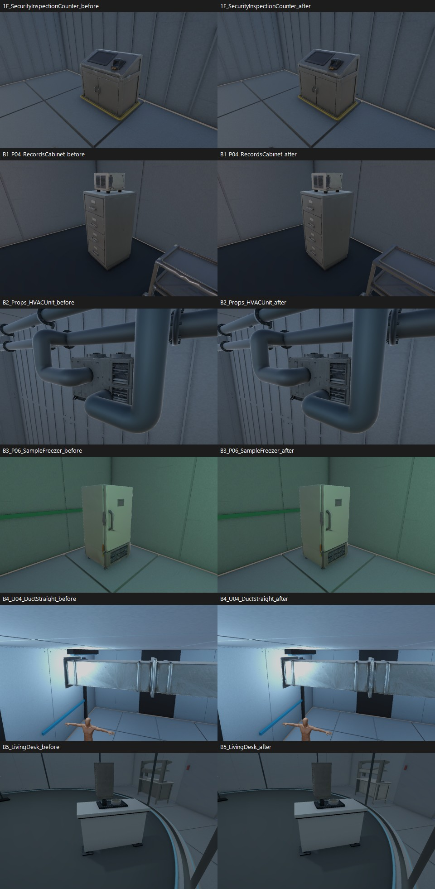
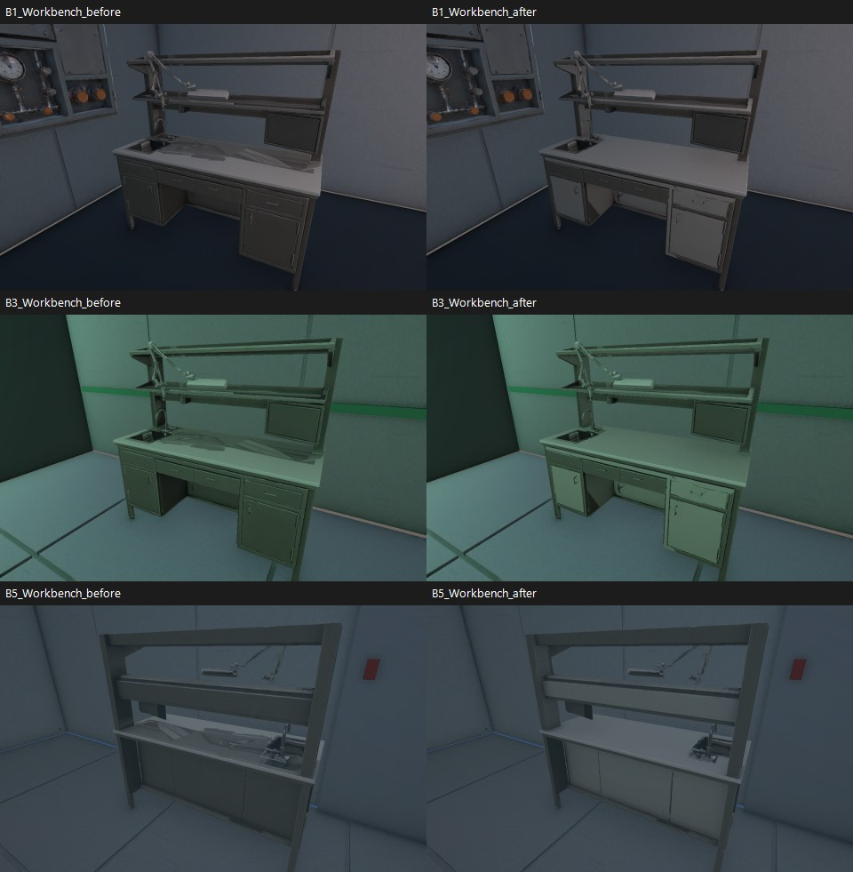
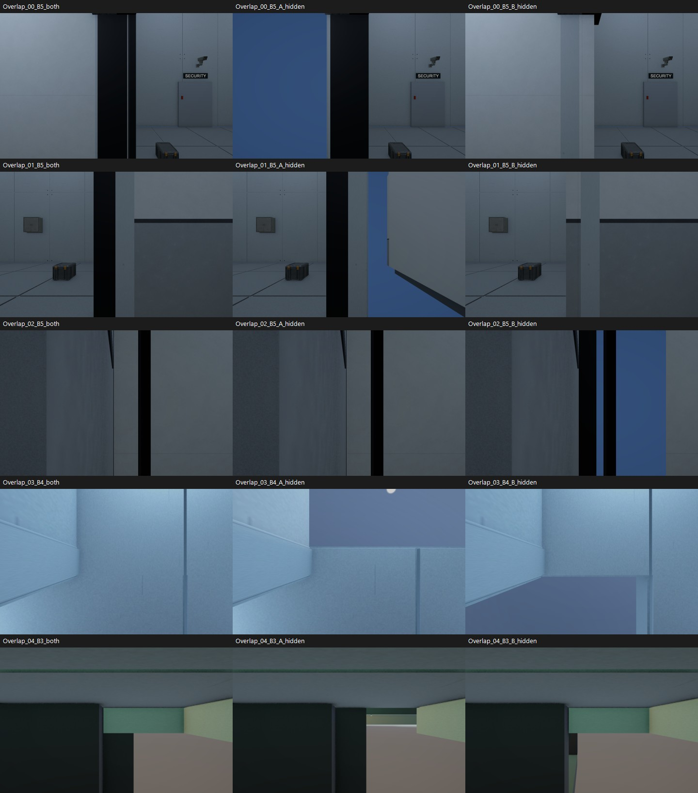

# After Seconds — 소품 베벨·스무스 및 색 텍스처 보정 V0.02

작성자 송예찬 · 2026-11-04 · Unity 6000.4.0f1 / Blender 5.2.2

이 문서의 벽·문틀 항목은 소품 마감 당시의 진단 기록이다. 이후 사용자 요청으로 6층을 검사하고 건축 시각 메시81개의 겹침을 보수했다. 현재 상태는 [전층 벽·문틀 보수 결과](../2026-11-04_Wall_Frame_Repair/검수결과.md)를 따른다.

## 반영 결과

사용자가 지정한 **가구·소품·설비**에 베벨과 스무스를 적용했다. 건축 벽·바닥·천장에는 베벨을 추가하지 않았다. 별도 요청한 벽·문틀 겹침은 아래 위치를 검사했으며 이번 소품 수정에서 건축 메시를 절단하거나 씬 배치를 바꾸지는 않았다.

| 항목 | 결과 |
| --- | --- |
| 처리한 고유 메시 파트 | 41개 |
| 새로 베벨을 추가한 파트 | 35개 |
| 기존 제작 베벨을 유지한 생활 소품 파트 | 6개 |
| 스무스·가중 노멀 | 41개, 60도 기준 |
| 갱신한 모델 프리팹 | 41개 |
| 6층에서 새 메시를 참조하는 배치 | 110곳 |
| 원래 소품 메시를 계속 사용하는 대상 배치 | 0곳 |
| 저장 후 누락 메시·재질 참조 및 유효하지 않은 수치 | 0건 |

작업 중 사용자가 Unity를 저장·종료한 뒤의 상태를 보존 기준으로 삼았다. 사용자가 저장한 B5 변경은 그대로 유지했다. 씬 파일·원본 FBX·기존 `.meta`·충돌체·배치 Transform을 변경하지 않았다. 변경한 기존 파일은 소품 프리팹 41개와 공용 작업대 재질 1개다.

## 베벨·스무스 처리

- 실제 배치 스케일을 읽어 약 1~4mm를 출발값으로 사용하고, 좁거나 복잡한 모서리는 폭을 줄였다. 최종 파트별 값은 [bevel_smooth_manifest.json](bevel_smooth_manifest.json)에 있다.
- 베벨은 2분할이다. 75도 이상 모서리부터 검사하고 겹침 제한을 사용했다. 복잡한 덕트·수납 랙·냉동고·시료 용기·가스통 랙은 서로 맞닿지 않는 긴 모서리를 선별해 처리했다.
- 각도 기준 스무스와 Weighted Normal을 적용했다. 평판 전체를 부풀리는 Subdivision Surface나 기하학적 Smooth 변형은 사용하지 않았다.
- LivingDesk·MealTraySet·BedLinen·HygieneStation·TestMonitorStand의 6개 메시 파트는 기존 제작 베벨을 유지했다.
- 원래 UV를 유지하며 베벨에 필요한 좁은 새 면의 UV를 보간했다. 검수 도중 생긴 퇴화 면은 정리했고, 최종 Blender 메시의 열린 경계·3개 이상 면이 공유하는 모서리·면적 0인 면은 모두 0건이다.
- 원본 FBX를 덮어쓰지 않았다. 같은 모델 폴더에 `_BevelSmooth.asset` 파생 메시를 두고 기존 프리팹의 MeshFilter 참조만 갱신했다. 기존 프리팹 GUID·재질·충돌을 보존했다.

고유 원본 메시 파트의 삼각형 합은 **815,808 → 1,447,800**으로 늘었다. 추가 모서리 면의 비용이며 원본 형상을 일괄 고밀도 모델로 교체한 것은 아니다. 실제 화면의 삼각형 수와 프레임 성능은 배치·컬링·그림자에 따라 달라지며 목표 기기 FPS 테스트는 아직 하지 않았다.

일부 생성 모델의 찌그러진 플랜지·작은 루버 등 원래 형상까지 재제작한 것은 아니다. 베벨과 노멀 보정의 결과를 원래 형상 결함의 전면 해결로 기록하지 않는다.

## 작업대 색 텍스처

B5·B3·B1의 공용 작업대에서 상판·판재의 큰 삼각형 색 얼룩을 제거했다.

처음 이미지 생성 도구로 만든 아틀라스 시안은 실제 모델에 넣었을 때 UV 경계가 맞지 않는 큰 색 패치가 남아 **채택하지 않았다**. 최종본은 기존 메시·UV를 그대로 사용한 **Blender emission 베이크**다. 넓은 평면 판재 패치 29곳의 색을 정돈하고 나머지 세부는 원래 색 텍스처를 사용했다. 새 조명이나 그림자를 색 텍스처에 굽지 않았다.

- 원본: `Assets/Afrer_Seconds/05.Model/Props/Common/Textures/Props_LaboratoryWorkbench_BaseColor.png` — 보존.
- 적용본: `Assets/Afrer_Seconds/05.Model/Props/Common/Textures/Props_LaboratoryWorkbench_BaseColor_Corrected.png` — **2048×2048**, 기존 UV.
- 공용 작업대 머티리얼의 BaseMap/MainTex를 새 텍스처로 연결했다. 노멀맵은 기존 파일을 유지했다.
- B5·B3·B1의 동일 시점에서 큰 삼각형 무늬가 사라진 것을 확인했다. 손잡이 주변 등 원래 생성 모델의 작은 디테일·베이크 흔적까지 전부 새로 제작한 것은 아니다.

자세한 판재 선택과 색은 [color_rebake.json](color_rebake.json)에 기록했다. 원본과 수정본을 혼동하지 않도록 기존 제작 출처 JSON을 덮어쓰지 않고 `06.Data/AssetSources/PropEdgeFinish_20261104.json`에 후속 처리 기록을 추가했다.

## 벽·문틀 겹침 검사

축에 거의 평행한 실제 삼각형에서 **같은 방향·거의 같은 평면(간격 0.5mm 이하)**의 면적 겹침 후보 71쌍을 찾았다. 71쌍이 모두 플레이 시야에서 깜빡이는 결함이라는 뜻은 아니다. 숨은 접합·설계된 접촉도 포함한다. 후보 원본은 [overlap_candidates.json](overlap_candidates.json)에 있다.

그중 다음 5곳은 두 Renderer를 함께 보이는 화면과 A/B를 하나씩 숨긴 화면으로 비교했다. 숨김은 진단용 메모리 변경이며 저장하지 않았다.

| 위치 | 실제 공면 겹침 면적 | 확인한 대상 |
| --- | ---: | --- |
| B5 생활실 → 에어록 입구 왼쪽 | 약 0.892m² | `Wall_West_Outer` ↔ `Door01_To_Airlock/Frame_Left` |
| B5 생활실 → 에어록 입구 오른쪽 | 약 0.892m² | `Wall_East_Entry` ↔ `Door01_To_Airlock/Frame_Right` |
| B5 계단 전실 B4 연결문 왼쪽 | 약 0.780m² | `B4_Link_Locked_NoSceneTransition/Frame_Left` ↔ `Landing_WestWall` |
| B4 라이트록과 관찰 복도 천장 | 약 1.415m² | 두 구역의 재제작 천장 패널 |
| B3 제염실 포획 구역 옆 | 약 2.774m² | `Floor_BesidePen` 바닥 시각 메시 ↔ `Pen_RetainingWall` |

벽과 문틀이 같은 평면에서 겹친 구조를 확인했다. 카메라·깊이 버퍼 조건에 따라 깨짐이나 깜빡임이 생길 수 있어 사용자가 본 현상의 원인 후보로 볼 근거가 있다. 다만 이번 고정 렌더만으로 모든 시점의 시간에 따른 깜빡임을 증명한 것은 아니다.

다음 보수에서는 문 개구·통로 폭·Collider를 유지하면서 **겹치는 시각 면 자체를 잘라 맞추거나 접합용 외형 메시를 분리**하는 쪽이 적절하다. 벽 전체나 충돌체를 이동하거나 원본을 일괄 삭제하지 않는다. 이 건축 보수는 아직 수행하지 않았다.

## 검증과 재현 자료

- [application.json](application.json): 파생 메시·프리팹 GUID·층별 배치 참조.
- [saved_asset_verification.json](saved_asset_verification.json): 저장 후 별도 Unity 실행에서 41개 메시를 다시 읽고 수치·참조 검사 통과.
- [preservation.json](preservation.json): 사용자 저장 후 기준 파일 1,072개와 비교. 기존 파일 변경은 허용한 프리팹·재질뿐이며 씬·FBX·기존 meta 변화 없음.
- [before_after_photos.json](before_after_photos.json): 전후 카메라 좌표.
- [overlap_diagnostics.json](overlap_diagnostics.json): 겹침 대상 경로와 진단 카메라 좌표.
- [tools/finish_props.py](tools/finish_props.py): 베벨·스무스 준비 및 검증.
- [tools/repair_workbench_color.py](tools/repair_workbench_color.py): 원래 UV 기반 판재 색 베이크.
- [tools/PropFinishTool.cs.txt](tools/PropFinishTool.cs.txt): Unity 반입·참조 갱신·저장 후 검증.

새 Blender 원본은 저장소 `SourceAssets/PropEdgeFinish/PropEdgeFinish.blend`와 `WorkbenchColorRebake.blend`에 있다. 소품 원본은 Unity 로컬 좌표에서 결과를 내보낸 뒤 Blender에서 똑바로 보이도록 표시 회전·스케일을 설정했다. 색 베이크 원본에는 이미지를 패킹했다.

실제 키보드 플레이·전체 퍼즐 완주·성능 검증은 하지 않았다. 런타임 게임 코드는 변경하지 않았다. 이번 에셋과 문서 변경은 로컬 상태이며 원격 push는 수행하지 않았다.
