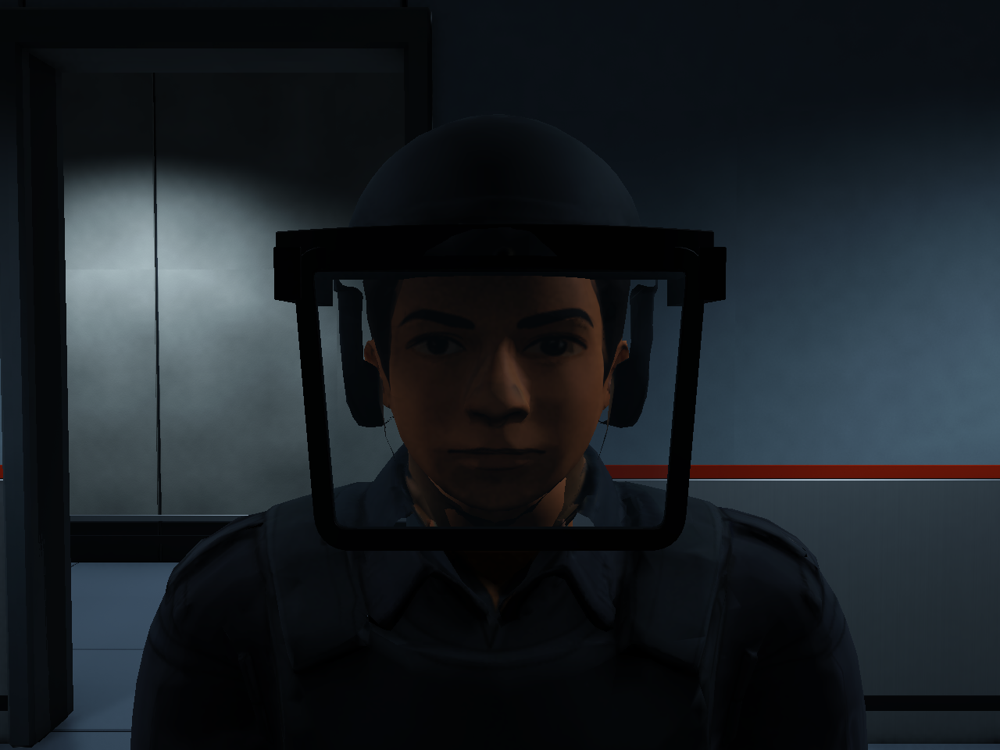

# 경비 FBX 자기 교차 다각형 반입 경고 보수 V0.01

작성자 송예찬 · 2026-11-05 · Unity 6000.4.0f1 / Blender 5.2.2 LTS

`AS_V03_Guard_HeadRepaired.fbx`의 `AS_V03_Guard` 메시에서 Unity가 자기 교차 다각형을 버리는 경고를 강제 재반입으로5건 재현했다. 앞선 웨이트·참조·외형 검사에서 이 반입 경고를 확인하지 못했다.

Blender 원본 면에는 투영 교차가 없었으나 베벨 평가 후 작은 뒤틀린 다각형7개와 면적 없는 면이 생겼다. Unity에 다각형 분할을 맡기지 않도록 최종 베벨·렌즈 두께 적용 후 모든 출력 메시를 Blender에서 명시적으로 삼각화했다. 면적 없는 삼각형4개는0.1µm 거리 기준으로 정리했고, 베벨 보간 뒤의 작은 웨이트 합 오차는 비율을 유지하며 정규화했다. 면을 버려 경고를 숨기는 Importer 옵션은 사용하지 않았다.

| 검사 | 결과 |
| --- | --- |
| 강제 FBX 재반입 |변경 전 자기 교차 경고5건 →변경 후 경고/오류0건 |
| 출력 메시4개 |비삼각형0, 면적 없는 삼각형0, 가중치 합 검사 통과 |
| 경비 삼각형 |37,297 →37,317tri, Unity가 누락하던 작은 면을 복원한 차이 |
| B5 최고 LOD 배치 |965,361 →965,421tri |
| 리그/참조 |Humanoid valid/human, 파트별53본, 누락 본0, 재질4개 정상 |
| 씬 |기존 경비3개 연결 유지, Animator 꺼짐/Controller 없음 |
| 보존 |씬·게임 코드·원본 경비/연구원56개 파일 해시 동일, FBX .meta/GUID 동일 |

원본 베벨 폭/분할은 바꾸지 않았다. 편집용 수정자는 `.blend`의 숨긴 `Editable_Modifier_Sources` 컬렉션에 보존하고, 보이는 출력 메시에는 검증을 마친 삼각형과 Armature만 남겼다. 출력 FBX에는 숨긴 편집 소스를 넣지 않았다. 재생성 스크립트 `repair_guard_head.py` V0.03에도 동일한 검증 절차를 적용했다.

[측면](02_GuardFace_Side.png) · [전신](03_GuardBody.png)

[변경 전 반입 로그](import_log_before.json), [변경 후 강제 반입 로그](import_log.json), [출력 메시 검사](export_checks.json), [Unity 리그·재질·삼각형 검사](verification.json), [보호 파일 해시](protected_after.json), [변경 전 다각형 진단](polygons_before.json).

Console에 이미 남아 있는 이전 경고는 지우지 않았다. 수정 후 강제 반입에서 새로 발생한 경고가0건임을 확인했다. 씬 배치·충돌·게임 C#은 변경하지 않았다.