# B5 경비 얼굴·펌프·배관·난간·벽 이음 보수 V0.02

후속: 경비 FBX 자기 교차 경고를 [다각형 반입 보수](PolygonFix/검수결과.md)에서 수정했다. 최신 경비37,317tri·B5 최고 LOD965,421tri다. 아래37,297tri/965,361tri 수치와 사진은 최초 보수 단계 기록이다.

작성자 송예찬 · 2026-11-05 · Unity 6000.4.0f1 / Blender 5.2.2 LTS · 메인 기획서 V0.17

사용자가 지적한 경비의 막힌 바이저, 펌프 회전, `SL_Metal` 배관·계단 난간의 잘못된 중간 형상과 연결부, 돌출 벽 트림을 새 `Level_B5_Stealth.unity`에서 보수했다. 게임 내부 C#과 Animator Controller는 작성하지 않았다.

## 원인과 수정

| 대상 | 확인한 문제 | 반영한 수정 |
| --- | --- | --- |
| G2 경비 얼굴 | 막힌 바이저 표면에 얼굴 그림이 붙고 내부 얼굴 형상이 없음 | 실제 얼굴·목, 투명 렌즈, 프레임을 분리. 헬멧 절단면을 평면 분할하고 이마 밀폐부·측면 고정부 추가 |
| Cooling_Pump 2개 | 베이스 플레이트가 세워진 잘못된 자세 | VisualNormalization X=-90°(Inspector270°), 바닥 Y=0으로 접지. 북측 루트 Yaw180°·남측0°와 중심 위치 유지 |
| 냉각 배관 | 두 관의 긴 직선 구간이 겹침. 단면 프레임 전환이 갑작스럽고 관 전용 UV가 없음 | 공급/회수 높이를3.50/3.10m로 분리하고 단면을 연속 전송. 실제 펌프 상부·정면 포트에 연결, 호 길이 기준 UV 추가 |
| 배관 연결 | 접합부·지지부 묘사 누락 | 플랜지·가스켓·6각 볼트로 된 연결12곳과 벽 지지부 추가. 펌프 포트는 기존 메시·UV·색 맵으로 위치를 측정함 |
| 계단 난간 | 떨어진 경사 막대4개, 중간참 연결과 지지대 없음 | 바깥 연속 난간과 안쪽 U자 연결부, 지지대/발판18곳. 발판이 계단 면에 놓이도록 위치 수정 |
| SL_WallTrim | 콘크리트 이음 덮개와 빽빽한 금속 리브가 벽 이음과 겹치며 돌출 | 큰 이음 덮개 제거. 강판의 실제 패널 분할선에 얕은 조인트만 남김. 점검구 프레임은 한 개의 미터 이음 링으로 만들어 모서리 겹침 제거 |

얼굴은 기존 연구원 아트의 실제 머리 형상과 UV를 헬멧 내부에 맞춰 재사용했다. 별도 투명 렌즈 두께는1.5mm다. 새 얼굴·렌즈·프레임은 Head 본에 결속했고 목 연결부는 Neck/Head로 가중치를 나눴다. 53본 Humanoid 리그가 유효하며, 새 B5의 경비3개에 같은 보수본을 적용하고 기존 자세/배치를 유지했다. 원본 경비 FBX·프리팹과 Blender 파일은 보존했다. 실제 표정·애니메이션은 연결하지 않았다.

## 사진

실제 씬의 같은 카메라 위치로 촬영했다. 아래 원본 진단 이미지만 Blender의 별도 조명으로 렌더했다.

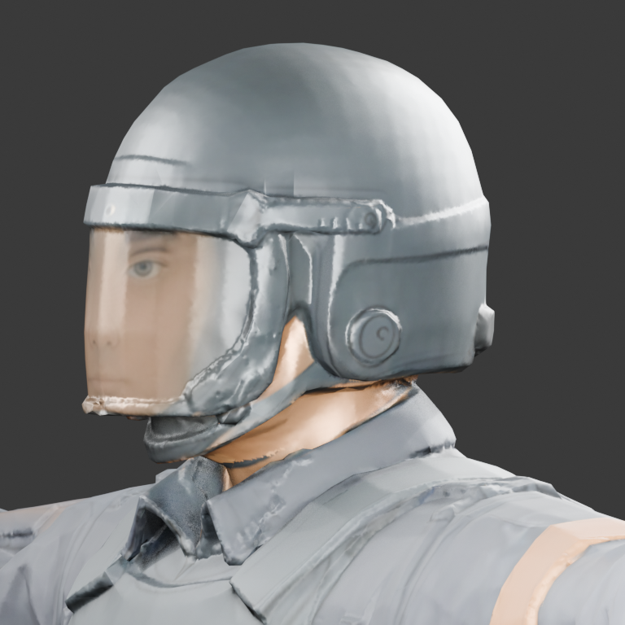

| 대상 | 변경 전 | 변경 후 |
| --- | --- | --- |
| 경비 얼굴 정면 | 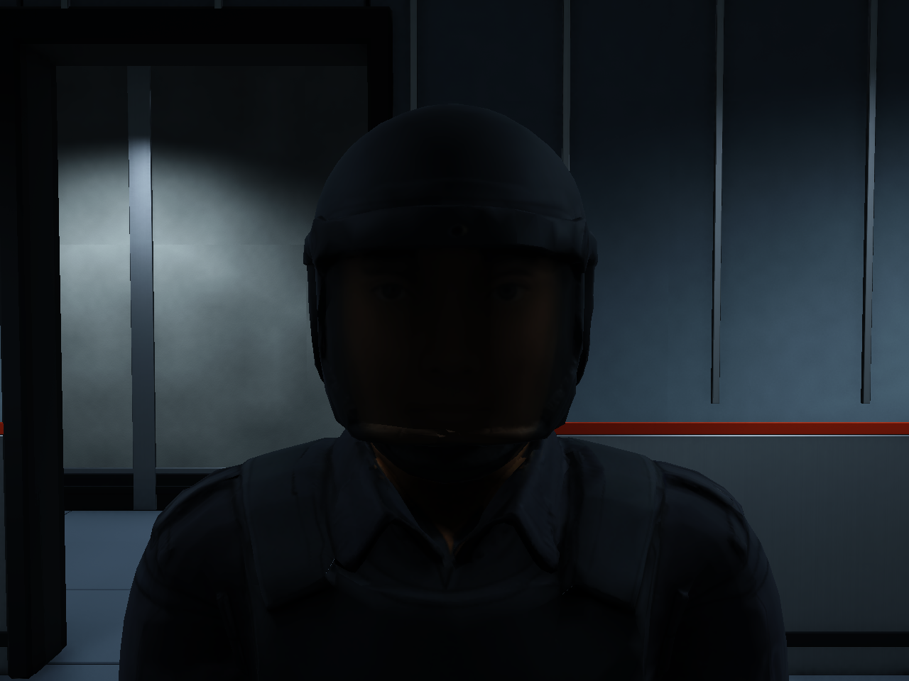 | 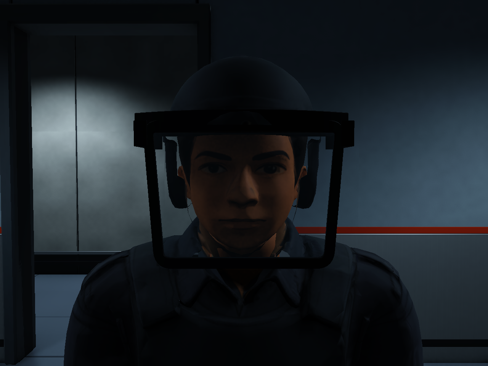 |
| 경비 얼굴 측면 | 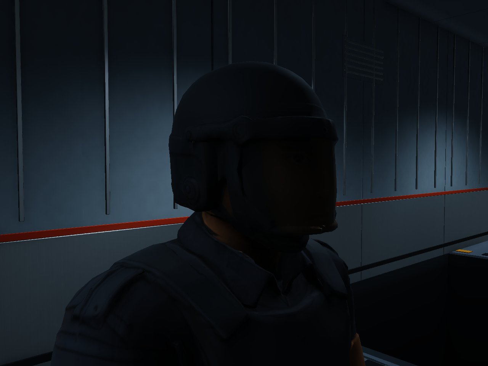 | 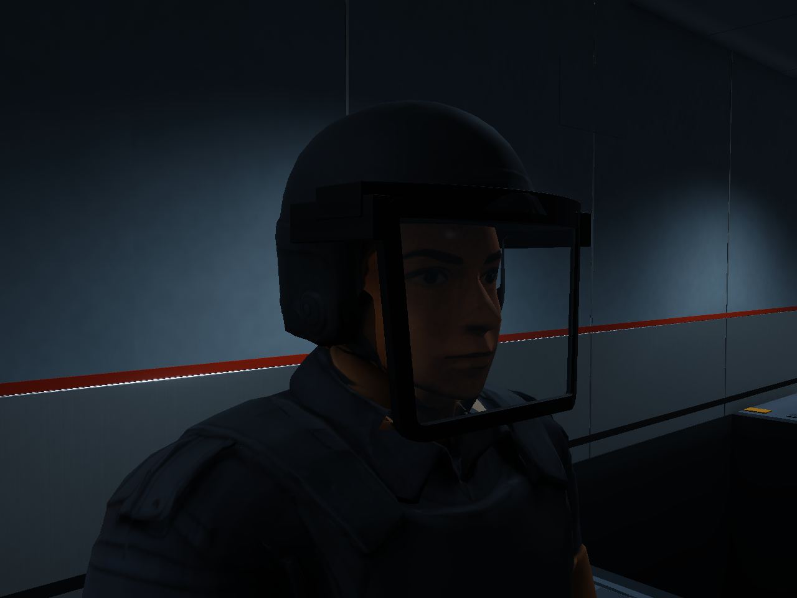 |
| 남측 펌프 | 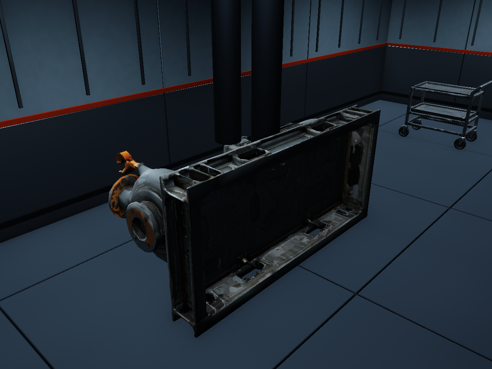 | 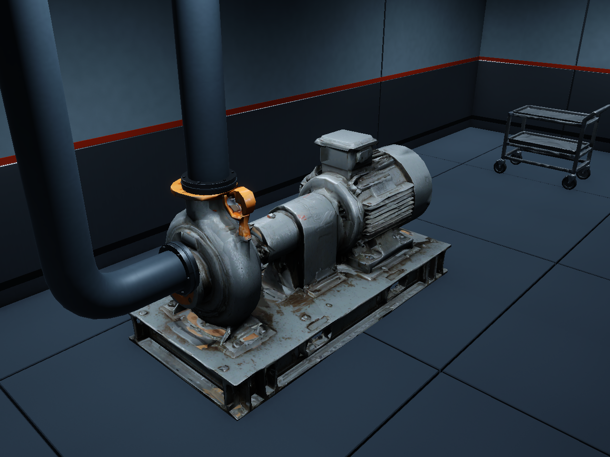 |
| 계단 난간 | 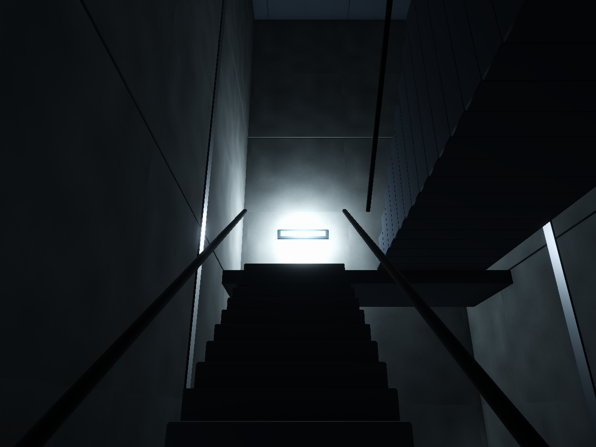 | 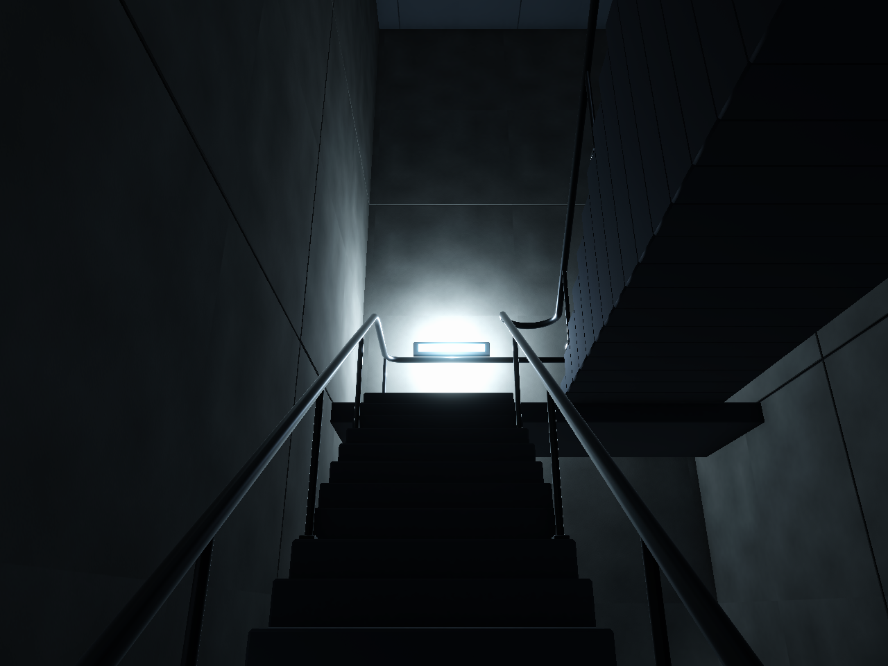 |
| 벽 이음 | 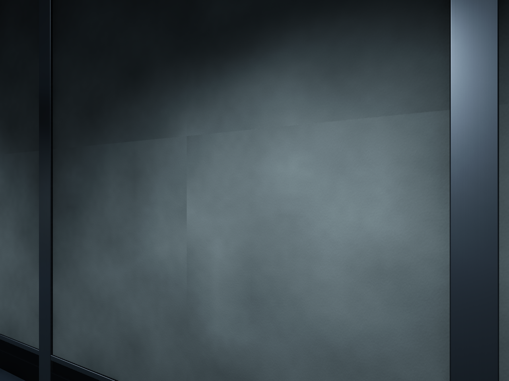 | 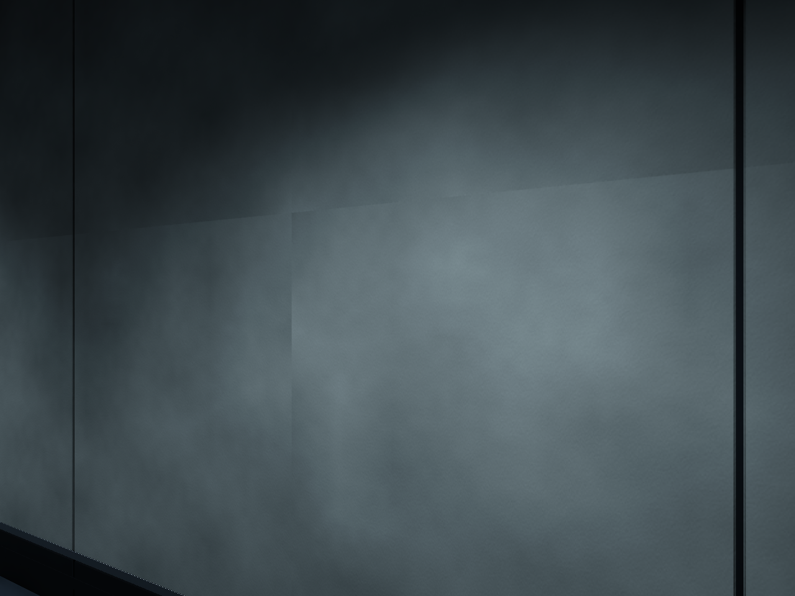 |

[배관 곡관](After/07_Pipe_Bend.png) · [배관 플랜지와 지지부](After/08_Pipe_Joints.png) · [북측 펌프 연결](After/09_PumpNorth.png) · [난간 중간 연결·발판](After/10_Landing_Rail.png)

배관 본체는 도장 강판, 접합부와 난간은 금속 PBR를 사용한다. 문틀 등 남은 `SL_Metal`은 별도 `AR_DarkPaintedSteel` 재질로 연결했다. 기존 공용 재질을 덮어쓰지 않았다. 반사7개를 다시 구웠으며 Inspector의 Custom 큐브맵을 참조한다. 실시간 반사 촬영은0개다.

## 형상과 검증

관 단면은 회전 최소화 프레임으로 이어 급격한 축 전환을 없앴다. 공급/회수 관 본체 간 교차 삼각형은0쌍이다. 플랜지·가스켓·브래킷은 조립을 위해 맞닿거나 겹치는 부품이며 본체 간 교차 검사와 구분한다. 관/연속 난간 UV 면적0인 면은0개다. 관·난간의 제조 단면에는1.5mm/2분할 베벨을 적용했고, 얇아진 벽 조인트/점검구 프레임에도 크기에 맞춘 베벨을 남겼다. 얼굴 같은 유기 형상에는 예각 베벨을 일괄 적용하지 않는다.

| 검사 | 결과 |
| --- | --- |
| 건축 삼각형 |215,764 →195,416tri |
| 경비1개 |28,623 →37,297tri, 실제 얼굴·렌즈·고정부 포함 |
| 전체 최고 LOD 배치 |959,687 →965,361tri, 약0.59% 증가 |
| 리그 |53본, Humanoid valid/human, 누락 본·미할당 웨이트·가중치 합 오류0 |
| 보존 배치 |건축 외형·펌프 회전 보수 대상 외의 기존 Transform 변경/누락0 |
| 충돌 |기존258개 동일, 펌프2개는 새 자세에 맞춤. 회수 관 입상부2개 추가 →총262개 |
| 문·동선 |개방22개/잠금3개 유지, A266+B414+C137=817개 캡슐 표본 막힘0 |
| 참조 |누락 스크립트·메시·재질0 |
| 보호 파일 |원본6씬/meta와 기존 Blender·생성기 등44개 SHA256 동일 |
| 저장 |새 씬 저장 후 재개방, dirty=false, 임시 촬영 객체0 |

수치는 플레이어·다른 씬을 제외한 B5 레벨 루트의 최고 LOD 배치 기준이며 비활성 보존 메시를 포함한다. 실제 렌더 삼각형·전체 메모리·FPS 수치가 아니다. NPC는 SkinnedMeshRenderer4개로 분리됐으며 NPC LOD는 아직 없다. 전체 잠입 완주·난이도·FPS 검증과 실제 애니메이션 검수는 이번 범위에 포함하지 않았다.

작업 중 PC_RPAsset의 섀도 맵 해상도2048→4096 변화도 관찰됐다. 제작 도구는 해당 값을 설정하지 않았으며 사용자 편집 가능성이 있어 유지했다.

[최종 씬 검사](final_scene_audit.json), [동선·문 검사](validation.json), [형상·웨이트·UV 검사](source_audit.json), [보호 파일 해시](protected_after.json), [펌프 접지](pump_final.json), [포트 측정](pump_ports_measured.json), [정적 반사](reflection_bakes_final.json)에 상세 결과가 있다.

## 현재 제작 기준

활성 건축은 `05.Model/Environment/B5/B5_Stealth_ArtRepair.fbx`, 경비는 `05.Model/Enemy/AS_V03_Guard_HeadRepaired.prefab`이다. Blender 편집 원본은 `SourceAssets/B5_StealthLayout/B5_StealthLayout_ArtRepair.blend`와 `NPC/AS_V03_Guard_HeadRepaired.blend`, 생성기는 `build_b5_art_repair.py`와 `repair_guard_head.py`다. 출처는 `06.Data/AssetSources/B5_ArtRepair_20261105.json`을 따른다. 이전 WallVariants/Lite 및 원본 NPC를 다시 덮어쓰지 않는다.

게임 C#·AI·감지·추격·자동 회전·애니메이션 컨트롤러·미니맵/UI는 추가/수정0개다. Git 커밋·푸시는 하지 않았다.