# B5 잠입·탐색 제작 검수 V0.03

후속 벽 마감과 금속 트림은 [최신 검수](../2026-11-05_B5_WallVariants/검수결과.md)를 따른다. 아래949,363tri/Lite 건축 수치는 벽 교체 전 단계다.

최종 범위는 레벨·아트다. 사용자는 내부 C#을 질문하며 직접 작성하기로 했으며, 게임 스크립트와 Animator Controller는 추가/수정하지 않았다. 제작·검수 도구는 프로젝트 밖에 있다. 아래 수치는 CCTV 분리형 교체까지 반영한 결과다. 수치 대상은 B5 레벨 루트이며 플레이어·다른 씬은 제외한다. 비활성 보존 메시를 포함한 배치 자산 기준으로, 화면에 실제 그려지는 양과 구분한다. 수치 대상은 B5 레벨 루트이며 플레이어·다른 씬은 제외한다. 비활성 보존 메시를 포함한 배치 자산 기준으로, 화면에 실제 그려지는 양과 구분한다.

## 감면과 LOD

| 항목 | 전 | 후 | 방식 |
| --- | ---: | ---: | --- |
| 전체 배치 최고 LOD |2,439,679tri|949,363tri|61.09% 감소 |
| 건축 |868,256tri|205,440tri|베벨 폭 유지, 분할3→1, Weighted Normal |
| 설비 유닛1개 |195,450tri|23,980tri / 원거리9,592tri|위치 용접 후 UV atlas 유지 감면 |
| 작업대1개 |70,258tri|66,940tri / 원거리57,209tri|상판/싱크대 손상 방지 위해 보수적 Planar 처리 |
| 원거리 대체 포함 자산 인스턴스 전체 |2,439,679tri|1,172,001tri|서로 다른 LOD를 동시에 그린다는 뜻은 아님 |
| 씬이 참조하는 고유 메시 메모리 |약152.5MiB|약93.2MiB|전체 Editor RAM/GPU/텍스처 메모리 수치 아님 |

소품11종의 감면본/LOD를 만들었고, CCTV를 새 아트로 교체한 현재 소품 인스턴스에는 LODGroup25개가 있다. 원거리 전환은 화면 상대 크기0.10, 최종 표시0.005를 사용한다. UV 재전개 없이 기존 PBR 텍스처를 사용했다. 노멀과 세부 곡률에는 차이가 있으며 작업대에는 무리한 Collapse를 적용하지 않았다. [전 수치](mesh_cost_before.json), [최종 수치](mesh_cost_after.json), [소품 감면 자료](optimization_manifest.json)를 보관했다. FPS/완주 난이도 검증은 아니다.

원본 고해상도 모델은 보존하고 새 B5에만 `_Lite` 건축과 `_B5_Lite` 소품 프리팹을 연결했다. 편집 원본은 `SourceAssets/B5_StealthLayout/B5_StealthLayout_Lite.blend`, `Optimized_Props/B5_Optimized_Props.blend`다.

| 설비 원본 | 설비 LOD0 | 설비 LOD1 |
| --- | --- | --- |
| 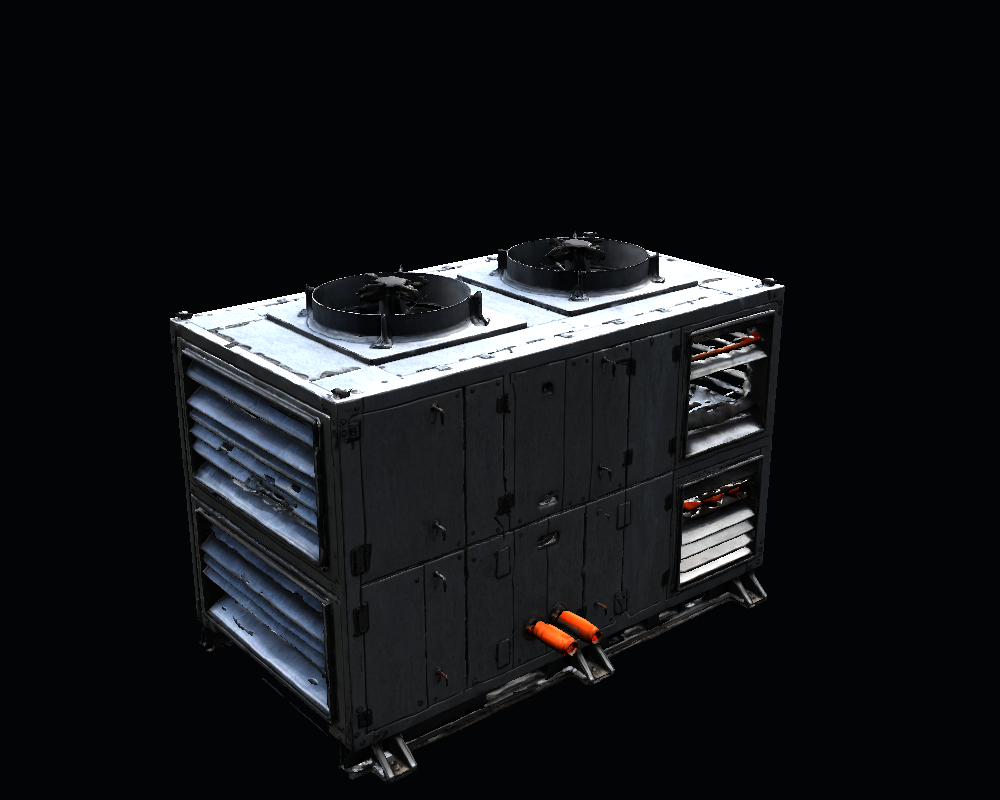 | 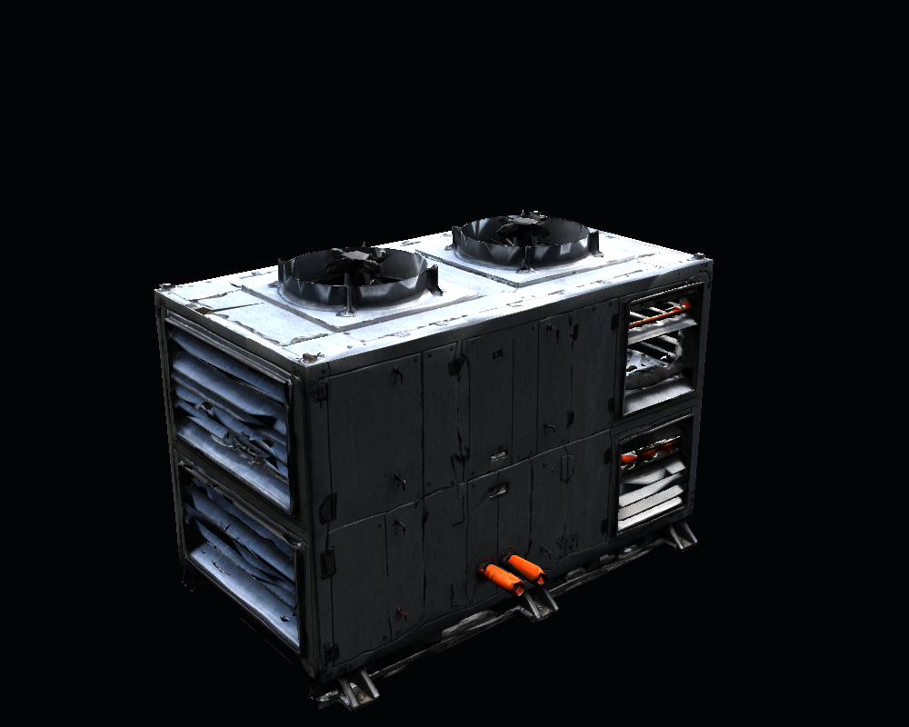 | 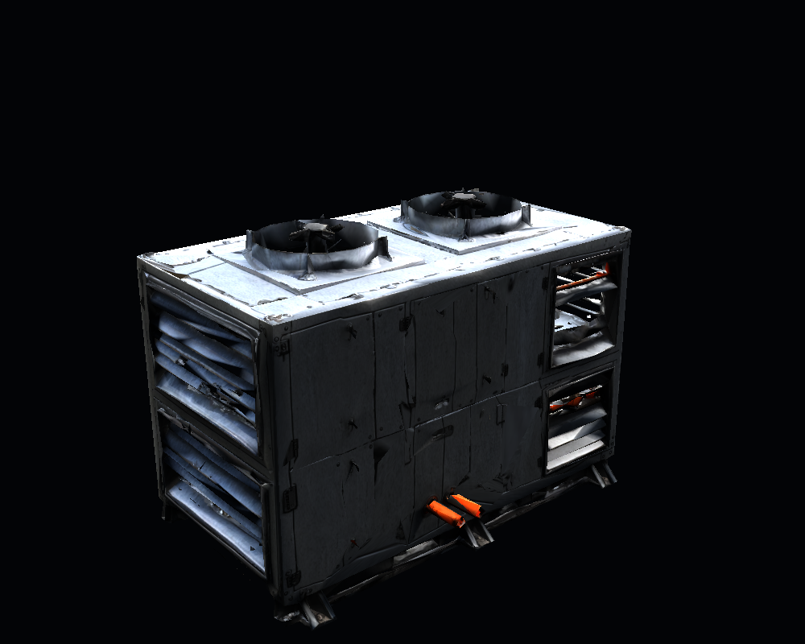 |

## 에너미 메시 검수

| 모델 | Unity 삼각형 | 본 | 정점당 최대 영향 | 미할당/합계 오류 | UV/위상 |
| --- | ---: | ---: | ---: | --- | --- |
| 경비 |28,623|53|4|0/0|비정상 UV·구멍·비다양체·퇴화·중복 면0 |
| 연구원 |25,894|53|4|0/0|비정상 UV·구멍·비다양체·퇴화·중복 면0 |

위상 검사는 UV/노멀 분리 정점을 임시 사본에서 용접한 뒤 확인했다. 원본 데이터는 수정하지 않았다. [정적 검사](enemy_mesh_audit.json), [임시 포즈 검사](EnemyAudit/pose_audit.json)를 보관했다. 기본·좌우 달리기 관절·앉기·팔 올리기·후면의6시점을 각 모델에서 렌더했다. 같은 프레임의 GPU 스키닝 캐시를 피하기 위해 검사 포즈만 CPU로 베이크해 촬영했다. 이 베이크 메시나 검수 포즈는 게임에 저장하지 않았다.

실제 걷기/뛰기 클립, 접지, 얼굴/손가락 전체 범위, 장비의 강체 부착, 롱코트의 모든 자세를 통과했다는 뜻은 아니다. 특히 강한 다리 굽힘의 코트/허벅지 장비는 실제 애니메이션을 연결할 때 다시 검토한다. NPC LOD는 아직 제작하지 않았다. 모델당 약2.6~2.9만tri를 유지하며 현재 씬은 정적 배치다.

| 경비 관절 검수 | 연구원 관절 검수 |
| --- | --- |
| 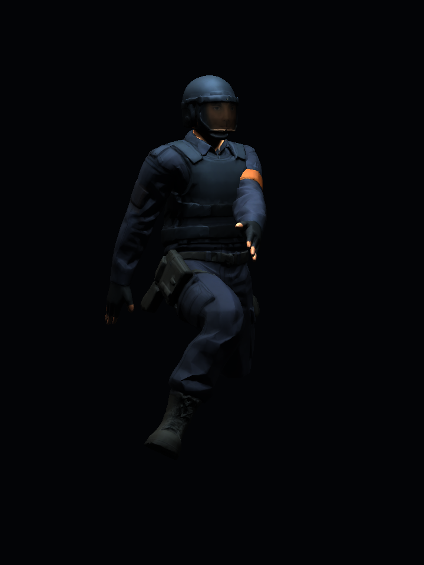 | 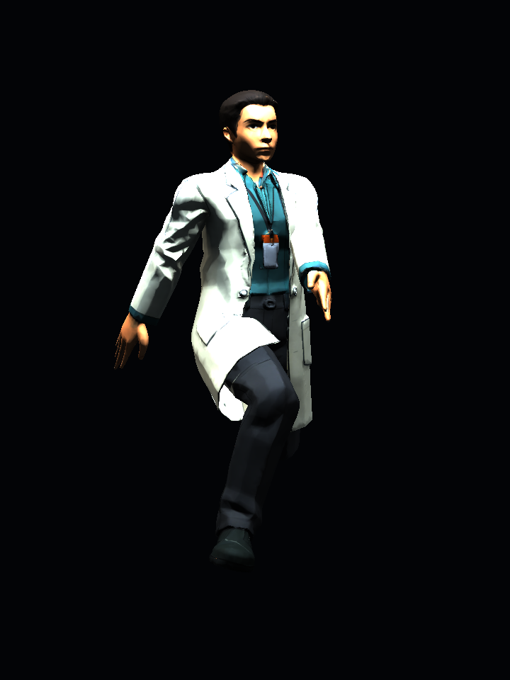 |

## CCTV 아트 분리와 피벗

CCTV는 에너미 역할이다. 기존 `Props/Common/P03_SecurityCamera`는 다른 씬의 원본 참조 보존용으로 남겼고, 새 B5는 `05.Model/Enemy/CCTV_SecurityCamera_Articulated.prefab`을 사용한다. Blender에서 새로 만든9,796tri 아트이며 모서리에1~12mm 범위의 베벨과 노멀을 적용했다. 정확한 값은 [CCTV 제작 자료](cctv_manifest.json)를 따른다.

```text
CCTV_SecurityCamera_Articulated
├─ Fixed_Base             천장 고정
└─ Pan_Yaw                로컬 Y 좌우 회전
   └─ Head_Tilt           로컬 X 상하 회전
```

실제 축 중심에 피벗을 놓고 좌우±90°·상하±25° 및 조합을 검수했다. 고정부는 움직이지 않고 헤드는 목을 따라간다. [Unity 피벗 검수](EnemyAudit/cctv_pose_audit.json), [베벨 평가 메시 삼각형 간섭 검사](cctv_clearance_audit.json)의 샘플 각도에서 헤드/지지물 관통0건, 헤드와 천장 최소 간격 약19.5cm를 확인했다. 축 접촉은 의도된 연결로 제외했다. 모든 연속 각도의 충돌을 수학적으로 보증하는 검사는 아니다.

회전 애니메이션·감지·추적·경비 호출 스크립트는0개다. 프리팹의 Pan_Yaw/Head_Tilt를 Inspector에서 수동으로 돌릴 수 있는 아트 준비까지만 했다. 기본 헤드는 아래로10°이며 새 B5의 천장(13.5,4,9)에 배치했다.

| 기본 | 좌우 회전 | 상하 회전 |
| --- | --- | --- |
| 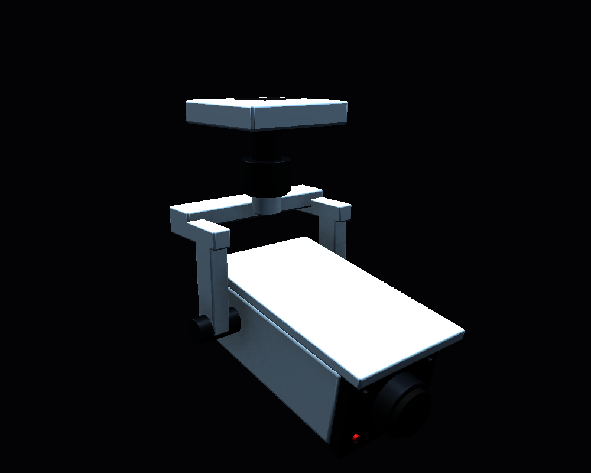 | 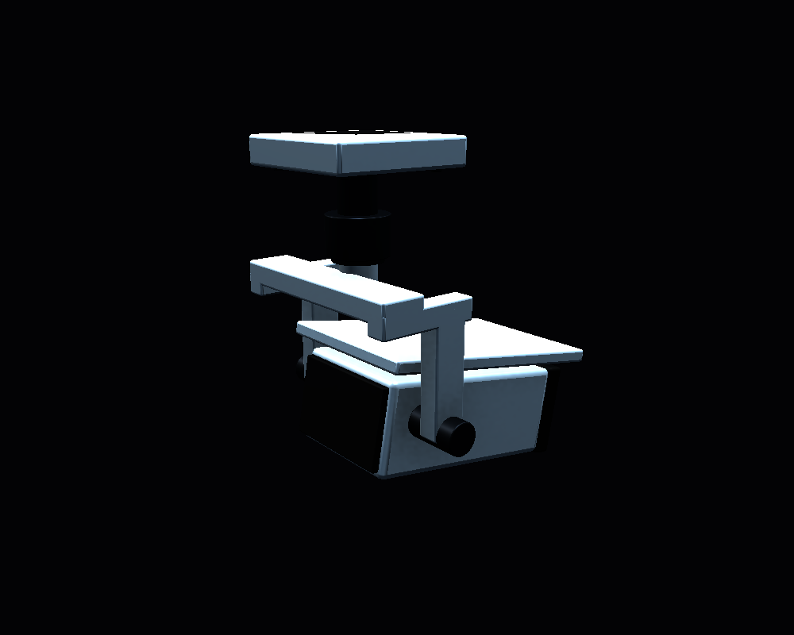 | 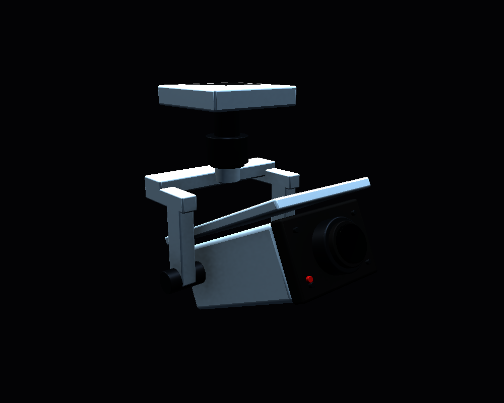 |

[천장을 숨긴 도면 방향 상부 검토](Images/08_Overview_RoofHidden.png), [실제 플레이 시작 화면](Images/09_Play_Entry.png)을 보관했다. 천장은 촬영 중에만 숨겼고 저장 씬에서는 활성 상태다. 게임 콘솔의 촬영 경로 검증 오류1건은 외부 도구 오류였으며 경로를 수정해 재촬영했다. [수정 이후 오류 조회](play_console_final_since537.json)와 게임 예외를 구분한다.

---

작성자 송예찬 · 2026-11-05 · Unity 6000.4.0f1 · Blender 5.2.2 LTS

새 평면을 적용한 별도 씬은 `Assets/Afrer_Seconds/01.Scenes/Stage/Level_B5_Stealth.unity`다. 원본 `Level_B5_Isolation.unity`와 다른5층 씬은 보존했다. 새 씬은 48×32m 검토 치수의 실내를 연결해 직접 걸어 볼 수 있는 제작본이며, 잠입 게임 완성본은 아니다.

## 도면과 실제 공간

[B5 예상 경로 A/B/C 비교](../../도면/잠입_탐색/플레이어_예상이동/B5_경로비교.png), [전체층 A 경로](../../도면/잠입_탐색/플레이어_예상이동/전체층_A_탐색경로.png), [경로 좌표](../../도면/잠입_탐색/플레이어_예상이동/player_routes.json)를 보관했다. 6층×3안의 SVG/PNG 복사본이며 A는 탐색 보행, B는 다른 접근, C는 발각 후 재배치 가정이다. 안전 경로·최적 해답을 뜻하지 않는다. 원 도면과 좌표 원본은 바꾸지 않았고 Unity 경로선·미니맵·UI도 추가하지 않았다.

B5의 격리실·냉각실, 북/서/중앙/남/동측 직원 복도, 경비실·전실·관제실·유틸리티, 잠긴 설비/리프트/계단B 구획의 바닥·벽·천장을 제작했다. 문22개는 실제 구멍으로 연결하고 잠긴3개는 문짝과 충돌을 뒀다. 잠긴 리프트와 계단B에는 작동 장치나 다음 층이 없다. 계단A는 두 구간과 중간·상부참을 만들어 실제로 오를 수 있다. B4 씬 전환은 아직 연결하지 않았다.

원본 포드의 로컬 위치(0,0,10.32), 스케일(3,2,3), 생활/직원 설비 그룹의 로컬 Transform을 유지하고 새 공간 부모만 이동했다. 격리실 천장 아래7.2m를 유지했다. 포드 탈출 상호작용은 미구현이라 검토 시작은 도면E, Unity(-7,0.885,-6)다.

냉각 피트는 깊이3m이며 네 옹벽·바닥을 만들고 위를 덮는 보행 다리를 두지 않았다. 유틸리티 설비와 남측 펌프를 연결하는 배관은 천장 쪽으로 보냈다. 기존 VARCO 소품25개와 새 분리형 CCTV와 포드 생활 소품을 재사용했다. 관제실 캐비닛은 예상 동선을 막아 서측 벽으로 옮겼고 계단 하부 폭은1.4m로 보정해 입구 여유를 확보했다.

## 모델과 베벨

건축은 Unity 기본 큐브 외형 대신 Blender에서 제작한 FBX를 사용한다. 새 바닥·벽 패널·천장·문틀·계단·피트·배관은 치수에 맞춘 베벨과 노멀을 적용했다. 건축 감면본은 대체로3~25mm의 기존 폭을 유지한1분할 챔퍼와 Weighted Normal이며 얇은 부품은 겹침 방지를 위해 폭을 제한했다. 정확한 각 오브젝트 값은 [건축 제작 자료](architecture_manifest.json)의 `bevels`를 따른다. invisible BoxCollider는 이동 판정용이다.

경비·연구원은 사용자 지정 [After_Second_Env_and_Props_Ver0.03](https://3d.varco.ai/flow/8f7100a4-a7df-488b-81ee-0c2ac6ae60d8)에서 이미지→3D→humanoid-fingers 리깅을 실행했다. 각250점, 합계500점이며 PRIVATE 설정이다. Blender에서 보조 구체 제거,1.8m 크기, PBR 채널,65도 이상 예각의1mm/2분할 베벨을 정리했다. 유기적인 피부·옷 곡면은 스무딩을 유지했다. 원본 GLB·참고 이미지·편집 가능한 `.blend`를 남겼다.

Unity 모델은 `05.Model/Environment/B5/B5_Stealth_Architecture_Lite.fbx`, `05.Model/Enemy/AS_V03_{Guard,Researcher}.fbx/.prefab`에 있다. 재질/텍스처는 해당 분류의 Materials/Textures, 출처 JSON은 `06.Data/AssetSources/B5_Stealth_20261105.json`, 편집 원본은 저장소 `SourceAssets/B5_StealthLayout/`에 있다. 원래 모델과 `.meta`는 덮어쓰지 않았다.

G0·G1·G2·R1 및 C1은 도면 위치의 정적 외형 배치다. NPC Avatar는 Humanoid/Valid를 확인했으나 기존 플레이어 Idle을 그대로 연결했을 때 루트 높이가 맞지 않아 컨트롤러를 제거하고 검토 포즈로 저장했다. Animator는 비활성 상태이며 AI·애니메이션·감지·도주·경비 호출을 구현했다고 해석하지 않는다.

## 검증 결과

| 확인 | 결과 | 자료 |
| --- | --- | --- |
| 열린 문/잠긴 문 | 22개 통행,3개 차단 | [충돌 검사](validation.json) |
| 예상 A/B/C 캡슐 통행 | 266/414/137개 위치, 막힘0 | [충돌 검사](validation.json) |
| 실제 W 입력 | 프레임104→529, 약3.28m 이동해 격리실 문 통과 | [입력 전](runtime_state_before_key.json), [입력 후](runtime_state_after_key.json) |
| 플레이 중 기존 CharacterController 경로 보행 | A/B/C 모두 도착, 실패0 | [보행 검사](runtime_walk.json) |
| 계단A 상부 | 40단·상승7.8m 끝까지 도착 | [보행 검사](runtime_walk.json) |
| 피트 | 바닥Y=-3m, 네 방향 옹벽 | [피트 검사](pit_containment.json) |
| 저장 후 재개방 | 누락 스크립트/메시/재질0, 유지 그룹 로컬 Transform 일치 | [저장 검증](saved_scene_verification.json), [충돌 검사](validation.json) |
| 기존 원본 |6층 씬/meta·JC 보수 메시 및 원 도면 해시 일치 | [보존 검사](preservation.json) |
| 플레이 중 콘솔 | 게임 예외0, 컴파일 실패 없음. 촬영 경로 도구 오류1건은 수정 후 재촬영 | [콘솔 검사](play_console_errors.json) |

자동 보행 검사는 기존 CharacterController에 짧은 이동량을 넣어 충돌·계단을 확인한 것이며, 사용자가 길을 찾으며 잠입을 완주한 테스트는 아니다. FPS·다수 AI·경보 난이도·교환 성공·수색 중 경로 안전은 아직 검증하지 않았다.

## 사진

아래는 저장 씬의 검토 카메라 렌더다. 도면 경로 표시나 게임 HUD가 아니다.

| 포드와 격리실 | 냉각 피트 |
| --- | --- |
| 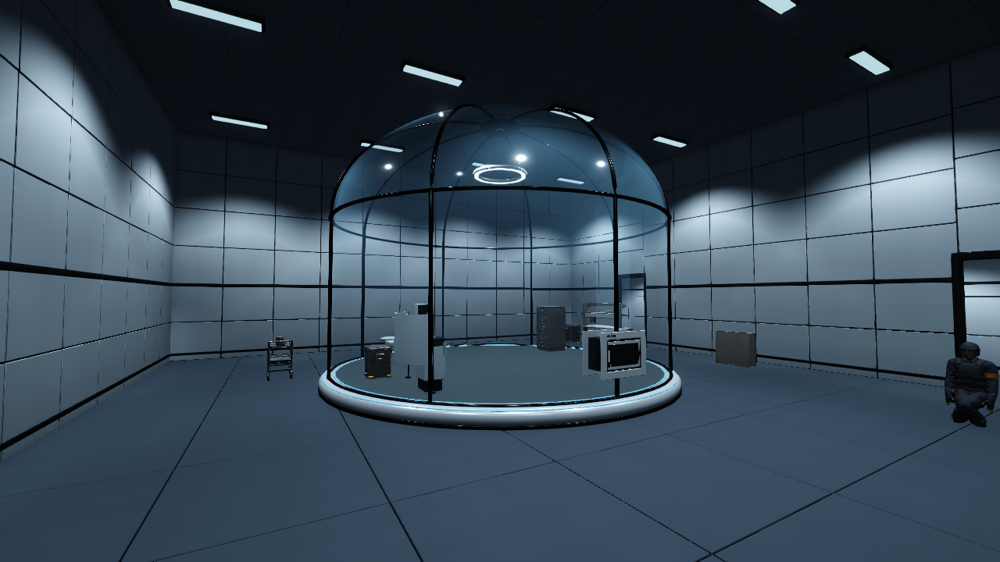 | 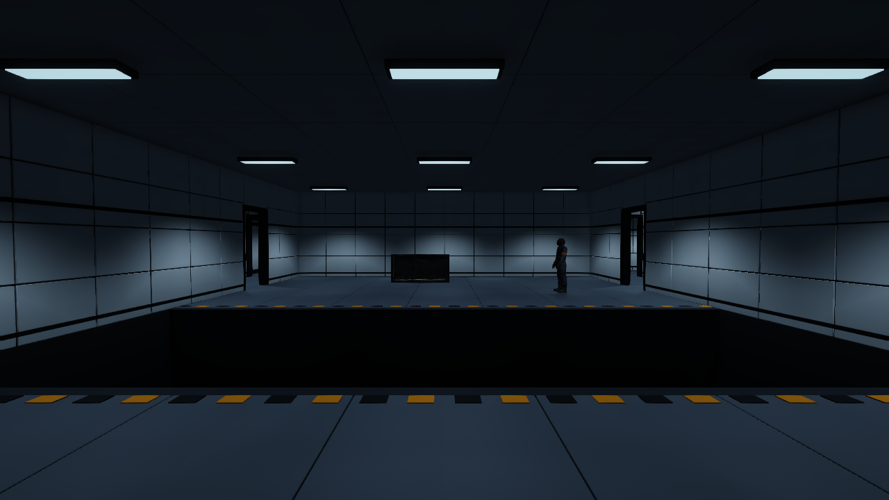 |

| 관제실과 연구원 | 계단A |
| --- | --- |
| 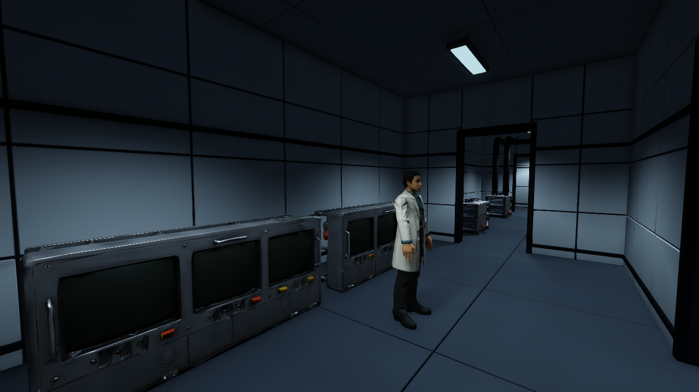 | 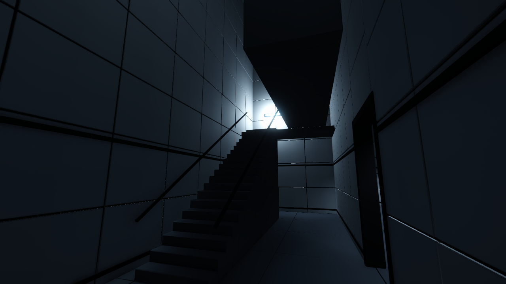 |

[시작 문](Images/01_Entry.png), [북측 복도](Images/04_NorthCorridor.png), [경비 외형](Images/07_Guard.png)도 확인할 수 있다.

## 남은 설계와 기능

- 냉각조의 원 교환 표시는 남→북으로 향해 남동측 계단 목표와 멀어진다. 지름길로 검증되지 않았으며 교환 방향·적 위치·재접근 동선 설계가 필요하다.
- 계단A 상승7.8m·단높이0.195m·40단은 포드 천장7.2m를 고려한 보행용 단면 가안이다. B4 층고·출입 높이와 실제 층간 연결은 별도 확정한다.
- 포드 탈출, AI 감지/추격/도주/알림, CCTV 경비 호출, 예약·교환, 문 상호작용, NPC 애니메이션과 엔딩은 미구현이다. 열린 문은 검토를 위해 열린 상태이고 잠긴 문은 작동하지 않는다.
- 다른5층은 도면만 개정한 상태다. B5에서 직접 길을 찾으며 방 밀도·관찰 지점·순찰 가정을 검토한 뒤 본편 기능을 구현한다.
- UI/UX와 미니맵은 사용자 요청대로 후속 단계에 남긴다. Git 커밋·푸시는 하지 않았다.
