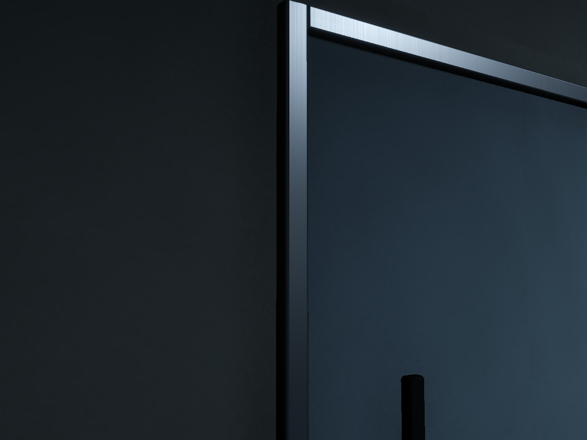
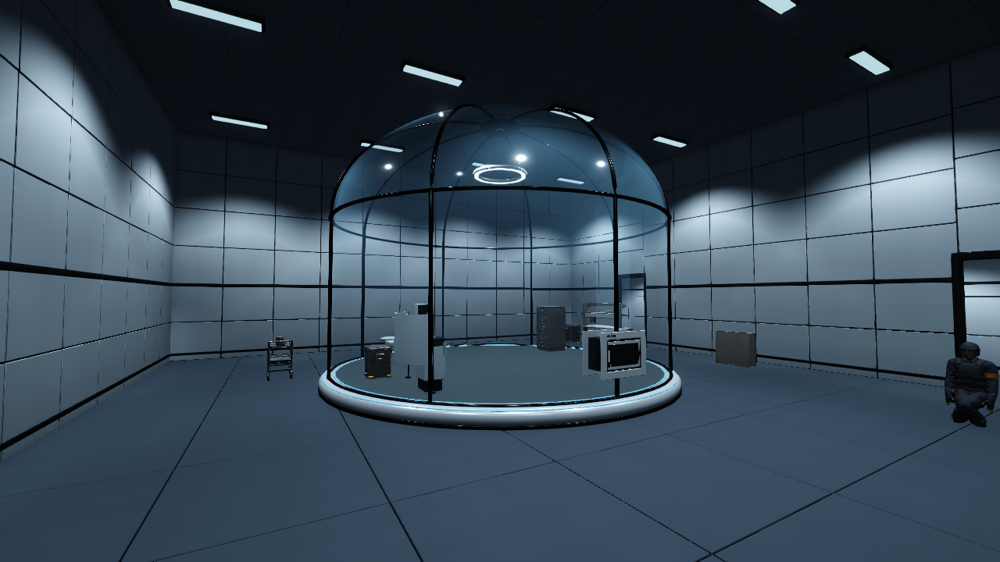
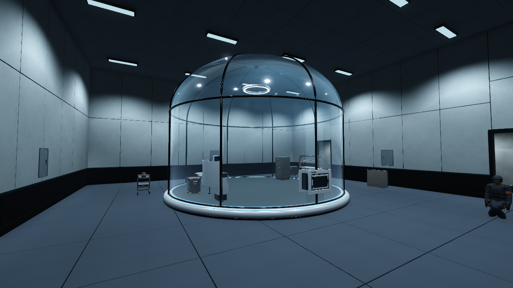
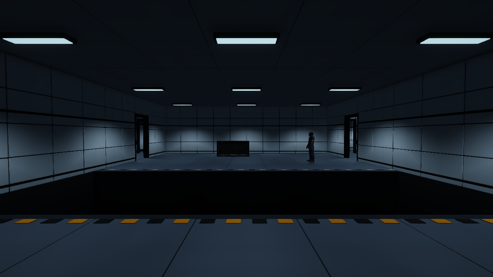
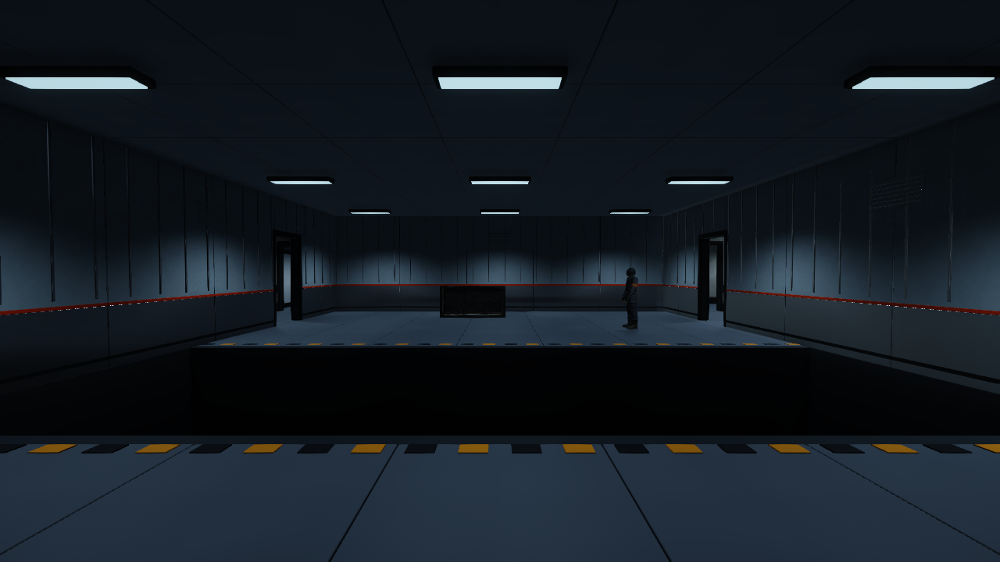
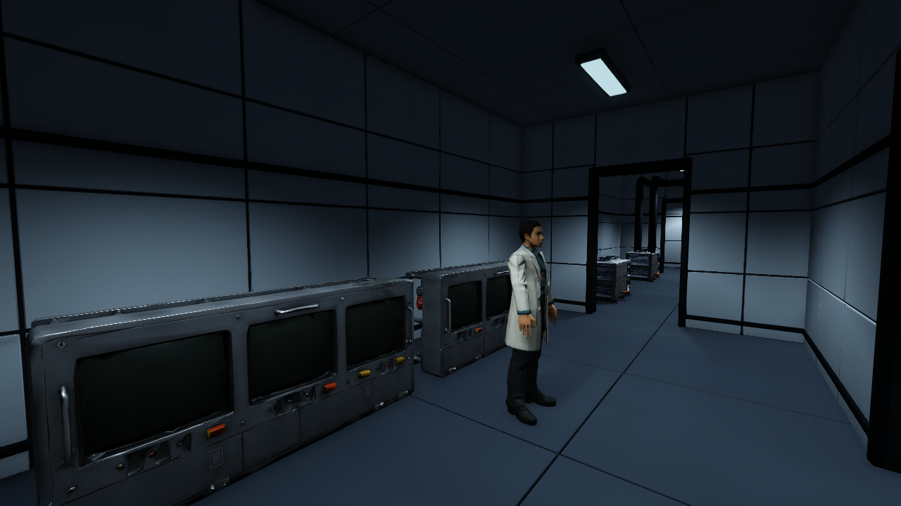
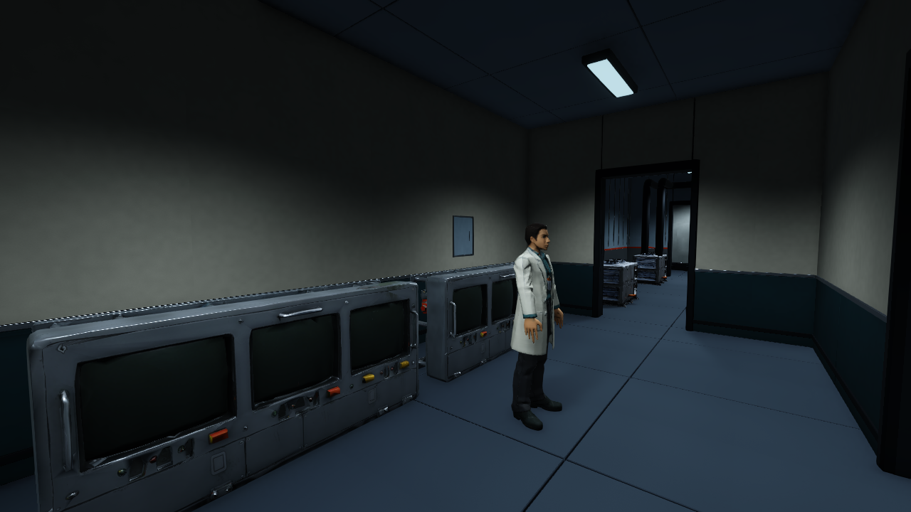
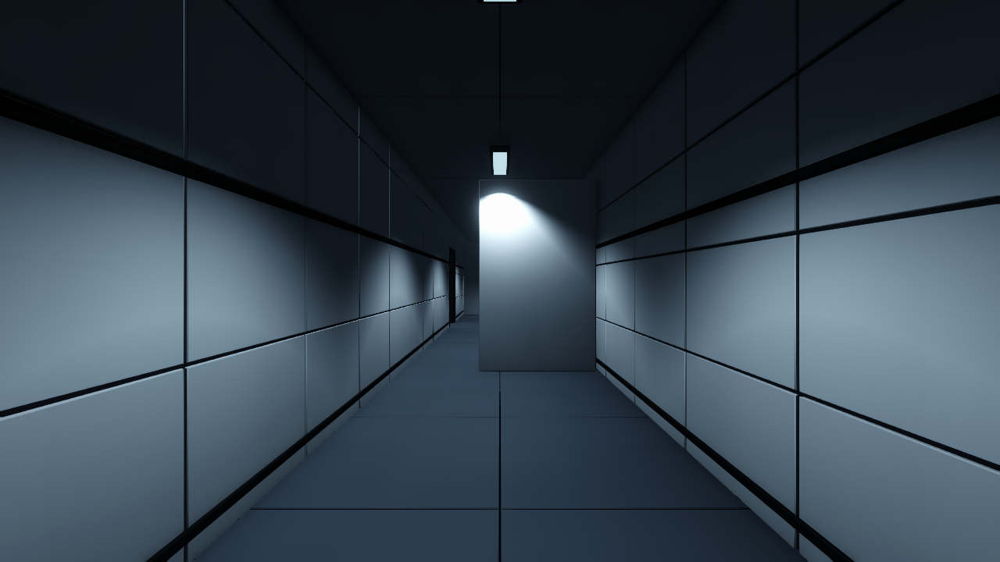
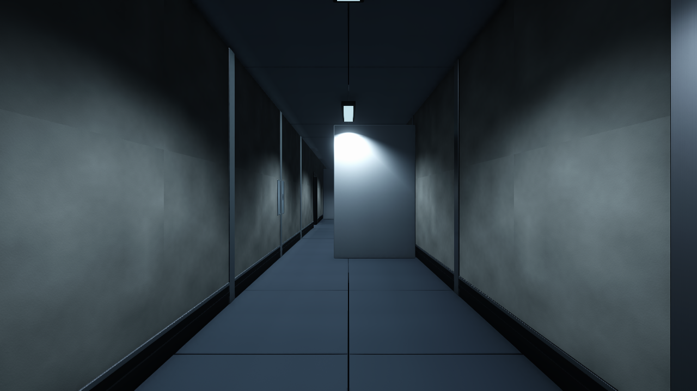

# B5 구역별 벽 마감·금속 재질 검수 V0.02

후속 얼굴·펌프·배관·난간·벽 트림 보수는 [최신 에셋 검수](../2026-11-05_B5_AssetRepair/검수결과.md)를 따른다. 아래 WallVariants와600개 트림, 충돌260개 기록은 보수 전 단계다.

작성자 송예찬 · 2026-11-05 · 메인 기획서 V0.17 · Unity 6000.4.0f1 / Blender 5.2.2 LTS

새 `Level_B5_Stealth.unity`의 반복 사각 벽판을 구역 용도에 맞게 바꾸고, `SL_WallTrim_*`을 브러시드 금속으로 정리했다. 문·방 중심선·기존 소품 배치와 충돌체는 유지했다. 내부 게임 C#과 Animator Controller는 작성하지 않았다.

## 벽면 구분

| 구역 | 새 마감 | 길 찾기 단서 |
| --- | --- | --- |
| 격리실 A | 긴 세로 위생 패널, 낮은 어두운 보호판, 얇은 청록 띠 | 밝고 정돈된 실험 구역 |
| 냉각실 B·설비실 | 도장 강판, 세로 리브, 금속 하부판, 주황 띠, 닫힌 루버 | 설비와 위험 시설 |
| 직원 지원실 SUP1~3 | 따뜻한 회벽, 청록 하부 마감, 금속 캡 레일 | 사람이 사용하는 공간 |
| 공용 복도 | 넓은 콘크리트 면, 드문 구조 이음 덮개, 낮은 보호판 | 연결 통로 |
| 계단·리프트 코어 | 큰 콘크리트 구획과 보강 덮개 | 수직 이동 시설 |

점검구·루버31개는 닫힌 장식 모듈이다. 새로운 출입문이나 사용 가능한 통로를 뜻하지 않는다. 벽99개 구간의 중심선과 기존 문 구간을 유지했다. 돌출 마감은 이전 벽 레일 범위인 중심선에서 약0.18m 안에 배치했다.

## SL_WallTrim의 베벨과 재질

트림은 Blender에서 만든 메시다. Unity 기본 Cube에 색만 입힌 것이 아니다. 초기 1분할 챔퍼와 낮은 금속도 때문에 모서리와 금속감이 약했고, FBX 원본 미리보기는 기본 Lit 재질을 사용하고 있었다. 씬에는 텍스처가 이미 있었으나 도장 강판용 맵을 트림에도 공유해 노출 금속으로 읽히지 않았다.

600개 트림 파트의 3~6mm 베벨을 3분할로 보강했다. 나머지 건축에는 기존 경량 챔퍼를 유지했다. 편집 가능한 `.blend`에는 Bevel·Weighted Normal이 남아 있고, FBX에는 평가된 형상을 내보냈다. 따라서 Unity Inspector에서 Bevel modifier가 보이지 않는 것은 정상이다. 전체 원본2,871파트의 베벨 폭0인 항목은0개다.

트림은 전용1024px `WV_Trim_Base/Normal/MetallicSmoothness.png`로 교체했다. Metallic 맵 R은0.96, Smoothness 알파는 약0.62이며 Smoothness 배수는1이다. 방향성 브러시 결과 미세 거칠기 차이를 넣고 UV 반복4, 노멀 강도0.32를 사용했다. 벽판의 도장 강판과 트림의 노출 금속을 구분한다. FBX 원본의 재질16개도 외부 URP 재질로 remap해 모델 미리보기와 씬 참조를 맞췄다. Blender 편집 원본에도 동일한 PBR 노드를 연결했다.

천장 패널 조명79개의 조사각을140°/내각90°로 넓혀 벽 상단의 모서리가 빛을 받게 했다. 조명 개수·위치·출력·색·범위·그림자 설정은 유지했다. 구역별128px HDR 반사7개를 한 번 구워 압축 BC6H 큐브맵으로 연결했다. Inspector 모드는 `Custom`이며 미리 구운 텍스처를 참조한다. 실시간 재촬영은 없다. 플레이어·NPC는 반사 촬영 동안만 숨겨 고정된 인물 잔상이 생기지 않도록 했다.

실제 씬 조명으로 렌더한 점검구 프레임. 별도 촬영용 조명을 넣은 진단 이미지는 이 보고서에 사용하지 않았다. 냉각실처럼 어두운 구간의 금속은 시선과 광원 각도에 따라 어두워진다. 모든 면을 일정한 은색으로 보이게 조정하지 않았다.

## 전후 사진

같은 위치·FOV로 촬영했다. 재질과 함께 조명 조사각·정적 반사가 바뀌었으므로 벽 형상만 비교하는 실험은 아니다.

| 장소 | 변경 전 | 변경 후 |
| --- | --- | --- |
| 격리실 |  |  |
| 냉각실 |  |  |
| 직원실 |  |  |
| 북측 복도 |  |  |

[입구](After/01_Entry.png) · [계단A](After/06_StairA.png) · [냉각실 리브 근접](After/10_Trim_CoolingRib_Close.png) · [경비와 벽 마감](After/07_Guard.png) · [천장을 잠시 숨긴 평면](After/08_Overview_RoofHidden.png)

북측 복도 중앙의 세로 설치물은 변경 전 사진에도 있는 기존 배치물이다. 이번 벽 마감 작업에서 추가한 물체가 아니다. 상부 평면은 u가 오른쪽, v가 아래쪽이며 천장은 촬영 후 복원했다. Unity에 경로선·미니맵·UI를 추가하지 않았다.

## 검사 결과와 비용

| 항목 | 결과 |
| --- | --- |
| 건축 삼각형 |205,440 →215,764tri, 약5.03% 증가 |
| 전체 배치 최고 LOD |949,363 →959,687tri, 약1.09% 증가 |
| 초기 고밀도 전체 배치 대비 |2,439,679 →959,687tri, 약60.66% 감소 |
| 건축 Renderer |150 →249, 마감·구역별 묶음 증가 |
| 참조 메시 메모리 |약87.60MiB, 메시만의 측정치 |
| 충돌체 |260개 모두 작업 시작 스냅샷과 동일 |
| 주요 배치 |포드·플레이어·적의 보호 대상 Transform 동일 |
| 문 |개방22개 통행 가능, 잠금3개 막힘 유지 |
| 경로 |A266 / B414 / C137, 합817개 캡슐 표본 막힘0 |
| 참조 |누락 스크립트·메시·재질0 |
| 원본 보존 |기존6개 씬/meta와 보호 소스19개 SHA256 동일 |
| 저장 |새 씬 저장 후 재개방, dirty=false |

트림 베벨 보강으로 삼각형 수가 벽 교체 직전보다 조금 늘었다. 구역과 재질이 늘어 Renderer 수도 증가했다. 위 수치는 화면에 동시에 그려지는 양, 전체 RAM/GPU 메모리, FPS 측정 결과가 아니다. 기존 소품 LODGroup25개와 원본 모델은 유지했다.

촬영 중 생긴 불필요한 Renderer.enabled override17개를 정리했다. 가드 프리팹 한 곳에는 편집기에 이미 있던 루트 x=-0.141/z=-0 값이 명시 override로 저장됐다. 주요 배치는 작업 시작 편집기 스냅샷과 동일하다. [직렬화 비교와 보호 해시](audit_final.json)에 이 차이를 포함해 기록했다.

검수 자료: [씬 보존](preservation_scene.json), [문·경로·참조](validation_after.json), [메시 비용](mesh_cost.json), [재질 변경 전](trim_material_before.json), [재질 연결](trim_material_after.json), [최종 재질·반사 검사](material_audit_final.json), [최종 정적 반사](reflection_bakes_final.json), [조명 조사각 변경 전](fixture_spread_before.json).

## 원본과 다음 작업 기준

활성 건축은 `05.Model/Environment/B5/B5_Stealth_WallVariants.fbx`, 편집 원본은 `SourceAssets/B5_StealthLayout/B5_StealthLayout_WallVariants.blend`다. 생성기는 `build_b5_wall_variants.py`, PBR 노드는 `wall_material_nodes.py`, 세부 베벨은 `wall_variants_manifest.json`에 있다. 기존 `build_b5_architecture.py`와 Lite 모델/원본은 보존했다. 출처는 `06.Data/AssetSources/B5_WallVariants_20261105.json`을 따른다.

내부 게임 C#·AI·감지·자동 회전·애니메이션 연결과 UI는 사용자 작성 범위다. 이번 검사는 재질·레벨 아트와 정적 통행 확인이며, 잠입 난이도·완주·FPS 검증은 아니다. Git 커밋·푸시는 하지 않았다.