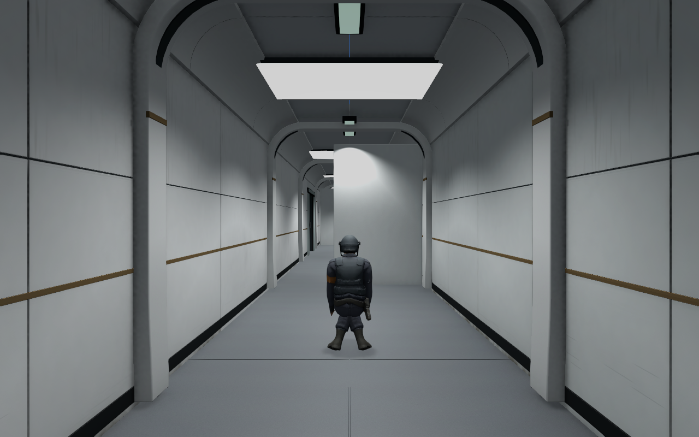
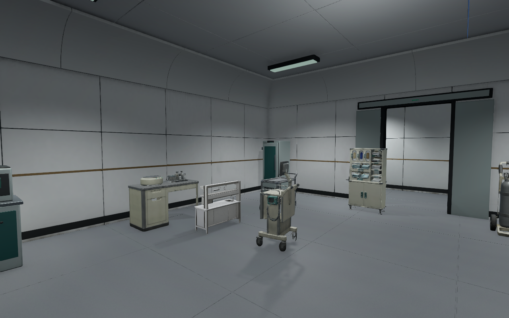
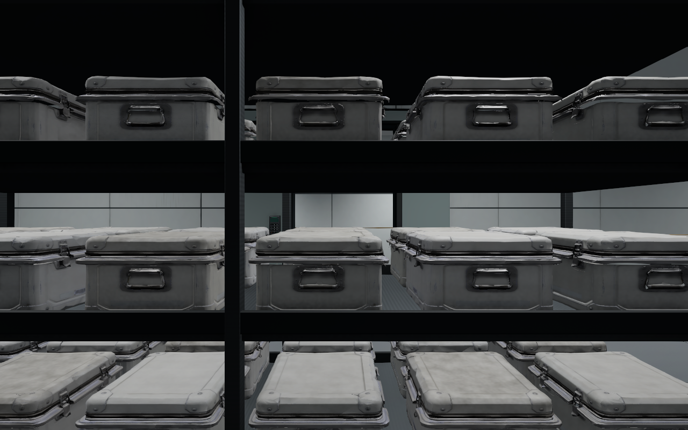

# B5 B4 B3 곡면 실내와 생활 흔적 검수 V0.02

이 문서는 복도 확장 전 단계의 기록이다. 현재 모델·배치·수치는 [복도 확장 후속 검수](../2026-11-06_B345_WideInterior/검수결과.md)를 우선한다. Before 폴더는 후속 확장 직전 사진으로 갱신되었으므로 이 단계의 적용 전 비교에 사용하지 않는다.

작성자 송예찬 · 2026-11-06

사용자가 지정한 [4번 레퍼런스](../../Reference/Reference_004.jpg)를 기준으로, 벽에서 천장으로 이어지는 흰색 곡면과 복도를 감싸는 아치 프레임을 B5·B4·B3에 적용했다. 벽과 상자의 ‘패턴’은 먼지·손때·닦인 자국·가벼운 마모를 뜻한다. 앞선 장식 띠·규칙적인 문양 해석을 수정했고, 상자 마감을 불규칙하게 섞었다.

## 적용 결과

| 항목 | B5 | B4 | B3 |
| --- | ---: | ---: | ---: |
| 아치 프레임 | 23 | 23 | 23 |
| 벽과 천장 사이 곡면을 적용한 구역 | 14 | 16 | 15 |
| 생활 흔적을 적용한 벽 파트 | 558 | 1,839 | 1,777 |
| 생활 흔적 상자 | 8 | 5 | 296 |
| 추가 아치 충돌체 | 92 | 92 | 92 |
| 추가 천장 확산등 | 22 | 22 | 22 |
| 전체 최고 LOD 삼각형 | 1,671,810 | 1,766,421 | 2,967,841 |

기존 프랍101개와 B3 선반 상자288개의 위치·회전·크기는 유지했다. B3 상자296개는 선반288개와 추가 프랍 상자8개를 합한 수량이다. 상자는 새 6종 마감으로 교체했고, 1.05m 이내 인접 상자 사이에서 같은 마감의 반복은0쌍이다. 테두리·손잡이·잠금쇠·베벨·3단계 LOD는 유지했다.

벽에는 바닥 가까운 먼지, 얕은 닦인 자국, 손때와 작은 긁힘을 적용했다. 바닥 먼지가 벽 중간에 반복되지 않도록 높이에 따라 변형을 구분했다. 상자는 가벼운 먼지·모서리 먼지·손때·닦인 자국·마모·장기 보관의6가지다. 색 띠를 순서대로 배치하던 방식은 현재 씬에서 사용하지 않는다.

아치와 곡면 패널은 Blender 실제 메시다. 각진 모서리의 베벨과 편집 원본을 보존했다. 기존 시야 차단벽과 겹치는 남측 아치1개는 층마다 제외했고, 벽을 따라 걷는 경로를 위해 아래 받침 돌출을 줄였다. 계단실과 기존 층간 단면은 유지했다. 흰색 천장·회백색 벽·회색 바닥·얇은 따뜻한 금속 마감을 적용하고, 중성 조명과 낮은 Bloom을 사용했다.

## 전후 사진

복도 확장 전 곡면 적용 상태: 

| B4 방의 벽과 천장 연결 | B3 상자 마감 |
| --- | --- |
|  |  |

[상자6종 중성 조명 비교](../2026-11-06_B345_WallSurfaces/CaseWear_6Variants.png). Before/After 폴더의 B5·B4 사진은 각각9장, B3는10장이다. 조명 검수용 임시 카메라 사진이며 일부 시점에는 기존 NPC가 가까이 보인다.

## 검증

- 예상 이동 경로2,627표본 막힘0, 열린 일반 문74곳 간섭0, 추가 프랍101개 겹침0.
- CharacterController 경로·계단·데크19검사 통과. 이번 단계에서는 실제 키보드 Play 테스트와 FPS 측정을 다시 하지 않았다.
- 아치 적용 직전 Transform6,798개와 기존 활성 Collider를 보존했다. 새 아치 Collider276개를 별도로 추가했다.
- 누락 재질·텍스처·스크립트0. 새 아트 반입 경고/오류0. HDR·카메라 후처리·Renderer PostProcessData·Volume 레이어 연결을 확인했다.
- 상자 마감은 모든 LOD에 적용했다. 정적 반사25개를 갱신했다.
- 이번 작업 시작 시 보호한 기존 파일2,926개 중 반사 이미지25개가 갱신 대상이다. 나머지2,901개는 변경하지 않았다. 게임 C#·Animator·설정·Packages·기존 모델·재질·프리팹을 포함한다.

검사 원본: validation.json, preservation.json, controller.json, reflections.json. 기존 파일 보존 결과는 `../2026-11-06_B345_WallSurfaces/protection.json`에 있다. 최신 시각 검수는 사용자가 Unity에서 걸으며 확인한다. B3 자동 W 입력 확인이 남아 있던 이전 단계의 한계도 그대로다.

## 현재 파일과 이어하기

- 씬: `Assets/Afrer_Seconds/01.Scenes/Stage/Level_B5_Stealth.unity`, B4/B3 동일 형식.
- 기존 건축: B5/B4 `LC_*_Architecture.fbx`, B3 `SD_B3_Architecture.fbx`. 벽의 기존 Renderer만 꺼두고 `Wall_Surface_Wear`의 `WS_*_Walls.fbx`를 사용한다.
- 새 곡면 건축: `Environment/{B5,B4,B3}/AR_*_Interior.fbx`, 씬 `Arched_Interior` 아래.
- 상자 재사용 프리팹: `Props/Common/SW_Case_{LightDust,CornerDust,Handling,WipeMarks,Scuffed,Stored}.prefab`. 기존 SD 프리팹과 씬 오브젝트 이름에는 이전 마감 이름이 남아 있으나, 현재 Renderer는 SW 재질을 사용한다.
- Blender/외부 Editor 도구: `SourceAssets/B345_WallSurfaces/`, `SourceAssets/B345_ArchedInterior/`. `ApplyArches.Apply`는 이미 적용된 씬에 재실행하지 않는다.

게임 동작·UI·미니맵은 추가하지 않았다. 로컬 저장 상태이며 커밋/push하지 않았다.
