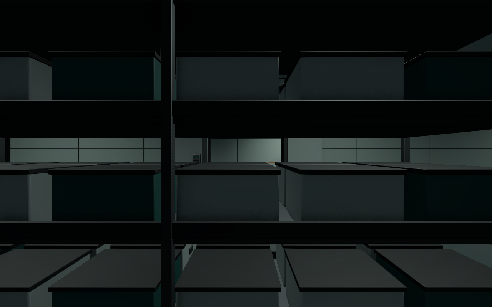
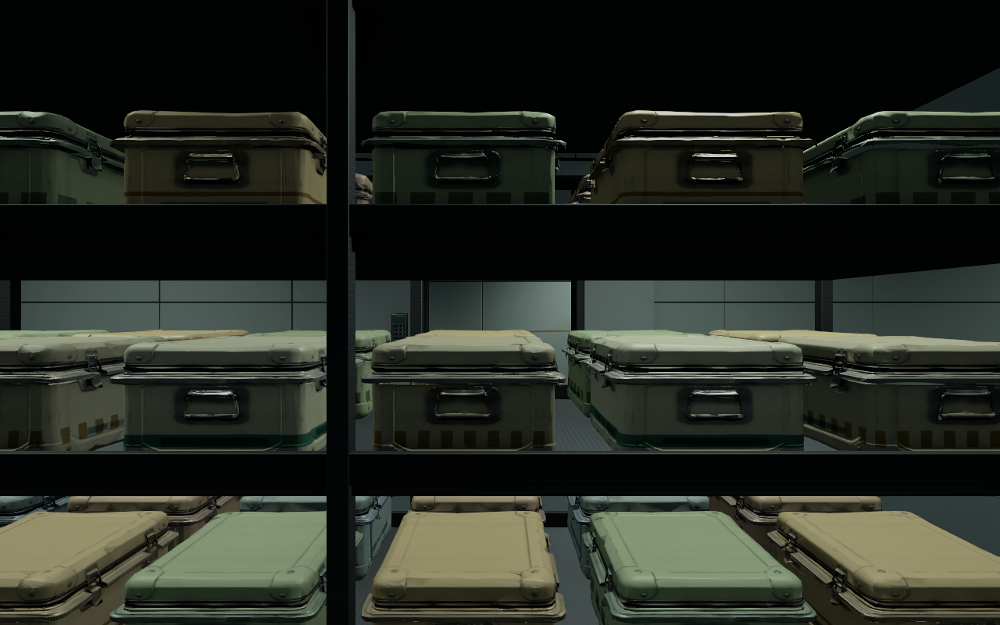
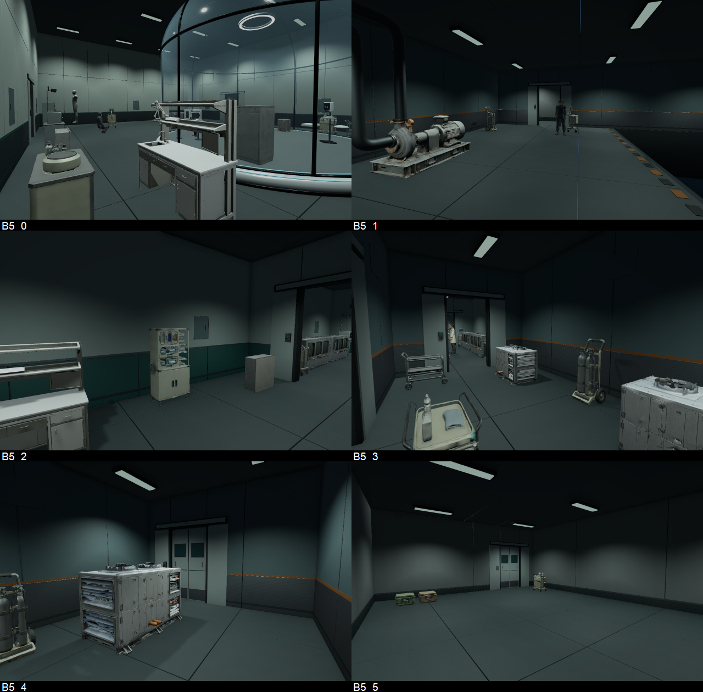
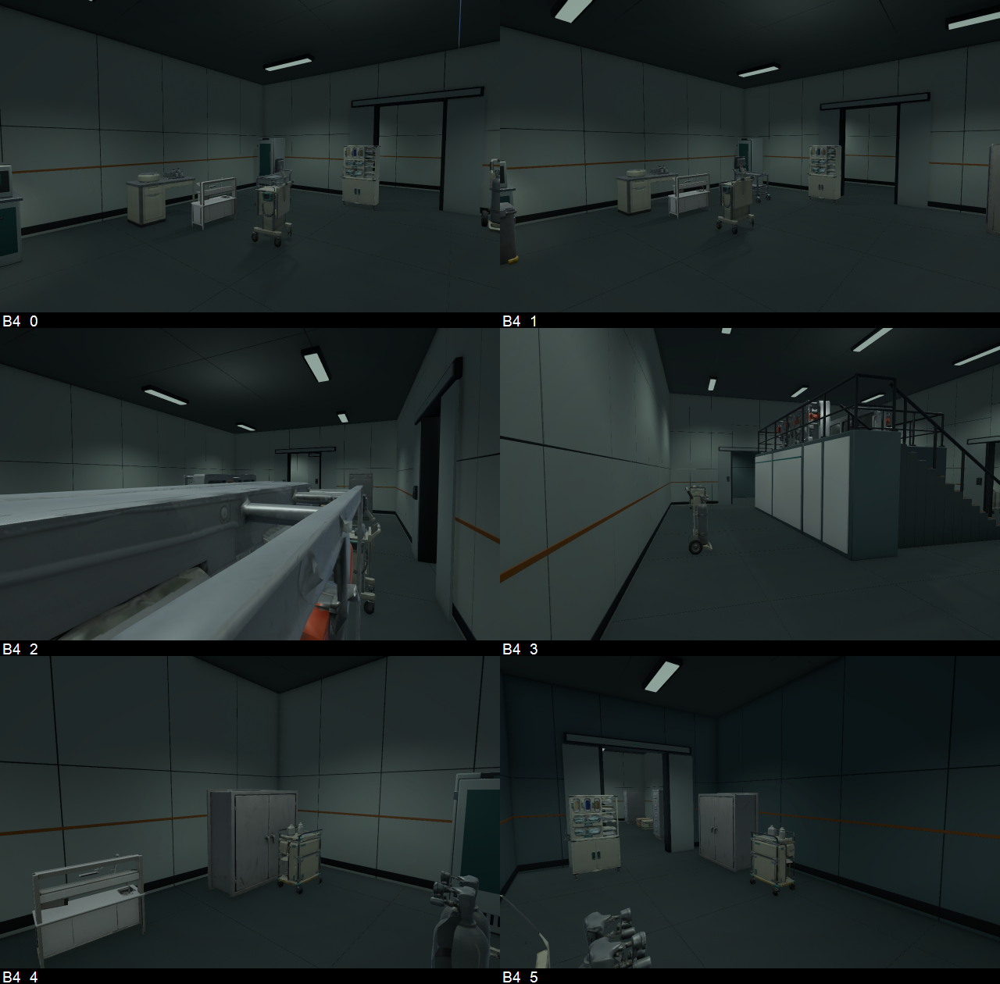
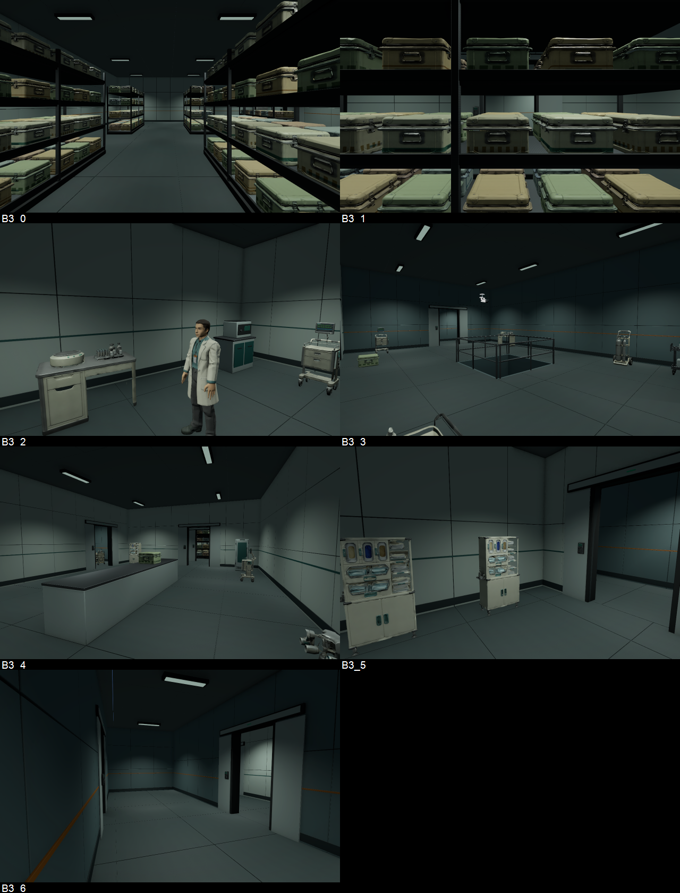

# B5·B4·B3 프랍 보강 검수 V0.01

작성자 송예찬 · 2026-11-06 · Unity 6000.4.0f1 / URP17.4

제작된 세 층에 프랍101개를 추가하고 B3 선반 상자288개를 교체했다. VARCO에서 먼저6종을 생성·리메시한 뒤 Blender에서 치수, 모서리 베벨, 노멀, LOD와 PBR를 정리했다. 작업은 로컬 저장 상태다.

## 제작과 배치

| 층 | 추가 프랍 | 용도 |
| --- | ---: | --- |
| B5 | 30 | 격리·진단, 냉각 설비, 격리 전실, 경비/모니터링/유틸리티, 설비실·리프트 전실 |
| B4 | 33 | 북/남 관찰실 진단, 분석·관제 지원, 준비/기록/유틸리티, 설비실·리프트 전실 |
| B3 | 38 | 시료 저장·전처리, 오염·청정 작업, 폐기·환복, 설비실·리프트/계단 전실 |

새 모델은 시료 운반 상자, 진단 카트, 가스통 카트, 보호구 수납장, 원심분리기를 포함한 시료 준비대, 정비 카트다. [지정 VARCO V0.03 플로우](https://3d.varco.ai/flow/8f7100a4-a7df-488b-81ee-0c2ac6ae60d8)에 이미지→3D→리메시 노드를 남겼다. 기존 인물 노드는 변경하지 않았다. 6종 모두 생성 결과를 채택했으며 Blender에서 직접 새 형태를 대체 제작할 필요는 없었다.

리메시 목표는 상자3,000/장비8,000tri였다. 이후 Blender 1mm·2분할 각도 베벨을 적용한 최종 LOD0는 상자5,203, 장비10,737~15,174tri다. 3단계 LOD를 적용했고 공용 프리팹과 재질을 재사용한다. Albedo·Normal·금속/매끄러움 맵을 URP Lit에 연결하고 정적 반사25개를 갱신했다.

B3 상자는 기존 단순 몸통·뚜껑·잠금쇠864파트를 건축 파생본에서 제외하고288개를 별도 배치했다. 보호 테두리, 모서리 보강, 뚜껑 가스켓, 금속 손잡이와 잠금쇠가 구분된다. 청록 띠·이중 황토 띠·세로 청색·황토 반복 문양·녹색 블록·적갈색 봉인 패턴을 원래 UV에 베이크하고6종을48개씩 배치했다. 상자 크기는0.62×0.415×0.68m, 기존 선반 위치와 간격을 유지한다. 개별 Collider288개는 비활성화하고 기존 랙 충돌6개를 사용한다.

## 확인한 결과

- 추가 프랍101개는 서로 또는 기존 Collider와 겹치지 않는다. 문 접근 여유가 부족했던8곳은 위치를 조정했다.
- 예상 이동 경로2,627표본에서 막힘0. 일반 열린 문74곳의 통행과 기존 문짝 앵커를 유지했다.
- 임시 CharacterController로 A/B/C 경로9개·계단A/B 왕복8개·관제 데크2개, 총19검사 통과.
- 반입 경고/오류0, 누락 스크립트/재질0. 새 에셋의 .meta 누락·고아 .meta는 별도 meta_check.json에서 확인했다.
- 원본6씬·게임 C#·Animator·설정·Packages·사전 로컬 AD_WallPanel5개를 포함한 보호 파일156개 해시 일치. B3 교체 건축을 제외한 기존 Transform4,480개 일치.
- 최종 확인에서 원본 B3 SampleStorage 씬과 .meta는 Stage/Old로 이동된 상태였다. 두 파일의 내용·GUID가 같아 현재 위치를 유지하고 protection.json에 기록했다.
- B5/B4 건축 LC 모델은 유지했다. B3만 SD_B3_Architecture 파생본으로 바꾸었고 기존 LC 모델과 편집 원본을 보존했다.

| 층 | 전체 최고 LOD 삼각형 | Collider 컴포넌트 | 광원 |
| --- | ---: | ---: | ---: |
| B5 | 1,430,698 | 352 | 86 |
| B4 | 1,503,565 | 415 | 100 |
| B3 | 2,719,481 | 608 | 71 |

B3 Collider 수에는 비활성 상자288개가 포함된다. 최고 LOD 합계는 씬 배치량이며 실제 프레임 렌더량과 다르다. 조명 수와 기존 밝기 설정은 변경하지 않았다.

## 실제 Play 측정과 한계

i5-11400F / RTX3070 / Direct3D12 / RAM 약32GB, PC 품질1920×1080·renderScale1에서 층별24초, 시야3곳을 각8초씩 측정했다. 각 시야 처음2초는 제외했다. 관측 프레임은 B5 2,667 / B4 2,738 / B3 최종2,690개이며 측정 중 경고/오류 로그0건이다.

| 층 | 시야별 중앙 프레임 시간 범위 | 가장 높은 p95 | 입력 확인 |
| --- | --- | --- | --- |
| B5 | 8.04~9.21ms | 11.72ms | W 입력으로 약1.498m 이동 |
| B4 | 8.28~8.38ms | 12.93ms | W 입력으로 약1.513m 이동 |
| B3 | 8.20~8.71ms | 12.06ms | 자동 W 입력의 위치 변화 미확인 |

B3는 초기·재측정 모두 프레임 진행은 확인했지만 이동은 확인하지 못했다. 최종 샘플의 Application.isFocused는 모두 false였으며, 비활성 창의 입력 처리 영향 가능성이 있다. 이를 통행 실패나 플레이어 코드 문제로 단정하지 않는다. B3 직접 조작 확인은 남는다. 정적 경로와 별도 Controller 검사는 통과했다. 게임 코드나 Input 설정은 바꾸지 않았다.

이 수치는 Editor 진단이며 목표 기기 빌드 성능, 전체 맵 모든 시점, 적 AI가 작동하는 잠입 플레이의 보장이 아니다. B3의 초기/최종 원시 측정값과 performance_summary.json을 함께 보관한다. 마감 시 Edit Mode와 runInBackground=false로 복구했다.

## 확인할 파일과 사진

- 씬: `Assets/Afrer_Seconds/01.Scenes/Stage/Level_B5_Stealth.unity`, `Level_B4_Stealth.unity`, `Level_B3_Stealth.unity`.
- 공용 모델/프리팹: `Assets/Afrer_Seconds/05.Model/Props/Common/SD_*`. 재질/텍스처는 해당 Materials/Textures.
- B3 건축: `05.Model/Environment/B3/SD_B3_Architecture.fbx`.
- 제작 원본/외부 도구: [SourceAssets/B345_Dressing](../../../SourceAssets/B345_Dressing/README.md). Blender 파일은 텍스처를 패킹하고 상대 경로로 정리했다.
- 출처/반입 기록: `06.Data/AssetSources/B345_Dressing_20261106.json`. 최신 배치 좌표는 placed_B5/B4/B3.json.
- 사진은 동일 시점 Edit Mode 오프스크린 렌더다. Before/After19시점과 각 모델 앞/뒤 검수 사진을 보관한다.

| B3 시료 상자 이전 | B3 시료 상자 이후 |
| --- | --- |
|  |  |

문 개폐·키패드·AI·CCTV 자동 회전·Animator Controller·UI·미니맵은 이번에 추가하지 않았다. 사용자가 질문하며 직접 구현하는 범위다. 이번 변경은 커밋/push하지 않았다.
