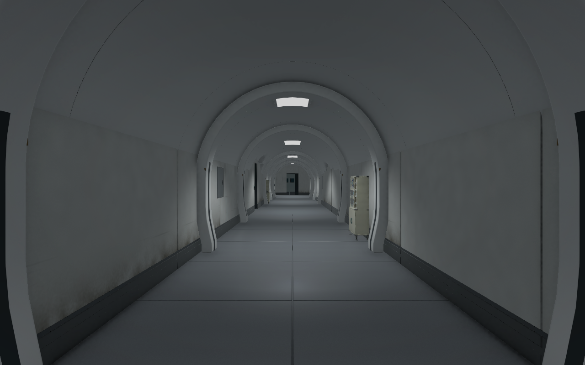
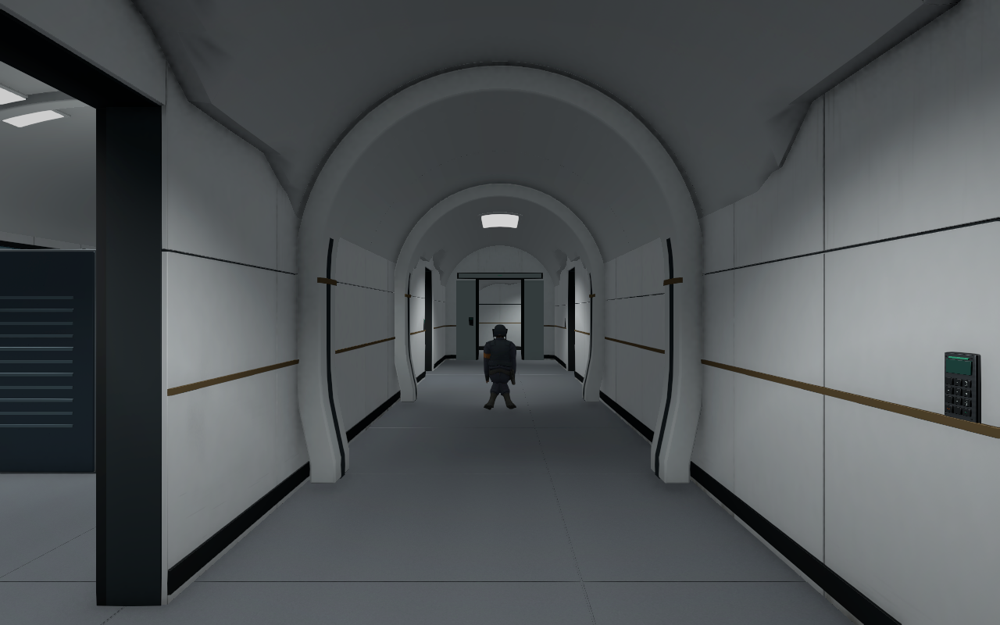
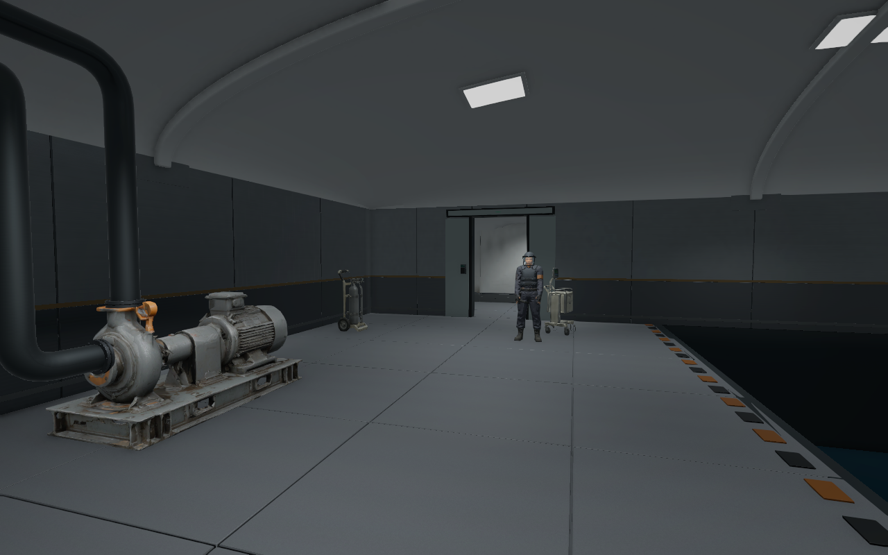
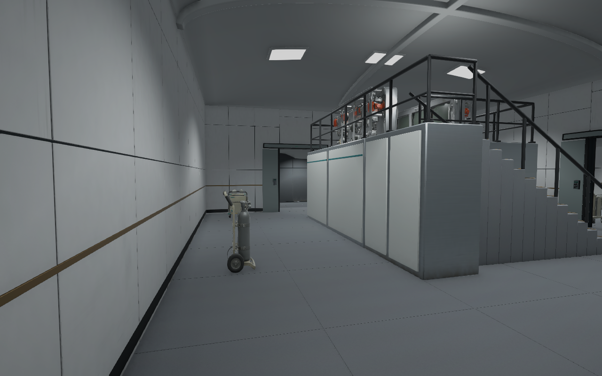

# B5·B4·B3 터널·돔 설계 정합 검수 V0.01

작성자 송예찬 · 2026-11-06

2026-11-06 최신: 사용자 요청에 따라 B5/B4/B3의 큰 복도 차폐벽12개를 제거하고 벽면 설비 엄폐12개로 대체했다. 도면V0.04와 단면 기준을 다시 작성해 복도4.2m·북측4.8m, 연속 반원 터널, 주요실 돔10곳, 문 접합부·리브·조명·충돌을 맞췄다. 기존 복도 조명은 정리하고 곡면 밀착등16개/층을 사용한다. 벽·상자 패턴은 장식 문양이 아닌 불규칙한 먼지·닦임·사용 흔적이며 상자309개에6마감을 혼합했다.

## 도면과 구조

방과 계단 크기를 줄이지 않고 일반 복도3→4.2m, 북측4→4.8m로 넓혔다. 건물 본체 외곽은51.6×34m이며 동측 코어에 단차가 있다. 계단·리프트 코어는 동쪽3.6m·남쪽0.8m 이동했다. 문 폭1.5m·높이2.8m, 계단A40단/7.8m와 계단B36단/6.4m를 유지한다.

[새 B5 평면](../../도면/잠입_탐색/B5_격리층_잠입.png) · [전체층 평면](../../도면/잠입_탐색/전체층_잠입.png) · [터널·돔 단면](../../도면/잠입_탐색/터널_돔_단면_기준.png) · [B5 예상 경로 비교](../../도면/잠입_탐색/플레이어_예상이동/B5_경로비교.png)

복도 천장은 연속 반원 터널이다. 24cm 두께·44cm 깊이 리브의 주 모서리에22mm 베벨을 넣었다. 발 돌출 약58cm로 일반 복도의 리브 사이 폭은 약3.04m다. 문 앞에는 측면 연결 곡면을 만들어 기존 문·키패드·수납부 높이를 피한다. 주요실 돔은 포드·데크·랙 높이를 기준으로 달리 잡고, 겹치던 기존 평천장과 등기구를 파생 모델에서 제거했다. 돔 등기구도 실제 곡면을 따라 붙인다.

| 층 | 복도 리브 | 주요실 돔 | 복도 조명 | 돔 조명 | 최고 LOD 삼각형 |
| --- | ---: | ---: | ---: | ---: | ---: |
| B5 | 17 | 2 | 16 | 12 | 1,811,020 |
| B4 | 16 | 5 | 16 | 24 | 1,931,889 |
| B3 | 17 | 3 | 16 | 14 | 3,098,827 |

큰 차폐벽은 층마다4개, 총12개를 시각 메시와 통행 충돌에서 제거했다. `Corridor_WallEquipment`에는 기존 공용 VARCO/Blender 보호구 수납 설비를4개씩 재사용했다. 약1.06×0.45×1.85m로 벽 쪽에 붙여 통로를 가로지르지 않는다. 기존 프랍101개를 합해 검사 대상은113개다. 긴 시야가 생긴 만큼 경비/CCTV 배치와 엄폐 체감은 실제 플레이에서 조정한다.

## 사진

| 큰 차폐벽 제거 후 B5 북측 터널 | B4 중앙 터널 |
| --- | --- |
|  |  |

| B5 냉각실 돔 | B4 관제 데크와 돔 |
| --- | --- |
|  |  |

사진은 검수용 임시 카메라 렌더다. Before 폴더는 복도 확장 전 상태다.

## 검증 결과와 범위

- 현재 충돌·바닥을 바탕으로 B5/B4/B3 예상 이동9개를 재계산했다. 도면 복사본에만 표시하며 미니맵을 만들지 않았다. 상층9개 경로는2D 가안이다.
- 예상 경로2,783표본 막힘0, 열린 일반 문74곳 접근 간섭0, 프랍113개 겹침0.
- 임시 CharacterController 이동·계단·데크19검사 통과. 실제 키보드 Play/FPS 측정은 이번 단계에서 하지 않았다.
- 원래 Transform6,798개의 회전·스케일·활성 상태를 보존하고 필요한 상위 배치를 이동했다. 새 구조와 설비는 별도 그룹이다. 기존 차폐벽 Collider12개는 껐다.
- 상자309개는6종 생활 흔적을 불규칙하게 섞었다. 1.05m 이내 동일 마감 이웃0쌍. 벽의 사용 흔적과 모든 LOD 재질을 확인했다.
- 누락 재질·스크립트0, 새 모델 재반입 경고/오류0. 정적 반사25개를 새 구조에 맞춰 갱신했다.
- 최종 반사 검사에서 B3의 기존 큐브맵10개가 빈 이미지였음을 확인했다. 반사 굽기에 일반 배치 메시도 포함하고 인물은 제외해 전체25개를 다시 생성했다. 사진도 수정된 반사 기준으로 다시 촬영했다.
- 원본 에셋·프리팹·게임 C#·Animator·설정·Packages·기존6씬 보존은 protection.json을 따른다. 기존 반사 이미지25개만 갱신 대상이다.

검사 원본: validation.json, controller.json, art_audit.json, structure.json, replanned_routes.json, import.json, reflections.json, protection.json. B4 추가 조명 정리는 lighting_refine.json이다.

## 현재 파일

- 씬: `Stage/Level_B5_Stealth.unity`, B4/B3 동일 형식.
- 활성 건축/벽: `Environment/<층>/WC_<층>_Architecture.fbx`, `WC_<층>_Walls.fbx`. B4는 WC_B4_Details도 사용한다.
- 터널·돔: `WA_<층>_Interior.fbx`, 씬 `Arched_Interior`. 정적 곡면 MeshCollider와 리브 충돌을 포함한다.
- 생활 흔적: 공용 WS 벽 재질, SW_Case_* 상자 재질/프리팹. WS_Clean은 흰색 벽 마감 이름이며 방화벽이 아니다.
- 편집 원본/외부 제작 도구: `SourceAssets/B345_WideInterior`, `B345_WallSurfaces`. Blender 베벨 수정 원본을 보존했다.

게임 기능·UI를 추가하지 않았다. 로컬 저장 상태이며 커밋/push하지 않았다.
