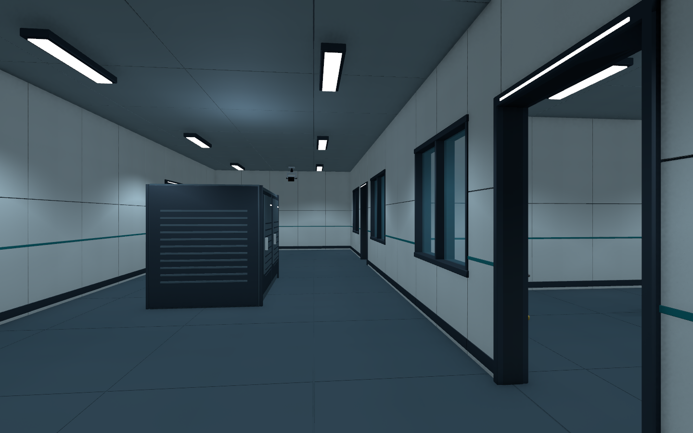
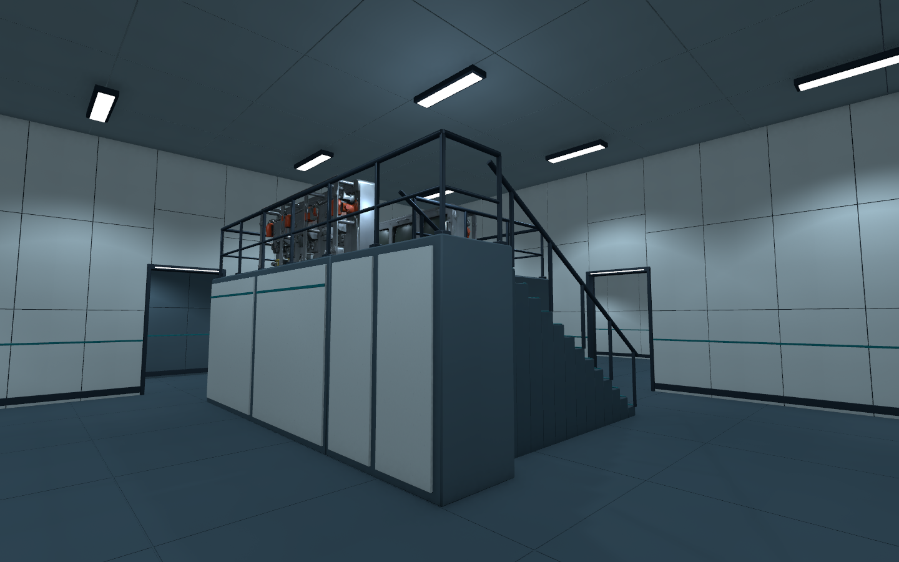

# B5 재검수 · B4 잠입층 제작 검수 V0.02

2026-11-06 · 작성자 송예찬

최신 Git `62ecedf`를 `git pull --ff-only`로 확인한 뒤, B5 보수 상태를 재검수하고 새 `Level_B4_Stealth.unity`를 제작했다. Unity 6000.4.0f1 / URP 17.4.0을 유지했다. 게임 내부 C#·Animator·패키지는 수정하지 않았다.

## B5 확인

현재 씬의 경비 얼굴·투명 바이저, 북/남 펌프 접지와 포트, 공급·회수 배관, 계단 중간참 난간과 벽 조인트를 새 카메라 렌더로 확인했다. 이번 확인 범위에서 추가 메시 보수는 하지 않았다. B5 씬 파일은 변경하지 않았다.

- [경비 얼굴](B5/01_Guard.png)
- [북측 펌프](B5/02_NorthPump.png), [남측 펌프와 배관](B5/03_SouthPumpPipes.png)
- [계단 난간](B5/04_StairLanding.png), [벽 접합부](B5/05_WallJoints.png)

도면의 예상 이동 경로를 지름0.6m·높이1.8m 캡슐로 0.25m 간격 검사했다. A210 / B330 / C108, 총648개 표본에서 겹침0건이다. 과거817표본과는 샘플링 방식이 다르며, 이 검사는 정적 통행 확인이다. 사람의 길 찾기·경비 회피·FPS 검증을 대신하지 않는다. [검사 원문](B5/route_audit.json)

## B4 제작

기준은 `Docs/도면/잠입_탐색/layout.json`의 B4와 `플레이어_예상이동/player_routes.json`이다. 원본 `Level_B4_Observation.unity`를 보존하고 별도 씬을 만들었다.

| 항목 | 현재 상태 |
| --- | --- |
| 평면 | 48×32m, 실내/복도/코어19구역, 문28곳(열림27·잠긴 설비문1) |
| 관찰 구역 | 북·남 관찰실과 관찰 복도, 양면 유리창4곳, 장비 랙 |
| 분석·관제 구역 | 분석 콘솔, 높이2.5m 데크와14단 계단, 가장자리 난간 |
| 지원 구역 | 관찰 지원·장비 준비·기록·유틸리티실, 잠긴 설비실 내부, 리프트 전실 |
| 계단A | B5 도착 전실과 닫힌 검토용 경계. B5와 연속된 단면/전환 미구현 |
| 계단B | 두 flight·중간참·상부참, 36단·상승6.4m 가안. B3 전환 미구현 |
| 배치 | 기존 소품30개, 경비3·연구원1·관절형CCTV2. NPC는 정적 외형 |
| 조명 | 광원93개 중 그림자7개, 구역별128px 정적 반사8개 |
| 메시 | 건축169,016tri + 마감12,096tri, 전체 최고LOD867,081tri |
| 충돌/LOD | Collider259개, 소품LODGroup30개 |

건축과 마감은 베벨·Weighted Normal·명시 삼각화로 출력했다. 편집 가능한 Blender 원본은 `SourceAssets/B4_StealthLayout/`에 둔다. Unity 모델은 `05.Model/Environment/B4/`에 직접 저장하며 재질과 반사 텍스처만 Materials/Textures로 나눈다. 공용 소품·인물과 B5의 도장 텍스처는 참조로 재사용했다. 새 바닥은 `B4SL_Floor.mat`를 사용하며, 기존 B4 바닥 재질은 보존했다.

[도착 전실](B4/01_Arrival.png) · [관찰실 안쪽](B4/03_ObservationRoom.png) · [데크 계단](B4/05_DeckStairs.png) · [데크 시야](B4/06_DeckView.png) · [분석실](B4/07_Analysis.png) · [계단B](B4/08_StairB.png) · [지원실](B4/09_SupportRooms.png) · [천장을 숨긴 전체 구조](B4/10_Overview.png)

## 통행·플레이 검사

| 검사 | 결과 |
| --- | --- |
| 캡슐 표본 | A341 / B545 / C191, 총1,077곳 겹침0건 |
| CharacterController.Move | A/B/C와 데크 상승/하강·계단B 상승/하강7개 검사 통과 |
| Controller 설정 | 지름0.56m, 높이1.8m, stepOffset0.3, skinWidth0.08, slopeLimit45°. 현재 플레이어의 치수/설정을 따르고 시험용 Controller 원점만 발 기준으로 변환 |
| 도착 높이 | 바닥0.08 / 데크2.58 / 계단상부6.48m. 0.08m는 skinWidth 여유 |
| 문 | 열린27곳 통행, 잠긴 설비문1곳 차단 확인 |
| 유리 | 창4곳 양쪽에서 충돌 확인. AI 시야/사격/교환 판정은 미구현 |
| 실제 플레이 모드 | 프레임 진행 확인, Input System의 W 입력0.8초로 약1.2m 이동, grounded 유지 |
| 마지막 플레이 Console | 새 경고·오류0건, 컴파일 실패 없음 |
| 참조 | 씬의 Assets 의존파일114개 존재, 누락 메시/재질/스크립트0건 |

[정적 경로](B4/route_audit.json) · [Controller 왕복](B4/controller_audit.json) · [문/창/참조](B4/connections.json) · [씬 검사](B4/scene_audit.json) · [실제 입력/프레임/Console](B4/play_audit.json) · [플레이 시작 화면](B4/11_PlayEntry.png) · [입력 후 화면](B4/12_PlayAfterInput.png)

정적 경로와 Controller 검사는 외부 제작 도구가 실행했다. 실제 키보드 상태 이벤트는 플레이 모드에서 기존 이동 코드에 전달했다. 전 구간을 사람이 직접 걸어 보는 잠입 플레이와 성능 벤치마크는 하지 않았다. 삼각형 수나 검사 중 프레임 증가를 FPS 성능 결과로 해석하지 않는다.

## 수정한 문제와 보존

새 씬의 초기 복사에는 B5의 조명 데이터 참조가 남아 URP ReflectionProbeManager에서 오류와 검은 렌더가 발생했다. B4의 복사된 LightingData 참조를 비우고 다시 연 뒤, B4 전용 반사8개를 만들었다. 최종 렌더와 실제 플레이에는 재발하지 않았다. 초기 도구 호출/검수 과정의 Console 이력과 최종 새 오류0건을 구분한다.

새 씬 전용 바닥 재질을 분리했고, 반입/저장 중 자동 변경된 기존 재질2개는 원래 내용으로 복원했다. 플레이 검사에서 변경한 Run In Background는 false로 되돌렸다. 기존 게임 코드·씬·Animator·Packages·ProjectSettings 및 사용자 GatewaySettings 등 보호95파일의 작업 전후 SHA256이 같다. [보존 결과](protected_after.json)

마감 확인 시 원본 B4/B5 씬2개는 `01.Scenes/Stage/Old/`로 이동돼 있었다. 이동된 씬의 내용 해시와 .meta의 GUID 보존을 확인해 해당 이동을 유지했고, 보존 결과의 relocated에 이전/현재 경로를 기록했다.

검수 중 새로 생긴 `ProjectSettings/Packages/com.unity.pipeline/EditorPipelineConfig.json`은 미추적 상태로 남겼다. 백그라운드 실행 옵션은 false이며, 파일 정리 명령은 자동 승인 검토의 `blocked by policy` 거절로 실행하지 않았다.

플레이 진입 시 NPC가 T자 자세로 돌아가는 문제는 B5의 정적 뼈 회전212개를 새 B4 인물4개에 복사하고, 컨트롤러가 연결되지 않은 인스턴스 Animator4개를 꺼서 보수했다. B5 씬과 공유 프리팹/Animator 리소스는 저장하지 않았다. [정적 포즈 적용 기록](B4/static_poses.json)

포즈 변경 후 떠 있던 발은 현재 스킨 메시의 최저 정점으로 접지를 다시 맞췄다. FBX 스케일을 중복 적용한 계산을 바로잡은 뒤, 경비는 약0.442m·연구원은 약0.160m 내려 발바닥을 바닥 위0.008m에 두었다. 최종 렌더와 플레이 화면에서 확인했다. [접지 보정 기록](B4/actor_grounding.json)

## 남은 설계·검수

1. **B5↔B4 계단A 단면:** B5의 상부참은 v26부터지만 B4 서측 문 중심은 v25이다. 평면상 E/T 좌표 일치만으로 실제 연결됐다고 볼 수 없다. B5 상승7.8m도 가안이다. 상부 계단 길이·참 폭·B4 개구를 함께 조정해야 한다.
2. **B4↔B3 계단B:** 상승6.4m·36단은 이번 보행 검토용이다. B3 도착층 높이와 문/참을 정한 뒤 확정한다. 현재 상부의 경계는 닫혀 있고 전환 로직은 없다.
3. **사람 검수:** 관찰창 너머의 시야, 데크 존재를 알아차리는지, 지원실 우회와 계단 찾기가 이해되는지 확인한다. 경비·CCTV·연구원 동작, 예약/교환, UI·애니메이션은 사용자의 후속 구현 범위다.
4. **다음 층:** B3 최신 잠입 평면과 예상 A/B/C를 읽고 같은 방식으로 별도 `Level_B3_Stealth.unity`를 제작·검수한다. 이번 작업에서 B3~1F를 새 평면으로 구현하지는 않았다.

검수 종료 시점에는 Git commit/push·외부 게시·유료 생성을 하지 않았다. 이후 사용자의 하루 마감 요청에 따른 공유 범위와 다음 회사 작업은 [최신 이어하기](../../이어하기_2026-11-06.md)를 따른다.
