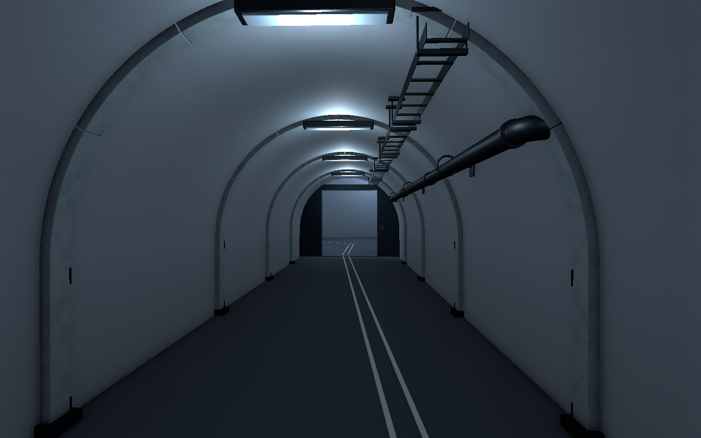
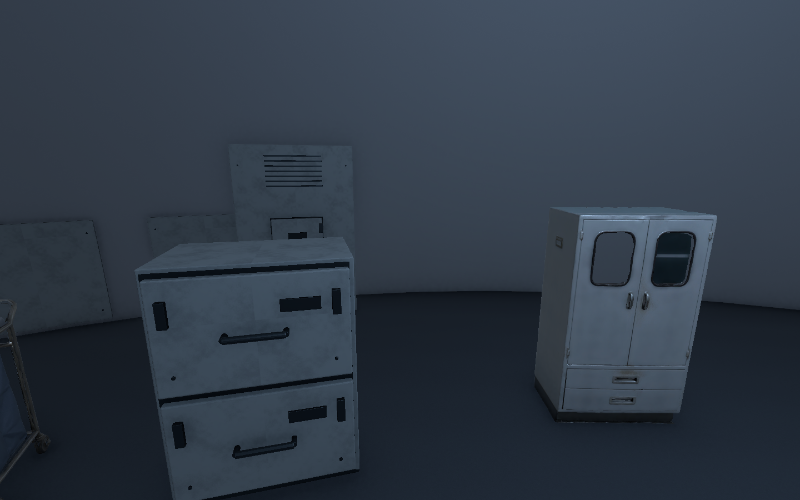
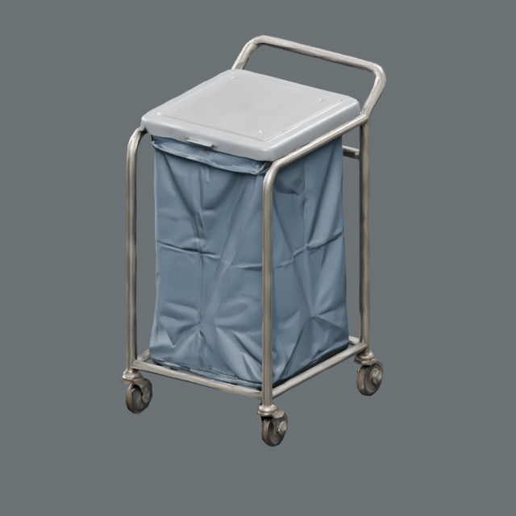
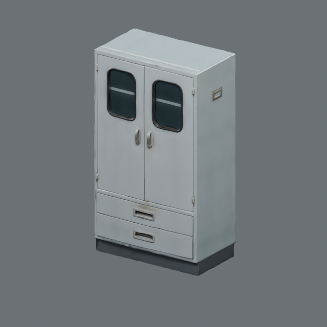

# 프랍·환경 목록과 B5 기준 구간 검수 V0.01

작성자 송예찬 · 2026-11-06

최신 시설생활 엑셀145종을 기준으로 환경32종과 바닥형 급식 전달 캐비닛·응급 보급장2종을 추가했다. 기존 소형 P82 전달함·P89 응급용품함의 용도와 치수는 유지한다. 새 품목은 P146/P147이다. 전체179종의 제작 방식·적용층·제작단계·재질·검수 기준을 기록했다. 환경 명세 수량은 기준 구간만 집계하며 빈칸은 전층 수량 미산정이다.

## 제작과 배치

- B5 C01 격리 공동과 T01 모니터링 연결 터널: 환경39개 + 프랍3개, 총42개.
- 환경 모델11개: 리브, 곡면 하부 보호판, 설비 받침, 밀폐 작업등, 루버, 케이블 트레이, 배관 클램프, 점검함, 직선관, 양 끝 환입 엘보2개. 문과 기존 외피를 보존했다.
- VARCO 세탁물함·응급 보급장은 리메시 후 Blender에서 비례를 유지해 치수 정규화,1mm 예각 베벨, PBR와3단계LOD를 정리했다. LOD 삼각형은 각각9,954/3,980/1,194 및8,236/3,293/988이다.
- 급식 전달 캐비닛은 VARCO 이미지까지 생성됐으나 3D 작업이 실패해 Blender에서 판금·힌지·문틈·손잡이·체결부·조절발을 직접 제작했다.
- 신규 환경의 예각에는 베벨, 도장과 금속에 서로 다른 금속도·거칠기 맵을 적용했다. 곡면 보호판에는4가지 불규칙 사용 흔적 변형을 사용했다.
- 기존 T01 임시 등2개를 비활성화하고 실제 기구와 맞춘 작업등4개를 사용했다. C01/C02 반사2개를 새 파일로 베이크했다.

## 검증 범위

- 엑셀의 기존 품목·명세·표·고정창을 보존하고 총179품목,3,306개 배치/조립 명세 행을 확인했다. 수식 오류0. 배치 상태를 바꾸면 목표/완료/잔여 수량이4/4/0→4/3/1로 갱신되고 복원되는 것도 검증했다. 임시 검증 변경은 저장하지 않았다.
- B5 기존 주/우회 경로690개 캡슐 표본: 막힘0.
- 신규 프랍의 유의미한 충돌 겹침0, 누락 메시0, 누락/오류 재질0.
- 프랍2종의 LOD 각3단계 연결. 배치된 신규 모델의 모든 LOD를 합한 메시 수치는133,701tri로 실제 프레임 렌더 비용과 다르다.
- 모델 최종 반입 경고/오류0. 내부 제작기에서 발생한 LODGroup 중복 추가 오류는 기존 그룹 재사용으로 수정했다.
- 게임 런타임 코드·기존 구버전 씬 내용과 GUID 보존. 세부 해시는 preservation.json, 참조 이동은 scene_archive.json.
- 키보드 Play/FPS, AI 감지, 전체층·전체 구역 연결, 문·조명 스위치 동작은 이번 검증에 포함하지 않는다.

## 씬 정리

Stage에는 Level_B5_Circular와 Level_B2_MezzaninePreview만 남는다. 이번에 이전 레벨6개와 Player 테스트 씬을 AssetDatabase로 이동했고, 기존3개를 합쳐 Stage/Old에10개를 보관한다. 빌드 설정은 기존 Player 씬의 경로만 Old로 갱신했으며 활성 여부는 유지했다. 빌드 시작 씬을 새 B5로 전환한 작업은 아니다.

## 확인 화면

## 다음 제작

B5 내부 생활 구획·침구·세면·관찰 장비를 기존145종 목록과 맞춰 보수하고 나머지 핵심실로 확장한다. 이후 B5–B4 실제 연결과 B4 기준 구간을 제작한다. 현재42배치를 전층 배치 완료로 집계하지 않는다. 커밋/push하지 않았다.
