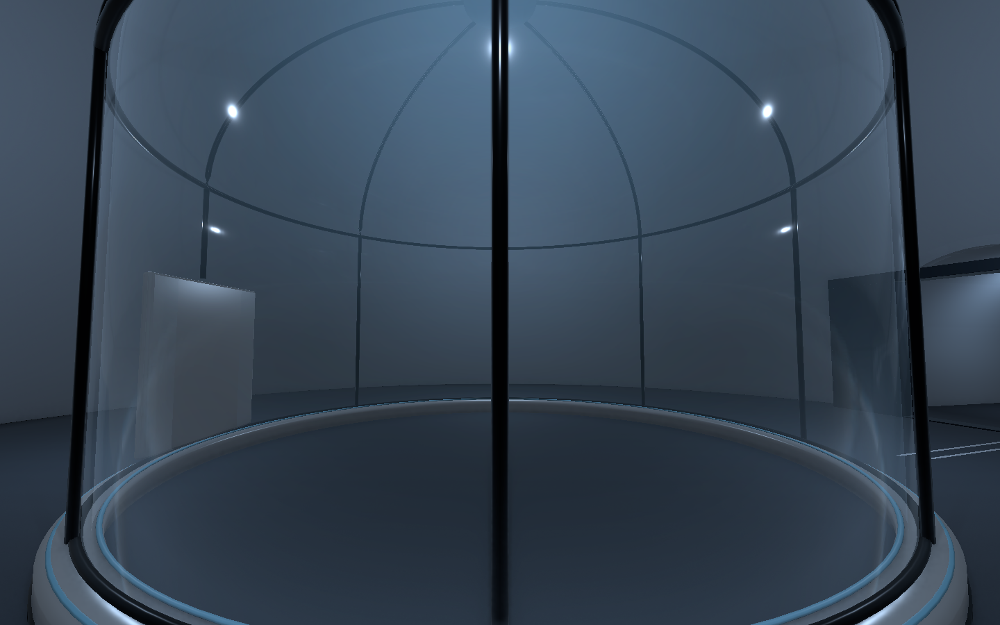
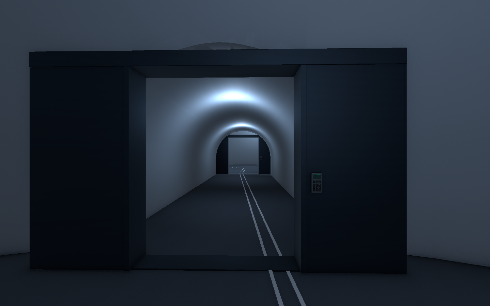
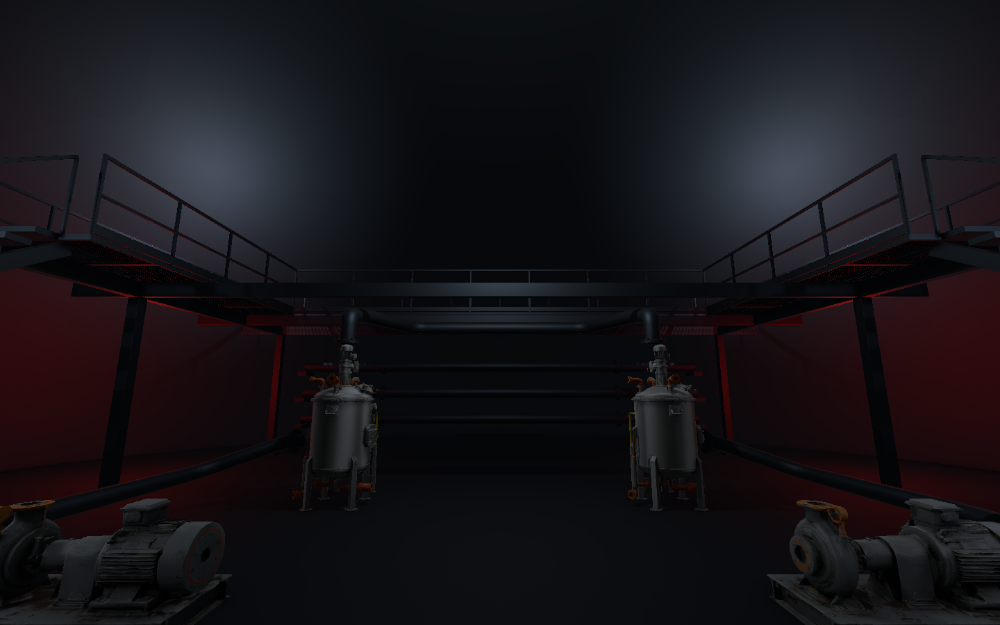
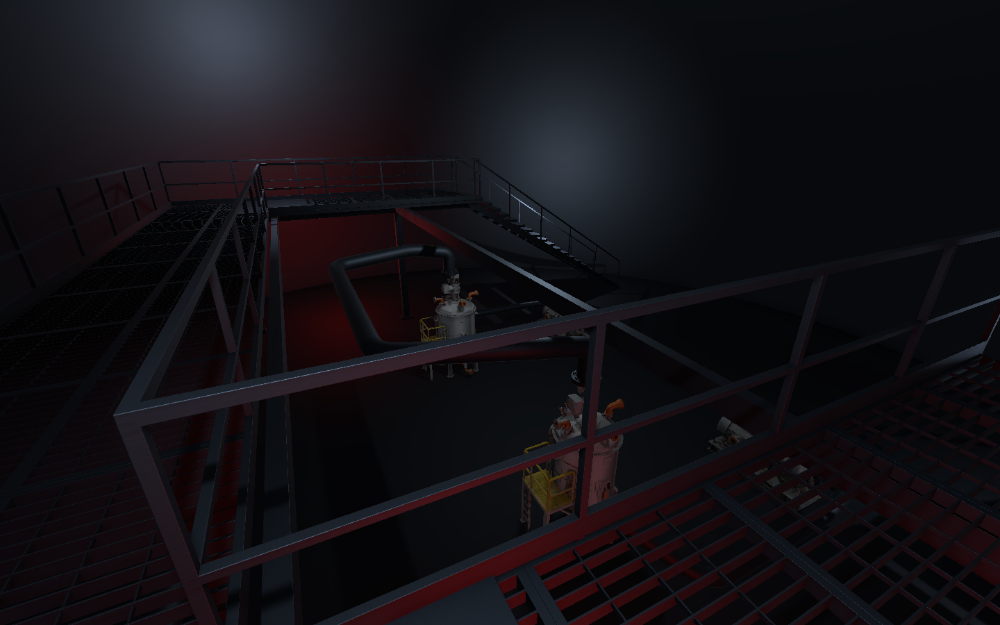

# 원형 공동 설계 대조·첫 제작 검수 V0.01

작성자 송예찬 · 2026-11-06

사용자가 완성된 외부 설계를 논의 내용과 대조·수정하고 제작을 시작하도록 요청했다. 수정본은 [원형 공동 제작 설계](../../도면/원형공동/README.md)이며, 기존 Unity 레벨과 별도로 첫 제작을 진행했다.

## 설계 대조

원본은 PDF20장·86공간·113동층 연결·5주요 층간 연결,145품목·3,264배치/조립 명세와27생활 활동을 포함한다. 실험체 생활, 연구원·경비 숙소, 위생·식사·리넨·데스크·서버 구성은 유지했다.3,264행 중 구성 부품1,775행과 조립 기준63행이 있으므로 이를 독립 장비 수량으로 합산하지 않는다. 기존 에셋 후보38개의 파일은 모두 존재한다.

| 항목 | 원본 상태 | 수정 |
| --- | --- | --- |
| 원형 공동·터널·층간 높이 | 반영 | 기존 좌표 보존. 처음에는 핵심 구역부터 제작 |
| B2 메자닌 | 없음. 복층 설명은 B4 관찰 데크만 포함 | C02에 그레이팅 U형 데크·계단2·작업대·상하 관찰 구조 추가 |
| 안내선과 기록 | 기록/생활 소품은 있으나 안내선 코드 연결 없음 | R1 직원·S1 시료·M1 정비 코드, 기록 문구와 경로 추가 |
| 층별 색감 | 도면 층 구분 색/분위기 참고 수준 | B5 청백색·B4 어두운 무채색·B2 철색/붉은 보조등·B1 유지 |
| B3 창고 조명 | 일반 작업등 배치 가안 |13개 구역 회로, 그중 보관5구역 기본 소등, 스위치 후보 위치·별도 안내광 |
| CCTV 후보 | 이전 공용 모델 | 회전 분리된 Enemy/CCTV_SecurityCamera_Articulated 우선, 일괄 방별 배치 재검토 |
| 문 폭 |2.4m 가안, 기존 프리팹 치수 수정 필요 |2.4m 개구부용 문틀·포켓·문짝을 Blender에서 새 제작 |

수정 PDF17장과 JSON은 프로젝트에 저장했고 `dl/outputs/after_seconds_reviewed`에 전달 사본을 둔다. 원본 PDF·엑셀·JSON·분위기 이미지는 보존했다. 참고원본 엑셀의 수식·수량은 수정하지 않았으며 새 메자닌·조명 회로는 수정 JSON을 우선한다.

## Unity 제작 범위

- `Assets/Afrer_Seconds/01.Scenes/Stage/Level_B5_Circular.unity`: 핵심 공동4개·코어3개·터널7개. 실제 반구형 외피와 터널 접합 개구부, 문14세트와 양면 키패드, 기존 후보 프랍17개, 청백색 조명46개, 반사7개, R1 바닥 표식.
- `Assets/Afrer_Seconds/01.Scenes/Stage/Level_B2_MezzaninePreview.unity`: C02 한 공동의 구조 검토 씬. 그레이팅 데크·계단2·기둥/보/계단 지지대·난간/발끝막이·철판 작업대, 탱크2·펌프2와 연결 배관·플랜지/볼트, 붉은 보조등과 중성 작업광·반사1개.
- 새 건축·문·메자닌·배관은 Blender 제작이며 편집용 베벨 원본을 SourceAssets/CircularFacility에 보관했다. 기존 프랍과 텍스처를 재사용했다. 새 에셋 생성이 필요한 추가 소품은 후속 VARCO 우선 수급 범위다.
- 기존 플레이어·이동 코드를 새 씬에 재사용했다. 게임 C#·AI·문 동작·조명 스위치·미니맵을 새로 구현하지 않았다. 현재 B3는 점등 설계 데이터까지이며 새 원형 Unity 씬은 아직 없다.

## 검증 결과

- B5 예상 주 경로·우회 경로는 실제 문틀·프랍 충돌을 반영해 다시 계산했다. 최초16개 충돌 표본을 수정하고 최종690개 캡슐 표본에서 막힘0개다.
- 문14세트 모두 열린 상태 중앙 통행 가능, 닫힌 상태 개구부 차단을 확인했다. 닫기/열기는 외부 Editor 검수이며 런타임 작동 구현이 아니다.
- B2 상부 데크105개 캡슐 표본에서 막힘0개다. 계단은 경사선에 수평 캡슐을 놓는 검사와 구분해 기존 CharacterController로 양쪽 상승·하강4회를 검사했다. 도착 잔여 거리 약0.075m, 바닥 기준 오차 약0.08m로 기존 컨트롤러의 접지 여유 범위다.
- 삼각형 합계는 B5 545,429 / B2 검토 씬547,316이다. LOD 자식 메시를 모두 더한 상한이며 실제 프레임 렌더 수나 성능 측정이 아니다.
- 초기4개 모델 반입 경고·오류0건, 새 CF 에셋 관련 Console 경고·오류0건을 확인했다.
- 보호 파일1,824개의 내용과 외부 원본의 SHA-256을 비교한다. 최종 결과는 [보존·검사 결과](preservation_and_checks.json)를 따른다.

실제 키보드 Play/FPS, 적 AI와 상하 감지, 전체층 연결·완주 검수는 하지 않았다. 상부 그레이팅의 실제 구멍과 지지대는 메시로 만들었지만 시각 가독성·최종 LOD와 조명 세부는 사용자 시야 검수 뒤 조정한다.

## 확인 이미지

## 다음 제작

1. B5 핵심 구역의 플레이어 시야·프랍 크기·벽면 마감과 안내선 체감을 확인한다. 현재는 첫 제작 단계이며 생활 구획·작은 소품이 완성된 상태가 아니다.
2. B5→B4 계단실·도착부를 실제 메시로 연결하고 B4의 무채색 측정 공간을 제작한다.
3. B3 보관 회로별 조명·스위치 외형과 랙 배치를 제작한다. 점등 상호작용은 사용자가 구현한다.
4. B2 검토 메자닌을 기계층 전체 경로와 접합하고 나머지 층·외곽 생활 공간으로 확장한다.

현재 변경은 로컬 저장이며 커밋·push는 하지 않았다.
