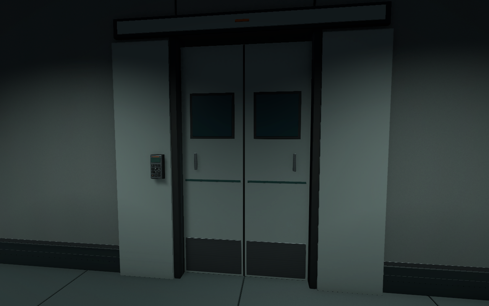
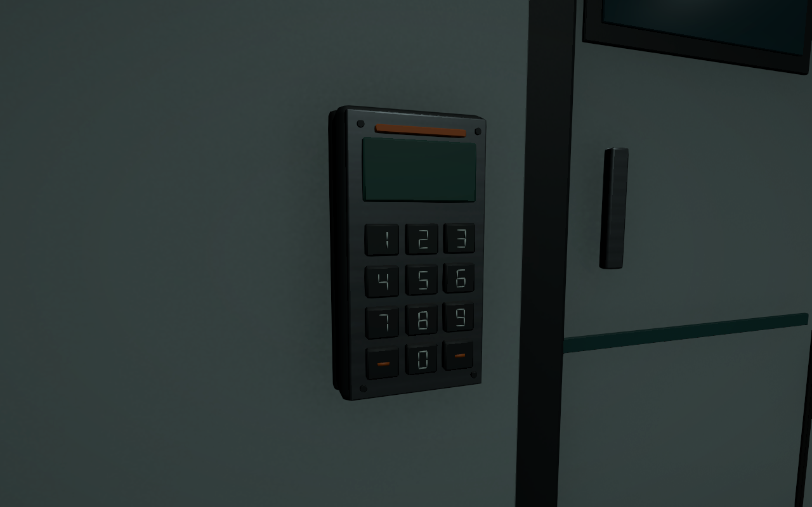
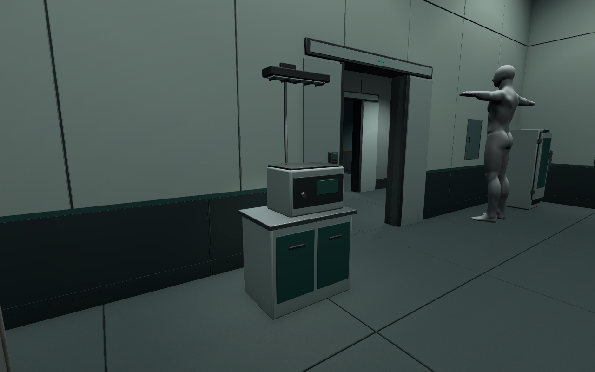
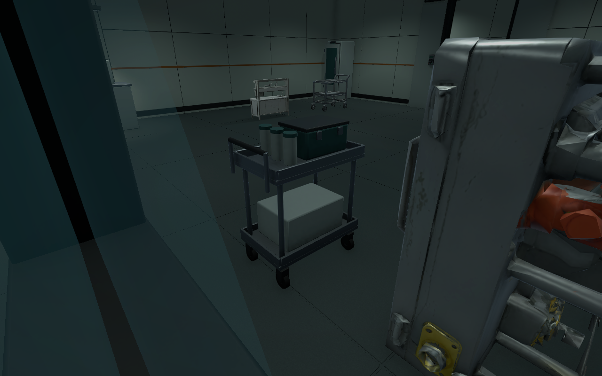

# B5·B4 문과 실험실 마감 검수 V0.01

작성자 송예찬 · 2026-11-06 · Unity 6000.4.0f1 / URP 17.4.0

사용자가 이동은 잘 된다고 확인한 뒤, B5와 B4 모두의 양개문·키패드·벽·배관 재질·추가 프랍·과한 밝기를 수정하도록 요청했다. 문틀도 같이 재제작했다. 실제 작동 코드는 사용자가 직접 작성한다는 기존 범위를 유지했다.

## 적용한 결과

| 항목 | B5 | B4 |
| --- | --- | --- |
| 새 문·문틀 | 25세트 | 28세트 |
| 기존 상태 유지 | 열림22 / 잠김3 | 열림27 / 잠김1 |
| 양면 키패드 | 50개 | 56개 |
| 추가 프랍 | 6개 | 9개 |
| 장비 작업등 추가 | 2개 | 3개 |
| 전체 광원 / 그림자 광원 | 84 / 16 | 96 / 7 |
| 갱신한 정적 반사 | 7개 | 8개 |
| 최고 LOD 배치 삼각형 | 1,084,917 | 1,062,101 |
| 전체 Collider(플레이어 포함) | 315 | 324 |

문은 좌우 슬라이딩 방식이다. 문틀·상부 모터 덮개·얕은 측면 수납 덮개·문짝·고무 맞댐·하단 금속판을 구성하고 예각에 베벨을 적용했다. 건축에 붙어 있던 옛 문틀/잠금문 시각 파트만 파생 건축에서 제거했다. 원본 모델과 편집 원본은 보존했다. 기존 잠금 Collider4개를 새 문짝 Collider로 대체했다.

`LP_DoubleSlidingDoor.prefab`의 `Leaf_Left`와 `Leaf_Right`가 움직일 파트다. 닫힘 중심은 X=±0.376m, 열림은 X=±1.126m이며 각각 0.75m 이동한다. `Left/Right_Closed`, `Left/Right_Open` 앵커가 있다. 문짝과 충돌체가 같이 움직이는 구조까지 준비했으며 키패드 입력·잠금 해제·자동 개폐·Animator는 미구현이다. 문 안쪽의 어두운 사각 패널은 현재 불투명 장식이며 관찰창 판정이 아니다.

키패드에는 돌출 숫자키12개, 숫자/제어 표식, 표시창, 상태 렌즈, 체결 나사를 만들었다. 정면에서 1–9/0이 올바르게 읽히도록 반입 후 좌우 방향을 보정했다. 잠긴 문은 호박색, 열린 문은 녹색 상태 렌즈다. 텍스트 UI나 안내 표지는 추가하지 않았다.

추가 장비는 샘플 냉장고·분석 장비·검체 운반 카트3종이다. 분석 장비 위 작업등에는 지지대와 차광 루버가 있다. 몸체는 도장 재질, 작업면/배관/연결부는 금속, 바퀴/실링은 고무로 구분했다. Blender 원본에 베벨을 남기고 Unity용 FBX는 베벨 적용·명시 삼각화 후 출력했다.

벽은 청결 구역·직원 구역·설비 구역의 톤을 유지하면서 과한 표면 무늬를 줄였다. `LP_Coating`, `LP_Concrete`, `LP_Stainless`의 Base/Normal/MetallicSmoothness 512px 맵9개와 공용 재질21개를 사용한다. 배관은 미세 브러시 방향의 금속 맵과 연결부 재질로 구분했다. 기존 `AD_*`, `SL_*`, `B4_*` 공유 재질 파일을 덮어쓰지 않고 두 새 씬의 참조를 교체했다.

전체 조도를 낮추고 구역 조명과 장비 작업등을 구분했다. Neutral 톤매핑, 노출0, 대비0, 채도-4, 약한 Bloom(0.025)을 적용했다. 천장 발광면은 별도 Unlit 재질로 읽히게 했다. 반사는 128px 정적 큐브맵15개를 새로 베이크했고 인물·플레이어 렌더러는 베이크 중만 숨겼다가 복구했다. 실시간 반사나 그림자 광원을 추가하지 않았다.

## 검증과 보존

- 예상 A/B/C 경로를 반경0.30m·높이1.8m 캡슐, 0.25m 간격으로 검사: B5 648표본, B4 1,077표본, 막힘0건.
- 열린 문49곳의 중심과 앞뒤 통로 검사: 막힘0건. 잠긴 문4곳은 두 문짝 Collider에 막히는 것을 확인했다. 모든 문에 좌우 앵커/Collider와 키패드2개가 있다.
- 새 프랍15개의 내부 축소 상자 검사: 기존 충돌체와 겹침0건. 이 검사는 Collider 기준이며 메시 전체의 임의 관통을 완전히 보증하지 않는다.
- 누락 스크립트·누락 재질·오류 셰이더0건. 첫 반입과 최종 키패드/작업등 강제 반입의 새 경고·오류0건.
- 원본6씬·게임 C#·Animator·설정·Packages·기존 로컬 재질5개 등 보호 파일153개 SHA256 일치. 새 B5/B4 씬만 보호 비교에서 제외했다. 건축/조명 외 기존 Transform1,503개는 같은 이름이 반복되는 경우도 포함해 전후 일치했다.
- 최고 LOD 수치는 배치된 메시 합계다. 기존 소품 LOD는 유지했다. 실제 동시 가시량·FPS·CPU/GPU 비용 측정은 이번 검증에 포함하지 않았다.

전후 사진은 동일 카메라의 **Edit Mode 오프스크린 렌더**다. 실제 Play 입력·잠입 난이도·문 개폐 테스트가 아니다. 5시점 평균 표시 밝기는 B5 0.407→0.162, B4 0.284→0.150이다. 재질/톤매핑을 포함한 이미지 비교 수치이며 조도(lux)나 모니터 밝기 측정값은 아니다. 사용자 화면에서 읽기 어려운 구간은 해당 구역 조명으로 후속 조정한다.

## 사진

| 구역 | 이전 | 수정 후 |
| --- | --- | --- |
| B5 시작 구역 | [이전](Before/B5/View1.png) | [수정 후](After/B5/View1.png) |
| B5 냉각실·배관 | [이전](Before/B5/View2.png) | [수정 후](After/B5/View2.png) |
| B4 분석실 | [이전](Before/B4/View3.png) | [수정 후](After/B4/View3.png) |
| B4 관제 데크 | [이전](Before/B4/View4.png) | [수정 후](After/B4/View4.png) |

## 파일과 다음 작업

- 씬: `01.Scenes/Stage/Level_B5_Stealth.unity`, `Level_B4_Stealth.unity`.
- 건축: `05.Model/Environment/{B5,B4}/LP_B5_Architecture.fbx`, `LP_B4_Architecture.fbx`.
- 문·키패드·프랍6종: `05.Model/Props/Common/LP_*`.
- 재질/맵: `05.Model/Environment/Common/{Materials,Textures}/LP_*`.
- 반사: `05.Model/Environment/{B5,B4}/Textures/LP_Reflection_*`.
- 톤 프로필: `06.Data/LP_LabTone_B5.asset`, `LP_LabTone_B4.asset`.
- 제작 원본/외부 도구: [SourceAssets/B45_LabPolish](../../../SourceAssets/B45_LabPolish/README.md).
- 상세 결과: [validation.json](validation.json), [applied.json](applied.json), [reflections.json](reflections.json), [protected_files.json](protected_files.json), [preserved_transforms.json](preserved_transforms.json).

다음은 두 층의 사용자 시야에서 밝기·문틀 크기·장비 배치 확인, 실제 성능 측정, 기존 계획의 계단A 단면 정리다. 문/키패드의 기능은 사용자 질문에 맞춰 별도로 구현한다. 층간 전환·AI·CCTV 회전·UI·미니맵은 이번 작업 범위가 아니다. 현재 변경은 로컬에 저장했으며 이번 마감에서 커밋/push하지 않았다.
