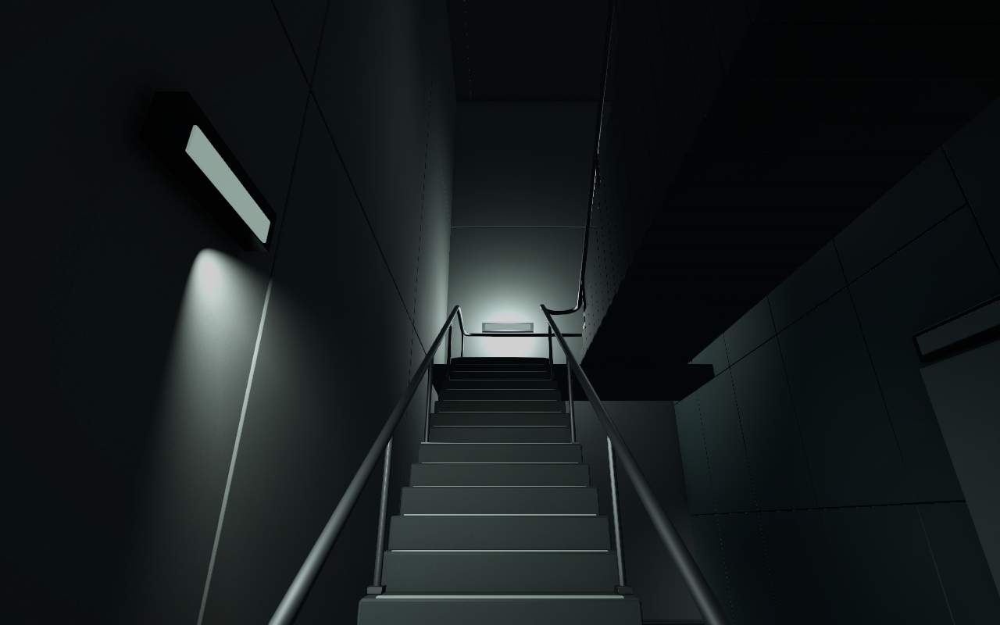
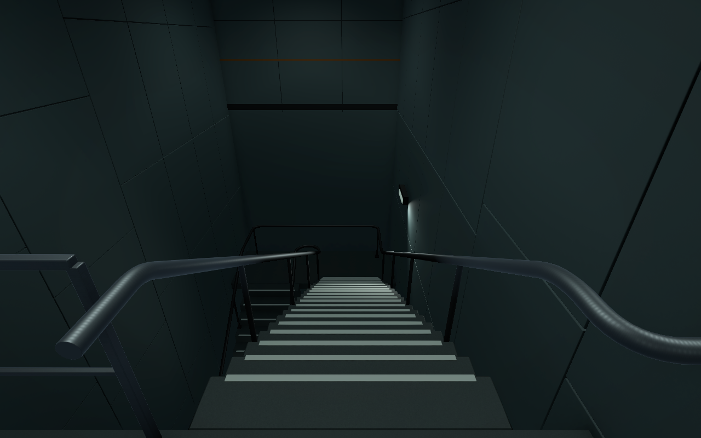
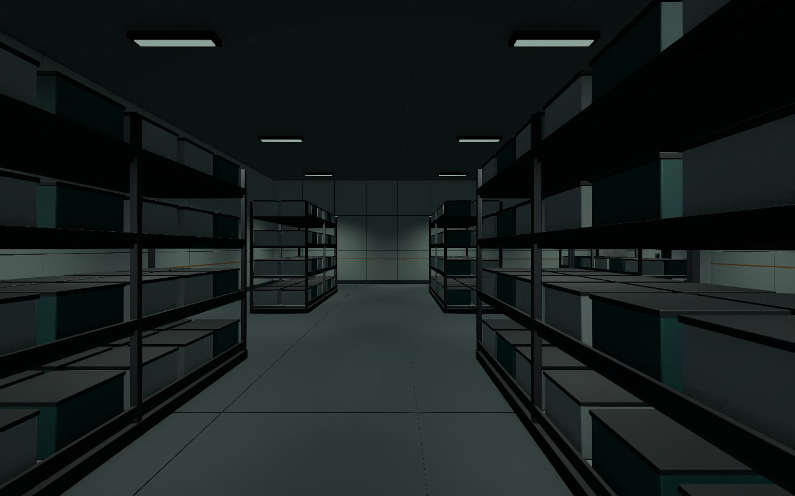
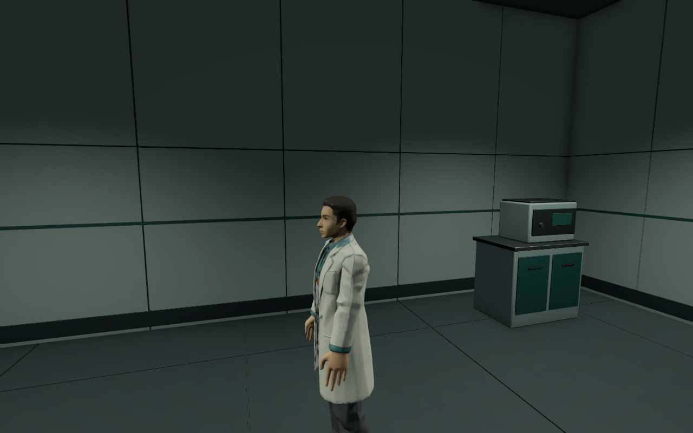
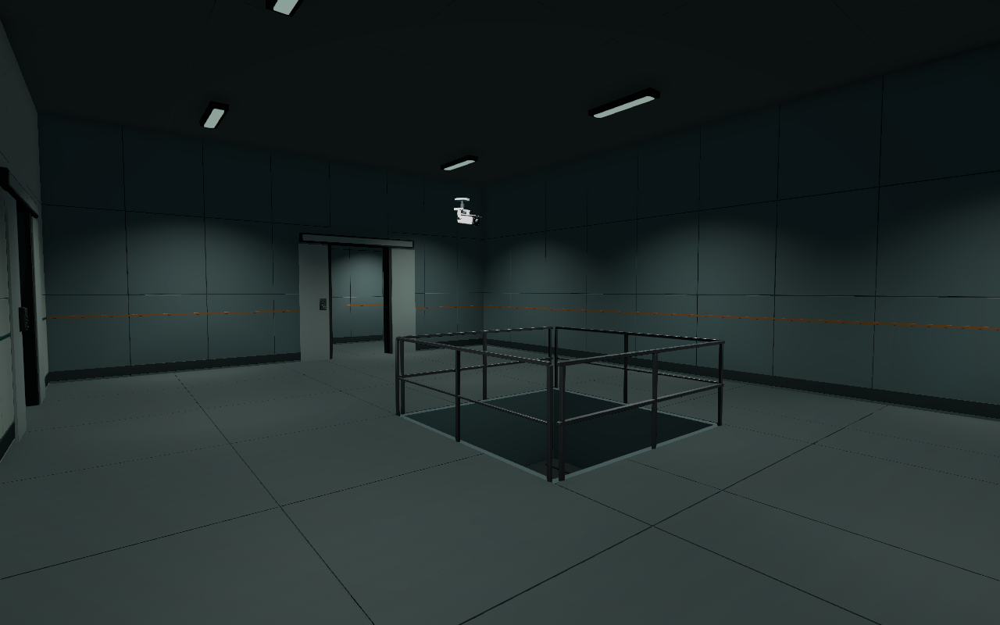
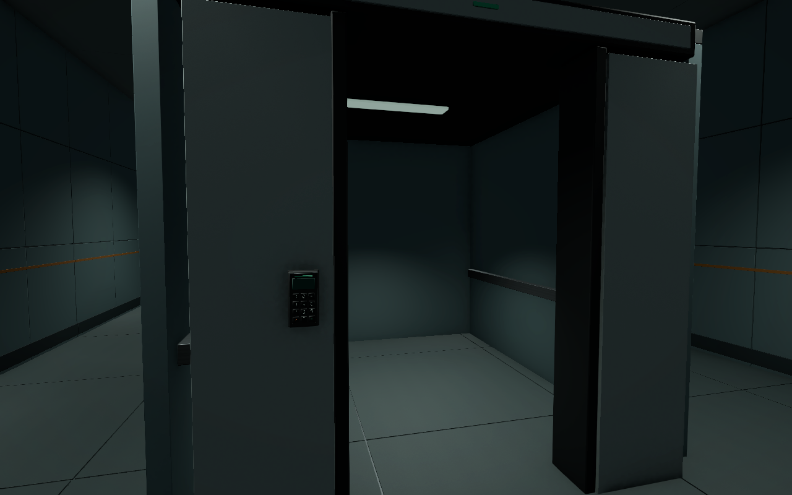

# B5·B4 단면 정합과 B3 시료층 검수 V0.01

작성자 송예찬 · 2026-11-06 · Unity6000.4.0f1 / URP17.4 / Blender5.2.2 LTS

사용자가 승인한 다음 작업으로 B5/B4 실제 플레이 시야·성능을 확인하고, 계단A/B 도착 단면을 맞춘 뒤 별도 B3 잠입층을 제작했다. 게임 내부 C#·AI·Animator Controller·UI는 추가하거나 수정하지 않았다. 이번 변경은 로컬 저장 상태다.

## 결과와 확인 위치

- `Assets/Afrer_Seconds/01.Scenes/Stage/Level_B3_Stealth.unity`: 새17구역 시료층. 랙6개, 세척 피트, 검수대, 지원실4개와 복도 우회, 계단B 하강부, 정적 화물 리프트. 일반 문27세트와 프랍18개, 경비3·연구원1·CCTV2.
- 새 B5/B4: 계단 상부참에 맞는 문 개구와 층간 경계문, 아래층 계단, 난간/추락 방지 충돌, 디딤판 대비 띠와 국부 조명. B4 도착문 v28.25, B3 도착문 v23.5. 자세한 치수는 [층간 단면](../../도면/잠입_탐색/층간_단면.md).
- 활성 건축은 각 층 `05.Model/Environment/{층}/LC_{층}_Architecture.fbx`. 이전 LP/SL/B4 원본은 보존했다. Blender 편집 원본·베벨·출력 도구는 [LevelContinuation](../../../SourceAssets/LevelContinuation/README.md), [B3_StealthLayout](../../../SourceAssets/B3_StealthLayout/README.md).
- B5의 Vestibule_ColdSamples/Monitoring_Analyzer, B4의 AN_Analyzer/AS_Analyzer는 앞면이 벽을 향하던 방향을 수정했다. 작업등 방향도 맞췄다. B5 포드·기존 인물과 기존 프랍 배치는 유지했다.
- 최종 근접 검수에서 새 B5 상부문과 겹친 기존 `StairA_LampUpper`를 문 위 중심높이10.8m로 옮기고 연결 조명도10.65m로 맞췄다. 원본 조명 모델은 보존했으며 [수정 후 사진](B5/View2.png)과 B5 반사를 다시 확인했다.
- B3 밝기는 랙/장비가 읽히도록 천장·리프트 국부 조명으로 보정했다. B5/B4 전체 노출을 다시 올리지 않았다. 정적 반사는 B5 7/B4 8/B3 10개,128px다.

열린 문 옆의 흰 부재는 고정 수납 덮개이며 문짝이 튀어나온 것으로 확인되지 않았다. 앞선 DoorPocketFix 자료는 진단 기록이다. 이번 단면 정합과 별개로 기존 문 포켓을 수정했다고 기록하지 않는다.

## 정적 검사

| 항목 | B5 | B4 | B3 |
| --- | ---: | ---: | ---: |
| 최고LOD 전체 삼각형 | 1,108,145 | 1,127,609 | 893,329 |
| 전체 Collider, 플레이어 포함 | 322 | 382 | 282 |
| 광원 / 그림자 광원 | 86 / 16 | 100 / 7 | 71 / 5 |
| A/B/C 캡슐 표본 | 666 | 1,064 | 897 |
| 경로 막힘 | 0 | 0 | 0 |
| 일반 열린 문 통행 | 22 / 22 | 27 / 27 | 25 / 25 |
| 추가 프랍 겹침 | 0 / 6 | 0 / 9 | 0 / 18 |
| 누락 스크립트·재질 | 0 | 0 | 0 |

근거: [validation.json](validation.json). 문짝은 열림/닫힘 앵커와 Collider 연결을 확인했다. 일반 문80세트는 열린74/잠긴6개다. 여기에 층간 경계문4개와 열린 리프트문1개가 별도로 있다. 닫힌 층간 경계문4개는 중앙 충돌이 있고, 리프트문은 중앙이 비어 있다. 문 작동 기능은 없다.

첫 B3 검사에서 예상 경로가 캐빈 측벽·문 수납부에 닿았다. 이 구조물을 원안 평면 장애물에 반영하고 SVG/PNG·A/B/C 경로를 재생성한 뒤 최종2,627표본에서 막힘0건을 확인했다. 도면의 E/T는 높이를 접은 평면 표시이며 계단은 별도 검사했다.

임시 CharacterController.Move로 A/B/C9개, 계단A/B 상·하행8개, 데크 상·하행2개를 검사했다. 반지름0.28m·높이1.8m·stepOffset0.3m·skinWidth0.08m·경사45도. 바닥 오차 약0.08m는 skinWidth 범위다. [controller.json](controller.json)에 실제 이동 단계와 결과가 있다. 이 검사는 적 행동/잠입 성공을 검증하지 않는다.

## 실제 Play·성능

i5-11400F / RTX3070 / 메모리 약32GB / Direct3D12,1920×1080·renderScale1·PC 품질·VSync0·targetFPS-1. 층마다24초, 세 시점을8초씩 기록하고 각 시점 첫2초를 제외했다. 첫 시점에서 W 입력1초를 주입했다. 게임 뷰에 초점을 맞추고 서로 다른 Time.frameCount만 집계했다.

| 층 | 관찰 프레임 / 측정 표본 | 실제 W 이동 | 시점별 프레임 중앙값 범위 | 가장 높은 p95 | CPU Main 평균 범위 | GPU 평균 범위 |
| --- | ---: | ---: | ---: | ---: | ---: | ---: |
| B5 | 2,614 / 1,974 | 1.494m | 8.80–9.19ms | 11.01ms | 2.64–2.99ms | 1.46–1.48ms |
| B4 | 2,804 / 2,117 | 1.507m | 8.13–8.46ms | 10.22ms | 2.50–2.76ms | 1.14–1.17ms |
| B3 | 2,995 / 2,267 | 1.498m | 7.70–7.87ms | 9.41ms | 2.31–2.46ms | 0.90–0.93ms |

세 층 모두 측정 중 새 경고·오류0건, 측정 표본 전체에서 focused=true였다. B5는 중앙 복도/냉각실/계단A, B4는 중앙 복도/분석실/관제 데크, B3는 중앙 복도/시료 랙/검수대 시점이다. [요약 데이터](performance_summary.json), [B5 원시 기록](B5_play_performance.json), [B4 원시 기록](B4_play_performance.json), [B3 원시 기록](B3_play_performance.json).

단면 수정 전 같은 시점의 중앙값은 B5 8.42–9.65ms, B4 8.52–8.58ms였다. [B5 이전 기록](B5_baseline_play_performance.json), [B4 이전 기록](B4_baseline_play_performance.json)을 보존했다. 반복 실행 변동을 포함하므로 차이를 최적화 성과로 단정하지 않는다. 최종 평균 DrawCall은 시점별 B5 1,597–2,428 / B4 1,279–2,249 / B3 1,285–1,667이며 이후 목표 기기에서 별도 확인한다.

CPU/GPU는 FrameTimingManager 값이다. 그림자 패스별 비용을 분리한 Profiler 분석이나 standalone 빌드 벤치마크는 하지 않았다. 이 기록은 현재 Editor에서의 짧은 측정이며 전체 게임 성능 보장이 아니다. 측정 후 Play를 종료하고 Run In Background를 원래 false로 복구했다.

실제 게임 뷰 캡처: [B5 계단](B5_Play.png), [B4 관제 데크](B4_Play.png), [B3 청정 구역](B3_Play.png).

## 보존·반입

최종 FBX3개 강제 반입 경고/오류0건. 원본6씬·게임 코드·Animator·설정·Packages·사전 로컬 재질5개 등을 포함한 보호 파일156개 해시 일치. 의도한 건축/충돌/조명/신규 LP 프랍/마커·B4 시작점/이동한 문·B5 상부문 벽등을 제외한 기존 Transform2,070개도 일치했다. 새 에셋과 .meta의 누락/고아 파일0건을 확인했다. [해시 근거](protected_files.json), [배치 검사 범위](preserved_transforms.json), [.meta 검사](meta_check.json), [반입 로그](import.json).

## 화면

아래는 동일 카메라 설정의 Edit Mode 오프스크린 렌더이며, 실제 Play 캡처/성능 자료와 구분한다.

최종 프레임의 표시 휘도/흰색 클리핑 비율은 [images.json](images.json)에 기록한다. 사진은 물리 조도 측정값이 아니다. 어둠 속 가독성과 길 찾기는 사용자의 직접 이동 검수가 남는다.

## 남은 작업

1. B3 시작 전실→시료 랙→제염 출입구→리프트를 사람이 직접 걸으며 갈림길과 출구 가독성 확인.
2. 문·키패드·층 전환/리프트 기능은 사용자 질문과 직접 코딩 순서로 구현.
3. B3→B2 리프트 단면과 B2 새 잠입층 제작. B2·B1·1F의 새 평면은 아직 미적용.
4. AI/경보·교환·애니메이션을 연결한 뒤 실제 잠입 난이도, 목표 기기 빌드 성능 확인.

기존6층 씬과 게임 코드, 사용자 로컬 재질5개·설정·Packages를 보존한다. Unity 버전과 패키지는 변경하지 않았다. 새 씬을 Build Settings에 자동 추가하지 않았고, 현재 층간 자동 이동은 없다.
