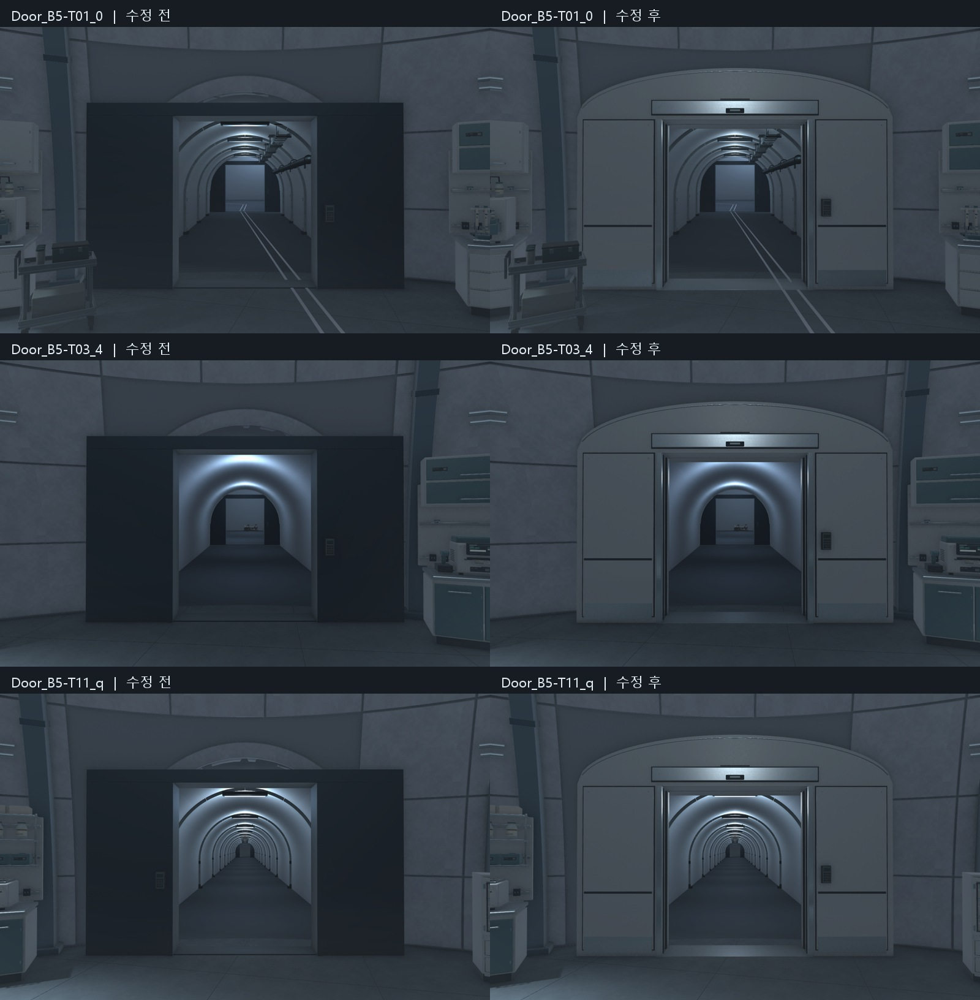

# 실험동 출입문 보수 검수 V0.01

작성자: 송예찬 · 2026-11-07

## 결과

C01은 앞으로 **실험동**이라고 부른다. T01·T03·T11의 실험동 쪽 문3세트를 교체해 문 위로 터널 단면이 드러나던 부분을 막았다. 원래 터널 높이3.4m와 문 상단3.08m 사이에 약32cm의 차이가 있었다. 새 문은 통행 폭2.4m·높이2.79m를 유지하고 최대3.65m의 곡선 외장과 터널 안으로 이어지는 아치 마감으로 접합한다.

양면 패널 사이에 실제 빈 수납 공간이 있고, 좌우 문짝은 각각1.235m 이동한다. 문짝에는 실제 뚫린 관찰창과 투명 유리, 밀폐선, 킥플레이트, 손잡이 홈을 넣었다. 상부 점검 커버·센서 외형, 금속 트림·체결부·키패드까지 정리했다. 기존 직사각형 문은 각 문 아래 비활성으로 보존했다. 다른 구역의35문은 교체하지 않았다.

## 검증

| 항목 | 결과 |
| --- | --- |
| 닫힘 상태 터널 단면 | 3,673표본×3 =11,019표본, 빈틈0 |
| 기존 문 위쪽 차폐 | 각117개 상부 광선 미차폐 확인; 새 문 상부462표본 미차폐0 |
| 열린 문 통행 | 81표본×3 =243표본, 막힘0 |
| 문짝 이동 중 간섭 | 좌우21자세×3 =126자세, 1mm 초과 간섭0 |
| B5 복도 | 4,854표본 막힘/바닥 누락0 |
| 세 연결 복도 왕복 | 기존 CharacterController 이동6/6 통과 |
| 신규 모델 | 기능별 메시3개, 28,364tri, 퇴화면/누락 재질0 |
| 승인된 배치 | 실험동 작업대/설비 Transform·플레이어 위치 유지 |
| 실제 Play | 기존 W 입력으로 T01 문 통과1.219m,422프레임 진행,새 경고/오류0 |
| 성능 표본 | 1920×1080 Editor, 중앙11.81ms·p9513.41ms; 최종 빌드 성능을 뜻하지 않음 |

단면 차폐는 정적 Collider 광선 표본 검사이며 유리 관찰창은 시각적으로 투명하고 충돌은 막는다. 화면은 실험동/터널 양쪽, 상부 근접, 임시 닫힘 자세로 확인했다. 기존 문과 새 문 상부 검사는 시작 높이가 달라 표본 수 자체는 직접 비교하지 않는다.

## 보존과 저장 상태

게임 C#·Animator·다른 씬·기존 리브·프랍 모델/텍스처는 보존했다. 원래 씬5673개 직렬화 객체의 삭제0, 기존 객체 변경18개는 세 문과 보관용 재부모화에 한정된다. 신규 문은 열린 상태이며 Play 종료 후 저장 씬을 다시 열어 플레이어와 편집 상태를 복원했다. 최종 Play=false, sceneDirty=false, 백그라운드 실행 설정=false다.

보호 파일3,246개 중3,244개는 바이트 동일하다. Unity 전체 저장 과정에서 재질 자동 직렬화가 기록되어 정리했으며 `PF_Decal_Sealer.mat`, `PR_VialGlass.mat`2개의 해시는 기준과 다르다. Sealer는 URP의 doubleSidedGI 및 BaseMap/MainTex 동기화, VialGlass는 URP 재질 직렬화/메타데이터 차이로 남아 있다. VialGlass의 기존 BaseColor(0.64,0.78,0.79,0.20), 투명/뒤면 컬링·거칠기 설정은 기존 제작값으로 유지했다. 파일 전체 동일로 보고하지 않는다. 앞으로 적용기는 새 전용 재질만 `SaveAssetIfDirty`로 저장한다.

개폐 애니메이션·잠금·상호작용·키패드 동작은 이번 범위에 포함하지 않았다. 열린/닫힌 앵커와 정적 충돌만 준비했다. 사용자에게 확정받은 게임 로직으로 해석하지 않는다. 실험동 전체와 B5 전체 아트 완성이 아니며0/34를 유지한다.

## 파일

- 원본/도구: `SourceAssets/C01_Doors/`, 편집 원본 `CDR_ClinicalPortal.blend`.
- 모델: `Assets/Afrer_Seconds/05.Model/Environment/B5/CDR_ClinicalPortal.fbx`.
- 전용 재질: 같은 폴더 `Materials/CDR_Accent`, `CDR_Glass`, `CDR_Status`.
- 반입 기록: `06.Data/AssetSources/C01_Doors_20261107.json`.
- 검수 원문: `door_audit.json`, `route_audit.json`, `controller_walk.json`, `play_door.json`, `preservation.json`.
- 수정 전9장, 수정 후12장. 닫힌 사진은 검수용 임시 자세이며 씬에는 열린 상태로 저장했다.

기존 커밋되지 않은 작업과 이번 작업은 로컬에 보존되어 있다. 커밋·push·게시하지 않았다. 다음은 사용자 시야에서 문 외형 확인 후 실험동 벽/광원·바닥 안내선 마감, T01→C02다.
