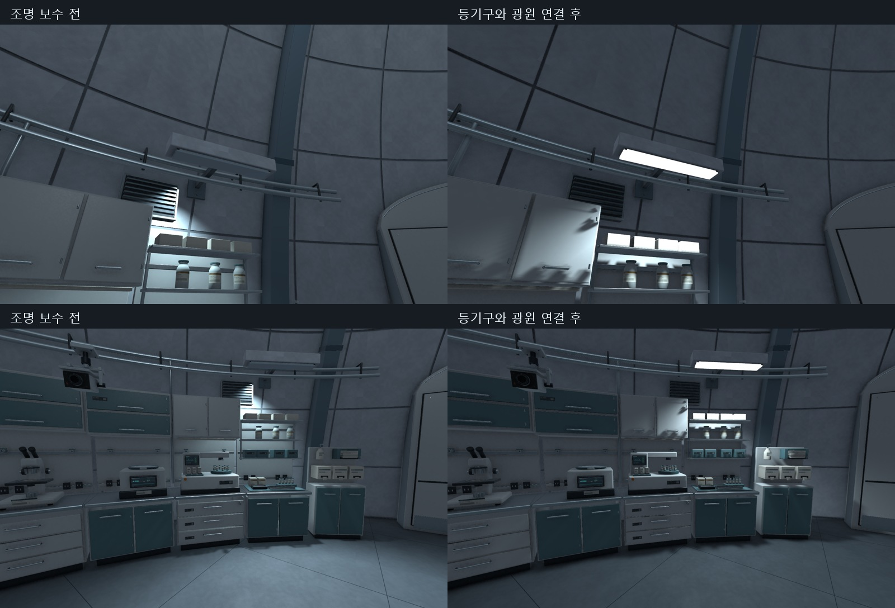

# 실험동 조명 연결 검수 V0.01

작성자: 송예찬 · 2026-11-07

실제 작업등은 EmissionColor가 설정되어도 `_EMISSION` 키워드가 꺼져 어두웠다. 외곽 보조 Spot5개와 중앙 보조 Point1개는 대응하는 등기구가 없이 빛을 내고 있었다. 사용자 Worklight_52 위치 조정은 먼저 별도 백업해 현재 값과 의도를 보존한 뒤 원인을 수정했다.

벽 작업등4개의 확산판을 전용 CL_Lamp로 연결했다. 발광색/키워드와 BakedEmissive 플래그를 함께 설정해 재로드 뒤에도 발광이 유지된다. 이 재질 플래그를 사용했지만 GI나 Lightmap을 새로 베이크한 것은 아니다. 실제 광원은 확산판 아래47.5mm, 수직 아래에서 실내 쪽6.84도다. Spot135/Inner90도, Intensity6.5, Range11m로 조절해 작업대의 과한 흰색 번짐을 줄였다.

포드의 Point 광원은 아래 방향 Spot으로 전환했다. 확산판이 광원 위58mm에 있는 천장 등기구1개를 붙였고 기존 Intensity12/Range12m를 유지했다. 신규 모델1,632tri·퇴화0. 외곽 보조광5개와 Measurement_Indirect1개는 Light 컴포넌트만 비활성 보관했으며 위치/회전/Intensity/Range는 삭제하거나 초기화하지 않았다. 실험동 안의 활성 Light는 벽4+포드1=5개다. T01/T11에 실제 등기구가 있는 밀폐등15개의 발광 표면도 연결했다. 다른 복도나 전체 B5 조명 완성을 뜻하지 않는다.

## 검증

- 벽 작업등4개 모두 발광 표면 연결, 확산판/광원 오프셋47.5mm·방향 차6.84도.
- 포드 확산판/광원 오프셋58mm·방향 차0도. 새 모델 퇴화면0.
- 발광 키워드와 BakedEmissive 플래그는 저장/재로드/Play 진입 후에도 유지.
- 실제 기존 W 입력: 345프레임 진행, 1.218m 이동, 새 경고/오류0건.
- 1920×1080 Editor 프레임 시간 중앙13.64ms, p95 17.92ms. 최종 빌드 성능 보장은 아니다.
- 동일 시점 수정 전8장/수정 후8장으로 등기구·작업대·포드·방 전체를 확인했다.

조명 작업 직전 기준3322개 기존 파일의 해시는 모두 동일하다. 공용 Lamp 재질은 직접 고치지 않고 새 전용 재질을 씬의 해당 Renderer에 연결했다. 기존 씬 객체 삭제0, 수정36개는 Light/광원 Transform/등기구 Renderer와 신규 자식 목록이다. 승인된 작업대·프랍·문·기존 벽/리브·플레이어 시작 위치, 게임 C#을 보존했다. 사용자 편집 백업은 SourceAssets/C01_PortalTiles/baseline.json과 C01_Lighting/baseline.json에 기록돼 있다.

Play 종료 후 저장 씬 복원 및 background=false. 문은 기존 열린 상태다. 광원 스위치·점멸·경보/구역 점등 코드는 추가하지 않았다. 사용자 시야에서 최종 밝기를 확인하고 다음은 바닥 안내선→T01/C02다. 전체 아트0/34 유지. 로컬 저장, 커밋/push 미실시.
