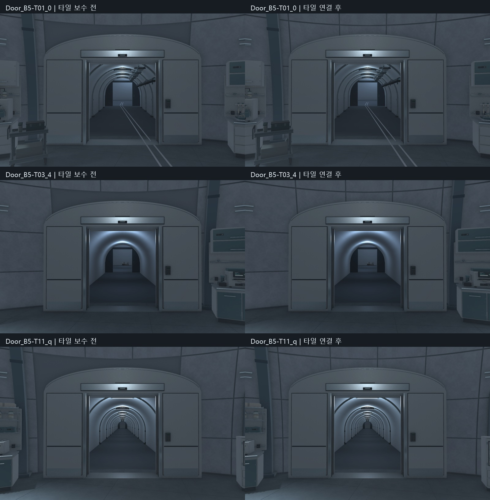

# 실험동 문 위 타일 연결 검수 V0.01

작성자: 송예찬 · 2026-11-07

사용자가 지적한 부분은 문 본체가 아니라 문 위 회색 바탕이었다. 기존 제작기에서 출입축17도 이내·높이4.01m 아래의 타일을 통째로 빼면서 비대칭으로 드러났다. 해당 영역에 기존 곡률·두께24mm·줄눈과 같은 타일을 추가하고 실제 아치 단면에 맞춰 절단했다. 기존 벽/문/리브 모델은 변경하지 않았다.

20조각·1메시·14,337tri. 베벨3mm, 퇴화면0, 누락 재질0. 새 타일 Collider와 메시 일치. 출입구3곳×123 =369개 통행 표본 막힘0. 실제 안/밖/상부 사진18장을 확인했다. 삼각화 중 작은 퇴화면3개를 제거해 최종 재반입 경고/오류0이다.

타일 도중 사용자 조명 편집이 감지됐다. 미저장 상태를 Temp의 CurrentUserEdit_BeforeTiles.unity로 별도 백업하고 저장한 다음 적용했다. 유효 기준은 baseline.json의 effectiveSceneBackup이다. 조명 보수 직전 씬과 대조하면 기존 객체 삭제0, 변경은 C01_Experiment_Art의 자식 목록1건뿐이다. 승인된 프랍·문·리브·플레이어 Transform을 건드리지 않았다.

보호3254파일 중 기존 모델/텍스처/게임 코드는 동일하다. 씬 저장 시 URP 자동 재검증으로15개 기존 재질의 직렬화 해시가 달라져 preservation.json에 기록했다. 타일 적용기는 기존 S1_Coat을 참조하며 새 재질이나 공용 재질 수정을 만들지 않았다. 바이트 전체 동일이라고 보고하지 않는다. 이어서 수행한 조명 변경은 별도 검수에 기록했다.

모델은 05.Model/Environment/B5/AF_C01_PortalTileInfill.fbx, 원본은 SourceAssets/C01_PortalTiles/AF_C01_PortalTileInfill.blend다. 로컬 저장, 커밋/push 미실시. 게임 기능 변경0. 최종 조명 상태는 ../2026-11-07_C01_Lighting/검수결과.md를 따른다.
