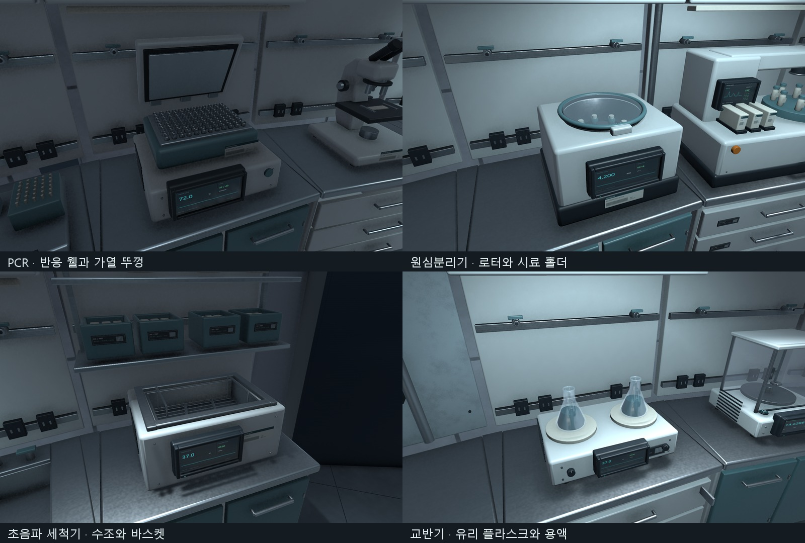

# C01 프랍 기능 디테일·베벨·PBR 마감 V0.01

작성자 송예찬 · 2026-11-07

사용자가 확인한 구성과 30개 작업대 배치를 유지하면서 CP_/ID_ 모델 37종의 외형 마감을 갱신했다. 이번 단계는 새 방 배치가 아니라 기존 실험 장비와 수납 가구의 제작 디테일을 높이는 작업이다. FBX·재질을 갱신했으며 저장된 씬 파일은 작업 전 백업과 바이트 단위로 동일하다.

## 실제 반영

| 대상 | 형상 보강 |
| --- | --- |
| 공통 하우징·가구 | 3분할 베벨, 곡면/평면 노멀 분리, 가중 노멀 보존 FBX, 문 경첩·분할선 |
| 원심분리기 | 실제 몸체 구멍, 내부 챔버·8개 로터 홀더·잠금부, 투명 덮개와 고무 씰 |
| PCR | 열린 가열 뚜껑·힌지·내부 플레이트, 96개 열린 반응 웰 |
| 초음파 세척기 | 상판을 뚫은 깊이 있는 수조, 내부 벽·바닥·와이어 바스켓·집게 |
| 현미경 | 굽은 주조 지지대, 헤드·회전 대물렌즈부·미세 초점 조절부·스테이지 레일 |
| 교반기·건조대 | 목·어깨·입구 두께가 있는 유리 플라스크, 교반기 용액과 건조대 배수 홈 |
| 정밀저울·플레이트 장비 | 방풍 유리 레일·수평계, 96개 열린 웰·구동 레일 |
| 피펫·회전기·믹서 | 테이퍼 팁·손가락 받침·표시, 베어링·기어박스·시료 마개, 열린 고무 컵 |
| 멸균기·실러 | 잠금 손잡이·원형 압력계·바늘, 금속 열접착부·포장 봉합선 |
| 라벨 프린터·준비 키트 | 스캐너 광학창·용지 가이드·바코드 출력, 시료 기록 화면·밀봉팩 표시 |
| PPE·수납·분석기 | 성형 용기·보호구 표기·마스크 귀끈, 열린 부품함·내용물, 바이알 어깨·캡·렌즈 링 |

기존 바이탈 모니터의 승인된 둥근 본체, LCD 발광/유리 구조와 외곽 밀도는 유지했다. 모든 면에 무조건 베벨을 넣지는 않았다. LCD·라벨 평면, 얇은 밀봉선과 이미 매끄러운 원본 본체는 용도에 맞게 보존했다.

## 텍스처 구성

공유 표면 6종(Coat/Blue/Steel/Dark/Rubber/Paper)에 1024² Base Color·Tangent Normal·Metallic/Smoothness 패킹 맵 **18장**, 기능 라벨/눈금 **12장**을 추가했다. 거칠기 원본 6장은 SourceAssets에 보관한다. 도장 표면, 브러시 스테인리스, 고무와 종이의 반사·표면 질감을 구분했다.

URP Lit용 패킹은 R=Metallic, A=Smoothness(1−Roughness), G=1, B=0이다. Base는 sRGB, Normal/패킹은 선형이며, 공유 재질의 BaseMap·BumpMap·MetallicGlossMap 연결과 키워드를 실제 에디터에서 확인했다. [Unity URP Lit 공식 문서](https://docs.unity.com/en-us/engine/6000.0/manual/materials-and-shaders/built-in/shaders-in-universalrp/reference/lit-shader)의 맵 역할을 따른다.

이번 맵은 로컬에서 제작한 공유 타일 표면과 개별 라벨이다. 개별 프랍의 고해상도 원본에서 AO/노멀을 베이크한 작업으로 기록하지 않는다. 기구의 큰 형상과 홈은 실제 메시다. 화면·표시·바늘·뚜껑 상태는 정적 아트이며 조작/애니메이션 기능은 추가하지 않았다.

## 검증 결과

- 37종 모델, 고유 에셋 삼각형 **443,454개**(바이탈 3 LOD 합산). 이전235,680개보다 증가했다. 이 값은 전체 씬 렌더 삼각형 수와 다르다.
- 면적5e-9㎡ 미만 퇴화 삼각형0, 재질/셰이더 누락0, 강제 재반입 경고/오류0.
- 6개 공유 PBR 재질 연결·키워드 유효, 모델37개 GUID 보존, 보호파일23개 해시 동일.
- 승인 작업대30개 위치/회전 동일. 바닥 충돌체29개와 기존 구조의35mm 초과 관통0.
- C01 순환 capsule540표본 막힘0. 전체 복도4854표본 막힘·바닥 누락0.
- 최종1920×1080 Editor Play5초: **413프레임 진행, 실제 W 이동1.229m, 새 경고/오류0**. median 11.68ms, p95 14.15ms. 짧은 에디터 표본이며 빌드 전체 성능 판정은 아니다.
- Play 종료 후 저장 씬으로 복원, 편집 모드/dirty=false, 백그라운드 override=false. 플레이어(-9.2,-81.36,-10), 회전(0,0,0) 유지.
- `git diff --check`는 이전 작업에서 Unity가 직렬화한 빈 `m_Name: `5곳의 후행 공백을 보고했다. 해당 씬은 이번 단계 전후 해시가 같으며 수동 편집하지 않았다.

첫 시각 검수에서 바이알 중심 좌표 계산, 곡면 노멀, 일부 중복 라벨과 미세 Boolean 삼각형을 찾아 고친 후 최종 반입·검수를 수행했다. 최종 근접/구역 캡처는24장이다. Collider 검사는 모든 미세 메시의 교차 검사를 뜻하지 않는다.

## 자료

- [전체 모습](After_Overview.png), [실험 구역](After_Zone_50.png)
- [현미경 이전](Before_Close_ID_BinocularMicroscope.png) / [현재](After_Close_ID_BinocularMicroscope.png)
- [PCR 이전](Before_Close_ID_ThermalCycler.png) / [현재](After_Close_ID_ThermalCycler.png)
- [원심분리기](After_Close_CP_Centrifuge.png), [세척기](After_Close_ID_UltrasonicBath.png), [멸균기](After_Close_ID_BenchAutoclave.png)
- [바이탈](After_Close_S1_VitalMonitor_18.png), [광학 분석기](After_Close_OpticalAnalyzer.png), [PPE](After_Close_Clinical_PPE_Station.png)
- [모델 검사](final_assets.json), [플레이 검사](play_inside.json), [재질/배치/최종 상태](state.json), [보존 해시](preservation.json)

근접 캡처는 내부를 확인하기 위해 이전보다 가까운 각도로 찍었다. Overview/구역 캡처는 이전과 같은 카메라다. 원본·재현 방법은 [제작 README](../../../SourceAssets/C01_PropFinish/README.md)에 있다. 로컬 저장 완료, 커밋·push는 하지 않았다. C01 출입구·문 포켓·벽/광원·바닥 안내선 마감과 다른 공동은 후속이며 전체 아트0/34는 유지한다.
