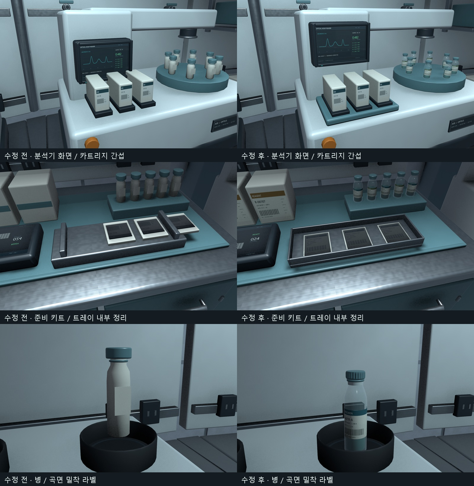

# C01 겹침·병 라벨·얇은 소품 보수 V0.01

작성자 송예찬 · 2026-11-07

사용자가 지적한 분석기 화면/소켓 겹침, 준비 키트 카드 돌출, 병의 상자형 라벨을 수정했다. 승인된 방 구성·30작업대 Transform·Collider는 유지하며 기존 FBX를 갱신했다. [전후 비교](BeforeAfter.jpg)는 동일 카메라로 촬영했다.

## 고친 부분

- **CP_OpticalAnalyzer**: 화면 중심을7cm 올려 카트리지 상단과 화면 모듈 하단 사이 **36.9mm** 여유를 확보했다. 카트리지 도크가 본체 상판에 닿게 만들고 표면 라벨 돌출도 줄였다.
- **CP_PreparationKit**: 트레이 네 변과 바닥을 다시 만들고 포장물3개를 내부에 배치했다. 포장 두께를12mm에서1.8mm로 줄였으며 라벨은0.2mm 정도만 띄웠다. 태블릿/포장 인쇄의 UV 방향도 고쳤다.
- **병 공통**: 큐브 라벨을 없애고 병 곡률을 따르는16면 인쇄 표면으로 교체했다. 표면과의 간격은0.18mm다. 뚜껑24개 파지 홈·병목·밀봉 링·시료 바코드/눈금·유리 내부 시료를 반영했다. 큰 시약병은 불투명 폴리머, 작은 시료병은 유리/시료를 구분한다.
- **추가 점검**: 믹서의 병을 고무 컵 바닥 가까이 내렸다. 피펫 표시도 곡면에 밀착했다. 실러 포장은1.8mm, 프린터 출력지는0.45mm로 만들고 출력 슬롯에서 이어지는 굽은 종이로 바꿨다. 상자 밴드는 얇은 인쇄 표면으로 바꿨다.
- **받침 접점**: 크로마토그래피·유세포 분석기·시약 선반·혼합 선반·응급 캐비닛의 병과 일부 상자가 떠 있던 높이를 보정했다. 병을 내린 기구의 호스 끝점도 함께 맞췄다. 시료장 내부 상자 받침도 보정했다.

공통 병 수정은 다음9종의 원본46개에 적용된다. 씬에서 반복 배치된 수를 뜻하지 않는다.

| 원본 | 병 수 |
| --- | ---: |
| CP_EmergencyCabinet | 6 |
| CP_OpticalAnalyzer | 8 |
| CP_PreparationKit | 5 |
| CP_ReagentShelf | 9 |
| ID_ChromatographyStack | 3 |
| ID_DualVortexMixer | 2 |
| ID_FlowCytometer | 5 |
| ID_MixedSupplyShelf | 3 |
| ID_PipetteWorkstation | 5 |

## 검증

- 최종 재반입 경고/오류0. 모델37종 퇴화 삼각형0(면적5e-9㎡ 기준), 누락 재질/셰이더0. 고유 모델 삼각형 463,470개(바이탈 LOD 합산).
- 원본 검사에서 상자형 병 라벨0, 준비 키트 포장물3개 모두 트레이 내부, 분석기 수직 이격36.9mm.
- 승인된30작업대 Transform,37개 모델 GUID,23개 보호파일 해시 유지. 저장 씬은 이번 단계 전후 바이트 단위 동일.
- 바닥 충돌체29개의35mm 초과 관통0, C01 순환540 capsule 표본 막힘0. 전체 복도4854 검사는 직전 단계 결과이며 이번에는 구조·Collider를 변경하지 않았다.
- 새 병/라벨 반입 후1920×1080 Play5초: 421프레임, W입력 1.222m 이동, 새 경고/오류0. median 11.50ms / p95 13.18ms. 이 Play 이후 선반 받침 높이를 미세 보정했으며 최종 메시 반입/시각 검사를 다시 수행했다. 전체 빌드 성능 검사로 해석하지 않는다.
- 편집 모드, scene dirty=false, 플레이어(-9.2,-81.36,-10)/회전0, 백그라운드 override=false 복원.
- 최종 근접13장과 작업 전11장 보관. 전체 프랍의 모든 면 교차가 없다는 보증은 아니며 이번에 지적된 겹침·라벨·소품 접점을 집중 검사했다.

## 직접 확인

- [분석기](After_OpticalAnalyzer.png), [화면 간격](After_Analyzer_Clearance.png)
- [준비 키트](After_PreparationKit.png), [트레이](After_Preparation_Tray.png)
- [믹서](After_ID_DualVortexMixer.png), [병 확대](After_Vial_Detail.png)
- [피펫](After_ID_PipetteWorkstation.png), [크로마토그래피](After_ID_ChromatographyStack.png), [선반](After_ID_MixedSupplyShelf.png), [응급 캐비닛](After_EmergencyCabinet.png)
- [실러](After_ID_SterileSealer.png), [프린터](After_ID_LabelPrinter.png)
- [모델 검사](final_assets.json), [보존/간격](preservation.json), [Play 결과](play_inside.json), [최종 편집 상태](state.json)

로컬 반영 완료. 커밋/push·외부 생성·업로드는 하지 않았다. 장비는 정적 아트이며 게임 C# 추가0. 제작 원본과 재현 순서는 [README](../../../SourceAssets/C01_PropRepair/README.md)를 따른다.
