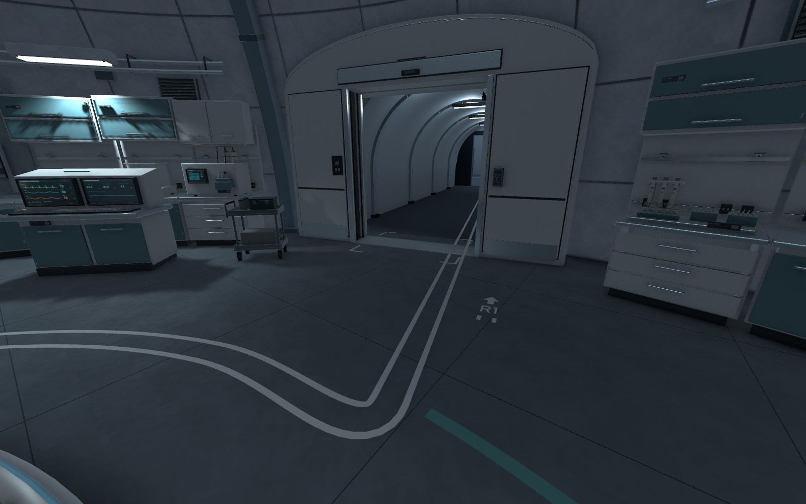
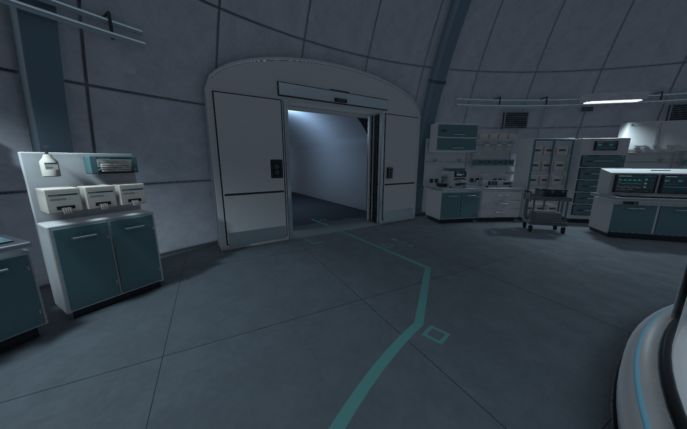
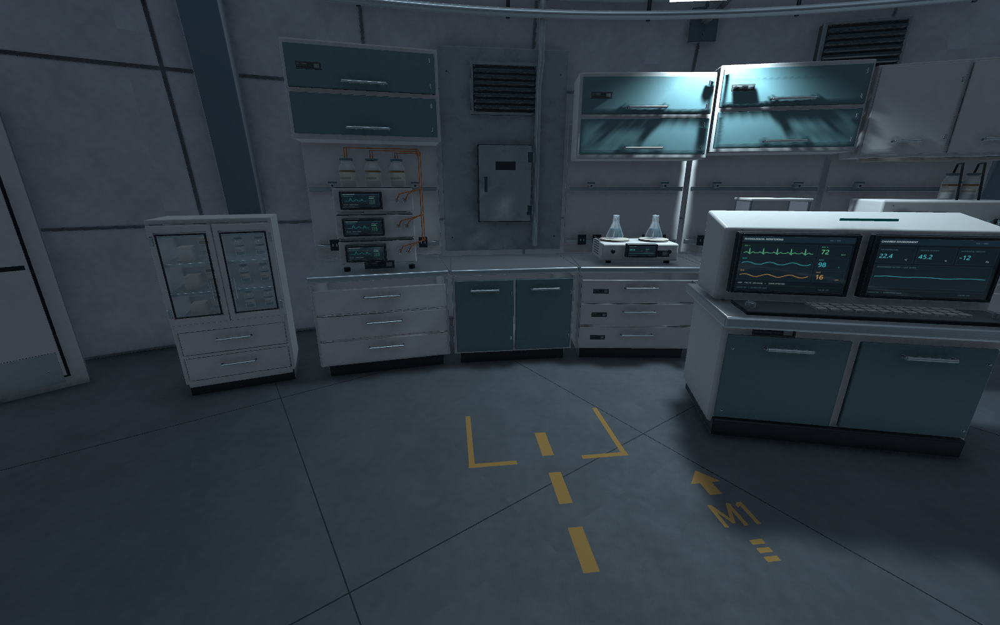
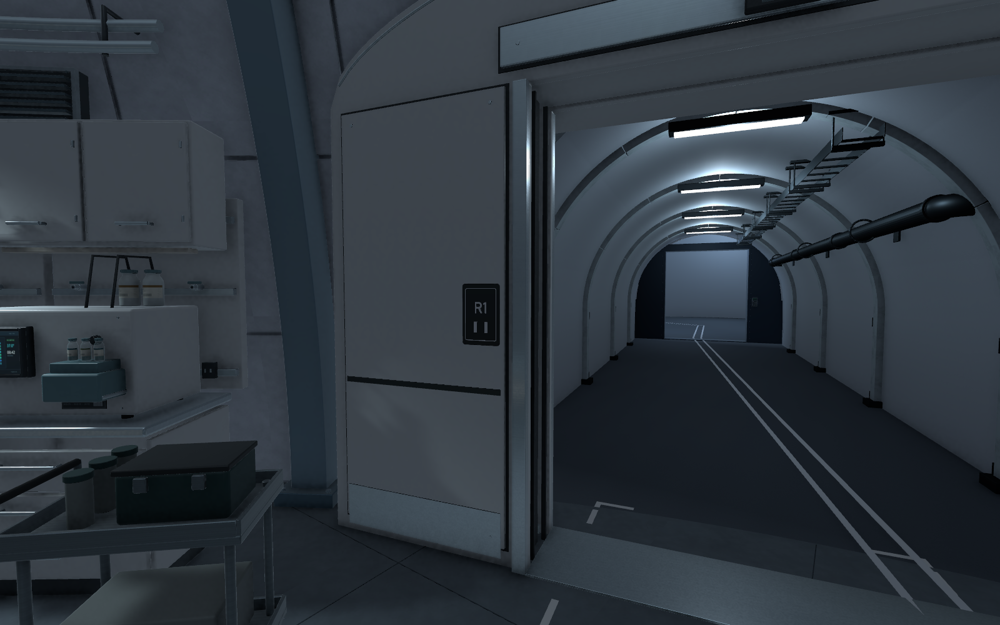

# 실험동 바닥 업무 안내선·출입 표식 검수 V0.01

작성자 송예찬 · 2026-11-07

사용자가 이전 목록 1번인 실험동 타일·조명 확인을 완료했다. 이번에는 2번 바닥 안내선과 작은 출입 표식을 제작했다. 조명·색감의 최종 조정은 B5 전체 제작 이후 진행한다.

## 반영 내용

| 구분 | 실제 반영 |
| --- | --- |
| R1 직원 이동 | T11 출입부에서 포드 서쪽을 돌아 기존 R1에 합류하는 흰 이중선. 합류부의 방향·높이를 기존 선 끝에 맞춤 |
| S1 시료 이송 | 포드 북동쪽에서 T03으로 연결하는 청록색 선과 사각 패턴 |
| M1 정비 | 유일한 활성 점검함 앞의 짧은 황토색 점선과 접근 공간 표시. 층 전체 정비 노선은 미확정 |
| 바닥 코드 | R1 2곳·S1 2곳·M1 1곳. 선·접근 공간과 문자가 겹치지 않도록 배치 |
| 출입 표식 | T01/T11 R1, T03 S1. 24×36cm, 두께 8mm의 모서리 베벨 명판을 실제 문틀 면에 부착 |
| 문턱 | 세 출입구의 모서리에 짧은 경계 표시 |

새 그룹은 `B5_Circular_Core_V0.03/C01_Experiment_Art/C01_Workplace_Wayfinding`이다. 신규 메시 15개·재질 9개·텍스처 7장, Renderer 17개다. 메시 고유 삼각형 합계는 1,032개다. 바닥 표식은 기존 바닥 마감 표면 위 2.5mm에 두고, R1 합류부만 기존 안내선 높이에 연속적으로 맞췄다. 비발광 정적 표식이며 Collider·Light·게임 MonoBehaviour는 추가하지 않았다.

## 검증 결과

| 검사 | 결과 |
| --- | --- |
| 안내선 경로 캡슐/바닥 표본 | 358개, 막힘 0·바닥 누락 0 |
| CharacterController T01/T03/T11 양방향 이동 | 6/6 통과 |
| 신규 메시 | 퇴화 삼각형 0·누락 재질 0 |
| 기존 구조/프랍 Transform | 2,001개 변화·삭제 0, 신규 21개 모두 안내선 그룹 내부 |
| 저장 씬 객체 비교 | 기존 5,790개 삭제 0. 실험동 부모 Transform의 새 자식 참조 1개 외 기존 직렬화 내용 동일 |
| 기존 Light | 187개 설정·활성 상태·위치 동일 |
| 기존 파일 SHA-256 | 3,702개 중 대상 B5 씬만 변경. 나머지 3,701개 동일 |
| Play 실험동 | 407프레임 진행, 실제 W 입력으로 1.224m 이동, 측정 중 경고·오류 0 |
| Play T11 | 392프레임 진행, 실제 W 입력으로 0.929m 이동, 측정 중 경고·오류 0 |
| 마무리 상태 | Edit 모드, 저장 씬 dirty=false, Run In Background 원복, 플레이어 (-9.2, -81.36, -10), 회전 (0,0,0) |

Play 측정은 현재 PC의 Editor 1920×1080 환경에서 약 5초씩 실행했다. 중앙 프레임 시간은 실험동 11.93ms, T11 12.55ms였으며 빌드 성능 보증 수치가 아니다. 검수 카메라 6개 시점의 전후 이미지를 직접 확인했고, 문자 좌우 반전·바닥에 묻힘·합류부 단절·M1 문자와 경계의 겹침을 정리했다.

재적용 도구는 기존 Mesh 에셋의 GUID를 유지하면서 `Clear/SetVertices/SetTriangles/UploadMeshData`로 렌더링 데이터를 갱신한다. `CopySerialized`만으로 갱신했을 때 화면에 이전 표면 높이가 남는 현상은 이 방식으로 해결했다.

## 화면

원시 결과: `route_probe.json`, `controller_walk.json`, `geometry_audit.json`, `preservation.json`, `scene_preservation.json`, `play_inside.json`, `play_tunnel.json`. 제작 원본은 [C01_Wayfinding](../../../SourceAssets/C01_Wayfinding/README.md)이다.

현재 변경은 로컬 저장 상태이며 커밋·push하지 않았다. 다음 제작은 T01 복도 세부 마감 → C02다. B5 전체 조명·색감 조정, 나머지 공동의 안내선 확장과 최종 아트 판정은 이후 작업으로 남긴다.

## Revision History

| 버전 | 날짜 | 작성자 | 변경 |
| --- | --- | --- | --- |
| V0.01 | 2026-11-07 | 송예찬 | 실험동 업무 안내선·소형 출입 표식 제작 및 통행·Play·보존 검수 |
