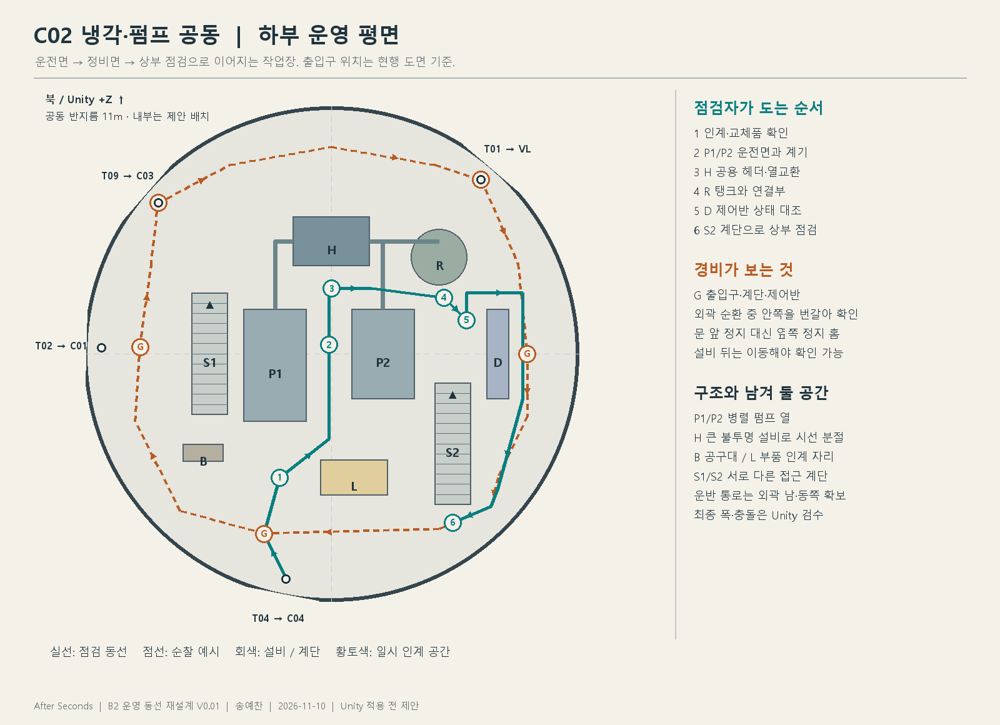
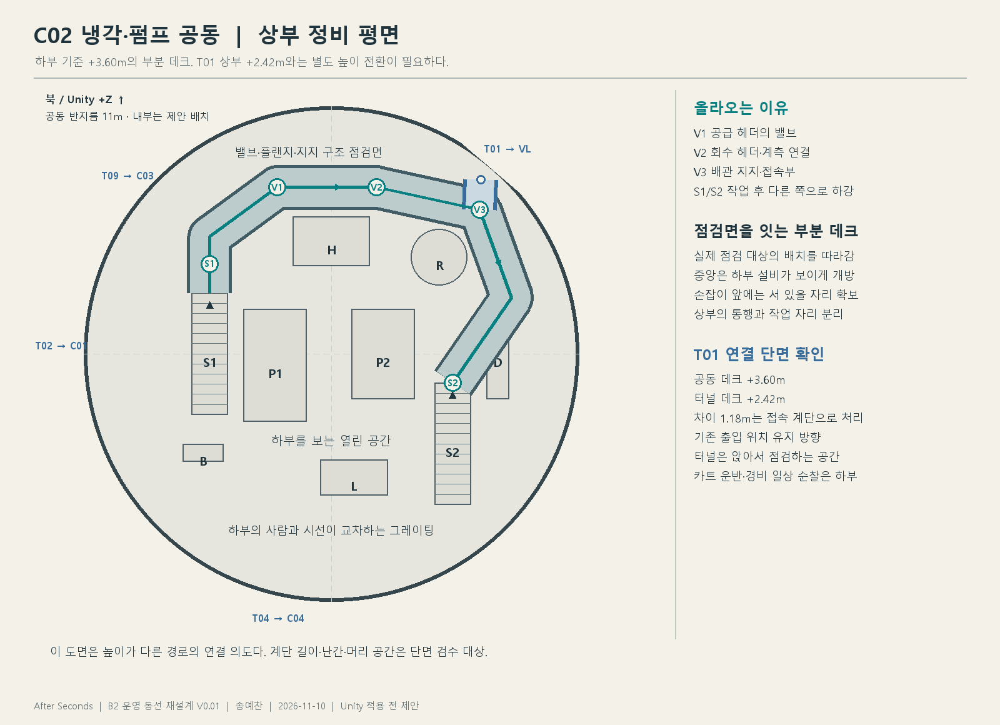
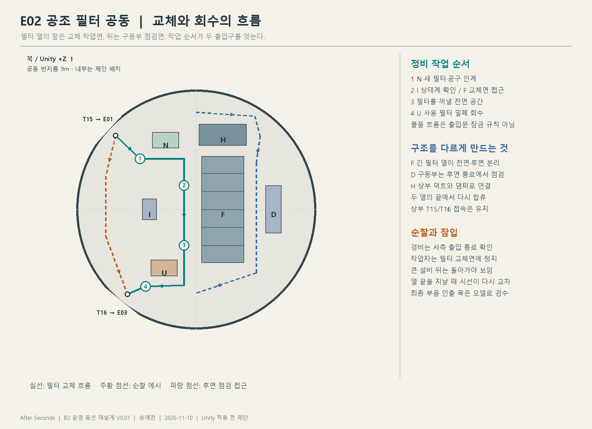
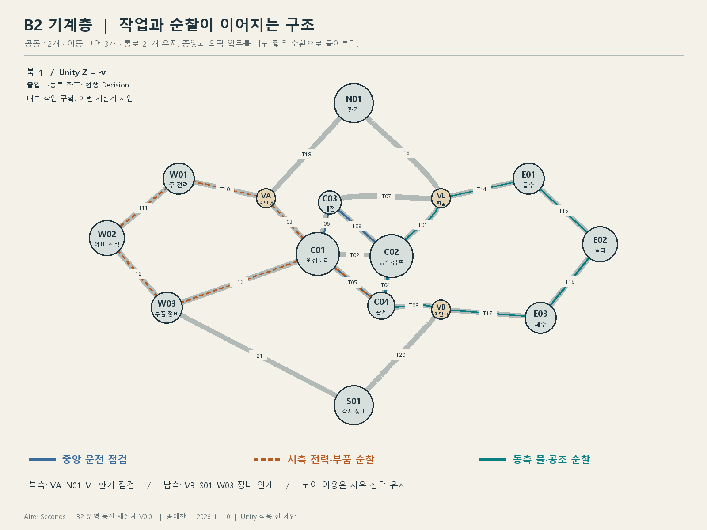

# After Seconds B2 설비 운영과 순찰 동선 재설계 V0.02

최신 후속: `as_built_ceiling_density.json`194배치와 [B2 설비·천장 보강 검수](../../../Review/2026-11-10_B2_CeilingDensity/Review.md)를 우선한다. 27설비 확대, 12공동 천장 연결과 S01/E03 구조가 반영됐다.

최신 후속 마감: [B2 적치·콘솔·바닥 보수](../../../Review/2026-11-10_B2_SurfaceRefinement/Review.md). 적치물2개 이동, 윤활 설비/받침 추가, 콘솔8 교체, 바닥·계단 사용감과 B2 안내선 미표시는 `as_built_surface_refinement.json`이 최신이다.

작성자 송예찬 · 2026-11-10

**사용자 승인 후 B2 기계층의 12개 공동에 운영 동선 재구성을 적용했다.** 정비사는 설비의 상태를 확인하고 부품을 교체할 수 있어야 하며, 경비는 출입과 작업 구역을 확인하면서 순찰할 수 있어야 한다. 두 동선 사이의 설비·높이 차이·시선 단절이 플레이어의 잠입 경로를 만든다. 현재 Unity 내부는 [검수 화면](../../../../Review/2026-11-10_B2_Operations/review.html)과 [실배치 데이터](as_built_operations.json)를 따른다. 아래 기존 그림은 제작 방향을 정했던 초기 설계도이며, 최종 계단 참·난간 개구·탱크 위치는 통행 검수에 맞춰 조정했다.

기존 공동 12개·이동 코어 3개·통로 21개의 연결 관계를 기준으로 한다. 각 공동의 반지름과 출입 위치는 현행 `facility_layout.json`에서 가져왔다. 아래 초기 그림과 현행 실배치를 구분하며, 현재 치수·위치는 `as_built_operations.json`을 우선한다. 각 도면의 화살표는 설계 설명용으로, 게임 화면이나 미니맵에 배치하는 표시가 아니다.

## 1. 내부를 구성하는 기준

현재 검수 화면의 C02·E01·W02에서는 장비와 계단은 보이지만, 어느 면에서 조작하고 무엇을 순서대로 점검하는지는 약하다. E01·E02·W02에 같은 형태의 원형 데크가 반복돼 서로 다른 공정의 공간이 비슷하게 읽힌다. 추가 배치 기록에는 C04 관제 공동에도 매니폴드와 예비 모터가 들어 있어 관제·정비·보관의 경계가 흐려져 있다.

새 구조는 각 공동을 다음 다섯 자리로 나눈다. 모든 공동에 같은 면적이나 같은 원형 통로를 적용하지 않는다.

| 자리 | 사람이 하는 일 | 구조로 보여 줄 것 |
| --- | --- | --- |
| 출입·인계 | 점검 항목 확인, 방문 기록, 작업 구역 파악 | 출입문 옆 제어반·기록 거치대, 통로에서 벗어난 짧은 정지 공간 |
| 운전면 | 계기와 상태등을 보고 밸브·스위치를 조작 | 장비 앞면이 같은 점검 통로를 향하도록 정렬 |
| 정비면 | 커버를 열고 필터·모터를 빼내거나 공구 사용 | 장비 뒤/옆의 서비스 통로, 부품을 꺼낼 방향과 비워 둔 자리 |
| 반출입 | 카트를 세우고 새 부품과 회수품을 인계 | 통행로 밖 카트 주차 홈, 교체품 적치 구역, 운반 방향 |
| 상부 점검 | 높은 배관·밸브·댐퍼·케이블 연결 확인 | 해당 설비에 닿는 부분 데크와 계단, 작업 대상이 있는 끝 지점 |

돔의 곡면 외피와 터널은 유지한다. 그 안에 놓인 작업대·설비 열은 실제 작업 방향에 맞춰 직선이나 ㄱ자 형태로 배열할 수 있다. 복잡함은 기능이 다른 설비 구획과 재합류 동선에서 생기게 하고, 통로 한가운데 큰 벽을 세워 만들지 않는다.

## 2. 내가 C02를 점검하러 온다면

도면은 C02 반지름 11m와 출입구 네 곳을 기준으로 한다. P1·P2는 병렬 펌프 열, H는 열교환/필터 묶음, R은 냉각 계통 탱크, D는 구동 제어반, B는 공구대, L은 부품 인계 자리다. 설비 종류와 용량은 게임 배경용 제안이다.

1. **C04 관제 쪽 T04로 들어온다.** 문 앞을 막지 않는 인계 자리에서 점검할 펌프 번호를 확인한다. 입구에서 두 펌프 열의 이름과 공용 계기판을 읽을 수 있게 한다.
2. **L에 카트를 세우고 P1·P2 사이의 운전 통로로 간다.** 양쪽 펌프의 압력계와 조작면이 이 통로를 향한다. 바닥의 장비 번호와 배관 방향이 어느 기계를 보는지 알려 준다.
3. **각 펌프의 바깥쪽으로 돌아 정비면을 확인한다.** 모터 커버를 빼는 방향, 커플링 보호 덮개, 바닥 트레이, 배수 홈이 있다. 통로를 가로지르는 바닥 배관 대신 설비 받침 내부와 상부 헤더로 연결한다.
4. **북쪽 H에서 계통이 합쳐지는 것을 확인한다.** 두 펌프의 배관이 같은 헤더로 모이고, 열교환기와 탱크 R로 이어지는 외형을 만든다. 같은 기계를 흩어 놓는 대신 한 공정으로 읽히게 한다.
5. **동쪽 D에서 상태를 대조한다.** 제어반은 물 계통과 구별된 건조한 작업 구획에 두고, 화면·계기·장비 번호를 일치시킨다. 제어반 문을 여는 면 앞에는 부품을 적치하지 않는다.
6. **상부 작업이 있을 때 계단을 오른다.** 높이 3.6m 데크에서 밸브 헤더·지지 브래킷·점검 플랜지에 접근한다. 업무가 끝나면 다른 계단으로 내려와 L에서 회수품을 챙기고 나간다.

평상시 장비 열 사이와 주변을 순환할 수 있고, 한 장비를 정비하느라 인계 자리를 사용할 때도 주 통행은 유지된다. 부품을 꺼내는 자리는 상자를 영구 배치하지 않는 **용도가 있는 빈 공간**이다.

### C02 상부가 필요한 이유

상부에는 실제 점검 대상인 공급·회수 헤더, 밸브 손잡이, 계측 연결부와 배관 지지 구조가 있다. 데크는 그 작업면을 잇는 부분 U자 형태로 만들고, 중앙의 열린 부분으로 하부 공정을 볼 수 있게 한다. 전 구간을 똑같은 원형 발코니로 감싸지 않는다.

기존 T01 상부 연결을 유지하는 방향이다. 공동 데크 3.60m와 터널 데크 2.42m 사이의 높이 전환을 도면에 별도로 표시한다. 도면의 평면 선은 같은 높이로 곧장 이어진다는 뜻이 아니다. 연결 계단의 길이·머리 공간·도어 개구부는 실제 단면에서 다시 맞춘다.

터널 상부는 **배관 점검을 위한 낮은 정비 공간**이라서 웅크리는 이유가 있다. 큰 부품과 카트는 하부로 운반한다. 경비의 일상 순찰은 하부를 사용하고, 공동 안의 서서 다닐 수 있는 데크는 계단으로 확인할 수 있게 한다. 앉기 전용 터널을 서 있는 경비의 통행 가능 경로로 간주하지 않는다.

## 3. 내가 C02를 순찰하는 경비라면

펌프의 상세 분해 점검 대신 **출입문, 작업자 위치, 계단 입구, 제어반 상태 표시**를 확인한다.

| 확인 자리 | 바라보는 곳과 목적 | 잠입에서 생기는 상황 |
| --- | --- | --- |
| 남쪽 인계 자리 | T04 출입과 카트 주차 홈 | 문을 통과하는 순간과 설비 뒤로 들어가는 순간이 구분됨 |
| 서쪽 T02 옆 | C01 연결 통로와 펌프 열의 측면 | 경비가 통로 쪽을 확인할 때 반대쪽 정비면으로 이동 가능 |
| 북서 T09 접근부 | C03 출입, 왼쪽 계단과 상부 데크 일부 | 계단 전체를 한눈에 보지 못해 올라가는 시점을 선택해야 함 |
| 북동 T01 접근부 | 화물 승강기 쪽 통로, 상부 점검 출입 | 하부 출입을 보는 시선과 상부를 올려다보는 시선이 교차 |
| 동쪽 제어반 앞 | 표시등·반대쪽 계단 입구 | 제어반과 탱크가 중앙 정비 통로의 일부를 가림 |

정지 지점은 문턱과 계단 첫 단을 피해 옆으로 물린다. 경비가 멈춰도 보행이 물리적으로 봉쇄되지 않아야 한다. 한 자리에서 네 출입구와 상부 전체를 모두 감시하지 않는다. 반대로 영구적인 완전 사각 하나로 공동 전체를 통과하게 만들지도 않는다.

플레이어는 중앙 운전 통로의 짧은 노출, 외곽 정비면의 긴 우회, 상부 그레이팅의 상하 노출을 비교한다. 펌프의 낮은 받침은 앉을 때만 일부를 가리고, 큰 열교환기·탱크·제어반의 불투명 몸체는 서 있는 몸도 가릴 수 있다. 열린 그레이팅은 시선을 막지 않는다. 동선 선은 경비 AI 구현이나 순찰 시간 확정을 뜻하지 않는다.

## 4. 공동마다 다른 내부 구조

| 공동 | 내부 구조 제안 | 점검 순서 | 경비가 확인할 자리 |
| --- | --- | --- | --- |
| C01 원심분리 | 공정 장비 두 묶음과 운반 통로. 투입·배출 쪽을 구별하고 중앙 횡단 대신 장비 끝에서 재합류 | 투입 상태 → 장비 운전면 → 배출/회수 → 기록 | 다섯 문을 한 바퀴에 모두 보지 않도록 두 작업 묶음의 끝을 확인 |
| C02 냉각·펌프 | 두 펌프 열·공용 헤더·독립 제어면·부분 U자 상부 | P1/P2 → 필터/열교환 → 탱크 → 제어반 → 상부 밸브 | 출입구 네 곳과 두 계단, 제어반 옆 |
| C03 배전 | 작은 돔에 맞춘 ㄷ자 배전반과 짧은 중앙 점검 통로. 대형 중앙 기계나 복층은 추가하지 않음 | 인입 표시 → 구간별 패널 → 케이블 접속·기록 | 문 옆 정지 홈과 제어반 열의 끝 |
| C04 관제 | 전면 공정 화면·운전석, 뒤쪽 랙 정비 통로, 옆쪽 인수인계 자리 | 현황 확인 → 작업 지시 → 통신/기록 → 랙 점검 | 관제석과 출입 시야. 매니폴드·예비 모터는 실제 정비 공동으로 재분류 |
| W01 주 전력 | 큰 전력 설비 두 묶음과 분리된 제어반 열. 케이블 트레이가 배전 방향을 보여 줌 | 인입/출력 표시 → 설비 외곽 점검 → 제어반 | T10/T11 문과 전력 설비 뒤 정비 통로 입구 |
| W02 예비 전력 | 발전기 열과 연료 보조 설비 구획, 배기 쪽 ㄱ자 정비 데크. 기존 상부 T11/T12의 양쪽 연결을 잇는 길은 유지 | 시동 패널 → 모터/발전기 → 연료 계기 → 상부 배기 지지 | 장비 열 끝과 데크 접근. 원형 계단 구성이 반복되지 않게 변경 |
| W03 정비·부품 | 입고 확인 → 부품 랙 → 수리 벤치 → 반출 대기의 ㄷ자 작업 흐름 | 필요한 부품 확인 → 공구 수령 → 작업 → 회수품 분리 | 세 문 사이의 반출입 통로와 랙 끝. 카트는 주차 홈에 배치 |
| E01 급수·펌프 | 탱크 한쪽 편심 배치, 병렬 가압 장비, 탱크 상부에 닿는 부분 부채꼴 데크 | 유입 계기 → 가압 장비 → 공급 계기 → 상부 밸브 | T14/T15 연결과 계단. T14/T15 상부 연결 유지 |
| E02 공조 필터 | 긴 필터 열의 교체면과 후면 점검 통로를 구분. 상부는 덕트 댐퍼를 따라가는 두 줄 데크 | 새 필터 수령 → 계기 → 필터 교체 → 회수품 대기 → 상부 댐퍼 | T15/T16 출입, 필터 열 끝, 상부 연결. 양쪽 상부 경로 유지 |
| E03 폐수·폐기물 | 밀폐 탱크와 처리 장비를 배관으로 묶고, 배수 구역과 제어·기록 구역의 바닥을 구별 | 유입 표시 → 탱크 계기 → 밀폐 회수 → 기록 | 반출 대기 자리와 두 출입구. 바닥을 빈 상자로 채우지 않음 |
| N01 주 공조·환기 | 대형 송풍기와 덕트가 장축을 형성. 교체용 모터 인양 자리와 측면 정비 통로 | 진동/상태 표시 → 모터 → 덕트 연결 → 댐퍼 | T18/T19 양쪽 입구, 장비 뒤 통로의 시작·끝 |
| S01 설비 감시·정비 | 인수인계·현황판 구획과 진단 작업 베이. W03의 부품 창고와 구별 | 작업 접수 → 진단 → 작업 기록 → 공구 반납 | T20/T21 출입과 작업 베이 끝. 사무용 책상 반복 대신 열린 설비 커버·검사 장치 |

### E02는 필터를 실제로 갈 수 있는 공간으로

T15 쪽에 새 필터 카트를 잠시 두고, 필터 열의 교체면 앞을 비워 둔다. 사용한 필터는 T16 쪽의 밀폐 회수 카트로 보낸다. 이 방향은 작업 절차이며 문을 일방통행으로 잠그는 규칙이 아니다. 필터 열 반대편에는 구동부·접속부를 보는 정비 통로를 둔다. 필터 몸체가 시선을 끊지만, 열의 양 끝에서 다시 만날 수 있다.

상부는 덕트와 댐퍼 점검을 위한 연결이며 T15와 T16의 기존 상부 접속을 끊지 않는다. E01의 탱크 둘레 작업, C02의 병렬 펌프 작업과 다른 동선이 보이도록 한다.

## 5. 층 전체에서는 어떻게 돌아보는가

현행 통로 연결만 사용한 경로 예시다. 굵은 선은 연결 관계를 보여 주며 실제 NavMesh 경로나 최종 경비 인원 배정은 아니다. 코어는 같은 층 연결의 경유점으로 이용하며, 위층으로 올라갈지는 플레이어가 선택한다.

| 업무 | 기존 공간으로 이어지는 순서 | 사용하는 통로 순서 |
| --- | --- | --- |
| 중앙 운전 점검 | C04 → C02 → C03 → C01 → C04 | T04 → T09 → T06 → T05 |
| 서측 전력·부품 순찰 | C04 → C01 → W03 → W02 → W01 → VA → C01 → C04 | T05 → T13 → T12 → T11 → T10 → T03 → T05 |
| 동측 물·공조 순찰 | C04 → C02 → VL → E01 → E02 → E03 → VB → C04 | T04 → T01 → T14 → T15 → T16 → T17 → T08 |
| 북측 환기 점검 | C01 → VA → N01 → VL → C03 → C01 | T03 → T18 → T19 → T07 → T06 |
| 남측 정비 인계 | C04 → VB → S01 → W03 → C01 → C04 | T08 → T20 → T21 → T13 → T05 |

한 경비가 층 전체를 계속 한 바퀴 도는 방식보다 업무별 짧은 순환을 나누는 안이다. 시작은 중앙 한 공동에서 두 직업의 동선을 걸어 보는 것으로 충분하다. 경비 수·대기 시간·교대·무전은 AI 단계에서 정하며, 이 도면 때문에 자동 확정하지 않는다.

점검자는 계기 앞에서 설비를 보고, 경비는 문과 접근 경로를 본다. 같은 방에서도 바라보는 방향과 정지 이유가 달라진다. 나중에 연구원/시설 담당 캐릭터의 업무 연출에 사용할 수 있으며 새 적 종류를 추가하는 결정은 아니다.

## 6. 크기와 1인칭 디테일

다음은 게임 배치 시험값이다. 최종 여유는 실제 모델 크기·카트 회전·플레이어 충돌체로 확인한다.

| 항목 | 시작 기준 |
| --- | --- |
| 하부 주 통행·운반 통로 | 유효 폭 2.4~3.0m. 문 앞과 회전부는 별도 여유 |
| 장비 운전·정비 통로 | 1.4~1.8m부터 시험. 패널 열림과 교체품 꺼내는 공간 별도 |
| 공동 상부 정비 데크 | 1.6~2.0m부터 시험. 양 끝 접속과 계단의 머리 공간 확인 |
| 기존 터널 상부 | 높이 2.42m 데크·폭 1.50m의 현행 앉기 경로를 기준으로 연결 |
| 정지·적치 자리 | 문 앞에 두지 않고 옆으로 빼며, 비워 두는 이유를 바닥 표시와 장비 번호로 표현 |

손이 닿는 면에는 작동 방향이 보이는 손잡이, 잠금쇠, 체결부, 계기, 교체 커버, 모델에 맞는 라벨을 둔다. 배관은 연결된 목적지가 보이게 하고, 케이블은 장치의 실제 단자에서 트레이로 이어진다. 예비 모터·공구 카트는 필요한 작업장에 모으고 관제석을 장식하는 용도로 쓰지 않는다.

생활 흔적은 동선을 따른다. 운전면 앞은 신발 자국, 반출입 통로는 카트 바퀴 흔적, 설비 뒤는 먼지, 배관 접속부와 바닥 트레이는 국소적인 사용감으로 구분한다. 규칙적인 반복 무늬를 전체 표면에 똑같이 덮지 않는다. 조명은 철색과 어두운 붉은 보조등을 유지하면서 계기·계단 첫 단·출입 표식이 읽히는 국소 밝기를 잡는다. 공구 사용부·문틀·철골·장비 모서리에는 크기에 맞는 베벨과 금속 재질을 적용한다.

## 7. 실제 제작으로 옮기는 순서

1. **C02 한 곳부터 공간 덩어리를 바꾼다.** 펌프 두 열, 공용 헤더, 제어반, 인계 자리와 두 계단을 먼저 놓는다. 기존 프랍 수를 유지할 의무 없이 용도별로 재배치한다.
2. 정비사 시점으로 계기·커버·밸브에 실제 접근하고, 경비 시점으로 문·계단을 차례로 확인한다. 단순히 지나갈 수 있는지와 일을 할 수 있는지를 따로 검사한다.
3. 플레이어 시점으로 중앙 통과·외곽 우회·상부 이동을 비교한다. 시선이 끊겼다가 다시 만나는 곳, 교환할 양쪽 몸 공간, 앉기와 서기의 차이를 확인한다.
4. C02 대표 구역을 확인한 뒤 E02의 필터 열, C03의 배전반, W03의 반출입 작업장을 만들어 서로 다른 구조가 유지되는지 비교한다.
5. 나머지 8개 공동과 기존 상부 접속 7곳을 정합한다. 최종 배치를 확인한 뒤 실배치 도면과 제작 목록을 갱신한다.

새로 필요한 아트의 우선순위는 설비용 작업 프레임·전용 부분 데크 → 열교환/필터 열의 연결 헤더 → 교체 가능한 패널·필터 카트 → 손이 닿는 소형 부품이다. 기존 모델의 형태와 재질을 먼저 검수하고, 새 독립 프랍은 사용자 지정 VARCO 흐름에서 후보를 만든 뒤 구조·치수가 맞지 않는 것은 Blender에서 제작한다. 메시 밀도·LOD·베벨·접속 디테일을 함께 확인한다.

완료 판정에는 다음 질문을 포함한다.

- 문으로 들어왔을 때 작업자가 먼저 갈 곳과 경비가 확인할 곳을 구분할 수 있는가?
- 운전면과 정비면에 접근할 수 있고, 커버를 열거나 부품을 꺼낼 자리가 있는가?
- 카트와 경비의 정지 위치가 문·계단·주 통행을 막지 않는가?
- 상부에 올라갈 작업 이유가 있고, 내려오거나 다른 접근부로 돌아갈 수 있는가?
- 불투명 설비가 실제 시선을 가리고 열린 그레이팅은 실제로 통과시키는가?
- C02·E02·C03·W03을 조명 색을 같게 해도 다른 용도의 공간으로 알아볼 수 있는가?

## 8. 근거와 산출물

- [현행 공동·출입구·통로 좌표](../facility_layout.json)
- [기존 상부 연결과 실제 배치](../B2_배관통로/README.md)
- [최근 B2 검수 화면과 기록](../../../../Review/2026-11-10_B2_DomeNetwork/Review.md)
- [추가 설비 97배치 원본](../../../../../SourceAssets/B2_DomeNetwork/layout.json)
- [제안 도형·경로 데이터](proposal.json) · [도면 검증 결과](validation.json)
- [C02 하부 SVG](C02_lower.svg) · [C02 상부 SVG](C02_upper.svg) · [E02 SVG](E02_filter.svg) · [전체 연결 SVG](B2_routes.svg)

새 도면은 설비 덩어리·작업 순서·시선과 경로를 검토하는 평면 제안이다. 높이별 충돌·계단 단면·이동 검수 결과는 [Unity 검수 기록](../../../../Review/2026-11-10_B2_Operations/Review.md)에 정리했다. 외형 재설계는 경비 사격·제압 조건·순찰 시간 같은 미정 게임 규칙을 확정하지 않는다.

## 변경 기록

| 버전 | 날짜 | 작성자 | 내용 |
| --- | --- | --- | --- |
| V0.01 | 2026-11-10 | 송예찬 | B2 12공동을 정비·운전·반출입·경비 순찰 관점에서 재구성. C02 하부/상부, E02 필터 교체 동선, 현행 통로 기반 층 전체 점검 경로 제안. Unity 적용 전. |

| V0.02 | 2026-11-10 | 송예찬 | 사용자 승인 후 12공동 Unity 적용·부분 데크4·공정 연결·186배치·근접/보행 검수. 초기 제안 그림과 현행 실배치 참조 구분. |
