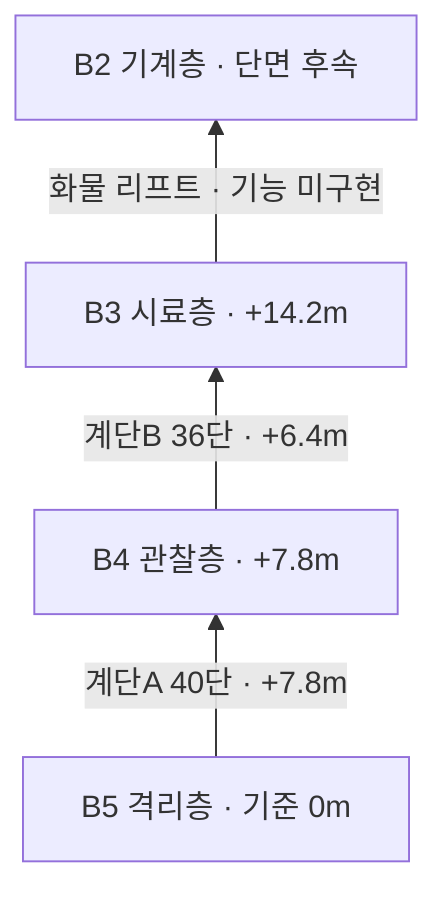

# B5–B4–B3 층간 단면 V0.02

작성자 송예찬 · 2026-11-06 · 게임 레벨 제작 치수

기존 보행 계단의 단수와 경사는 유지하고 도착층 출입문을 실제 상부참에 맞춘다. 구조 제작 기준으로 채택한 치수이며 실제 건축 법규 검토값이 아니다. 씬별 로컬 바닥은0m이고 아래 높이는 동일 건물로 볼 때의 상대 기준이다.

| 항목 | 계단A | 계단B |
| --- | --- | --- |
| 연결 | B5→B4 | B4→B3 |
| 아래/위층 기준 높이 | 0 / 7.8m | 7.8 / 14.2m |
| 상승·단수 | 7.8m / 40단 | 6.4m / 36단 |
| 단 높이·깊이 | 0.195 / 0.30m | 약0.1778 / 0.28m |
| 상부참 | u42.725–46.975, v26.8–31.3 | u47.26–51.44, v22.84–25.76 |
| 위층 출입문 중심 | u42.6, v29.05 | u47.1, v24.3 |
| 위층 도착 지점 | u44.6, v29.05 | u49.6, v24.3 |

B5/B4/B3 복도 확장으로 수직 코어 전체가 u+3.6m·v+0.8m 이동했다. 계단 자체의 폭·경사·단수는 유지한다. B5 하부 문은(u42.6,v25.8), B4행 상부 문은(u42.6,h7.8,v29.05)이다. B4의 ES–STA 문은(v29.05), B3의 STA–STB 문은(u47.1,v24.3)이다. B4 계단B 상부 문은(u47.1,h6.4,v24.3)이다. 문 폭1.5m·높이2.8m를 유지한다.

B4 계단A 전실의 바닥은 상부참과 연결되는 v26.8 이후에 남기고, 아래층으로 내려가는 계단/중간참/하부 바닥을 연결한다. B3 계단B도 같은 방식으로 B4 계단을 높이-6.4m만큼 옮겨 이어 준다. 높은 참의 빈 가장자리에는 난간과 추락 방지 충돌을 둔다.

씬 경계를 넘는 문은 로딩 기능 구현 전까지 닫힌 외형/충돌 상태로 둔다. 해당 문에 도달하고 계단을 왕복할 수 있는 구조까지 검증하며, 씬 전환·문 작동·도착 좌표 적용 코드는 사용자 학습 단계에서 구현한다. 서로 다른 씬 사이를 이미 자동 이동할 수 있다는 뜻은 아니다.

계단 코의 얕은 대비 띠와 차광된 국부 조명을 추가해 어두운 디딤판을 읽을 수 있게 했다. B4 플레이어 시작점은 새 도착 지점으로 맞췄다. B5 포드와 기존 인물 배치는 유지한다. B5/B4에서 새 LP 프랍4개의 앞면 방향도 별도로 보정했다.

현재 평면·예상 동선·터널/돔 단면 생성 절차는 `SourceAssets/B345_WideInterior/README.md`를 따른다. 이전 V0.02 생성기를 재실행하지 않는다. 평면의 계단실 E/T는 높이를 접은 표시이며 실제 계단 보행 검사는 별도로 수행한다. [터널·돔 단면](터널_돔_단면_기준.png)은 복도/방의 천장 높이 기준이다.
