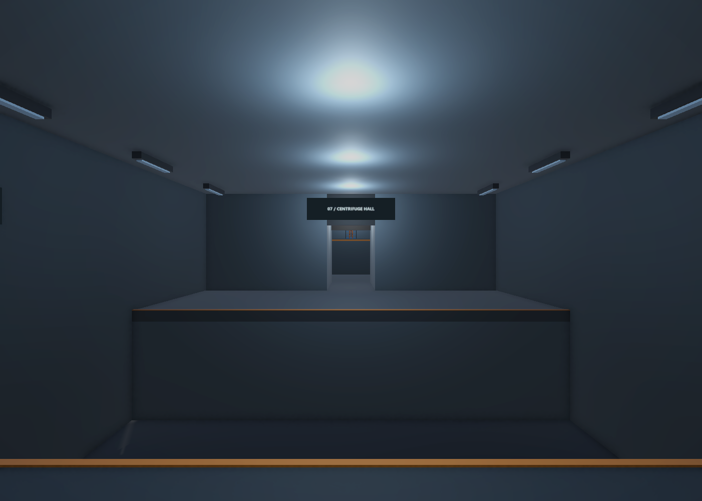
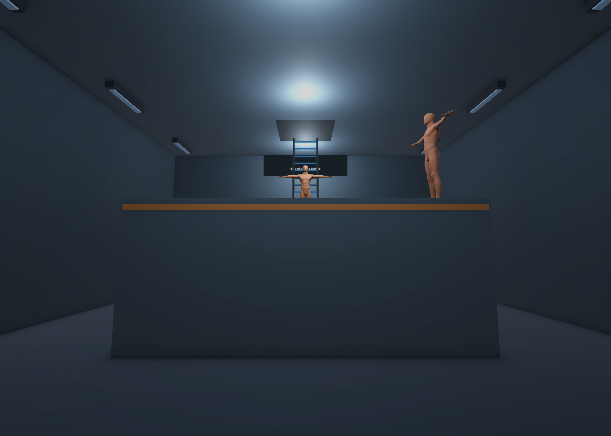
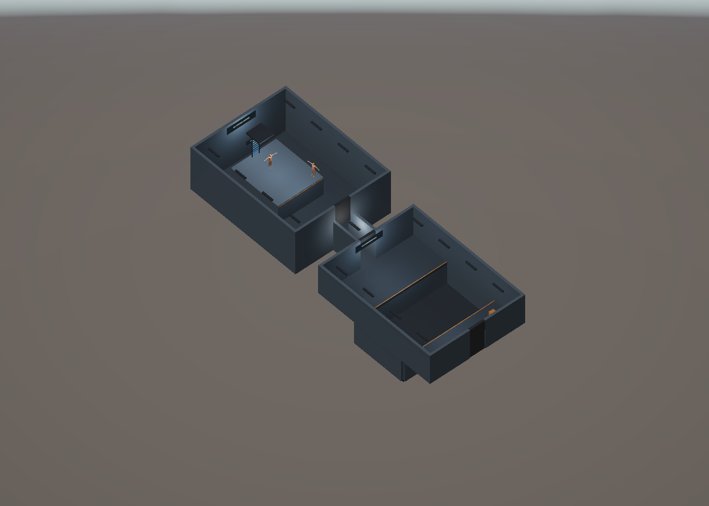
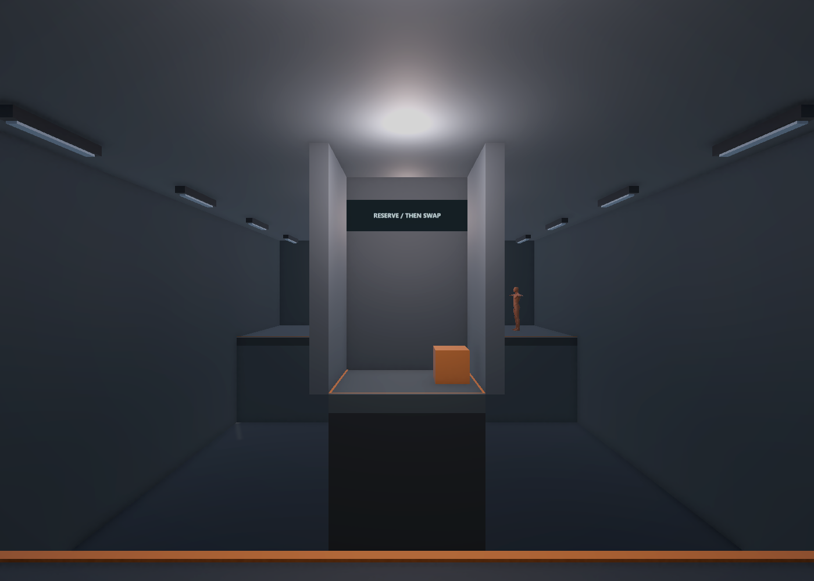
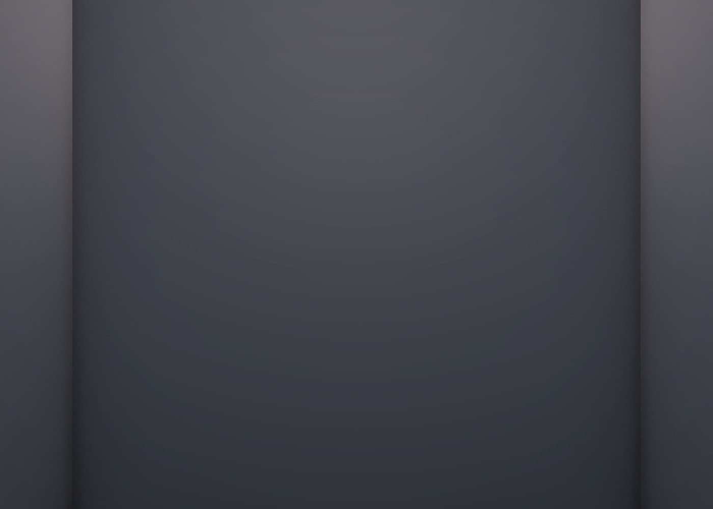
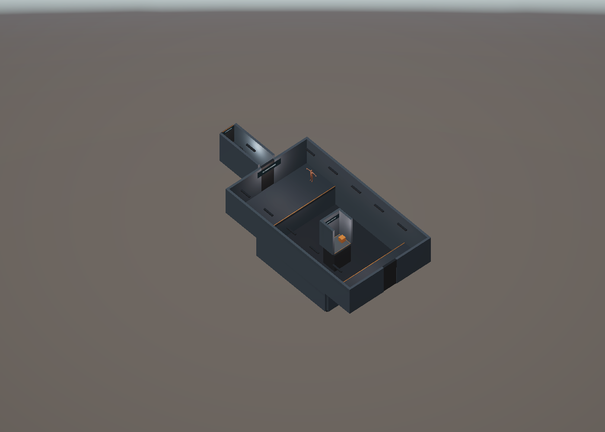
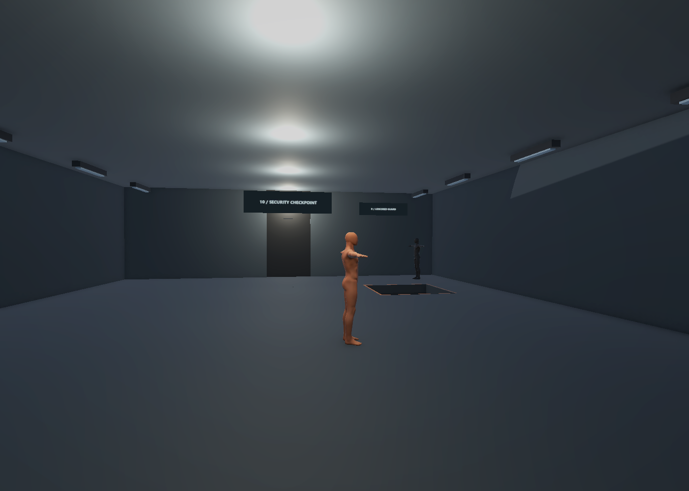
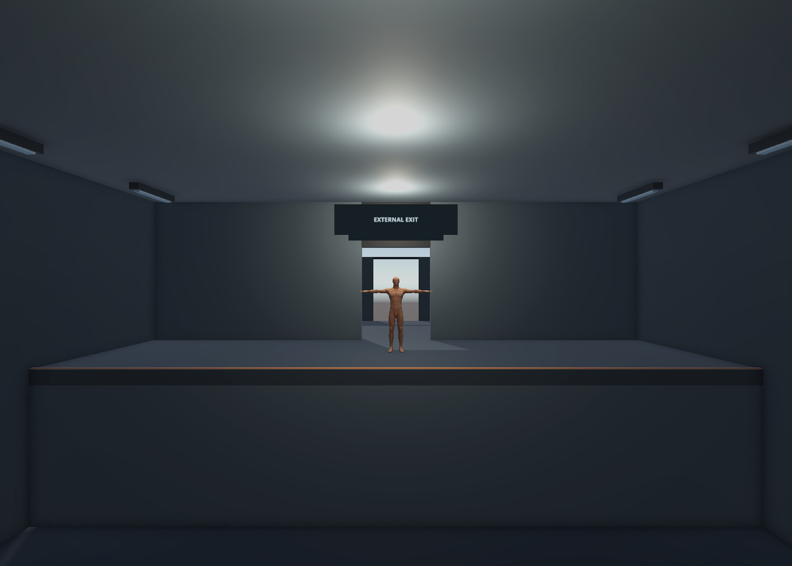
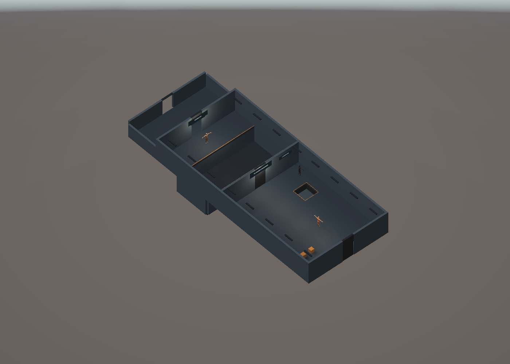

# B2·B1·1F 레벨 구성 V0.02

2026-11-05 설계 개정: 최신 제작 가안은 메인 기획서V0.15의9.0과 [기계층](도면/잠입_탐색/B2_기계층_잠입.svg)·[실험층](도면/잠입_탐색/B1_실험층_잠입.svg)·[물류층](도면/잠입_탐색/1F_물류_위장층_잠입.svg)이다. 지원실·설비 복도·직원 구역을 연결하고 B2/B1 사다리 위치를 맞췄다. 아래는 기존 구덩이·발판·단상 기믹의 제작 이력이며 새 전체 동선의 필수 순서가 아니다. Unity 씬은 아직 새 평면으로 수정하지 않았다.

2026-11-03 · 작성자 송예찬

## 작업 범위

남은 층 제작 요청으로 B2 기계층·B1 실험층·1F 검문소를 각각 별도 Unity 씬으로 구성함. 기준은 메인 기획서 9.8~9.11과 방 7~10의 기존 SVG 도면임. 기존 B5·B4·B3·Player와 게임 코드는 보존함.

| 층 | 씬 파일 · Assets/Afrer_Seconds/01.Scenes/Stage/ 기준 | 공간 |
| --- | --- | --- |
| B2 | Level_B2_Machinery.unity | 7번 원심분리기 홀 · 8번 중앙 관제실 |
| B1 | Level_B1_Experiment.unity | 9번 피험 챔버 · 1F행 계단 외형 |
| 1F | Level_1F_Checkpoint.unity | 10번 출입 검문소 · 외부 출구 착지 구역 |

각 씬에는 기존 Player 씬에서 복제한 플레이어·카메라 구성이 포함됨. **확인할 층의 씬 하나만 열어** 실행함. Player 씬이나 다른 층을 함께 로드하면 플레이어·카메라가 중복될 수 있음. Build Settings와 실제 층 전환은 이번에 연결하지 않음.

## B2 기계층

| 구역·대상 | 로컬 좌표·치수 | 부모 위치 |
| --- | --- | --- |
| Room07_CentrifugeHall | x −6~6, z −10~6 | (0,0,0) |
| 7m 구덩이 | z −5~2, 너비 전체 | Room07 내부 |
| 상자 2개 | (−4.5,3.5), (4.5,3.5) | Room07 내부, 높이 0.6m 외형 |
| 시작점 | (0,5), 플레이어 루트 Y 0.65 | Room07 내부 |
| 건너편 데크 | z −10~−5 | 경비·상자를 배치하지 않음 |
| 연결 통로 | 바닥 폭 2·길이 4 | 💡 (0,0,−12) |
| Room08_CentralControl | x −6~6, z −9~6 | 💡 (0,0,−20) |
| 관제 섬 | x −3~3, z −7~0, 높이 2.5 | Room08 내부 |
| 경비 L | (0,−4.5), Y 2.5, 남쪽 방향 | 정적 외형 |
| 경비 M | (−2.4,−0.8), Y 2.5, 동쪽 방향 | 정적 외형·순찰 마커 |
| M 순찰 마커 | (−2.4,−0.8) ↔ (2.4,−0.8) | Room08 내부 |
| 상자 2개 | (−5,4), (5,4) | Room08 내부 |
| 뒤쪽 던지는 위치 | (0,−8) | 관제 섬 뒤 2m 통로 |
| 출구 사다리 | (0,−6), 섬 위 | 시각 외형만 있음 |

7번 방은 건너편에 교환 대상이 없는 배치를 유지함. 구덩이 위 다리나 옆길을 넣지 않음. 8번 섬은 둘레를 돌 수 있으며 뒤 통로의 바닥·공간을 확인함. 천장은 💡 6m, 사다리 위에는 2×2m 해치 구멍과 닫힌 덮개 외형을 둠. 사다리 자체에는 충돌체나 등반 기능을 넣지 않음.

## B1 실험층

| 구역·대상 | 위치·치수 |
| --- | --- |
| Room09_SubjectChamber | x −6~6, z −13~8 |
| 구덩이 | z −8~4, 부스 바닥을 제외한 전체 너비 |
| 발판 부스 바닥 | x −1.25~1.25, z −2~0, Y 0 |
| 부스 벽 | 북·동·서에 높이 4m, 남쪽 열림 |
| 부스 상자 | (−0.8,−1), 높이 0.6m 외형 |
| 순찰 경비 Q | (−4.5,−10.5), 동쪽 방향 |
| Q 순찰 마커 | (−4.5,−10.5) ↔ (4.5,−10.5) |
| 시작점 | (0,7), 플레이어 루트 Y 0.65 |
| 출구 셔터 | 북쪽 z −13, x −1~1, 닫힌 상태 |
| 1F행 계단 전실 | 💡 부모 (0,0,−13), 폭 2m |

부스 바닥은 구덩이 한가운데의 독립된 섬임. 남쪽 데크에서 부스까지 4m, 부스에서 북쪽 데크까지 6m의 간격을 유지함. 부스 북쪽 벽이 뒤 경비 방향의 시선을 막고, 남쪽 진입면은 열려 있는지 확인함. 벽 두께는 💡 0.3m이며 부스 유효 바닥 바깥에 배치함.

계단은 💡 8단·단높이 0.2m·디딤판 0.5m, 충돌은 별도 경사 메시로 구성함. 출구 셔터와 계단 끝 연결문은 닫힌 외형임. 문 작동·등반·층 이동 없이 북쪽 출구로 정상 진행할 수 있는 상태는 아님.

## 1F 검문소

| 구역·대상 | 위치·치수 |
| --- | --- |
| Room10_ExitCheckpoint | x −7~7, z −22~9 |
| 시작점 | (0,8), 플레이어 루트 Y 0.65 |
| 경비 T | (−1,2), 서쪽 방향 |
| T 순찰 마커 | (−1,2) ↔ (−6,2) |
| 방탄 경비 R | (−5.5,−7), 동쪽 방향 |
| R 순찰 마커 | (−5.5,−7) ↔ (5.5,−7) |
| 상자 2개 | (3,5), (4.5,5) |
| 낮은 피트 | 중심 (−4,−4), 2.4×2.4m, 바닥 −1.2m |
| 셔터 | z −9 벽, x −1~1, 닫힌 상태 |
| 착지대 | z −12~−9 |
| 마지막 구덩이 | z −18~−12, 폭 6m |
| 연구 책임자 Z | (0,−20), 출구 플랫폼 |
| 출구 플랫폼 | z −22~−18 |
| 외부 착지 구역 | 💡 z −28~−22, 폭 14m |

R과 Z도 기존 경비 더미를 재사용하고 씬 전용 색상 재질로 구분함. R의 방탄 판정·Z의 이벤트가 구현된 것은 아님. 피트의 바닥은 별도 판으로 두며, 일반 바닥을 네 조각으로 나눠 구멍 위를 덮지 않도록 구성함. 마지막 구덩이에도 다리·옆길을 넣지 않음.

외부는 출구 이후의 공간감을 확인하는 작은 착지 구역과 게이트 외형임. 전체 물류창고 외관·주변 도시·결말 연출을 완성한 상태는 아님.

## 공통 제작 가안·최적화

- 넓은 구덩이의 표시용 바닥은 💡 Y −3m임. 사망·재시작 판정이나 기획 수치를 추가한 것이 아님. 실제 실패 처리는 별도 구현 대상임.
- 벽 두께 💡 0.3m를 연결부 치수에서 제외함. B2의 연결 통로 바닥은 4m, 벽·천장은 3.4m로 정리함. B1 계단과 1F 외부 연결부도 방 벽과 겹치지 않게 맞춤.
- 벽·바닥·문틀 등은 `05.Model/Environment/UpperFloors/Materials`의 공유 재질을 사용함. 표지 12종은 `03.Art/Environment/UpperFloors/UpperFloors_Signs_Atlas.png`와 공유 머티리얼 하나로 구성함. 각 표지의 UV는 별도 메시로 저장함.
- B2·B1·1F의 색상 Accent와 R·Z용 재질만 분리함. 기존 경비·플레이어·모델 원본은 수정하지 않음.
- Volume은 `06.Data/Rendering/UpperFloors`에 층별로 저장함. 노출 +0.2, Bloom 0.1·Quarter·최대 반복 3은 💡 시각 가안임.
- Point Light는 구역별로 묶고 추가 그림자를 만들지 않음. 각 층 Directional Light 하나만 그림자를 생성함. 조명 외형·표지·경고선 등은 그림자 투사를 끔.
- 층별 오클루전 데이터를 베이크하고 카메라 컬링을 켬. 문·캐릭터·상자는 고정 차폐물에서 제외함. 구조나 실제 Additive 층 로딩을 바꾸면 다시 검토·베이크해야 함.
- 단순 건축 메시와 짧은 관찰 거리를 고려해 LOD 파생 모델은 이번에 만들지 않음. 이전 [B3 최적화 방안](B3_조명과_최적화.md)을 따름.

| 층 | Renderer | 참조 머티리얼 | 광원 | 그림자 광원 | Collider |
| --- | ---: | ---: | ---: | ---: | ---: |
| B2 | 98 | 9 | 10 | 1 | 41 |
| B1 | 72 | 9 | 7 | 1 | 33 |
| 1F | 83 | 11 | 9 | 1 | 41 |

이 숫자는 씬 구성 집계이며 실제 Draw Call·프레임 비용은 아님. 조명 베이크·실행 빌드 성능 검증은 하지 않음.

## 검수·남은 기능

저장 후 각 씬을 다시 열어 누락 스크립트·재질 참조·플레이어·카메라·Volume 서브에셋·시작 바닥·퍼즐 주요 치수·경비 위치·구덩이 바닥·차폐·통로를 확인함. 같은 방향의 단순 박스 면이 겹치는지 검사해 세 층 모두 0건을 확인함. 이는 임의의 모든 메시·모든 카메라 각도에 대한 깜빡임 전수 검증은 아님.

- B2 편집 검사 18/18.
- B1 편집 검사 16/16.
- 1F 편집 검사 18/18.
- 실제 카메라 렌더와 천장을 잠시 숨긴 배치 이미지를 확인하고 상태를 복원함.
- 세 층 모두 Play Mode에서 기존 PlayerMotor.Move를 dt=1/60으로 90회 직접 호출해 시작점에서 2.25m 이동·접지를 확인함. B2 z 5→2.75, B1 z 7→4.75, 1F z 8→5.75. 키보드 이벤트·전체 퍼즐 플레이와 구분하며 결과 JSON을 검수 폴더에 보관함.
- 작업 시작 시 존재한 Assets·Packages·ProjectSettings 556개 파일의 해시를 보존함. 사용자 씬 이동·Build Settings·애니메이션 보관 작업도 유지함.

검수 중 Unity Editor의 `SceneView.DoOnGUI` 내부 NullReferenceException 이력이 있었음. 최종 확인에서는 새 예외가 추가되지 않고 Scene View 카메라가 유효하며 현재 Console 오류·경고는 0이었음. 프로젝트 스크립트 컴파일 실패는 없었음. 이력은 `editor-console-history.json`에 남겼으며 편집기 문제 재발 시 확인 대상으로 둠.

모든 경비는 현재 정적 T포즈 외형임. 사격·교환·제압·순찰·방탄·무게 판정·문·사다리·체크포인트·실패 복구·층 전환·결말은 별도 구현해야 함. 그래서 시작점 이동은 가능해도 구덩이와 닫힌 셔터를 정상 풀이로 통과하는 완성 레벨은 아님.

도구는 프로젝트 Assets 밖 `Projects/Management/AfterSeconds_UpperFloors_20261103`에 보관함. 검수 기록은 [검수/2026-11-03_UpperFloors](검수/2026-11-03_UpperFloors)에 있음. 커밋·push는 하지 않음.
