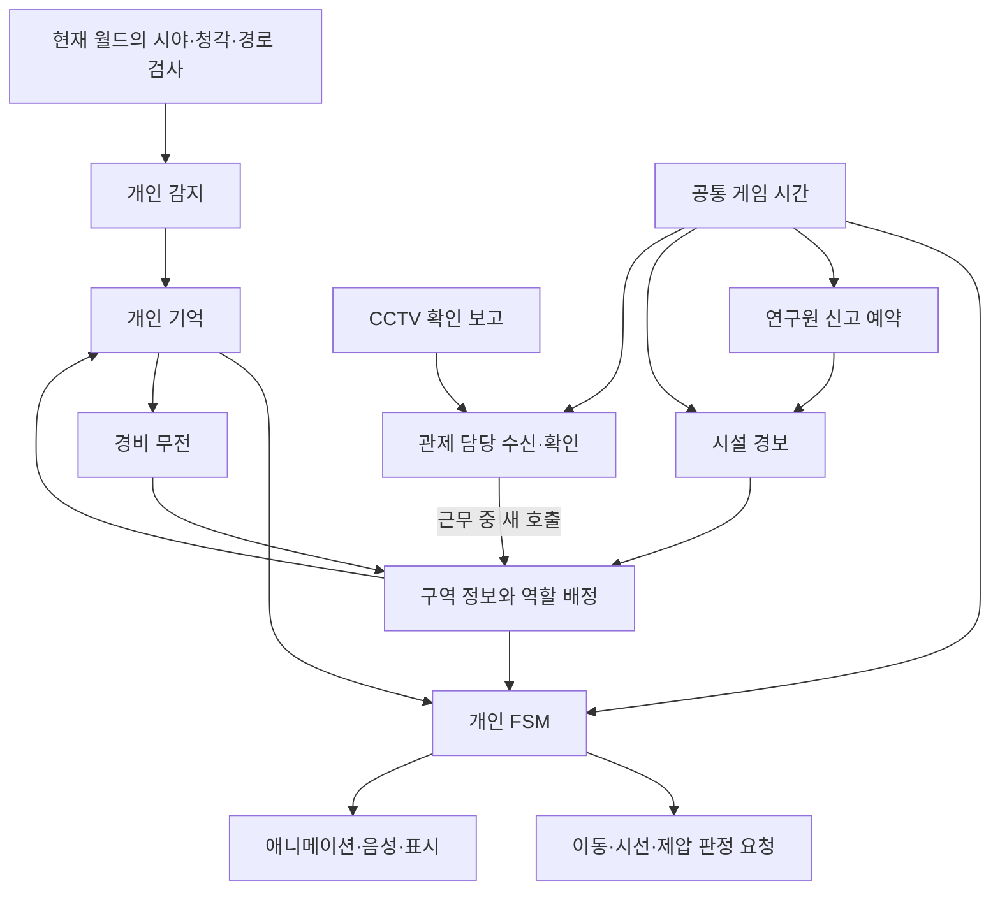
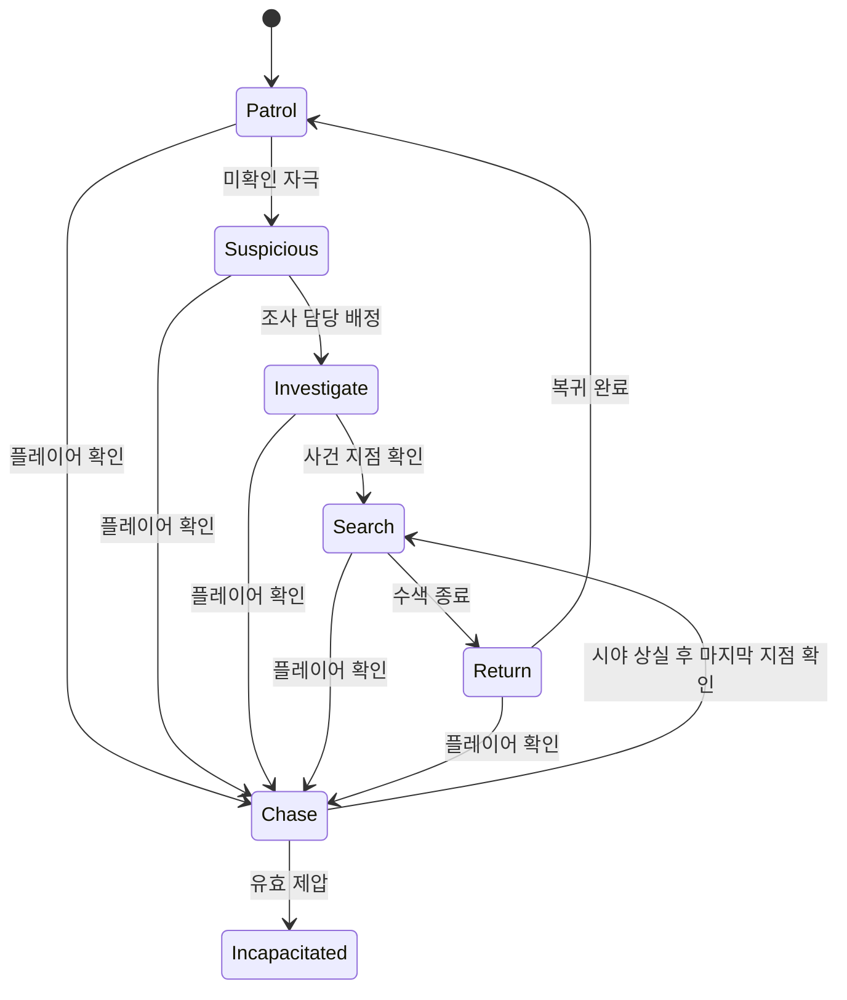

# After Seconds 에너미 AI 기획과 로직 V0.05

작성자 송예찬 · 2026-11-10

경비·CCTV·연구원이 자신이 보고 들은 정보와 전달받은 보고를 바탕으로 플레이어를 찾고, 서로 다른 경로를 확인하는 잠입 AI를 설계한다. 플레이어는 적의 시선·이동·무전에서 다음 위험을 읽고, 엄폐·유인·제압·3초 교환을 선택한다.

기준은 [메인 기획서](AfterSeconds_메인기획서.md) V0.76이다. **1장의 사용자 확정 규칙을 유지하고, 그 규칙을 연결하는 새 메커니즘·상태 구성·의사코드는 💡 상세 기획안으로 제안한다.** 🟡는 결정이 필요한 항목이다. 문서 작성 요청을 미정 규칙의 일괄 승인으로 해석하지 않는다. 현재 산출물은 기획이며 Unity 게임 코드·씬·Animator에는 적용하지 않았다.

**프로젝트 전체로는 플레이어 핵심 기능이 먼저다.** 이 문서의 단계는 그 뒤 에너미 AI에 착수했을 때의 순서다. **에너미 AI에서 처음 구현할 범위는 3.1과 16장의 1~2단계다.** 경비 1명, 관측의 위치·시각·종류, 순찰·추격·수색과 고정 간격 판단부터 만든다. 나머지 장의 구역 협력·관제실·시설 경보는 단계가 올라갈 때 읽는다. 1~2단계에 필요한 내용만 모은 [첫 구현 요약](에너미_AI_첫구현_요약.md)을 먼저 본다.

## 1. 확정 규칙과 설계 목표

| 항목 | 현재 기준 |
| --- | --- |
| 경비 | 플레이어를 추격하며 무전으로 관측 정보를 알린다. 모든 경비는 총을 소지한다. 실제 사격 여부는 🟡 |
| CCTV | 플레이어를 감지하고 경비를 호출한다. 감지 누적·전송 지연·범위는 🟡 |
| 연구원 | 발견하면 도망가고, 도주 후 게임 시간 30초 뒤 전체 경보를 울린다. 30초의 정확한 시작 사건은 🟡 |
| 연구소장 | 마지막 엔딩 역할. 일반 전투 AI나 자유 교환 대상으로 자동 확장하지 않는다 |
| 위치 정보 | 직접 보이는 플레이어의 현재 위치가 우선이다. 시야 단절 시 마지막 관측·전달 정보 중 최신 유효 위치를 수색한다. 교환만으로 새 위치를 알지 못한다 |
| 피격과 제압 | 교환을 유발하는 총알·투척물 명중은 즉시 사망·기절시키지 않는다. 직접 제압은 성립 즉시 무력화하며 교환을 예약하지 않는다. 제압 성립 조건은 🟡 |
| 위치교환 | 각 유효 명중 게임 시각 +3초에 플레이어와 해당 대상을 교환한다. 양쪽 현재 자세·몸 크기·지지 바닥을 검사해 한쪽 실패 시 그 예약 전체를 취소한다 |
| 연속 교환 | 한 투척의 복수 명중을 각각 예약한다. 앞 예약 실패가 뒤 예약을 취소하지 않는다. 각자의 이동·낙하 속도를 유지한다 |
| 시간 | 기록·단말·갤러리 열람 중 게임 시간이 정지한다. AI·물리·비행·교환·30초 신고·경보·소음 수명도 함께 멈춘다 |
| 층 이동 | VA·VB·VL 자유 선택, 상행만 허용. 소지품·진행과 발각·수색·경보·유효 신고 정보를 이어받는다. 경비의 실제 층간 추적은 🟡 |
| 상하 감시 | 열린 그레이팅은 시야를 통과시키고 불투명 배관·설비가 차폐한다. 보행용 연속 Collider를 그대로 불투명 면으로 쓰지 않는다 |
| 예측 가능성 | 경비 판단에 무작위를 넣지 않는다. 같은 상태·같은 입력·같은 규칙에서 같은 결정을 내린다 |

💡 적의 영리함은 정보의 근거를 유지하고 맡을 일을 나누는 데서 만든다. 소리를 들은 적이 조사하고, 다른 적이 연결 통로를 확인하며, 플레이어를 놓치면 마지막 목격 지점 주변을 살핀다. 적이 아는 정보와 플레이어가 실제로 있는 위치가 다를 수 있어야 유인과 교환이 해법이 된다.

## 2. 참고 자료와 적용 범위

| 자료 | 자료에서 확인한 내용 | After Seconds에 적용할 방향 |
| --- | --- | --- |
| [CDPR 개발자 GDC 발표](https://gdcvault.com/play/1035509/Heat-MaxTac-and-Blockades-Expanding) · [슬라이드](https://media.gdcvault.com/gdc2025/Slides/Celmer_Maciej_Heat%2BMaxTac%2BBlockades.pdf) | 경찰 추적 중 경로 그래프와 후보 위치 검사, 경찰 시스템과 배치 시스템 분리. 확인한 38쪽 PDF의 페이지 기준 23~24·34~35쪽 | 복도 연결 관계로 가능한 우회·차단 지점을 고르고 실제 도달 가능성을 검사. 오픈월드의 동적 경찰 생성까지 도입하지 않음 |
| [REDmodding 행동 파일 분석](https://wiki.redmodding.org/cyberpunk-2077-modding/for-mod-creators-theory/files-and-what-they-do/file-formats/behaviors-.behavior-files) | 조건·행동 노드가 TweakDB 설정과 연결되고 NPC 종류·상태에 따라 반응 분기 | 감지 조건·행동 선택·실제 이동/연출을 분리. 커뮤니티 분석이며 게임 전체 공식 아키텍처로 단정하지 않음 |
| [Much Better AI 제작자 설명](https://www.nexusmods.com/cyberpunk2077/mods/31402) | 검색에 노출된 제작자 설명의 위협 기억·제한된 조사 인원·목격과 청취 구분 등 변경 방향 | 참고 사례. 원문 직접 접속은 제한됐고 실행 검증도 하지 않음. 원작 로직의 근거나 필수 설계 전제로 사용하지 않음 |
| [공식 Update 2.0](https://www.cyberpunk.net/en/news/49060/update-2-0) | 탄착을 인지한 적의 발사 원점 조사, 측면을 잡혔을 때 반응 시간·그룹 전투 합류 개선 | 자극의 종류와 얻을 수 있는 정보를 구분. 패치 노트만으로 내부 알고리즘을 추정하지 않음 |
| [루시드 다이버 원본 검토](소음_어그로_루시드다이버_참조.md) | 소음 이벤트 → 청각 검사 → 기억·조사, 추격 중단 조건. 확인한 버전은 소음 마커 생성·삭제 방식 | 익숙한 책임 분리를 재사용하고 3D 감지·직접 관측 우선·풀 수명 분리를 추가 |

아래의 FSM·구역 협력 구성은 **After Seconds용 설계 제안**이다. Cyberpunk가 이와 똑같은 FSM이나 정보 우선순위를 사용한다는 설명이 아니다.

## 3. 단계별 구조와 실제 코드 계층

### 3.1 첫 구현과 확장 경계

💡 **1~2단계는 경비 1명과 개인 판단만 만든다.** 관측 레코드는 `Position·ObservedAt·Kind` 세 필드, 현재 보임은 그 틱의 감지 입력, 현재 상태·목표는 경비 자신의 데이터로 둔다. 고정 경로와 마지막 관측점 하나로 시작해 이벤트 버스·목표 예약·경보 단계 관리자·범용 프레임워크 없이도 순찰·추격·수색을 검증한다. 피격·교환은 3단계, 소음 풀은 4단계에 추가한다.

| 필요한 시점 | 그때 추가할 구조 | 첫 구현에서 생략할 것 |
| --- | --- | --- |
| 1~2단계 | 게임 시계, 최소 관측, 현재 시야 결과, 개인 상태와 목적지 | 무전·구역 배정·시설 경보·관제실·풀 |
| 3단계 교환 | 대상 ID, 피격 사건, 새 위치에서의 동기 경로 재검사 | 비동기 요청 번호는 비동기 처리를 도입할 때만 |
| 4단계 소음 | 사건 ID·수명, 필요한 마커의 대여 세대 | 마커가 필요 없으면 소음 데이터만 사용 |
| 5단계 경비 2~3명 | 보고의 출처/수신 시각, 도면 구역 ID, 업무·목표 중복 방지 | 층 전체 인원을 한꺼번에 제작하지 않음 |
| 6단계 CCTV·연구원 | 관제 담당의 수신/호출, 신고 예약과 중단 정책 | 4단계 시설 경보는 아직 단순 신고 여부로 검증 가능 |
| 7단계 층 진행 | 시설 경보 단계·FloorId·저장·씬 전환 | 새 경보 단계마다 별도 Manager 생성하지 않음 |
| 8단계 실제 배치 | 층별 규모·병목·관제실 방문 효과·선택한 미리보기 범위 | 경비 미래 위치 표시 여부가 미정이면 이를 선행 구현하지 않음 |

### 3.2 후속 확장의 책임 분리

💡 개인 AI는 감지·기억·행동, 5단계부터 구역 기능은 보고와 역할 배정, 7단계부터 시설 경보는 전역 경계를 담당한다. 아래 그림은 최종 책임 관계이며 처음부터 모두 만들 목록이 아니다. FSM은 현재 행동 상태와 전환 조건을 정하는 상태 머신이다.



| 책임 | 입력 | 출력과 제한 |
| --- | --- | --- |
| 감지 | 위치·시선·자세, 실제 차폐 결과, 들을 수 있는 자극 | 본 것·들은 것만 관측 데이터로 반환 |
| 기억 | 자기 관측, 도착한 유효 보고 | 마지막 확인 위치·시각·근거, 별도의 의심 지점 |
| 개인 FSM | 기억, 현재 상태, 담당 업무, 시간 | 다음 행동 의도. 월드 전체의 플레이어 Transform을 추적하지 않음 |
| 구역 협력 | 도착한 보고, 참여 가능한 경비, 구역 연결·이동 가능성 | 조사·추격 지원·출입 경로 확인 담당. 숨은 현재 좌표를 입력으로 받지 않음 |
| 관제 수신 | CCTV 관측, 담당 근무 상태, 전송·확인 시간 | 6단계 제안 채택 시 근무 조건이 유효할 때만 새 호출 발행. 이미 발행된 보고는 회수하지 않음 |
| 시설 경보 | 확정 신고와 구역 보고 | 시설 경보 상태와 마지막 확인된 층·위치. 전역 경보가 전역 시야를 뜻하지 않음 |
| 이동·표현 | 행동 의도와 경로 요청 결과 | 이동, 고개 돌림, 무전, 상태 표시. 판정 규칙을 Animator에 중복 구현하지 않음 |
| 소음 풀 | 마커 생성/반납 요청 | 소음 표시·재생 오브젝트 재사용. 기억·경보·신고 예약의 소유자가 아님 |

루시드 다이버의 역할 분리를 발전시키되 처음부터 큰 행동 트리나 점수 기반 AI 프레임워크로 교체할 필요는 없다. 조건이 늘어나면 같은 상태 안의 세부 행동을 함수·데이터로 나누고, 실제 복잡도가 확인된 부분만 확장한다.

### 3.3 현재 A.Define부터 F.Presenter까지의 배치

실제 루트는 `Unity/After_Seconds_Build_V0.01/Assets/Afrer_Seconds/02.Scripts/`다. 2026-11-10 확인 기준 `A.Define`과 `B.Simulator`는 `noEngineReferences=true`, Simulator는 Define을 참조한다. 나머지는 초기/Player 구현 참조 상태이므로 아래 표는 **적 AI를 넣을 제안 위치**이며 asmdef 연결 완료를 뜻하지 않는다.

| 현재 폴더 | 넣을 역할 | 시작 단계 |
| --- | --- | --- |
| A.Define | 최소 관측·상태·행동 의도, 나중에 보고/경로 결과 계약. Unity 타입 없이 좌표 값 표현 | 1 |
| B.Simulator | 기억 갱신·FSM·고정 논리 틱·붙잡기 조건. 이후 구역 배정·경보·신고 예약 | 1~2, 협력 5, 신고 6, 시설 7 |
| C.System | 실제 Transform·Raycast·NavMesh/경로·이동·소음 수집, ScriptableObject 값을 순수 설정으로 변환 | 2, 교환 3, 소음 4 |
| D.Ui | 상태 표시와 디버그/HUD View. 추격·신고 성립 판정을 소유하지 않음 | 개발 표시 2, 본편 UI 후속 |
| E.Manager | 세션 생성·게임 시계 구동·시스템 조립·저장/층 전환. 개별 경비 판단을 여기에 몰아넣지 않음 | 최소 조립 1, 층 진행 7 |
| F.Presenter | 감지 결과를 판단 입력에 연결하고 반환된 행동 의도를 이동·Animator·UI에 전달 | 2 |

권장 내부 의존성은 `B → A`, `C → A/B`, `D → A`, `E → A/B/C`, `F → A/B/C/D/E`다. 공통 시계는 E가 구동하고 B가 받은 시간으로 판단한다. B는 C나 Unity 월드를 직접 호출하지 않는다. 구역 협력도 처음에는 B의 함수·데이터 하나로 시작한다. 기존 [계층 제안 문서](Unity_계층_설계와_학습_순서.md)의 초기 폴더 예시와 구분하며 폴더 이동·asmdef 수정은 이번 범위에 포함하지 않는다.

## 4. 관측 정보와 기억

### 4.1 단계에 따라 늘리는 관측 정보

💡 첫 관측은 **위치·시각·종류 세 필드**다. 단일 경비·단일 플레이어라면 별도 대상 ID·출처·수신 시각은 필요 없다. 현재 보임·상태·수색 목적지는 경비 데이터/틱 입력이며 관측 레코드에 덧붙이지 않는다.

| 필드 | 도입 시점 | 그때 필요한 이유 |
| --- | --- | --- |
| Position | 1~2 | 실제 관측한 사건 위치 |
| ObservedAt | 1~2 | 사건의 게임 시각, 최신성 판단 |
| Kind | 1~2 | 플레이어 목격·미확인 자극의 구분 |
| SubjectId | 3 | 복수 교환 대상 식별. 미확인 소리는 대상 미지정 |
| EvidenceId / Sequence | 3~4 | 피격·소음 중복 제거와 같은 시각의 고정 순서 |
| ValidUntil | 4 | 수명 있는 소음. 초기 목격 만료는 ObservedAt와 공통 설정으로 계산 가능 |
| ObserverId / Channel / ReceivedAt | 5 | 무전 최초 출처와 도착 시각 구분. 재전송해도 ObservedAt 유지 |
| SectorId | 5 | 도면의 공동·통로 ID로 업무를 나눔 |
| Certainty | 선택 확장 | 처음에는 Kind의 확정/미확인 분류로 충분. 여러 정밀도를 실제 사용할 때만 추가 |
| FloorId | 7 | 다른 층 좌표와 신고를 구분. 초기 단일 층은 세션에 한 번만 보관 |

`PositionRevision·RequestId`는 관측 자체의 필드에서 제거한다. 비동기 경로 질의를 도입하는 시점에 **경로 요청 계약**에만 요청 ID와 월드 변경 번호를 둔다. 3단계의 동기 경로 재검사에는 필요 없다.

기억은 복사 가능한 값이다. 과거 위치를 플레이어나 재사용된 소음 마커 Transform으로 표현하지 않는다. 5단계부터 전달 보고는 원래 사건 ID·관측 시각을 유지한다. 게임 내부 출처 ID를 안다는 이유로 NPC가 미확인 소리의 범인을 식별하지 않는다.

### 4.2 기억 선택 순서

1. **현재 직접 관측한 플레이어**가 있으면 해당 위치를 추격 판단에 사용한다.
2. 시야가 끊겼다면 자신과 전달 정보 중 **최신 유효 플레이어 위치 근거**를 선택한다. 이는 현재 위치의 확정값이 아니라 마지막 확인 지점이다.
3. 그와 별도로 미확인 소음·움직임·동료 발견을 의심 단서로 보관한다. 새 충돌음이 더 최근이라는 이유만으로 기존 플레이어 목격 기록을 지우지 않는다.
4. 확정 위치 근거가 만료되어도 발생 이력을 경보 기억으로 남길 수 있다. 정확한 목표 좌표로 계속 쫓는 것과 경계를 유지하는 것을 구분한다.

💡 같은 관측 시각의 충돌하는 보고는 증거의 확실성 → 사전에 정한 채널 순위 → 최초 관측자 ID → 사건 순번으로 결정한다. 채널 순위와 유효시간은 데이터로 명시한다. 수신 시각이 늦다는 이유로 오래된 보고가 최신 보고를 덮어쓰지 않는다.

**예시:** 10초에 A가 서쪽 통로에서 플레이어를 봤고, 12초에 B가 북쪽에서 봤다. A의 무전이 13초에 늦게 도착해도 목표는 B가 12초에 본 북쪽이다. 14초에 동쪽에서 식판 충돌음이 들리면 동쪽은 새 의심 지점이지만 플레이어가 동쪽에 있다고 확정하지 않는다.

### 4.3 기억과 수색의 종료

💡 위치 정보의 유효시간이 끝나면 최신 좌표 추적을 종료하고 제한된 수색으로 전환한다. 정해진 수색 지점을 모두 확인하거나 수색 시간이 끝나면 담당 구역으로 복귀한다. 사건 자체는 별도 경계 기억으로 남겨 다음 감지 반응에 반영한다. 단서가 없는 무한 추격과 한 번 시야를 잃자마자 완전히 잊는 반응을 모두 피한다.

## 5. 시각과 청각 감지

### 5.1 시각 감지

💡 후보 대상 수집 → 거리 → 수평·수직 시야각 → 실제 차폐 → 식별 누적 순서로 검사한다. 머리·가슴 등 여러 표본 중 드러난 부위와 거리를 이용해 식별 진행도를 갱신한다. 정확한 표본과 누적 곡선은 시험 대상이다.

```text
보이는 표본이 있으면:
    식별 진행도 += 거리·노출·자세·경계 상태로 정한 증가율 × 고정 판단 간격 h
보이는 표본이 없으면:
    식별 진행도를 정한 감소율로 줄인다
식별 임계값에 도달하면:
    그 시각과 그 위치를 '플레이어 확인'으로 기록한다
이미 확인한 플레이어가 계속 보이면:
    실제 관측한 현재 위치를 갱신한다
시야를 잃으면:
    현재 보임을 해제하고 마지막 확인 위치를 보존한다
```

앉았다는 이유만으로 투명해지지 않는다. 낮아진 몸이 설비에 가려지는 효과를 먼저 적용하고, 자세 자체의 식별 속도 보정은 별도 시험한다. 🟡 B3 어둠·손전등에 따른 감지 변화는 명암 표현과 실제 판정이 일치하는 범위에서 결정한다. 화면 픽셀 밝기를 그대로 감지값으로 쓰는 것으로 확정하지 않는다.

그레이팅 상하 감시는 보행 Collider와 분리된 감지용 차폐 정보를 사용한다. 불투명 배관·벽·닫힌 문은 막고, 열린 격자의 빈 공간은 통한다. 유리의 시야 투과와 총알·투척물 차단도 별도로 판단한다. 통로 위 경비가 아래 플레이어를 볼 수 있어도 손이 닿거나 이동할 수 있다고 보지는 않는다.

### 5.2 청각 감지

💡 소음은 발생 위치·게임 시각·종류·강도·반경·수명을 가진다. 3D 거리와 벽·문·연결 공간의 전달 조건을 검사하며, 단순 수평 거리만으로 B2 상하층이나 다른 층 전체에 전달하지 않는다. 벽 뒤 소리는 첫 구현에서 정한 차폐/감쇠 정책을 따르고, 복잡한 음향 시뮬레이션은 필요성이 확인된 뒤 확장한다.

| 자극 | 얻는 정보 | 기본 반응 제안 |
| --- | --- | --- |
| 발소리 | 소리가 난 지점, 달리기 등 소음 유형. 보지 않았다면 신원 불확실 | 방향 확인 후 조사 후보 등록 |
| 물건 충돌 | 충돌 지점과 재질/세기 | 가까운 담당자가 조사. 물건의 현재 위치를 계속 따라가지 않음 |
| 총성 | 들을 수 있었던 발사 원점 또는 그 추정 영역 | 경계 강화·보고·조사. 사수를 식별한 것은 아님 |
| 자신이 총에 맞음 | 발사 당시 원점·발사 시각. 현재 좌표가 아닌 피격 사건의 단서 | 직접 관측이 없으면 발사 원점 수색. 총성만 들은 경우와 구분 |
| 투척물 피격·탄착 관측 | 관측한 투척 시작/비행 지점·방향 또는 충돌 지점·시각 | 직접 관측과 최신 유효 근거를 비교. 최초 투척 원점을 자동 제공하지 않음 |
| 제압 소리 | 들은 사건 위치 | 조사. 직접 목격했다면 시각 근거로 별도 판단 |
| 지속 기계음 | 주변 소음 환경 | 💡 작은 소리 감쇠에 사용 가능. 플레이어 유인음과 동일 사건으로 다루지 않음 |

**보이는 플레이어보다 일반 소음을 우선하지 않는다.** 시야를 잃었더라도 더 최근의 충돌음만으로 플레이어 목격 기억을 삭제하지 않는다. 구역 담당은 별도 조사자를 배정하거나 주 추격자가 마지막 목격 지점을 먼저 확인하도록 한다.

💡 반복 충돌은 동일 사건을 합치고 조사 요청 수를 제한한다. 다만 같은 곳에 두 번째 물건을 던졌다는 이유만으로 경비가 영원히 무시하지 않는다. 새 사건은 시선 반응·기록을 갱신하되 이미 진행 중인 동일 지점 조사에 매번 새 인원을 추가하지 않는 방식이다.

총·투척·소리만 감지·교환 각각의 위치 정보는 [메인 기획서의 피격 정보 표](AfterSeconds_메인기획서.md#피격-반응과-경비가-아는-위치--확정)가 기준이다. 총피격의 발사 원점은 허용된 **과거 사건 정보**다. 이는 보이지 않는 플레이어의 현재 좌표를 조회한다는 뜻이 아니다. 투척의 시작점은 실제 목격이 있을 때만 주는 제안으로 구분한다.

### 5.3 소음 풀의 수명

마커를 반납해도 개인 기억과 전달된 보고는 각자의 수명으로 남긴다. 마커가 재사용됐을 때 이전 조사 목적지가 바뀌지 않도록 `EvidenceId`와 대여 세대 값을 검증한다. 풀의 고갈 시 표시 마커를 생략할 수 있어도 게임 규칙에 필요한 소음 사건을 조용히 유실시키지는 않는다. 풀 크기·증설 정책은 성능 시험 후 정한다. [풀링 세부 참조](소음_어그로_루시드다이버_참조.md)

### 5.4 알아차리는 이상 징후의 범위

💡 장식 변화 전체를 추적하지 않는다. 최초 단계에서는 실제로 발생한 감지 이벤트만 쓰고 아래 지속 상태 감시는 필요한 단계부터 추가한다.

| 징후 | 인지 조건과 반응 | 단계 |
| --- | --- | --- |
| 물건이 부딪히는 소리 | 청취 가능하면 그 지점 조사 | 4 |
| 원래 바닥에 놓인 식판·소품 | 정적 배치만으로 이상 취급하지 않음. 떨어지는 순간을 보거나 충돌음을 듣는 경우만 사건 | 4 |
| 쓰러진 동료 | 실제 시야와 식별 성공 시 발견·보고·수색 | 5 |
| 열린 문 | 일반 개방 문은 정상. '평소 닫힘을 감시하는 지정 문'에 한해 기대 상태를 알고 실제 변화를 볼 때 조사 | 8 선택 |
| 사라진 총 | 일반 무기 분실 감시는 보류. 지정 보관대와 기대 수량을 기억하고 재확인하는 기능을 만들 때만 | 8 이후 선택 |
| 빈 관제석 | 관제 업무의 수신 가능 상태로 처리. 방 밖 모든 경비에게 자동 이상 신호를 보내지 않음 | 6 |

사건이 없던 정적 프랍을 월드 전체 스캔으로 이상 판정하지 않는다. 사건 목격은 원래의 시야·청각 검사를 통과해야 한다.

## 6. 경비의 행동과 상태 전환

💡 행동 상태, 맡은 역할, 시설 경보를 분리한다. 예를 들어 시설 전체 경보 중에도 특정 경비는 플레이어 위치를 모른 채 북쪽 출입구를 수색할 수 있다.

| 상태 | 진입 조건 | 수행 행동 | 주요 종료 조건 |
| --- | --- | --- | --- |
| Patrol 순찰 | 담당 구역 정상 업무, 복귀 완료 | 정해진 경로·대기·시선 전환 | 의심 자극 → Suspicious, 플레이어 확인 → Chase |
| Suspicious 의심 | 미확인 움직임·소음·이상 징후, 원점 모르는 투척 피격 | 자극 방향을 보고 식별·조사 필요성 평가 | 조사 배정 → Investigate, 확인 → Chase, 근거 소멸 → 이전 업무 |
| Investigate 조사 | 유효한 사건의 담당자로 배정 | 사건 위치까지 이동해 주변 확인 | 플레이어 확인 → Chase, 흔적만 남음 → Search, 조사 종료 → Return |
| Chase 추격 | 직접 확인 또는 유지 중인 직접 추격 | 현재 보이는 위치로 접근하고 무전. 시야를 잃으면 마지막 확인 지점으로 접근 | 재관측 실패·해당 지점 도착 → Search, 실제 붙잡기 조건 성립 → 붙잡기 처리 |
| Search 수색 | 마지막 목격 지점 도착, 보고 위치 확인, 동료 발견, 시야 없는 피격으로 위치 단서 확보 | 구역 내 후보 지점을 순서대로 확인 | 직접 확인 → Chase, 갱신된 유효 보고 → 목표 재평가, 범위/시간 종료 → Return |
| Return 복귀 | 할당 업무 종료·취소 | 도달 가능한 복귀 지점으로 이동 | 새 단서 → 의심/조사, 플레이어 확인 → Chase, 복귀 완료 → Patrol |
| Incapacitated 무력화 | 유효한 직접 제압 성립 | 이동·감지·새 무전 중단, 담당 업무 해제 | 회복 여부·시점은 🟡. 자동 회복을 전제하지 않음 |

무전을 받은 경비는 보지 못한 플레이어를 현재 보고 있는 것처럼 처리하지 않는다. 보고 위치로 신속하게 이동하는 행동도 정보 상태는 수색이며, 실제 재관측 뒤 추격으로 바뀐다.



그림은 핵심 전환만 표시한다. 유효한 직접 제압은 어느 활동 상태에서든 무력화로 전환한다. 단순 투척 피격은 무력화 전이가 아니며, 3초 동안 제자리에 고정시키지 않는다. 붙잡기는 거리뿐 아니라 현재 높이·차폐·실제 접촉 경로가 유효해야 하는 행동으로 분리한다. 구체 조건과 피드백은 🟡다.

**피격 시 어느 상태로 가는가 — 확정 반응을 연결하는 제안.** 현재 플레이어를 확인하면 어느 활동 상태에서든 Chase다. 보이지 않는 총피격은 원점·발사 시각을 기억한 뒤 Search로, 원점을 못 본 투척 피격은 Suspicious에서 충돌 방향을 확인한 뒤 Investigate/Search로 간다. 더 최신의 유효 목격이 있으면 오래된 발사 원점으로 되돌리지 않는다. 피격은 순간 연출 이벤트이며 3초짜리 정지 상태가 아니다. 무력화된 경비가 일반 피격으로 다시 활동 상태가 되지 않는다.

### 6.1 추격과 수색

💡 마지막 목격 지점에서 확인할 후보는 가까운 코너, 문, 불투명 설비 뒤, 연결된 다른 높이의 통로다. 실제 경로와 접근 권한이 있는 지점만 선택한다. 우선순위는 마지막으로 **관측한** 이동 방향 → 해당 방향의 연결 통로 → 가까운 미확인 엄폐 지점으로 두고 동률은 고정 ID로 해결한다. 관측하지 못한 현재 플레이어 방향을 사용하지 않는다. 처음에는 기존 공동·통로 ID와 연결만 수색 후보로 쓰고, 별도 수색 포인트 에셋은 만들지 않는다(12.1).

문이 닫혔으면 열 수 있는 문인지 검사하고, 권한이 없거나 막혔으면 가능한 우회로를 찾는다. 재탐색 시간이나 실패 횟수의 한도를 두고, 도달 불가를 보고한 뒤 다른 후보로 전환한다. 벽을 향해 계속 달리거나 반대편으로 순간이동하지 않는다.

### 6.2 무전

💡 최초 플레이어 확인·다른 구역 진입을 실제로 목격·시야 상실 등의 사건에서 보고를 요청한다. 같은 위치를 매 프레임 방송하지 않고 최소 간격이나 위치 변화 기준으로 제한한다. 무전은 추격과 병행하는 행동이며 매번 멈춰 서는 별도 상태로 강제하지 않는다.

보고에는 관측 위치·층·시각과 현재 목격인지 마지막 목격인지가 포함된다. 이미 수신된 보고는 발신 경비가 나중에 무력화돼도 자동 삭제하지 않는다. 🟡 전송 전 무력화 시 취소, 무전 지연·통신 범위·갱신 간격은 후속 결정이다.

### 6.3 동료 발견과 사격

💡 쓰러진 동료는 실제 시야에 들어와야 발견한 것으로 처리한다. 발견한 경비는 위치를 보고하고 주변을 수색하며, 동료를 쓰러뜨린 플레이어 위치는 목격 증거가 있을 때만 추가한다. 처치·부축·동료 깨우기 기능은 별도 결정 없이 넣지 않는다.

경비가 총을 가지고 있어도 사격 행동은 아직 활성 규칙이 아니다. [사격 선택지와 제압 조건](잠입_상호작용_상세설계.md)을 먼저 정한다. 제압탄·실탄을 선택할 경우에만 조준 예고, 발사 가능선, 아군 오사, 피격 효과, 실패 조건과 사격용 엄폐 선택을 추가한다. Cyberpunk의 사격수·넷러너 역할을 현재 경비에게 그대로 복사하지 않는다.

### 6.4 붙잡기의 성립과 실패

🟡 **사격·제압과 함께 최우선 결정**이다. 아래는 생포 중심 시험안이며 확정 규칙이 아니다.

1. 의식 있는 경비가 플레이어를 직접 식별하고, 몸체 표면 사이가 기존 시험값 0.9m 이내이며 실제 손이 닿는 높이·경로여야 한다. 벽·닫힌 문·유리·그레이팅·다른 몸체를 통과해 붙잡지 않는다.
2. 💡 팔을 뻗는 예고를 0.4 게임초 표시한다. 이 동안 플레이어 입력은 유지하고 플레이어를 경비 앞으로 끌어당기지 않는다. 기존 0.35초 반응 지연과 별개 값이다. **예고 동안 경비는 이동·회전을 계속한다(사용자 결정).**
3. 예고 중 거리·시야·접촉 경로가 끊기거나 경비가 무력화되면 취소한다. 마지막 순간에도 모두 다시 검사하고 성립하면 붙잡힘 실패를 한 번 발생시킨다.
4. 💡 **교환이 성공하면 진행 중이던 예고를 취소한다.** 새 위치에서 1번 조건을 만족하면 예고를 처음부터 새로 시작하고, 남은 예고 시간을 이어받지 않는다. 예고가 거의 끝났을 때 교환했는데 여전히 경비 가까이에 있더라도 0.4초를 다시 센다. **실패한 교환은 예고를 취소하지 않는다.** 교환 예약이 걸려 있다는 사실만으로도 붙잡기를 막지 않는다.
5. 교환과 예고 종료가 같은 시각이면 10.2의 제안 순서대로 교환을 먼저 처리한다. 4번과 5번은 아직 제안이며 구현 전 확정한다.

추격 6.0m/s와 플레이어 전진 달리기 7.5m/s 가안에서는 **장애물 없는 직선에서 계속 달리는 플레이어를 뒤에서 따라잡을 수 없다.** 첫 시험은 이 도주를 허용한다. 멈춤·걷기·앉기·코너·길 선택·관측에 근거한 다른 경비의 경로 확인이 거리 변화를 만든다. 숨은 가속·순간이동·자동 스태미나 제한으로 보완하지 않는다. 경로 확인 담당이 없는 1명 시험과 2~3명 협력 시험을 분리해 난이도를 조정한다.

#### 앞을 막은 경비도 달려서 지나칠 수 있는 문제

**처음 시험안에는 예고 0.4초 동안 경비가 움직이는지가 빠져 있었고, 제자리에 선다고 보면 붙잡기가 성립하지 않았다.** 아래는 그 경우를 플레이어 몸 반지름 0.28m(현재 프리팹), 경비 몸 반지름 0.3m 가정으로 계산한 값이다. 표면 간 0.9m는 중심 간 약 1.48m다.

| 상황 | 붙잡기 범위 안에 머무는 시간 | 예고 0.4초 기준 결과 |
| --- | --- | --- |
| 제자리에 선 경비 옆을 몸이 닿을 만큼 스쳐 달림 | 약 0.36초 | 성립하지 않음 |
| 같은 경비 옆을 중심 간 1.0m 떨어져 달림 | 약 0.29초 | 성립하지 않음 |
| 폭 4.2m 통로 중앙의 경비를 벽에 붙어 지나감 | 0초. 중심 간 최대 1.82m로 범위 밖 | 예고도 시작되지 않음 |
| 뒤에서 쫓아오는 경비 | 거리가 초당 1.5m씩 벌어짐 | 성립하지 않음 |

경비가 예고 동안 제자리에 서 있다면, 달리는 플레이어는 정면 차단도 통과한다. 7장의 경로 확인 역할이 통로 앞을 지켜도 압박이 되지 못한다. 여기에 세 코어가 항상 열려 있고 경비의 층간 추적이 미정이므로, **발각되면 가까운 코어까지 달리는 것이 항상 가장 좋은 선택**이 된다. 여섯 층 주 경로 약 620m는 달리기 7.5m/s로 약 83초다(계단 구간 제외).

**사용자 결정 (2026-11-10): 예고 중에도 따라붙기.** 붙잡기 예고 동안 경비는 멈추지 않고 이동·회전을 계속해 플레이어를 따라붙는다. 아래 표의 첫 번째 안이며, 나머지 세 안은 검토 기록으로 남긴다.

이 결정으로 달라지는 것은 다음과 같다.

- **정면 차단이 가능해지는 방향이며 AI36에서 검증한다.** 달려오는 플레이어가 범위에 들어오면 경비가 예고를 시작하면서 플레이어 쪽으로 붙고, 지나친 뒤에도 따라가면 범위를 벗어나기까지 시간이 늘어난다. 실제로 잡히는지는 식별 시점·회전 속도·가속·옆으로 지나가는 간격에 달려 있다. 경비가 즉시 6.0m/s로 방향을 맞춘다는 가정에서는 지나친 뒤 약 0.6초 동안 범위 안이지만, 이는 가정에 따른 참고값이고 시험 결과가 아니다.
- **뒤로 도주는 여전히 가능하다.** 처음부터 거리를 두고 직선으로 달리면 초당 1.5m씩 벌어진다.
- **회전 속도가 난이도가 된다.** 경비가 몸을 돌리는 데 걸리는 시간이 길수록 스쳐 지나가기 쉽다. 🟡 회전 속도와 가속은 조정 데이터로 두고 AI36으로 시험한다.
- **끌어당기지 않는다.** 따라붙는 것은 경비 자신의 이동이다. 플레이어 위치나 속도를 바꾸지 않는다.

| 안 | 내용 | 얻는 것 | 치르는 값 |
| --- | --- | --- | --- |
| **채택: 예고 중에도 따라붙기** | 예고 동안 경비가 이동·회전을 계속한다. 회전 속도를 조정 데이터로 둔다 | 정면 차단과 경로 확인 역할이 의미를 가질 수 있다(AI36 검증). 직선에서 뒤로 도주하는 것은 계속 허용된다 | 회전 속도·가속 값을 시험해야 한다 |
| 예고 단축 | 0.4초를 0.2~0.3초로 줄인다 | 규칙 추가 없음 | 스치기만 해도 잡혀 피할 여지가 줄어든다 |
| 닿으면 느려짐 | 붙잡기 범위 안에서는 달리기가 풀려 걷기 속도가 된다 | 범위에 들어온 순간부터 위험이 분명해진다 | 플레이어 이동 규칙이 하나 늘어난다 |
| 경비 사격 | 제압탄 등 원거리 위협을 채택한다 | 거리를 벌려도 안전하지 않다 | 엄폐·피격 설계가 추가된다. 사격 결정과 묶인다 |

2단계의 경비 1명 시험에서 AI36으로 먼저 확인하고, 층 전체 배치 뒤 AI37로 달리기만으로 통과하는 시간을 잰다. 이 문제를 숨은 가속이나 코어 잠금으로 덮지 않는다.

## 7. 구역 협력과 역할 배정

💡 역할은 영구적인 적 직업이 아니라 현재 사건에 대한 업무다. 사건마다 적 수를 늘리기보다 이미 배치된 경비가 역할을 나누도록 한다.

| 역할 | 배정 대상 | 행동 |
| --- | --- | --- |
| 조사 담당 | 해당 소리를 들었거나 유효 보고를 받은 경비 중 경로상 가까운 가용 인원 | 소음·이상 징후 지점을 확인 |
| 직접 추격 | 플레이어를 실제로 확인한 경비 | 직접 관측 위치를 우선해 추격·무전 |
| 경로 확인 | 직접 시야는 없지만 유효 보고를 받은 가용 경비 | 알려진 위치·이동 방향에서 이어지는 출입 경로로 이동해 확인 |
| 구역 유지 | 역할을 받지 않은 경비 | 담당 업무를 유지하며 추가 단서를 감지 |

조사 인원은 **사건당 1명으로 시작하는 시험안**이다. 한 명이 무력화·도달 불가·새 직접 추격으로 업무를 떠나면 담당을 해제하고 필요한 경우 재배정한다. 직접 플레이어를 보는 경비를 단순 조사 역할에 묶어 두지 않는다. 여러 경비가 동시에 직접 보면 각자 그 관측을 우선하며, 다른 접근 경로 선택으로 중복을 줄인다.

### 7.1 배정 순서

1. 수신 범위 안의 유효 사건만 모으고 중복 EvidenceId를 합친다.
2. 무력화·도달 불가·더 높은 우선순위 업무 중인 경비를 제외한다.
3. 이미 적합한 담당자가 있으면 유지한다. 조금 가까워졌다는 이유로 매 갱신마다 바꾸지 않는다.
4. 신규 담당은 도달 가능한 경로 길이 → 기존 업무 방해 정도 → 고정 경비 ID 순으로 고른다.
5. 목표 지점을 예약해 여러 명이 같은 작은 엄폐 지점에 모이지 않게 한다.
6. 업무 완료·정보 만료·경로 실패·담당 무력화 시 예약을 해제하고 재평가한다.

경로 확인 지점은 복도·문·계단 연결 그래프에서 고른다. 마지막으로 보인 방향과 지형에서 추론할 수 있는 후보이며, 보이지 않는 플레이어를 따라 자동 갱신하지 않는다. 문 상태·폭·높이·이동 가능성을 검사하고 적의 현재 위치에서 실제로 이동한다. 막다른 곳이나 접근 불가 지점을 맡기지 않는다.

💡 수색 인원과 시간에 상한을 두되 정확한 값은 레벨 시험으로 정한다. 모든 코어를 무조건 봉쇄하거나 사건 없이 새 경비를 출구에 생성하는 방식은 이 설계에 포함하지 않는다. 경비가 지키는 위험한 경로와 시스템이 코어 이용을 잠가 버리는 것은 구분한다.

### 7.2 플레이어에게 보이는 협력

무전 예시는 “북쪽 통로에서 확인”, “시야에서 놓쳤다”, “나는 서쪽 연결부 확인한다”처럼 실제 정보 상태와 맡은 일을 전달한다. 소리를 들은 적은 먼저 방향을 보고, 조사자는 이동하며, 경로 확인자는 담당 통로 쪽을 살핀다. 보지 않은 위치를 확정적으로 말하지 않는다. 자막·효과음·상태등의 최종 표현은 UI/UX·사운드 단계에서 정한다.

### 7.3 좁은 통로와 문에서 마주침

💡 문과 B2 폭 1.5m 상부처럼 서로 비켜설 수 없는 곳은 5단계부터 **통로 ID와 진행 방향 단위**로 통행권을 둔다. 1명 단계에서는 필요 없다.

- 이미 병목 안에 있는 경비의 통행을 우선한다. 밖에서 오는 경비는 출입면을 막지 않는 앞쪽 넓은 지점에서 기다린다.
- 양쪽 모두 밖이면 직접 추격 → 진행 중 업무 → 먼저 요청한 게임 시각 → 고정 경비 ID 순으로 정한다. 먼저 들어간 경비를 새 추격자가 뒤집어 내보내지 않는다.
- 양쪽이 이미 들어가 막혔다면 이동해 나온 쪽의 가까운 안전한 넓은 지점까지 한 명이 후퇴한다. 후퇴 공간이 없으면 경로 실패로 보고하고 우회하며 서로 밀거나 Collider를 끄지 않는다.
- 통과·무력화·층 해제 시 통행권을 반환한다. 대기 시간 한도를 넘으면 재탐색하고, 영구 양보가 생기지 않게 오래 기다린 요청의 우선순위를 올리는 안을 시험한다.
- 걷는 경비가 앉은 플레이어 전용 구간을 통과할 수 있다고 가정하지 않는다. 통행권은 적끼리의 조정이며 플레이어 이동을 자동 잠그는 문이 아니다.

초기 수색 후보와 병목은 기존 문/통로 ID를 재사용한다. 폭·높이·후퇴 가능 지점은 실제 씬 검사로 확인한다.

## 8. 연구원과 CCTV

### 8.1 연구원

**확정:** 발견 → 도주, 도주 후 게임 시간 30초 뒤 전체 경보, 최신 유효 관측 위치 사용. 아래 이동 상태와 예약 관리는 💡 상세안이다.

| 행동 상태 | 처리 |
| --- | --- |
| Work 업무 | 업무 지점에서 작업하고 시각 감지 |
| Flee 도주 | 관측한 위험 지점에서 멀어지는 도달 가능한 안전 지점으로 이동 |
| Shelter 대피 | 안전 지점에서 머물며 새 위협을 실제로 감지하면 대피 지점 재평가 |

신고는 행동 상태와 별도로 `미시작 → 대기 → 전송 완료`로 관리한다. 무력화 기능과 신고 취소를 채택한다면 `취소`를 추가한다. 이동 상태가 바뀌거나 연구원 오브젝트가 층 전환으로 해제돼도 이미 시작한 신고 예약을 소실시키지 않는다.

- 🟡 시작 사건은 **도주 시작 / 안전 지점 도착** 중 선택해야 한다. 💡 추천은 도주 시작이며, 길찾기 실패나 숨을 곳 부재가 신고를 영구 지연하지 않는 장점이 있다. 확정 전 둘 중 하나를 기본 규칙으로 구현하지 않는다.
- 시작 사건이 발생한 게임 시각을 `ReportStartAt`, 예정 시각을 `ReportStartAt + 30`으로 저장한다. 같은 연구원의 반복 감지가 기존 예정 시각을 뒤로 미루지 않는 안을 제안한다.
- 도주 경로가 막히면 다른 안전 지점을 찾는다. 숨은 현재 플레이어 좌표로 회피 방향을 고치지 않고 마지막으로 확인한 위협 정보를 사용한다.
- 신고가 실행되면 신고 채널에 유효하게 공유된 최신 관측을 사용한다. 다른 경비가 나중에 플레이어를 봤다면 그 보고가 도착한 범위에서 갱신할 수 있다.
- 관측 위치가 모두 만료됐다면 시설 경보 자체는 울리고 위치는 “마지막 확인 구역” 또는 “현재 위치 미확인”으로 표시하는 안이다. 현재 좌표를 채우지 않는다.
- 여러 연구원은 각자의 예약을 가진다. 가장 먼저 도착한 신고가 전체 경보를 발생시키고 뒤 신고는 정보 갱신에 쓰되 경보 수치를 무한 누적하지 않는 안을 제안한다.

**30초 동안의 대응 수단 — 우선 결정할 제안.** 💡 도주 시작부터 30초를 세고, 전송 전에 연구원에게 유효한 비살상 직접 제압을 성립시키면 그 연구원의 대기 신고를 취소하는 안을 추천한다. 경비 제압과 동일한 접근·거리·높이·차폐 조건을 적용하는 방향이며, 연구원 제압 허용 자체와 세부 조건은 승인 전이다. 다른 연구원의 신고나 이미 전송된 경보까지 취소하지 않는다.

플레이어는 신고자를 따라가 위험을 감수하고 중단할지, 남은 시간에 자료/도구를 챙기고 경보를 감수할지 선택한다. 투척 명중은 기존 규칙대로 즉시 기절시키지 않으며 신고 시간을 초기화하지 않는다. 연구원 교환 가능 여부도 🟡로 남기고, 허용하더라도 위치만 바뀐다는 이유로 신고가 취소되지는 않는 안이다. **층을 떠나도 시작한 신고는 이어지므로 상행은 신고 취소 수단이 아니다.**

신고 중단 수단을 채택하지 않으면 30초는 '중단 기회'가 아니라 '경보 전 준비 시간'으로 설명해야 한다. 어느 쪽을 택할지 구현 6단계 전에 결정한다. 도주 중 주변 알림 범위·재신고 간격도 미정이다.

### 8.2 CCTV

💡 `Scan 순회 → Suspect 확인 중 → Track 추적·보고 → Reacquire 재확인 → Scan`으로 구성한다. 경비 호출은 아래 관제실 경유안을 채택하면 관제 담당이 실행한다. 실제 카메라 헤드의 방향과 감지 원뿔을 맞춰, 외형은 반대쪽을 보는데 감지는 플레이어를 보는 현상을 막는다.

| 상태 | 처리와 전환 |
| --- | --- |
| Scan | 정해진 좌우 회전 범위·정지 시간을 반복. 미확인 노출 발견 시 Suspect |
| Suspect | 감지 누적. 확인 임계값 도달 시 위치·시각 보고를 만들고 Track, 근거 소멸 시 Scan |
| Track | 보이는 동안 실제 위치 갱신, 관제 수신처로 보고. 화면의 감지와 경비 호출 완료를 구분 |
| Reacquire | 시야를 놓친 마지막 방향을 제한된 시간 재확인. 실패 시 Scan으로 복귀하며 전달된 보고는 별도 유지 |

호출받은 경비는 보고된 위치로 가고 실제 재관측 전까지 현재 위치를 모른다. CCTV 하나가 확인했다고 모든 경비가 똑같은 지점으로 몰리지 않도록 구역 역할 배정을 통한다. 최초 호출과 갱신 주기를 구분하고 매 프레임 새 사건을 만들지 않는다.

고정 베이스·좌우 목 회전·상하 헤드 피벗의 아트 구조를 감지 기준에 맞춰 사용한다. 🟡 상하 추적 범위, 확인 시간, 통신 지연·범위, 전체 경보 직접 발령 여부, 파괴·해킹·교환·전원 차단 기능은 후속 결정이다. 소음 청취 기능도 CCTV에 자동 부여하지 않는다.

### 8.3 CCTV와 관제실의 호출 경로

💡 사용자 제안에 따른 대응 수단이다. **CCTV 확인 → 해당 층 관제 담당 수신·확인 → 경비 호출 → 구역 배정** 순서로 처리한다. 자동으로 경비에게 직접 전송하는 우회 경로는 함께 두지 않는다.

관제 가능 조건은 지정 담당이 의식 있는 상태로 해당 관제석에서 근무 중이고 단말이 사용 가능한 것이다. 방에 아무 NPC나 있다는 것만으로 담당이 생기지 않는다. 처음에는 층당 관제 담당 1명을 경비 수에 포함하고 대체 근무·원격 이중화는 도입하지 않는 안이다. 담당을 제압하는 것 외에 **유인해 관제석을 비우게 하는 방법**을 남긴다. 가용 경비가 있으면 일반 소음은 다른 경비가 조사하되, 담당 혼자 있는 상황의 유효한 가까운 이상 징후·직접 위험에는 자리 이탈을 허용하는 배치를 시험한다.

| 사건 | 제안 처리 |
| --- | --- |
| 카메라가 확인 | 원래 관측 시각을 보존한 보고 생성. 전송 지연 후 관제에 도착 |
| 관제 수신·확인 | 관제 근무 조건과 보고 유효성을 검사. 확인 지연 후 다시 검사하고 경비 호출 전송 |
| 담당이 호출 발행 전에 이탈/무력화 | 아직 발행하지 않은 CCTV 호출 취소. 카메라의 로컬 감지·상태등은 계속 동작 가능 |
| 이미 호출 발행/수신 | 이미 보낸 호출과 경비 기억은 유지. 관제실을 비워도 현재 추격을 강제로 중단하지 않음 |
| 관제 담당 복귀 | 미발행 옛 대기열을 한꺼번에 보내지 않음. 복귀 뒤 새로 확인·전송한 유효 관측부터 호출 |
| 경비 직접 발견·연구원 신고 | 각자의 무전/신고 경로 유지. CCTV 관제 무인화 효과로 함께 차단하지 않음 |

호출 도착 시각은 `카메라 확인 시각 + 카메라 전송 지연 + 관제 확인 지연 + 호출 전송 지연`이다. 세 지연값은 🟡이며 모두 게임 시간으로 관리한다. 확인 누적시간은 카메라가 아직 식별하지 못한 시간으로 별도다. 호출 도착·관제 이탈이 같은 시각이면 사건 순번으로 처리하되 이미 발행된 호출은 회수하지 않는 안을 제안한다.

도면상 관제 후보는 B5 C02, B4 N01, B2 C04, B1 E01이다. B3 E02(주 서버·관측 데이터), 1F C03(출구 검문 구역)은 **관제 기능을 추가할지 정할 후보**이며 기존 관제실이 완성됐다고 기록하지 않는다. 전체 층 적용 전 이 두 층의 호출 경로도 정한다. 관제 담당 유인은 선택 방문 보상이며 관제실 방문을 코어 개방 조건으로 강제하지 않는다.

**B5는 관제실이 두 곳 만들어져 있다.** 💡 CCTV 호출의 수신처는 C02로 두는 안을 추천한다.

| 공동 | 실제 제작 상태 | 위치 | 제안 역할 |
| --- | --- | --- | --- |
| C02 보안관제동 | 2인 관제석, 6분할 감시 화면, 녹화·네트워크 랙. 화면 내용이 CCTV 감시 영상이다 | 시작점 C01과 계단 A 사이. 주 경로 위 | CCTV 확인 보고의 수신·경비 호출 |
| N01 중앙관제동 | 6인 관제석, 시설 지도·재실 상태·전력·공조·기록·정비 화면 | 계단 A·화물 승강기에서 각각 통로 약 52m. 외곽 | 🟡 시설 상태 관제. 전체 경보나 설비 제어와 연결할지 후보로 남긴다 |

C02를 고르는 이유는 감시 화면이 실제로 그 방에 있고, 첫 층의 주 경로에서 "관제석이 비면 CCTV 호출이 멎는다"를 자연스럽게 겪기 때문이다. N01을 수신처로 쓰면 이 대응 수단이 외곽을 일부러 찾아간 플레이어에게만 보인다. 두 곳 모두를 수신처로 두는 이중화는 처음에는 도입하지 않는다. 최종 지정은 🟡 사용자 결정이다. [C02 제작 기록](검수/2026-11-08_C02_Security/검수결과.md) · [N01 제작 기록](검수/2026-11-08_B5_RemainingDomes/검수결과.md)

## 9. 시설 경보와 정보 공유

💡 아래 단계는 경보 상태를 설명하기 위한 초안이다. 단계 수·이름·감쇠시간은 아직 확정하지 않았다. 개인 행동 상태와 독립적으로 관리한다.

| 단계 | 진입 근거 | 플레이어 위치를 모르는 경비의 실제 행동 제안 |
| --- | --- | --- |
| A0 정상 | 활성 사건·경계 기억 없음 | 기존 순찰 경로와 업무, 통상 대기/시선 |
| A1 구역 경계 | 그 구역의 소음·미확인 움직임 보고 | 조사 담당 1명이 확인. 나머지는 자기 위치에서 연결 출입구를 한 차례 살핀 뒤 업무 유지 |
| A2 구역 비상 | 확인된 침입 보고·동료 발견 | 보고받은 구역의 한 명은 사건 지점 수색, 다른 가용 한 명은 연결 출입구 확인. 직접 위치 근거가 없으면 자기 구역 출입구만 확인 |
| A3 전체 경보 | 연구원 30초 신고 성립 | 각 층의 가용 경비가 기존 근무 범위 내 출입구·코어 연결부를 포함한 경계 순찰로 전환하고 출입구 관찰 대기 시간을 늘림. 이미 역할이 있는 경비는 그 업무 우선 |

첫 구현에는 A0/A3만 필요한 것도 아니며 시설 단계 자체를 생략한다. 6단계에서는 신고 발생 여부를 검증하고 7단계에서 위 단계와 행동을 붙인다. A3도 경비를 플레이어 근처에 새로 생성하거나 정확한 진입 코어로 보내지 않는다. 알려진 마지막 관측 층에는 유효 보고 기반 수색을 배정하고, 단서가 없는 다른 층은 **자기 구역의 경계 순찰 변화**만 적용한다.

💡 A3의 출입구 관찰 대기는 A0 설정의 2배로 시작해 시험하되 미검증 수치다. 시야 거리·이동 속도·감지 즉시성까지 동시에 강화하지 않는다. CCTV 스캔 속도와 연구원 도주 규칙도 자동으로 바꾸지 않는다. 무엇 때문에 어려워졌는지 구분하며, 같은 구역에서 A0/A3의 경로·대기를 비교한다.

개인의 발견과 보고 전달 시점은 분리한다. 무전을 받지 못했고 직접 감지한 것도 없는 경비는 정확한 위치를 알지 못한다. 전송 범위가 정해지기 전 모든 보고를 모든 층에 즉시 전달하지 않는다.

경보를 높이는 사건과 낮추는 조건을 별도로 둔다. 새 단서가 없고 수색이 끝나면 구역 비상을 경계로 낮추는 안이며, A3의 유지·해제 조건은 🟡다. 연구원 신고의 **30초는 신고 지연**이고, 경보 전체 지속시간이나 수색시간으로 재사용하지 않는다.

경보를 읽을 때는 `시설 단계 + 마지막 목격 층/구역 + 관측 시각 + 정보 상태`를 함께 사용한다. “B3에서 마지막 확인”을 현재 B2에 있는 플레이어 위치처럼 보여 주지 않는다.

## 10. 위치교환과 시간 처리

### 10.1 피격부터 교환 이후까지

1. 유효 명중은 기존 규칙대로 명중 시각 +3초 교환을 예약한다. AI는 예약 존재만으로 플레이어 위치나 정확한 미래 착지점을 알지 못한다.
2. 경비는 피격에 반응하고 감지·추격을 계속한다. 추격 판단은 직접 관측과 유효한 기억을 따른다.
3. 교환 시각에는 실제 양쪽 공간·몸 크기·자세·바닥을 검사한다. 실패하면 해당 예약만 취소한다.
4. 성공하면 양쪽 위치를 원자적으로 바꾸고 각자의 이동·낙하 속도를 유지한다. 경비의 기존 이동 경로는 새 출발 위치에 맞게 무효화하고 다시 요청한다.
5. 감지 위치와 시선을 새 월드 상태로 갱신한다. 보이는 플레이어가 없으면 예전 관측 기록을 현재 위치처럼 고치지 않는다. 새 근거가 생기면 기억을 갱신한다.

💡 교환 뒤 경로 재계산 중에는 물리적으로 이동 가능한 범위에서 기존 속도를 처리하고, 경로 보정만을 위해 속도를 0으로 만들거나 가까운 NavMesh로 순간 이동시키지 않는다. 유효한 바닥이지만 경비 경로가 없는 자리라면 `경로 없음`을 보고하고 그 자리에서 시선 확인·재탐색한다. NavMesh 존재 여부를 교환 성공의 추가 필수조건으로 만들지는 않는다. 보행 충돌·물리 제약이 이후 속도를 바꾸는 것은 교환 순간 속도 초기화와 구분한다.

**교환 직후 첫 판단 — 💡 다음 고정 판단 틱에서 처리한다.** 교환이 일어난 사건 시각에는 이전 경로를 무효화하고 새 몸 위치/유지된 속도를 적용한다. 플레이어를 자동으로 향해 회전하지 않는다. 첫 틱의 새 위치에서 실제 감지·접촉 경로를 검사하고 아래 순서로 행동한다.

| 새 위치의 조건 | 첫 행동 |
| --- | --- |
| 플레이어가 실제로 식별되어 보임 | Chase 갱신, 새 위치에서 유효한 경로 요청, 조건 충족 시 무전. 즉시 붙잡힘이 아니라 6.4의 예고·재검사 적용 |
| 안 보이지만 최신 유효 목격/발사 원점 있음 | 그 과거 지점의 Search/접근. 자기 자신이 옮겨졌다는 이유로 상대의 목적지를 기억에 넣지 않음 |
| 플레이어 근거 없고 유효한 소음/이상 사건만 있음 | 해당 단서의 확인·조사. 보통 소리가 추격 근거를 지우지 않음 |
| 근거가 없음 | 현재 위치에서 시선 확인 후 도달 가능한 기존 업무 복귀. 즉시 플레이어 쪽 회전 없음 |
| 경로가 없음 | 현재 위치에서 감지·보고·재탐색. 이동 가능한 NavMesh로 강제 보정하지 않음 |

🟡 교환 때 시선·회전·각속도 유지 규칙은 별도 결정이다. 감지 기준이 되는 방향은 그 결정을 따라야 하며 자동으로 플레이어를 바라보게 하지 않는다.

### 10.2 공통 시계와 동일 시각 순서

💡 **감지 누적·기억·FSM·역할 배정은 고정 논리 간격 h로 판단한다.** 시작 시험값은 h=0.1 게임초(10Hz)이며 설정으로 둔다. 렌더 프레임의 가변 deltaTime을 식별 누적에 직접 넣지 않는다. 매 틱의 감지/경로 입력 스냅샷과 사건 순서를 고정하고, 이동·물리/애니메이션 갱신 주기는 AI 판단과 분리한다. 충돌·교환·신고 예정 사건은 실제 게임 시각을 기록하며 0.1초 경계로 지연시키지 않는다.

💡 **판단 틱은 `FixedUpdate`에서 부른다.** 프로젝트의 Fixed Timestep은 0.02초이므로 h=0.1초는 `FixedUpdate` 5회다. E.Manager가 호출 횟수를 세어 5회째마다 C.System의 감지·경로 결과를 모으고 B.Simulator의 판단을 부른다. 0.1초는 시험값이다.

**그 시점에 판단이 보는 월드.** Unity 기본 방식에서 물리 시뮬레이션은 `FixedUpdate` 호출이 끝난 **뒤에** 실행된다. 따라서 `FixedUpdate` 안에서 부른 판단은 이번 스텝의 물리 결과를 아직 보지 못한다. 직전 스텝까지 계산된 결과에, 그 뒤 `Update`에서 일어난 이동이 더해진 상태를 본다. 첫 구현은 이 "`FixedUpdate` 시작 시점의 스냅샷"으로 통일한다. 🟡 물리가 끝난 직후의 월드를 보게 하려면 호출 위치를 따로 정해야 한다. [Unity 물리 실행 시점 설명](https://docs.unity.com/en-us/engine/6000.0/script-reference/unityengine/simulationmode/fixedupdate)

**사건 시각은 판단 틱과 별개로 정한다.** 현재 플레이어 이동은 `PlayerPresenter`의 `Update`에서 프레임마다 실행된다. 그래서 위치 변화와 명중 시각이 0.02초 단위로 맞춰지지 않는다. 사건별 기준은 다음 시험안으로 둔다.

| 사건 | 일어나는 곳 | 기록하는 게임 시각 |
| --- | --- | --- |
| 플레이어 이동 | 현재 `Update`, 프레임마다 | 따로 기록하지 않는다. 판단 틱은 호출 시점의 위치를 읽는다 |
| 총 명중 | 발사 입력을 처리한 갱신 | 그 갱신의 게임 시각 |
| 투척물 충돌 | 물리 스텝의 충돌 통지 | 그 물리 스텝의 게임 시각 |
| 교환 실행 | 예정 시각이 지난 것을 처음 확인한 갱신 | 예정 시각(명중 +3초)을 기록한다. 실제 실행은 그 갱신 시점이라 최대 한 갱신 간격만큼 늦을 수 있다 |
| 붙잡기 예고 종료 | 예고 시작 +0.4초가 지난 것을 처음 확인한 갱신 | 위와 같다 |
| 판단 틱 | `FixedUpdate` 5회마다 | 0.1초 간격 |

🟡 교환 실행과 예고 종료를 `Update`와 `FixedUpdate` 중 어디에서 확인할지, 경비 이동을 어느 갱신에서 할지는 정하지 않았다. 플레이어 이동을 `FixedUpdate`로 옮기는 것도 선택이며 이 문서가 요구하지 않는다. 플레이어 쪽에서 공통 게임 시계와 교환 실행을 먼저 만들 때 이 기준을 함께 정하고, 에너미 AI는 그것을 따른다.

- **프레임이 밀릴 때.** Unity가 밀린 `FixedUpdate`를 한 프레임 안에서 여러 번 부르므로 판단 틱은 건너뛰지 않는다. 다만 그 사이에 `Update`가 끼지 않아, 연달아 불린 틱들은 같은 플레이어 위치를 본다. Maximum Allowed Timestep(현재 약 0.33초)을 넘는 만큼은 게임 시간이 늦어진다.
- **열람 중 정지.** 게임 시간 정지를 Unity의 시간 배율로 구현하면 `FixedUpdate`와 판단 틱이 함께 멈춘다. 기록 화면과 UI 연출은 배율의 영향을 받지 않는 시간으로 움직인다. 다른 방식으로 멈춘다면 물리와 판단이 같이 서는지 따로 확인한다.

h를 바꿀 때는 Fixed Timestep의 정수 배로 둔다. B.Simulator는 넘겨받은 `now`와 `h`만으로 판단하며 Unity 시간을 직접 읽지 않는다. 검증하는 것은 **같은 틱별 입력을 기록해 다시 넣었을 때 같은 판단이 나오는가**다. 프레임률이 달라지면 `Update`에서 움직이는 플레이어의 틱별 위치가 달라지므로, 프레임률만 바꾼 실제 플레이의 결과가 같다고 보장하지 않는다. 고정 주기는 Unity 물리·NavMesh의 완전한 결정성을 보장하는 조건도 아니다. [Unity 고정 갱신 설명](https://docs.unity.com/en-us/engine/6000.0/manual/scripting/managing-time-and-frame-rate/fixed-updates)

모든 규칙은 하나의 게임 시계를 입력받는다. 열람 정지 중에는 경과 시간이 0이고 예약·소음 만료·수색·무전·신고도 진행하지 않는다. 실제 대기 시간으로 예약을 소진하는 타이머를 섞지 않는다.

판단 틱과 예약 사건이 동일 게임 시각에 놓인 경우의 순서는 다음 초안이다. 틱 사이의 교환은 예정 시각에 실행하고 다음 틱에서 재감지한다. 붙잡기 만료의 접촉 검사도 해당 사건 시각에 수행한다. **교환과 붙잡기 등이 같은 시각에 겹치는 경우의 최종 우선순위는 🟡이며, 구현 전 확정한다.**

1. 해당 시각까지의 이동·충돌 사건을 반영하고 명중 예약을 등록한다.
2. 만료된 교환을 예정 시각 → 예약 순번 순으로 한 건씩 공간 검사·실행한다. 앞 교환 결과가 다음 검사에 반영된다.
3. 교환 후 월드로 시각·청각을 검사하고 개인 기억을 갱신한다.
4. 해당 시각 도착한 보고를 병합하고 만료된 연구원 신고를 처리한다.
5. 시설·구역 상태와 역할을 갱신한 뒤 개인 FSM·붙잡기 후보를 판단한다.
6. 다음 이동 의도와 표현 이벤트를 전달한다.

큰 시간 간격을 한꺼번에 처리할 때도 중간의 예약·신고 시각을 순서대로 거친다. 3.0초와 3.5초의 교환을 둘 다 4.0초 월드에서 검사하지 않는다. 동일 입력에 대한 논리적 결정의 일관성과 Unity 물리 전체의 플랫폼 간 완전한 재현성을 혼동하지 않는다.

### 10.3 미리보기 범위와 월드 질의 경계

🟡 **경비의 3초 뒤 위치를 보여 줄지는 14장의 우선 결정**이다. 다음 두 범위를 비교한다.

| 안 | 표시 | 필요한 구조 |
| --- | --- | --- |
| 💡 첫 구현 추천 | 예약 대상·남은 시간·현재 양쪽 공간 검사와 취소 이유. 미래 경비 위치는 표시하지 않음 | 현재 월드 질의와 개인 판단만 구현. 기존 필수 피드백은 유지 |
| 확장안 | 특정 입력 가정 아래의 3초 뒤 경비 위치/예상 경로를 조건부 표시 | 복제 상태·예측 시간축·예측용 감지/경로 결과 공급. 정확한 실제 미래로 표시하지 않음 |

`B.Simulator.Step(state, tickInput, settings)`에는 C.System이 만든 **감지 결과·경로 가능 여부/경로 값·사건 목록**을 넘긴다. 판단 함수 안에서 Physics.Raycast·NavMesh·Transform을 직접 조회하지 않는다. 2단계에는 `현재 보임/목격 위치/경로 도달 가능 여부` 정도의 작은 입력으로 시작하고 인터페이스를 과도하게 늘리지 않는다.

미래 위치 표시를 채택하면 실제용 질의는 C.System의 현재 Unity 월드에서, 예측용 질의는 복제된 상태와 명시한 이동 가정에서 만든다. 미래 틱을 돌리면서 **현재 Unity 월드에 Raycast한 결과를 미래의 실제 관측처럼 쓰지 않는다.** 움직이는 문·다른 적·플레이어 입력 때문에 미래 차폐/경로를 구할 수 없으면 불확실로 표시하거나 예측을 중단한다. 별도 물리 씬 등 구현 방식은 범위 선택 뒤 결정한다.

같은 함수 사용은 선택한 상태 전환 규칙을 재사용한다는 뜻이다. 실제 진행과 예측이 서로 다른 질의 입력을 받으면 결과도 달라질 수 있다. 예측은 실제 무전·신고·풀·월드에 부작용을 주지 않고 적의 행동 입력으로 되돌아가지 않는다.

## 11. 층 전환과 저장

전환 순간 발각·추격/수색·경보·유효 신고 상태를 확인한다는 기존 결정을 다음 데이터로 구체화하는 💡 안이다.

| 구분 | 처리 |
| --- | --- |
| 시설 상태 | 경보 단계, 원인 사건, 최신 유효 보고, 관측 층·구역·시각 보존 |
| 신고 예약 | 시작한 연구원 신고의 예정 게임 시각·신고 ID·증거 참조·완료 여부 보존. 연구원 GameObject 수명과 분리 |
| 추격 근거 | 마지막 목격 정보, 코어 진입을 실제 목격했는지, 전달 완료 여부 보존 |
| 이전 층 현장 | 씬 오브젝트를 해제해도 이미 전달된 보고를 삭제하지 않음. 현장 소음 마커와 이동 업무는 수명 종료 처리 |
| 새 층 AI | 전달받은 경보와 증거만 사용해 대응. 실제 진입 코어를 시스템이 안다는 이유로 모든 적에게 노출하지 않음 |

플레이어가 코어 진입을 들키지 않았다면 새 층 적에게 정확한 출구 위치를 자동 배포하지 않는다. 진입을 목격하고 보고했다면 알려진 코어 연결을 근거로 예상 경로를 확인할 수 있지만 도착한 플레이어를 실제로 봤다는 정보와 구분한다. 경보 때문에 세 코어의 이용 자체를 잠그는 규칙은 추가하지 않는다.

🟡 경비가 코어를 통해 실제 따라오는지, 로딩 중 게임 시간이 흐르는지, 신고·교환 예정 시각과 층 전환이 겹칠 때의 처리, 아래층 현장 무력화 상태의 저장 범위는 결정해야 한다. 💡 로딩 중 게임 시계를 멈추고 보존할 데이터를 원자적으로 넘기는 안을 추천한다. 다른 층의 소음 좌표를 새 층의 같은 좌표로 재사용하지 않는다.

재시작 시에는 선택한 체크포인트의 경보·기억·신고 상태를 일관되게 복원하고 이전 시도의 이벤트 구독·역할 예약·소음 마커를 정리한다. 실패한 시도의 미전송 신고가 새 시도에서 울리지 않아야 한다. 체크포인트 자체의 범위는 [상세 설계](잠입_상호작용_상세설계.md)의 후속 항목이다.

## 12. 구역 정의와 층별 배치

### 12.1 도면 ID를 그대로 쓰는 구역

[facility_layout.json](도면/Decision/원형공동/facility_layout.json) V0.09의 `floors[].rooms`와 `floors[].tunnels`를 사용한다. 공동 C01 같은 ID는 층 안에서만 고유하므로 `(B5, C01)`을 키로 쓰고, 통로는 이미 전역 형태인 `B5-T01`을 그대로 사용한다. `a/b`가 연결하는 공동과 통로를 하나의 그래프로 본다. 별도 AI 전용 구역 번호를 만들지 않는다.

5단계의 협력 범위는 **사건 구역과 연결된 공동/통로 한 단계**로 시작하는 안이다. 통신 범위·관제 경유는 별도 설정이며 가까운 구역이라는 이유만으로 보고가 자동 전달되지는 않는다. 수색 후보는 기존 공동 출입부·통로 연결점, 경로 확인 지점은 다음 연결 통로다. 기존 좌표/경로에서 도출하고 실제 도달 가능성을 검사한다. 개별 설비 뒤 추가 수색 포인트는 실제로 부족한 곳만 8단계에서 보완한다.

B2 상하 보행면은 같은 구역 ID에 높이/보행면 정보를 부가한다. B3 보수 통로와 B2 상부 연결은 실제 씬·최신 실측 경로로 유효성을 보완한다. 평면 JSON 연결만으로 높이·폭·차폐까지 검증됐다고 보지 않는다. 이번 개정은 JSON과 씬의 구조를 변경하지 않는다.

### 12.2 인원 규모의 첫 시험안

💡 아래는 **층 전체 배치 규모의 범위**이며 기존 모델 수나 성능 검증 결과가 아니다. 먼저 한 구역의 경비 1명 → 2~3명으로 시험하고, 그 결과로 층 전체 수를 조정한다.

| 층 | 경비 | CCTV | 연구원 | 한 번에 같은 사건에 대응할 경비의 시작안 |
| --- | --- | --- | --- | --- |
| B5 | 6~8 | 4~6 | 2~3 | 1~2 |
| B4 | 5~7 | 5~7 | 5~8 | 2~3 |
| B3 | 3~4 | 3~5 | 0~2 | 1~2 |
| B2 | 4~6 | 3~5 | 0~1 | 1~2 |
| B1 | 6~8 | 5~7 | 4~6 | 2~3 |
| 1F | 3~5 | 2~3 | 0~1 | 1~2 |

관제실안을 채택하면 지정 관제 담당 1명은 해당 층 경비 수에 **포함**한다. 연구소장은 마지막 연출의 1명으로 따로 다루며 일반 전투 인원에 넣지 않는다. 사건 대응 수는 배정 업무의 상한이지 눈앞에서 직접 본 경비가 인원 제한 때문에 플레이어를 무시하게 하는 규칙이 아니다. 정확한 배치·시야 중첩·순찰 시간은 이후 검증한다.

### 12.3 층별 행동 특성

💡 기본 감지 규칙은 공통으로 유지하고, 공간·근무 위치·소음 환경·연결 경로로 층의 차이를 만든다. 아래는 배치 방향이며 경비 수·좌표·새 장비 제작이 확정된 목록은 아니다.

| 층 | 역할과 공간 활용 | 플레이어가 판단할 것 |
| --- | --- | --- |
| B5 격리층 | 생활 시설·격리 실험 공간·배식/관찰 업무 주변의 순찰. 컷씬 이후 첫 수동 연습과 감시 구역 분리 | 경비 시선과 실제 차폐, 첫 유인과 3초 교환 |
| B4 측정 관찰층 | 측정·실험 업무 연구원과 연결부 경비, 관찰 방향에 맞춘 CCTV | 연구원을 피해 자료를 볼지, 경비를 유인해 연구 구역을 통과할지 |
| B3 시료층 | 상대적으로 적은 인원, 랙 사이 긴 시야와 코너, 소등 구역 | 손전등·점등의 도움과 노출을 어떻게 설계할지 시험. 어둠이 자동 무적이 되지 않게 확인 |
| B2 기계층 | 배관·메자닌·열린 그레이팅 상하 시야, 실제 계단을 통한 접근 | 아래에서 위를 보는 감시, 굵은 배관 차폐, 앉은 통로의 이동과 교환 공간 |
| B1 연구 통제층 | 연구원 업무와 경비/CCTV 보고를 연결한 관찰·통제 구역 | 신고 전에 벗어날지, 경보 상태에서 다른 연결부를 택할지 |
| 1F 지상 출구 | 출구 주변 최종 감시와 엔딩 진입을 분리 | 수집 기록 유무와 무관하게 탈출 목적을 이해하고 출구에 도달 |

B2에서는 “보인다”, “갈 수 있다”, “붙잡을 수 있다”를 각각 검사한다. 위층 플레이어를 본 아래층 경비는 실제 계단으로 이동하고 마지막 관측 방향을 공유한다. 높이가 다른데 평면 거리만으로 붙잡거나, 크라우칭 통로에 서 있는 경비를 강제 삽입하지 않는다. 현재 경비가 통과할 수 없는 상부 구간은 가까운 합법적인 연결부에서 확인하도록 설계한다.

각 구역 제작 시 순찰 경로·대기 방향·조사 지점·엄폐·수색 후보·역할 중복 방지 지점·연구원 대피 후보를 도면과 연결한다. 배치가 현재 Decision의 복수 동선·코어 자유 선택을 침범하지 않는지 확인한다.

## 13. 판단 로직의 의사코드

아래는 💡 단계별 동작 순서를 설명한다. 1~2단계 코드는 13.1의 최소 판단부터 시작하고 무전·역할 분기는 해당 단계에 추가한다. 실행 코드나 클래스 이름의 확정이 아니다.

### 13.1 고정 틱과 최소 개인 판단

```text
FixedUpdate 5회마다 한 번, 각 고정 논리 틱(now, h = 0.1):
    게임 시간이 정지했으면 시계·누적기·예약 진행 없음
    해당 시각의 월드 질의 결과를 C.System에서 입력값으로 받음
    개인 기억(위치·시각·종류)과 현재 감지 입력 갱신
    식별 진행도는 증가율 × h로 갱신
    실제 플레이어가 확인되면 Chase
    시야를 잃으면 마지막 목격 위치로 접근한 뒤 Search
    수색이 끝나면 Return/Patrol
    행동 의도를 반환하고 C.System이 실제 이동 수행
```

교환·피격은 3단계부터 시각 있는 사건으로, 소음은 4단계부터 넣는다. 아래 확장 의사코드는 **5단계 이후**에 필요하다. 동일 시각 처리 순서와 비동기 질의 도입 조건은 10.2와 4.1을 따른다.

### 13.2 확장 관측 병합과 경비 판단

```text
MergeEvidence(memory, incoming, now):
    원래 사건 ID·관측 시각·층 정보가 없거나 유효하지 않으면 거절
    같은 사건의 중복 전달이면 중복 작업을 만들지 않음
    현재 직접 보임은 이번 감지 결과로만 갱신
    incoming이 플레이어 위치를 뒷받침하는 유효 근거라면:
        원래 관측 시각과 동률 규칙으로 최신 위치 기억 갱신
    그 외 소음·미확인 움직임·동료 발견은 별도 의심 단서로 보관

DecideGuard(state, perception, memory, assignment, now):
    무력화됐으면 새 행동·보고를 중단하고 맡은 업무 해제
    현재 플레이어가 식별되어 보이면:
        Chase 선택, 현재 관측 위치로 이동 의도 작성
        무전 조건이 맞으면 관측 증거를 전송 요청
        실제 접촉 후보 검사는 별도 수행
    아니고 진행하던 직접 추격의 마지막 지점에 아직 도착하지 않았다면:
        유효한 최신 목격 지점으로 접근
    아니고 이번에 피격됐고 유효한 위치 단서가 생겼다면:
        총은 과거 발사 원점, 투척은 실제 관측 근거를 기억해 Search/Investigate
        더 최신 목격 근거는 유지
    아니고 유효한 수색/경로 확인 업무가 있다면:
        보고 기반 목적지 확인, 현재 시야 확보 전에는 정확한 추격으로 표시하지 않음
    아니고 유효한 소음 조사 업무가 있다면:
        사건 발생 위치 조사
    아니고 끝나지 않은 수색이 있다면:
        미확인 후보 중 도달 가능한 다음 지점 확인
    그 외에는:
        복귀 또는 순찰
```

### 13.3 구역 배정

```text
AssignTasks(zoneKnowledge, guards, navigationResults, now):
    중복·만료·완료된 사건과 업무 정리
    직접 관측 중인 경비는 추격 우선 유지
    유효한 기존 담당과 목표 예약은 유지
    사건을 확정 위험 → 이상 징후 → 일반 소음 순으로 평가
    각 사건에 대해:
        역할별 인원 한도와 이미 배정된 인원 확인
        정보 수신 범위·가용 상태·이동 능력·경로 유효성으로 후보 필터
        경로 길이 → 기존 업무 방해 정도 → 고정 ID로 후보 정렬
        필요한 업무만 배정하고 목적지 예약
    비동기 경로 질의를 도입한 경우에만 늦은 응답의 요청 ID·월드 변경 번호 검사
    교환·문 변화 이후의 오래된 응답은 폐기하고 재요청
```

### 13.4 연구원 신고

```text
OnConfiguredReportStart(researcherId, evidence, now):
    시작 정책이 아직 미정이면 본편 활성 규칙으로 사용하지 않음
    같은 신고가 이미 대기 중이면 예정 시각을 뒤로 미루지 않음
    reportId, reporterId, dueTime = now + 30, 근거 ID를 세션에 저장

ProcessReport(report, now):
    게임 시간이 정지했거나 아직 예정 시각 전이면 대기
    취소 정책에 따라 이미 취소된 예약이면 실행하지 않음
    시설 신고 채널에서 최신 유효 관측 선택
    관측이 없으면 위치 미확인으로 두고 전체 경보 발생
    관측이 있으면 해당 층·위치·원래 관측 시각과 전체 경보 전달
    완료 처리해 같은 신고가 다시 실행되지 않게 함
```

취소 정책은 아직 미정이므로 `취소됨`이라는 분기 존재가 연구원 제압·취소 기능의 확정을 뜻하지 않는다. 정확한 시각 처리와 층 전환은 10~11장의 공통 시계·이벤트 순서를 따른다.

## 14. 조정 데이터와 우선 결정

붙잡기·사격·제압, 경비 미래 위치 미리보기, 연구원 신고 시작/중단은 **최우선 결정**이다. 관제실 경유 CCTV와 수신 중단은 제안 단계다.

현재 경비 시험 수치는 [잠입·상호작용 상세 설계 4장](잠입_상호작용_상세설계.md#4-경비-수치와-공간-시험)에만 관리한다. 순찰 1.5m/s·추격 6.0m/s·시야 15m·수평 총 90°·붙잡기 몸체 간 0.9m·반응 지연 0.35초는 **미검증 시험안**이다. 반응 지연과 시각 식별 누적시간을 동일 값으로 혼용하지 않는다.

| 데이터 묶음 | 정할 값 | 결정 상태 |
| --- | --- | --- |
| 판단 주기 | 고정 h=0.1 게임초 시작안. `FixedUpdate` 5회마다 호출. 판단이 보는 월드와 사건별 시각 기준은 10.2 | 💡 1~2단계 시험. 교환 실행·예고 종료를 확인하는 갱신은 🟡 |
| 미리보기 범위 | 3초 뒤 경비 위치를 표시할지, 질의/예측 범위 | 🟡 최우선 결정. 현재 교환 피드백만 우선 추천 |
| 붙잡기 실패 | 예고 중 경비가 이동·회전을 계속함. 거리 0.9m·예고 0.4초·회전 속도는 시험값. 접촉 재검사·취소·동시 교환 우선순위 | 따라붙기는 사용자 결정. 수치와 동시 처리는 🟡. AI36으로 시험(6.4) |
| 시각 | 수직 시야각, 표본, 식별/감쇠 속도, 재확인, 자세·빛 효과 | 💡 시험 필요 |
| 청각 | 종류별 반경·강도·수명, 차폐·감쇠, 반복 합침 | 💡 시험 필요 |
| 기억 | 근거별 유효시간, 의심/확정 구분, 동률 채널 순위 | 💡 제안 |
| 경비 이동 | 경로 재계산 간격, 도달 실패 한도, 붙잡기 조건 | 🟡 결정·시험 필요 |
| 구역 협력 | 역할별 인원 상한, 목표 예약·해제, 업무 유지 시간 | 💡 제안 |
| 통신 | 최초 지연·갱신 간격·범위·전송 전 중단 정책 | 🟡 미정 |
| 연구원 | 신고 지연 30 게임초 | 사용자 확정 |
| 연구원 세부 | 시작 사건, 반복/다중 신고, 제압·취소 가능 여부 | 🟡 미정. 도주 시작 기준 추천 |
| CCTV·관제실 | 회전·식별·재확인, 전송/관제 확인/호출 지연, 관제 담당과 무인화 범위 | 💡 6단계 시험. B3·1F 수신처 미정 |
| 경보 | 7단계 A0~A3·출입구 경계 순찰, A3 관찰 대기 A0의 2배 시험, 완화/해제 | 💡 제안 |
| 경비 사격 | 생포 중심 / 제압탄 / 실탄 | 🟡 최우선 결정 |
| 직접 제압 | 허용 방향·거리·차폐·높이·회복·발견 반응 | 🟡 최우선 결정 |
| 예외 시각 | 교환과 붙잡기 동시, 로딩 중 시계, 전환 중 예약 | 🟡 구현 전 결정 |

설정은 조정 가능한 데이터로 두고, 현재 값·근거·시험 결과를 함께 기록한다. 기능별 서로 다른 곳에 같은 30초나 3초 값을 복제하지 않는다. 확정되지 않은 수치를 이전 프로토타입의 값으로 자동 채우지 않는다.

## 15. 구현 후 검증 시나리오

아래는 앞으로 수행할 검증의 합격 조건이다. **현재 테스트 통과 기록이 아니다.**

| ID | 상황 | 기대 결과 |
| --- | --- | --- |
| AI01 | 같은 상태·관측·시간·설정으로 반복 판단 | 같은 상태 전환·업무 배정·보고 순서 |
| AI02 | 경비가 플레이어를 보는 중 옆으로 식판 투척 | 시야를 유지하면 플레이어 추격 우선 |
| AI03 | 시야 밖 물건 충돌 | 사건 위치 조사, 숨은 플레이어 좌표 획득 없음 |
| AI04 | 경비 여러 명이 같은 소음을 들음 | 설정한 조사 인원만 배정, 나머지는 기존 업무/다른 유효 업무 |
| AI05 | 12초 관측 후 10초 관측의 무전이 도착 | 12초 관측을 유지, 수신 시각으로 역전되지 않음 |
| AI06 | 같은 보고가 여러 경비를 거쳐 재전송 | 원래 사건/관측 시각 유지, 무한 경보 갱신 없음 |
| AI07 | 유인 담당 경비가 직접 플레이어를 발견 | 조사 업무 해제 후 추격·보고, 담당 공백 필요 시 재배정 |
| AI08 | 코너에서 시야 단절 | 마지막 목격 지점 확인 후 주변 수색, 벽 너머 좌표 추적 없음 |
| AI09 | 교환 직후 상대가 시야 밖 | 기존 위치의 기억을 현재 좌표로 고치지 않음, 새 감지 후 갱신 |
| AI10 | 명중 0초·0.5초, 첫 교환 공간 실패 | 3초 첫 예약 취소, 3.5초 둘째 예약 독립 검사 |
| AI11 | 이동·낙하 중 교환 | 교환 순간 각자의 속도 유지, 경로 초기화가 속도 강제 0을 만들지 않음 |
| AI12 | B2 아래에서 위층 플레이어 감지 | 열린 격자 시야 통과, 배관 차폐. 실제 계단 경로 사용·원격 붙잡기 없음 |
| AI13 | 경비가 통과 불가인 낮은 상부로 플레이어 이동 | 합법적인 접근부 확인·보고, 강제 앉기/순간이동 없음 |
| AI14 | 연구원 신고 시작 후 게임 시간 29.9초/30초 | 시작 정책 확정 후 30초 도달 시 한 번 실행 |
| AI15 | 신고 대기·교환 예약·소음 발생 중 기록 열람 | 실제 10초를 읽어도 남은 게임 시간이 그대로 유지 |
| AI16 | 연구원 재발견 또는 여러 연구원의 신고 | 기존 예약의 무한 연기 없음, 확정한 중복 정책대로 처리 |
| AI17 | 신고 대기 중 상행하여 출발 씬 해제 | 예약 보존, 이전 층 좌표를 새 층 좌표로 오해하지 않음 |
| AI18 | 미발각 상행 / 코어 진입 목격 후 상행 비교 | 새 층의 정보 차이 유지. 미발각 시 정확한 진입 코어 자동 전파 없음 |
| AI19 | 소음 A 마커 반납 후 B 위치에서 재사용 | A 조사 목적지 불변, B는 새로운 사건 |
| AI20 | 닫힌 문·경로 단절·늦게 온 경로 응답 | 무한 벽 달리기/옛 경로 사용 없음, 재탐색 또는 업무 해제 |
| AI21 | CCTV 외형 회전과 감지 비교 | 렌즈 방향과 감지 방향 일치, 시야 상실 후 보고 위치 고정 |
| AI22 | 동료가 벽 뒤에 쓰러짐 / 시야 안에 쓰러짐 | 실제 보일 때 발견, 목격 없는 플레이어 좌표 공유 없음 |
| AI23 | 체크포인트 재시작 | 이전 시도의 신고·소음·업무·구독 잔존 없음 |
| AI24 | 미리보기 실행 | 실제 AI·경보·예약·풀에 변경 없음, 조건부 예측을 성공 보장으로 표시하지 않음 |
| AI25 | 경비가 접촉 가능 거리에서 붙잡기 예고 | 예고·입력 유지, 끝에 조건 재검사 후 실패 1회. 벽/유리/다른 높이에서는 불성립 |
| AI26 | 예고 중 거리 이탈·시야 차단·경비 무력화 / 교환 성공 / 교환 실패 | 앞의 세 경우와 교환 성공은 예고 취소. 교환 성공 뒤 새 위치에서 조건이 맞으면 예고를 처음부터 새로 시작. 교환 실패는 예고 유지. 교환과 예고 종료가 같은 시각이면 확정한 우선순위 적용 |
| AI27 | 같은 무단서 경비에게 A0/A1/A2/A3 비교 | 각 단계의 시선 확인·업무 배정·경계 순찰·대기 차이가 나타나며 숨은 좌표를 얻지 않음 |
| AI28 | CCTV 확인 후 호출 전송/관제 확인/호출 지연 진행 | 합산 예정 시각 전 경비에게 전달 안 됨. 열람 중 각 지연 정지, 원래 관측 시각 보존 |
| AI29 | 같은 틱별 입력을 30/60/144fps 렌더 일정으로 재생 | 판단 결과·보고 순서 동일. 틱 누락·최신 월드 결과로 과거 틱 대체 없음 |
| AI30 | 순찰 경비에게 시야 밖 총피격 / 튕긴 투척 피격 | 총은 발사 당시 원점 Search, 투척은 관측 근거만 확인. 현재 플레이어 좌표 생성 없음 |
| AI31 | 교환 직후 플레이어 보임/안 보임/기억 없음 비교 | 10.1 첫 행동 표에 맞고 자동 회전·즉시 포획·3초 경직 없음 |
| AI32 | 좁은 문·B2 병목에서 서로 마주침 | 먼저 진입한 경비 통행, 안전한 대기/후퇴·재탐색. 겹침·Collider 해제·영구 교착 없음 |
| AI33 | 관제 담당을 호출 발행 전/후 유인, 이후 복귀 | 발행 전 신규 호출 중단, 발행 후 보고 유지, 복귀 시 옛 대기열 폭주 없음 |
| AI34 | 정적 식판·일반 열린 문·지정 문 변화·보관대 총 누락 | 채택한 이상 징후만 실제 감지로 처리. 범위 밖 프랍 변화 자동 인지 없음 |
| AI35 | 연구원 신고 전 유효 제압 / 신고 후 제압 / 상행 | 중단안 채택 시 해당 대기 신고만 취소. 전송 완료·다른 연구원·상행 후 예약 보존 |
| AI36 | 통로 앞을 막은 경비 옆을 달려서 통과. 정면 스침·1m 간격·벽 붙기 세 경우 | 예고 중 따라붙는 경비에게 어느 경우가 잡히고 어느 경우가 통과되는지 기록. 회전 속도를 바꿔 가며 비교하고, 플레이어가 끌려가지 않는지 확인 |
| AI37 | 발각된 뒤 엄폐·교환·제압 없이 달리기만으로 한 층을 통과 | 통과 여부와 걸린 시간을 기록. 항상 성공한다면 발각의 대가가 없는 것이므로 붙잡기·사격·층간 추적 결정을 다시 본다 |

개발용 관찰 화면에는 경비 상태·역할·선택한 근거 ID·원래 관측 시각·목표 지점·경로 실패 이유·신고 잔여 시간을 표시하는 안을 제안한다. 플레이어용 HUD와 분리하며, 겉으로 보이는 행동과 판단 근거가 맞는지 확인하는 용도다.

## 16. 사용자 주도 구현 순서

**플레이어 핵심 기능을 먼저 완성한다.** 아래 단계는 이후 에너미 AI에 착수했을 때의 내부 구현 순서이며, 플레이어에서 마련한 공통 게임 시계와 교환 시스템을 재사용한다. 1단계의 "고정 게임 시계"와 3단계의 "교환"은 새로 만드는 것이 아니라 그때 이미 있는 것을 연결하는 작업이다.

| 단계 | 먼저 만들 작은 범위 | 완료 기준 |
| --- | --- | --- |
| 1 | 고정 게임 시계·위치/시각/종류 3필드·단일 기억 | 틱별 입력으로 시간 정지·동일 판단 설명. 무전·구역·시설 경보 불필요 |
| 2 | 경비 1명, 순찰·직접 시야·추격·마지막 위치 수색, 붙잡기 시험 | AI01·08·25·26·29·36. AI25~26·36은 붙잡기안 결정 후. 소음·무전·구역 배정은 아직 만들지 않음 |
| 3 | 피격 정보·교환 후 첫 판단·경로 재계산 | AI09~13·30·31. 미리보기 범위·동시 시각 먼저 결정 |
| 4 | 소음 사건·조사·필요한 마커 풀 | AI02~03·19 검증. 표시 생략이 판정 누락으로 이어지지 않음 |
| 5 | 경비 2~3명의 보고·기존 구역 ID 배정·병목 통행권 | AI04~07·20·32. 비동기 요청 태그는 실제 비동기화 시에만 |
| 6 | CCTV 1대·관제 담당 1명·연구원 1명의 신고/대응 | 시작/취소·전송 정책 결정 후 AI14~16·21·28·33·35. 4단계 경보 없이 신고 이벤트부터 |
| 7 | 시설 경보와 실제 행동 변화·층 전환·재시작 | AI17~18·23·27. 전체 경보와 위치 정보 분리 |
| 8 | 층별 인원·관제실·이상 징후·음성·표시 | AI24·34·37과 상하 감시. 미래 위치 표시는 선택했을 때만 제작 |

각 단계는 **의사코드 → 사용자 코딩 → 주석과 검증** 순서로 진행한다. 경비 사격·제압 조건·준비 부족 구간의 우선 결정은 [상세 설계](잠입_상호작용_상세설계.md)를 함께 따른다. 현재 문서 작성으로 게임 로직을 자동 구현하거나 본편 AI가 완성된 것으로 기록하지 않는다.

## 변경 기록

| 버전 | 날짜 | 작성자 | 내용 |
| --- | --- | --- | --- |
| V0.05 | 2026-11-10 | 송예찬 | 검토 반영: 물리 시뮬레이션이 `FixedUpdate` 뒤에 실행된다는 점에 맞춰 판단이 보는 월드를 정정하고, 플레이어 이동이 `Update`인 현재 구조에 맞춰 사건별 시각 기준을 분리. 교환 성공 시 예고 취소 후 새 예고·교환 실패 시 유지로 6.4와 AI26 통일(제안). 정면 차단을 "가능해지는 방향, AI36 검증"으로 정정. 플레이어 우선 작업 순서 명시. |
| V0.04 | 2026-11-10 | 송예찬 | 사용자 결정 반영: 붙잡기 예고 중에도 경비가 이동·회전을 계속해 따라붙는다. 달라지는 점과 회전 속도 시험을 6.4에 정리하고 나머지 세 안은 검토 기록으로 남김. |
| V0.03 | 2026-11-10 | 송예찬 | 붙잡기 시험값으로는 달리는 플레이어를 정면에서도 놓친다는 계산과 네 가지 대안·검증 AI36~37 추가. B5 CCTV 수신처를 실제 감시 화면이 있는 C02로 정정하고 N01은 시설 상태 관제 후보로 구분. 판단 틱을 물리 갱신 5회에 맞춰 10.2 단순화. 첫 구현 요약 문서 연결. |
| V0.02 | 2026-11-10 | 송예찬 | 사용자 검토 반영: 단계별 최소 범위·필드 도입, 실제 A~F 배치, 고정 논리 틱·미리보기 질의 경계, 붙잡기 최우선, 피격 정보/전이, 교환 첫 행동, 병목·이상 징후, 도면 ID·인원 범위, 경보 행동·관제실 경유 호출/중단과 연구원 대응안 보완. 검증 35개, 패치 노트 표현·모드 근거 범위 정정. 새 게임 선택은 제안 유지. |
| V0.01 | 2026-11-10 | 송예찬 | Cyberpunk 공식 발표·행동 파일 분석·모드 설명과 루시드 다이버를 바탕으로 감지·기억·경비 FSM·구역 협력·연구원/CCTV·경보·교환/시간/층 전환, 의사코드·조정 데이터·검증·학습 순서 작성. 기존 확정과 새 상세 제안 구분. |
