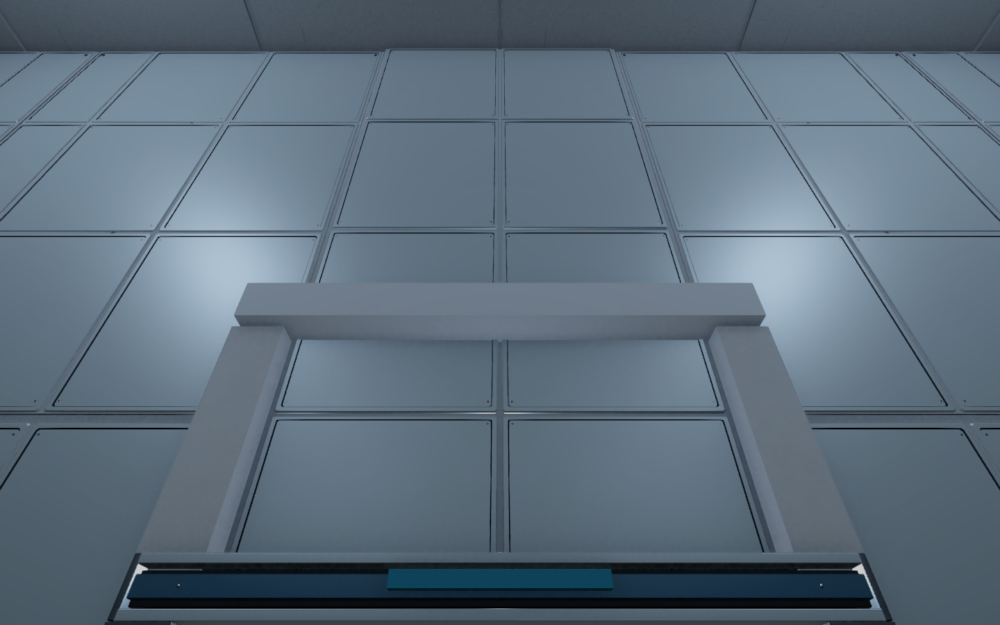
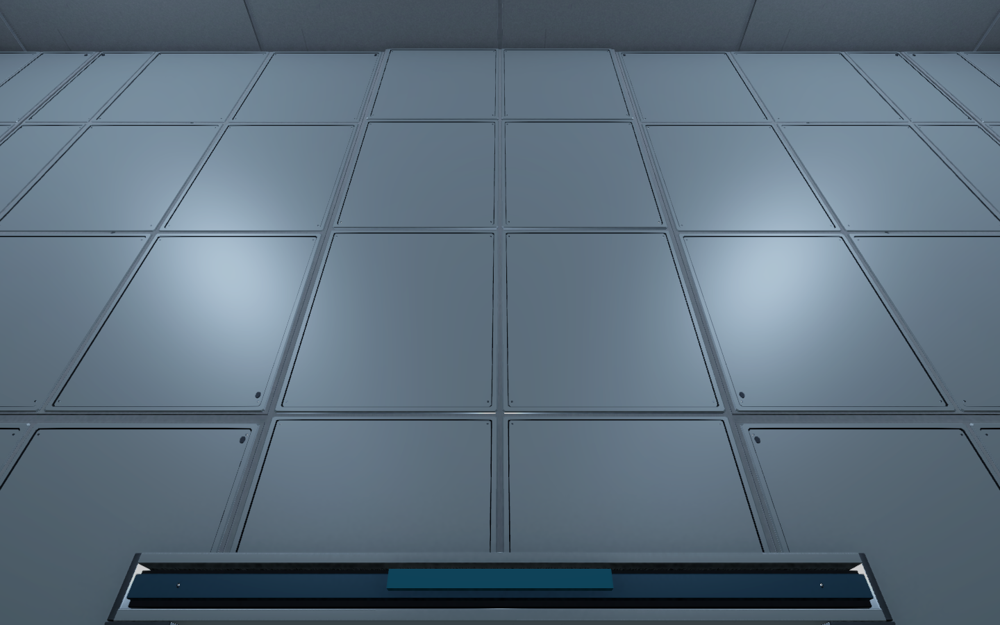

# After Seconds — 2026-11-05 이어하기 V0.09

## 집에서 시작할 순서

작성자 송예찬 · 메인 기획서 V0.17 · 2026-11-05 작업 인수인계

**현재 작업 대상은 새 `Level_B5_Stealth.unity`다.** 큰 연구소의 복도와 방을 탐색하며 출구를 찾고, 적의 감시를 피해 경로를 판단하는 잠입 레벨로 방향을 바꿨다. 새 6층 도면 중 B5를 별도 씬으로 제작하고, 사용자가 지적한 경비 얼굴·펌프·배관·난간·벽 이음과 마지막 FBX 자기 교차 경고까지 보수했다. 다음은 이 씬을 직접 걸어 보며 외형과 길 찾기를 검수하는 일이다.

1. 집 PC의 **After_Seconds 저장소 루트**에서 `git status --short --branch`로 미보존 작업과 브랜치를 확인하고 `main`에서 `git pull --ff-only`를 실행한다. 충돌이나 분기 상태이면 기존 작업을 보존한 뒤 통합하며 강제 reset으로 덮어쓰지 않는다.
2. 이 문서 상단 → [메인 기획서](AfterSeconds_메인기획서.md) → [B5 경로 비교 도면](도면/잠입_탐색/플레이어_예상이동/B5_경로비교.png) → [에셋 보수 사진](검수/2026-11-05_B5_AssetRepair/검수결과.md) → [경비 반입 경고 최종 검수](검수/2026-11-05_B5_AssetRepair/PolygonFix/검수결과.md) 순서로 읽는다.
3. Unity Hub에서 `Unity/After_Seconds_Build_V0.01`을 **Unity 6000.4.0f1**로 연다. URP는17.4.0이며 패키지·에디터 버전을 자동 변경하지 않는다. Library는 Git 대상이 아니므로 최초 반입 시간을 기다린다.
4. `Assets/Afrer_Seconds/01.Scenes/Stage/Level_B5_Stealth.unity`를 연다. `Level_B5_Isolation.unity`는 예전 공간 구성이다. 새 B5는 포드 탈출 후 검토 지점E에서 시작하며 포드 탈출 기능·B4 씬 전환은 아직 없다.
5. 아래 할 일의 첫 항목부터 사용자와 확인한다. **게임 내부 C#은 사용자가 질문하며 직접 작성한다.** 레벨 검수 요청을 AI·추격·자동 회전·Animator Controller·UI 구현 허가로 해석하지 않는다.

## 대화에서 확정한 방향

- 중심 경험은 건물의 복수 복도·지원실을 탐색하는 미로 같은 잠입이다. 적을 어떻게 피할지 고민하는 상황이 퍼즐 역할을 한다. 옛 방별 풀이와 우회 금지 조건을 새 평면에 일괄 적용하지 않는다.
- 경비는 추격, CCTV는 경비 호출, 연구원은 도주하면서 주변에 알림, 연구소장은 마지막 엔딩 역할이다. 현재는 외형과 검토용 배치만 있으며 이 동작들은 미구현이다.
- 예상 플레이어 경로는 [도면 복사본](도면/잠입_탐색/플레이어_예상이동/)에만 표시한다. Unity 경로선·미니맵은 UI/UX 단계에 별도로 논의한다. 제거한 큰 방 이름·퍼즐 정답·역할 설명 표지를 복구하지 않는다.
- 눈에 보이는 단단한 모서리에는 크기에 맞는 베벨을 넣고, UV·금속성·거칠기·연결부와 최적화까지 검수한다. VARCO 결과가 부족하면 Blender에서 보수한다. VARCO 작업 위치는 [After_Second_Env_and_Props_Ver0.03](https://3d.varco.ai/flow/8f7100a4-a7df-488b-81ee-0c2ac6ae60d8)이다.

## 현재 사용 중인 결과물

| 대상 | 최신 파일과 상태 |
| --- | --- |
| 새 B5 | `01.Scenes/Stage/Level_B5_Stealth.unity`, 48×32m 가안. 지원실 내부·복수 복도·냉각 피트·계단A 포함 |
| 건축 | `05.Model/Environment/B5/B5_Stealth_ArtRepair.fbx`, 편집 원본 `SourceAssets/B5_StealthLayout/B5_StealthLayout_ArtRepair.blend` |
| 경비3개 | `05.Model/Enemy/AS_V03_Guard_HeadRepaired.prefab` 및 같은 이름의FBX. 실제 얼굴·목 연결부·투명 바이저·프레임, 53본 리그. 1개37,317tri |
| CCTV | `05.Model/Enemy/CCTV_SecurityCamera_Articulated.prefab`. Fixed_Base → Pan_Yaw(로컬Y) → Head_Tilt(로컬X), 자동 동작 없음 |
| 펌프 | North/South의 `VisualNormalization` 로컬X=-90°(Inspector270°). 루트 방향 North180°/South0° 유지, 바닥 접지 |
| 배관과 난간 | 공급·회수 관 분리, 포트 연결·플랜지12곳. 연속 난간과 지지18곳, 몸체/연결부 재질 구분 |
| 벽 이음 | 큰 돌출 덧댐과 과도한 리브를 얕은 패널 조인트로 보수. 서비스 패널 테두리는 연속 고리 |
| 최신 수치 | B5 최고 LOD 배치965,421tri, 건축195,416tri, Collider262개, 소품LODGroup25개. NPC LOD는 없음 |

위 `01.Scenes`·`05.Model` 경로는 Unity의 `Assets/Afrer_Seconds/` 기준이다. `SourceAssets`는 저장소 루트 기준이며 Unity Assets 밖의 편집 원본이다. 오래된 Lite/WallVariants/원본 경비는 보존 자료다. 이전 생성기나 Apply 도구를 최신 씬에 그대로 재실행하지 않는다. 경비의 편집용 베벨은 Blender의 숨긴 `Editable_Modifier_Sources`에 있고, 출력용 메시만 삼각화했다.

## 다음 할 일

- [ ] **새 B5 사용자 검수:** G2_CoolingNorth 경비의 얼굴·바이저 안쪽, 두 펌프의 접지와 포트, 배관 중앙과 플랜지, 계단 중간참 난간, 벽 조인트를 실제 이동 시점에서 확인한다. 추가 수정 위치는 오브젝트 이름과 함께 남긴다.
- [ ] **탐색 동선 확인:** 도면A/B/C를 따라 복도 구분·막다른 길·문 너머 공간·엄폐 밀도·출구 발견 흐름을 확인한다. 냉각조의 기존 남→북 교환 구상은 계단에서 멀어지는 문제와 적 배치를 함께 재설계한다.
- [ ] **성능 측정:** 집 PC에서 실제 이동 중 FPS·프레임 시간·그림자 비용을 측정한다. 현재 메시에 대한 감면 수치는 FPS 검증이 아니다. 필요할 때 NPC LOD와 정적 배치 비용을 검토한다.
- [ ] **층간 계획:** 계단A의 상승7.8m/40단은 가안이다. B4의 층고·출입 위치·전환 방식부터 맞춘 뒤 B4 이상을 새 평면 기준으로 제작한다. 새 설계가 실제 적용된 층은 B5뿐이다.
- [ ] **게임 기능은 사용자 요청 이후:** 계층·Define 분석 → 의사코드 → 사용자가 코딩 → 주석 순서로 진행한다. 경비 감지/추격, CCTV 호출, 연구원 도주/알림, 예약/교환, 포드 탈출, 문·층 전환, NPC 애니메이션이 남아 있다.
- [ ] **기획 검증과 완주:** 손의 힘 A/B안·새 적의 교환 판정·경보 수치·체크포인트·탄약을 비교하고, 기능이 연결된 뒤 실제 잠입 완주와 난이도를 검증한다. 현재 단순 통행 검사를 게임 완성으로 해석하지 않는다.

## 검증과 보존 범위

경비 FBX 강제 재반입 경고/오류0건, 리그·재질·경비3개 연결을 확인했다. 경로817개 표본 막힘0건과 기존 CharacterController의 A/B/C 통행·계단 보행을 확인했지만, 전체 잠입 플레이와 FPS는 아직 검증하지 않았다. Console에 남은 과거 자기 교차 경고와 수정 후 새 경고를 구분한다. Unity AI Assistant의 `NoSubscription`은 생성 서비스 구독 오류이며 이번 메시 반입 경고와 별개다.

이번 Git 동기화에는 새 레벨뿐 아니라 앞선6층 표지24개 비활성화와 구 B5의 `JC_*` 접합부8개 보수도 포함한다. 새 B5 제작과 후속 에셋 보수는 그 상태의 원본6씬을 보존했다. 사용자 포드 로컬 위치 `(0,0,10.32)`·스케일 `(3,2,3)`·천장 방향을 유지한다. 게임 `.cs`·Animator Controller·Packages에는 이번 작업 변경이 없다.

함께 있던 로컬 설정도 현재 상태로 보존한다. `PC_RPAsset`의 주/추가 광원 그림자 맵4096, `InputSystem_Actions.inputactions`의 Interact/Crouch/Jump `expectedControlType` 빈 문자열 변경이 포함된다. 제작 도구가 바꾼 게임 로직으로 설명하지 않으며, 집에서 입력·성능을 확인한다.

집에서 열기 위한 씬·에셋·`.meta`·도면·검수 결과·Blender 원본과 생성기는 Git에 함께 보관한다. Blender 원본10개의 이미지 참조는 내장 또는 저장소 내부 상대경로이며 외부 링크 라이브러리는 없다. 7개 Stage 씬의 Unity Assets 의존파일987개와 `.meta`도 확인했다. [동기화 전 검사](검수/2026-11-05_HomeHandoff/검사결과.json)를 참고한다. 학원 PC의 `Management` 임시 도구/백업과 채팅 원문은 Git으로 전송되지 않으며, 이어갈 맥락은 이 문서에 기록한다.

다음 세션에 전달할 문장:

> After_Seconds의 AGENTS.md, CLAUDE.md와 Docs/이어하기_2026-11-05.md 상단을 읽고 최신 상태와 남은 할 일을 확인해줘. 작업 씬은 Level_B5_Stealth이고, 먼저 경비 얼굴·펌프·배관·난간·벽 이음과 탐색 동선을 검수해줘. 게임 내부 C#은 내가 질문하며 직접 작성할 거야.

## 이전 작업 기록

아래는 제작 순서에 따른 이력이다. 파일명·수치·미커밋 여부가 다르면 위 인수인계의 최신 상태를 우선한다.

## 최신 후속 · 경비 FBX 자기 교차 경고 수정

작성자 송예찬 · 메인 기획서 V0.17

경비 보수본을 강제 재반입해 자기 교차 경고5건을 재현하고, 베벨/두께 적용 후 명시 삼각화·면적 없는 삼각형4개 정리·웨이트 정규화로 수정했다. 수정 후 강제 반입 경고/오류0건이다. 경비는37,317tri, B5 최고 LOD965,421tri이며 리그/재질/경비3개 연결을 유지했다. 씬·게임 코드·원본 NPC 등56개 파일과 FBX .meta/GUID는 보존했다.

`repair_guard_head.py` V0.03은 편집용 베벨을 숨긴 `Editable_Modifier_Sources`에 보존하고, 검증한 삼각형 메시만 출력한다. [반입 경고 검수와 사진](검수/2026-11-05_B5_AssetRepair/PolygonFix/검수결과.md)을 먼저 본다. 아래 최초 에셋 보수의37,297tri/965,361tri는 경고 수정 전 단계다.

---

## 최신 후속 · 경비 얼굴·펌프·배관·난간·벽 이음

작성자 송예찬 · 메인 기획서 V0.17

사용자가 지적한 에셋 문제를 보수했다. 활성 건축은 `B5_Stealth_ArtRepair.fbx`, 경비는 `AS_V03_Guard_HeadRepaired.prefab`이다. 경비 얼굴을 실제 형상과 투명 바이저로 분리하고 목 연결부·헬멧 고정부를 만들었다. 기존 연구원 머리 형상/UV를 재사용했고53본 리그·경비3개의 자세/배치를 유지했다. 펌프2개는 VisualNormalization X=-90°로 베이스를 눕히고 바닥에 접지했다. 공급/회수 관은 중간 겹침을 없애고 측정한 상부/정면 포트에 연결했다. 플랜지12곳·연속 난간·지지18곳을 추가하고 큰 벽 이음 덧댐/리브를 얕은 실제 조인트로 바꿨다.

전체 최고 LOD965,361tri(보수 전959,687tri보다0.59% 증가), 건축195,416tri다. 경비1개37,297tri/SkinnedMesh4개이며 NPC LOD는 없다. 기존 충돌258개 유지, 펌프2개 보정, 입상관2개 추가로262개다. 경로817개 표본 막힘0·누락 참조0·보호 파일44개 해시 동일·비대상 Transform 변경0을 확인했다. 게임 C#·Animator Controller·UI는 작성하지 않았다.

[최신 검수와 사진](검수/2026-11-05_B5_AssetRepair/검수결과.md), `06.Data/AssetSources/B5_ArtRepair_20261105.json`을 먼저 본다. 이전 WallVariants/Lite와 원본 경비는 보존 자료이며 최신 씬에 다시 적용하지 않는다. 섀도 맵4096 설정은 제작 도구가 지정하지 않은 변화여서 보존했다. 아래 벽 마감 V0.06 기록은 후속 보수 전 상태다.

---

## 최신 후속 · B5 벽 구분과 금속 트림

작성자 송예찬 · 메인 기획서 V0.17

활성 건축은 `B5_Stealth_WallVariants.fbx`/`B5_StealthLayout_WallVariants.blend`다. 격리실은 위생 세로 패널, 설비실은 도장 강판·세로 리브, 직원실은 회벽·청록 하부판, 복도·코어는 콘크리트로 구분했다. `SL_WallTrim_*`600파트의 3~6mm 베벨을3분할로 보강하고 전용 브러시드 금속 맵과 FBX 미리보기 재질 remap을 적용했다. 천장 조명79개의 조사각만 넓혔으며 새 조명은 추가하지 않았다. 정적 반사7개는 미리 구운 Custom 큐브맵이다.

최고 LOD 전체959,687tri, 건축215,764tri/249 Renderer다. 벽 교체 직전949,363tri보다 약1.09% 늘었고 초기244만 대비 약60.66% 감면 상태다. 충돌체260개·주요 배치 동일, 경로817개 표본 막힘0, 누락 참조0, 기존6씬/meta·보호 소스19개 해시 동일을 확인했다. 게임 C#·AI·자동 회전·애니메이션 컨트롤러는 추가/수정0개다.

[전후 사진과 금속 근접 검수](검수/2026-11-05_B5_WallVariants/검수결과.md), `06.Data/AssetSources/B5_WallVariants_20261105.json`을 우선한다. 아래 Lite/949,363tri 기록은 벽 교체 전 단계다. 기본 건축 생성기나 이전 Apply 도구를 재실행해 최신 벽·트림 재질을 되돌리지 않는다. 다음 작업은 사용자가 현재 레벨을 확인한 뒤 원하는 게임 기능을 질문하며 직접 구현하는 순서다.

---

## 최종 후속 · 감면과 에너미 아트, 게임 코드는 사용자 작성

작성자 송예찬 · 메인 기획서 V0.17

사용자는 내부 C#을 질문하면서 직접 작성하기로 했다. 현재는 레벨과 아트만 제작하며 게임 스크립트를 추가/수정하지 않았다. `Level_B5_Stealth.unity`가 최신 별도 씬이다. 건축은 `B5_Stealth_Architecture_Lite.fbx`/`B5_StealthLayout_Lite.blend`, 소품은 원본 보존한 `_B5_Lite.prefab`과 L0/L1 모델을 사용한다. CCTV 교체 후 최고 LOD 전체 배치2,439,679→949,363tri(61.09% 감소), 소품 LODGroup25개다. 메모리 수치는 씬 참조 메시만 측정했으며 FPS 검증은 아니다.

경비28,623tri·연구원25,894tri는 구멍/비정상 면/미할당 웨이트/가중치 합계 오류0건과 임시 관절 포즈를 확인했다. 실제 애니메이션·AI는 없고 NPC LOD는 아직 없다. 자동 리깅 모델의 롱코트/허벅지 장비는 실제 애니메이션 클립을 붙일 때 다시 검토한다. CCTV는 Props의 기존 원본을 보존하고 Enemy의 `CCTV_SecurityCamera_Articulated.prefab`으로 새 B5에 배치했다. Fixed_Base 고정, Pan_Yaw 로컬Y, Head_Tilt 로컬X이며 검토 범위는 좌우±90°/상하±25°다. 검토 각도에서 고정 베이스 유지·헤드/지지물 교차0건을 확인했다. 회전·감지·호출 스크립트는0개다.

[최신 검수·비교 사진](검수/2026-11-05_B5_Stealth/검수결과.md)에 세부 수치, 인물 포즈, CCTV 피벗과 남은 범위를 기록했다. 원 도면과 원본6씬, 사용자 포드 로컬 Transform은 보존했다. 아래 이전 제작 기록은 당시 상태다.

---

## 최신 작업 · 도면 동선 복사본과 별도 B5 제작

작성자 송예찬 · 2026-11-05 · 메인 기획서 V0.16

[B5 예상 경로 비교](도면/잠입_탐색/플레이어_예상이동/B5_경로비교.png), [새 B5 검수와 사진](검수/2026-11-05_B5_Stealth/검수결과.md)을 먼저 본다. 아래 V0.03 설계 기록은 당시 상태다. 새 평면을 적용한 씬은 `Assets/Afrer_Seconds/01.Scenes/Stage/Level_B5_Stealth.unity` 하나다. 원본6개 씬과 사용자 포드의 로컬 위치·스케일은 보존했다. 도면의 예상 동선은 복사본18개와 비교 이미지에만 그렸고 Unity 경로선·미니맵·UI는 만들지 않았다.

새 씬은 48×32m 검토 치수로 방과 문 너머 직원 지원 공간, 북/서/중앙/남/동측 복도, 냉각 피트, 계단A를 연결했다. 새 건축은 Blender 베벨 메시이며 기존 VARCO 소품을 재사용했다. 사용자 지정 V03 flow에서 경비·연구원을 생성·리깅하고 Blender에서 예각 베벨·1.8m 크기·PBR를 정리했다. 현재 NPC는 정적 검토 포즈이며 Animator를 꺼 두었다. AI·애니메이션·감지·교환을 구현했다고 해석하지 않는다.

실제 W 입력으로 격리실 문을 통과했고 프레임104→529 진행과 약3.28m 이동을 확인했다. A/B/C는 기존 CharacterController로 모두 통행했고 계단A 상부7.8m까지 올랐다. 문22개 개방/3개 잠금, 누락 참조0건을 확인했다. 전체 잠입 완주·난이도·FPS 검증은 아니다. 포드 탈출은 미구현이므로 검토 시작은 도면E다. 계단 상승7.8m·40단은 가안이며 B4 전환은 없다. 냉각조의 기존 남→북 교환 표시는 계단에서 멀어져 방향·적 위치 후속 설계가 필요하다. 상세 수치와 보존 결과는 검수 자료를 따른다.

다음은 사용자가 새 씬을 직접 걸어 보며 길 찾기와 방 밀도를 확인한 뒤, 의사코드→코딩→주석 순서로 적의 감지·추격·도주/알림을 구현한다. 새 에셋 출처는 `06.Data/AssetSources/B5_Stealth_20261105.json`, Blender 원본은 `SourceAssets/B5_StealthLayout/`이다. 이 제작 단계 당시에는 Git 커밋·푸시 전이었다.

---

## 최신 설계 변경 · 잠입과 탐색

작성자 송예찬 · 2026-11-05

사용자는 큰 건물의 복도와 방을 탐색하며 출구를 찾고, 경비·CCTV를 어떻게 피할지 판단하는 잠입을 중심으로 원했다. 경비는 추격, CCTV는 경비 호출, 연구원은 도망가며 주변에 알림, 연구소장은 엔딩 역할로 정했다. 설계도 수정 요청에 맞춰 메인 기획서V0.15와6층 평면 V0.01을 제작했다.

[전체층 미리보기](도면/잠입_탐색/전체층_잠입.png), [B5 상세](도면/잠입_탐색/B5_격리층_잠입.svg), [좌표·문·적 배치](도면/잠입_탐색/layout.json), [평면 검사](도면/잠입_탐색/validation.json)를 먼저 본다. 지원실 내부·직원 복도·복수 경로·순찰·CCTV 범위·연구원 도주로·층간 출입 위치를 표시했다. 기존1~10번 SVG는 기믹 검증 원안이다. 우회 금지·일반 문마다 방 분리·자동 탄약 보충 기준을 개정했다.

새 도면의48×32m 외곽·방 치수·문 폭·적 배치는 모두 가안이다. 방/문 인접·정적 보행·연구원 피난 연결을 검사했으며 Unity 충돌·시야·경보·추격·층간 단면·실제 플레이·난이도는 미검증이다. B5 보행 검사는 포드 탈출 후E부터,1F 목표는 외부 전실T까지다. 포드 탈출과 마지막 소장Z 교환은 별도 검증한다. A/B 손 힘·새 적의 교환 판정·경보 수치·체크포인트·탄약은 미확정이다.

이번 작업은 설계 문서·SVG·PNG·좌표 자료만이다. 현재6개 Unity 씬과 포드·배관·앞선 시각 메시/표지 보수는 보존했다. 다음은 기존 씬을 보존한 별도 B5 그레이박스 → 보행/길 찾기 → 경비/CCTV/연구원 → 교환 통합 → 실제 플레이 → 수정 순서다. 현재 씬이 새 도면대로 구현됐다고 해석하지 않는다.

---

작성자 송예찬 · Unity 6000.4.0f1

## 현재 변경

사용자가 큰 방 이름·번호와 퍼즐 풀이 설명 표지를 제거하고 최소 시설 표식만 남기는 방향을 승인했다. 메인 기획서V0.14의7.1에 반영했으며 B5~1F 원본6개 씬에서 표지24개를 비활성화했다. 원본 표지 에셋은 보존했다. 방 이름 UI는 보류하며 새 UI나 게임 기능은 구현하지 않았다.

| 층 | 비활성 표지 | 유지 표지 |
| --- | ---: | --- |
| B5 | 8 | S-03 식별, NORTH STAIR |
| B4 | 4 | 없음 |
| B3 | 4 | 화물 리프트 방향 |
| B2 | 3 | RESTRICTED / NO BRIDGE 위험 안내 |
| B1 | 2 | 1F 비상계단 방향 |
| 1F | 3 | 실제 외부 출구 |

저장 씬을 다시 열어 실제 표시 상태를 확인했다. [표지 정리 검수](검수/2026-11-05_Sign_Cleanup/검수결과.md)의 사진과 검증 범위를 따른다. 이전 문서의 표지30곳 제작·문구 보존 기록은 당시 검수 이력이다. 사용자 결정으로 비활성화한 설명 표지를 다시 활성화하지 않는다.

## 이어서 확인할 것

1. B5부터 실제 이동하며 설명 표지를 뺀 상태의 시야·길 찾기를 확인한다. 실제 플레이 테스트는 아직 하지 않았다.
2. B5 입구 천장·측벽 돌출과 냉각실 서쪽 벽4곳의 패널 방향은 아래 후속 보수에서 수정했다. `JC_*` 파생 메시를 이전 WF/AD 메시로 되돌리지 않는다.
3. B4 관측 데크·계단, B3 선반 단상·포획 구역, B2 제어 단상·구덩이·사다리, B1 구덩이·계단, 1F 외부 출입구 일부는 기본 외형이다. 제작 범위부터 정한다.
4. 공용 덕트 연결 테두리, B1 소형 계측기의 작은 형상은 후속 품질 과제다. 이전 마감 메시를 원본FBX로 되돌리지 않는다.
5. 게임 기능은 계층·Define 분석 → 의사코드 → 코딩 → 주석 순서로 이어간다. 예약·교환·경비 핵심 기능과 전체 퍼즐 완주·난이도·성능 검증은 아직 남아 있다.

B2 원심분리실의 큰 방 이름 표지가 배관에 가리던 문제는 해당 표지를 비활성화하면서 현재 화면에서 해소됐다. 배관을 옮기거나 기존 연결 관망을 되돌리지 않았다.

## 후속 접합부 보수

사용자가 시작 화면의 `Ceiling_EntryLeg` 돌출을 지적하고 비슷한 접합부 검수·정리를 요청했다. B5 에어록 입구 천장과 측벽2곳의 시각 메시를 방 벽 뒤로 마감했다. 통로 천장 하단4m와 기존 방향을 유지하고 입구·출구 천장을 중앙 천장과 겹치지 않는 구간으로 나눴다. 출구 천장의 냉각실 방향 돌출도 방 경계에 맞췄다. 냉각실 서쪽 벽4곳의 패널은 벽 중심을 기준으로 반사해 실내 쪽으로 배치했다.

`05.Model/Environment/B5/JC_*.asset`8개를 만들고 B5 씬의 MeshFilter 참조8곳만 바꿨다. 원본 WF/AD 메시·FBX·meta, 전체 Transform·Collider·Behaviour·기존 표지 상태는 보존했다. 다른5개 층의 씬은 이번 접합부 작업 직전 사본과 동일하다. URP가 저장 중 자동 정규화한 재질5개는 작업 전 파일로 복원했다.

저장 씬 재개방 후 메시8개 경계·참조와 누락 스크립트/메시/재질0건, 시작·근접·통로 안쪽·냉각실 방향·서쪽 패널 등7시점 렌더를 확인했다. 수정 외 컴포넌트3,109개 보존과 디스크의 메시 참조 이외 변경 없음 검사를 통과했다. 실제 키보드 이동·전체 퍼즐 완주·FPS 검수는 이번에 하지 않았다. 다른 층은 접속부 메시 범위를 조사했으며 전층 외형 무결성이나 도면 전체 구현 완료를 뜻하지 않는다.

[수정 목록](검수/2026-11-05_Junction_Cleanup/repair_result.json), [저장 후 검증](검수/2026-11-05_Junction_Cleanup/verification.json), [씬 보존 비교](검수/2026-11-05_Junction_Cleanup/disk_preservation.json), [패널 가림 검사](검수/2026-11-05_Junction_Cleanup/west_wall_verification.json)를 보관했다. 통로 안쪽에서 보이는 작은 검은 모서리는 레이 검사상 `Airlock_Lamp_Cross/Housing`의 끝이며 천장 구멍으로 판단해 삭제하지 않았다.

| 보수 전 | 보수 후 |
| --- | --- |
|  |  |

## 전체층 도면과 현재 구현의 차이

사용자는 문 뒤 공간이 없으며 전체 설계도대로라면 그 공간도 구현해야 한다고 지적했다. 현재 씬은 퍼즐 방1~10 중심의 부분 구현이다. 전체층 평면도의 지원실·직원 동선·공용 코어까지 구현 완료한 상태가 아니다. 이 차이를 문 상호작용 미구현이나 불필요한 장식문으로만 설명하지 않는다. 이번 작업에서 문이나 공간을 제거·추가하지 않았다.

| 층 | 현재 제작 범위 | 전체층 시안과 비교해 남은 공간 |
| --- | --- | --- |
| B5 | 격리실·냉각조·차폐 통로·계단 하부 | 경비 초소·모니터링·유틸리티는 잠긴 전면 외형만 있음. 지원실 내부·직원 통로·층간 연결은 미완성 |
| B4 | 관찰 복도·관제 데크·계단 외형 | 관찰 지원실·데이터 분석실의 독립 실내, 직원 동선 |
| B3 | 시료 저장고·제염 에어록·리프트 외형 | 냉동 보관실·시료 전처리실·폐기물 보관실·직원 환복실 |
| B2 | 원심분리기 홀·관제 섬·해치 외형 | 전기실·기계 설비 복도와 공용 코어 연결 |
| B1 | 피험 챔버·퍼즐 부스·계단 외형 | 사전 준비 실험실·기록 보관실·도면의 북/남 관찰 구획 |
| 1F | 검문소·마지막 구덩이·외부 착지 구역 | 물류창고 전체 구획·사무실·직원 탈의실·하역장 전체 |

위 비교는 [전체층 시안](도면/연구소_전체_시안/02_전체층_평면도_V0.01.png), 그 폴더 README, 층별 레벨 구성 문서와 현재6개 씬의 구성 목록을 기준으로 한다. 개념 이미지의 문 개수·48×32m·추가 셀 수를 확정 치수로 복제하지 않는다. 전체 구현 시에는 기존 방별 SVG·좌표와 퍼즐 우회 방지를 유지하면서 지원 공간·직원 통로·계단·리프트·샤프트를 실내 평면으로 구체화하고, 문 뒤 공간과 실제 층 전환 기능을 각각 검수해야 한다. B5의 과거 제작 범위5번에 지원 구역을 배경 외형으로 제한한 기록이 있지만, 이를 전체층 도면 구현 완료의 근거로 쓰지 않는다.

## 유지할 기준

- B5 사용자 포드 위치·스케일과 천장 방향, 기존Transform·Collider·게임 스크립트·Animator·Packages는 유지한다.
- Unity/URP/AI Assistant 버전을 자동으로 올리지 않는다.
- 안내가 부족한 지점은 플레이 테스트에서 확인하고 필요한 순간의 UI를 검토한다. 모든 표지를 UI로 일괄 이동하지 않는다.
- 원래 환경·소품 제작 상태와 이전 검수 범위는 [11월4일 이어하기](이어하기_2026-11-04.md)를 함께 읽는다.
- 이 기록은 Git 동기화 전 제작 이력이다. 집에서 이어가는 현재 절차와 범위는 문서 상단을 따른다.
